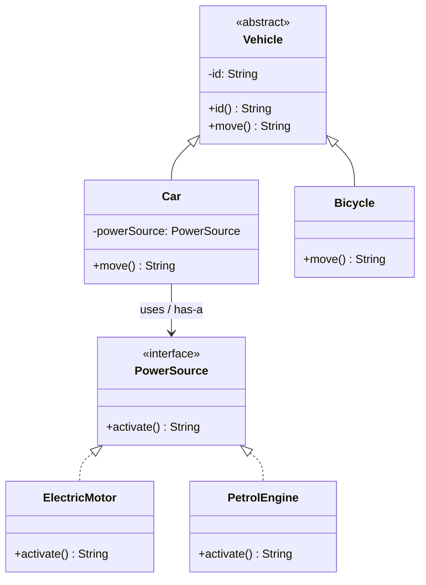
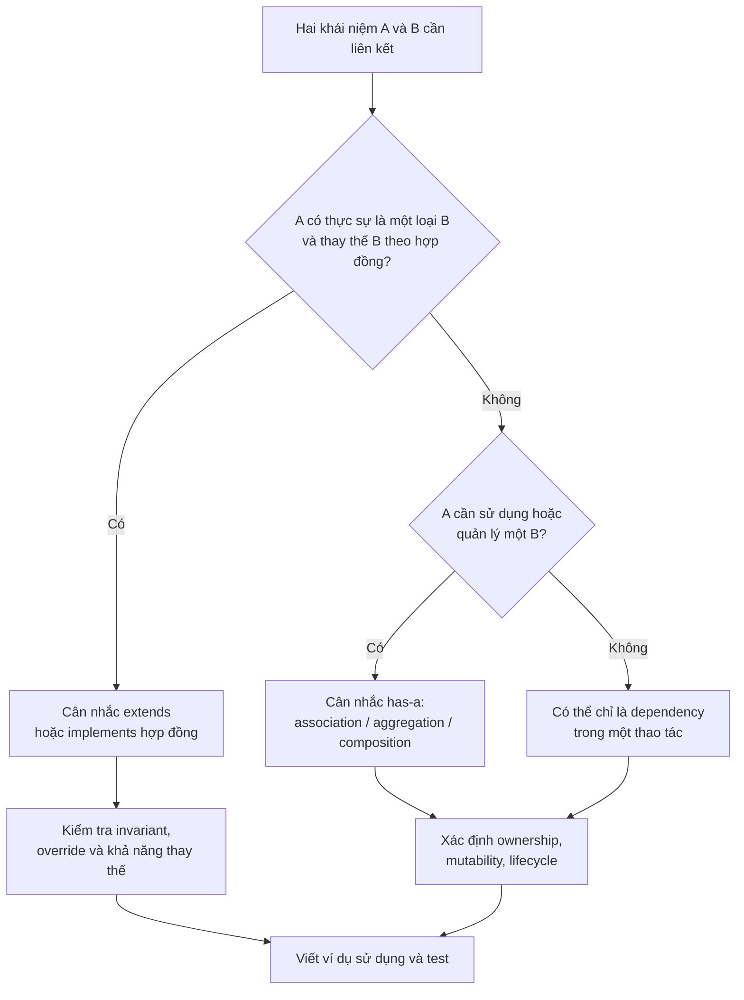

# Quan hệ “có một” (has-a) và quan hệ “là một” (is-a) trong Java OOP

Khi thiết kế các lớp, một trong những quyết định quan trọng nhất là **nối chúng với nhau bằng quan hệ nào**. Hai quan hệ dễ gặp là:

- **Is-a — “là một”:** một đối tượng thuộc một kiểu tổng quát hơn. Ví dụ: *ô tô là một loại phương tiện*. Trong Java, quan hệ kiểu con thường được biểu diễn bằng `extends` hoặc `implements`.
- **Has-a — “có một”:** một đối tượng giữ hoặc sử dụng một đối tượng khác như một phần cấu trúc hay khả năng của nó. Ví dụ: *ô tô có một hệ thống truyền động*. Trong Java, điều này thường được thể hiện bằng **field tham chiếu**, kết hợp đối tượng (*composition*) hoặc các hình thức association/aggregation phù hợp.

Hai quan hệ không loại trừ nhau: **`Car` có thể `extends Vehicle` và đồng thời chứa một `PowerSource`**.

Điều quan trọng không phải chọn cú pháp nào ngắn hơn, mà là biểu diễn đúng **ý nghĩa nghiệp vụ, quyền sở hữu trạng thái, khả năng thay thế và vòng đời**.

## 1. So sánh trực tiếp is-a và has-a

| Câu hỏi | Is-a — “là một” | Has-a — “có một” |
|---|---|---|
| Bản chất | Phân loại, chuyên biệt hóa hoặc thực hiện hợp đồng kiểu | Liên kết, chứa hoặc sử dụng thành phần |
| Cách diễn đạt | “Mỗi `Car` đều là một `Vehicle`” | “Mỗi `Car` có/được cấp một `PowerSource`” |
| Cơ chế Java phổ biến | `extends`, `implements` | Field, constructor injection, tạo thành phần nội bộ |
| Mục tiêu | Sử dụng đối tượng lớp con ở vị trí yêu cầu kiểu cha/hợp đồng | Tạo hành vi từ việc phối hợp các đối tượng có trách nhiệm riêng |
| Đối tượng runtime | Một instance của lớp con có phần trạng thái lớp cha | Các thành phần là những đối tượng riêng có tham chiếu liên kết |
| Tái sử dụng | Kế thừa hành vi hợp lệ hoặc cung cấp cùng API | Ủy quyền (*delegation*) cho thành phần |
| Mức gắn kết | Lớp con phụ thuộc chặt hơn vào hợp đồng lớp cha | Có thể thay thế thành phần qua interface |
| Sai lầm thường gặp | Kế thừa chỉ để “mượn” một hàm tiện ích | Hiểu rằng cứ có field tham chiếu là sở hữu độc quyền thành phần |

**Quy tắc kiểm tra nhanh:**

- Nếu câu **“X là một loại Y”** đúng trong ngữ nghĩa nghiệp vụ **và X có thể được sử dụng thay Y mà không vi phạm hợp đồng**, cân nhắc is-a.
- Nếu câu **“X sử dụng/giữ một Y để làm công việc của X”** đúng, cân nhắc has-a.
- Nếu chỉ thấy hai lớp có vài dòng code giống nhau, điều đó **chưa đủ** để kết luận chúng cần quan hệ is-a.

## 2. Ví dụ Java hoàn chỉnh: ô tô vừa “là một” vừa “có một”

Chúng ta xây dựng một mô hình nhỏ:

- Mọi phương tiện đều có mã định danh và hành vi `move()`.
- `Car` và `Bicycle` là các loại `Vehicle`.
- `Car` có một thành phần `PowerSource`; loại nguồn động lực được truyền vào khi tạo ô tô.
- `Bicycle` không cần `PowerSource` trong mô hình này.

File `RelationsDemo.java` (Java 11+):

```java
import java.util.List;
import java.util.Objects;

public class RelationsDemo {

    // Hợp đồng cho thành phần cung cấp động lực.
    interface PowerSource {
        String activate();
    }

    static final class ElectricMotor implements PowerSource {
        @Override
        public String activate() {
            return "mô-tơ điện đã sẵn sàng";
        }
    }

    static final class PetrolEngine implements PowerSource {
        @Override
        public String activate() {
            return "động cơ xăng đã khởi động";
        }
    }

    // Lớp tổng quát: thể hiện quan hệ is-a của các phương tiện.
    static abstract class Vehicle {
        private final String id;

        protected Vehicle(String id) {
            if (id == null || id.isBlank()) {
                throw new IllegalArgumentException("Mã phương tiện rỗng");
            }
            this.id = id.strip();
        }

        public final String id() {
            return id;
        }

        public abstract String move();
    }

    static final class Car extends Vehicle {
        // Has-a: Car giữ một tham chiếu PowerSource.
        private final PowerSource powerSource;

        public Car(String id, PowerSource powerSource) {
            super(id);
            this.powerSource =
                    Objects.requireNonNull(powerSource, "powerSource");
        }

        @Override
        public String move() {
            // Car ủy quyền một phần công việc cho thành phần.
            return "Car " + id() + ": " + powerSource.activate()
                    + " -> di chuyển";
        }
    }

    static final class Bicycle extends Vehicle {
        public Bicycle(String id) {
            super(id);
        }

        @Override
        public String move() {
            return "Bicycle " + id() + ": đạp bằng sức người";
        }
    }

    public static void main(String[] args) {
        Vehicle electricCar =
                new Car("CAR-01", new ElectricMotor());

        Vehicle petrolCar =
                new Car("CAR-02", new PetrolEngine());

        Vehicle bicycle = new Bicycle("BIKE-01");

        List<Vehicle> fleet = List.of(
                electricCar, petrolCar, bicycle
        );

        for (Vehicle vehicle : fleet) {
            System.out.println(vehicle.move());
        }
    }
}
```

Chạy:

```bash
javac RelationsDemo.java
java RelationsDemo
```

Kết quả:

```text
Car CAR-01: mô-tơ điện đã sẵn sàng -> di chuyển
Car CAR-02: động cơ xăng đã khởi động -> di chuyển
Bicycle BIKE-01: đạp bằng sức người
```

### Chỉ ra hai quan hệ trong cùng chương trình

**Is-a:**

```java
static final class Car extends Vehicle { ... }
static final class Bicycle extends Vehicle { ... }
```

Một biến khai báo kiểu `Vehicle` có thể tham chiếu đến `Car` hoặc `Bicycle`:

```java
Vehicle vehicle = new Car("CAR-03", new ElectricMotor());
System.out.println(vehicle.move());
```

`Vehicle` quy định rằng phương tiện có hành vi `move()`. Java chọn implementation `Car.move()` theo kiểu thực tế của đối tượng. Đây là **đa hình** dựa trên quan hệ is-a.

**Has-a:**

```java
private final PowerSource powerSource;
```

`Car` **giữ một thành phần** đáp ứng hợp đồng `PowerSource`. Khi di chuyển, `Car` gọi `powerSource.activate()`, tức **ủy quyền** công việc cho một đối tượng khác.

Thay `ElectricMotor` bằng `PetrolEngine` không yêu cầu `Car` thay superclass hoặc sao chép thuật toán khởi động của từng loại động cơ. `Car` cũng không phải một `PowerSource`: ô tô **sử dụng** nguồn động lực, chứ bản thân nó không phải một loại động cơ trong mô hình này.

### Sơ đồ quan hệ



Trong sơ đồ:

- Mũi tên kế thừa `Vehicle <|-- Car` cho thấy **Car là một Vehicle**.
- Đường `Car --> PowerSource` cho thấy **Car giữ và sử dụng PowerSource**.
- Các đường từ `ElectricMotor`, `PetrolEngine` đến `PowerSource` cho thấy **mỗi loại động cơ thực hiện hợp đồng PowerSource**.

Sơ đồ cố ý dùng một **association có hướng** giữa `Car` và `PowerSource`, chưa khẳng định Car sở hữu độc quyền toàn bộ vòng đời nguồn động lực. Chúng ta sẽ phân biệt điều đó ở phần sau.

## 3. Is-a phải đúng cả về hợp đồng, không chỉ đúng tên gọi

Viết `extends` khiến Java chấp nhận quan hệ kiểu con về mặt cú pháp (nếu lớp cha có thể được kế thừa), nhưng **không tự chứng minh mô hình nghiệp vụ đúng**.

Ví dụ thiết kế sai:

```java
class Engine {
    void ignite() {
        System.out.println("Ignite");
    }
}

// Không nên:
// class Car extends Engine { ... }
```

Ô tô cần động cơ không có nghĩa **ô tô là một động cơ**. Nếu kế thừa như vậy chỉ để gọi `ignite()`, `Car` sẽ thừa hưởng API của `Engine` như thể người dùng có thể thay một động cơ bằng cả ô tô. Đó là một quan hệ phân loại sai.

Tương tự:

```java
// Các quan hệ thường không phản ánh đúng nghiệp vụ:
// class Order extends Customer { ... }
// class Library extends Book { ... }
// class House extends Door { ... }
```

Trong các ví dụ đó, có thể diễn đạt hợp lý hơn bằng field:

```java
class Order {
    private final Customer customer;

    Order(Customer customer) {
        this.customer =
            java.util.Objects.requireNonNull(customer, "customer");
    }
}
```

Một đơn hàng **thuộc về/có liên kết tới một khách hàng**; nó không **là một khách hàng**.

### Kiểm tra bằng khả năng thay thế

Giả sử code xử lý bất kỳ `Vehicle` nào:

```java
static void startTrip(Vehicle vehicle) {
    System.out.println(vehicle.move());
}
```

Cả `Car` và `Bicycle` đều thực hiện `move()` theo hợp đồng đã xác định, nên thay thế được ở đây:

```java
startTrip(new Car("CAR-04", new ElectricMotor()));
startTrip(new Bicycle("BIKE-02"));
```

Đó là ý tưởng của **Liskov Substitution Principle**: nơi cần kiểu cha có thể làm việc với kiểu con mà không bị phá các kỳ vọng quan trọng về đầu vào, đầu ra và bất biến.

Ví dụ nếu `Vehicle.move()` cam kết trả chuỗi mô tả không rỗng cho phương tiện sẵn sàng, subclass không nên bất ngờ trả `null` chỉ vì thuật toán bên trong khác. Việc **đúng cú pháp kế thừa** chưa đủ; quan hệ kiểu con còn phải tôn trọng hợp đồng hành vi.

## 4. Has-a không chỉ có một hình thức

Trong giao tiếp hằng ngày, has-a mô tả chung việc một đối tượng **có hoặc sử dụng** một đối tượng khác. Trong UML/OOP, thường phân biệt thêm:

| Quan hệ | Ý nghĩa thiết kế | Ví dụ | Cách biểu diễn |
|---|---|---|---|
| **Association** (liên kết) | Một đối tượng biết hoặc tương tác với đối tượng khác | `Order` liên kết `Customer` | Field/tham số hoặc quan hệ qua ID, tùy mô hình |
| **Aggregation** (kết tập, quan hệ toàn thể–bộ phận lỏng) | Thành phần có thể tồn tại độc lập hoặc được chia sẻ | `Team` có nhiều `Player` | Thường lưu tham chiếu/collection, UML hình thoi rỗng khi dùng |
| **Composition** (hợp thành, sở hữu mạnh) | Thành phần được mô hình coi là thuộc toàn thể và phụ thuộc vòng đời/sở hữu của toàn thể | `Order` sở hữu các `OrderLine` trong một thiết kế cụ thể | API ngăn chia sẻ tùy tiện; UML hình thoi đặc khi cam kết sở hữu |
| **Dependency** (phụ thuộc sử dụng) | Chỉ cần thành phần để thực hiện một công việc, không nhất thiết lưu lâu | Phương thức nhận `Formatter` làm tham số | Tham số, biến cục bộ; UML đường phụ thuộc |

Không phải mọi field tham chiếu đều là **composition theo nghĩa sở hữu mạnh**. Ví dụ `Car` nhận một `PowerSource` từ bên ngoài: thành phần này có thể được một phần khác của chương trình giữ tham chiếu và quản lý. Vậy nên không thể suy ra “Car độc quyền sở hữu motor” chỉ từ:

```java
private final PowerSource powerSource;
```

Từ khóa `final` chỉ ngăn gán lại **field tham chiếu** sau khi hoàn tất khởi tạo hợp lệ; nó không ngăn bên ngoài giữ cùng đối tượng, không làm đối tượng thành phần bất biến, và không tự động quy định quyền sở hữu.

### Association so với composition: ví dụ đơn hàng

Một thiết kế có thể quyết định rằng **đơn hàng sở hữu các dòng hàng được chốt tại thời điểm đặt**. Khi đó, các dòng hàng là snapshot dữ liệu được quản lý bởi đơn hàng; không có API cho phép caller thay đổi chúng độc lập.

File `OrderCompositionDemo.java` (Java 17+):

```java
import java.util.List;
import java.util.Objects;

public class OrderCompositionDemo {
    record OrderLine(String sku, int quantity, long unitPriceVnd) {
        OrderLine {
            if (sku == null || sku.isBlank()) {
                throw new IllegalArgumentException("sku rỗng");
            }
            if (quantity <= 0) {
                throw new IllegalArgumentException("quantity phải dương");
            }
            if (unitPriceVnd < 0) {
                throw new IllegalArgumentException("Giá không được âm");
            }
            sku = sku.strip();
        }

        long subtotalVnd() {
            return Math.multiplyExact(unitPriceVnd, quantity);
        }
    }

    static final class Order {
        private final String id;
        private final List<OrderLine> lines;

        Order(String id, List<OrderLine> lines) {
            if (id == null || id.isBlank()) {
                throw new IllegalArgumentException("id rỗng");
            }

            this.id = id.strip();
            this.lines =
                List.copyOf(Objects.requireNonNull(lines, "lines"));

            if (this.lines.isEmpty()) {
                throw new IllegalArgumentException("Đơn hàng phải có hàng");
            }
        }

        long totalVnd() {
            long total = 0;
            for (OrderLine line : lines) {
                total = Math.addExact(total, line.subtotalVnd());
            }
            return total;
        }

        int lineCount() {
            return lines.size();
        }
    }

    public static void main(String[] args) {
        Order order = new Order("O-001", List.of(
            new OrderLine("BOOK-01", 2, 70_000L),
            new OrderLine("PEN-01", 3, 10_000L)
        ));

        System.out.println(order.lineCount()); // 2
        System.out.println(order.totalVnd());  // 170000
    }
}
```

Trong mô hình này:

- `Order` **có nhiều** `OrderLine`, không phải “Order là một OrderLine”.
- `List.copyOf(...)` tạo hoặc tái sử dụng danh sách không thể sửa qua API `List`, và từ chối các phần tử `null`.
- `OrderLine` là `record` chỉ chứa `String` và primitive; dữ liệu của nó bất biến theo thiết kế ví dụ. Vì vậy chia sẻ tham chiếu tới từng record không làm caller sửa được nội dung dòng hàng.
- `Order` không trả ra collection có thể sửa và không có setter cho danh sách dòng hàng.

Đây là **cách thiết kế diễn đạt quyền kiểm soát dữ liệu của Order**, phù hợp ý tưởng composition ở tầng domain. Dù vậy, bản thân Java không có cơ chế “xóa ngay mọi `OrderLine` khi Order bị giải phóng”, và các record bất biến có thể được chia sẻ an toàn. **Quan hệ sở hữu trong mô hình không đồng nghĩa vòng đời bộ nhớ phải được quản lý như C++**.

Nếu `OrderLine` là class mutable, chỉ `List.copyOf` **không đủ** để cô lập trạng thái từng phần tử: cần defensive copy sâu hơn, một immutable value object khác hoặc API giới hạn thay đổi.

## 5. Vòng đời đối tượng và quyền sở hữu: đừng suy luận từ garbage collector

Xét:

```java
Engine engine = new Engine();
Car car = new Car(engine);
```

Với các lớp `Engine` và `Car` tương thích, cả biến `engine` lẫn field `car.engine` có thể tham chiếu **cùng một đối tượng**.

Nếu biến `car` không còn được sử dụng, không thể kết luận `engine` biến mất ngay. Đối tượng thành phần vẫn còn tham chiếu riêng và việc thu hồi bộ nhớ do garbage collector quyết định.

Ở chiều ngược lại, nếu đối tượng thành phần đại diện tài nguyên như socket, file handle hoặc database connection, ta phải có **hợp đồng đóng tài nguyên** rõ ràng; không nên mặc định chỉ cần “cha mất thì con tự được đóng”.

Một lớp sở hữu tài nguyên có thể triển khai `AutoCloseable` và đóng thành phần theo hợp đồng riêng:

```java
interface Connection extends AutoCloseable {
    void send(String text);

    @Override
    void close();
}

final class Client implements AutoCloseable {
    private final Connection connection;

    Client(Connection connection) {
        this.connection =
            java.util.Objects.requireNonNull(connection);
    }

    void send(String message) {
        connection.send(message);
    }

    @Override
    public void close() {
        connection.close();
    }
}
```

**Lưu ý quan trọng:** `Client.close()` như trên ngụ ý `Client` **được quyền sở hữu và đóng** connection. Nếu connection được chia sẻ hoặc caller tự quản lý, tự động đóng trong `Client.close()` có thể gây lỗi. Cần quyết định và ghi rõ ai có trách nhiệm đóng; quyền sở hữu không tự suy ra từ việc có field tham chiếu.

## 6. Composition và delegation: tái sử dụng mà không cần extends

Kế thừa cho phép subclass dùng và override phương thức được kế thừa. Composition cho phép đối tượng **gọi một thành phần khác thực hiện một phần công việc**.

Ví dụ `Car.move()` đã gọi `powerSource.activate()`. Đây là delegation:

```java
final class Car extends Vehicle {
    private final PowerSource powerSource;

    // Constructor nhận PowerSource...

    @Override
    public String move() {
        return powerSource.activate() + " -> xe di chuyển";
    }
}
```

Sự phối hợp này đem lại các lợi ích:

- **Thay implementation độc lập:** `ElectricMotor` hoặc `PetrolEngine` có thể thỏa mãn cùng hợp đồng `PowerSource`.
- **Kiểm thử dễ hơn:** có thể cung cấp implementation giả để kiểm tra `Car` gọi đúng thành phần.
- **Trách nhiệm gọn hơn:** `Car` mô tả cách xe di chuyển, còn `PowerSource` mô tả cách kích hoạt nguồn động lực.
- **Không chiếm superclass:** `Car` vẫn có thể `extends Vehicle` trong khi dùng nhiều thành phần khác.

Ví dụ một test double đơn giản:

```java
PowerSource fake = () -> "nguồn giả lập sẵn sàng";
Vehicle testCar = new Car("TEST-01", fake);

System.out.println(testCar.move());
// Car TEST-01: nguồn giả lập sẵn sàng -> di chuyển
```

`PowerSource` là functional interface trong ví dụ, vì chỉ có một abstract method `activate()`. Cách truyền lambda này kiểm tra sự **hợp tác giữa các đối tượng**, không cần tạo superclass riêng chỉ phục vụ test.

### “Ưu tiên composition hơn inheritance” có nghĩa gì?

Đây là một lời khuyên **theo ngữ cảnh**, không phải quy tắc cấm kế thừa. Khi mục tiêu chủ yếu là tái sử dụng hành vi hoặc lựa chọn thuật toán, composition thường giảm ràng buộc hơn. Khi có quan hệ is-a đúng nghĩa và cần tính thay thế qua superclass hoặc interface, kế thừa/quan hệ kiểu con vẫn phù hợp.

Không nên chuyển mọi quan hệ is-a thành field “để không dùng extends”, cũng không nên biến mọi has-a thành extends chỉ để được gọi phương thức.

## 7. Interface có phải quan hệ “là một” không?

Về hệ thống kiểu của Java, nếu:

```java
interface Payable {
    long amountDueVnd();
}

class Invoice implements Payable {
    @Override
    public long amountDueVnd() {
        return 150_000L;
    }
}
```

thì một đối tượng `Invoice` có thể dùng ở nơi cần `Payable`:

```java
Payable item = new Invoice();
System.out.println(item.amountDueVnd()); // 150000
```

`Invoice` là **subtype của `Payable`** về mặt kiểu và hợp đồng. Nhưng khi diễn đạt tự nhiên, nên nói “Invoice **có khả năng được thanh toán**” hoặc “Invoice **thực hiện hợp đồng Payable**”, thay vì ép một phát biểu phân loại thế giới thực như “hóa đơn là một vật thanh toán” nếu cách nói đó không có ý nghĩa.

Vì vậy cần phân biệt:

- **Is-a trong phân loại domain**: `Car extends Vehicle`.
- **Subtyping theo khả năng/hợp đồng**: `Invoice implements Payable`.

Cả hai cho phép đa hình về kiểu, nhưng ngữ nghĩa thiết kế khác nhau. Khi nhiều loại đối tượng khác họ chia sẻ một khả năng, interface thường diễn đạt tốt hơn một superclass chứa trạng thái chung gượng ép.

## 8. Khi nào một đối tượng nên “có nhiều” thành phần?

Một tổ chức có thể có nhiều nhân viên, một đơn hàng có nhiều dòng hàng, một playlist có nhiều bài hát. Has-a không giới hạn ở đúng một đối tượng:

```java
class Playlist {
    private final java.util.List<Song> songs;

    Playlist(java.util.List<Song> songs) {
        this.songs = java.util.List.copyOf(songs);
    }
}
```

Quan hệ “có nhiều” được thể hiện bằng collection. Nhưng **collection không đủ xác định ý nghĩa sở hữu**:

- Playlist có thể chỉ **liên kết** tới những bài hát tồn tại độc lập.
- Order có thể **sở hữu snapshot** các dòng hàng theo thời điểm đặt đơn.
- Team có thể giữ danh sách người chơi nhưng người chơi vẫn có thể chuyển đội.
- Một đối tượng có thể dùng một service chung được inject và không sở hữu service đó.

Khi cần tài liệu hóa quan hệ, nên ghi thêm:

1. **Multiplicity:** một hay nhiều? Có bắt buộc phải có ít nhất một phần tử không?
2. **Ownership:** ai tạo, ai cập nhật, ai giải phóng tài nguyên?
3. **Mutability:** thành phần có thể đổi trạng thái và được chia sẻ không?
4. **Lifecycle:** thành phần có tồn tại độc lập với đối tượng chứa không?
5. **Direction:** bên nào cần biết bên nào? Có thực sự cần liên kết hai chiều không?

## 9. Sai lầm phổ biến khi chọn quan hệ

| Thiết kế | Vấn đề | Cách suy nghĩ lại |
|---|---|---|
| `Car extends Engine` | Ô tô không phải là động cơ | `Car` có/sử dụng `Engine` |
| `Order extends Customer` | Đơn hàng không phải một khách hàng | `Order` liên kết `Customer` |
| `PaymentService extends DatabaseClient` chỉ để gọi `save()` | Lẫn trách nhiệm nghiệp vụ với hạ tầng | Service chứa hoặc được inject repository |
| Mọi class dùng chung utility đều `extends BaseUtil` | Dùng kế thừa thay vì tái sử dụng chức năng | Utility, composition hoặc interface phù hợp |
| `Team` giữ `List<Player>` rồi kết luận sở hữu độc quyền `Player` | Field tham chiếu không chứng minh ownership | Xác định quy tắc chia sẻ và vòng đời |
| Field `private final Engine` nên nghĩ Engine bất biến | `final` chỉ cố định tham chiếu field | Xem tính mutable của Engine và đường truy cập ngoài |
| Kết luận component bị hủy ngay khi container không còn tham chiếu | Java không có destructor sở hữu bộ nhớ như vậy | Phân biệt domain lifecycle, GC và quản lý tài nguyên |
| Subclass vi phạm hợp đồng superclass | Có cú pháp is-a nhưng không thay thế an toàn | Thiết kế lại hierarchy hoặc dùng composition |
| Cứ có hai lớp liên hệ là phải dùng extends | Quan hệ liên kết không nhất thiết là phân loại | Hỏi “là một” hay “có/sử dụng một” |

### Một bài kiểm tra “is-a” bằng hành vi

Nếu hệ thống yêu cầu:

```java
void moveAnyVehicle(Vehicle vehicle) {
    System.out.println(vehicle.move());
}
```

liệu một đối tượng `Car` có thể được truyền vào mà vẫn đáp ứng cam kết của `Vehicle.move()`? Nếu có, quan hệ is-a đang có ý nghĩa.

Ngược lại, nếu hệ thống yêu cầu:

```java
void activateSource(PowerSource source) {
    System.out.println(source.activate());
}
```

truyền một `Car` vào không hợp lý trừ khi `Car` **thật sự tự cung cấp hợp đồng `PowerSource`**, điều khác với việc nó **giữ một `PowerSource`** trong field. Việc sử dụng một thành phần **không tự làm lớp chứa trở thành subtype của thành phần**.

## 10. Cách lựa chọn trong thiết kế thực tế



Một bộ câu hỏi ngắn khi review code:

- **Nếu bỏ quan hệ `extends`, đối tượng có mất ý nghĩa phân loại cần thiết không?** Nếu không, có thể kế thừa chỉ để dùng lại code.
- **Lớp A cần thay thành phần B bằng implementation khác không?** Nếu có, field kiểu interface và constructor injection có thể có ích.
- **Ai bảo đảm component hợp lệ?** Constructor lớp chứa nên kiểm tra tham chiếu bắt buộc; component tự bảo vệ invariant của mình.
- **Nếu component được chia sẻ, việc thay đổi nó ảnh hưởng những đối tượng nào?** Xác định chính sách chia sẻ, defensive copy hay bất biến.
- **Nếu component nắm tài nguyên, ai đóng?** Nêu hợp đồng sở hữu; cân nhắc `AutoCloseable` khi thích hợp.
- **Nếu lớp con thay thế lớp cha, có hành vi nào bất ngờ sai không?** Kiểm tra contract/LSP thay vì chỉ dựa vào cú pháp `extends`.

## 11. Bài tập kiểm tra

### Bài 1 — Chọn is-a hay has-a

Hãy phân loại các quan hệ sau:

| Quan hệ | Gợi ý đáp án |
|---|---|
| `Dog` và `Animal` | Is-a, nếu `Dog` đáp ứng hợp đồng `Animal` |
| `Library` và `Book` | Has-a (thư viện có sách); sách không phải một thư viện |
| `Invoice` và `Customer` | Has-a/association (hóa đơn liên quan khách hàng) |
| `Teacher` và `Employee` | Có thể is-a, tùy mô hình nghiệp vụ |
| `MusicPlayer` và `AudioDecoder` | Has-a/uses-a: trình phát dùng bộ giải mã |
| `CreditCardPayment` và `PaymentMethod` | Kiểu con qua `implements` nếu `PaymentMethod` là interface hợp đồng |

Không có đáp án chỉ từ tên lớp cho mọi hệ thống: hãy nêu giả định nghiệp vụ và trách nhiệm tương ứng.

### Bài 2 — Có biên dịch không?

```java
interface Engine {
    void start();
}

class PetrolEngine implements Engine {
    @Override
    public void start() {}
}

class Car {
    private final Engine engine;

    Car(Engine engine) {
        this.engine = engine;
    }
}

Car car = new Car(new PetrolEngine());
// Engine engine = car; // Có hợp lệ không?
```

**Đáp án:** Không. `Car` **có một** `Engine` nhưng không phải subtype của `Engine`. Muốn dùng động cơ, `Car` phải cung cấp hành vi ủy quyền phù hợp hoặc caller sử dụng engine trực tiếp theo thiết kế đã định.

### Bài 3 — Một hay hai đối tượng?

```java
Vehicle vehicle = new Car("CAR-05", new ElectricMotor());
```

Theo ví dụ `RelationsDemo`, đoạn này có những object nào?

**Đáp án:** Có một đối tượng runtime `Car`, và một đối tượng `ElectricMotor` riêng được truyền vào. Phần trạng thái `Vehicle` thuộc **chính đối tượng Car**, không phải một instance `Vehicle` thứ hai được tạo riêng. Biến `vehicle` chỉ chứa tham chiếu có kiểu khai báo `Vehicle`.

### Bài 4 — Refactor thiết kế sai

Ban đầu có:

```java
class DatabaseClient {
    void save(String data) {}
}

class UserService extends DatabaseClient {
    void register(String userName) {
        save(userName);
    }
}
```

Hãy sửa theo has-a:

```java
import java.util.Objects;

class UserService {
    private final DatabaseClient db;

    UserService(DatabaseClient db) {
        this.db = Objects.requireNonNull(db);
    }

    void register(String userName) {
        if (userName == null || userName.isBlank()) {
            throw new IllegalArgumentException("Tên người dùng rỗng");
        }
        db.save(userName);
    }
}
```

Bản sửa phản ánh `UserService` **sử dụng** `DatabaseClient` thay vì **là một loại database client**. Nếu nhiều cách lưu trữ cần hoán đổi hoặc giả lập để test, có thể thay `DatabaseClient` bằng một interface như `UserRepository`. Chỉ thêm interface khi nó đem lại giá trị thiết kế thật sự.

---

## Ghi nhớ

- **Is-a:** đối tượng thuộc kiểu con và có thể dùng thay kiểu cha/hợp đồng theo quy tắc substitutability; trong Java thường dùng `extends` hoặc `implements`.
- **Has-a:** một đối tượng **giữ, sở hữu hoặc sử dụng** thành phần khác; thường biểu diễn qua field và delegation.
- Một đối tượng có thể **đồng thời is-a với một kiểu và has-a với những thành phần khác**.
- **Has-a không tự chứng minh sở hữu độc quyền hoặc vòng đời phụ thuộc**; cần xem association, aggregation, composition, khả năng chia sẻ và quản lý tài nguyên.
- Dùng kế thừa vì **quan hệ phân loại hợp lệ**, dùng composition vì **nhu cầu kết hợp hành vi/trạng thái**. Đừng dùng `extends` chỉ để tránh viết field.