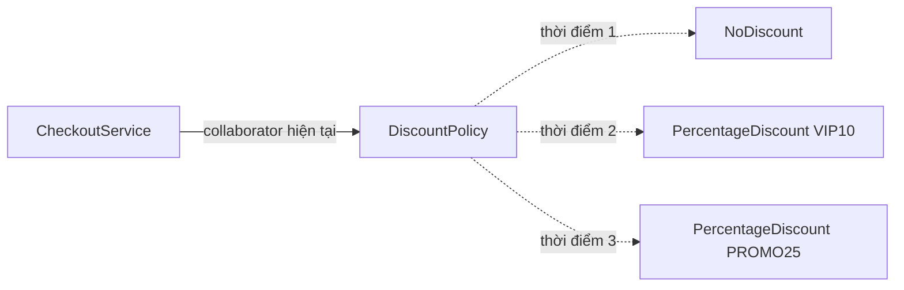
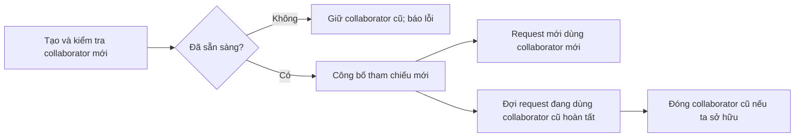

# Thay đổi đối tượng cộng tác khi chạy trong Java

Trong **kết hợp (composition)**, một đối tượng thực hiện công việc bằng cách giữ tham chiếu đến những đối tượng khác — gọi là **đối tượng cộng tác** (*collaborator/dependency*) — rồi ủy quyền một phần hành vi cho chúng.

Ví dụ, một dịch vụ tính tiền có thể dùng một đối tượng `DiscountPolicy` để quyết định mức giảm giá. Nếu hợp đồng được thiết kế tốt, ta có thể **thay chính sách giảm giá trong khi chương trình đang chạy**, mà không phải tạo lại dịch vụ tính tiền hoặc viết lại logic của dịch vụ.

```java
checkout.setDiscountPolicy(new PercentageDiscount("VIP10", 10));
```

Đây là một lợi ích quan trọng của composition: thay đổi **cách một đối tượng được hỗ trợ thực hiện công việc** bằng cách thay collaborator, thay vì cố định mọi biến thể trong một cây lớp kế thừa.

> “Thay đổi khi chạy” ở bài này là thay **tham chiếu đến một đối tượng có cùng hợp đồng**, không phải sửa mã nguồn Java hoặc tự động nạp plugin mới. Những vấn đề về đa luồng, tài nguyên và quyền sở hữu cần được xử lý riêng nếu có.

## 1. Đối tượng cộng tác là gì?

Xét một dịch vụ nhận chính sách tính phí:

```java
interface FeePolicy {
    long calculate(long subtotal);
}

final class OrderService {
    private FeePolicy feePolicy;

    OrderService(FeePolicy feePolicy) {
        this.feePolicy = feePolicy;
    }

    long total(long subtotal) {
        return feePolicy.calculate(subtotal);
    }
}
```

Ở đây:

- `OrderService` là **đối tượng chủ**, chịu trách nhiệm điều phối tính tiền.
- `FeePolicy` là **hợp đồng của collaborator**.
- Một đối tượng triển khai `FeePolicy` thực hiện phép tính cụ thể.
- Trường `feePolicy` lưu **tham chiếu** đến collaborator, không cần biết lớp cụ thể.

Nếu tham chiếu này được phép thay đổi qua một API có kiểm soát, hành vi của `OrderService` ở các lần gọi về sau cũng có thể thay đổi.



Sơ đồ thể hiện **cùng một `CheckoutService`** lần lượt giữ tham chiếu đến các đối tượng chính sách khác nhau. Không phải ba chính sách cùng thực hiện một đơn hàng; mỗi lần xử lý sẽ chọn collaborator hiện hành theo thiết kế.

## 2. Ví dụ Java hoàn chỉnh: đổi chính sách giảm giá lúc chạy

Mục tiêu nghiệp vụ:

1. Ban đầu thanh toán không giảm giá.
2. Khi bật chương trình VIP, dịch vụ sử dụng mức giảm 10%.
3. Khi chuyển sang khuyến mãi, dịch vụ sử dụng mức giảm 25%.
4. Có thể quay về chính sách không giảm giá.
5. Dịch vụ thanh toán **vẫn là một đối tượng**, chỉ collaborator được thay.

Lưu toàn bộ mã sau trong **`Main.java`** và chạy bằng Java 17 hoặc Java 21.

```java
import java.util.Objects;

record Order(long subtotalVnd) {
    Order {
        if (subtotalVnd < 0) {
            throw new IllegalArgumentException("Tiền hàng không được âm");
        }
    }
}

record Receipt(String policyCode, long subtotalVnd,
               long discountVnd, long totalVnd) {
}

// Hợp đồng mà CheckoutService cần từ collaborator.
interface DiscountPolicy {
    String code();

    // Phải trả giá trị trong khoảng [0, subtotalVnd].
    long discount(long subtotalVnd);
}

final class NoDiscount implements DiscountPolicy {
    @Override
    public String code() {
        return "NONE";
    }

    @Override
    public long discount(long subtotalVnd) {
        if (subtotalVnd < 0) {
            throw new IllegalArgumentException("Tiền hàng không hợp lệ");
        }
        return 0;
    }
}

final class PercentageDiscount implements DiscountPolicy {
    private final String code;
    private final int percent;

    PercentageDiscount(String code, int percent) {
        if (code == null || code.isBlank()) {
            throw new IllegalArgumentException("Mã chính sách không hợp lệ");
        }
        if (percent < 0 || percent > 100) {
            throw new IllegalArgumentException("Phần trăm phải từ 0 đến 100");
        }
        this.code = code;
        this.percent = percent;
    }

    @Override
    public String code() {
        return code;
    }

    @Override
    public long discount(long subtotalVnd) {
        if (subtotalVnd < 0) {
            throw new IllegalArgumentException("Tiền hàng không hợp lệ");
        }
        // Ví dụ tính trên VND nguyên, làm tròn xuống.
        return Math.multiplyExact(subtotalVnd, percent) / 100;
    }
}

final class CheckoutService {
    // Không final vì thiết kế này chủ ý cho phép thay collaborator.
    private DiscountPolicy discountPolicy;

    CheckoutService(DiscountPolicy initialPolicy) {
        this.discountPolicy =
                Objects.requireNonNull(initialPolicy, "initialPolicy");
    }

    // Điểm thay thế collaborator, có kiểm tra null.
    void setDiscountPolicy(DiscountPolicy nextPolicy) {
        this.discountPolicy =
                Objects.requireNonNull(nextPolicy, "nextPolicy");
    }

    Receipt checkout(Order order) {
        Objects.requireNonNull(order, "order");

        // Lấy một tham chiếu cho toàn bộ lần thanh toán.
        DiscountPolicy selected = discountPolicy;
        long subtotal = order.subtotalVnd();
        long reduction = selected.discount(subtotal);

        // Không tin mù quáng mọi implementation.
        if (reduction < 0 || reduction > subtotal) {
            throw new IllegalStateException(
                    "Chính sách trả giá trị giảm giá không hợp lệ");
        }

        return new Receipt(
                selected.code(),
                subtotal,
                reduction,
                subtotal - reduction
        );
    }
}

public class Main {
    private static void printReceipt(Receipt receipt) {
        System.out.printf("%s: %d VND%n",
                receipt.policyCode(), receipt.totalVnd());
    }

    public static void main(String[] args) {
        Order order = new Order(100_000);

        CheckoutService checkout = new CheckoutService(new NoDiscount());

        printReceipt(checkout.checkout(order));

        checkout.setDiscountPolicy(
                new PercentageDiscount("VIP10", 10));
        Receipt vipReceipt = checkout.checkout(order);
        printReceipt(vipReceipt);

        checkout.setDiscountPolicy(
                new PercentageDiscount("PROMO25", 25));
        printReceipt(checkout.checkout(order));

        checkout.setDiscountPolicy(new NoDiscount());
        printReceipt(checkout.checkout(order));

        // Biên lai cũ là dữ liệu riêng; đổi policy không sửa quá khứ.
        System.out.println("Biên lai VIP cũ: "
                + vipReceipt.totalVnd() + " VND");
    }
}
```

Biên dịch và chạy:

```bash
javac Main.java
java Main
```

Kết quả:

```text
NONE: 100000 VND
VIP10: 90000 VND
PROMO25: 75000 VND
NONE: 100000 VND
Biên lai VIP cũ: 90000 VND
```

**Phân tích kết quả:**

- `CheckoutService` chỉ được tạo **một lần**.
- `setDiscountPolicy(...)` thay đối tượng được lưu trong trường `discountPolicy`, không thay `Order` hoặc chính `CheckoutService`.
- Mỗi `DiscountPolicy` có cùng phương thức `discount(long)` nhưng quy tắc khác nhau. Lời gọi `selected.discount(subtotal)` sử dụng **đa hình** để chạy implementation của đối tượng hiện tại.
- `vipReceipt` lưu kết quả đã tính. Chuyển policy sang `PROMO25` không tính lại hoặc sửa biên lai cũ.
- `selected` là biến cục bộ giữ collaborator đã chọn trong một lần gọi. Điều này giúp `code()` và `discount()` sử dụng **cùng một đối tượng chính sách**, thay vì đọc lại trường nhiều lần.
- Hai implementation mẫu không giữ trạng thái thay đổi khi tính tiền, nên có thể tái sử dụng chúng mà không cần quản lý bộ đếm hay session riêng.

Đây là ví dụ tiền tệ dùng số nguyên VND để dễ quan sát. Hệ thống tài chính thực cần thống nhất đơn vị tiền, làm tròn, thuế và giới hạn số học; `Math.multiplyExact` sẽ báo lỗi nếu phép nhân bị tràn `long`.

## 3. Vì sao composition cho phép thay collaborator?

Điểm then chốt là trường giữ kiểu **hợp đồng chung**, không cố định một lớp cụ thể:

```java
private DiscountPolicy discountPolicy;
```

Nếu viết:

```java
private PercentageDiscount discountPolicy;
```

ta sẽ không thể gán `new NoDiscount()` vào trường đó, vì `NoDiscount` không phải subtype của `PercentageDiscount`.

Nếu viết:

```java
// Mã giả về hướng kế thừa trong một thiết kế khác:
// class VipCheckoutService extends BaseCheckoutService { ... }
```

Đây là **mô tả ý tưởng**, không phải đoạn có thể chạy riêng. Trong ví dụ chính, `CheckoutService` được khai báo `final`, nên Java **không cho phép extends CheckoutService**.

để biểu thị mọi biến thể chính sách bằng một lớp con của dịch vụ, việc chuyển chính sách có thể buộc tạo **dịch vụ mới** hoặc thêm nhánh trong mỗi subclass. Ví dụ trên không sử dụng kế thừa để chọn giảm giá; `CheckoutService` **có một** `DiscountPolicy`, thay vì `CheckoutService` **là một** loại chính sách.

| Cách thiết kế | Chỗ biểu diễn biến thể | Thay chính sách khi chạy |
| --- | --- | --- |
| `if/else` bên trong `CheckoutService` | Các nhánh điều kiện và mã loại | Phải đổi mã/trạng thái rồi phân nhánh |
| Các lớp con `VipCheckoutService`, `PromoCheckoutService` | Quan hệ kế thừa dịch vụ | Thường phải đổi đối tượng dịch vụ hoặc thiết kế thêm |
| Composition với `DiscountPolicy` | Các object thực hiện interface | Thay tham chiếu collaborator có kiểm soát |
| Composition với field `final DiscountPolicy` | Các object thực hiện interface | Chọn một lần khi tạo; không đổi bằng setter |
| Composition + registry/factory | Chọn implementation theo cấu hình | Có thể chọn policy mới qua một ranh giới lựa chọn |

**Composition không tự động mang nghĩa “thay được mọi lúc”.** Điều đó phụ thuộc vào việc trường tham chiếu có thể thay đổi hay không và lớp có cung cấp thao tác thay thế đúng hợp đồng hay không.

## 4. Có ba lựa chọn thường gặp về vòng đời collaborator

### 4.1. Chọn khi khởi tạo, giữ cố định

```java
final class FixedCheckoutService {
    private final DiscountPolicy policy;

    FixedCheckoutService(DiscountPolicy policy) {
        this.policy = Objects.requireNonNull(policy);
    }

    Receipt checkout(Order order) {
        long reduction = policy.discount(order.subtotalVnd());
        // Xây Receipt và kiểm tra hợp đồng tương tự ví dụ chính.
        return new Receipt(
                policy.code(),
                order.subtotalVnd(),
                reduction,
                order.subtotalVnd() - reduction);
    }
}
```

Đây là cách thường dùng với **constructor injection**. Nó đơn giản, trường không bị gán lại và phụ thuộc của service ổn định. Trong ví dụ rút gọn, `FixedCheckoutService` chưa kiểm tra khoảng `reduction`; nếu dùng thực tế phải bổ sung validation như `CheckoutService`.

### 4.2. Thay bằng setter hoặc phương thức nghiệp vụ

```java
checkout.setDiscountPolicy(new PercentageDiscount("VIP10", 10));
```

Có ích khi đối tượng chủ là một thành phần sống lâu, trong khi khả năng cộng tác cần đổi theo phiên làm việc, trạng thái vận hành hoặc cấu hình.

Nhược điểm: số lượng trạng thái có thể thay đổi của service tăng lên; người sử dụng phải hiểu **ai có quyền thay và thay vào lúc nào**. Nếu việc thay collaborator không thực sự cần thiết, giữ phụ thuộc `final` thường dễ hiểu hơn.

### 4.3. Chọn collaborator riêng cho từng lời gọi

Nếu chính sách khác nhau theo **mỗi đơn hàng**, không nhất thiết giữ policy trong một trường thay đổi của singleton service. Có thể truyền trực tiếp:

```java
final class PerRequestCheckout {
    Receipt checkout(Order order, DiscountPolicy policy) {
        Objects.requireNonNull(order, "order");
        Objects.requireNonNull(policy, "policy");

        long subtotal = order.subtotalVnd();
        long reduction = policy.discount(subtotal);
        if (reduction < 0 || reduction > subtotal) {
            throw new IllegalStateException("Giảm giá ngoài giới hạn");
        }

        return new Receipt(
                policy.code(), subtotal, reduction, subtotal - reduction);
    }
}
```

Như vậy không có trường policy mutable chia sẻ giữa các request. Cách chọn per-request thường đặc biệt hợp lý trong ứng dụng web, nơi nhiều người dùng có thể cần chính sách khác nhau **đồng thời**.

| Yêu cầu | Cách tổ chức phù hợp |
| --- | --- |
| Policy chỉ chọn khi tạo service | Constructor injection + trường `final` |
| Policy thay theo thao tác quản trị, ảnh hưởng đến các lần gọi mới | API `set/replacePolicy` có kiểm soát |
| Mỗi request có policy riêng | Truyền policy qua tham số, hoặc resolve bằng thành phần request-scoped |
| Policy chọn theo mã cấu hình | Factory/registry ánh xạ mã sang implementation |
| Policy có tài nguyên cần đóng | Quản lý quyền sở hữu và vòng đời rõ ràng trước khi thay |

## 5. Thay đối tượng khác với sửa trạng thái đối tượng hiện tại

Hai câu lệnh dưới đây có ý nghĩa khác nhau:

```java
DiscountPolicy selected = new PercentageDiscount("VIP10", 10);
checkout.setDiscountPolicy(selected);
```

Ở đây `CheckoutService` giữ **tham chiếu mới**.

Ngược lại, nếu collaborator là một đối tượng mutable:

```java
// Ví dụ khái niệm:
// mutablePolicy.setPercent(10);
```

thì ta vẫn có **cùng một collaborator**, chỉ nội dung bên trong nó đổi. Mọi đối tượng khác đang giữ tham chiếu tới `mutablePolicy` cũng có thể quan sát thay đổi đó.

Sự khác biệt quan trọng trong hệ thống nhiều thành phần:

- **Thay tham chiếu:** service chuyển từ policy A sang policy B; các thành phần khác còn giữ A không tự động chuyển sang B.
- **Sửa trạng thái policy A:** mọi người dùng chung A có thể bị ảnh hưởng.
- **Thay service:** một `new CheckoutService(...)` mới tạo thêm đối tượng chủ, khác với hai trường hợp trên.

Một policy bất biến như `PercentageDiscount` trong ví dụ có lợi thế: sau khi tạo, `percent` và `code` không thay đổi. Đổi chính sách bằng cách **tạo object mới rồi thay tham chiếu** thường dễ suy luận hơn là sửa nhiều thuộc tính của một collaborator đang được chia sẻ.

## 6. Thay collaborator khi chương trình đang chạy: yếu tố đa luồng

Ví dụ `CheckoutService` đầu bài chủ yếu minh họa cách dùng tuần tự. Trong ứng dụng chạy đồng thời, một luồng có thể gọi `checkout()` trong khi luồng khác gọi `setDiscountPolicy()`.

Trường mutable thông thường:

```java
private DiscountPolicy discountPolicy;
```

**không tự tạo ra sự bảo đảm về khả năng nhìn thấy thay đổi giữa các luồng (visibility)**. Để công bố collaborator mới đúng cách, có thể dùng `volatile`, `synchronized` hoặc `AtomicReference` tùy nhu cầu.

### Một cách an toàn cho thao tác thay tham chiếu: `AtomicReference`

Ví dụ độc lập dưới đây chỉ tập trung vào cơ chế chọn policy hiện tại; các kiểu `Order`, `Receipt`, `DiscountPolicy`, `NoDiscount` và `PercentageDiscount` được dùng lại từ ví dụ chính:

```java
import java.util.Objects;
import java.util.concurrent.atomic.AtomicReference;

final class ConcurrentCheckoutService {
    private final AtomicReference<DiscountPolicy> current;

    ConcurrentCheckoutService(DiscountPolicy initial) {
        this.current = new AtomicReference<>(
                Objects.requireNonNull(initial, "initial"));
    }

    void replacePolicy(DiscountPolicy next) {
        current.set(Objects.requireNonNull(next, "next"));
    }

    Receipt checkout(Order order) {
        Objects.requireNonNull(order, "order");

        // Một snapshot tham chiếu tại đầu lời gọi.
        DiscountPolicy selected = current.get();

        long subtotal = order.subtotalVnd();
        long reduction = selected.discount(subtotal);

        if (reduction < 0 || reduction > subtotal) {
            throw new IllegalStateException("Policy không hợp lệ");
        }

        return new Receipt(
                selected.code(), subtotal, reduction, subtotal - reduction);
    }
}
```

Điều được bảo đảm ở đây:

1. `current.set(next)` cập nhật **tham chiếu** một cách nguyên tử và có ngữ nghĩa visibility của `AtomicReference`.
2. `current.get()` lấy **một** collaborator cụ thể cho toàn bộ lần tính tiền.
3. Một lời gọi bắt đầu ngay trước hoặc đang trùng với thao tác thay có thể tiếp tục dùng **policy cũ** mà nó đã lấy. Những lời gọi bắt đầu sau khi `replacePolicy()` hoàn tất sẽ đọc policy mới nếu không có cập nhật khác.
4. `AtomicReference` **không tự làm trạng thái bên trong collaborator thread-safe**. Nếu policy tự sửa collection/counter trong `discount()`, phần đó cần cơ chế đồng bộ riêng.
5. `AtomicReference` cũng không làm nhiều tác động nghiệp vụ (tính phí, ghi database, phát sự kiện) trở thành một giao dịch nguyên tử.

Một lựa chọn ngắn hơn trong trường hợp chỉ cần đọc/ghi toàn bộ tham chiếu là:

```java
private volatile DiscountPolicy currentPolicy;
```

`volatile` có thể đủ cho visibility và tính nguyên tử của phép đọc/ghi một tham chiếu. `AtomicReference` hữu ích thêm khi cần `compareAndSet`, `getAndSet` hoặc một số thao tác thay đổi có điều kiện.

**Phạm vi nhất quán cần được nói rõ:** “thay cấu hình xong thì mọi request đang chạy phải lập tức dùng chính sách mới” là yêu cầu **khác** với “request mới dùng chính sách mới, request đang chạy hoàn tất với snapshot cũ”. Mẫu `AtomicReference` ở trên hỗ trợ mô hình snapshot per-call, không hủy các request đã bắt đầu.

## 7. Quyền sở hữu và vòng đời của collaborator

Không phải collaborator nào cũng là đối tượng bất biến không tài nguyên. Một số collaborator nắm giữ:

- Socket hoặc connection.
- Executor, worker thread hoặc bộ nhớ ngoài heap.
- Session hoặc client cần đóng sau khi dùng.
- Bộ nhớ cache phải làm ấm trước khi chuyển.
- Trạng thái cần đồng bộ hoặc flush.

Ví dụ, nếu một `Gateway` có `close()`, việc thay:

```java
gateway = newGateway;
oldGateway.close();
```

**có thể nguy hiểm** khi một request cũ vẫn đang dùng `oldGateway`. Việc thay tham chiếu không có nghĩa tất cả cuộc gọi đang diễn ra đã kết thúc.

Để thay một cộng tác viên có tài nguyên, cần xác định:

1. **Ai sở hữu?** Service, DI container hay thành phần ngoài? Thành phần không sở hữu thường không được tự ý đóng.
2. **Khi nào sẵn sàng?** Có cần khởi tạo và kiểm tra kết nối mới trước khi công bố không?
3. **Khi nào được đóng đối tượng cũ?** Có cần đếm request đang dùng, cơ chế drain, timeout hoặc một giai đoạn chuyển tiếp không?
4. **Nếu khởi tạo mới thất bại?** Có giữ policy/adapter cũ tiếp tục phục vụ không?
5. **Nếu đổi thất bại giữa chừng?** Có cách rollback và báo cáo lỗi rõ ràng không?



Sơ đồ này thể hiện **quy trình quản trị vòng đời cần thiết**, không phải tất cả các bước đã được triển khai bởi setter hoặc `AtomicReference.set()`. Với một `DiscountPolicy` thuần tính toán, không có tài nguyên, việc thay thường đơn giản hơn nhiều.

## 8. Một policy mới phải tuân thủ hợp đồng cũ

Khi collaborator có thể thay thế, mọi implementation cần thực hiện cùng **ngữ nghĩa hợp đồng**, không chỉ cùng chữ ký.

Trong ví dụ, `DiscountPolicy.discount(subtotalVnd)` phải:

- Nhận tiền hàng theo **VND nguyên**.
- Trả mức giảm trong khoảng từ `0` đến `subtotalVnd`.
- Không tùy ý đổi đơn vị sang phần trăm hoặc một loại tiền khác.
- Có chính sách rõ ràng với dữ liệu không hợp lệ.
- Nếu được dùng đồng thời, triển khai phải tương thích với cơ chế đồng thời đã công bố.

Một implementation như:

```java
final class BrokenDiscount implements DiscountPolicy {
    @Override
    public String code() {
        return "BROKEN";
    }

    @Override
    public long discount(long subtotalVnd) {
        return -100;
    }
}
```

**vẫn biên dịch**, nhưng `CheckoutService` sẽ ném `IllegalStateException` vì kết quả vi phạm hợp đồng. Interface giúp thay thế ở mức **kiểu dữ liệu**, còn **Liskov Substitution Principle** nhắc rằng triển khai mới phải giữ hành vi người dùng dựa vào.

Điều này càng quan trọng trong hot swap: một triển khai không tương thích có thể khiến các request sau chuyển đổi thất bại dù thay tham chiếu thành công.

## 9. Chọn collaborator từ factory hoặc registry

Trong hệ thống thật, người quản trị hoặc request thường gửi mã chính sách dưới dạng `String`, ví dụ `"VIP10"`. Một ranh giới lựa chọn có thể sử dụng registry:

```java
import java.util.Map;

final class DiscountCatalog {
    private final Map<String, DiscountPolicy> policies = Map.of(
            "NONE", new NoDiscount(),
            "VIP10", new PercentageDiscount("VIP10", 10),
            "PROMO25", new PercentageDiscount("PROMO25", 25)
    );

    DiscountPolicy findRequired(String code) {
        DiscountPolicy policy = policies.get(code);
        if (policy == null) {
            throw new IllegalArgumentException(
                    "Mã chính sách không hỗ trợ: " + code);
        }
        return policy;
    }
}
```

Sau đó:

```java
DiscountCatalog catalog = new DiscountCatalog();
checkout.setDiscountPolicy(catalog.findRequired("PROMO25"));
```

Đoạn trên giả định `checkout` là đối tượng `CheckoutService` đã tạo trong ví dụ. Registry tách **việc tìm đúng loại** khỏi **việc dùng collaborator**. `CheckoutService` không cần biết `"VIP10"` đại diện cho lớp nào.

Có thể thay `Map` bằng `switch`, dependency injection hoặc factory khác tùy quy mô. Nếu một policy là đối tượng stateful thuộc riêng từng request, registry có thể lưu **factory tạo mới** thay vì dùng chung một đối tượng policy.

**Không cho phép đầu vào không tin cậy lựa chọn tùy ý một class theo tên rồi tạo bằng reflection** nếu không có cơ chế giới hạn và xác thực rõ. Registry tường minh chỉ cho phép các implementation đã được phê duyệt.

## 10. Khi nào thay collaborator tốt hơn kế thừa hoặc điều kiện?

| Nhu cầu | Giải pháp cân nhắc | Lý do |
| --- | --- | --- |
| Đổi công thức giảm giá mà giữ dịch vụ tính tiền | Composition + `DiscountPolicy` | Hành vi có thể thay độc lập |
| Một quy trình cố định với vài bước con được mở rộng | Template Method / kế thừa có kiểm soát | Hợp đồng kế thừa có thể phù hợp |
| Hai trường hợp cố định khác nhau đúng một điều kiện nhỏ | `if` hoặc `switch` rõ ràng | Tránh tạo hệ thống class không cần thiết |
| Nhiều request cần nhiều policy cùng lúc | Chọn collaborator theo mỗi lời gọi | Tránh trạng thái chia sẻ có thể xung đột |
| Cấu hình chung đổi tại runtime | Setter/replace API với `volatile` hoặc `AtomicReference` khi đa luồng | Công bố phiên bản mới cho các lời gọi tiếp theo |
| Collaborator có state và tài nguyên riêng | Composition + quản lý lifecycle rõ | Tránh đóng đối tượng khi còn được dùng |
| Muốn ghép nhiều hành vi phụ trợ như retry, cache, logging | Decorator/delegation | Kết hợp linh hoạt các lớp wrapper |

Thay collaborator ở runtime thường là một biến thể của **Strategy Pattern**: thuật toán được đóng gói trong một interface, các chiến lược có thể thay thế nhau. Composition là cấu trúc giúp đối tượng chủ giữ một collaborator; Strategy mô tả cách dùng cấu trúc đó để thay **thuật toán/hành vi**.

Không phải mọi collaborator đều là Strategy. Một repository, clock, event publisher hoặc HTTP client cũng có thể được thay theo nhu cầu kiểm thử hay cấu hình, dù chức năng của nó không được gọi là “chiến lược”.

## 11. Kiểm thử chuyển đổi collaborator

Cần kiểm tra cả **hành vi trước/sau khi đổi** và việc các đối tượng cũ không bị sửa ngoài dự kiến.

Ví dụ phép kiểm thử thuần Java, đặt trong một phương thức khi các lớp ở ví dụ chính đã tồn tại:

```java
CheckoutService service = new CheckoutService(new NoDiscount());
Order order = new Order(100_000);

Receipt before = service.checkout(order);

service.setDiscountPolicy(new PercentageDiscount("VIP10", 10));
Receipt after = service.checkout(order);

if (before.totalVnd() != 100_000) {
    throw new AssertionError("Chính sách ban đầu sai");
}
if (after.totalVnd() != 90_000) {
    throw new AssertionError("Chính sách mới chưa có hiệu lực");
}
if (!"NONE".equals(before.policyCode())) {
    throw new AssertionError("Biên lai cũ bị thay đổi");
}
```

Một số ca khác đáng kiểm thử:

- `setDiscountPolicy(null)` phải từ chối để tránh trạng thái service không có policy.
- Policy mới trả giảm giá âm hoặc lớn hơn subtotal phải bị phát hiện.
- Đổi chính sách từ A sang B rồi về A phải cho kết quả đúng theo từng lần gọi.
- Trong hệ thống đa luồng, mỗi request phải quan sát một collaborator nhất quán theo hợp đồng snapshot đã chọn.
- Khi collaborator có tài nguyên, việc đổi không được đóng tài nguyên đang còn request sử dụng.
- Nếu policy mới khởi tạo thất bại, không được công bố một đối tượng chưa sẵn sàng.

Với JUnit, các test có thể viết bằng `assertEquals`, `assertThrows` và fake implementations của `DiscountPolicy`. Những test quan trọng nhất không phải chỉ kiểm tra setter được gọi, mà là **hành vi nghiệp vụ sau khi chọn collaborator mới**.

## 12. Lỗi thường gặp

| Sai lầm | Hệ quả | Cách khắc phục |
| --- | --- | --- |
| Trường collaborator có kiểu lớp cụ thể thay vì interface cần thiết | Không thay được implementation không cùng nhánh | Dùng hợp đồng có ý nghĩa |
| Setter cho phép `null` | Request tiếp theo có thể ném `NullPointerException` | `Objects.requireNonNull` hoặc chính sách vắng mặt rõ ràng |
| Cứ mỗi request lại đổi một field của singleton chung | Request người này có thể dùng policy người khác | Truyền policy per-request |
| Đọc collaborator nhiều lần trong một thao tác | Giữa chừng policy thay, kết quả có thể dùng nhiều phiên bản | Chụp một tham chiếu cục bộ cho mỗi thao tác |
| Nghĩ thay tham chiếu thường là thread-safe hoàn toàn | Không bảo đảm visibility hoặc trạng thái bên trong | Dùng đúng đồng bộ/atomic publication và policy an toàn |
| Đóng collaborator cũ ngay khi thay | Request đang chạy dùng tài nguyên đã đóng | Quản lý in-flight operations và ownership |
| Một implementation mới đổi đơn vị hoặc trả giá trị sai | Phá hợp đồng thay thế | Contract test và validation |
| Mọi collaborator đều được tạo thành Strategy dù không cần đổi | Tăng lớp/độ phức tạp vô ích | Dùng trường `final` nếu phụ thuộc cố định |
| Dùng reflection theo tên lớp do client gửi | Rủi ro cấu hình và bảo mật | Danh mục implementation được phép |
| Cho rằng setter cập nhật cả kết quả đã tạo trước đó | Nhầm ranh giới giữa trạng thái hiện tại và lịch sử | Lưu kết quả/phiên bản phù hợp trong biên lai |

## 13. Câu hỏi tự kiểm tra

**Câu 1.** Sau khi gọi `checkout.setDiscountPolicy(new NoDiscount())`, đối tượng `CheckoutService` có được tạo lại không?

**Trả lời:** Không. Chỉ tham chiếu collaborator bên trong service thay đổi. Đối tượng chủ vẫn là cùng một object.

**Câu 2.** Vì sao biến `DiscountPolicy selected = discountPolicy;` được đặt ở đầu `checkout()`?

**Trả lời:** Để `discount()` và `code()` cùng sử dụng **một** policy đã chọn. Việc thay field ở thời điểm khác không khiến chính lần gọi ấy vô tình dùng hai collaborator khác nhau.

**Câu 3.** Khi một singleton `CheckoutService` phục vụ nhiều người dùng với mức giảm riêng, có nên gọi `setDiscountPolicy(...)` cho từng request không?

**Trả lời:** Thường không nên; các request có thể ghi đè policy của nhau. Chọn policy theo tham số request hoặc dùng phạm vi dữ liệu phù hợp.

**Câu 4.** `AtomicReference<DiscountPolicy>` có khiến mọi phương thức trong `DiscountPolicy` trở thành thread-safe không?

**Trả lời:** Không. Nó bảo đảm thao tác trên **tham chiếu** theo hợp đồng atomic/visibility; logic và trạng thái của đối tượng policy vẫn phải được thiết kế an toàn riêng.

**Câu 5.** Nếu một HTTP client cũ đang xử lý request, có nên gọi `close()` cho nó ngay sau khi chuyển field sang client mới?

**Trả lời:** Không thể mặc định như vậy. Cần biết ai sở hữu client và khi nào các request đang dùng nó kết thúc. Có thể cần cơ chế drain hoặc quản lý vòng đời riêng.

**Câu 6.** Có phải composition luôn phải hỗ trợ thay collaborator runtime?

**Trả lời:** Không. Composition với collaborator `final` cố định suốt vòng đời vẫn là thiết kế hợp lệ, thường đơn giản hơn khi không có nhu cầu chuyển đổi.

**Ghi nhớ:** Composition cho phép đối tượng chủ **ủy quyền** cho collaborator qua một hợp đồng rõ ràng. Nếu nghiệp vụ cần, đối tượng chủ có thể **thay collaborator lúc chạy** để thay hành vi mà không phải thay chính nó. Thiết kế tốt còn phải xác định rõ *phạm vi áp dụng của lần thay*, *tính nhất quán giữa các luồng*, *hợp đồng của các implementation* và *vòng đời tài nguyên* — không chỉ thêm một setter.