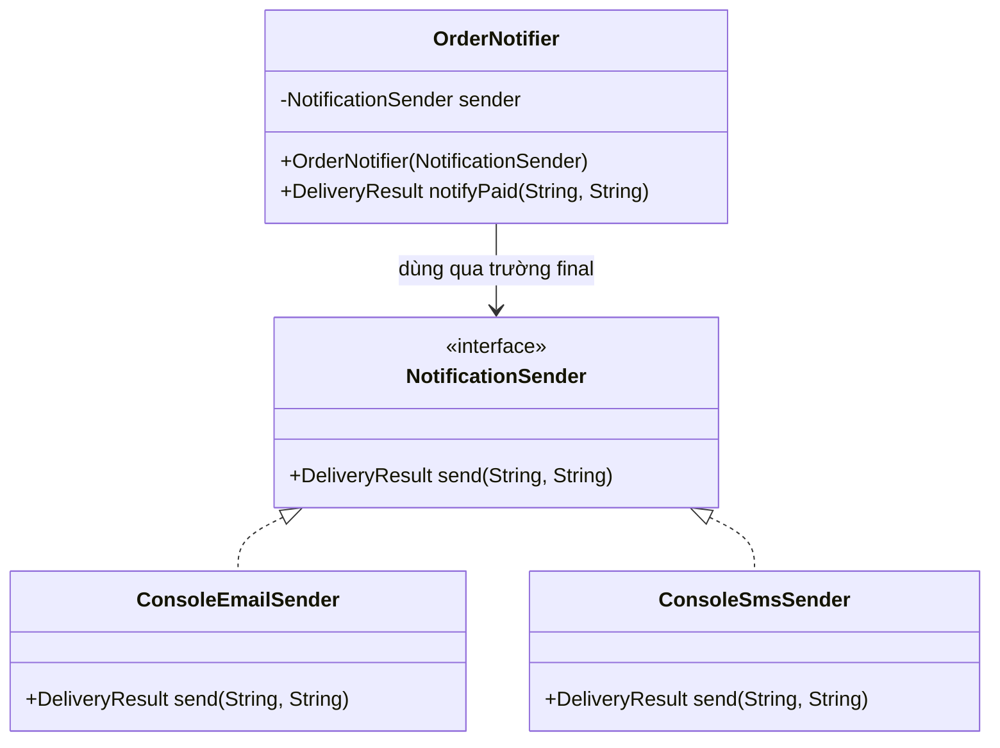
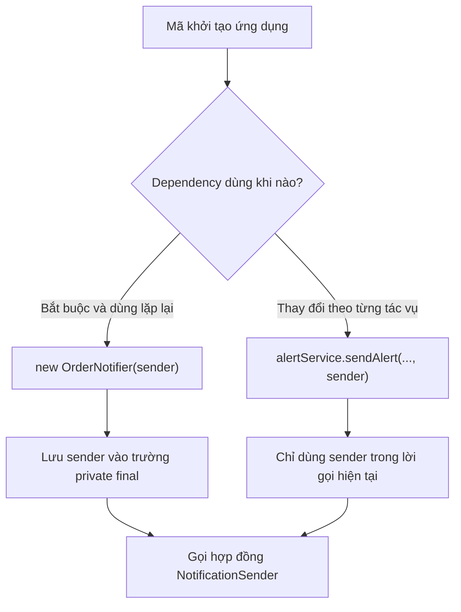
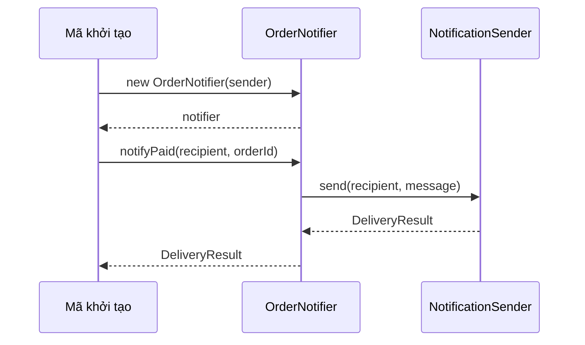

# Tiêm phụ thuộc qua hàm khởi tạo hoặc phương thức trong Java

> **OOP → Kết hợp (Composition).** Một đối tượng thường cần sử dụng đối tượng khác để hoàn thành công việc: dịch vụ đặt hàng cần bộ gửi thông báo; bộ xuất báo cáo cần trình định dạng; mã nghiệp vụ cần nơi lưu dữ liệu. **Dependency Injection (DI) — tiêm phụ thuộc** là cách *cung cấp* những đối tượng cộng tác từ bên ngoài, thay vì để lớp sử dụng tự tạo cứng chúng. Hai cách thực hiện trực tiếp trong Java là **constructor injection** (truyền qua hàm khởi tạo) và **method injection** (truyền qua tham số phương thức).

## 1. Vì sao cần tiêm phụ thuộc?

Giả sử một lớp thông báo đơn hàng tự tạo bộ gửi email:

```java
class OrderNotifier {
    private final EmailSender sender = new EmailSender();

    void notifyPaid(String recipient) {
        sender.send(recipient, "Đơn hàng đã thanh toán");
    }
}
```

`EmailSender` ở đây là tên một lớp giả định. Cách viết này khiến `OrderNotifier` phải biết **chính xác implementation** và cách khởi tạo nó. Nếu muốn gửi SMS, thay nhà cung cấp email, hoặc kiểm thử mà không gửi thông báo thật, ta phải sửa hoặc tìm cách thay phần phụ thuộc bên trong.

Tách hợp đồng gửi thông báo:

```java
interface NotificationSender {
    DeliveryResult send(String recipient, String message);
}
```

Rồi cho lớp thông báo **nhận** một `NotificationSender`:

```java
class OrderNotifier {
    private final NotificationSender sender;

    OrderNotifier(NotificationSender sender) {
        this.sender = java.util.Objects.requireNonNull(sender);
    }
}
```

Đối tượng `OrderNotifier` **có một** bộ gửi thông báo (*has-a*), nhưng không tự quyết định phải dùng bộ gửi email hay SMS. Đây là kết hợp (composition) thông qua một hợp đồng và là ví dụ đơn giản của DI.

| Không tiêm phụ thuộc | Có tiêm phụ thuộc |
|---|---|
| Lớp tự `new EmailSender()` trong logic của mình | Mã bên ngoài tạo sender rồi chuyển vào lớp |
| Logic nghiệp vụ gắn với một implementation cụ thể | Logic nghiệp vụ phụ thuộc vào hợp đồng `NotificationSender` |
| Khó thay sender trong test | Có thể truyền `RecordingSender` giả lập |
| Thay công nghệ có thể buộc sửa lớp nghiệp vụ | Có thể thay implementation tại điểm khởi tạo ứng dụng |

**Lưu ý:** DI không đồng nghĩa bắt buộc có Spring hay một DI container. Constructor và tham số phương thức của Java thuần đã đủ để thực hiện DI.

## 2. Constructor injection: phụ thuộc cần trong cả vòng đời đối tượng

**Constructor injection** phù hợp khi một dependency là **bắt buộc** và sẽ được nhiều phương thức của một đối tượng sử dụng.

```java
final class OrderNotifier {
    private final NotificationSender sender;

    OrderNotifier(NotificationSender sender) {
        this.sender = Objects.requireNonNull(sender, "sender");
    }

    DeliveryResult notifyPaid(String recipient, String orderId) {
        return sender.send(
            recipient,
            "Đơn hàng " + orderId + " đã thanh toán"
        );
    }
}
```

Tại nơi khởi tạo:

```java
NotificationSender sender = new ConsoleEmailSender();
OrderNotifier notifier = new OrderNotifier(sender);
```

Điều đáng chú ý:

1. `sender` được yêu cầu **ngay lúc tạo** `OrderNotifier`. Nếu truyền `null`, constructor từ chối trước khi trả một object hợp lệ.
2. Trường `private final` ngăn gán lại tham chiếu sender sau khi tạo. Nó **không làm đối tượng sender bên trong trở thành bất biến hoặc thread-safe**.
3. Các phương thức nghiệp vụ chỉ gọi hợp đồng `NotificationSender`; chúng không cần biết lớp thực tế.
4. Bên ngoài quyết định **cấu hình và vòng đời** dependency. Không nên tự ý đóng một dependency do caller sở hữu khi hợp đồng không cho phép.



Mũi tên `OrderNotifier → NotificationSender` cho thấy **phụ thuộc ở mã nguồn trỏ tới abstraction**. Hai lớp sender triển khai chi tiết và có thể thay cho nhau miễn là chúng tuân thủ cùng hợp đồng.

## 3. Method injection: phụ thuộc được chọn theo từng lời gọi

**Method injection qua tham số** phù hợp khi hành vi phụ thuộc vào **ngữ cảnh của lần gọi** và không cần được giữ lâu trong một trường.

Ví dụ, một tác vụ gửi cảnh báo có thể chọn kênh gửi khác nhau theo từng yêu cầu:

```java
final class AlertService {
    DeliveryResult sendAlert(
            String recipient,
            String message,
            NotificationSender sender) {

        Objects.requireNonNull(sender, "sender");
        return sender.send(recipient, message);
    }
}
```

Cách sử dụng:

```java
AlertService alerts = new AlertService();

alerts.sendAlert(
    "an@example.test",
    "Đơn hàng cần xác nhận",
    new ConsoleEmailSender()
);

alerts.sendAlert(
    "0900000000",
    "Mã xác nhận 123456",
    new ConsoleSmsSender()
);
```

Trong cách này, `AlertService` không cần trường `NotificationSender`. Mỗi lời gọi truyền dependency được chọn lúc đó. Đây là **tiêm dependency bằng tham số phương thức**; nó không đồng nghĩa với cơ chế `@Lookup` method injection chuyên biệt của Spring.

**Khác biệt về vòng đời:**



Nếu lần nào cũng truyền cùng một sender qua hàng chục phương thức chỉ để có thể gọi nó, constructor injection thường gọn hơn. Ngược lại, nếu một dịch vụ gửi được nhiều kênh độc lập theo yêu cầu, lưu cố định một sender có thể làm API kém linh hoạt.

## 4. Ví dụ Java hoàn chỉnh: dùng cả hai cách injection

Đoạn sau chạy độc lập với **Java 17+**, không cần Spring hay dịch vụ email/SMS thật. Các sender chỉ in ra console để minh họa đa hình và đường truyền dependency.

Lưu thành `DependencyInjectionDemo.java`:

```java
import java.util.Objects;

public class DependencyInjectionDemo {

    record DeliveryResult(String channel, boolean accepted) {
        DeliveryResult {
            Objects.requireNonNull(channel, "channel");
        }
    }

    interface NotificationSender {
        DeliveryResult send(String recipient, String message);
    }

    static String requireText(String value, String field) {
        if (value == null || value.isBlank()) {
            throw new IllegalArgumentException(field + " không hợp lệ");
        }
        return value;
    }

    // Implementation A: chỉ mô phỏng email bằng log console.
    static final class ConsoleEmailSender implements NotificationSender {
        @Override
        public DeliveryResult send(String recipient, String message) {
            requireText(recipient, "recipient");
            requireText(message, "message");
            System.out.println("[EMAIL] " + recipient + " <- " + message);
            return new DeliveryResult("EMAIL", true);
        }
    }

    // Implementation B: chỉ mô phỏng SMS bằng log console.
    static final class ConsoleSmsSender implements NotificationSender {
        @Override
        public DeliveryResult send(String recipient, String message) {
            requireText(recipient, "recipient");
            requireText(message, "message");
            System.out.println("[SMS] " + recipient + " <- " + message);
            return new DeliveryResult("SMS", true);
        }
    }

    // Constructor injection: dùng sender cố định trong vòng đời notifier.
    static final class OrderNotifier {
        private final NotificationSender sender;

        OrderNotifier(NotificationSender sender) {
            this.sender = Objects.requireNonNull(sender, "sender");
        }

        DeliveryResult notifyPaid(String recipient, String orderId) {
            requireText(recipient, "recipient");
            requireText(orderId, "orderId");
            return sender.send(
                recipient,
                "Đơn hàng " + orderId + " đã thanh toán"
            );
        }
    }

    // Method injection: sender có thể thay đổi theo từng lần gọi.
    static final class AlertService {
        DeliveryResult sendAlert(
                String recipient,
                String message,
                NotificationSender sender) {
            requireText(recipient, "recipient");
            requireText(message, "message");
            Objects.requireNonNull(sender, "sender");
            return sender.send(recipient, message);
        }
    }

    // Fake dùng để kiểm thử, không gửi email hoặc SMS thật.
    static final class RecordingSender implements NotificationSender {
        private int calls;
        private String lastRecipient;
        private String lastMessage;

        @Override
        public DeliveryResult send(String recipient, String message) {
            calls++;
            lastRecipient = recipient;
            lastMessage = message;
            return new DeliveryResult("FAKE", true);
        }

        int calls() {
            return calls;
        }

        String lastRecipient() {
            return lastRecipient;
        }

        String lastMessage() {
            return lastMessage;
        }
    }

    public static void main(String[] args) {
        // Tiêm qua constructor.
        OrderNotifier notifier =
            new OrderNotifier(new ConsoleEmailSender());

        DeliveryResult email = notifier.notifyPaid(
            "an@example.test",
            "ORD-101"
        );
        System.out.println("Email accepted: " + email.accepted());

        // Tiêm qua tham số của phương thức.
        AlertService alerts = new AlertService();
        DeliveryResult sms = alerts.sendAlert(
            "0900000000",
            "Mã xác nhận 123456",
            new ConsoleSmsSender()
        );
        System.out.println("SMS accepted: " + sms.accepted());

        // Thay dependency bằng fake mà không sửa OrderNotifier.
        RecordingSender fake = new RecordingSender();
        OrderNotifier testNotifier = new OrderNotifier(fake);
        testNotifier.notifyPaid("test@example.test", "ORD-TEST");

        if (fake.calls() != 1
                || !fake.lastRecipient().equals("test@example.test")
                || !fake.lastMessage().contains("ORD-TEST")) {
            throw new AssertionError("OrderNotifier dùng sai dependency");
        }
        System.out.println("Fake calls: " + fake.calls());
    }
}
```

Chạy:

```bash
javac DependencyInjectionDemo.java
java DependencyInjectionDemo
```

Đầu ra mong đợi:

```text
[EMAIL] an@example.test <- Đơn hàng ORD-101 đã thanh toán
Email accepted: true
[SMS] 0900000000 <- Mã xác nhận 123456
SMS accepted: true
Fake calls: 1
```

Đây là **mô phỏng tại console**. `accepted=true` trong ví dụ chỉ có nghĩa implementation mô phỏng đã chấp nhận lời gọi; không chứng minh email/SMS thật đã được gửi hay người nhận đã đọc. Với dịch vụ thực, hợp đồng cần phân biệt đã gửi, đang chờ, bị từ chối và lỗi kết nối nếu những trạng thái đó quan trọng.

### Theo dõi một lần gọi



`OrderNotifier` không khởi tạo `ConsoleEmailSender`; điều đó được làm ở phía `main`. Do vậy, có thể truyền `RecordingSender` để kiểm thử mà không phải thay code của `OrderNotifier`.

## 5. So sánh constructor, method và setter injection

Đôi khi tài liệu sử dụng từ **method injection** để chỉ **setter injection** (tiêm qua phương thức setter), nhưng cũng có tài liệu nói riêng về **method parameter injection** (truyền dependency trực tiếp cho một thao tác). Nên nêu rõ đang dùng dạng nào.

| Tiêu chí | Constructor injection | Method parameter injection | Setter injection |
|---|---|---|---|
| Ví dụ | `new Service(repo)` | `service.run(repo)` | `service.setRepo(repo)` |
| Dependency được nhận khi nào? | Khi khởi tạo đối tượng | Mỗi lần gọi một phương thức | Khi setter được gọi |
| Lưu thành field? | Thường có, có thể `final` | Thường không cần | Thường có, thường không `final` |
| Phù hợp với | Dependency bắt buộc, ổn định | Dependency tùy từng yêu cầu/tác vụ | Cấu hình tùy chọn hoặc có khả năng thay đổi |
| Nguy cơ | Constructor có quá nhiều tham số | Lặp tham số ở nhiều lời gọi | Đối tượng có thể chưa cấu hình hoặc bị đổi giữa chừng |
| Dễ làm giả trong test | Có | Có | Có, nhưng phải kiểm soát thứ tự cấu hình |

Setter injection có thể viết như sau:

```java
final class ConfigurableNotifier {
    private NotificationSender sender;

    void setSender(NotificationSender sender) {
        this.sender = Objects.requireNonNull(sender, "sender");
    }

    DeliveryResult notify(String recipient, String message) {
        if (sender == null) {
            throw new IllegalStateException("Chưa cấu hình sender");
        }
        return sender.send(recipient, message);
    }
}
```

Mẫu này có rủi ro: nếu gọi `notify()` trước `setSender()`, object chưa sẵn sàng. Nếu nhiều thread cùng gọi setter và notify, còn phải xem xét đồng bộ và quy tắc thay đổi cấu hình. Vì vậy, **ưu tiên constructor injection cho dependency bắt buộc**; dùng setter khi việc thay đổi hoặc không cấu hình dependency là một yêu cầu thực sự.

## 6. Composition khác với kế thừa như thế nào ở đây?

Trong ví dụ, quan hệ giữa notifier và sender là:

```text
OrderNotifier có một NotificationSender.
```

Không phải:

```text
OrderNotifier là một loại NotificationSender.
```

`OrderNotifier` **sử dụng** sender để hoàn thành trách nhiệm riêng; nó không cần `extends ConsoleEmailSender` hay `extends ConsoleSmsSender`. Đây là composition: phối hợp các đối tượng có trách nhiệm độc lập.

```java
// Đúng hướng: sử dụng một thành phần thông qua hợp đồng.
class OrderNotifier {
    private final NotificationSender sender;
    OrderNotifier(NotificationSender sender) {
        this.sender = sender;
    }
}

// Không nên kế thừa chỉ để tái sử dụng hàm send:
// class OrderNotifier extends ConsoleEmailSender { ... }
```

Composition giúp thay đổi cách gửi thông báo mà không cần làm biến dạng cây kế thừa. Nó cũng thuận tiện khi mỗi đối tượng có vòng đời riêng: notifier có thể sống dài, sender có thể được chia sẻ hoặc có cơ chế đóng kết nối theo API.

**Quan trọng:** chỉ truyền dependency vào không tự làm cho chương trình có tính đúng đắn về concurrency hoặc vòng đời tài nguyên. Nếu sender dùng kết nối hoặc thread pool, cần quyết định ai tạo, ai sở hữu và ai đóng chúng.

## 7. Truyền interface thay vì gắn với implementation cụ thể

Hai constructor sau đều là một dạng nhận dependency từ bên ngoài:

```java
OrderNotifier(ConsoleEmailSender sender) { /* ... */ }
OrderNotifier(NotificationSender sender) { /* ... */ }
```

Nhưng cách thứ hai mềm dẻo hơn vì nhận bất kỳ implementation nào tuân thủ `NotificationSender`.

Khi lớp nghiệp vụ chỉ cần hành vi `send`, nó không nên yêu cầu những phương thức riêng của một nhà cung cấp cụ thể. Hợp đồng càng dựa vào nhu cầu thực của caller, mức kết dính càng thấp.

Tuy nhiên, **không bắt buộc mỗi class đều cần một interface**. Nếu một thành phần chỉ có một cách triển khai ổn định và không có ranh giới thay thế hữu ích, tiêm một concrete class vẫn có thể hợp lý. Điều quan trọng là ai quyết định cách tạo dependency và dependency có bị gắn cứng trong logic nghiệp vụ không.

### Dependency Injection, Dependency Inversion và IoC

Ba khái niệm liên quan nhưng không đồng nghĩa:

- **Dependency Injection (DI):** cách cung cấp dependency từ bên ngoài qua constructor, phương thức hoặc setter.
- **Dependency Inversion Principle (DIP):** nguyên tắc cho mã cấp cao và mã triển khai cùng phụ thuộc vào abstraction phù hợp, thay vì mã cấp cao lệ thuộc trực tiếp vào chi tiết cấp thấp.
- **Inversion of Control (IoC):** ý tưởng đảo quyền điều khiển việc tạo/cấp phát hoặc tổ chức luồng điều khiển cho một thành phần bên ngoài; DI là một kỹ thuật thường dùng để áp dụng IoC.

Không cần một container DI để có DI. Trong `main` của ví dụ, mã khởi tạo ứng dụng đang đóng vai trò **composition root** — nơi chọn và lắp ráp các implementation.

## 8. Chọn cách injection theo yêu cầu thực tế

Một số tình huống minh họa:

| Tình huống | Cách thường thích hợp | Lý do |
|---|---|---|
| `OrderService` luôn cần `OrderRepository` để xử lý | Constructor injection | Bắt buộc, ổn định trong vòng đời service |
| `CheckoutService` luôn dùng một `PaymentGateway` được cấu hình | Constructor injection | Thiếu gateway là không thể làm việc đúng |
| Xuất một báo cáo với `Formatter` khác nhau từng lần | Method parameter injection | Formatter là chiến lược riêng của tác vụ |
| Công cụ chạy thử cho chọn kênh gửi thông báo mỗi lần | Method parameter injection | Dependency thay theo đầu vào của lần gọi |
| Một tính năng phụ có thể được cấu hình sau | Setter injection có kiểm soát | Không phải dependency bắt buộc từ lúc tạo |
| Tập trung tạo và kết nối mọi service trong ứng dụng | Composition root hoặc DI container | Một nơi quản lý lắp ghép và vòng đời |

**Nguyên tắc quyết định nhanh:** nếu thiếu dependency khiến object **không hợp lệ hoặc không dùng được**, đưa nó vào constructor. Nếu dependency **chỉ cần cho một hành động cụ thể và thay theo hành động**, cân nhắc tham số phương thức. Nếu dependency thật sự **tùy chọn hoặc được cấu hình lại**, setter có thể phù hợp nhưng phải định nghĩa trạng thái trước/sau cấu hình.

## 9. Lỗi phổ biến

### Lỗi 1 — Cung cấp dependency rồi lại tự tạo mới bên trong

```java
class BadNotifier {
    private final NotificationSender sender;

    BadNotifier(NotificationSender sender) {
        this.sender = sender;
    }

    void notifyUser(String recipient, String message) {
        // Sai ý đồ injection: bỏ qua this.sender.
        new ConsoleEmailSender().send(recipient, message);
    }
}
```

Mặc dù constructor có tham số, class vẫn gắn cứng với email. Sửa bằng `this.sender.send(...)`.

### Lỗi 2 — Để dependency bắt buộc có thể null

```java
class BadService {
    private NotificationSender sender;
    // Không có constructor/setter bảo đảm sender được gán.
}
```

Khi gọi phương thức sử dụng sender, dễ gặp `NullPointerException`. Nên dùng constructor với `Objects.requireNonNull` hoặc một thiết kế trạng thái có kiểm soát nếu dependency thực sự tùy chọn.

### Lỗi 3 — Constructor có quá nhiều dependency

```java
// Ví dụ minh họa dấu hiệu cần xem lại trách nhiệm:
Service(A a, B b, C c, D d, E e, F f, G g) { /* ... */ }
```

Không có một ngưỡng số tham số áp dụng cho mọi dự án. Nhưng nếu constructor có quá nhiều phụ thuộc không liên quan, có thể lớp đang làm quá nhiều việc. Hãy xem lại trách nhiệm, tách dịch vụ hợp lý thay vì tự động đóng tất cả vào một đối tượng `Dependencies` khó kiểm soát.

### Lỗi 4 — Method injection khiến API truyền lan dependency

Nếu nhiều tầng gọi nhau đều nhận `NotificationSender` mà tầng trung gian không sử dụng nó ngoài việc truyền tiếp, có thể dependency đã được đặt sai phạm vi. Cân nhắc cho thành phần thật sự sử dụng nhận dependency qua constructor.

### Lỗi 5 — Không phân biệt trách nhiệm sở hữu resource

Một dependency được tiêm có thể sở hữu kết nối mạng, executor hoặc stream. Mã nhận dependency **không được tự ý đóng** tài nguyên do nơi khác quản lý nếu hợp đồng không quy định; nếu một thành phần được giao quyền sở hữu thì phải đóng tài nguyên vào đúng cuối vòng đời. DI không tự động thay thế chính sách quản lý tài nguyên.

### Lỗi 6 — Nghĩ constructor injection tự tạo an toàn đa luồng

`private final NotificationSender sender` không làm cho `sender.send(...)` tự thread-safe. Nếu nhiều thread chia sẻ một sender có trạng thái mutable, implementation vẫn cần bảo đảm an toàn đa luồng hoặc được sử dụng trong phạm vi phù hợp.

## 10. Bài tập thực hành

**Bài 1 — Đổi implementation.** Thêm `ConsolePushSender implements NotificationSender` in `[PUSH]`. Tiêm nó vào `OrderNotifier` thay cho `ConsoleEmailSender` mà không sửa `OrderNotifier`. Quan sát đầu ra.

**Bài 2 — Chọn injection.** Một `ReportService` cần `DocumentRepository` trong mọi lời gọi và cần một `ReportFormatter` thay đổi theo từng báo cáo. Thiết kế constructor nhận repository, còn phương thức `export(formatter)` nhận formatter. Giải thích vì sao chọn hai phạm vi khác nhau.

**Bài 3 — Kiểm thử bằng fake.** Dùng `RecordingSender` để kiểm tra `OrderNotifier.notifyPaid` truyền đúng người nhận, mã đơn hàng và chỉ gọi `send` một lần. Sau đó truyền `RecordingSender` cho `AlertService.sendAlert` để kiểm tra method injection.

**Bài 4 — Trạng thái chưa cấu hình.** Thử gọi `notify` của `ConfigurableNotifier` trước khi `setSender`. Giải thích vì sao việc tiêm qua setter có thể tạo ra trạng thái chưa hợp lệ; viết test cho tình huống này.

**Bài 5 — Sở hữu dependency.** Một `SmtpSender` có kết nối cần đóng. Khi `OrderNotifier` nhận sender từ composition root, ai nên đóng kết nối? Hãy đề xuất hợp đồng sở hữu rõ ràng thay vì tự đóng từ mọi class đang dùng sender.

**Ghi nhớ:** Với composition, một đối tượng **nhận và sử dụng** các đối tượng cộng tác thay vì tự tạo cứng chúng. **Constructor injection** phù hợp nhất cho dependency bắt buộc, ổn định; **method parameter injection** phù hợp với dependency thay đổi theo tác vụ; còn **setter injection** chỉ nên dùng khi cần thay đổi hoặc cấu hình sau và đã kiểm soát trạng thái chưa sẵn sàng. Điểm chung là mã nghiệp vụ chỉ biết hợp đồng cần dùng, nhờ đó dễ thay implementation và kiểm thử.