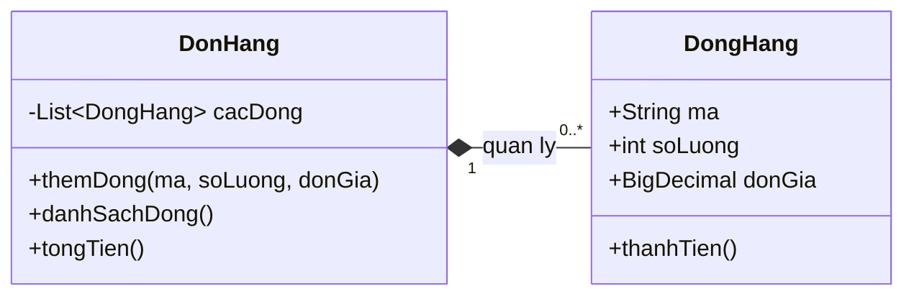
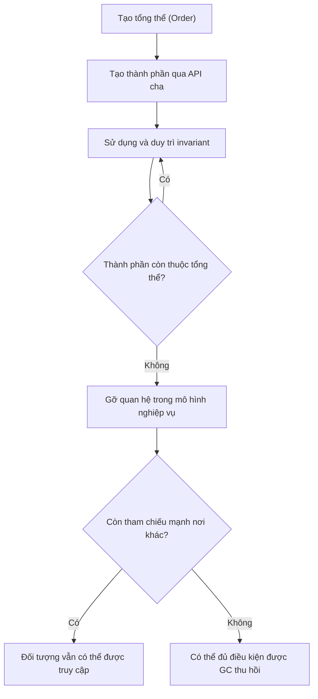

# Quyền sở hữu và vòng đời đối tượng được chứa trong Composition (Java)

> **Bối cảnh:** OOP → Kết hợp (Composition). Khi một đối tượng chứa các đối tượng khác, câu hỏi thiết kế quan trọng không chỉ là “có trường dữ liệu nào?”, mà còn là **ai kiểm soát việc tạo, sửa, chia sẻ và kết thúc sử dụng thành phần đó?**

## 1. Mục tiêu học tập

Sau bài này, bạn có thể:

- Phân biệt **quyền sở hữu ở mức thiết kế đối tượng**, **khả năng truy cập qua tham chiếu Java** và **quyền quản lý tài nguyên hệ thống**.
- Xác định thành phần có được dùng chung giữa nhiều đối tượng hay phải nằm dưới sự quản lý của một đối tượng cha.
- Thiết kế API giữ vững bất biến (invariant) khi đối tượng được chứa thay đổi.
- Dùng `AutoCloseable` và `try-with-resources` để điều khiển vòng đời tài nguyên khi đối tượng cha sở hữu tài nguyên đó.
- Tránh nhầm cơ chế garbage collection với việc đóng file, kết nối hoặc luồng công việc.

## 2. Quyền sở hữu nghĩa là gì?

Trong **composition**, một đối tượng tổng thể (*whole/owner*) quản lý các thành phần (*parts*) để thực hiện chức năng và bảo vệ trạng thái hợp lệ của tổng thể.

Ví dụ: `DonHang` quản lý các `DongHang`. Đơn hàng quyết định khi nào thêm dòng hàng, dòng nào được xóa, số lượng/đơn giá nào hợp lệ và cách tính tổng tiền. Người dùng `DonHang` không được tự ý sửa danh sách nội bộ để bỏ qua các quy tắc đó.



Ký hiệu hình thoi tô đặc (`*--`) trong UML thể hiện **composition**: thành phần nằm trong ranh giới vòng đời và quyền quản lý của tổng thể, theo **mô hình nghiệp vụ**.

Tuy nhiên, Java **không có từ khóa ownership**. Một trường `private DongHang dongHang;` chỉ lưu **tham chiếu**, chưa tự động đảm bảo cha là chủ sở hữu duy nhất. Quyền sở hữu phải được bảo vệ bằng cách thiết kế constructor, phương thức, phạm vi truy cập và quy ước sử dụng.

### Ba khái niệm dễ bị lẫn

| Khái niệm | Câu hỏi chính | Trong Java |
|---|---|---|
| Sở hữu theo mô hình nghiệp vụ | Ai quyết định tạo, thay đổi, loại bỏ thành phần? | API, invariant, đóng gói; không được JVM áp đặt |
| Tham chiếu đến đối tượng | Ai đang giữ đường truy cập đến cùng một đối tượng? | Nhiều biến có thể trỏ đến cùng instance; `private` và `final` không tự ngăn alias |
| Sở hữu tài nguyên | Ai phải đóng file/socket/stream và khi nào? | Hợp đồng API, `AutoCloseable`, `try-with-resources` |

Một đối tượng con có thể ngừng thuộc đơn hàng nhưng vẫn còn tham chiếu trong chương trình. Điều này **không** có nghĩa Java xóa ngay đối tượng khỏi bộ nhớ.

## 3. Quyết định quyền sở hữu trước khi viết code

Với mỗi trường chứa một đối tượng khác, hãy trả lời:

1. **Ai tạo?** Cha tạo nội bộ, nhận dữ liệu để sao chép, hay nhận một instance từ bên ngoài?
2. **Ai có thể sửa?** Mọi thay đổi đi qua API cha hay các lớp khác có thể sửa trực tiếp?
3. **Có được chia sẻ?** Một thành phần có thể đồng thời phục vụ nhiều tổng thể không?
4. **Khi nào kết thúc?** Khi cha bị loại bỏ khỏi nghiệp vụ, khi cha gọi `close()`, hay khi toàn ứng dụng dừng?
5. **Ai dọn dẹp?** Chỉ rõ trách nhiệm với tài nguyên có giới hạn như kết nối, file và thread.

| Tình huống | Thiết kế thường phù hợp | Lưu ý |
|---|---|---|
| `DonHang` và danh sách `DongHang` | Composition; cha kiểm soát thêm/xóa dòng | Chặn sửa danh sách qua getter |
| `HoaDon` và giá trị `Money` bất biến | Có thể chia sẻ value object an toàn | Không bắt buộc tạo bản sao nếu thực sự bất biến |
| `NhanVien` và `PhongBan` | Quan hệ liên kết/aggregation thường hợp lý hơn | Phòng ban vẫn tồn tại khi nhân viên rời đi |
| `ExportJob` tự mở `BufferedWriter` | Job sở hữu writer và phải đóng | Đóng theo `try-with-resources` |
| Service được container dependency injection cấp | Thường container quản lý vòng đời | Consumer không tự đóng dependency dùng chung |

**Quy tắc thực dụng:** quyền sở hữu càng mạnh thì thành phần càng nên được tạo/quản lý qua API của cha, thay vì cho bên ngoài thay thế hoặc sửa tùy ý.

## 4. Ví dụ hoàn chỉnh: đơn hàng quản lý dòng hàng

Lưu thành `CompositionDemo.java`, chạy với **Java 17+**:

```java
import java.math.BigDecimal;
import java.util.ArrayList;
import java.util.List;
import java.util.Objects;

public class CompositionDemo {
    public static void main(String[] args) {
        Order order = new Order("DH-001");

        order.addLine("BOOK", 2, new BigDecimal("125000"));
        List<Order.Line> snapshot = order.lines();

        order.addLine("PEN", 3, new BigDecimal("10000"));

        System.out.println(snapshot.size());       // 1
        System.out.println(order.lines().size());   // 2
        System.out.println(order.total());          // 280000

        try {
            snapshot.clear();
        } catch (UnsupportedOperationException expected) {
            System.out.println("Khong the sua danh sach tu ben ngoai");
        }
    }

    static final class Order {
        private final String id;
        private final List<Line> lines = new ArrayList<>();

        Order(String id) {
            if (id == null || id.isBlank()) {
                throw new IllegalArgumentException("Ma don hang khong hop le");
            }
            this.id = id;
        }

        public void addLine(String sku, int quantity, BigDecimal unitPrice) {
            // Cha tao va kiem soat thanh phan con.
            lines.add(new Line(sku, quantity, unitPrice));
        }

        public List<Line> lines() {
            // Ban chup khong sua duoc; khong lo danh sach noi bo.
            return List.copyOf(lines);
        }

        public BigDecimal total() {
            return lines.stream()
                    .map(Line::amount)
                    .reduce(BigDecimal.ZERO, BigDecimal::add);
        }

        // Gia tri bat bien: String va BigDecimal cung bat bien.
        record Line(String sku, int quantity, BigDecimal unitPrice) {
            Line {
                if (sku == null || sku.isBlank()) {
                    throw new IllegalArgumentException("SKU khong hop le");
                }
                if (quantity <= 0) {
                    throw new IllegalArgumentException("So luong phai > 0");
                }
                Objects.requireNonNull(unitPrice, "unitPrice");
                if (unitPrice.signum() < 0) {
                    throw new IllegalArgumentException("Don gia am");
                }
            }

            BigDecimal amount() {
                return unitPrice.multiply(BigDecimal.valueOf(quantity));
            }
        }
    }
}
```

Chạy:

```bash
javac CompositionDemo.java
java CompositionDemo
```

Kết quả:

```text
1
2
280000
Khong the sua danh sach tu ben ngoai
```

**Vì sao ví dụ này thực sự quản lý thành phần?**

- `Order` tạo từng `Line` sau khi kiểm tra dữ liệu. Mọi thao tác thêm dòng hàng đều đi qua `addLine(...)`.
- Danh sách `lines` là `private`; `lines()` trả về một **snapshot bất biến ở mức danh sách**, nên gọi `clear()`, `add()` từ bên ngoài đều bị từ chối.
- `Line` là `record` chứa các giá trị bất biến trong ví dụ. Vì vậy việc trả các `Line` trong snapshot không làm lộ trạng thái có thể thay đổi của đơn hàng.
- `total()` luôn được tính từ dữ liệu mà `Order` đang kiểm soát.

**Giới hạn cần hiểu:** `List.copyOf(...)` chỉ tạo bản sao *nông* của cấu trúc danh sách. Nếu phần tử là `MutableLine` có setter, người nhận snapshot vẫn có thể sửa phần tử đó. Lúc ấy phải dùng bản sao sâu phù hợp, DTO bất biến, hoặc chỉ cung cấp thao tác đọc cần thiết.

Ngoài ra, `final List<Line>` chỉ ngăn **gán lại biến trường**, không ngăn `lines.add(...)`. Để bất biến được bảo vệ, phải thiết kế cả cấu trúc và các đường truy cập.

## 5. Vòng đời đối tượng con diễn ra thế nào?

Có thể phân biệt vòng đời **nghiệp vụ** và vòng đời **bộ nhớ** như sau:



Đối với đối tượng Java thông thường:

- **Tạo:** khi gọi constructor hoặc factory, đối tượng được cấp phát và được liên kết vào tổng thể theo API.
- **Sử dụng:** tổng thể quản lý quyền thay đổi; cần tránh alias đưa cho bên ngoài khả năng sửa trái phép.
- **Ngừng thuộc tổng thể:** khi dòng hàng được xóa hoặc đơn hàng kết thúc nghiệp vụ, quan hệ composition chấm dứt theo quy tắc domain.
- **Thu hồi bộ nhớ:** JVM có thể thu hồi đối tượng khi không còn reachable từ các GC root. **Không thể dự đoán thời điểm thu hồi**, và bản thân việc bỏ tham chiếu không gọi `close()`.

Nếu ai đó vẫn giữ một `Line` đã lấy ra từ snapshot, `Line` ấy vẫn tồn tại và có thể đọc được; nhưng nó không còn là thành phần hiện hành của `Order` nếu `Order` đã bỏ dòng đó. Đây là điểm khác biệt giữa **vòng đời trong mô hình** và **vòng đời của instance trên heap**.

## 6. Vòng đời tài nguyên: cha tạo thì cha đóng

Một trường hợp sở hữu mạnh khác là đối tượng tự tạo tài nguyên hệ điều hành, ví dụ export CSV. Bộ nhớ Java có garbage collector, nhưng **file handle cần được đóng rõ ràng**.

Lưu thành `ExportDemo.java` (Java 17+):

```java
import java.io.BufferedWriter;
import java.io.IOException;
import java.nio.charset.StandardCharsets;
import java.nio.file.Files;
import java.nio.file.Path;

public class ExportDemo {
    public static void main(String[] args) throws IOException {
        Path output = Path.of("orders.csv");

        try (CsvExporter exporter = new CsvExporter(output)) {
            exporter.writeRow("DH-001", "280000");
            exporter.writeRow("DH-002", "50000");
        } // close() tu dong duoc goi, ke ca khi trong khoi co loi.

        System.out.println(Files.readString(output));
    }

    static final class CsvExporter implements AutoCloseable {
        private final BufferedWriter writer;
        private boolean closed;

        CsvExporter(Path output) throws IOException {
            // Exporter tu mo writer => exporter chiu trach nhiem dong.
            writer = Files.newBufferedWriter(output, StandardCharsets.UTF_8);
        }

        void writeRow(String id, String total) throws IOException {
            if (closed) {
                throw new IllegalStateException("Exporter da dong");
            }
            writer.write(id + "," + total);
            writer.newLine();
        }

        @Override
        public void close() throws IOException {
            if (!closed) {
                closed = true;
                writer.close();
            }
        }
    }
}
```

`CsvExporter` sở hữu `BufferedWriter` vì nó **tự mở** writer. Từ khi được tạo thành công đến khi `close()` hoàn tất, exporter chịu trách nhiệm dọn dẹp. Cờ `closed` giúp tránh đóng lặp trong ví dụ tuần tự này; nó **không** biến lớp thành thread-safe. Với code đa luồng, cần một hợp đồng đồng bộ hóa riêng.

Nếu exporter **nhận `Writer` từ bên ngoài**, không nên tự đóng writer trừ khi API nói rõ quyền sở hữu đã được chuyển giao:

```java
void renderPreview(java.io.Writer borrowedWriter) throws java.io.IOException {
    borrowedWriter.write("preview");
    borrowedWriter.flush();
    // Ben goi so huu borrowedWriter; phuong thuc nay khong close().
}
```

Điểm mấu chốt: **có tham chiếu đến tài nguyên không đồng nghĩa có quyền đóng nó**. Nếu hai đối tượng cùng đóng một kết nối hoặc stream dùng chung, một bên có thể làm hỏng hoạt động của bên kia.

> Với ứng dụng Spring, bean do container quản lý thường có vòng đời do container điều phối (ví dụ callback `@PreDestroy`). Thành phần nhận bean qua dependency injection cần tuân theo hợp đồng vòng đời của container; quan hệ tham chiếu field không tự trao quyền đóng bean đó.

## 7. Ba lỗi thường gặp và cách sửa

### Lỗi 1 — Rò rỉ khả năng sửa trạng thái của cha

```java
// Nguy hiem: nguoi goi co the them/xoa phan tu khong qua kiem tra.
public List<Line> getLines() {
    return lines;
}
```

Nếu cấu trúc cần đọc mà không sửa, có thể trả `List.copyOf(lines)`. Nếu con là mutable, cần thêm chiến lược sao chép hoặc view DTO bất biến; bản sao nông chưa đủ.

### Lỗi 2 — Giữ alias mutable do caller cung cấp

```java
// Nguy hiem: caller van giu danh sach va co the sua truc tiep.
this.lines = incomingLines;
```

Cách sửa phụ thuộc hợp đồng:

```java
// Khi Line la value object bat bien:
this.lines = List.copyOf(incomingLines);
```

Nếu muốn cấu trúc nội bộ thay đổi được, có thể dùng `new ArrayList<>(incomingLines)` nhưng vẫn phải xem xét khả năng thay đổi của từng phần tử. Sao chép không thay thế việc xác thực dữ liệu.

### Lỗi 3 — Đồng nhất hết vòng đời với garbage collection

```java
writer = Files.newBufferedWriter(path);
// Bo tham chieu va mong GC tu dong dong file: sai hop dong quan ly tai nguyen.
writer = null;
```

Cách sửa: dùng `try-with-resources` tại phạm vi sở hữu tài nguyên. Không dựa vào `finalize()` (cơ chế lỗi thời, không bảo đảm thời điểm thực thi) để đóng file/socket/connection.

## 8. Checklist khi review thiết kế composition

| Câu hỏi kiểm tra | Dấu hiệu thiết kế tốt |
|---|---|
| Thành phần do ai tạo hoặc nhận? | Constructor/factory nói rõ ownership và điều kiện hợp lệ |
| Getter có làm lộ nội bộ? | Không trao quyền sửa ngoài chủ đích |
| Có alias mutable từ ngoài? | Sao chép, dùng immutable type hoặc định nghĩa chuyển giao quyền sở hữu |
| Thành phần có chia sẻ với owner khác? | Chỉ chia sẻ khi vòng đời/hợp đồng cho phép |
| Xóa component có làm sai invariant? | Thao tác qua phương thức domain và cập nhật trạng thái nhất quán |
| Chứa `Closeable`/stream/socket? | Có đúng một trách nhiệm close rõ ràng; lỗi vẫn được dọn dẹp |
| Có giả định GC sẽ gọi cleanup? | Không; GC chỉ liên quan đến quản lý bộ nhớ |
| Có yêu cầu đa luồng? | Quy định thread confinement hoặc đồng bộ hóa riêng |

## 9. Tự luyện tập

**Bài 1 — Thiết kế giỏ hàng:** xây dựng `ShoppingCart` chứa nhiều `CartItem`. Chỉ cho thêm qua `addItem(productId, quantity, price)`; không cho số lượng âm/0; cung cấp `items()` cho đọc và `total()` cho tính tiền. Hãy giải thích tại sao `CartItem` bất biến giúp bảo vệ quyền sở hữu.

**Bài 2 — Phát hiện bug:** constructor nhận `List<MutableItem>`, lưu trực tiếp vào field, getter trả chính field đó. Chỉ ra **hai đường** bên ngoài có thể phá invariant. Đề xuất sửa cả cấu trúc danh sách lẫn phần tử.

**Bài 3 — Quyền đóng tài nguyên:** thiết kế hai constructor hoặc factory: `openOwned(Path)` tự tạo writer và `useBorrowed(Writer)` dùng writer do caller cung cấp. Hợp đồng của `close()` khác nhau thế nào? Trình bày rõ trường hợp chuyển giao ownership nếu muốn exporter đóng writer được truyền vào.

### Kiến thức cần nhớ

- **Composition là quyết định thiết kế về ranh giới và vòng đời nghiệp vụ.** Java không tự buộc đối tượng con chỉ có một tham chiếu hay tự hủy khi cha không còn dùng.
- **Encapsulation bảo vệ ownership:** quản lý thay đổi qua owner, tránh lộ danh sách mutable và alias không kiểm soát.
- **GC không thay thế cleanup:** tài nguyên do đối tượng sở hữu phải có chính sách đóng tường minh; `try-with-resources` là công cụ tiêu chuẩn khi dùng `AutoCloseable`.