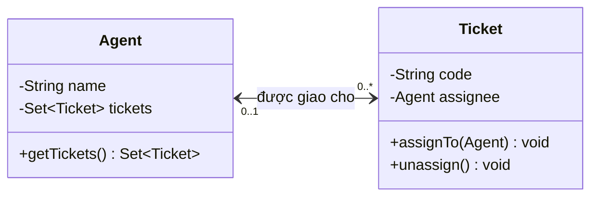
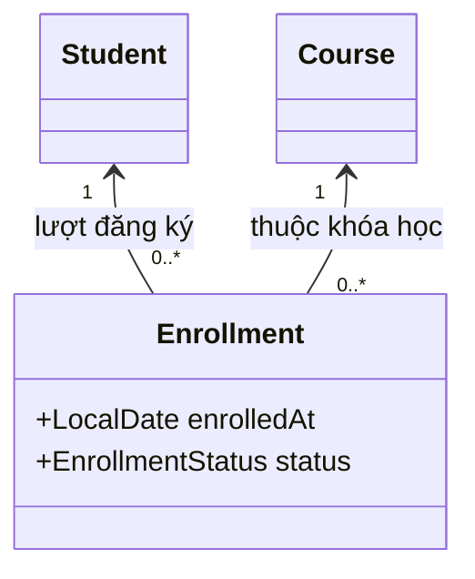

# Liên kết giữa các đối tượng trong OOP (Association)

## 1. Liên kết giữa các đối tượng là gì?

Trong lập trình hướng đối tượng, một **liên kết (link)** là mối quan hệ cụ thể giữa **những đối tượng đang tồn tại** trong chương trình. Ở mức thiết kế lớp, kiểu quan hệ này thường được gọi là **association** (quan hệ liên kết).

Ví dụ trong hệ thống hỗ trợ khách hàng:

- Một `Ticket` có thể được giao cho một `Agent` (nhân viên hỗ trợ).
- Một `Agent` có thể được giao nhiều `Ticket`.
- Ticket vẫn có thể tồn tại khi chưa được giao cho ai; nhân viên cũng tồn tại mà không cần có ticket.

Nếu ticket `SUP-42` đang được giao cho nhân viên Lan, đó là một **liên kết cụ thể tại thời điểm chạy**. Khi chuyển ticket cho Minh, liên kết thay đổi mà không cần tạo lại lớp hay các đối tượng.

Phân biệt hai cấp độ:

| Cấp độ | Câu hỏi | Ví dụ |
|---|---|---|
| **Quan hệ giữa các lớp** | Các đối tượng của hai lớp *có thể* liên hệ thế nào? | `Ticket` có thể tham chiếu đến `Agent`. |
| **Liên kết giữa các đối tượng** | Hiện tại *đối tượng nào* đang liên hệ với đối tượng nào? | Ticket `SUP-42` đang được giao cho đối tượng Lan. |

Java thường biểu diễn liên kết bằng **tham chiếu đối tượng** nằm trong trường (field), phần tử của `List`/`Set`, hoặc cấu trúc quản lý quan hệ. Hai biến cùng trỏ đến một object **không tạo ra hai object**.

## 2. Đọc một quan hệ: chiều truy cập và số lượng

Một **association** trả lời “ai liên hệ với ai?”; hai thuộc tính cần xác định thêm là **hướng truy cập** (*navigability*) và **bội số** (*multiplicity*).

- **Một chiều:** `Ticket` giữ `Agent assignee`, nhưng `Agent` không giữ danh sách ticket. Muốn tìm các ticket của Lan có thể hỏi repository.
- **Hai chiều:** ngoài `Ticket.assignee`, `Agent` giữ `Set<Ticket>`. Cả hai đường đi cần được đồng bộ khi phân công/chuyển/gỡ.

| Bội số | Ý nghĩa trong mô hình hỗ trợ |
|---|---|
| `0..1` gần `Agent` | Một ticket có thể chưa phân công hoặc có một agent |
| `0..*` gần `Ticket` | Một agent có thể phụ trách 0 hoặc nhiều ticket |

Bội số **đặt sát đầu nào thì đếm số đối tượng ở đầu đó ứng với một đối tượng phía bên kia**. Các ràng buộc khác như `1`, `1..*`, `m..n` và cách hiện thực 1–1/1–N/N–N là trọng tâm của bài **Số lượng: một-một, một-nhiều và nhiều-nhiều**.



Sơ đồ và ví dụ hai chiều dưới đây thống nhất: `Ticket` tìm người phụ trách, còn `Agent` tìm các ticket đang được giao. **Hai chiều không đồng nghĩa sở hữu vòng đời**: gỡ ticket khỏi Lan không làm đối tượng Lan biến mất.

## 3. Ví dụ Java chạy được: liên kết hai chiều có thể thay đổi

Tạo một tệp tên `AssociationDemo.java`:

```java
import java.util.Collections;
import java.util.LinkedHashSet;
import java.util.Objects;
import java.util.Set;

public class AssociationDemo {

    static final class Agent {
        private final String name;
        private final Set<Ticket> tickets = new LinkedHashSet<>();

        Agent(String name) {
            this.name = Objects.requireNonNull(name, "name");
            if (name.isBlank()) {
                throw new IllegalArgumentException("name must not be blank");
            }
        }

        String getName() {
            return name;
        }

        // Trả về bản sao chỉ đọc để bên ngoài không phá quan hệ.
        Set<Ticket> getTickets() {
            return Collections.unmodifiableSet(
                    new LinkedHashSet<>(tickets));
        }
    }

    static final class Ticket {
        private final String code;
        private Agent assignee; // null: chưa có người phụ trách

        Ticket(String code) {
            this.code = Objects.requireNonNull(code, "code");
            if (code.isBlank()) {
                throw new IllegalArgumentException("code must not be blank");
            }
        }

        String getCode() {
            return code;
        }

        Agent getAssignee() {
            return assignee;
        }

        void assignTo(Agent next) {
            changeAssignee(Objects.requireNonNull(next, "next"));
        }

        void unassign() {
            changeAssignee(null);
        }

        private void changeAssignee(Agent next) {
            if (assignee == next) {
                return; // Giao lại cùng người: không làm gì.
            }

            Agent previous = assignee;
            if (previous != null) {
                previous.tickets.remove(this);
            }

            assignee = next;

            if (next != null) {
                next.tickets.add(this);
            }
        }
    }

    public static void main(String[] args) {
        Agent lan = new Agent("Lan");
        Agent minh = new Agent("Minh");
        Ticket ticket = new Ticket("SUP-42");

        ticket.assignTo(lan);
        System.out.println(ticket.getAssignee().getName()); // Lan
        System.out.println(lan.getTickets().contains(ticket)); // true

        ticket.assignTo(minh);
        System.out.println(lan.getTickets().contains(ticket)); // false
        System.out.println(minh.getTickets().contains(ticket)); // true

        ticket.unassign();
        System.out.println(ticket.getAssignee() == null); // true
        System.out.println(minh.getTickets().isEmpty()); // true
    }
}
```

Chạy bằng JDK 11 trở lên:

```bash
javac AssociationDemo.java
java AssociationDemo
```

Kết quả:

```text
Lan
true
false
true
true
true
```

Điểm cốt lõi nằm ở `changeAssignee()`: khi thay người phụ trách, ta **gỡ ticket khỏi tập hợp của agent cũ**, cập nhật tham chiếu, rồi **thêm vào tập hợp của agent mới**. Việc này bảo toàn quy tắc:

```text
agent.getTickets().contains(ticket)
    == (ticket.getAssignee() == agent)
```

Ví dụ đặt hai lớp bên trong `AssociationDemo` để code có thể nằm trong một tệp và giữ các collection ở chế độ `private`. Trong dự án thực, có thể tách ra các tệp riêng và tổ chức thao tác cập nhật quan hệ qua API nội bộ hoặc domain service. Không nên cho bên ngoài gọi `getTickets().add(...)` để thay đổi chỉ một phía.

**Lưu ý về danh tính:** ví dụ giữ `Ticket` trong `Set` theo danh tính đối tượng vì `Ticket` không ghi đè `equals()/hashCode()`. Nếu cần định nghĩa bằng mã ticket, mã phải ổn định và quy tắc equality/hash nhất quán; đổi thuộc tính tham gia hash khi object đã ở trong `HashSet`/`LinkedHashSet` có thể làm hỏng thao tác tìm/xóa.

## 4. Liên kết một chiều: khi nào chỉ cần một tham chiếu?

Nếu yêu cầu chỉ là “xem ai đang phụ trách ticket”, ta có thể loại bỏ `Set<Ticket>` trong `Agent`. Lúc đó:

```java
final class Agent {
    private final String name;
    Agent(String name) { this.name = name; }
    String getName() { return name; }
}

final class Ticket {
    private Agent assignee;

    void assignTo(Agent agent) {
        assignee = Objects.requireNonNull(agent);
    }

    Agent getAssignee() {
        return assignee;
    }
}
```

Phiên bản này đơn giản hơn, nhưng không thể trực tiếp hỏi `agent.getTickets()`. Muốn tìm tất cả ticket của Lan, ứng dụng phải duyệt tập ticket, truy vấn repository hoặc cơ sở dữ liệu.

Chọn **một chiều** khi không cần điều hướng ngược; chọn **hai chiều** khi nghiệp vụ truy cập cả hai hướng và có nơi chịu trách nhiệm đồng bộ. “Có quan hệ về mặt nghiệp vụ” không đồng nghĩa “cả hai lớp bắt buộc phải chứa field tham chiếu đến nhau”.

## 5. Khi liên kết có nhiều đối tượng hoặc có thông tin riêng

- **Một–một:** một `Employee` có tối đa một `AccessCard` và ngược lại, nếu chính sách yêu cầu.
- **Một–nhiều:** một `Agent` có thể phụ trách nhiều `Ticket`, nhưng mỗi ticket có tối đa một người phụ trách.
- **Nhiều–nhiều:** một `Student` học nhiều `Course`; một `Course` có nhiều sinh viên.

Khi **chính liên kết** có ngày đăng ký, trạng thái, điểm hoặc quyền, nên cân nhắc một đối tượng trung gian `Enrollment(student, course, enrolledAt, status)` thay vì hai `Set` tách rời. Một `Enrollment` kết nối đúng một `Student` và một `Course`, đồng thời sở hữu dữ liệu của lần đăng ký.



Đừng suy ra bội số chỉ từ việc có `List` hay `Set`: phải xác định **cả hai phía** và cưỡng chế giới hạn bằng API/DB nếu cần. Bài về multiplicity xây một registry chạy được và kiểm tra đăng ký trùng.

## 6. Phân biệt với các quan hệ thường dễ nhầm

| Khái niệm | Câu hỏi để nhận biết | Ví dụ |
|---|---|---|
| **Association (liên kết)** | Object A biết hoặc có quan hệ thường trực với object B? | Ticket được giao cho Agent. |
| **Dependency (phụ thuộc)** | A chỉ dùng B tạm thời, chẳng hạn trong tham số phương thức? | `ReportService.export(Formatter formatter)`. |
| **Aggregation (kết tập)** | Một object nhóm các object khác, thành viên vẫn có thể tồn tại độc lập? | Đội hỗ trợ gồm các nhân viên. |
| **Composition (hợp thành)** | Thành phần thuộc độc quyền vào toàn thể, vòng đời gắn chặt? | Đơn hàng sở hữu các dòng đơn hàng theo mô hình nghiệp vụ. |
| **Inheritance (kế thừa)** | B có thực sự là một loại A (`is-a`)? | `EmailTicket extends Ticket`. |

Aggregation và composition là các cách mô hình hóa quan hệ toàn thể–thành phần; **một field tham chiếu hay collection tự nó không chứng minh được quy tắc sở hữu và vòng đời**. Đây là quy tắc nghiệp vụ phải được thiết kế, thực thi và kiểm thử.

Không dùng kế thừa chỉ để object này “có” object kia: `Ticket extends Agent` là sai bản chất, vì ticket **được giao cho** nhân viên chứ không **phải là** nhân viên.

## 7. Những lỗi thiết kế liên kết hay gặp

**Chỉ cập nhật một phía.** Nếu đổi `ticket.assignee` mà không sửa `agent.tickets`, hai hướng trả về kết quả khác nhau. Nên có một đầu mối cập nhật quan hệ.

**Trả về collection có thể sửa trực tiếp.** `getTickets()` trả `Set` nội bộ cho bên ngoài gọi `clear()` sẽ phá bất biến. Dùng bản sao chỉ đọc, API thêm/xóa có kiểm soát hoặc chỉ lưu một chiều.

**Không định nghĩa rõ `null` và bội số.** `0..1` cho phép không có người phụ trách; `1` cần từ chối giá trị trống hoặc có cơ chế buộc gán trước khi đối tượng trở thành hợp lệ.

**Giữ cả hai chiều khi không cần.** Nó làm tăng bộ nhớ, mức liên kết giữa lớp và số chỗ phải cập nhật. Hãy xuất phát từ những truy vấn/thao tác thực tế.

**Nhầm object trong RAM với hàng trong database.** Tham chiếu Java là mối quan hệ trong bộ nhớ; khóa ngoại là cách biểu diễn quan hệ trong cơ sở dữ liệu. ORM (chẳng hạn JPA) có quy tắc tải dữ liệu, owning side, cascade và transaction riêng. Không suy ra rằng “có cả hai field Java” thì hai phía ở database tự đồng bộ.

**Quên vấn đề đồng thời.** Ví dụ trên minh họa bất biến trong một luồng. Nếu nhiều luồng cùng phân công một ticket, cần thiết kế đồng bộ/transaction phù hợp; các bước `remove → assign → add` không tự động nguyên tử trong môi trường đa luồng.

## 8. Tự kiểm tra hiểu biết

1. Nếu `Ticket` chỉ có `assignee`, còn `Agent` không có `tickets`, liệu quan hệ “ticket được giao cho nhân viên” có tồn tại không? **Có**: đó là liên kết một chiều.
2. Chuyển ticket từ Lan sang Minh phải thay đổi những dữ liệu nào trong ví dụ hai chiều? **Gỡ khỏi danh sách của Lan, đổi `assignee`, thêm vào danh sách của Minh.**
3. Một ticket chưa có nhân viên phụ trách có trái quy tắc `0..1` không? **Không**: số 0 được chấp nhận.
4. Khi nào nên tạo `Enrollment` thay vì hai tập `Set`? **Khi lần đăng ký có thuộc tính/hành vi/quy tắc riêng** như ngày, trạng thái hay điểm.
5. Việc viết `private Agent assignee;` có tự chứng minh rằng `Agent` sở hữu vòng đời `Ticket` không? **Không**: đó chỉ là tham chiếu; sở hữu vòng đời là một quyết định mô hình hóa khác.

**Ghi nhớ:** association mô tả *ai liên hệ với ai*; multiplicity quy định *bao nhiêu*; navigability quy định *đi từ đâu sang đâu*. Trong Java, hãy đóng gói thao tác tạo, đổi và hủy liên kết để những quy tắc này luôn đúng.