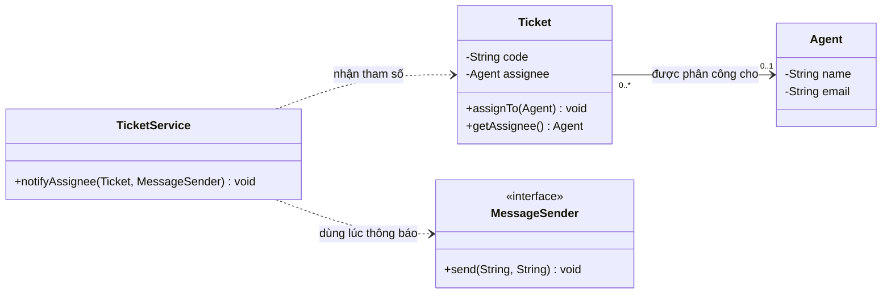

# Sự phụ thuộc tạm thời và liên kết lâu dài trong OOP

## 1. Một đối tượng “dùng” đối tượng khác theo hai cách khác nhau

Giả sử một hệ thống quản lý yêu cầu hỗ trợ (support ticket):

- Ticket **được phân công cho** một nhân viên. Hệ thống cần biết người phụ trách để truy vấn, chuyển giao, hiển thị trạng thái ở những lần thao tác sau.
- Khi gửi thông báo phân công, hệ thống **sử dụng** một bộ gửi tin nhắn trong đúng thao tác gửi. Sau khi gửi xong, đối tượng xử lý không nhất thiết phải giữ bộ gửi đó.

Cả hai đều liên quan đến việc đối tượng này sử dụng đối tượng khác, nhưng **ý nghĩa thiết kế khác nhau**:

- **Sự phụ thuộc tạm thời** (dependency, trong ví dụ là *method-level dependency*) xuất hiện khi một lớp cần lớp khác để thực hiện một thao tác. Ví dụ nhận một tham số, tạo biến cục bộ hoặc gọi hàm tĩnh. Đối tượng sử dụng không nhất thiết giữ tham chiếu đó làm trạng thái lâu dài.
- **Liên kết lâu dài** (association) là mối quan hệ được mô hình hóa giữa các đối tượng, thường được thể hiện bằng tham chiếu hoặc collection được lưu trong field. Liên kết có thể được truy cập ở nhiều thời điểm trong vòng đời của object, cho đến khi bị thay đổi hoặc gỡ bỏ.

**“Tạm thời” và “lâu dài” ở đây nói về cách một đối tượng sử dụng/lưu mối quan hệ, không có nghĩa rằng đối tượng được sử dụng phải được tạo mới hoặc bị hủy khi phương thức kết thúc.** Một bộ gửi tin nhắn dùng qua tham số có thể là singleton tồn tại suốt ứng dụng; một liên kết trong field cũng có thể bị thay đổi chỉ sau một giây.

## 2. Nhận biết qua UML và mã Java

| Tiêu chí | Phụ thuộc tạm thời (dependency) | Liên kết lâu dài (association) |
|---|---|---|
| Câu hỏi chính | “Lớp A cần B để **làm việc gì**?” | “Đối tượng A **đang liên hệ với** đối tượng B nào?” |
| Dấu hiệu phổ biến trong Java | Tham số phương thức, biến cục bộ, lời gọi phương thức tĩnh | Field tham chiếu, collection các đối tượng, cấu trúc quản lý liên kết |
| Thời điểm cần tham chiếu | Khi chạy thao tác liên quan | Giữa nhiều thao tác, khi trạng thái quan hệ còn hiệu lực |
| UML | Mũi tên **nét đứt** từ lớp dùng đến lớp được dùng | **Đường liền**; có thể thêm bội số và chiều truy cập |
| Ví dụ | `TicketService` gọi `MessageSender.send(...)` | `Ticket` giữ `Agent assignee` |
| Hệ quả thường gặp | Thay tham số/implementation có thể thay hành vi xử lý | Thay liên kết làm thay đổi trạng thái nghiệp vụ |
| Điều cần thiết kế | Đầu vào, hợp đồng API, lỗi khi gọi | Bội số, thay thế/gỡ liên kết, tính nhất quán, vòng đời nghiệp vụ |



Đọc sơ đồ:

1. **Đường liền** từ `Ticket` đến `Agent`: ticket có thể giữ tham chiếu đến nhân viên phụ trách; mỗi ticket có `0..1` agent, mỗi agent có thể phụ trách `0..*` ticket.
2. **Đường nét đứt** từ `TicketService` đến `MessageSender`: service cần biết *cách gọi* sender khi thực hiện `notifyAssignee(...)`, nhưng không cần giữ sender trong field.
3. `TicketService` cũng phụ thuộc `Ticket` trong chữ ký của phương thức. Có dependency không nhất thiết phải hình thành một association được lưu lâu dài.

## 3. Ví dụ Java chạy được

Tạo file `RelationshipDemo.java` với nội dung sau (Java 11+):

```java
import java.util.Objects;

public class RelationshipDemo {

    // Đối tượng nghiệp vụ độc lập: một nhân viên có thể phụ trách nhiều ticket.
    static final class Agent {
        private final String name;
        private final String email;

        Agent(String name, String email) {
            this.name = Objects.requireNonNull(name, "name");
            this.email = Objects.requireNonNull(email, "email");
        }

        String getName() {
            return name;
        }

        String getEmail() {
            return email;
        }
    }

    static final class Ticket {
        private final String code;
        private Agent assignee; // Association: giữ tham chiếu sau khi assignTo() kết thúc.

        Ticket(String code) {
            this.code = Objects.requireNonNull(code, "code");
        }

        String getCode() {
            return code;
        }

        Agent getAssignee() {
            return assignee;
        }

        void assignTo(Agent agent) {
            assignee = Objects.requireNonNull(agent, "agent");
        }

        void unassign() {
            assignee = null;
        }
    }

    interface MessageSender {
        void send(String destination, String message);
    }

    static final class ConsoleSender implements MessageSender {
        @Override
        public void send(String destination, String message) {
            System.out.println("To: " + destination + " | " + message);
        }
    }

    static final class TicketService {
        void notifyAssignee(Ticket ticket, MessageSender sender) {
            Objects.requireNonNull(ticket, "ticket");
            Objects.requireNonNull(sender, "sender");

            Agent assignee = ticket.getAssignee();
            if (assignee == null) {
                throw new IllegalStateException("Ticket has no assignee");
            }

            // Dependency tạm thời: chỉ dùng sender trong lời gọi hiện tại.
            sender.send(
                    assignee.getEmail(),
                    "Bạn được giao ticket " + ticket.getCode()
            );
            // Service không lưu sender hoặc ticket vào field.
        }
    }

    public static void main(String[] args) {
        Agent lan = new Agent("Lan", "lan@example.test");
        Agent minh = new Agent("Minh", "minh@example.test");
        Ticket ticket = new Ticket("SUP-42");
        TicketService service = new TicketService();

        ticket.assignTo(lan);
        service.notifyAssignee(ticket, new ConsoleSender());

        // Liên kết Ticket -> Agent vẫn còn sau lần gửi thông báo.
        System.out.println("Phụ trách: " + ticket.getAssignee().getName());

        // Đổi liên kết nghiệp vụ; không thay code gửi thông báo.
        ticket.assignTo(minh);
        service.notifyAssignee(ticket, new ConsoleSender());

        ticket.unassign();
        System.out.println("Chưa phân công: " + (ticket.getAssignee() == null));
    }
}
```

Biên dịch/chạy:

```bash
javac RelationshipDemo.java
java RelationshipDemo
```

Kết quả:

```text
To: lan@example.test | Bạn được giao ticket SUP-42
Phụ trách: Lan
To: minh@example.test | Bạn được giao ticket SUP-42
Chưa phân công: true
```

### Phân tích từng thời điểm

| Thời điểm | Trạng thái `ticket.assignee` | `sender` trong `notifyAssignee` |
|---|---|---|
| Trước `assignTo(lan)` | `null` | Chưa gọi |
| Sau `assignTo(lan)` | Trỏ đến đối tượng Lan | Chưa gọi |
| Trong lần `notifyAssignee(...)` đầu | Vẫn trỏ đến Lan | Có tham chiếu tham số tới `ConsoleSender` |
| Sau lần gọi đầu | Vẫn trỏ đến Lan | `TicketService` không giữ tham chiếu sender |
| Sau `assignTo(minh)` | Trỏ đến Minh | Không ảnh hưởng đến kiểu dependency |
| Sau `unassign()` | `null` | Không ảnh hưởng đến sender |

Lưu ý: việc kết thúc phương thức **không bảo đảm** đối tượng `ConsoleSender` bị thu gom bộ nhớ ngay lập tức. Một object có thể còn được nơi khác tham chiếu. Điểm đáng chú ý là **`TicketService` không lưu nó để dùng ở lần gọi sau**.

## 4. Ba biến thể cho thấy sự khác nhau

### A. Phụ thuộc qua tham số phương thức

```java
void sendReceipt(Receipt receipt, MailGateway gateway) {
    gateway.send(receipt.email(), receipt.body());
}
```

`MailGateway` được gọi trong một thao tác. Bên sử dụng không cần có field `gateway`. Đây là ví dụ rõ ràng về dependency ở mức phương thức. (Đoạn minh họa giả định `Receipt` và `MailGateway` đã được khai báo.)

### B. Liên kết được lưu thành trạng thái

```java
final class ProjectTask {
    private final String code;
    private Agent owner;

    ProjectTask(String code) {
        this.code = code;
    }

    void assign(Agent newOwner) {
        owner = Objects.requireNonNull(newOwner);
    }

    Agent getOwner() {
        return owner;
    }
}
```

`ProjectTask` giữ tham chiếu `owner` sau khi `assign(...)` trả về. Ta có thể truy cập owner sau nhiều thao tác khác nhau. Đó là association một chiều ở cấp đối tượng.

### C. Dependency injection qua constructor: phụ thuộc về thiết kế nhưng có field

```java
final class NotificationService {
    private final MessageSender sender;

    NotificationService(MessageSender sender) {
        this.sender = Objects.requireNonNull(sender);
    }

    void notify(String email) {
        sender.send(email, "Có thông báo mới");
    }
}
```

Ở đây `NotificationService` **phụ thuộc vào hợp đồng** `MessageSender` và lưu tham chiếu được tiêm qua constructor. Vì có field, quan hệ tham chiếu tồn tại giữa các lần gọi phương thức. Trong UML, tùy mức chi tiết của sơ đồ, ta có thể biểu diễn association đến interface hoặc dependency đến abstraction.

Vì thế, **không nên áp dụng máy móc “cứ có dependency thì chỉ sống trong một phương thức” hay “cứ có field thì không phải dependency”**. Dependency là khái niệm rộng: thay đổi định nghĩa của một lớp/interface có thể ảnh hưởng lớp dùng nó. Association mô tả một quan hệ cấu trúc giữa các đối tượng, thường cụ thể hơn.

## 5. Chọn cách biểu diễn nào trong thiết kế thực tế?

Hãy tự hỏi:

1. **Có cần truy vấn quan hệ sau khi thao tác hiện tại kết thúc không?** Nếu cần nhớ “ticket đang thuộc về ai”, hãy mô hình hóa một association bằng trạng thái của object hoặc trong kho dữ liệu.
2. **Đây là dữ liệu nghiệp vụ hay công cụ để làm việc?** Người phụ trách ticket là quan hệ nghiệp vụ; formatter, exporter, sender thường là cộng tác viên phục vụ thao tác.
3. **Nếu thay đối tượng được dùng, ý nghĩa thay đổi là gì?** Đổi `Agent` làm đổi trách nhiệm xử lý ticket; đổi `MessageSender` từ email sang SMS chủ yếu đổi kênh gửi thông báo.
4. **Ai chịu trách nhiệm duy trì liên kết?** Một association hai chiều hoặc quan hệ có ràng buộc bội số cần nơi cập nhật thống nhất. Dependency qua tham số không cần đồng bộ hai phía chỉ vì phương thức dùng đến đối tượng đó.
5. **Số lần gọi và chi phí truyền tham số ra sao?** Nếu hầu hết phương thức trong service đều cần một cộng tác viên ổn định, constructor injection có thể phù hợp hơn việc truyền đi truyền lại tham số. Đây là lựa chọn API/DI, không nhất thiết là mối quan hệ nghiệp vụ lâu dài.

Không có quy tắc “liên kết lâu dài luôn tốt hơn” hay “dependency ngắn hạn luôn ít coupling hơn”. Chọn theo dữ liệu cần giữ, trách nhiệm của lớp, luồng truy cập và khả năng kiểm thử.

## 6. Bội số, khả năng gỡ liên kết và vòng đời

Với `Ticket -> Agent` của ví dụ:

- `0..1` phía `Agent`: một ticket chưa có hoặc có đúng một người phụ trách.
- `0..*` phía `Ticket`: một agent có thể được nhiều ticket trỏ đến.
- `assignTo(...)` đổi người phụ trách; `unassign()` hủy liên kết. **Object Agent không bị xóa** khi ticket bỏ liên kết.
- Java field chỉ lưu **tham chiếu đến object**, không lưu “bản sao” object và không tự tạo ràng buộc cơ sở dữ liệu.

Nếu chỉ lưu field ở phía `Ticket`, ta có association **một chiều**. Muốn từ `Agent` lấy danh sách ticket, phải truy vấn một nguồn dữ liệu khác hoặc thiết kế thêm chiều ngược. Nếu lưu cả hai phía, cần đồng bộ mỗi lần gán/chuyển/gỡ để tránh:

```text
ticket.getAssignee() == lan
nhưng !lan.getTickets().contains(ticket)
```

Association không đồng nghĩa với **composition**: việc ticket giữ agent không khiến ticket sở hữu vòng đời agent. Với thành phần có vòng đời thuộc một “toàn thể”, ta phải thể hiện rõ quy tắc sở hữu đó trong mô hình và code.

## 7. Vì sao phân biệt này hữu ích khi kiểm thử và bảo trì?

**Kiểm thử dependency theo từng thao tác:** triển khai interface giả (fake/stub) và truyền vào phương thức để xác nhận thông báo được gửi đúng đích mà không gọi dịch vụ thật. Ví dụ:

```java
// Minh họa bên trong phương thức kiểm thử cùng phạm vi các lớp demo.
class CapturingSender implements MessageSender {
    String destination;
    String message;

    @Override
    public void send(String destination, String message) {
        this.destination = destination;
        this.message = message;
    }
}

Ticket ticket = new Ticket("SUP-42");
ticket.assignTo(new Agent("Lan", "lan@example.test"));
CapturingSender sender = new CapturingSender();

new TicketService().notifyAssignee(ticket, sender);

if (!"lan@example.test".equals(sender.destination)) {
    throw new AssertionError("Wrong notification destination");
}
if (!sender.message.contains("SUP-42")) {
    throw new AssertionError("Missing ticket code");
}
```

**Kiểm thử association sau nhiều thao tác:** tạo ticket, phân công cho A, đổi sang B, rồi gỡ. Kiểm tra `getAssignee()` sau *mỗi* bước; việc giữ/gỡ link là trạng thái nghiệp vụ cần xác nhận độc lập với thành công của gửi thông báo.

**Ảnh hưởng khi thay đổi thiết kế:** đổi API `MessageSender` có thể khiến `TicketService` phải sửa vì phụ thuộc ở cấp mã nguồn. Đổi bội số hay quy tắc người phụ trách ảnh hưởng mô hình `Ticket`, API gán người, lưu trữ và các tình huống nghiệp vụ. Hai loại thay đổi đòi hỏi phạm vi kiểm thử khác nhau.

## 8. Lỗi thường gặp

| Lỗi | Hậu quả | Hướng xử lý |
|---|---|---|
| Lưu mọi đối tượng sử dụng vào field | State dư thừa, khó theo dõi quan hệ và vòng đời | Dùng tham số/local cho cộng tác viên chỉ cần tại chỗ |
| Chỉ truyền đối tượng nghiệp vụ qua tham số dù phải nhớ qua nhiều thao tác | Mất trạng thái liên kết khi xử lý lần sau | Lưu liên kết ở aggregate/domain model hoặc repository |
| Cho rằng kết thúc phương thức sẽ hủy object tham số | Hiểu sai Java GC và tham chiếu chia sẻ | Phân biệt phạm vi biến tham chiếu với vòng đời object |
| Nhầm field của DI với quan hệ “sở hữu” nghiệp vụ | Áp quy tắc composition/cascade không phù hợp | Tách phụ thuộc dịch vụ và association miền nghiệp vụ |
| Lưu association hai chiều mà chỉ cập nhật một phía | Hai chiều truy cập cho kết quả khác nhau | Đóng gói thao tác gán, chuyển và gỡ quan hệ |
| Đồng nhất dependency với quan hệ UML một chiều | Vẽ sơ đồ mơ hồ, thiếu bội số và trạng thái | Dùng nét đứt cho quan hệ sử dụng; nét liền khi mô hình hóa association |

### Bài tập tự luyện

Thiết kế chức năng xuất hóa đơn gồm `Invoice`, `Customer`, `PdfExporter`.

1. Mỗi hóa đơn thuộc một khách hàng và cần tra lại khách hàng trong các lần xem sau. Quan hệ nào? **Association** giữa `Invoice` và `Customer`.
2. Khi bấm nút xuất PDF, phương thức nhận `PdfExporter` để dựng file, không giữ exporter. Quan hệ nào? **Dependency ở mức phương thức**.
3. Nếu `InvoiceService` nhận `PdfExporter` trong constructor và giữ field để dùng nhiều lần thì sao? Service **phụ thuộc vào abstraction của exporter** và đồng thời giữ **tham chiếu cấu trúc dài hơn một lời gọi**.
4. Việc đổi PDF exporter có khiến khách hàng của hóa đơn thay đổi không? **Không**: đây là hai quan hệ phục vụ hai trách nhiệm khác nhau.
5. Xóa liên kết invoice–customer có đồng nghĩa xóa object customer không? **Không**: association không tự quyết định quyền sở hữu hay vòng đời.

**Cốt lõi:** dependency trả lời “**cần ai để thực hiện thao tác?**”, association trả lời “**đang liên hệ với ai như một phần trạng thái/mô hình?**”. Trong Java, hãy xem kỹ nơi lưu tham chiếu, mục đích nghiệp vụ và thời gian cần truy cập quan hệ; đừng kết luận chỉ dựa vào tuổi thọ của object hoặc sự xuất hiện của một kiểu trong source code.