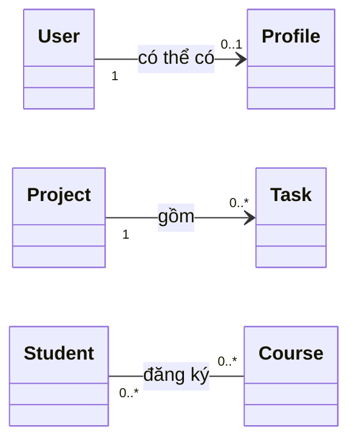
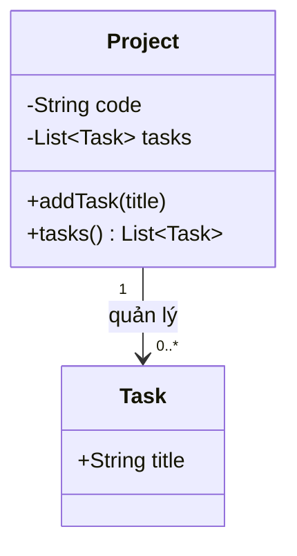
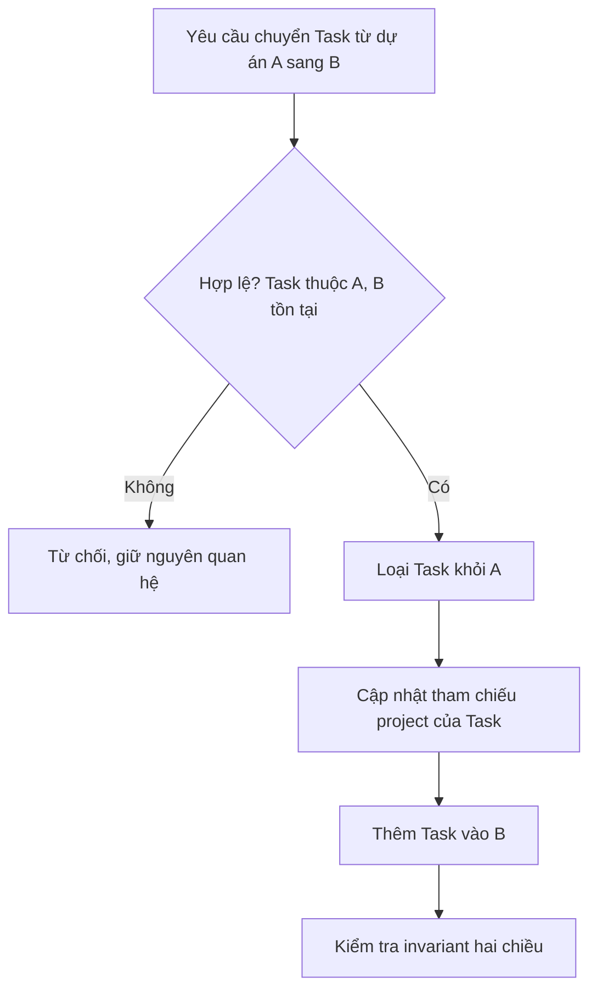
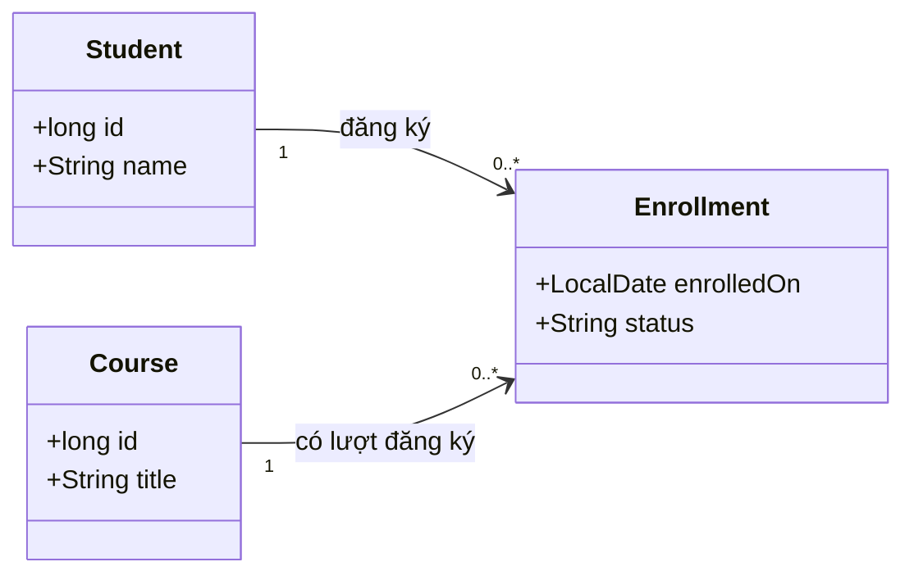

# Số lượng trong quan hệ OOP: một–một, một–nhiều và nhiều–nhiều

**Phạm vi:** Quan hệ giữa các đối tượng trong lập trình hướng đối tượng (OOP), cách mô tả số lượng bằng UML (*multiplicity/cardinality*) và cách cài đặt, duy trì quy tắc nghiệp vụ bằng Java.

Một quan hệ như “sinh viên học môn học” vẫn chưa đủ để thiết kế class. Cần hỏi thêm: **mỗi sinh viên được học bao nhiêu môn, và mỗi môn có bao nhiêu sinh viên?** Số lượng ở hai phía quyết định cấu trúc dữ liệu, API cập nhật, cách bảo vệ tính nhất quán và đôi khi cả thiết kế lưu trữ.

## 1. Đọc đúng số lượng quan hệ

Trong UML, số lượng được đặt **ở đầu gần lớp mà nó đếm**. Ví dụ `Department "1" -- "0..*" Employee` có nghĩa:

- Một `Department` có thể liên kết với **0 hoặc nhiều** `Employee`.
- Mỗi `Employee` liên kết với **đúng 1** `Department` theo mô hình này.

| Ký hiệu UML | Ý nghĩa | Ví dụ |
| --- | --- | --- |
| `1` | Chính xác một | Mỗi phiếu bảo hành thuộc đúng một sản phẩm trong hệ thống đã chọn |
| `0..1` | Không có hoặc có một | Người dùng có thể chưa tạo hồ sơ mở rộng |
| `0..*` (hoặc `*`) | Không hoặc nhiều | Dự án mới chưa có công việc |
| `1..*` | Ít nhất một | Nhóm được yêu cầu có ít nhất một thành viên |
| `2..5` | Từ hai đến năm | Một bàn đăng ký từ 2–5 người, theo quy tắc đặt bàn của ứng dụng |

`1`, `0..1`, `0..*` là **ràng buộc số lượng** trong mô hình, không phải kiểu dữ liệu Java. Một trường đơn (`User owner`) hay tập hợp (`List<Task>`) chỉ là cách cài đặt; chúng không tự bảo đảm quy tắc đó.

### Ba kiểu quan hệ quen thuộc



| Kiểu | Nhìn từ A | Nhìn từ B | Ví dụ thực tế |
| --- | --- | --- | --- |
| Một–một (1–1) | Mỗi A có tối đa/đúng một B tùy ràng buộc | Mỗi B có tối đa/đúng một A | Một tài khoản có một hồ sơ do hệ thống cấp |
| Một–nhiều (1–N) | Một A có nhiều B | Mỗi B thuộc một A trong phạm vi mô hình | Một dự án có nhiều công việc |
| Nhiều–nhiều (N–N) | Một A liên kết nhiều B | Một B liên kết nhiều A | Sinh viên đăng ký nhiều khóa học, mỗi khóa có nhiều sinh viên |

**Chú ý:** 1–1 không có nghĩa luôn là `1` ở cả hai đầu. `1`–`0..1` vẫn thường được gọi là quan hệ một–một *tùy chọn* ở một phía. Tương tự, 1–N có thể là `1`–`0..*` hoặc `1`–`1..*`, tùy nghiệp vụ.

## 2. Quan hệ một–một: đúng một hay tối đa một?

Ví dụ: mỗi `User` luôn có một `Profile` được khởi tạo cùng lúc. Quan hệ được thiết kế là `User (1) -> Profile (1)`. Một biến tham chiếu thể hiện thuận tiện một đầu quan hệ:

```java
final class User {
    private final Profile profile;

    User(String displayName) {
        this.profile = new Profile(displayName);
    }

    Profile profile() {
        return profile;
    }
}

record Profile(String displayName) { }
```

Ở đây, constructor `User` luôn tạo `Profile`; sau khi tạo thành công, `profile` không thể bị gán lại. Nếu constructor nhận `Profile` từ ngoài, cần kiểm tra `null` và xác định một `Profile` có được chia sẻ hay không.

Một biến tham chiếu `Profile profile` **không tự bảo đảm tính duy nhất trên toàn hệ thống**. Ví dụ:

```java
Profile shared = new Profile("An");
// Hai object khác nhau vẫn có thể trỏ tới cùng shared
// nếu API cho phép truyền shared vào constructor.
```

Nếu quy tắc yêu cầu “mỗi hồ sơ chỉ thuộc một người”, phải bảo đảm bằng API/domain service, registry hoặc ràng buộc duy nhất tại tầng lưu trữ. `private` và `final` chỉ hạn chế truy cập/gán lại ở một vị trí, không tạo luật một–một toàn cục.

**Biến thể tùy chọn `0..1`:** tài khoản có thể chưa hoàn thiện hồ sơ. Có thể dùng `Profile profile` là `null` với hợp đồng rõ ràng, hoặc `Optional<Profile>` làm kiểu **trả về** của getter. Không nên nhầm `Optional` với lời bảo đảm về tính duy nhất giữa mọi `User`.

## 3. Quan hệ một–nhiều: đối tượng cha và tập hợp con

Một `Project` có nhiều `Task`; một `Task` thuộc đúng một dự án (theo quy tắc ví dụ).



Biểu diễn thường thấy ở phía một:

```java
private final List<Task> tasks = new ArrayList<>();
```

Với quan hệ một–nhiều, bạn cần giải quyết **hai nhóm quy tắc**:

1. **Số lượng:** một dự án có thể có 0 task hay phải có ít nhất 1 task? Số lượng tối đa có giới hạn không?
2. **Tính toàn vẹn:** task có thể chuyển dự án không, ai được thêm/xóa, task trùng nội dung có được xem là hai công việc không?

Nếu `getTasks()` trả trực tiếp danh sách có thể sửa, caller có thể `clear()` hay `add()` để bỏ qua điều kiện nghiệp vụ. Thường nên để đối tượng quản lý cung cấp các hành vi rõ ràng: `addTask`, `removeTask`, `moveTask`, và chỉ trả danh sách đọc/snapshot.

| Cấu trúc | Phù hợp khi | Cần chú ý |
| --- | --- | --- |
| `List<Task>` | Có thứ tự, có thể có các phần tử trùng theo `equals` | Kiểm tra trùng theo ID nếu nghiệp vụ cần |
| `Set<Task>` | Muốn loại trùng theo `equals/hashCode` | Phải định nghĩa equality ổn định |
| `Map<TaskId, Task>` | Tra cứu nhanh và duy nhất theo ID | Phải giữ khóa trùng khớp ID của đối tượng |

**Quan hệ hai chiều:** nếu `Task` cũng có `Project project`, mỗi lần chuyển task phải cập nhật **cả** `oldProject.tasks`, `newProject.tasks` và `task.project` trong một thao tác hợp lệ. Tránh cho mọi caller tùy ý gọi setter ở một phía vì dễ tạo trạng thái “task trỏ về A nhưng chỉ xuất hiện trong danh sách B”.



Trong ứng dụng có giao dịch/cơ sở dữ liệu, toàn bộ cập nhật cần được bao trong transaction thích hợp để tránh trạng thái dở dang khi lỗi.

## 4. Quan hệ nhiều–nhiều: chọn cách biểu diễn có chủ ý

Ví dụ một `Student` có thể học nhiều `Course`, và một `Course` có thể có nhiều `Student`.

Cách trực tiếp trong bộ nhớ là hai tập hợp:

```java
class Student {
    Set<Course> courses = new HashSet<>();
}
class Course {
    Set<Student> students = new HashSet<>();
}
```

Nhưng đoạn phác thảo này chưa an toàn: ai có quyền cập nhật? Nếu chỉ thêm vào `student.courses` mà quên `course.students` thì hai phía mâu thuẫn; nếu dùng `HashSet`, `equals/hashCode` cũng phải ổn định. Các trường trên còn đang có quyền truy cập mặc định và không có kiểm tra nghiệp vụ.

### Dùng đối tượng trung gian khi quan hệ có thông tin riêng

Đăng ký môn học thường có `enrolledOn`, `status`, `grade`… Đây là **thuộc tính của lần đăng ký**, không phải thuộc tính riêng của sinh viên hoặc môn học. Tạo `Enrollment` làm quan hệ có danh tính/quy tắc rõ ràng:



Mỗi `Enrollment` gắn với đúng một `Student` và đúng một `Course`. Nhờ vậy quan hệ N–N ban đầu được biểu diễn bằng **hai quan hệ 1–N** đối với đối tượng trung gian.

Ưu điểm: có thể cấm đăng ký trùng theo cặp `(studentId, courseId)`, lưu thời điểm đăng ký, trạng thái chờ/xác nhận, điểm số, lịch sử nghiệp vụ hoặc những điều kiện riêng của từng khóa học.

Nếu lưu vào cơ sở dữ liệu quan hệ, bảng `enrollment` thường có khóa ngoại `student_id`, `course_id`, cùng ràng buộc unique trên cặp này nếu quy tắc cấm đăng ký trùng. Với JPA/Hibernate, bạn có thể dùng `@ManyToMany` cho quan hệ thuần liên kết, nhưng khi liên kết có dữ liệu riêng, entity `Enrollment` thường rõ ràng và dễ mở rộng hơn. Các annotation không thay thế việc xác định quy tắc cập nhật hai phía hoặc uniqueness.

## 5. Ví dụ Java đầy đủ cho cả ba kiểu

Đặt đoạn dưới vào `MultiplicityDemo.java` (Java 17 trở lên). Ví dụ cố ý quản lý quan hệ nhiều–nhiều ở một registry duy nhất; lớp `Student` và `Course` không cần tự giữ hai danh sách có thể lệch nhau.

```java
import java.time.LocalDate;
import java.util.ArrayList;
import java.util.LinkedHashMap;
import java.util.List;
import java.util.Map;
import java.util.Objects;

public class MultiplicityDemo {

    // 1–1 bắt buộc: mỗi User tạo đúng một Profile.
    static final class User {
        private final String email;
        private final Profile profile;

        User(String email, String displayName) {
            this.email = nonBlank(email, "email");
            this.profile = new Profile(nonBlank(displayName, "displayName"));
        }

        Profile profile() {
            return profile;
        }
    }

    record Profile(String displayName) { }

    // 1–N: mỗi Project quản lý từ 0 đến nhiều Task.
    static final class Project {
        private final String code;
        private final List<Task> tasks = new ArrayList<>();

        Project(String code) {
            this.code = nonBlank(code, "code");
        }

        void addTask(String title) {
            tasks.add(new Task(nonBlank(title, "title")));
        }

        List<Task> tasks() {
            return List.copyOf(tasks); // snapshot không thể chỉnh danh sách
        }
    }

    record Task(String title) { }

    record Student(long id, String name) {
        Student {
            if (id <= 0) throw new IllegalArgumentException("student id");
            name = nonBlank(name, "student name");
        }
    }

    record Course(long id, String title) {
        Course {
            if (id <= 0) throw new IllegalArgumentException("course id");
            title = nonBlank(title, "course title");
        }
    }

    // Khóa liên kết: cùng sinh viên + cùng khóa học => cùng một đăng ký.
    record EnrollmentKey(long studentId, long courseId) { }

    record Enrollment(Student student, Course course, LocalDate enrolledOn) {
        Enrollment {
            Objects.requireNonNull(student, "student");
            Objects.requireNonNull(course, "course");
            Objects.requireNonNull(enrolledOn, "enrolledOn");
        }
    }

    static final class EnrollmentRegistry {
        private final Map<EnrollmentKey, Enrollment> byPair =
                new LinkedHashMap<>();

        boolean enroll(Student student, Course course, LocalDate day) {
            Objects.requireNonNull(student, "student");
            Objects.requireNonNull(course, "course");
            Objects.requireNonNull(day, "day");

            EnrollmentKey key = new EnrollmentKey(student.id(), course.id());
            if (byPair.containsKey(key)) return false;

            byPair.put(key, new Enrollment(student, course, day));
            return true;
        }

        List<Enrollment> forStudent(Student student) {
            Objects.requireNonNull(student, "student");
            return byPair.values().stream()
                    .filter(e -> e.student().id() == student.id())
                    .toList();
        }

        int count() {
            return byPair.size();
        }
    }

    private static String nonBlank(String text, String field) {
        if (text == null || text.isBlank()) {
            throw new IllegalArgumentException(field + " must not be blank");
        }
        return text;
    }

    public static void main(String[] args) {
        User user = new User("an@example.com", "An");
        System.out.println(user.profile().displayName());

        Project project = new Project("P-01");
        project.addTask("Phan tich");
        project.addTask("Kiem thu");
        System.out.println(project.tasks().size());

        Student an = new Student(1, "An");
        Student binh = new Student(2, "Binh");
        Course java = new Course(10, "Java OOP");
        Course sql = new Course(11, "SQL");

        EnrollmentRegistry registry = new EnrollmentRegistry();
        System.out.println(registry.enroll(an, java, LocalDate.of(2026, 10, 1)));
        System.out.println(registry.enroll(an, java, LocalDate.of(2026, 10, 2)));
        registry.enroll(an, sql, LocalDate.of(2026, 10, 3));
        registry.enroll(binh, java, LocalDate.of(2026, 10, 3));

        System.out.println(registry.forStudent(an).size());
        System.out.println(registry.count());
    }
}
```

Chạy:

```bash
javac MultiplicityDemo.java
java MultiplicityDemo
```

Kết quả dự kiến:

```text
An
2
true
false
2
3
```

Giải thích:

- `User` tạo một `Profile` trong constructor. Đây là cách thiết kế 1–1 bắt buộc trong phạm vi instance ở ví dụ.
- `Project` có hai `Task`; `List.copyOf` ngăn caller sửa danh sách qua getter. Vì `Task` là record với thành phần `String` bất biến, caller cũng không thể sửa trực tiếp các phần tử.
- `EnrollmentRegistry` lưu một liên kết cho mỗi cặp ID. Đăng ký lặp `(1, 10)` trả `false` và không tạo bản ghi mới.
- Một sinh viên có 2 đăng ký; tổng registry có 3 đăng ký. Một course `java` được hai sinh viên cùng học, thể hiện N–N.

**Giới hạn của demo:** `EnrollmentRegistry` chạy trong bộ nhớ, giả định mã định danh sinh viên/khóa học là duy nhất, không xác thực chúng đã tồn tại trong kho dữ liệu và **chưa thread-safe**. Trong hệ thống nhiều request chạy đồng thời, cần kiểm soát giao dịch và ràng buộc unique ở database; thao tác kiểm tra `containsKey` rồi `put` không tự là thao tác nguyên tử.

## 6. Số lượng quan hệ không đồng nghĩa với ownership

Phân biệt hai câu hỏi độc lập:

- **Multiplicity:** có thể có **bao nhiêu** đối tượng ở mỗi đầu?
- **Loại quan hệ/vòng đời:** đối tượng này **tham chiếu, chia sẻ, quản lý hay sở hữu** đối tượng kia theo quy tắc nào?

Ví dụ, `Project 1 -- 0..* Task` có thể được mô hình hóa thành association với task còn tồn tại sau khi chuyển dự án, hoặc thành composition nếu task chỉ có ý nghĩa trong vòng đời dự án. Cùng là 1–N nhưng hành vi xóa/chuyển và quyền sở hữu khác nhau.

**Hướng điều hướng (*navigability*)** cũng độc lập với multiplicity: `Project` có thể biết danh sách `Task`, `Task` có thể biết `Project`, cả hai bên cùng biết hoặc dùng registry/query service để tra cứu. Việc có hai trường tham chiếu không biến 1–N thành N–N.

## 7. Bất biến cần giữ theo từng kiểu

| Kiểu | Bất biến quan trọng | Chỗ nên cưỡng chế |
| --- | --- | --- |
| 1–1 bắt buộc | A có đúng một B, B không thuộc hai A nếu quy tắc yêu cầu | Constructor/factory; kiểm tra domain; unique ở lưu trữ |
| 1–1 tùy chọn | A có tối đa một B; có thể chưa có | Phương thức gán/gỡ, ràng buộc unique và khả năng null rõ ràng |
| 1–N | Child thuộc đúng một owner, không xuất hiện ở hai tập hợp trái quy tắc | Thao tác thêm/chuyển/xóa tập trung |
| N–N | Cặp A–B hợp lệ, không bị trùng nếu ứng dụng yêu cầu | Association object/registry; unique composite key |
| Mọi kiểu | Không có liên kết mồ côi, sai trạng thái, hoặc sửa được bằng đường tắt | Encapsulation, validation, transaction, test |

Một số sai lầm phổ biến:

1. **Nghĩ `List` nghĩa là nhiều–nhiều.** `List` chỉ là tập hợp ở một đầu; muốn biết 1–N hay N–N phải xét cả số lượng ở đầu còn lại.
2. **Nghĩ `@OneToOne` hoặc một field là đủ.** Quy tắc duy nhất/không-null còn phụ thuộc mô hình, API và cấu hình lưu trữ.
3. **Quên đối tượng trung gian khi quan hệ có thuộc tính.** `Enrollment.grade` không phải điểm chung của mọi khóa học hay điểm chung của mọi sinh viên.
4. **Cập nhật quan hệ hai chiều một nửa.** Chỉ thêm vào một collection làm dữ liệu bộ nhớ không nhất quán.
5. **Trả về collection mutable nội bộ.** Caller có thể phá vỡ min/max, quy tắc trùng hoặc liên kết ngược.
6. **Dùng `Set` nhưng `equals/hashCode` phụ thuộc field mutable.** Thay đổi field khi object đang trong hash collection có thể làm tra cứu/xóa sai.
7. **Bỏ qua tranh chấp đồng thời.** Hai request cùng kiểm tra “chưa có liên kết” vẫn có thể cùng ghi; cần unique constraint/giao dịch phù hợp.

## 8. Luyện tập áp dụng

**Bài A — Nhận diện multiplicity.** Vẽ UML cho các yêu cầu:

- Một khách hàng có thể có từ 0 đến nhiều địa chỉ giao hàng; mỗi địa chỉ trong mô hình gắn với đúng một khách hàng.
- Một nhân viên có thể được cấp 0 hoặc 1 thẻ ra vào, mỗi thẻ gắn đúng một nhân viên.
- Một tác giả viết nhiều cuốn sách, một cuốn có thể có nhiều tác giả.

**Bài B — Cài đặt 1–N có giới hạn.** `Team` có **1 đến 5** thành viên; cấm thành viên trùng ID. Thiết kế `addMember`/`removeMember`. Khi tạo team phải có ít nhất một thành viên; khi xóa thành viên cuối cùng phải từ chối hoặc hủy team theo nghiệp vụ.

**Bài C — Mở rộng N–N.** Thêm `status` (`PENDING`, `ACTIVE`, `CANCELLED`) và `grade` vào `Enrollment`. Quyết định việc đăng ký lại một khóa đã hủy là *cập nhật bản ghi cũ* hay *tạo lần đăng ký mới*, từ đó chọn key/unique constraint hợp lý. Phương án đúng phụ thuộc quy tắc lưu lịch sử.

**Bài D — Review code.** Cho `Course` chứa `List<Student>` nhưng `Student` không giữ danh sách course. Hãy giải thích vì sao vẫn **có thể** là N–N; đề xuất cách truy vấn “những khóa của sinh viên X” qua repository/registry mà không cần cập nhật hai collection.

### Tự kiểm tra trước khi kết thúc thiết kế

Với mỗi quan hệ, hãy phát biểu thành hai câu: “**một A có bao nhiêu B?**” và “**một B có bao nhiêu A?**”. Ghi rõ `0` có hợp lệ không, yêu cầu tính duy nhất, cách tạo/gỡ/chuyển liên kết và nơi duy trì bất biến. Chỉ sau đó mới chọn field đơn, `List`, `Set`, `Map` hoặc class liên kết.