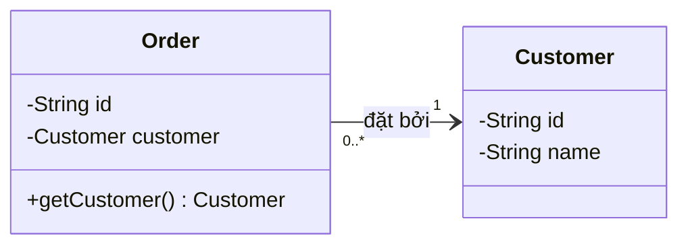
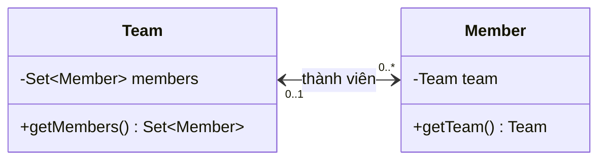
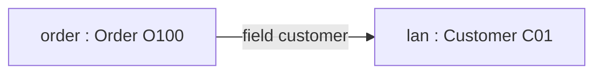
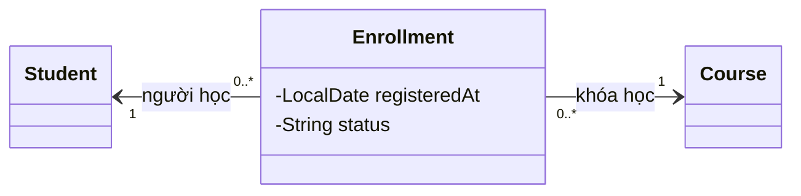
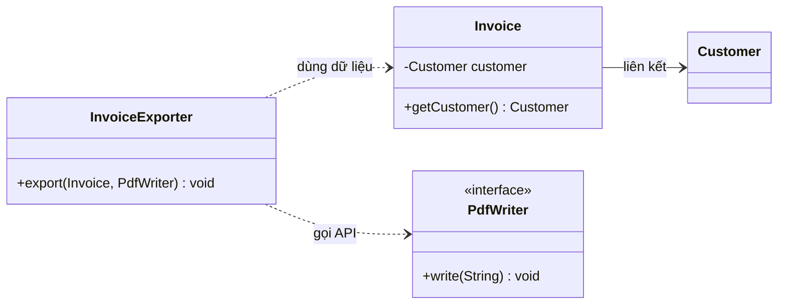

# Hướng liên kết và khả năng điều hướng trong OOP

## 1. Hướng liên kết là gì?

Trong mô hình hướng đối tượng, **association** mô tả quan hệ giữa các đối tượng. **Khả năng điều hướng (navigability)** cho biết một đối tượng có thể **đi theo quan hệ để tìm đối tượng ở đầu bên kia** hay không.

Ví dụ một hệ thống quản lý bán hàng:

- Từ một đơn hàng, ta cần tìm được khách hàng đặt đơn để hiển thị tên và địa chỉ giao hàng.
- Từ một khách hàng, ta *có thể* cần liệt kê tất cả đơn hàng của khách đó.
- Hai yêu cầu truy cập này **khác nhau**: triển khai chiều `Order → Customer` không tự tạo chiều `Customer → Order`.

Hãy phân biệt ba khái niệm:

| Khái niệm | Câu hỏi thiết kế | Ví dụ |
|---|---|---|
| **Association** | Hai loại đối tượng có quan hệ nghiệp vụ gì? | Đơn hàng thuộc về khách hàng. |
| **Navigability** | Đứng tại object A, ta truy cập trực tiếp được object B qua quan hệ không? | `order.getCustomer()`. |
| **Multiplicity** | Một object được liên kết với bao nhiêu object của phía kia? | Một đơn hàng có đúng một khách; một khách có nhiều đơn. |

**Hướng liên kết không phải hướng luồng dữ liệu, luồng điều khiển, hay chiều tạo object.** Một khách hàng có thể được tạo trước đơn hàng, trong khi quan hệ vẫn chỉ cho phép điều hướng từ `Order` sang `Customer`.

## 2. Cách đọc ký hiệu UML

### Liên kết một chiều



Đọc sơ đồ như sau:

- Đường **liền có mũi tên `Order → Customer`**: từ object đơn hàng có thể truy cập object khách hàng.
- Số `1` gần `Customer`: **mỗi đơn hàng gắn với đúng một khách hàng**.
- Số `0..*` gần `Order`: **mỗi khách hàng có thể có từ 0 đến nhiều đơn hàng**.
- Không có field `orders` trong `Customer`: điều hướng ngược không khả dụng trực tiếp bằng cách gọi trên object `Customer`. Tuy nhiên có thể truy vấn qua repository hoặc các cấu trúc khác.

**Quy tắc đọc bội số:** ký hiệu đặt cạnh *đầu nào* thì cho biết số đối tượng ở đầu đó mà *một đối tượng phía đối diện* có thể liên kết tới.

### Liên kết hai chiều



Đọc sơ đồ:

- `Team` cho phép tìm các `Member` hiện thuộc nhóm.
- `Member` cho phép tìm `Team` hiện phụ trách mình.
- `0..1` cạnh `Team`: một thành viên thuộc tối đa một nhóm tại một thời điểm.
- `0..*` cạnh `Member`: một nhóm có thể có nhiều thành viên.

Trong UML, **một đường association không có mũi tên không đủ để kết luận nó hai chiều**: tùy ký pháp và quy ước sơ đồ, việc không ghi mũi tên có thể chỉ là **chưa chỉ rõ navigability**. Nếu cần làm rõ hai chiều, hãy chỉ định rõ cả hai hướng trong mô hình hoặc chú thích bằng lời.

## 3. Quan hệ một chiều trong Java: chỉ lưu đường cần đi

Tạo tệp `UnidirectionalDemo.java`:

```java
import java.util.Objects;

public class UnidirectionalDemo {

    static final class Customer {
        private final String id;
        private final String name;

        Customer(String id, String name) {
            this.id = Objects.requireNonNull(id);
            this.name = Objects.requireNonNull(name);
        }

        String getId() {
            return id;
        }

        String getName() {
            return name;
        }
    }

    static final class Order {
        private final String id;
        private final Customer customer;

        Order(String id, Customer customer) {
            this.id = Objects.requireNonNull(id);
            this.customer = Objects.requireNonNull(customer);
        }

        Customer getCustomer() {
            return customer;
        }

        String getId() {
            return id;
        }
    }

    public static void main(String[] args) {
        Customer lan = new Customer("C01", "Lan");
        Order order = new Order("O100", lan);

        // Điều hướng hợp lệ: từ Order đến Customer.
        System.out.println(order.getCustomer().getName()); // Lan
        System.out.println(order.getId());                 // O100

        // Không có lan.getOrders(): Customer không lưu chiều ngược.
    }
}
```

Chạy:

```bash
javac UnidirectionalDemo.java
java UnidirectionalDemo
```

Kết quả:

```text
Lan
O100
```

Điều gì xảy ra ở bộ nhớ?



`order` giữ **tham chiếu** tới `lan`, không chứa một bản sao `Customer`. Trong Java, việc `Customer` không có field `orders` chỉ nói rằng nó **không nắm sẵn cách điều hướng ngược theo thiết kế này**. Ta vẫn có thể tìm các `Order` theo customer bằng kho dữ liệu hoặc bằng cách duyệt tập hợp các đơn hàng.

**Khi phù hợp:** ứng dụng thường cần từ đơn hàng xem khách; trang lịch sử mua hàng có thể dùng repository để truy vấn, không cần tải/giữ tất cả đơn hàng trong mỗi `Customer`.

## 4. Nếu thực sự cần hai hướng: đồng bộ đúng một liên kết

Với `Team ↔ Member`, mỗi `Member` thuộc tối đa một `Team`. Nếu `Member.team == t`, tập `t.members` phải chứa đúng member đó; khi chuyển nhóm, phải **gỡ nhóm cũ → đổi tham chiếu → thêm nhóm mới**.

Ví dụ Java 11+ dưới đây dùng một cổng cập nhật và giữ hai tham chiếu trong cùng một đối tượng đồ thị. Lưu là `BidirectionalNavigationDemo.java`:

```java
import java.util.LinkedHashSet;
import java.util.Set;

public class BidirectionalNavigationDemo {
    static final class Team {
        private final Set<Member> members = new LinkedHashSet<>();

        Set<Member> members() {
            return Set.copyOf(members);
        }
    }

    static final class Member {
        private Team team;

        Team team() {
            return team;
        }

        void moveTo(Team next) {
            if (team == next) return;
            if (team != null) team.members.remove(this);
            team = next;
            if (next != null) next.members.add(this);
        }
    }

    public static void main(String[] args) {
        Team first = new Team();
        Team second = new Team();
        Member member = new Member();

        member.moveTo(first);
        member.moveTo(second);

        System.out.println(first.members().isEmpty());       // true
        System.out.println(second.members().contains(member)); // true
        System.out.println(member.team() == second);          // true
    }
}
```

```bash
javac BidirectionalNavigationDemo.java
java BidirectionalNavigationDemo
```

Kết quả: ba dòng `true`. Hai kiểu lồng nhau dùng cùng enclosing class nên được phép truy cập các trường `private` của nhau theo quy tắc Java. `Member` là nơi cập nhật duy nhất; `Team.members()` trả snapshot, không cho caller phá liên kết bằng `add/remove` ở ngoài.

Đây mới là demo đơn luồng tối giản, **chưa có validation sức chứa, xử lý lỗi giữa chừng hay khóa đồng thời**. Bài **Quan hệ hai chiều và giữ dữ liệu nhất quán** phát triển cùng ý tưởng thành một chuyển phòng ban có kiểm tra trước khi sửa, ca phòng đầy, invariant tests và ví dụ JPA. Đừng thêm hướng ngược chỉ để “sơ đồ đầy đủ” nếu ứng dụng không cần truy vấn ngược.

## 5. Lựa chọn 1 chiều hay 2 chiều: dựa trên truy vấn thực tế

| Tình huống | Hướng nên cân nhắc | Lý do |
|---|---|---|
| Hiển thị khách hàng của một đơn hàng | `Order → Customer` | Đơn hàng cần khách hàng, ít phải quản lý thêm trạng thái |
| Hiển thị đơn hàng đã mua của khách hàng | Truy vấn repository, hoặc chiều `Customer → Order` khi phù hợp | Không nhất thiết phải giữ mọi đơn trong RAM của customer |
| Mỗi thành viên phải biết nhóm; nhóm cần danh sách thành viên để phân công | Hai chiều `Team ↔ Member` | Nghiệp vụ thường xuyên tra cả hai hướng |
| Kiểm tra quyền của một tài liệu thông qua chủ sở hữu | `Document → Owner` | Đối tượng tài liệu đủ thông tin kiểm tra |
| Nhiều-nhiều giữa học viên và khóa học, đăng ký có ngày/trạng thái riêng | `Enrollment` làm đối tượng trung gian | Liên kết có dữ liệu và quy tắc riêng |

Có thể dùng association hai chiều khi miền nghiệp vụ thực sự cần. Tuy nhiên **không cần xây cả hai chiều chỉ vì quan hệ về mặt logic là đối xứng**. Việc thêm field ngược có chi phí: phải đồng bộ, dễ gặp vòng tham chiếu và thường khiến các lớp gắn chặt hơn.

### Ví dụ: nhiều-nhiều và lớp liên kết

Nếu một sinh viên đăng ký nhiều khóa học và một khóa học có nhiều sinh viên, việc biểu diễn mỗi phía bằng `Set` có thể đủ khi quan hệ chỉ là một cặp. Nhưng nếu “đăng ký học” có `registeredAt`, `status`, `finalGrade`, hãy tạo `Enrollment`:



Lớp `Enrollment` nắm thông tin của **chính mối liên kết**. Từ Student hoặc Course có điều hướng ngược đến Enrollment hay không vẫn là quyết định độc lập, tùy cách thiết kế field và truy vấn.

## 6. Hai cách thể hiện hướng trong thiết kế

**Hướng cấu trúc trong object graph:** object A có field tham chiếu đến object B. Ví dụ `member.getTeam()` hoạt động nhờ `Member.team`.

**Hướng truy vấn qua repository:** A không giữ field/collection B nhưng application vẫn tìm được B bằng một truy vấn. Ví dụ:

```java
interface OrderRepository {
    // Chỉ là contract minh họa, triển khai qua JDBC/JPA/...
    java.util.List<Order> findByCustomerId(String customerId);
}

// Ở service:
java.util.List<Order> orders = repository.findByCustomerId(customer.getId());
```

Đoạn trên **không tự làm `Customer` trở thành association hai chiều trong object graph**; nó chỉ chứng minh nghiệp vụ có thể lấy dữ liệu chiều ngược thông qua một thành phần khác. Trong thực tế, việc ánh xạ SQL/JPA, lazy loading và cache ảnh hưởng đến hiệu năng, nhưng không thay đổi ý nghĩa của chiều trong sơ đồ đối tượng.

## 7. Hướng điều hướng và quan hệ phụ thuộc có phải cùng một thứ?

Không. UML có các loại quan hệ khác nhau:

- **Association** (đường liền): thể hiện liên kết giữa các instance; navigability mô tả có thể truy cập một đầu từ đầu kia.
- **Dependency** (đường nét đứt với mũi tên): một thành phần sử dụng hoặc phụ thuộc định nghĩa của thành phần kia, ví dụ service nhận interface làm tham số.
- **Inheritance/generalization** (đường liền, tam giác rỗng hướng về lớp cha): quan hệ “là một loại”, không phải chỉ đường điều hướng giữa hai object.

Ví dụ:



`InvoiceExporter` có thể sử dụng `Invoice` và `PdfWriter` trong một lời gọi mà không giữ chúng thành trạng thái. Mũi tên dependency không nói rằng có một liên kết object lâu dài hoặc rằng `PdfWriter` biết ngược trở lại exporter.

## 8. Những lỗi quyết định khả năng điều hướng

| Lỗi thiết kế | Hệ quả | Cách cải thiện |
|---|---|---|
| Thêm field chiều ngược mà không có yêu cầu truy vấn | Tăng trạng thái phải đồng bộ và khả năng vòng tham chiếu | Dùng một chiều + repository nếu đủ |
| `getMembers()` trả collection nội bộ sửa được | Caller có thể bỏ qua cổng cập nhật | Trả snapshot hoặc immutable view đúng nhu cầu |
| Thay một phía nhưng quên phía còn lại | `member.team` và `team.members` trả hai “sự thật” khác nhau | Một phương thức điều phối liên kết |
| Hai setter gọi qua lại vô điều kiện | Đệ quy vô hạn, có thể `StackOverflowError` | Một đầu điều phối; helper nội bộ không gọi ngược |
| Serialize `Team → Member → Team` trực tiếp | Vòng object graph có thể gây JSON lặp sâu | DTO chỉ chứa thông tin cần trả |
| Dùng mũi tên UML để suy ra quyền sở hữu | Tưởng đổi liên kết sẽ xóa object bên kia | Tách navigability khỏi lifecycle và cascade |
| Coi JPA `mappedBy` là tự sửa hai phía Java | Hai phía vẫn sai trước khi reload | Đồng bộ object graph, hiểu owning side và transaction |

**Lưu ý:** chu trình tham chiếu giữa hai object không tự gây rò rỉ trong JVM; GC dựa trên khả năng tiếp cận từ GC roots. Nhưng việc giữ collection lớn và cập nhật hai chiều đồng thời vẫn cần giải pháp lưu trữ, khóa hoặc transaction phù hợp. Bài kế tiếp trình bày cụ thể kỹ thuật để bảo vệ invariant trong một thao tác có thể thất bại.

## 9. Bài tập kiểm tra thiết kế

**Bài 1.** Mỗi phiếu bảo hành thuộc về một sản phẩm. Hệ thống chỉ mở phiếu rồi xem sản phẩm, còn màn hình danh sách phiếu tra qua cơ sở dữ liệu. Nên điều hướng thế nào?

**Gợi ý:** association `Warranty → Product` là đủ trong object graph; danh sách phiếu sử dụng truy vấn repository theo mã sản phẩm.

**Bài 2.** Một thư viện có nhiều cuốn sách và ứng dụng thường xuyên cần hỏi “sách này hiện ở thư viện nào?” và “thư viện này đang quản lý các sách nào?”. Hãy chọn hướng và bội số nếu sách có thể chưa được xếp thư viện.

**Gợi ý:** `Library ↔ Book`, gần `Library` là `0..1`, gần `Book` là `0..*`. Khi chuyển sách từ A sang B phải gỡ khỏi A, đổi tham chiếu của sách và thêm vào B.

**Bài 3.** Phát hiện lỗi:

```java
// Giả sử Team có tập members, Member có field team.
member.setTeam(teamA);
teamB.getMembers().add(member);
```

**Gợi ý:** dữ liệu hai phía không thống nhất; API cho phép sửa tự do càng làm lỗi dễ xảy ra. Thay bằng một thao tác quản lý liên kết cập nhật đúng cả hai phía.

**Bài 4.** Vì sao có thể gọi truy vấn `findOrdersByCustomerId(id)` mà vẫn khẳng định mô hình object `Order → Customer` là một chiều?

**Gợi ý:** truy vấn nằm ở repository, không phát sinh field `Customer.orders`. Đường truy cập dữ liệu của ứng dụng rộng hơn đường tham chiếu trực tiếp của object.

**Bài 5.** UML association không có mũi tên có chắc chắn là hai chiều không?

**Gợi ý:** không. Nếu sơ đồ cần thể hiện navigability một cách nghiêm ngặt, phải ghi tường minh hoặc thống nhất quy ước trước khi đọc.

---

**Điểm cần nắm:** *Association* trả lời “ai liên kết với ai?”, *multiplicity* trả lời “một bên có bao nhiêu đối tượng bên kia?”, còn *navigability* trả lời “đứng tại object này có thể đi trực tiếp sang object kia không?”. Hãy triển khai đúng những chiều thật sự cần, và nếu giữ cả hai phía thì bảo vệ tính nhất quán bằng một API cập nhật có kiểm soát.