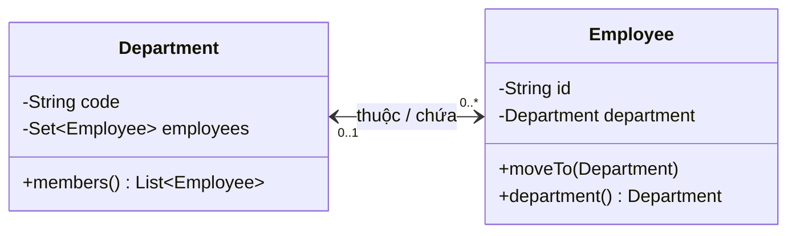
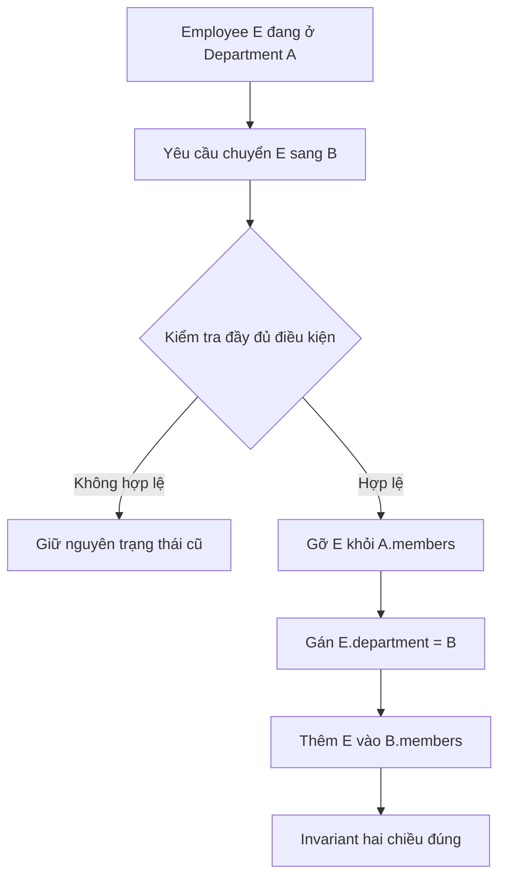
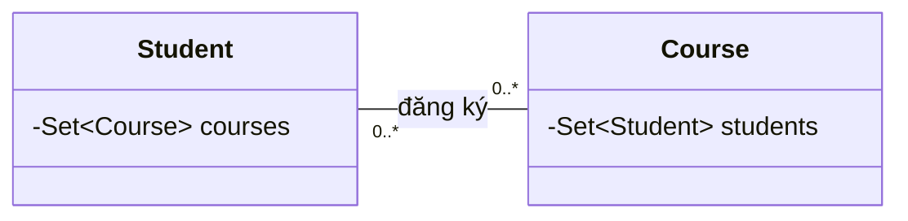

# Quan hệ hai chiều và giữ dữ liệu nhất quán trong OOP (Java)

Trong lập trình hướng đối tượng, **quan hệ hai chiều (bidirectional association)** xuất hiện khi hai đối tượng đều biết cách truy cập đối tượng ở đầu bên kia. Ví dụ, một nhân viên biết mình thuộc phòng ban nào, còn phòng ban biết danh sách nhân viên của mình.

Điểm khó không nằm ở việc thêm hai trường tham chiếu. Điểm khó là **giữ hai trường đó mô tả cùng một sự thật** sau mọi thao tác thêm, gỡ, chuyển liên kết, xử lý lỗi và ghi xuống cơ sở dữ liệu.

Bài này tập trung vào các quy tắc triển khai trong Java, với ví dụ chạy độc lập và lưu ý thực tế khi dùng JPA/Hibernate.

## 1. Quan hệ một chiều và hai chiều

Giả sử mỗi `Employee` thuộc tối đa một `Department`, mỗi `Department` có thể có nhiều `Employee`.

**Một chiều:** chỉ nhân viên giữ tham chiếu `department`; muốn tìm các nhân viên thuộc phòng ban có thể truy vấn repository. Không nhất thiết phải đặt collection bên trong `Department`.

**Hai chiều:** `Employee` giữ `department`, đồng thời `Department` giữ collection `employees`.



Ở ví dụ, nhân viên có thể chưa được phân phòng (`0..1`) và phòng ban có thể chưa có nhân viên (`0..*`). **Số lượng quan hệ (multiplicity)** và **hướng điều hướng (navigability)** là hai quyết định riêng: 1–N không bắt buộc phải có tham chiếu hai chiều.

| Thiết kế | Thông tin lưu trong đối tượng | Thuận lợi | Chi phí |
| --- | --- | --- | --- |
| Một chiều `Employee -> Department` | Mỗi `Employee` biết một `Department` | Ít trạng thái trùng lặp; đơn giản hơn | Tìm nhân viên theo phòng cần nguồn truy vấn hoặc duyệt |
| Một chiều `Department -> Employee` | Phòng lưu collection nhân viên | Duyệt thành viên dễ | Không thể hỏi trực tiếp phòng của nhân viên qua field |
| Hai chiều | Cả hai phía đều lưu tham chiếu | Điều hướng hai phía nhanh trong object graph | Mọi thay đổi phải đồng bộ hai phía |
| Chỉ lưu ID và truy vấn qua service | Không nhất thiết giữ object reference | Giảm phụ thuộc, thuận tiện ở ranh giới hệ thống | Phải truy vấn/caching và duy trì luật ở tầng dữ liệu |

**Không tự động chọn hai chiều chỉ vì có thể:** thêm một hướng điều hướng cũng làm tăng trạng thái phải giữ nhất quán.

## 2. Định nghĩa invariant trước khi viết code

Với mọi `Employee e` và `Department d` nằm trong cùng phạm vi quản lý:

```text
e.department == d   <=>   d.employees chứa đúng đối tượng e
```

Đây là **bất biến hai chiều** (*bidirectional invariant*). Từ đó suy ra:

1. Nếu `e.department == null`, `e` không được xuất hiện trong danh sách nhân viên của bất kỳ phòng nào.
2. Nếu phòng `A` chứa `e`, `e.department` phải trỏ về `A`.
3. Nếu một nhân viên chỉ được thuộc một phòng, không phòng khác nào được đồng thời chứa nhân viên ấy.
4. Mọi giới hạn bổ sung (sức chứa, nhân viên đang hoạt động, ID không trùng trong phòng...) cũng phải đúng sau một thao tác thành công.

Lỗi phổ biến khi thay đổi một phía:

```java
// Giả sử employee đang thuộc phòng A:
employee.setDepartment(departmentB);

// Nếu A.employees vẫn chứa employee và B.employees chưa thêm,
// ba tham chiếu cùng mô tả ba trạng thái khác nhau.
```

Tương tự, `departmentB.getEmployees().add(employee)` chỉ sửa collection B, chưa sửa `employee.department`. Hai setter độc lập có thể làm người gọi quên cập nhật nửa còn lại.



Sơ đồ mô tả thứ tự logic trong **một thao tác được kiểm soát**. Khi thao tác có thể thất bại giữa chừng hoặc chạy đồng thời, cần bảo vệ phạm vi cập nhật bằng giao dịch, khóa hoặc cơ chế khôi phục thích hợp.

## 3. Ba nguyên tắc thiết kế API

**Một cửa cập nhật liên kết.** Cho phép `employee.moveTo(newDepartment)`, hoặc `department.assign(employee)`, hoặc một domain service có quyền cập nhật cả hai. Không công khai nhiều setter độc lập để các caller tự “nhớ” đồng bộ.

**Đóng gói collection.** `getEmployees()` không trả về collection mutable nội bộ. Trả snapshot chỉ đọc/DTO để caller không thể `add/remove` ở ngoài cổng kiểm tra. Nếu phần tử bên trong mutable, snapshot của collection không tự làm các phần tử bất biến.

**Xác thực trước, sửa sau.** Kiểm tra phòng mới tồn tại, sức chứa, quyền chuyển và trạng thái hai chiều hiện tại trước khi thay đổi. Nếu không hợp lệ, kết quả phải là **không có thay đổi nào**.

| Hành vi | Cập nhật cần thiết | Điều cần bảo vệ |
| --- | --- | --- |
| Gán nhân viên chưa có phòng vào A | Thêm vào A; `employee.department = A` | Không trùng; A còn chỗ |
| Chuyển từ A sang B | Gỡ A; gán B; thêm B | Không để E đồng thời thuộc A và B |
| Hủy phân phòng | Gỡ khỏi phòng cũ; gán `null` | Không còn liên kết ngược sót lại |
| Gán lại đúng phòng đang thuộc | Không làm gì (*idempotent*) | Không thêm trùng hoặc phát sự kiện trùng |
| Gán thất bại vì B hết chỗ | Giữ nguyên liên kết với A | Không gỡ E khỏi A trước khi kiểm tra B |

## 4. Ví dụ Java 17 hoàn chỉnh: chuyển phòng ban nhất quán

Ví dụ dưới đây có thể biên dịch độc lập, không cần Spring hoặc database. Cả hai phía được thay đổi qua **một phương thức `Employee.moveTo(...)`**; collection nhân viên không lộ ra ngoài để chỉnh trực tiếp.

Tạo file `BidirectionalAssociationDemo.java`:

```java
import java.util.LinkedHashSet;
import java.util.List;
import java.util.Objects;
import java.util.Set;

public class BidirectionalAssociationDemo {

    static final class Department {
        private final String code;
        private final int capacity;
        private final Set<Employee> employees = new LinkedHashSet<>();

        Department(String code, int capacity) {
            if (code == null || code.isBlank()) {
                throw new IllegalArgumentException("Department code is blank");
            }
            if (capacity < 1) {
                throw new IllegalArgumentException("Capacity must be positive");
            }
            this.code = code;
            this.capacity = capacity;
        }

        String code() {
            return code;
        }

        List<Employee> members() {
            // Snapshot: không trao cho caller quyền add/remove collection gốc.
            return List.copyOf(employees);
        }

        private void validateIncoming(Employee person) {
            Objects.requireNonNull(person, "person");

            if (employees.contains(person)) {
                throw new IllegalStateException("Already in target collection");
            }
            if (employees.size() >= capacity) {
                throw new IllegalStateException("Department is full: " + code);
            }

            // Đây là ví dụ domain rule: ID nhân viên không trùng trong phòng.
            for (Employee existing : employees) {
                if (existing.id().equals(person.id())) {
                    throw new IllegalArgumentException(
                            "Duplicate employee id in " + code);
                }
            }
        }
    }

    static final class Employee {
        private final String id;
        private Department department; // null = chưa thuộc phòng nào

        Employee(String id) {
            if (id == null || id.isBlank()) {
                throw new IllegalArgumentException("Employee id is blank");
            }
            this.id = id;
        }

        String id() {
            return id;
        }

        Department department() {
            return department;
        }

        void moveTo(Department destination) {
            Department source = department;

            // Lời gọi lặp lại phải vô hại.
            if (source == destination) {
                return;
            }

            // Precondition: trạng thái hiện tại phải đã đồng bộ.
            if (source != null && !source.employees.contains(this)) {
                throw new IllegalStateException(
                        "Source department is inconsistent");
            }

            // Kiểm tra trước khi thay đổi: nếu đích không hợp lệ,
            // employee vẫn còn nguyên trong source.
            if (destination != null) {
                destination.validateIncoming(this);
            }

            // Chỉ sau khi toàn bộ kiểm tra thành công mới sửa quan hệ.
            if (source != null) {
                source.employees.remove(this);
            }
            department = destination;
            if (destination != null) {
                destination.employees.add(this);
            }
        }
    }

    private static void verify(
            Department first, Department second, Employee... employees) {
        for (Employee e : employees) {
            boolean inFirst = first.employees.contains(e);
            boolean inSecond = second.employees.contains(e);
            if (inFirst && inSecond) {
                throw new AssertionError("Employee in both departments");
            }
            if (inFirst != (e.department() == first)
                    || inSecond != (e.department() == second)) {
                throw new AssertionError("Broken bidirectional invariant");
            }
        }
    }

    public static void main(String[] args) {
        Department engineering = new Department("ENG", 2);
        Department sales = new Department("SAL", 1);

        Employee an = new Employee("E-01");
        Employee binh = new Employee("E-02");
        Employee chi = new Employee("E-03");

        an.moveTo(engineering);
        binh.moveTo(engineering);

        // ENG đầy: thất bại không được làm thay đổi bên nào.
        try {
            chi.moveTo(engineering);
        } catch (IllegalStateException expected) {
            System.out.println(expected.getMessage());
        }

        an.moveTo(sales);       // gỡ khỏi ENG, thêm vào SAL
        chi.moveTo(engineering);
        an.moveTo(sales);       // gọi lặp, không nhân đôi quan hệ

        verify(engineering, sales, an, binh, chi);
        System.out.println("ENG = " + engineering.members().size());
        System.out.println("SAL = " + sales.members().size());
        System.out.println("An o " + an.department().code());

        an.moveTo(null);        // hủy phân phòng
        verify(engineering, sales, an, binh, chi);
        System.out.println("SAL sau go = " + sales.members().size());
    }
}
```

Chạy:

```bash
javac BidirectionalAssociationDemo.java
java BidirectionalAssociationDemo
```

Kết quả dự kiến:

```text
Department is full: ENG
ENG = 2
SAL = 1
An o SAL
SAL sau go = 0
```

### Vì sao đoạn code giữ được bất biến?

- `Employee.department` và `Department.employees` đều là `private`; caller chỉ cập nhật qua `moveTo`.
- `moveTo` trả về ngay nếu đích đã là phòng hiện tại.
- Kiểm tra trạng thái cũ và sức chứa phòng mới xảy ra **trước** ba bước sửa dữ liệu. Nếu kiểm tra ném exception, trạng thái ban đầu không đổi.
- Khi thành công, phương thức xóa liên kết ngược cũ, cập nhật tham chiếu tiến và tạo liên kết ngược mới.
- `members()` trả snapshot collection, nên thao tác ngoài như `members().clear()` không thể sửa collection thật. Các `Employee` trong snapshot vẫn là object tham chiếu, nhưng người dùng không có setter tùy tiện để phá hỏng quan hệ.
- `verify` kiểm tra tính nhất quán từ cả hai phía cho các nhân viên được đưa vào test.

**Giới hạn có chủ đích của ví dụ:** đây là mô hình **đơn luồng trong bộ nhớ**. Hai request đồng thời có thể cùng vượt qua kiểm tra sức chứa rồi cùng thêm thành viên. Mọi đối tượng tham gia phải được quản lý trong cùng phạm vi và thao tác không được ngắt giữa chừng. Khi yêu cầu chạy đa luồng, phải chọn đồng bộ hóa phù hợp cho toàn bộ thao tác hoặc chuyển invariant sang một tầng giao dịch khác.

Ví dụ cũng dùng **object identity** làm phép so sánh thành viên vì `Employee` không override `equals/hashCode`. Kiểm tra ID trùng trong một phòng là luật nghiệp vụ bổ sung; hệ thống thực tế thường cần quản lý ID duy nhất toàn cục tại repository hoặc database.

## 5. Khi có quan hệ hai chiều nhiều–nhiều

Với `Student` và `Course`, một sinh viên học nhiều khóa và một khóa có nhiều sinh viên. Nếu cả hai class giữ `Set` của nhau thì thao tác đăng ký phải thay đổi **cả hai tập**.



Ý tưởng của phương thức **trung tâm** (minh họa khi hai tập được quản lý nội bộ và có quy tắc định danh ổn định):

```java
// Đoạn minh họa; studentCourses và courseStudents là các tập
// nội bộ được domain service sở hữu, không phải getter mutable.
void enroll(Student student, Course course) {
    validateEnrollment(student, course); // quyền, trùng, sĩ số...
    studentCourses(student).add(course);
    courseStudents(course).add(student);
}

void unenroll(Student student, Course course) {
    // Cũng phải kiểm tra và sửa hai phía trong cùng một thao tác.
    studentCourses(student).remove(course);
    courseStudents(course).remove(student);
}
```

Đừng nhân bản phương thức update theo hai hướng rồi gọi qua lại không kiểm soát: `student.addCourse(course)` gọi `course.addStudent(student)` rồi ngược lại có thể tạo **đệ quy vô hạn**. Một giải pháp là một phía điều phối, phía kia có phương thức nội bộ chỉ sửa tập cục bộ (*internal helper*). Các thao tác cập nhật phải xét sự nhất quán trước khi sửa nếu phát hiện dữ liệu đã lỗi.

Nếu liên kết có thêm `enrolledAt`, `status`, `grade` hoặc lịch sử đăng ký, một class `Enrollment` liên kết đúng một `Student` với đúng một `Course` thường dễ bảo vệ invariant hơn. Nó làm rõ trạng thái của **bản thân quan hệ**, tránh nhét thuộc tính liên kết vào sai thực thể.

## 6. Bidirectional association với JPA/Hibernate

Trong ORM, phải phân biệt **hai ý nghĩa khác nhau của “owner”**:

- **Đầu sở hữu quan hệ trong JPA (*owning side*):** phía mà Hibernate/JPA dùng để ghi khóa ngoại hoặc bảng liên kết xuống database. `mappedBy` khai báo phía nghịch (*inverse side*).
- **Chủ sở hữu nghiệp vụ (*domain owner*):** nơi giữ quy tắc thêm/xóa/chuyển liên kết. Hai khái niệm không nhất thiết trùng nhau.

Với `Department` 1–N `Employee`, thiết kế thường gặp:

```java
// Trong class Employee có @Entity:
@ManyToOne(fetch = FetchType.LAZY)
@JoinColumn(name = "department_id")
private Department department;

// Trong class Department có @Entity:
@OneToMany(mappedBy = "department")
private Set<Employee> employees = new HashSet<>();
```

`Employee.department` là **owning side** của khóa ngoại `department_id`; `Department.employees` là collection nghịch dùng để điều hướng. Nếu code chỉ thêm một `Employee` vào `department.employees` nhưng không cập nhật `employee.department`, in-memory graph lệch nhau và khóa ngoại có thể không được ghi như kỳ vọng.

Do đó cần một helper đồng bộ hai phía:

```java
// Pseudo-implementation minh họa trong Department entity.
// Thực tế thêm validate, kiểm soát orphan và locking theo nghiệp vụ.
public void addEmployee(Employee e) {
    Objects.requireNonNull(e);
    if (e.getDepartment() == this) return;

    Department old = e.getDepartment();
    if (old != null) old.employees.remove(e);

    this.employees.add(e);
    e.assignDepartmentInternally(this);
}
```

Trong ví dụ helper này, `assignDepartmentInternally` có phạm vi truy cập đủ hẹp và không được gọi tùy tiện từ application service. Nếu public setter tồn tại và vẫn được dùng ở nơi khác, invariant chưa được bảo vệ. Phần `old.employees.remove` và `this.employees.add` cũng cần được quản lý trong một transaction khi các entity là persistent.

### Những điều JPA không tự giải quyết

| Thành phần | Nó giúp gì? | Không tự bảo đảm điều gì? |
| --- | --- | --- |
| `@OneToMany(mappedBy = "...")` | Biết phía nghịch và cách điều hướng | Không tự đồng bộ hai collection/field trong mọi thao tác Java |
| `@ManyToOne` và FK | Ánh xạ liên kết lưu trên bảng child | Không ngăn caller sửa object graph sai trước flush |
| `@Transactional` | Gom các ghi DB trong một giao dịch | Không tự sửa logic cập nhật thiếu một phía |
| `@Version` | Phát hiện xung đột optimistic locking khi version được kiểm tra/cập nhật | Không thay thế unique constraint, và không chắc bắt được mọi thay đổi chỉ ở collection nghịch |
| Unique/FK/check constraint | Chặn dữ liệu DB vi phạm quy tắc cụ thể | Không tự làm hai tham chiếu đã nạp trong heap đồng bộ ngay |

**Lưu ý về `cascade` và `orphanRemoval`:** đây là chính sách vòng đời/persistence riêng. Không nên đặt `CascadeType.REMOVE` tùy tiện cho quan hệ được chia sẻ; xóa một phía có thể làm xóa luôn đối tượng vẫn được nơi khác sử dụng. `orphanRemoval = true` chỉ hợp lý khi child thật sự phụ thuộc vòng đời của owner theo nghiệp vụ.

### Khi chuyển phòng trong một giao dịch

Một application service có thể thực hiện:

```java
@Transactional
public void transferEmployee(Long employeeId, Long targetDepartmentId) {
    Employee e = employeeRepository.findById(employeeId)
            .orElseThrow();
    Department target = departmentRepository.findById(targetDepartmentId)
            .orElseThrow();

    // Helper domain cập nhật cả e.department và collection hai phía,
    // đồng thời áp dụng chính sách sức chứa/đủ điều kiện.
    e.moveTo(target);
}
```

Đây là **đoạn tích hợp giả định** `Employee` entity có helper và hai repository phù hợp; không phải một file Java độc lập như demo trên.

Nếu quy tắc yêu cầu “phòng tối đa N người”, hai transaction đồng thời có thể đều thấy phòng còn chỗ. Phải chọn biện pháp nhất quán như **pessimistic locking trên bản ghi phòng**, thiết kế optimistic locking có chạm đúng version cần bảo vệ, hoặc ràng buộc/database strategy phù hợp. Chỉ thêm `@Transactional` thường **không đủ** để bảo vệ giới hạn tổng số thành viên dưới cạnh tranh.

## 7. Lỗi thường gặp và cách phát hiện

### 7.1 Getter lộ collection có thể thay đổi

```java
// Sai: bỏ qua add/remove được kiểm soát
public Set<Employee> employees() {
    return employees;
}
```

Dùng snapshot đọc, immutable DTO hoặc immutable view phù hợp. `Collections.unmodifiableSet(employees)` là **view live** (thấy cập nhật bên trong); `Set.copyOf(employees)` là **snapshot** về thành viên ở thời điểm gọi. Cả hai chỉ ngăn chỉnh **collection qua tham chiếu trả về**, không làm các phần tử mutable trở thành immutable.

### 7.2 Chỉ cập nhật phía nghịch của JPA

```java
department.getEmployees().add(employee);
// employee.department vẫn null hoặc trỏ về phòng cũ!
```

Cần đổi owning side và cập nhật object graph phía nghịch để truy vấn trong transaction nhất quán.

### 7.3 Xóa quan hệ nhưng quên liên kết ngược

```java
employee.department = null;
// Phòng cũ vẫn chứa employee: còn dữ liệu "ma".
```

Phải xóa khỏi tập nhân viên của phòng cũ trong cùng một thao tác.

### 7.4 `equals/hashCode` dựa vào trường có thể thay đổi

Nếu một entity nằm trong `HashSet` và `hashCode()` phụ thuộc `department` hoặc tên có thể đổi, sau khi thay đổi nó có thể không được tìm/xóa đúng trong set. Dùng định danh bất biến hoặc chiến lược equality phù hợp với lifecycle của entity và ORM; không tùy tiện đưa association mutable vào `equals/hashCode`.

### 7.5 Đệ quy vô hạn do cập nhật đối xứng

```text
A.addB(B) -> B.addA(A) -> A.addB(B) -> ...
```

Cho **một phía điều phối**, phía kia cung cấp phương thức nội bộ chỉ cập nhật dữ liệu, hoặc thêm điều kiện kiểm tra trước thao tác. Không dựa vào thứ tự gọi tình cờ.

### 7.6 Serialize vòng tham chiếu

```text
Department -> employees -> Employee.department -> Department -> ...
```

Khi trả entity trực tiếp qua JSON, vòng tham chiếu có thể gây lỗi serialize, dữ liệu dư thừa hoặc lazy-loading ngoài transaction. Thiết kế **DTO** theo hợp đồng API (chẳng hạn `DepartmentResponse(code, employeeIds)`) thay vì xuất toàn bộ object graph. Các annotation JSON có thể hỗ trợ nhưng không thay thế thiết kế dữ liệu trả về.

## 8. Chiến lược kiểm thử tính nhất quán

Test phải kiểm tra **cả hai đầu quan hệ** sau mỗi thao tác, bao gồm tình huống thất bại.

| Kịch bản | Kiểm tra kỳ vọng |
| --- | --- |
| Thêm nhân viên chưa được gán vào A | `e.department == A` và `A.members` chứa e |
| Chuyển e từ A sang B | A không chứa e; B chứa e; `e.department == B` |
| Chuyển e sang chính B | Không đổi; không nhân đôi; không phát side effect thừa |
| Gỡ e khỏi B | `e.department == null`, B không chứa e |
| B đủ giới hạn sức chứa | Từ chối; A/B/e giữ đúng trạng thái trước lời gọi |
| Caller cố sửa danh sách trả về | Không thể thay đổi tập nội bộ |
| Hai request đồng thời chuyển/thêm | Tổng số thành viên và hai đầu vẫn hợp lệ sau khi hoàn tất |
| Save/flush/clear/reload entity JPA | Liên kết sau khi nạp lại khớp dữ liệu DB |

Ví dụ assertion có tính chất dễ hiểu:

```java
// Giả sử employee đã chuyển từ oldDepartment sang newDepartment:
assert employee.department() == newDepartment;
assert !oldDepartment.members().contains(employee);
assert newDepartment.members().contains(employee);
```

Ở kiểm thử JPA, nên gọi `flush()`, `clear()` rồi load lại trước khi khẳng định DB đã được cập nhật: object graph đúng trong persistence context chưa chứng minh dữ liệu lưu trữ đúng.

Đối với cạnh tranh đồng thời, kiểm thử nhiều luồng hoặc integration test dùng database thật hữu ích hơn việc chỉ gọi liên tục trên một thread. Một unit test tuần tự không chứng minh được cấu trúc thread-safe.

## 9. Bài tập thực hành

**Bài 1 — Trường học:** một `Classroom` có nhiều `Student`; mỗi `Student` thuộc một lớp tại một thời điểm. Cài đặt `transferTo(Classroom)` để đồng bộ hai phía, có giới hạn 40 học sinh và không cho ID trùng. Test chuyển từ lớp đầy sang lớp khác và chuyển **vào lớp đầy** phải giữ trạng thái cũ.

**Bài 2 — Nhiều–nhiều:** `Developer` có nhiều `Project` và mỗi `Project` có nhiều `Developer`. Đặt một service kiểm soát `joinProject`/`leaveProject`; viết kiểm thử xác nhận cả hai tập luôn đồng bộ sau đăng ký, rời dự án và đăng ký lặp.

**Bài 3 — JPA:** một `Order` chứa nhiều `OrderLine`; mỗi `OrderLine` tham chiếu `Order`. Chọn owning side, viết helper `addLine`/`removeLine`, quyết định khi nào `orphanRemoval` phù hợp và kiểm thử lại từ DB sau `flush/clear`.

**Bài 4 — Review một bug:** hệ thống chuyển nhân viên từ A sang B bằng cách gọi `B.getEmployees().add(e)`, rồi `e.setDepartment(B)`, nhưng không xóa khỏi A. Hãy xác định invariant bị vi phạm, sửa API và bổ sung test cho trường hợp B từ chối nhân viên.

## 10. Checklist khi thiết kế quan hệ hai chiều

- Quan hệ có **thực sự cần điều hướng hai chiều** hay một hướng và truy vấn là đủ?
- Đã xác định multiplicity, nullability, tính duy nhất và vòng đời của liên kết chưa?
- **Ai là cổng cập nhật duy nhất**, và có setter/getter mutable nào vượt qua cổng đó?
- Mọi thao tác thêm/gỡ/chuyển đều **xác thực trước và sửa đủ hai phía** chứ?
- Khi chuyển thất bại, có giữ nguyên trạng thái cũ không?
- Collection/equality có ổn định khi field của entity thay đổi không?
- Dùng ORM thì owning side, `mappedBy`, `cascade`, `orphanRemoval` đã đúng ý nghĩa nghiệp vụ chưa?
- Dữ liệu nhiều request có cần transaction, locking, unique/FK constraint và test đồng thời không?
- Có kiểm chứng lại hai hướng **sau khi đọc lại từ DB**, không chỉ sau thao tác trên object trong bộ nhớ?

**Điểm cốt lõi:** quan hệ hai chiều chỉ đúng khi hai hướng cùng thể hiện **một trạng thái nghiệp vụ duy nhất**. Hãy quản lý thay đổi qua API tập trung, bảo vệ invariant và kiểm tra cả hai phía; khi có persistence hoặc xử lý đồng thời, cần bổ sung cơ chế đảm bảo tính nhất quán tại đúng ranh giới giao dịch.