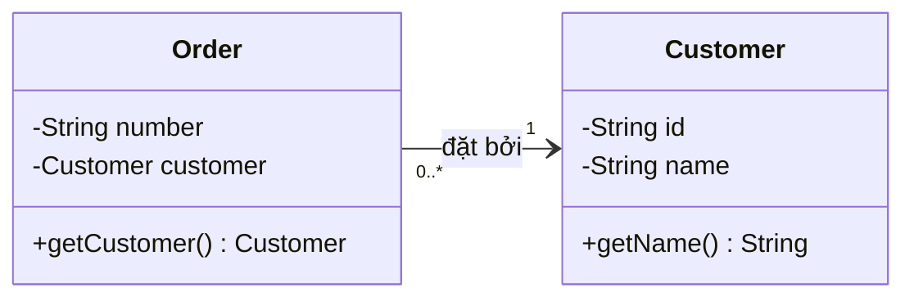
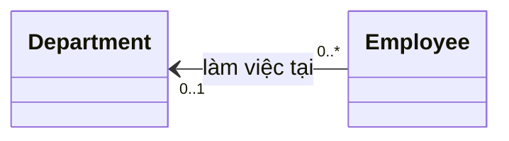
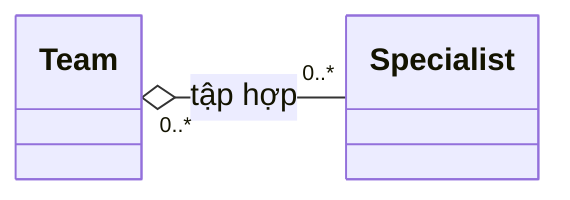
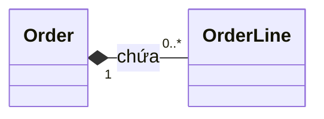
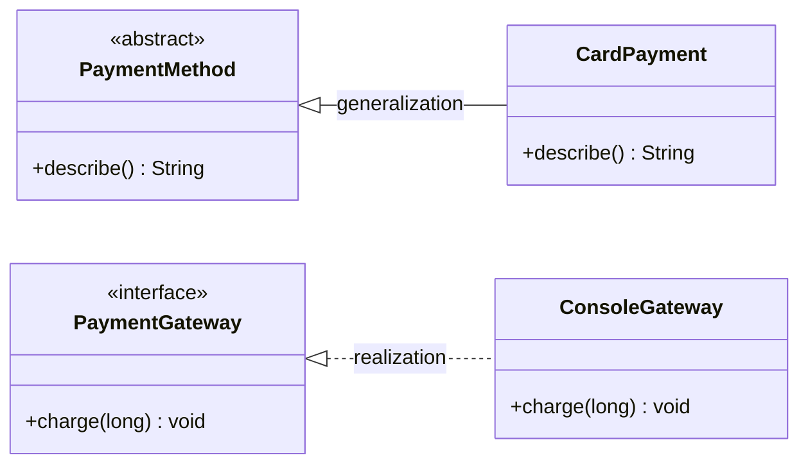
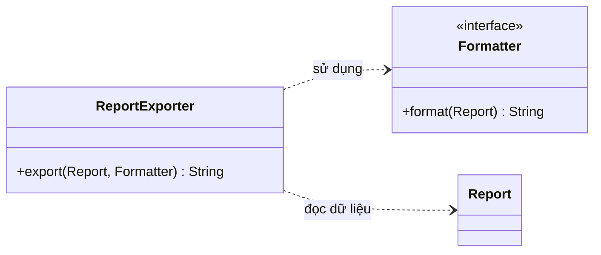
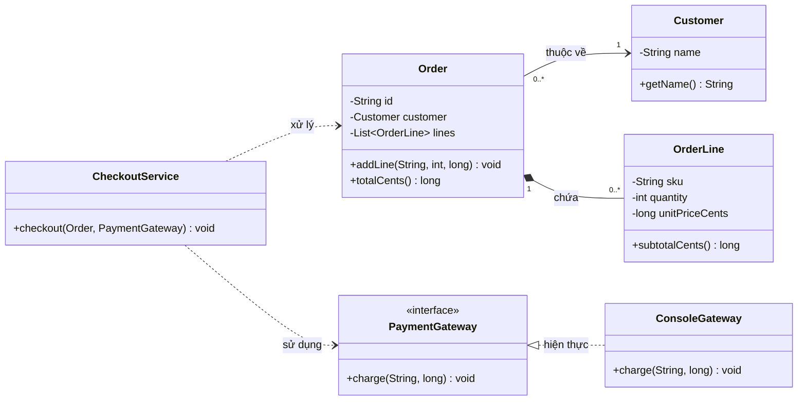
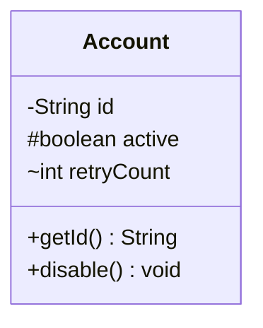
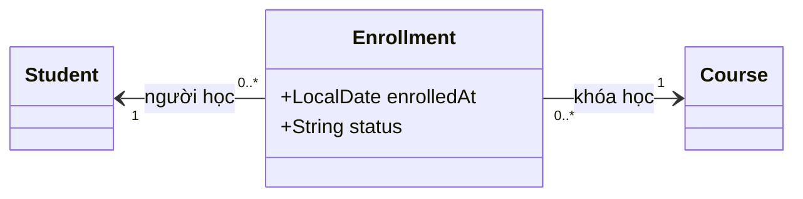

# Đọc ký hiệu quan hệ trong sơ đồ lớp UML

## 1. Đọc một sơ đồ lớp: bắt đầu từ đâu?

Sơ đồ lớp (*UML class diagram*) thể hiện các **kiểu đối tượng**, thành phần của chúng và **những quan hệ giữa các kiểu**. Khi nhìn thấy hai hộp được nối bằng một đường, đừng vội kết luận “hai lớp gọi nhau”. Cần đọc đủ:

1. **Loại nét và đầu đường:** liền hay đứt; mũi tên thường, tam giác rỗng, hình thoi rỗng hay hình thoi đặc?
2. **Đầu nào là đầu nguồn/đầu đích:** lớp nào phụ thuộc, lớp nào là loại tổng quát, lớp nào là *toàn thể*?
3. **Bội số ở hai đầu:** một đối tượng bên này liên hệ với bao nhiêu đối tượng bên kia?
4. **Tên quan hệ/tên vai trò:** “quản lý”, “đặt bởi”, “thành viên”, “sở hữu” có bổ sung ngữ nghĩa gì?
5. **Đối chiếu với mã Java:** đó là field, collection, tham số phương thức, `extends` hay `implements`?

Ví dụ:



Đọc đầy đủ: **mỗi `Order` gắn với đúng một `Customer`**, **mỗi `Customer` có thể gắn với 0 hoặc nhiều `Order`**, và mũi tên chỉ khả năng điều hướng từ `Order` sang `Customer` trong mô hình này. Từ mã Java, ta có thể nghĩ đến field `private Customer customer;` trong `Order`. Không có nghĩa mỗi khách hàng tự động giữ một danh sách đơn hàng trong bộ nhớ.

## 2. Bảng tra nhanh sáu quan hệ quan trọng

| Quan hệ | Dấu hiệu khi đọc | Ý nghĩa | Gợi ý hiện thực Java |
|---|---|---|---|
| **Association – liên kết** | Đường **liền**; có thể có mũi tên chỉ chiều điều hướng | Các instance có quan hệ với nhau | Field tham chiếu, `List`/`Set` hoặc cơ chế liên kết |
| **Dependency – phụ thuộc** | Đường **đứt**, mũi tên mở hướng đến thành phần được dùng | Thành phần A cần B để làm việc | Tham số, biến cục bộ, lời gọi API hoặc kiểu trong chữ ký |
| **Aggregation – kết tập** | Đường liền, **hình thoi rỗng** ở phía toàn thể | Quan hệ toàn thể–thành phần với thành phần có thể tồn tại độc lập | Một nhóm giữ tham chiếu đến các phần tử |
| **Composition – hợp thành** | Đường liền, **hình thoi đặc** ở phía toàn thể | Sở hữu thành phần mạnh; thành phần gắn vòng đời với một toàn thể trong mô hình | Toàn thể tạo/quản lý thành phần và ràng buộc vòng đời |
| **Generalization – khái quát hóa/kế thừa** | Đường liền, **tam giác rỗng** trỏ về kiểu tổng quát | Lớp con *là một loại* lớp cha | `extends` |
| **Realization – hiện thực hóa** | Đường đứt, **tam giác rỗng** trỏ về đặc tả/interface | Lớp hiện thực hợp đồng của interface | `implements` |

Các dấu hiệu này có thể cùng xuất hiện trong một hệ thống. Ví dụ `CheckoutService` phụ thuộc `PaymentGateway`, `StripeGateway` hiện thực `PaymentGateway`, trong khi `Order` hợp thành các `OrderLine` và liên kết đến `Customer`.

## 3. Association: đọc đầu mũi tên, tên vai trò và bội số



Hãy đọc **bội số đặt gần một đầu là số lượng ở đầu đó cho một đối tượng ở đầu đối diện**:

- `0..1` cạnh `Department`: mỗi `Employee` làm việc ở **0 hoặc 1 phòng ban**.
- `0..*` cạnh `Employee`: mỗi `Department` có **0 hoặc nhiều nhân viên**.
- Mũi tên `Employee → Department`: từ nhân viên có thể tìm phòng ban. Nó **không** tự chứng minh rằng `Department` có collection `employees`.
- Chú thích “làm việc tại” là **tên quan hệ**, không phải phép gán giá trị hay tên một phương thức bắt buộc.

### Bội số thường gặp

| Bội số UML | Cách đọc chính xác | Ví dụ |
|---|---|---|
| `1` | Đúng một | Mỗi đơn hàng hợp lệ có đúng một khách hàng |
| `0..1` | Không có hoặc có một | Nhân viên có thể chưa được phân phòng ban |
| `*` hoặc `0..*` | Không hoặc nhiều | Phòng ban có thể chưa có nhân viên |
| `1..*` | Ít nhất một | Một phiếu bàn giao hoàn tất cần tối thiểu một mục |
| `2..5` | Từ hai đến năm | Nhóm trực có từ hai đến năm người |
| `3` | Đúng ba | Một bộ sản phẩm bắt buộc có ba thành phần |

Lưu ý: bội số là **ràng buộc của mô hình**, không phải thứ Java tự kiểm soát chỉ vì đã khai báo `List<Employee>`. Muốn đảm bảo “ít nhất một”, “không quá năm”, hay “đúng một”, code hoặc tầng lưu trữ phải kiểm tra quy tắc.

### Về chiều điều hướng

- Đường liền có mũi tên mở về B thường biểu diễn **có thể điều hướng từ A đến B**.
- Mũi tên chỉ điều hướng **không** phải ký hiệu “B là cha của A”.
- Association **không có mũi tên** cần được đọc theo quy ước của sơ đồ: có trường hợp hướng không được chỉ định; không nên mặc định chắc chắn hai chiều.
- Nếu cần thể hiện rõ hai chiều, hãy vẽ/ghi chú rõ cả hai chiều hoặc chỉ rõ các thuộc tính ở hai lớp.

Ví dụ mã Java tương ứng với chiều `Employee → Department`:

```java
final class Department {
    private final String name;
    Department(String name) { this.name = name; }
    String getName() { return name; }
}

final class Employee {
    private Department department; // có thể null: 0..1

    void moveTo(Department next) {
        this.department = next;
    }

    Department getDepartment() {
        return department;
    }
}
```

Không có `Department.getEmployees()` vì ví dụ chỉ hiện thực chiều từ nhân viên sang phòng ban. Nếu ứng dụng cần danh sách nhân viên, có thể tra bằng repository; không nhất thiết phải bổ sung liên kết hai chiều trong mỗi object.

## 4. Hai hình thoi: aggregation và composition

Hai hình thoi nằm ở **phía toàn thể**, không nằm ở phía thành phần. Đây là quy tắc quan trọng khi đọc chiều.

### Aggregation – hình thoi rỗng



Hình thoi **rỗng gần `Team`** chỉ `Team` là phía toàn thể. Một `Specialist` có thể tồn tại ngoài Team và có thể tham gia nhiều team nếu quy tắc nghiệp vụ cho phép. Trong ví dụ, `0..*` ở cả hai đầu diễn đạt một specialist có thể tham gia nhiều nhóm và một nhóm có thể có nhiều specialist.

```java
import java.util.ArrayList;
import java.util.List;

class Specialist {
    final String name;
    Specialist(String name) { this.name = name; }
}

class Team {
    private final List<Specialist> members = new ArrayList<>();

    void add(Specialist member) {
        members.add(member);
    }
}
```

Nếu xóa Team khỏi danh mục quản lý, điều đó không đương nhiên đồng nghĩa phải xóa nhân sự Specialist. Aggregation mô tả ngữ nghĩa gom nhóm; nó **không tự tạo quy tắc xóa/GC** cho Java.

### Composition – hình thoi đặc



Hình thoi **đặc gần `Order`** chỉ `Order` là **toàn thể sở hữu** các `OrderLine`. Mỗi dòng đơn hàng thuộc về đúng một đơn hàng trong mô hình; một đơn hàng có thể chứa nhiều dòng. Trong composition của UML, một *part* thuộc tối đa một *composite* tại cùng thời điểm; vòng đời của part phụ thuộc vào toàn thể theo quy tắc miền nghiệp vụ.

Triển khai nên tạo và thay đổi dòng đơn hàng thông qua đơn hàng:

```java
import java.util.ArrayList;
import java.util.List;
import java.util.Objects;

final class OrderLine {
    final String sku;
    final int quantity;

    OrderLine(String sku, int quantity) {
        this.sku = Objects.requireNonNull(sku);
        if (quantity <= 0) throw new IllegalArgumentException("quantity");
        this.quantity = quantity;
    }
}

final class Order {
    private final List<OrderLine> lines = new ArrayList<>();

    void addLine(String sku, int quantity) {
        lines.add(new OrderLine(sku, quantity));
    }

    int lineCount() {
        return lines.size();
    }
}
```

Chú ý **`OrderLine` trong Java vẫn là một object bình thường**. Hình thoi đặc không khiến JVM tự xóa nó khi `Order` hết được tham chiếu, cũng không cấm mã khác giữ tham chiếu đến nó. Thiết kế API, ràng buộc lưu trữ và quy tắc nghiệp vụ mới thực thi ý nghĩa sở hữu. Trong ví dụ, `Order` kiểm soát việc tạo dòng; nếu cần bảo vệ tuyệt đối quyền sở hữu, hãy tiếp tục hạn chế việc công khai/chuyển dòng giữa các order.

**Không suy diễn chỉ từ field:** `private Customer customer;` không đủ để khẳng định composition. Thông thường một khách hàng tồn tại độc lập với từng đơn hàng của mình.

## 5. Tam giác rỗng: phân biệt extends và implements

Tam giác rỗng luôn hướng về **kiểu tổng quát hoặc hợp đồng**. **Nét liền hay nét đứt** quyết định quan hệ cần đọc.



- `PaymentMethod <|-- CardPayment`: tam giác gần `PaymentMethod` với nét liền → `CardPayment` **kế thừa** `PaymentMethod`.
- `PaymentGateway <|.. ConsoleGateway`: tam giác gần `PaymentGateway` với nét đứt → `ConsoleGateway` **hiện thực** hợp đồng `PaymentGateway`.

Ánh xạ Java:

```java
abstract class PaymentMethod {
    abstract String describe();
}

final class CardPayment extends PaymentMethod {
    @Override
    String describe() {
        return "Thanh toán bằng thẻ";
    }
}

interface PaymentGateway {
    void charge(long cents);
}

final class ConsoleGateway implements PaymentGateway {
    @Override
    public void charge(long cents) {
        System.out.println("Charged: " + cents);
    }
}
```

Đừng nhầm *tam giác rỗng* với *mũi tên điều hướng*. Hai quan hệ này trả lời hai câu hỏi khác nhau:

- Generalization/realization: “lớp này **là kiểu con/hiện thực hợp đồng nào**?”
- Association: “object này **liên kết và đi đến object nào**?”

## 6. Đường đứt có mũi tên mở: dependency



Ở đây `ReportExporter` *phụ thuộc* `Formatter` và `Report` để thực hiện thao tác. Dấu `..>` biểu diễn mũi tên phụ thuộc hướng **từ nơi dùng tới nơi được dùng**.

```java
interface Formatter {
    String format(Report report);
}

final class Report {
    final String title;
    Report(String title) { this.title = title; }
}

final class ReportExporter {
    String export(Report report, Formatter formatter) {
        return formatter.format(report);
    }
}
```

Không có field `formatter` hay `report` trong exporter. Điều đó phù hợp với ví dụ sử dụng đối tượng qua tham số, nhưng **dependency rộng hơn phạm vi tham số**: lớp A vẫn có dependency vào interface B khi lưu B trong field hoặc gọi B ở nơi khác. Dependency UML mô tả quan hệ phụ thuộc thiết kế; nó không khẳng định đối tượng B có tuổi thọ ngắn.

## 7. Ví dụ tổng hợp chạy được: cùng một nghiệp vụ có nhiều ký hiệu

Hãy xây mô hình thanh toán đơn hàng có:

- `Order → Customer`: association một chiều.
- `Order ◆— OrderLine`: composition; mỗi dòng thuộc đơn hàng.
- `CheckoutService ⋯▷ PaymentGateway`: dependency; service dùng cổng thanh toán trong một lần checkout.
- `ConsoleGateway ⋯▷ PaymentGateway` với tam giác rỗng: realization; implementation của interface.



Tạo một tệp `RelationSymbolsDemo.java` (JDK 11+):

```java
import java.util.ArrayList;
import java.util.List;
import java.util.Objects;

public class RelationSymbolsDemo {

    static final class Customer {
        private final String name;

        Customer(String name) {
            this.name = Objects.requireNonNull(name);
        }

        String getName() {
            return name;
        }
    }

    static final class OrderLine {
        private final String sku;
        private final int quantity;
        private final long unitPriceCents;

        // Chỉ Order tạo dòng thông qua addLine trong thiết kế ví dụ.
        private OrderLine(String sku, int quantity, long unitPriceCents) {
            this.sku = Objects.requireNonNull(sku);
            if (quantity <= 0 || unitPriceCents < 0) {
                throw new IllegalArgumentException("Invalid order line");
            }
            this.quantity = quantity;
            this.unitPriceCents = unitPriceCents;
        }

        long subtotalCents() {
            return Math.multiplyExact(quantity, unitPriceCents);
        }
    }

    static final class Order {
        private final String id;
        private final Customer customer; // Association: Order -> Customer
        private final List<OrderLine> lines = new ArrayList<>();

        Order(String id, Customer customer) {
            this.id = Objects.requireNonNull(id);
            this.customer = Objects.requireNonNull(customer);
        }

        void addLine(String sku, int quantity, long unitPriceCents) {
            // Composition: Order chịu trách nhiệm tạo/quản lý các dòng.
            lines.add(new OrderLine(sku, quantity, unitPriceCents));
        }

        String getId() {
            return id;
        }

        Customer getCustomer() {
            return customer;
        }

        long totalCents() {
            long result = 0L;
            for (OrderLine line : lines) {
                result = Math.addExact(result, line.subtotalCents());
            }
            return result;
        }
    }

    interface PaymentGateway {
        void charge(String orderId, long amountCents);
    }

    static final class ConsoleGateway implements PaymentGateway {
        @Override
        public void charge(String orderId, long amountCents) {
            System.out.println(
                    "Charge " + orderId + ": " + amountCents + " cents");
        }
    }

    static final class CheckoutService {
        void checkout(Order order, PaymentGateway gateway) {
            Objects.requireNonNull(order);
            Objects.requireNonNull(gateway);

            // Dependency: sử dụng gateway được truyền vào phương thức.
            gateway.charge(order.getId(), order.totalCents());
            System.out.println("Customer: " + order.getCustomer().getName());
        }
    }

    public static void main(String[] args) {
        Customer lan = new Customer("Lan");
        Order order = new Order("ORD-100", lan);
        order.addLine("BOOK-1", 2, 120_000L);
        order.addLine("PEN-5", 3, 10_000L);

        PaymentGateway gateway = new ConsoleGateway();
        new CheckoutService().checkout(order, gateway);
    }
}
```

Chạy:

```bash
javac RelationSymbolsDemo.java
java RelationSymbolsDemo
```

Kết quả:

```text
Charge ORD-100: 270000 cents
Customer: Lan
```

Từ một sơ đồ duy nhất, ta đã biết lớp nào nên có **tham chiếu**, lớp nào nên **kiểm soát thành phần**, lớp nào chỉ cần **API cộng tác**, và lớp nào phải khai báo `implements`. Sơ đồ định hướng cấu trúc; để bảo toàn các ràng buộc, vẫn cần triển khai và kiểm thử các hành vi cụ thể.

## 8. Các ký hiệu nằm trong hộp lớp

Để đọc quan hệ đúng, cũng cần hiểu thông tin bên trong hộp:



| Ký hiệu | Ý nghĩa trong UML | Java tương ứng thường gặp |
|---|---|---|
| `+` | Public | `public` |
| `-` | Private | `private` |
| `#` | Protected | `protected` |
| `~` | Package visibility | Không ghi modifier |
| Tên được gạch dưới trong UML | Thành viên **static** | `static` |
| Tên in nghiêng trong UML | Thành phần **abstract** | `abstract` |
| `operation(arg: Type): Result` | Phương thức với tham số và kiểu trả về | `Result operation(Type arg)` |

Những ký hiệu này mô tả **phạm vi truy cập và thành viên**, còn đường nối giữa các hộp mô tả **quan hệ giữa các lớp**. Dấu `-` trước field **không phải** nét đứt dependency; nó là ký hiệu `private`.

## 9. Tên vai trò, ràng buộc và vài điểm nâng cao

Ngoài tên association, sơ đồ có thể ghi **role name** ở gần một đầu, ví dụ `orders` cạnh `Order` hoặc `customer` cạnh `Customer`. Role name diễn đạt **vai trò của đối tượng ở đầu đó khi nhìn từ đầu đối diện**; đôi khi tương ứng với tên field trong code.

Một số ràng buộc có thể xuất hiện cạnh association hoặc thuộc tính:

- `{ordered}`: thứ tự các đối tượng liên kết có ý nghĩa.
- `{unique}`: tập các giá trị/đối tượng liên kết không lặp theo quy tắc.
- `{readOnly}`: đầu liên kết/thuộc tính không cho phép gán lại trong ngữ cảnh được mô tả.

Không đồng nhất máy móc UML `{ordered}` với `ArrayList` hay `{unique}` với `HashSet`: đó là **ràng buộc cần thể hiện trong hành vi**, lựa chọn collection chỉ là một phần hiện thực.

Khi **mối liên kết có thông tin riêng** (ví dụ học viên đăng ký khóa học có thời gian, trạng thái, điểm số), có thể dùng **association class** trong UML hoặc tạo lớp miền trung gian như `Enrollment` trong Java:



Đây là cách biểu diễn bằng **lớp trung gian bình thường** trong Mermaid để dễ đọc; UML association class chuẩn có ký pháp riêng (lớp nối với đường association bằng nét đứt). Đừng nhầm ký pháp lớp trung gian với dependency.

## 10. Các lỗi đọc sơ đồ phổ biến

| Cách hiểu sai | Cách đọc đúng |
|---|---|
| “Số `1` ở gần Customer tức mỗi Customer có một Order.” | `1` ở phía Customer tức **mỗi Order có một Customer**; nhìn phía Order để biết mỗi Customer có bao nhiêu Order. |
| “Mọi mũi tên đều là kế thừa.” | Kế thừa có **tam giác rỗng và nét liền**; association dùng đường liền với mũi tên điều hướng; dependency có nét đứt và mũi tên mở. |
| “Hình thoi đặc đặt ở lớp con.” | Hình thoi đặt ở **phía toàn thể** của quan hệ whole–part. |
| “Chỉ cần có `List<Child>` là composition.” | Collection chưa nói được quyền sở hữu hay vòng đời; cần đọc và thực thi quy tắc miền nghiệp vụ. |
| “Đường association không có mũi tên chắc chắn hai chiều.” | Có thể **chưa xác định navigability**; cần xem ghi chú/quy ước sơ đồ. |
| “Có đường dependency tức mỗi object đều có field tham chiếu.” | Dependency có thể đến từ tham số, biến cục bộ, lời gọi API; không bắt buộc field. |
| “`extends` và `implements` dùng cùng loại nét UML.” | Generalization dùng **nét liền**, realization dùng **nét đứt**, cả hai có tam giác rỗng hướng về kiểu tổng quát/hợp đồng. |
| “UML bắt JVM tự xóa part khi xóa whole.” | UML mô tả quy tắc thiết kế; Java GC dựa trên khả năng còn được tham chiếu, không đọc sơ đồ. |

## 11. Bài tập tự kiểm tra

**Bài 1.** Sơ đồ `Library "1" *-- "0..*" BookCopy` có hình thoi đặc gần `Library`. Hãy đọc vai trò, bội số, vòng đời.

**Gợi ý:** Library là toàn thể; mỗi BookCopy thuộc một Library trong mô hình; một Library có thể có nhiều BookCopy. Quy tắc sở hữu/vòng đời phải được thực thi bằng logic nghiệp vụ.

**Bài 2.** `ReportGenerator ..> PdfWriter` vẽ bằng đường đứt, mũi tên mở. Có bắt buộc `ReportGenerator` chứa `PdfWriter writer;` không?

**Đáp án:** Không. Có thể sử dụng `PdfWriter` qua tham số của một phương thức.

**Bài 3.** Trong UML, `Gateway <|.. StripeGateway` khác `Gateway <|-- StripeGateway` thế nào?

**Đáp án:** Nét đứt + tam giác rỗng là realization (thường `implements` interface); nét liền + tam giác rỗng là generalization (thường `extends`).

**Bài 4.** Mỗi nhân viên có thể tham gia tối đa ba dự án; mỗi dự án có tối thiểu một nhân viên. Hãy điền bội số cho `Employee -- Project`.

**Đáp án:** Gần `Project` ghi `0..3`; gần `Employee` ghi `1..*`. Đây là số lượng đối tượng của đầu đó gắn với **một** đối tượng phía đối diện.

**Bài 5.** Cho `Course "0..*" -- "0..*" Student` và mỗi lần đăng ký có ngày, trạng thái, điểm. Chọn cấu trúc phù hợp trong Java.

**Gợi ý:** Dùng một lớp `Enrollment` chứa tham chiếu đến `Student`, `Course` và thông tin của lần đăng ký. Thiết kế ràng buộc duy nhất cho cặp sinh viên–khóa học nếu nghiệp vụ yêu cầu.

---

**Ghi nhớ khi đọc sơ đồ:** **nét đường** nhận diện loại quan hệ; **đầu mũi tên/tam giác/hình thoi** xác định chiều và vai trò; **bội số** quy định số lượng object ở mỗi đầu; **field, collection, extends, implements hoặc tham số Java** giúp kiểm tra cách hiện thực. Đọc đồng thời các thành phần này trước khi chuyển UML thành mã.