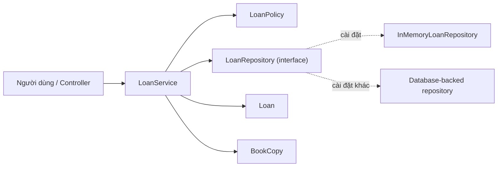
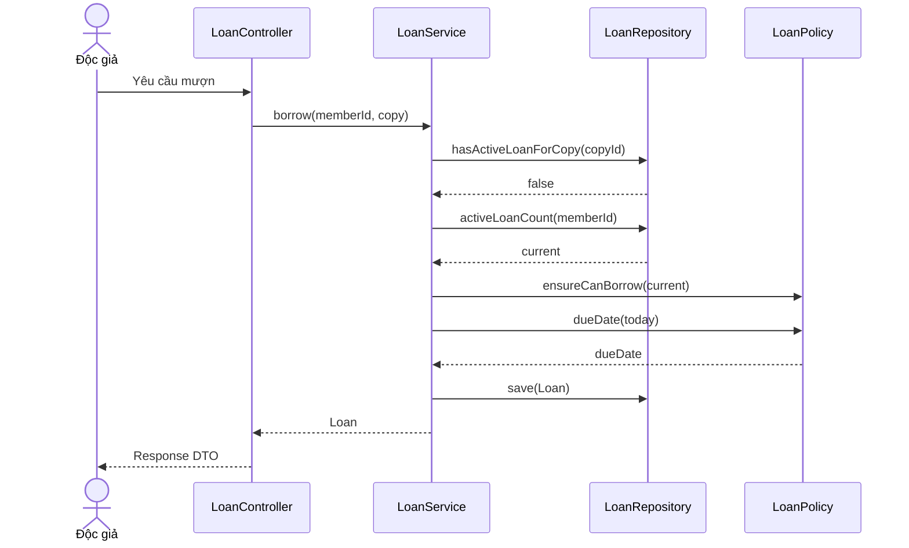

# Xác định trách nhiệm của từng lớp trong thiết kế OOP (Java)

Một hệ thống có nhiều class chưa chắc đã được thiết kế tốt. Điều quan trọng là **mỗi class chịu trách nhiệm về phần nào của bài toán, sở hữu những quy tắc nào và cần cộng tác với class nào**. Nếu phân chia sai, một class sẽ biết quá nhiều, nhiều class cùng sửa một quy tắc, và mỗi thay đổi nhỏ kéo theo sửa hàng loạt nơi.

Bài này hướng dẫn cách đi từ yêu cầu nghiệp vụ đến trách nhiệm của từng lớp, phân biệt trách nhiệm với thao tác kỹ thuật, áp dụng **Single Responsibility Principle (SRP)**, **high cohesion/low coupling**, và tự kiểm chứng thiết kế bằng một chương trình Java chạy độc lập.

## 1. “Trách nhiệm của lớp” nghĩa là gì?

**Trách nhiệm (responsibility)** là điều một class phải **biết** hoặc **thực hiện** để mô hình hoạt động đúng.

- **Trách nhiệm về thông tin (*knowing*)**: biết mã bản sách, trạng thái đơn hàng, hạn trả, các dòng sản phẩm...
- **Trách nhiệm về hành vi (*doing*)**: tính tổng tiền, xác thực một thao tác, chuyển trạng thái, điều phối quy trình, lưu/truy xuất dữ liệu...

Trong một thiết kế tốt, dữ liệu và hành vi **liên quan chặt chẽ** thường cùng nằm trong một class. Nếu class chứa trạng thái nhưng mọi hành vi quan trọng lại nằm trong “tiện ích” ngoài class, quy tắc rất dễ bị nhân bản hoặc bỏ qua.

Ví dụ:

| Yêu cầu nghiệp vụ | Trách nhiệm cần có | Nơi có thể đặt |
| --- | --- | --- |
| Không được mượn bản sách đang có người mượn | Tra cứu tình trạng mượn hiện hành | Repository/đối tượng quản lý giao dịch |
| Một độc giả được mượn tối đa 2 bản cùng lúc | Áp dụng giới hạn mượn | `LoanPolicy` |
| Hạn trả là 14 ngày kể từ ngày mượn | Tính hạn trả | `LoanPolicy` |
| Một lần mượn có người mượn, bản sách, ngày mượn/hạn trả hợp lệ | Bảo vệ dữ liệu của lần mượn | `Loan` |
| Mượn sách cần kiểm tra rồi ghi nhận kết quả | Điều phối quy trình mượn | `LoanService` |
| Cần lưu và tìm các lần mượn | Truy cập nơi lưu trữ | `LoanRepository` |

Các tên lớp chỉ là một **phương án hợp lý cho bối cảnh cụ thể**. Không có quy tắc cứng rằng cứ một dòng yêu cầu là phải tạo một class.

## 2. Trách nhiệm khác với danh sách phương thức

Đặt tên hành vi là cách cụ thể hóa trách nhiệm, nhưng **một class có nhiều method vẫn có thể chỉ mang một trách nhiệm**.

Ví dụ `Money` có thể gồm `add`, `subtract`, `multiply`, `compareTo`; tất cả cùng phục vụ trách nhiệm biểu diễn và tính toán giá trị tiền tệ. Ngược lại, một class chỉ có hai method `calculateSalary()` và `sendMarketingEmail()` vẫn có hai lý do nghiệp vụ khác nhau để thay đổi.

Một cách đặt câu hỏi tốt:

> **Khi một quy tắc thay đổi, class nào sẽ phải thay đổi vì quy tắc ấy?**

Nếu `LoanService` phải sửa khi đổi giao thức gửi email, đổi cấu trúc SQL, đổi chính sách hạn trả và đổi cấu trúc phản hồi HTTP, đó là dấu hiệu nó đang ôm các trách nhiệm thuộc nhiều mối quan tâm khác nhau.

### SRP: Một lý do thay đổi

**Single Responsibility Principle** thường được diễn đạt là “một class chỉ nên có một lý do để thay đổi”. “Một lý do” nên hiểu là **một nhóm trách nhiệm phục vụ một chủ thể/quy tắc có liên quan**, không phải “chỉ có một phương thức”.

Ví dụ:

- Chính sách mượn sách thay đổi → cân nhắc sửa `LoanPolicy`.
- Cách ghi dữ liệu từ bộ nhớ sang database thay đổi → sửa implementation của `LoanRepository`.
- Quy trình mượn cần bước phê duyệt mới → sửa hoặc mở rộng orchestration trong `LoanService`.
- Cấu trúc HTTP request/response thay đổi → sửa controller/DTO ở ranh giới HTTP.

Không thể chứng minh SRP chỉ bằng cách đếm số dòng hoặc số method. Một class 200 dòng có thể gắn kết tốt; một class 20 dòng vẫn có thể pha trộn trách nhiệm sai.

## 3. Các bước xác định trách nhiệm từ yêu cầu

### Bước 1 — Viết tình huống sử dụng thay vì đoán class

Ví dụ: “Độc giả chọn một **bản sách có mã riêng**. Hệ thống từ chối nếu bản đó đang được mượn, từ chối nếu độc giả đã mượn đủ giới hạn, rồi tạo phiếu mượn với hạn trả theo chính sách hiện hành”.

Tách thành những sự kiện/quy tắc:

1. Ai đang thực hiện? Độc giả (`borrowerId`).
2. Đối tượng liên quan? **Bản sách cụ thể** (`BookCopy`), không chỉ đầu sách chung (`BookTitle`).
3. Trạng thái cần kiểm tra? Bản sách đã có lượt mượn đang hoạt động hay chưa?
4. Quy tắc? Giới hạn lượt mượn, số ngày được mượn.
5. Kết quả? Một `Loan` mới được ghi nhận.
6. Ràng buộc hệ thống? Mọi bước kiểm tra và ghi phải nhất quán, nhất là khi nhiều người mượn cùng lúc.

### Bước 2 — Liệt kê trách nhiệm trước khi gán lớp

| Trách nhiệm | Dữ liệu/rule cần biết | Loại hành vi |
| --- | --- | --- |
| Nhận dạng bản sách | `copyId`, `title` | Domain data |
| Mô tả lần mượn | `borrowerId`, bản sách, ngày mượn, hạn trả | Domain entity/value |
| Áp dụng thời hạn và giới hạn | `loanDays`, `maxActiveLoans` | Domain policy |
| Truy vấn tình trạng và ghi phiếu | Tập lượt mượn | Persistence abstraction |
| Điều phối một yêu cầu mượn | Repository + policy + ngày hiện tại | Application service |
| Hiển thị hoặc nhận HTTP | Input/output cụ thể của giao diện | Adapter/controller |

### Bước 3 — Chọn nơi có đủ thông tin để quyết định

Đây là tư duy **Information Expert**: ưu tiên đặt hành vi ở đối tượng biết dữ liệu mà hành vi đó cần, miễn là không vi phạm ranh giới phụ thuộc.

Ví dụ:

- `Loan` tự bảo vệ tính hợp lệ nội tại: ngày trả sau ngày mượn.
- `LoanPolicy` biết công thức hạn trả và ngưỡng mượn, nên không buộc `LoanService` lặp hằng số `14` ở nhiều nơi.
- `LoanRepository` biết dữ liệu các lượt mượn hiện hành, nên service hỏi repository thay vì tự duy trì một bản sao danh sách.
- `LoanService` biết **thứ tự** các thao tác nhưng không cần biết chi tiết dùng `HashMap`, SQL hay REST API để lưu.

### Bước 4 — Vẽ cộng tác, kiểm tra hướng phụ thuộc



`LoanService` phụ thuộc **hợp đồng repository**, nên chính sách nghiệp vụ không phải thay đổi chỉ vì đổi bộ nhớ sang SQL. Luồng điều khiển là service gọi repository; lưu đồ không có nghĩa entity hoặc policy được tùy ý truy cập HTTP, database, logger và email.

### Bước 5 — Chọn API phù hợp với trách nhiệm

Một class tốt không chỉ có đúng method; nó còn **không mở những cách sửa trạng thái phá quy tắc**. Constructor và public method phải có precondition/postcondition rõ ràng. Khi không cần cho sửa collection nội bộ, trả về snapshot/read-only view.

## 4. CRC Card: kiểm tra class có nhận quá nhiều việc không

CRC = **Class – Responsibilities – Collaborators**. Một thẻ ngắn cho từng class giúp nhóm thảo luận trước khi code:

| Class | Responsibilities | Collaborators |
| --- | --- | --- |
| `BookCopy` | Giữ danh tính và tiêu đề của bản sách | Không cần |
| `Loan` | Giữ sự kiện mượn hợp lệ | `BookCopy` |
| `LoanPolicy` | Quyết định giới hạn và ngày trả | Không cần repository |
| `LoanRepository` | Tìm lượt mượn đang hoạt động, ghi dữ liệu | `Loan` |
| `LoanService` | Kiểm tra điều kiện và điều phối mượn | Policy, repository, `Clock` |

Nếu một thẻ phải liệt kê quá nhiều trách nhiệm không liên quan, đó là tín hiệu để xem lại. Nếu hai thẻ có cùng quy tắc, cần xác định **nguồn chân lý duy nhất** để tránh kết quả khác nhau.

## 5. Ví dụ Java 17 hoàn chỉnh: mượn sách theo trách nhiệm

Ví dụ sau minh họa cách chia lớp nhỏ theo **sự thay đổi của quy tắc**, vẫn đủ đơn giản để chạy trong một file. Một lượt mượn sau khi lưu được coi là đang hoạt động; thao tác **trả sách** chưa nằm trong phạm vi demo.

Tạo `ClassResponsibilityDemo.java`:

```java
import java.time.Clock;
import java.time.Instant;
import java.time.LocalDate;
import java.time.ZoneOffset;
import java.util.LinkedHashMap;
import java.util.Map;
import java.util.Objects;

public class ClassResponsibilityDemo {

    // 1. BookCopy: danh tính một bản sách vật lý cụ thể.
    record BookCopy(String copyId, String title) {
        BookCopy {
            copyId = notBlank(copyId, "copyId");
            title = notBlank(title, "title");
        }
    }

    // 2. Loan: dữ liệu và bất biến của một lần mượn.
    record Loan(String borrowerId, BookCopy copy,
                LocalDate borrowedOn, LocalDate dueOn) {
        Loan {
            borrowerId = notBlank(borrowerId, "borrowerId");
            Objects.requireNonNull(copy, "copy");
            Objects.requireNonNull(borrowedOn, "borrowedOn");
            Objects.requireNonNull(dueOn, "dueOn");
            if (!dueOn.isAfter(borrowedOn)) {
                throw new IllegalArgumentException(
                        "Due date must be after borrowed date");
            }
        }
    }

    // 3. LoanPolicy: quyết định giới hạn mượn và thời hạn.
    record LoanPolicy(int maxActiveLoans, int loanDays) {
        LoanPolicy {
            if (maxActiveLoans <= 0 || loanDays <= 0) {
                throw new IllegalArgumentException(
                        "Policy values must be positive");
            }
        }

        void ensureCanBorrow(long activeLoans) {
            if (activeLoans >= maxActiveLoans) {
                throw new IllegalStateException("Borrowing limit reached");
            }
        }

        LocalDate dueDate(LocalDate borrowedOn) {
            return borrowedOn.plusDays(loanDays);
        }
    }

    // 4. LoanRepository: hợp đồng lưu/truy vấn, không đặt luật 14 ngày.
    interface LoanRepository {
        boolean hasActiveLoanForCopy(String copyId);
        long activeLoanCount(String borrowerId);
        void save(Loan loan);
    }

    // Cài đặt bộ nhớ dùng cho demo và unit test.
    static final class InMemoryLoanRepository implements LoanRepository {
        // Các Loan lưu trong ví dụ đều được xem là đang hoạt động.
        private final Map<String, Loan> activeByCopy = new LinkedHashMap<>();

        @Override
        public boolean hasActiveLoanForCopy(String copyId) {
            return activeByCopy.containsKey(copyId);
        }

        @Override
        public long activeLoanCount(String borrowerId) {
            return activeByCopy.values().stream()
                    .filter(loan -> loan.borrowerId().equals(borrowerId))
                    .count();
        }

        @Override
        public void save(Loan loan) {
            Objects.requireNonNull(loan, "loan");
            Loan existing = activeByCopy.putIfAbsent(
                    loan.copy().copyId(), loan);
            if (existing != null) {
                throw new IllegalStateException("Copy already borrowed");
            }
        }
    }

    // 5. LoanService: phối hợp quy trình, không tự tính ngày trả
    // hay quyết định nơi cất dữ liệu.
    static final class LoanService {
        private final LoanRepository repository;
        private final LoanPolicy policy;
        private final Clock clock;

        LoanService(LoanRepository repository, LoanPolicy policy, Clock clock) {
            this.repository = Objects.requireNonNull(repository);
            this.policy = Objects.requireNonNull(policy);
            this.clock = Objects.requireNonNull(clock);
        }

        Loan borrow(String borrowerId, BookCopy copy) {
            borrowerId = notBlank(borrowerId, "borrowerId");
            Objects.requireNonNull(copy, "copy");

            if (repository.hasActiveLoanForCopy(copy.copyId())) {
                throw new IllegalStateException("Copy already borrowed");
            }

            policy.ensureCanBorrow(
                    repository.activeLoanCount(borrowerId));

            LocalDate today = LocalDate.now(clock);
            Loan loan = new Loan(
                    borrowerId, copy, today, policy.dueDate(today));
            repository.save(loan);
            return loan;
        }
    }

    private static String notBlank(String value, String name) {
        if (value == null || value.isBlank()) {
            throw new IllegalArgumentException(name + " is blank");
        }
        return value;
    }

    public static void main(String[] args) {
        LoanRepository repository = new InMemoryLoanRepository();
        LoanPolicy policy = new LoanPolicy(2, 14);
        Clock clock = Clock.fixed(
                Instant.parse("2026-10-15T00:00:00Z"), ZoneOffset.UTC);
        LoanService service = new LoanService(repository, policy, clock);

        BookCopy copy1 = new BookCopy("COPY-01", "Effective Java");
        BookCopy copy2 = new BookCopy("COPY-02", "Clean Code");
        BookCopy copy3 = new BookCopy("COPY-03", "Java Concurrency");

        Loan first = service.borrow("MEM-01", copy1);
        System.out.println("Due: " + first.dueOn());

        try {
            service.borrow("MEM-02", copy1);
        } catch (IllegalStateException ex) {
            System.out.println(ex.getMessage());
        }

        service.borrow("MEM-01", copy2);
        try {
            service.borrow("MEM-01", copy3);
        } catch (IllegalStateException ex) {
            System.out.println(ex.getMessage());
        }

        System.out.println(
                "Active loans: " + repository.activeLoanCount("MEM-01"));
    }
}
```

Chạy:

```bash
javac ClassResponsibilityDemo.java
java ClassResponsibilityDemo
```

Kết quả:

```text
Due: 2026-10-29
Copy already borrowed
Borrowing limit reached
Active loans: 2
```

### Chỉ ra từng trách nhiệm bằng hành vi cụ thể

| Khi thay đổi... | Thành phần chịu ảnh hưởng trực tiếp | Vì sao? |
| --- | --- | --- |
| Thời hạn từ 14 thành 21 ngày | Dữ liệu cấu hình tạo `LoanPolicy`, không sửa `LoanService.borrow` | Service chỉ sử dụng chính sách |
| Công thức hạn trả đổi sang ngày làm việc | `LoanPolicy` và dependency lịch nếu cần | Quy tắc tính ngày thuộc policy |
| Thêm kiểm tra ngày trả hợp lệ | `Loan` | Bất biến dữ liệu của chính lần mượn |
| Chuyển lưu bộ nhớ sang SQL | Implementation của `LoanRepository` và cấu hình nối | Service chỉ biết interface |
| Thêm bước ghi audit sau khi mượn | Quy trình ở `LoanService` hoặc cộng tác viên audit mới | Đây là hành vi điều phối |
| Đổi định dạng JSON trả cho mobile | Controller/response DTO ngoài ví dụ | JSON không phải trách nhiệm của entity/domain policy |

**Lưu ý quan trọng về concurrency:** demo chạy tuần tự trong bộ nhớ. Cặp thao tác “đếm số phiếu mượn → kiểm tra ngưỡng → lưu” **không nguyên tử** khi nhiều yêu cầu chạy đồng thời. Trong ứng dụng production, phải đặt kiểm tra và ghi dưới giao dịch/khóa hoặc một cơ chế cấp phát bảo đảm giới hạn, đồng thời ràng buộc không cho một bản sách có hai phiếu đang hoạt động trong DB. Việc tách trách nhiệm đúng **không tự động** đảm bảo tính nhất quán đa luồng.

Nếu mở rộng bài toán trả sách, repository phải nhận biết trạng thái active/returned; lúc đó có thể đưa hành vi đổi trạng thái vào `Loan` hoặc một aggregate phù hợp và để application service điều phối. Đây là thay đổi nghiệp vụ, không nên giả định code hiện tại đã xử lý.

## 6. Phát hiện class đang gánh sai trách nhiệm

Ví dụ mô tả một `LibraryManager` xử lý mọi thứ:

```java
class LibraryManager {
    void borrow(String userId, String copyId) {
        // SQL query lay ban sach
        // Kiem tra gioi han muon
        // Tinh ngay tra
        // Ghi SQL
        // Gui email
        // Format JSON response
    }
}
```

Đây thường là **God Class** hoặc Service có quá nhiều lý do thay đổi. Một thay đổi schema DB, chính sách thư viện, email template hay HTTP JSON đều có thể buộc sửa cùng class.

Hướng cải thiện là đặt trách nhiệm ở đúng ranh giới:



Đối tượng `Loan` biết nó có dữ liệu hợp lệ; `LoanPolicy` biết giới hạn; `LoanRepository` biết cách truy cập dữ liệu; `LoanService` biết thứ tự hành vi. Controller chỉ chuyển đổi request/response và xử lý các trách nhiệm giao tiếp phù hợp.

Không nhất thiết phải tách `EmailSender`, `LoanFactory`, `DateCalculator`, `LoanValidator` thành class riêng ngay ngày đầu. Chỉ tạo abstraction khi có một **trách nhiệm độc lập đáng quản lý**, một quy tắc rõ hoặc nhu cầu thay thế/test thực tế.

## 7. High Cohesion và Low Coupling

- **Cohesion (tính gắn kết):** các field và method trong cùng class phục vụ một mục đích gần nhau đến mức nào?
- **Coupling (mức phụ thuộc):** class cần biết bao nhiêu chi tiết triển khai của class khác, và thay đổi ở đó tác động thế nào?

| Dấu hiệu | Hướng thiết kế tốt | Dấu hiệu cần xem lại |
| --- | --- | --- |
| Cohesion | Các method cùng bảo vệ các dữ liệu/quy tắc liên quan | Cả gửi email, SQL và công thức nghiệp vụ trong cùng class |
| Coupling | Service dựa vào interface repository | Service tạo thẳng `new SqlLoanRepository(...)` trong phương thức nghiệp vụ |
| Encapsulation | Trạng thái được cập nhật qua hành vi hợp lệ | Public setter cho phép bỏ qua validation |
| Knowledge | Class chỉ biết thông tin cần thực hiện trách nhiệm | Method đi qua chuỗi `a.getB().getC().getD()` rồi sửa trạng thái sâu |
| Testability | Policy có thể test độc lập; ngày hiện tại được truyền qua `Clock` | Hàm tự gọi thời gian thực, DB thật và email thật để tính quy tắc |

Tối ưu một chỉ số không phải mục tiêu duy nhất. Ví dụ tách thành hàng chục class “chỉ có một method” có thể tạo thêm nhiều phụ thuộc khó hiểu hơn class ban đầu. Hãy cân bằng độ rõ nghĩa, chi phí thay đổi, tính dễ kiểm thử và nhu cầu thực tế.

### “Dữ liệu thuộc ai, hành vi thuộc ai?”

Có những hành vi tính toán trên nhiều đối tượng và cần thông tin không một entity nào sở hữu đầy đủ. Không nên ép mọi hành vi vào entity.

- **Entity/value object** giữ bất biến liên quan đến chính trạng thái của nó.
- **Domain service/policy** chịu quy tắc nghiệp vụ kết hợp nhiều đối tượng hoặc cần mô hình chính sách độc lập.
- **Application service** điều phối một use case, quyền truy cập, transaction, repository và các cổng tích hợp.
- **Infrastructure adapter** giao tiếp DB, file, queue, API ngoài.
- **Presentation adapter** nhận và trả dữ liệu phù hợp HTTP/CLI/UI.

Đây là cách phân chia hay gặp, **không phải luật bắt buộc**. Hệ thống nhỏ có thể ít lớp hơn. Ranh giới nên được quyết định bởi nơi có trách nhiệm thực và sự thay đổi được mong đợi.

## 8. Khi nào nên tách lớp, khi nào nên giữ nguyên?

### Nên cân nhắc tách khi

1. Một class có những hành vi thay đổi vì **các nhóm yêu cầu độc lập** (ví dụ tính tiền và gửi hóa đơn qua email).
2. Logic cùng một quy tắc bị sao chép ở nhiều nơi.
3. Test một phép tính đơn giản lại bắt buộc khởi động DB, HTTP hoặc dịch vụ bên ngoài.
4. Có nhiều nhánh `if/switch` vì một chiến lược/chính sách có thể thay đổi theo loại giao dịch.
5. Thay đổi nhỏ phá nhiều chức năng không liên quan, cho thấy mức phụ thuộc quá rộng.

### Chưa cần tách chỉ vì

1. Class có hơn một method.
2. Class dài hơn ngưỡng dòng tùy ý.
3. Một helper có thể được đặt tên riêng nhưng không có quy tắc độc lập.
4. Muốn có interface cho **mọi** class dù chưa có ranh giới cần thay thế.
5. Dự đoán quá nhiều tình huống tương lai không có yêu cầu rõ.

Ví dụ `LoanPolicy` là một record nhỏ và có thể để các quy tắc liên quan ở cùng một chỗ. Không cần tự động tách `MaxLoanPolicy` và `DueDatePolicy` chỉ vì chúng là hai method. Nếu giới hạn theo nhóm khách hàng do bộ phận A quản lý và hạn trả do bộ phận B quản lý, hoặc mỗi quy tắc có những biến thể khác nhau, việc tách mới có căn cứ.

## 9. Quy trình refactor từ lớp lớn sang các lớp có trách nhiệm rõ

Giả sử `LoanController` đang truy vấn SQL, tính hạn trả và trả JSON trong cùng một method. Có thể refactor từng bước:

1. **Ghi nhận hành vi hiện tại:** các đầu vào, kết quả, lỗi khi sách đang mượn/hết hạn mức. Dùng test cho các quy tắc quan trọng.
2. **Định nghĩa invariant:** một bản sách chỉ có một lượt mượn active; người mượn không vượt giới hạn.
3. **Trích xuất quy tắc thuần:** đưa tính hạn trả và ngưỡng vào `LoanPolicy` (không lệ thuộc IO).
4. **Trích xuất persistence:** đưa SQL qua `LoanRepository`; giữ hợp đồng rõ và test với adapter.
5. **Đặt workflow trong service:** lấy dữ liệu, gọi policy, lưu Loan, trả kết quả.
6. **Thu gọn controller:** ánh xạ request, xử lý lỗi/response DTO, gọi service.
7. **Xác nhận lại:** chạy test tình huống thành công/thất bại, kiểm tra transaction, dữ liệu lưu, logging và các ảnh hưởng ngoài ý muốn.

Thực hiện từng thay đổi nhỏ và kiểm tra hành vi thường an toàn hơn việc viết lại toàn bộ trong một lần. Đừng dùng “phân chia trách nhiệm” làm lý do để xóa những kiểm tra dữ liệu hoặc giao dịch hiện có.

## 10. Cách kiểm thử trách nhiệm thay vì kiểm thử riêng từng getter

| Đơn vị kiểm thử | Tình huống then chốt | Bằng chứng |
| --- | --- | --- |
| `BookCopy` | Mã rỗng hoặc tên rỗng | Constructor từ chối |
| `Loan` | Hạn trả bằng hoặc trước ngày mượn | Bất biến được bảo vệ |
| `LoanPolicy` | Đã đạt giới hạn; tính hạn trả | Kết quả độc lập DB, clock thực |
| `LoanService` | Bản sách đang mượn; người mượn quá hạn mức | Không gọi `save` khi bị từ chối |
| `LoanService` | Đủ điều kiện | Gọi repository lưu Loan với ngày đúng |
| Repository adapter | Lưu/truy vấn và khóa duy nhất | Hợp đồng với nơi lưu dữ liệu đúng |
| Use case tích hợp | Hai yêu cầu cùng mượn một bản sách | Không tạo hai lượt mượn active |

Một cách kiểm thử service là dùng **fake repository** in-memory hoặc mock repository và kiểm tra hành vi theo tình huống, thay vì mock mọi method nội bộ. Test policy bằng dữ liệu đầu vào/đầu ra thực tế. Trong chương trình lớn, integration test riêng cho transaction/unique constraint là cần thiết vì unit test không thể chứng minh tính nhất quán database.

## 11. Bài tập tự thiết kế

**Bài A — Chia trách nhiệm hệ thống đặt hàng.** Yêu cầu: người mua thêm sản phẩm, hệ thống tính tổng, áp mã giảm giá, kiểm tra tồn kho, ghi đơn và gửi email xác nhận. Hãy liệt kê trách nhiệm và đề xuất class/collaborator phù hợp. Giải thích vì sao định dạng email không nên đặt trong `Order`.

**Bài B — Đánh giá class nhiều method.** `BankAccount` có `deposit`, `withdraw`, `balance`, `transferTo` và `exportMonthlyCsv`. Method nào phù hợp trách nhiệm quản lý số dư, method nào có dấu hiệu thuộc tầng báo cáo? `transferTo` cần phối hợp hai account/transaction như thế nào?

**Bài C — Mở rộng ví dụ mượn sách.** Thêm `returnBook(copyId)`, trạng thái `ACTIVE/RETURNED` và quy tắc không trả cùng một phiếu hai lần. Quyết định entity nào giữ chuyển trạng thái, repository tra cứu nào cần thiết và service điều phối ra sao. Kiểm tra không còn lượt active sau khi trả.

**Bài D — Review dấu hiệu thiết kế.** Một class `ReportService` có 15 phương thức đều chuyển đổi cùng một cấu trúc báo cáo thành các phép đo liên quan; class khác `UserHelper` chỉ có 3 phương thức xử lý password, SQL và email. Class nào đáng xem lại trước? Giải thích dựa trên **lý do thay đổi và tính gắn kết**, không dựa trên số method.

## 12. Checklist tự đánh giá thiết kế lớp

- Có thể mô tả **trách nhiệm chính của mỗi lớp bằng một câu rõ ràng** không?
- Mỗi invariant/rule có một nơi đủ thẩm quyền quyết định, tránh nhiều phiên bản mâu thuẫn không?
- Các field/method của lớp có cùng phục vụ trách nhiệm đó không?
- Lớp cần biết bao nhiêu chi tiết bên ngoài? Có thể phụ thuộc interface ở ranh giới biến động không?
- Service chỉ điều phối hay đang tự thực hiện toàn bộ chính sách, SQL, định dạng giao diện?
- Getter, setter, constructor có để lộ cách phá vỡ invariant không?
- Các thay đổi thường gặp ảnh hưởng đến ít lớp và đúng vùng trách nhiệm không?
- Có thể kiểm thử phần logic thuần mà không phụ thuộc DB/network/thời gian thực không?
- Khi nhiều yêu cầu chạy đồng thời, transaction và khóa bảo vệ những invariant liên lớp ở đâu?
- Nếu tách/gộp lớp, tác dụng thực tế có rõ hơn chi phí thêm abstraction không?

**Điểm cốt lõi:** hãy chia lớp theo **trách nhiệm và ranh giới thay đổi**, đồng thời đặt hành vi ở nơi có đủ thông tin để bảo vệ quy tắc. Một thiết kế OOP tốt khiến người đọc biết *khi yêu cầu X đổi thì cần nhìn vào lớp nào*, và khiến các lớp khác ít phải sửa theo.