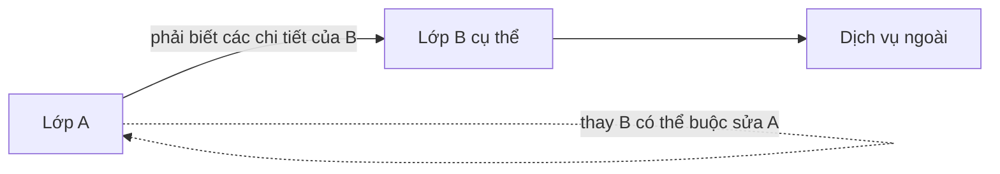
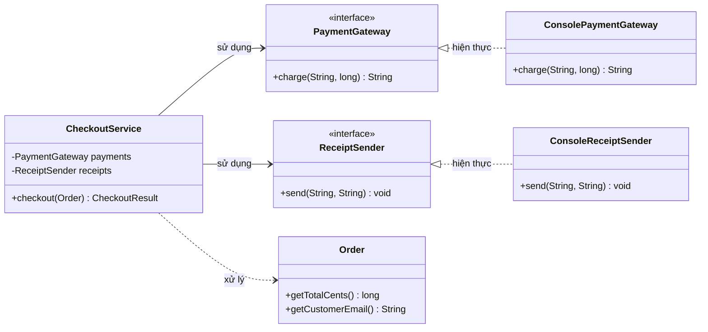
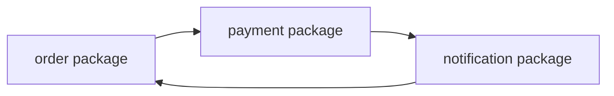
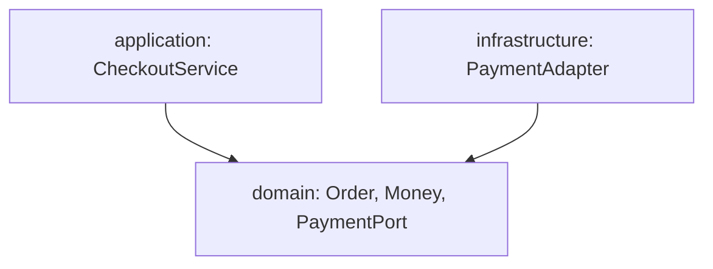

# Mức phụ thuộc giữa các lớp (Coupling) trong thiết kế OOP

## 1. Vì sao cần quan tâm mức phụ thuộc?

Giả sử ứng dụng bán hàng có lớp `CheckoutService` xử lý thanh toán. Ban đầu hệ thống chỉ dùng một cổng thanh toán và gửi biên nhận qua email. Sau này cần chuyển nhà cung cấp thanh toán, thêm SMS, kiểm thử mà không trừ tiền thật, hoặc chạy demo ngoại tuyến.

Nếu `CheckoutService` tự tạo một đối tượng cổng thanh toán cụ thể, tự gọi HTTP, tự cấu hình email và biết cấu trúc bảng database, chỉ một thay đổi nhỏ bên ngoài có thể buộc sửa hàng loạt dòng trong `CheckoutService`.

Đó là vấn đề **coupling**: mức độ một lớp/phần mềm **bị ràng buộc bởi lớp/phần mềm khác**. Phụ thuộc càng chặt vào chi tiết dễ thay đổi, việc sửa, kiểm thử, thay thế và sử dụng lại thường càng khó.

**Coupling không chỉ là số lượng lớp được import.** Hai lớp có thể cần trao đổi với nhau nhưng không bị gắn chặt vào cấu trúc nội bộ của nhau. Ngược lại, chỉ một mối phụ thuộc cũng có thể rất chặt nếu bên dùng dựa vào nhiều giả định ngầm về thứ tự gọi, trạng thái và ngoại lệ của bên được dùng.

Mục tiêu thực tế là **giảm những phụ thuộc không cần thiết và hướng phụ thuộc vào hợp đồng ổn định**, chứ không phải cố đưa số mối phụ thuộc về 0.

## 2. Nhìn ở ba mức: mã nguồn, đối tượng và thay đổi

| Góc nhìn | Cần quan sát | Câu hỏi hữu ích |
|---|---|---|
| **Phụ thuộc ở mã nguồn** | Import, chữ ký phương thức, kiểu field, `extends`, `implements`, lời gọi API | Nếu API/kiểu B đổi, lớp A có cần sửa hoặc biên dịch lại không? |
| **Phụ thuộc ở thời điểm chạy** | A giữ/cần đối tượng B; cấu hình, mạng, transaction, dữ liệu chia sẻ | Nếu B lỗi hoặc chậm, A có bị ảnh hưởng thế nào? |
| **Phụ thuộc khi thay đổi** | Giả định về dữ liệu, trình tự gọi, định dạng, chính sách nghiệp vụ | Đổi một quy tắc có kéo theo việc sửa nhiều lớp không? |

Hai lớp có thể liên kết tại runtime mà vẫn tương đối dễ thay thế nhờ một interface nhỏ và hợp đồng rõ ràng. Ngược lại, giao tiếp bằng chuỗi dữ liệu “ma thuật” có thể làm chúng bị ràng buộc ngầm dù mã nguồn gần như không import nhau.

Một cách hình dung đơn giản:



Khi B đổi phương thức, kiểu trả về, định dạng lỗi hoặc quy tắc bắt buộc phải gọi trước/sau, A có thể phải thay đổi theo. Độ lan truyền này là tín hiệu thực dụng của coupling.

## 3. Hai phong cách thiết kế: phụ thuộc chặt và phụ thuộc lỏng

### 3.1. Ví dụ phụ thuộc chặt (tight coupling)

```java
// Minh họa một thiết kế khó thay đổi, không phải chương trình đầy đủ.
final class CheckoutService {
    void checkout(Order order) {
        CardProcessor processor = new CardProcessor(
                "https://payment-provider.example/api", "merchant-001");
        String paymentId = processor.charge(
                order.getId(), order.getTotalCents());

        SmtpMailer mailer = new SmtpMailer("smtp.example", 587);
        mailer.sendReceipt(order.getCustomerEmail(), paymentId);
    }
}
```

Giả định `CardProcessor`, `SmtpMailer` và `Order` là các lớp đã được định nghĩa. Những vấn đề lộ ra:

- `CheckoutService` biết rõ **lớp cụ thể** của bên thanh toán và gửi thư.
- Service **tự tạo dependency**, khiến kiểm thử khó thay bằng fake khi không gọi dịch vụ thật.
- Địa chỉ máy chủ và thông tin cấu hình nằm trong lớp nghiệp vụ.
- Việc đổi nhà cung cấp hoặc kênh gửi biên nhận kéo theo sửa service.
- Hai tác dụng phụ là “trừ tiền” và “gửi thư” bị gắn vào một luồng; cần thiết kế xử lý lỗi phù hợp.

Không phải cứ dùng `new` là sai: `new Money(...)` hoặc tạo DTO/value object riêng bên trong service thường hoàn toàn hợp lý. Vấn đề ở đây là **tự tạo và phụ thuộc trực tiếp vào những cộng tác viên có chi tiết bên ngoài dễ thay đổi**.

### 3.2. Hướng phụ thuộc vào hợp đồng



Giờ `CheckoutService` cần hai **hợp đồng có ý nghĩa nghiệp vụ**: `PaymentGateway` và `ReceiptSender`. Các implementation được cung cấp từ bên ngoài, thường qua constructor injection.

Nhờ đó, service không phải biết cổng thanh toán dùng HTTP, mock, queue hay adapter của nhà cung cấp nào. Nó vẫn có dependency vào *hành vi thanh toán*, nhưng được cách ly khỏi phần lớn chi tiết triển khai.

## 4. Ví dụ Java 11+ hoàn chỉnh, chạy được và tự kiểm tra

Lưu toàn bộ ví dụ sau vào tệp `CouplingDemo.java`:

```java
import java.util.Objects;

public class CouplingDemo {

    static final class Order {
        private final String id;
        private final String customerEmail;
        private final int quantity;
        private final long unitPriceCents;

        Order(String id, String customerEmail,
              int quantity, long unitPriceCents) {
            this.id = Objects.requireNonNull(id, "id");
            this.customerEmail = Objects.requireNonNull(
                    customerEmail, "customerEmail");
            if (quantity <= 0 || unitPriceCents < 0) {
                throw new IllegalArgumentException(
                        "Invalid quantity or unit price");
            }
            this.quantity = quantity;
            this.unitPriceCents = unitPriceCents;
        }

        String getId() {
            return id;
        }

        String getCustomerEmail() {
            return customerEmail;
        }

        long getTotalCents() {
            return Math.multiplyExact(quantity, unitPriceCents);
        }
    }

    // Hai hợp đồng nhỏ, được đặt theo nhu cầu của checkout.
    interface PaymentGateway {
        String charge(String orderId, long amountCents);
    }

    interface ReceiptSender {
        void send(String email, String paymentId);
    }

    static final class CheckoutResult {
        private final String paymentId;
        private final long totalCents;

        CheckoutResult(String paymentId, long totalCents) {
            this.paymentId = paymentId;
            this.totalCents = totalCents;
        }

        String getPaymentId() {
            return paymentId;
        }

        long getTotalCents() {
            return totalCents;
        }
    }

    static final class CheckoutService {
        private final PaymentGateway payments;
        private final ReceiptSender receipts;

        CheckoutService(PaymentGateway payments, ReceiptSender receipts) {
            this.payments = Objects.requireNonNull(
                    payments, "payments");
            this.receipts = Objects.requireNonNull(
                    receipts, "receipts");
        }

        CheckoutResult checkout(Order order) {
            Objects.requireNonNull(order, "order");
            long total = order.getTotalCents();

            String paymentId = payments.charge(order.getId(), total);
            receipts.send(order.getCustomerEmail(), paymentId);

            return new CheckoutResult(paymentId, total);
        }
    }

    // Adapter dùng cho demo.
    static final class ConsolePaymentGateway
            implements PaymentGateway {
        @Override
        public String charge(String orderId, long amountCents) {
            System.out.println("Paid " + orderId + ": "
                    + amountCents + " cents");
            return "tx-" + orderId;
        }
    }

    static final class ConsoleReceiptSender
            implements ReceiptSender {
        @Override
        public void send(String email, String paymentId) {
            System.out.println("Receipt for " + email
                    + ": " + paymentId);
        }
    }

    // Fake để kiểm thử không cần gọi HTTP/thanh toán thật.
    static final class FakePaymentGateway
            implements PaymentGateway {
        String receivedOrderId;
        long receivedAmountCents;

        @Override
        public String charge(String orderId, long amountCents) {
            receivedOrderId = orderId;
            receivedAmountCents = amountCents;
            return "fake-transaction";
        }
    }

    static final class RecordingReceiptSender
            implements ReceiptSender {
        String receivedEmail;
        String receivedPaymentId;

        @Override
        public void send(String email, String paymentId) {
            receivedEmail = email;
            receivedPaymentId = paymentId;
        }
    }

    public static void main(String[] args) {
        Order order = new Order("ORD-7", "buyer@example.test",
                2, 140_000L);

        CheckoutService actual = new CheckoutService(
                new ConsolePaymentGateway(),
                new ConsoleReceiptSender());

        CheckoutResult result = actual.checkout(order);
        System.out.println("RESULT " + result.getPaymentId());

        FakePaymentGateway fakePayment = new FakePaymentGateway();
        RecordingReceiptSender fakeReceipt =
                new RecordingReceiptSender();

        CheckoutService underTest = new CheckoutService(
                fakePayment, fakeReceipt);
        CheckoutResult tested = underTest.checkout(order);

        if (!"ORD-7".equals(fakePayment.receivedOrderId)
                || fakePayment.receivedAmountCents != 280_000L
                || !"buyer@example.test".equals(
                        fakeReceipt.receivedEmail)
                || !"fake-transaction".equals(
                        fakeReceipt.receivedPaymentId)
                || tested.getTotalCents() != 280_000L) {
            throw new AssertionError("Checkout behavior incorrect");
        }

        System.out.println("Fake checks passed");
    }
}
```

Chạy trên JDK 11 trở lên:

```bash
javac CouplingDemo.java
java CouplingDemo
```

Kết quả dự kiến:

```text
Paid ORD-7: 280000 cents
Receipt for buyer@example.test: tx-ORD-7
RESULT tx-ORD-7
Fake checks passed
```

Ở bản thiết kế này:

1. **`CheckoutService` có trách nhiệm điều phối checkout**; việc tính tổng thuộc `Order`, thao tác thu tiền thuộc `PaymentGateway`, việc gửi biên nhận thuộc `ReceiptSender`.
2. **Lớp nghiệp vụ dùng interface** nên thay `ConsolePaymentGateway` bằng adapter khác không đòi sửa nội dung `CheckoutService` nếu hợp đồng và hành vi cam kết không đổi.
3. **Constructor injection** cho phép truyền các fake khi kiểm thử. Test xác nhận mã đơn, số tiền và người nhận thay vì chỉ so khớp cấu trúc code.
4. **Sự phụ thuộc chưa biến mất:** checkout vẫn cần một dịch vụ có khả năng thu tiền và một dịch vụ gửi biên nhận. Ta chỉ giảm việc dính chặt vào chi tiết của các dịch vụ đó.

Đây là ví dụ về **thiết kế phụ thuộc**, không phải quy trình thanh toán production đầy đủ. Nếu thu tiền thành công nhưng gửi biên nhận lỗi, lệnh thu tiền không thể tự “undo”. Hệ thống thực cần trạng thái giao dịch rõ ràng, idempotency, retry/outbox, hoặc cơ chế phù hợp để không trừ tiền lặp lại. Việc giảm coupling giúp cô lập chính sách tích hợp nhưng **không tự giải quyết các bài toán phân tán**.

## 5. Các dạng coupling thường được nhắc tới

Một số tài liệu OOP và structured design phân biệt những kiểu phụ thuộc sau. Đây là **phân loại để suy nghĩ**, không phải bảng xếp hạng tuyệt đối dùng cho mọi kiến trúc Java hiện đại.

| Dạng | Dấu hiệu | Ví dụ/bất lợi | Cách cải thiện khi cần |
|---|---|---|---|
| **Content coupling** | A can thiệp hoặc phụ thuộc trực tiếp vào chi tiết thực thi/nội bộ B | A sửa trực tiếp cấu trúc riêng tư của B thông qua reflection | Đóng gói trạng thái; cung cấp API theo hành vi |
| **Common coupling** | Nhiều thành phần phụ thuộc cùng trạng thái dùng chung | Biến `static` mutable/global cache bị sửa ở nhiều nơi | Giới hạn nơi sở hữu và quyền thay đổi trạng thái |
| **External coupling** | Nhiều thành phần phụ thuộc một giao thức/định dạng bên ngoài | Mỗi lớp tự diễn giải response JSON của nhà cung cấp | Adapter/anti-corruption layer, hợp đồng và versioning |
| **Control coupling** | A truyền cờ/mã để điều khiển chi tiết các nhánh của B | `process(order, true, 3)` với các cờ khó hiểu | Tách thao tác có tên hoặc dùng policy/strategy |
| **Stamp coupling** | A đưa cho B cả cấu trúc phức tạp dù B chỉ cần một phần | Truyền toàn bộ `UserProfile` để chỉ lấy email | Truyền dữ liệu hoặc contract nhỏ thực sự cần |
| **Data coupling** | Các thành phần trao đổi dữ liệu xác định rõ | `charge(orderId, amountCents)` | Thường có thể chấp nhận và dễ hiểu |
| **Message coupling** | Giao tiếp bằng lời gọi/hợp đồng thông điệp, hạn chế hiểu nội bộ | `gateway.charge(request)` qua interface nhỏ | Chú trọng hợp đồng, lỗi, versioning; không tự coi là không phụ thuộc |

Cần đọc bối cảnh: truyền `UserProfile` không nhất thiết sai nếu bên được gọi có trách nhiệm nghiệp vụ với **cả profile**. Truyền quá nhiều tham số nguyên thủy cũng có thể dẫn đến *primitive obsession*; một value object như `Money` hay `PaymentRequest` giúp diễn đạt hợp đồng tốt hơn.

### Một ví dụ về control coupling

```java
// Mã khó đọc: caller phải biết giá trị mode/flag mang ý nghĩa gì.
void publish(Document doc, int mode, boolean urgent) {
    // mode=1: email; mode=2: archive; ...
}
```

Có thể thay bằng thao tác phản ánh mục đích hoặc policy rõ nghĩa:

```java
interface DocumentPublisher {
    void publish(Document document);
}

final class EmailPublisher implements DocumentPublisher {
    @Override
    public void publish(Document document) {
        // Gửi email theo hợp đồng của adapter.
    }
}
```

`Document` và chi tiết triển khai ở đây được giả định tồn tại. Chỉ nên thêm nhiều lớp triển khai khi thực sự có các hành vi thay thế độc lập; nếu chỉ hai nhánh đơn giản và ổn định, một enum và `switch` rõ ràng cũng có thể đủ.

## 6. Nguyên tắc giảm coupling và ranh giới áp dụng

### A. Information hiding – giấu chi tiết triển khai

Đừng để các lớp bên ngoài biết cấu trúc lưu trữ nội bộ của một object chỉ để thay đổi nghiệp vụ:

```java
// Tránh:
// order.lines.add(new OrderLine(...));
// order.status = "PAID";

// Tốt hơn nếu thuộc trách nhiệm của Order:
order.addLine(productId, quantity);
order.markPaid(paymentId);
```

Lớp gọi biết **hành vi mà Order cam kết**, không cần biết phải sửa bao nhiêu field. Khi cấu trúc nội bộ đổi từ List sang Map, API bên ngoài có thể giữ nguyên.

### B. Dependency Inversion Principle (DIP)

Module nghiệp vụ có vai trò chính không nên phải gắn vào chi tiết hạ tầng dễ thay đổi; cả hai có thể phụ thuộc một abstraction phù hợp. Trong ví dụ, `CheckoutService` và adapter thanh toán cùng biết interface `PaymentGateway`.

**DIP không đồng nhất với dependency injection (DI).** DIP là nguyên tắc tổ chức phụ thuộc; DI là một kỹ thuật cung cấp cộng tác viên từ ngoài vào. Có thể dùng constructor injection mà vẫn phụ thuộc vào concrete class khó thay thế. Ngược lại, một interface nhỏ vẫn có giá trị mà không cần framework DI.

### C. Interface Segregation Principle (ISP)

Một interface quá rộng cũng tạo coupling. Nếu `PaymentProvider` chứa các hàm `charge`, `refund`, `issueCard`, `manageAccount`, `generateReport`, service chỉ xử lý checkout sẽ phụ thuộc vào nhiều điều nó không cần.

Tách hợp đồng theo vai trò sử dụng khi các vai trò thực sự độc lập:

```java
interface PaymentCharger {
    String charge(String orderId, long amountCents);
}

interface PaymentRefunder {
    void refund(String paymentId, long amountCents);
}
```

Không nên tách interface chỉ để có thật nhiều file. Nếu nhiều thao tác luôn đi cùng nhau và cùng thay đổi, một hợp đồng thống nhất có thể đơn giản, dễ hiểu hơn.

### D. Single Responsibility và cohesion

**Coupling** nói về **quan hệ giữa các lớp**; **cohesion** (mức gắn kết chức năng) nói về **các trách nhiệm trong cùng một lớp**.

Một lớp vừa thanh toán, gửi mail, đọc SQL và vẽ PDF thường có nhiều lý do để thay đổi. Việc phân chia đúng trách nhiệm có thể giảm coupling có hại và tăng cohesion. Tuy nhiên tách một thao tác đơn giản thành hàng chục wrapper chỉ để “mỗi lớp một dòng” có thể làm luồng xử lý khó hiểu hơn.

Đánh giá thiết kế cần cân bằng: **cohesion cao, coupling phù hợp** và số lượng thành phần vừa đủ.

### E. Law of Demeter và chuỗi truy cập

Cẩn trọng khi một lớp đào sâu vào nhiều tầng chi tiết của object khác:

```java
// Ràng buộc vào nhiều nấc cấu trúc:
String city = order.getCustomer()
        .getAddress().getCity();
```

Nếu “thành phố giao hàng” là khái niệm ổn định của đơn hàng, cân nhắc:

```java
String city = order.getShippingCity();
```

Nhưng đừng tự động biến mọi getter lồng nhau thành phương thức chuyển tiếp. DTO để hiển thị hoặc truy vấn dữ liệu thuần túy có thể hợp lý với chuỗi truy cập. Câu hỏi quan trọng là **lớp hiện tại có đang biết cấu trúc nội bộ mà nó không nên biết không?**

## 7. Coupling ở cấp package và module

Ở cấp hệ thống, phụ thuộc có thể tạo thành chu trình:



Khi cả ba module import qua lại, khó cô lập thay đổi và kiểm thử từng phần. Một cách sắp xếp khác:



Trong cách tổ chức này, những kiểu nghiệp vụ ổn định và contract cần thiết có thể được đặt tại domain/application; hạ tầng hiện thực contract. Nơi khởi tạo ứng dụng (composition root) kết nối adapter với service. Sự phụ thuộc **mã nguồn** hướng vào hợp đồng, dù luồng **runtime** vẫn đi từ service ra hạ tầng thông qua implementation.

Không nên áp một sơ đồ kiến trúc cứng cho mọi bài toán. Dự án nhỏ có thể dùng package đơn giản; hệ thống lớn với nhiều tích hợp và chu kỳ thay đổi khác nhau thường hưởng lợi từ ranh giới rõ.

### Khi hai module buộc phải giao tiếp hai chiều?

Trước hết kiểm tra xem trách nhiệm có bị phân chia sai không. Có thể trích một hợp đồng chung, dùng callback hoặc domain event. Nhưng event cũng tạo **coupling theo thông điệp**: bên nhận phụ thuộc schema, thời điểm, thứ tự, tính trùng lặp và cách xử lý lỗi. “Không import nhau” không có nghĩa “không còn phụ thuộc”.

## 8. Đo coupling như thế nào?

Các chỉ số có thể hỗ trợ phát hiện vấn đề, nhưng cần đọc cùng hành vi thực tế.

| Chỉ số/tín hiệu | Cách hiểu | Giới hạn |
|---|---|---|
| **CBO (Coupling Between Objects)** | Số lớp mà một lớp liên hệ/phụ thuộc theo định nghĩa của công cụ | Cách đếm không thống nhất giữa công cụ; không nói trực tiếp mối phụ thuộc nào nguy hiểm |
| **Fan-out** | Một module có bao nhiêu dependency đi ra | Nhiều dependency vào API ổn định có thể ít rủi ro hơn một dependency vào chi tiết dễ đổi |
| **Fan-in** | Có bao nhiêu nơi phụ thuộc vào một module | Fan-in cao có thể cho thấy component chung hữu ích, nhưng thay đổi ở đó cần thận trọng |
| **Chu trình phụ thuộc** | A → B → C → A | Có thể khiến phân lớp và triển khai độc lập khó hơn |
| **Change coupling** | Các file/lớp thường phải đổi cùng nhau | Cần xem lịch sử thay đổi; có thể do cùng feature chứ không do thiết kế xấu |
| **Khó kiểm thử cô lập** | Test phải mở database, mạng hoặc nhiều service mới chạy được | Có thể do ranh giới quá rộng, dependency ẩn hoặc thiếu abstraction thích hợp |

Một ví dụ: `ReportService` dùng năm class value object nhỏ, bất biến, với hợp đồng ổn định không nhất thiết có vấn đề hơn `CheckoutService` phụ thuộc một SDK thanh toán vừa lớn vừa thay đổi thường xuyên.

Muốn đánh giá đúng, hãy kết hợp **chi phí khi thay đổi**, **khả năng chạy test**, **độ ổn định của hợp đồng** và **mức độ hiểu biết về chi tiết bên ngoài**. Đừng chỉ đếm `import` hoặc số lượng field.

## 9. Quy trình thực tế khi thấy hai lớp phụ thuộc chặt

1. **Chỉ ra điều đang biến động:** nhà cung cấp, nguồn dữ liệu, cấu trúc object, quy tắc nghiệp vụ, định dạng thông điệp hay cơ chế gửi nhận?
2. **Xác định lớp nào cần trách nhiệm gì:** `CheckoutService` cần “thu tiền”, không cần biết endpoint HTTP cụ thể.
3. **Vạch hợp đồng nhỏ nhưng đầy đủ:** tham số, kết quả, ngoại lệ, các điều kiện tiền/hậu phải rõ ràng.
4. **Đưa phần thay đổi thường xuyên vào implementation riêng:** adapter database, HTTP, email hoặc chính sách nghiệp vụ có nhiều biến thể.
5. **Cung cấp dependency có chủ đích:** constructor injection cho thành phần bắt buộc và ổn định trong thời gian sống service; truyền tham số nếu chỉ cần theo từng thao tác.
6. **Kiểm thử qua hợp đồng:** giả lập giao diện ở ranh giới, kiểm tra hành vi observable; thêm integration test cho adapter thật khi cần.
7. **Đánh giá lại độ phức tạp:** nếu sau refactor số lớp tăng nhiều nhưng thay đổi thực tế không đơn giản hơn, thiết kế có thể đã trừu tượng hóa quá sớm.

Không phải lớp nào cũng cần interface. `Money`, `OrderId`, `LocalDate` hay thuật toán nội bộ ổn định thường có thể được dùng trực tiếp mà không cần tạo `IMoneyFactoryAdapter` và hàng loạt wrapper vô nghĩa.

## 10. Những nhầm lẫn hay gặp

| Nhận định sai | Cách hiểu đúng |
|---|---|
| “Càng ít dependency càng tốt trong mọi trường hợp.” | Thiết kế cần hợp tác giữa các lớp; mục tiêu là phụ thuộc **có chủ đích và dễ quản lý**. |
| “Chỉ import một lớp nên coupling chắc chắn thấp.” | Một lớp có thể biết rất nhiều chi tiết và giả định của một dependency duy nhất. |
| “Có interface là đã loose coupling.” | Nếu interface sao chép toàn bộ SDK bên ngoài hoặc thay đổi liên tục, lớp dùng vẫn bị ràng buộc chặt. |
| “Dependency injection giải quyết mọi coupling.” | DI giúp cung cấp implementation và kiểm thử; hợp đồng vẫn có thể thiết kế kém. |
| “Gọi qua event/message broker thì không còn coupling.” | Vẫn có phụ thuộc vào schema, delivery semantics, version và thứ tự xử lý. |
| “Static utility luôn là vấn đề.” | Hàm pure, stateless như `Math.multiplyExact` thường ổn; shared mutable state mới cần xem xét kỹ. |
| “Tách càng nhiều lớp càng dễ bảo trì.” | Quá nhiều abstraction/wrapper làm tăng độ khó điều hướng và quản lý. |
| “Coupling thấp nghĩa là cohesion cao.” | Đây là hai trục khác nhau: quan hệ giữa lớp và trách nhiệm bên trong lớp. |
| “Test có fake chạy được nghĩa là tích hợp production an toàn.” | Fake kiểm tra logic ứng dụng; adapter/network/database và failure modes còn cần kiểm chứng phù hợp. |

## 11. Bài tập thực hành

### Bài 1 – Nhận diện coupling mạnh

```java
class MonthlyReportService {
    byte[] generate() {
        OracleConnection db = new OracleConnection("...");
        var rows = db.query("SELECT ...");
        return new VendorPdfWriter().render(rows);
    }
}
```

*Đây là mã minh họa; các lớp vendor chưa được khai báo.*

Hỏi: nếu chuyển từ Oracle sang PostgreSQL hoặc đổi thư viện xuất PDF, phải sửa nơi nào? Làm gì để `MonthlyReportService` ít hiểu hơn về chi tiết đó?

**Gợi ý:** xác định hợp đồng lấy dữ liệu báo cáo và hợp đồng dựng tài liệu (chỉ khi có lý do cần thay đổi/kiểm thử độc lập). Đưa cấu hình và khởi tạo adapter ra khỏi service; tách truy vấn theo nhu cầu miền nghiệp vụ.

### Bài 2 – Interface có đủ không?

Một dự án có:

```java
interface HugePaymentSdkFacade {
    void connectWithVendorCertificate(...);
    void setVendorRegion(...);
    void callVendorEndpoint(...);
    void parseVendorResponse(...);
}
```

`CheckoutService` gọi tất cả hàm này. Tại sao dù có interface, coupling vẫn cao?

**Gợi ý:** interface làm lộ những chi tiết của nhà cung cấp; thay vendor vẫn buộc sửa lớp nghiệp vụ. Hợp đồng tốt hơn nên thể hiện hành động như `charge(request)` và quy tắc kết quả/lỗi nghiệp vụ.

### Bài 3 – Chọn cách truyền dependency

Một formatter chỉ được dùng trong một lần xuất báo cáo; còn repository được dùng trong hầu hết thao tác của một service. Bạn sẽ truyền chúng qua phương thức hay constructor?

**Gợi ý:** formatter có thể là tham số khi khác nhau theo mỗi request. Repository ổn định và bắt buộc thường phù hợp constructor injection. Đây là lựa chọn theo vòng đời và API; không có luật tuyệt đối.

### Bài 4 – Phát hiện coupling khi thay đổi

Một lần thay đổi định dạng địa chỉ buộc sửa `Customer`, `Order`, `Invoice`, `EmailSender` và `CsvExporter` vì tất cả tự đọc `address.line1`, `address.line2` và ghép chuỗi theo cách riêng.

Bạn sẽ tìm ranh giới nào để giảm sự lan truyền thay đổi?

**Gợi ý:** xem `Address` như value object với hành vi/định dạng rõ trách nhiệm, hoặc tạo formatter theo ngữ cảnh xuất dữ liệu. Không ép mọi định dạng (email, hóa đơn, CSV) về một chuỗi duy nhất nếu yêu cầu khác nhau.

### Bài 5 – Kiểm thử tính thay thế

Dựa vào `CouplingDemo.java`, tạo `FailingPaymentGateway` ném exception trong `charge()`. Kiểm tra `RecordingReceiptSender` **không được gọi** nếu thu tiền không thành công.

**Gợi ý:** thêm một biến `boolean called` trong sender; gọi `checkout()` và bắt lỗi dự kiến, sau đó assert `called == false`. Bài mở rộng: nếu gateway thu tiền xong nhưng sender lỗi, hệ thống nên lưu trạng thái và retry biên nhận thế nào để tránh thu tiền hai lần?

---

**Ghi nhớ:** coupling phản ánh mức độ một lớp phải biết, dựa vào và bị ảnh hưởng bởi lớp khác. Thiết kế tốt giữ **trách nhiệm rõ**, **hợp đồng ổn định**, **chi tiết có thể thay thế ở ranh giới cần thiết** và **hành vi dễ kiểm thử**. Hãy giảm sự lan truyền thay đổi thực tế, đồng thời tránh tạo abstraction khi chưa có nhu cầu.