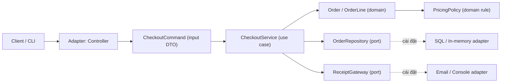
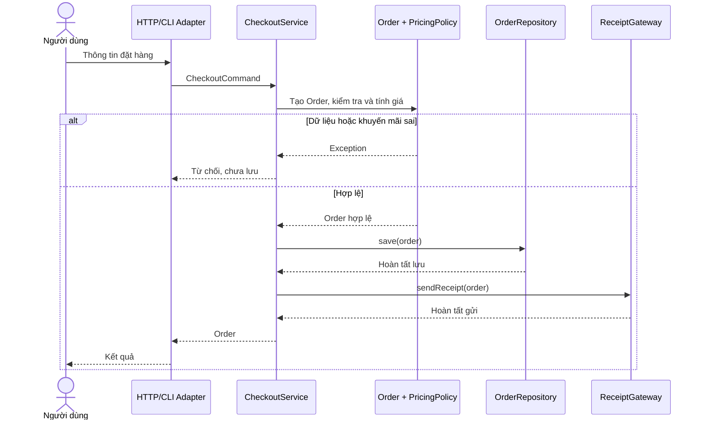

# Tách dữ liệu, nghiệp vụ và tương tác bên ngoài trong thiết kế lớp Java

Một chức năng “đặt hàng” có thể đồng thời phải nhận JSON, kiểm tra giỏ hàng, tính số tiền, lưu database và gửi email xác nhận. Nếu đặt tất cả trong một class, mọi thay đổi từ định dạng HTTP đến quy tắc khuyến mãi đều buộc sửa cùng một nơi. Khi chạy test tính tiền, chương trình lại cần khởi động database hoặc dịch vụ email.

Giải pháp là **phân định trách nhiệm của dữ liệu, logic nghiệp vụ và tương tác với thế giới bên ngoài**, rồi kết nối chúng bằng những giao diện đủ rõ. Mục tiêu là thay đổi và kiểm thử từng phần mà không làm rối quy tắc cốt lõi.

## 1. Hiểu đúng ba nhóm trách nhiệm

| Nhóm | Câu hỏi mà thành phần trả lời | Ví dụ | Điều nên tránh |
| --- | --- | --- | --- |
| Dữ liệu và mô hình miền (*data/domain model*) | Đối tượng có trạng thái gì? Những giá trị nào hợp lệ? | `OrderLine`, `Order`, `Money` | Để bất kỳ ai sửa dữ liệu khiến đơn hàng mất hợp lệ |
| Nghiệp vụ (*business rules/use case*) | Khi nào được đặt hàng? Tính tổng và giảm giá thế nào? Luồng xử lý ra sao? | `PricingPolicy`, `CheckoutService` | Gắn công thức giảm giá trực tiếp vào controller/SQL/email |
| Tương tác bên ngoài (*I/O, infrastructure, adapters*) | Nhận yêu cầu, lưu ở đâu, thông báo bằng cách nào? | HTTP controller, JDBC repository, email gateway | Đưa thư viện HTTP/SQL vào đối tượng nghiệp vụ |

**Điều chỉnh quan trọng:** “tách dữ liệu và nghiệp vụ” **không có nghĩa** entity chỉ chứa getter/setter còn tất cả quy tắc bị đẩy sang service. Một domain entity tốt có thể tự kiểm tra bất biến và cung cấp hành vi hợp lệ. Điều cần tách là **logic cốt lõi** khỏi chi tiết kết nối HTTP, cơ sở dữ liệu, file, email hay hệ thống khác.

Ví dụ `OrderLine` biết số lượng phải dương và biết tính thành tiền. `Order` bảo vệ tổng tiền hợp lệ. `CheckoutService` điều phối tạo và lưu đơn. `OrderRepository` định nghĩa cách yêu cầu lưu; lớp cài đặt JDBC mới biết câu SQL cụ thể.

## 2. Vì sao đặt chung mọi thứ trong một class gây vấn đề?

```java
// PSEUDOCODE: ví dụ cần cải tiến, không phải đoạn có thể chạy độc lập.
class CheckoutController {
    void checkout(HttpRequest request) {
        String customerId = request.json().get("customerId");
        long total = 0;

        // Vừa parse HTTP, vừa thực thi business rule.
        for (var item : request.json().items()) {
            total += item.quantity() * item.unitPriceCents();
        }
        if ("SAVE10".equals(request.json().promoCode())) {
            total = total - total / 10;
        }

        // Vừa làm I/O, vừa điều phối use case.
        database.execute("INSERT INTO orders ...");
        emailClient.send(customerId, "Order confirmed");
    }
}
```

Những phụ thuộc bị trộn lẫn:

- Chỉ muốn thay cách nhận JSON cũng có thể ảnh hưởng code tính tiền.
- Chỉ muốn test giảm giá lại phải giả lập HTTP, database và email.
- Cùng một quy tắc có thể bị sao chép sang CLI, API thứ hai hoặc tác vụ chạy nền.
- Nếu lưu đơn thành công nhưng gửi email lỗi, không rõ hệ thống xử lý trạng thái dở dang như thế nào.
- Controller chứa quá nhiều lý do thay đổi; lỗi thực hiện trong một tầng khó được phát hiện qua test tập trung.

Tách trách nhiệm giúp làm rõ **ai quyết định điều gì** và **lỗi ở đâu được xử lý**. Không có một cách tách duy nhất phù hợp với mọi quy mô dự án.

## 3. Thiết kế luồng phụ thuộc

Một cách tổ chức thực tế là: adapter nhận dữ liệu, application service điều phối, domain model/policy giữ quy tắc, còn persistence/notification được truy cập qua *port* (interface).



Đường mũi tên liền mô tả nơi một thành phần gọi hoặc dùng thành phần kia trong luồng. **Hướng phụ thuộc trong mã nguồn** cần được kiểm soát: tầng nghiệp vụ định nghĩa những port cần thiết; adapter bên ngoài cài đặt các port đó. Tầng domain không import controller, JDBC, `System.out` hoặc thư viện gửi email.

Trong thiết kế theo **Dependency Inversion Principle**, `CheckoutService` phụ thuộc `OrderRepository`/ `ReceiptGateway` là *interface*; lớp `JdbcOrderRepository` hoặc `SmtpReceiptGateway` mới phụ thuộc vào công nghệ cụ thể.

### Một số thuật ngữ dễ nhầm

| Thuật ngữ | Nhiệm vụ thực tế | Có chứa quy tắc nghiệp vụ không? |
| --- | --- | --- |
| DTO / Command | Mang dữ liệu vào/ra giữa các ranh giới | Chủ yếu kiểm tra định dạng đầu vào; không phải nguồn chân lý của invariant |
| Value object | Biểu diễn một giá trị có nghĩa trong domain | Có thể tự kiểm tra và thực hiện phép toán của giá trị đó |
| Entity / Aggregate | Bảo vệ trạng thái và các chuyển đổi hợp lệ | Có; đây thường là nơi quan trọng để giữ invariant |
| Domain policy/service | Quy tắc không thuộc riêng một entity hoặc cần cấu hình độc lập | Có |
| Application service | Điều phối một use case và các cộng tác viên | Có thể kiểm tra điều kiện quy trình, nhưng hạn chế nhồi công thức domain |
| Repository port | Hợp đồng lưu/truy vấn đối tượng miền | Không biết SQL trong bản interface |
| Adapter | Chuyển đổi I/O thành các hợp đồng của hệ thống | Không nên định nghĩa lại quy tắc tính tiền, hạn mức... |

`Data class` không nhất thiết chỉ là record; nó là lựa chọn hình thức biểu diễn. `record` Java hữu ích cho dữ liệu bất biến, nhưng entity có vòng đời và chuyển trạng thái có thể phù hợp hơn với class có hành vi và trường đóng gói.

## 4. Ví dụ Java 17 độc lập: đặt hàng và gửi biên nhận

Yêu cầu:

- Khách hàng có thể đặt ít nhất một dòng hàng.
- Mỗi dòng có mã sản phẩm, số lượng dương và giá tính bằng **đơn vị cent** không âm.
- Mã `SAVE10` giảm 10% tổng tiền trước giảm, làm tròn **xuống đến cent**; không nhập mã thì không giảm.
- Mã ưu đãi không hỗ trợ phải bị từ chối **trước khi lưu đơn**.
- Đơn hàng được lưu qua `OrderRepository`; gửi biên nhận qua `ReceiptGateway`.
- Có thể chạy thử với repository trong bộ nhớ và gateway in ra console, không cần HTTP hay database.

Tạo file **`SeparationOfConcernsDemo.java`**:

```java
import java.math.BigDecimal;
import java.util.ArrayList;
import java.util.LinkedHashMap;
import java.util.List;
import java.util.Map;
import java.util.Objects;
import java.util.Optional;

public class SeparationOfConcernsDemo {

    // INPUT DTO: biểu diễn dữ liệu mà một adapter chuyển cho use case.
    record LineInput(String sku, int quantity, long unitPriceCents) { }
    record CheckoutCommand(
            String customerId,
            List<LineInput> items,
            String promoCode) { }

    // DOMAIN: value object; dữ liệu và hành vi luôn đi cùng bất biến.
    record OrderLine(String sku, int quantity, long unitPriceCents) {
        OrderLine {
            if (sku == null || sku.isBlank()) {
                throw new IllegalArgumentException("SKU is required");
            }
            if (quantity <= 0 || unitPriceCents < 0) {
                throw new IllegalArgumentException("Invalid line values");
            }
        }

        long lineTotalCents() {
            // Phát hiện tràn số thay vì âm thầm cho kết quả sai.
            return Math.multiplyExact(quantity, unitPriceCents);
        }
    }

    // DOMAIN POLICY: quy tắc giá độc lập với cách nhận và lưu dữ liệu.
    interface PricingPolicy {
        long payableCents(long subtotalCents, String promoCode);
    }

    static final class StandardPricingPolicy implements PricingPolicy {
        @Override
        public long payableCents(long subtotalCents, String promoCode) {
            if (subtotalCents < 0) {
                throw new IllegalArgumentException("Negative subtotal");
            }

            if (promoCode == null || promoCode.isBlank()) {
                return subtotalCents;
            }
            if ("SAVE10".equals(promoCode)) {
                long discountCents = subtotalCents / 10; // làm tròn xuống
                return subtotalCents - discountCents;
            }
            throw new IllegalArgumentException("Unknown promotion");
        }
    }

    // DOMAIN: Order bảo vệ dữ liệu và invariant tổng tiền.
    static final class Order {
        private final String id;
        private final String customerId;
        private final List<OrderLine> lines;
        private final long subtotalCents;
        private final long payableCents;

        private Order(String id, String customerId,
                      List<OrderLine> inputLines, String promoCode,
                      PricingPolicy policy) {
            this.id = required(id, "order id");
            this.customerId = required(customerId, "customer id");
            Objects.requireNonNull(policy, "policy");

            this.lines = List.copyOf(inputLines);
            if (lines.isEmpty()) {
                throw new IllegalArgumentException("Empty order");
            }

            long sum = 0L;
            for (OrderLine line : lines) {
                sum = Math.addExact(sum, line.lineTotalCents());
            }
            this.subtotalCents = sum;

            long proposed = policy.payableCents(sum, promoCode);
            if (proposed < 0 || proposed > sum) {
                throw new IllegalArgumentException(
                        "Pricing policy returned invalid amount");
            }
            this.payableCents = proposed;
        }

        static Order place(String id, String customerId,
                           List<OrderLine> lines, String promoCode,
                           PricingPolicy policy) {
            return new Order(id, customerId, lines, promoCode, policy);
        }

        String id() { return id; }
        String customerId() { return customerId; }
        long subtotalCents() { return subtotalCents; }
        long payableCents() { return payableCents; }
        List<OrderLine> lines() { return lines; }
    }

    // PORTS: hợp đồng dịch vụ ngoài do use case cần.
    interface OrderRepository {
        void save(Order order);
        Optional<Order> findById(String id);
    }

    interface ReceiptGateway {
        void sendReceipt(Order order);
    }

    interface OrderIdGenerator {
        String nextId();
    }

    // APPLICATION: điều phối, không tự tính tiền hay biết SQL.
    static final class CheckoutService {
        private final PricingPolicy pricing;
        private final OrderRepository orders;
        private final ReceiptGateway receipts;
        private final OrderIdGenerator ids;

        CheckoutService(PricingPolicy pricing, OrderRepository orders,
                        ReceiptGateway receipts, OrderIdGenerator ids) {
            this.pricing = Objects.requireNonNull(pricing);
            this.orders = Objects.requireNonNull(orders);
            this.receipts = Objects.requireNonNull(receipts);
            this.ids = Objects.requireNonNull(ids);
        }

        Order checkout(CheckoutCommand command) {
            Objects.requireNonNull(command, "command");
            Objects.requireNonNull(command.items(), "items");

            // Chuyển từ input DTO sang domain value object.
            List<OrderLine> lines = new ArrayList<>();
            for (LineInput input : command.items()) {
                Objects.requireNonNull(input, "line input");
                lines.add(new OrderLine(
                        input.sku(),
                        input.quantity(),
                        input.unitPriceCents()));
            }

            Order order = Order.place(
                    ids.nextId(), command.customerId(),
                    lines, command.promoCode(), pricing);

            orders.save(order);
            receipts.sendReceipt(order);
            return order;
        }
    }

    // ADAPTER: thay bằng JDBC/JPA mà không thay code tính tiền.
    static final class InMemoryOrderRepository implements OrderRepository {
        private final Map<String, Order> data = new LinkedHashMap<>();

        @Override
        public void save(Order order) {
            Objects.requireNonNull(order, "order");
            if (data.putIfAbsent(order.id(), order) != null) {
                throw new IllegalStateException("Order id already exists");
            }
        }

        @Override
        public Optional<Order> findById(String id) {
            return Optional.ofNullable(data.get(id));
        }
    }

    // ADAPTER: tương tác console, không nằm trong entity Order.
    static final class ConsoleReceiptGateway implements ReceiptGateway {
        @Override
        public void sendReceipt(Order order) {
            String amount = BigDecimal
                    .valueOf(order.payableCents(), 2)
                    .toPlainString();
            System.out.println(
                    "Receipt " + order.id() + " = " + amount);
        }
    }

    private static String required(String text, String field) {
        if (text == null || text.isBlank()) {
            throw new IllegalArgumentException(field + " is required");
        }
        return text;
    }

    public static void main(String[] args) {
        InMemoryOrderRepository repository = new InMemoryOrderRepository();
        CheckoutService service = new CheckoutService(
                new StandardPricingPolicy(),
                repository,
                new ConsoleReceiptGateway(),
                () -> "ORDER-001");

        CheckoutCommand command = new CheckoutCommand(
                "CUSTOMER-01",
                List.of(
                        new LineInput("BOOK", 2, 120_00),
                        new LineInput("PEN", 3, 25_00)),
                "SAVE10");

        Order order = service.checkout(command);
        System.out.println(
                "Saved = " + repository.findById(order.id()).isPresent());

        try {
            service.checkout(new CheckoutCommand(
                    "CUSTOMER-02",
                    List.of(new LineInput("BOOK", 1, 120_00)),
                    "INVALID"));
        } catch (IllegalArgumentException expected) {
            System.out.println(expected.getMessage());
        }
    }
}
```

Biên dịch và chạy bằng Java 17 trở lên:

```bash
javac SeparationOfConcernsDemo.java
java SeparationOfConcernsDemo
```

Kết quả:

```text
Receipt ORDER-001 = 283.50
Saved = true
Unknown promotion
```

Tính tay: `2 × 120.00 + 3 × 25.00 = 315.00`; giảm 10% là `31.50`; thanh toán `283.50`. Trong code, tiền lưu bằng số nguyên cent để tránh lỗi làm tròn của `double`; chính sách giảm giá và quy tắc làm tròn được ghi rõ. Với hệ thống nhiều loại tiền, cần mô hình `Money` có currency, scale và rounding mode phù hợp.

### Vì sao đây là ví dụ phân tách đúng trách nhiệm?

- `CheckoutCommand`/`LineInput` là dữ liệu đầu vào; không biết SQL, email hoặc quy tắc tính tiền.
- `OrderLine` là **value object có hành vi**, giữ bất biến và tính thành tiền một dòng.
- `Order` là mô hình miền, đảm bảo danh sách không rỗng và số phải trả nằm trong khoảng hợp lệ. `List.copyOf` tạo snapshot danh sách; các phần tử trong ví dụ là record với thành phần bất biến nên không làm lộ trạng thái mutable.
- `StandardPricingPolicy` biết khuyến mãi, không biết cách nhận request hoặc lưu database.
- `CheckoutService` biến input thành đối tượng miền rồi phối hợp lưu/gửi biên nhận. Nó không tự viết SQL hoặc tính lại công thức `SAVE10`.
- `InMemoryOrderRepository` và `ConsoleReceiptGateway` là adapter. Đổi cách lưu hoặc gửi không đòi sửa `OrderLine` hay `Order`.

**Giới hạn của bản demo:** repository trong bộ nhớ không thread-safe, ID generator cố định dành cho lần checkout thành công duy nhất. Hệ thống thật phải sinh ID duy nhất và áp dụng ràng buộc uniqueness trong nơi lưu trữ.

Ngoài ra, `orders.save(order)` có thể thành công rồi `receipts.sendReceipt(order)` thất bại. Khi đó **đơn đã được lưu nhưng caller có thể nhận exception**. Đây là lý do một bản production thường dùng transactional outbox, hàng đợi và xử lý idempotent để phát biên nhận an toàn sau commit. Đừng ngộ nhận rằng đưa hai thao tác vào một method hoặc chỉ thêm `@Transactional` sẽ tự tạo giao dịch nguyên tử giữa database và hệ thống email.

## 5. Luồng xử lý và vị trí kiểm thử



### Unit test miền không cần I/O

Chính sách giá là phép tính thuần từ đầu vào sang đầu ra. Có thể kiểm thử độc lập mà không cần mock mạng/database:

```java
PricingPolicy policy = new StandardPricingPolicy();

assert policy.payableCents(31_500, "SAVE10") == 28_350;
assert policy.payableCents(31_500, null) == 31_500;
assert policy.payableCents(0, "SAVE10") == 0;
```

Chạy với `java -ea` để bật Java `assert`, hoặc dùng JUnit trong dự án thật. Nên bổ sung test với tổng không chia hết cho 10, mã không hỗ trợ, giá âm, số lượng 0 và tràn `long` để xác nhận các cạnh biên.

### Unit test quy trình với fake/mock

Với `CheckoutService`, fake `OrderRepository` có thể ghi nhận `save` đã được gọi với tổng tiền đúng; fake `ReceiptGateway` có thể đếm số lần gửi. Các kiểm tra quan trọng:

| Tình huống | Điều cần khẳng định |
| --- | --- |
| Dòng hàng hợp lệ + promo hợp lệ | Tạo Order đúng tổng, lưu một lần, yêu cầu gửi một lần |
| SKU rỗng hoặc quantity không dương | Bị từ chối trước `save` và `sendReceipt` |
| Promo không hỗ trợ | Không lưu và không gửi |
| Repository báo lỗi | Không gửi biên nhận; báo lỗi cho use case |
| Gateway báo lỗi sau khi lưu | Xử lý trạng thái đã lưu theo thiết kế retry/outbox |
| Hai request trùng ID | Repository thật phải áp dụng ràng buộc duy nhất |

Không cần test lại công thức giảm giá ở controller. Controller test trách nhiệm chuyển HTTP thành command, ánh xạ lỗi thành status code và JSON; policy test công thức riêng.

## 6. Ranh giới “dữ liệu” và domain: tránh mô hình thiếu hành vi

Một lỗi hay gặp là tạo entity với hàng loạt setter rồi dồn mọi nghiệp vụ sang service:

```java
// Thiết kế dễ bị phá vỡ invariant.
class Order {
    public List<OrderLine> lines;
    public long totalCents;
}
```

Caller có thể tự thay `totalCents` không khớp tổng của các dòng. Tách tầng không có nghĩa cho phép trạng thái miền mất kiểm soát.

Một hướng tốt hơn là dùng constructor/factory, đóng gói field và chỉ cho thay đổi qua các hành vi hợp lệ, ví dụ `addLine`, `confirm`, `cancel`. Trong demo, `Order` được tạo một lần, bất biến sau khi tạo. Nếu đơn có vòng đời thay đổi, hãy thêm trạng thái và những chuyển đổi nghiệp vụ vào chính aggregate phù hợp.

Phân biệt:

| Loại dữ liệu | Ví dụ | Quy tắc nên chứa |
| --- | --- | --- |
| Request DTO | `CheckoutCommand` | Cấu trúc đầu vào; parse/format cơ bản |
| Domain value object | `OrderLine` | SKU hợp lệ, quantity, phép tính dòng hàng |
| Domain entity/aggregate | `Order` | Bất biến và chuyển trạng thái của đơn |
| Persistence record | Hàng dữ liệu SQL/JPA mapping | Chuyển đổi sang/từ dạng lưu |
| Response DTO | `OrderResponse` | Dạng dữ liệu API cam kết trả về |

Không phải dự án nào cũng cần DTO và persistence model tách rời entity. Quyết định dựa trên mức độ phức tạp và sự biến động của các ranh giới. Tuy nhiên, khi entity bị ràng buộc mạnh vào schema hoặc serialization, tách chúng thường giúp domain độc lập hơn.

## 7. “Pure core, imperative shell” trong OOP

Một cách nhìn khác là đặt phần logic ít side effect ở trung tâm, phần có I/O ở rìa.

**Pure core:** cùng input thì cùng output và không ghi file, log, mạng, database. Ví dụ `PricingPolicy.payableCents`. Nó dễ test và dễ chạy lại.

**Imperative shell:** thực hiện nhận request, gọi domain logic, lưu dữ liệu và phát thông báo. Ví dụ `CheckoutService` điều phối các port, còn adapter thực hiện I/O thật.

Không phải mọi domain method đều thuần hàm: entity có thể thay đổi trạng thái hợp lệ bằng `confirm()` hoặc `cancel()`. Nguyên tắc có ích là **cô lập I/O và sự phụ thuộc không ổn định**, không phải cấm mọi hành vi thay đổi trạng thái bên trong đối tượng.

Những phụ thuộc có thể gây khó kiểm thử:

- Đồng hồ hệ thống: thay `LocalDate.now()` trực tiếp bằng `Clock` được truyền vào khi thời gian là quy tắc.
- Random/UUID: dùng `OrderIdGenerator` hoặc nguồn ID được tiêm qua constructor.
- Environment/config: lấy từ bên ngoài rồi chuyển thành cấu hình/policy rõ ràng.
- Email/HTTP/SQL: cung cấp port rồi viết adapter tương ứng.
- Database transaction: đặt tại ranh giới use case hoặc unit of work phù hợp, không nhúng vào phép tính giá.

## 8. Khi áp dụng với Spring Boot/JPA

Một cấu trúc điển hình:

```text
com.example.orders
├── domain
│   ├── Order.java
│   ├── OrderLine.java
│   └── PricingPolicy.java
├── application
│   ├── CheckoutService.java
│   ├── CheckoutCommand.java
│   ├── OrderRepository.java
│   └── ReceiptGateway.java
├── infrastructure
│   ├── JpaOrderRepositoryAdapter.java
│   ├── OrderJpaEntity.java
│   └── SmtpReceiptAdapter.java
└── web
    ├── CheckoutController.java
    └── CheckoutResponse.java
```

Đây là **một cách tổ chức**. Với hệ thống nhỏ, có thể gộp package đơn giản hơn; package đặt tên đẹp không bù được dependency sai.

Ví dụ sơ đồ phụ thuộc trong Spring:

```java
// application port
public interface OrderRepository {
    void save(Order order);
}

// infrastructure adapter
@Repository
public class JpaOrderRepositoryAdapter implements OrderRepository {
    private final SpringDataOrderRepository jpa;

    public JpaOrderRepositoryAdapter(SpringDataOrderRepository jpa) {
        this.jpa = jpa;
    }

    @Override
    public void save(Order order) {
        // Map domain sang persistence entity, rồi gọi jpa.save(...)
    }
}
```

Đoạn trên chỉ minh họa tích hợp: `SpringDataOrderRepository`, các entity và mapper phải được định nghĩa trong ứng dụng thật. Class domain không cần annotation HTTP hoặc gửi email.

`@Transactional` trên application service có thể bao bọc các thao tác ghi database, nhưng **không** mở rộng transaction ACID sang SMTP/HTTP khác hệ thống. Khi cần “lưu đơn xong chắc chắn sẽ gửi thông báo”, có thể ghi bản ghi outbox trong cùng giao dịch DB; worker riêng đọc outbox để gửi, retry và xử lý trùng. Luồng này có *eventual consistency*: thông báo có thể đến sau khi đơn đã lưu.

## 9. Dấu hiệu thiết kế sai và cách sửa

| Dấu hiệu | Vì sao có hại? | Hướng sửa phù hợp |
| --- | --- | --- |
| Controller viết SQL và tính discount | Pha trộn adapter với nghiệp vụ | Controller tạo command, gọi service; policy tính giá |
| Entity tự gửi email hoặc gọi HTTP | Domain phụ thuộc I/O | Phát sự kiện nghiệp vụ hoặc để service gọi port |
| Repository chứa luật “giảm 10%” | Luật bị chôn trong lưu trữ | Đưa vào domain policy |
| DTO có mutable list rồi truyền thẳng cho domain | Caller sửa lén trạng thái | Chuyển đổi/validate, tạo defensive copy |
| Service chứa hàng trăm `if` giá/thuế | Thay policy ảnh hưởng use case | Trích xuất policy có tên rõ |
| Dùng `new Jdbc...` trong service | Không thay adapter dễ, test phụ thuộc DB | Constructor injection + port |
| “Interface cho mọi class” kể cả value object đơn giản | Tạo abstraction không có giá trị | Chỉ dùng khi có ranh giới biến động hay hợp đồng cần |
| Gửi email rồi mới lưu đơn | Có thể gửi thông báo cho đơn không tồn tại | Xác định luồng ghi/commit và cơ chế thông báo đáng tin |
| Catch mọi exception rồi trả “success” | Che lỗi và phá cam kết API | Phân loại lỗi, rollback/retry và báo trạng thái đúng |

**Đừng tách cơ học theo “mỗi method một class”.** Class nên có trách nhiệm rõ, gắn kết và đủ hành vi. Nếu một module nhỏ chỉ có hai use case và một database, không cần sao chép đầy đủ kiến trúc nhiều tầng của hệ thống lớn.

## 10. Cách làm khi nhận yêu cầu mới

Giả sử cần “thêm miễn phí vận chuyển cho đơn đủ điều kiện”, hãy đi theo trình tự:

1. **Diễn đạt quy tắc:** ngưỡng miễn phí tính trước hay sau giảm giá? Áp dụng cho currency nào? Từ ngày nào?
2. **Xác định nguồn dữ liệu:** giỏ hàng, địa chỉ nhận, bảng phí, thông tin chính sách.
3. **Đặt trách nhiệm:** phép tính phí/miễn phí ở domain policy phù hợp; gọi dịch vụ giao vận qua port nếu thật sự cần I/O; service điều phối thứ tự.
4. **Giữ ranh giới:** request DTO chứa địa chỉ, mapper tạo đối tượng miền; adapter giao vận chuyển đổi request/response của bên thứ ba.
5. **Kiểm thử rule trước:** dưới/trên ngưỡng, promo cộng dồn, tiền tệ khác, lỗi khi tra phí.
6. **Kiểm thử tích hợp sau:** database, transaction, retry, API contract, trường hợp cùng một request được gửi lại.

Nhờ sự phân chia này, thêm cách tính phí mới không đòi sửa controller lẫn SQL chỉ vì hai phần đó sử dụng chung một use case.

## 11. Bài tập thực hành

**Bài A — Tách lớp đang ôm việc.** Một `RegistrationController` trực tiếp validate email, kiểm tra tài khoản tồn tại bằng SQL, hash mật khẩu, lưu DB, gửi email chào mừng, trả JSON. Hãy thiết kế các thành phần mới và chọn đúng nơi đặt invariant “email duy nhất”. Chỉ ra bước nào cần transaction và bước nào nên xử lý bất đồng bộ.

**Bài B — Đưa thời gian ra ranh giới.** Chính sách thuê sách: hạn trả 14 ngày sau ngày mượn; có ngày nghỉ lễ. Thiết kế domain policy thuần hàm từ `LocalDate` và lịch nghỉ đã cung cấp, đồng thời để adapter hoặc application service chịu trách nhiệm lấy ngày hiện tại/nguồn lịch.

**Bài C — Kiểm thử không I/O.** Viết test cho `StandardPricingPolicy` khi subtotal là 1 cent, 9 cents, 10 cents, và số lớn gần ngưỡng `long`. Giải thích quy tắc làm tròn xuống; bảo đảm `Order` dùng `Math.addExact` để không trả số tiền âm vì tràn.

**Bài D — Xử lý lỗi sau lưu.** Trong ví dụ checkout, repository lưu thành công nhưng receipt gateway ném exception. Đề xuất cơ chế outbox tối giản gồm các trạng thái `PENDING/SENT`, thao tác retry idempotent và cách khách hàng kiểm tra đơn hàng đã tạo, để không phải thực hiện lại việc đặt hàng do lỗi gửi mail.

**Bài E — Thử đổi adapter.** Thay `ConsoleReceiptGateway` thành fake chỉ ghi nhận số lần gửi; kiểm chứng tính tiền và repository không cần chỉnh. Sau đó thử tạo `JdbcOrderRepositoryAdapter` giả lập và xác định class nào **không** cần đổi.

## 12. Checklist review thiết kế lớp

- **Domain** có thể kiểm tra logic cốt lõi mà không cần khởi động framework, HTTP, file, database, email không?
- Data DTO có được chuyển thành object miền và kiểm tra invariant ở ranh giới thích hợp không?
- Entity/value object có hành vi bảo vệ trạng thái, tránh public setter không kiểm soát không?
- Application service có điều phối use case qua các hợp đồng rõ ràng không?
- Có lớp nào vừa tính toán domain, vừa ghi SQL, vừa định dạng response không?
- Phụ thuộc từ domain có đi vào một framework hoặc adapter cụ thể không?
- Các input không ổn định như clock, ID, configuration, random có nguồn được kiểm soát để test không?
- Giao dịch, idempotency, retry và lỗi từng side effect có chính sách rõ không?
- Có thực sự cần interface/adapter mới, hay cách đơn giản hơn vẫn rõ trách nhiệm?
- Khi đổi công thức giá, schema DB hoặc giao thức email, số lớp phải sửa có hợp lý không?

**Ý chính:** tách dữ liệu, nghiệp vụ và tương tác bên ngoài là tách **ranh giới thay đổi và trách nhiệm**. Hãy để mô hình miền giữ các bất biến, use case điều phối hành vi, và adapter giải quyết công nghệ I/O. Khi đó có thể phát triển nghiệp vụ mà không buộc mọi lần thay đổi đều chạm tới database, controller hoặc email.