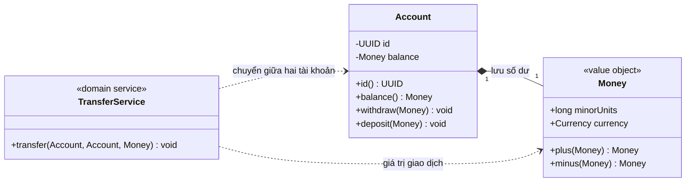
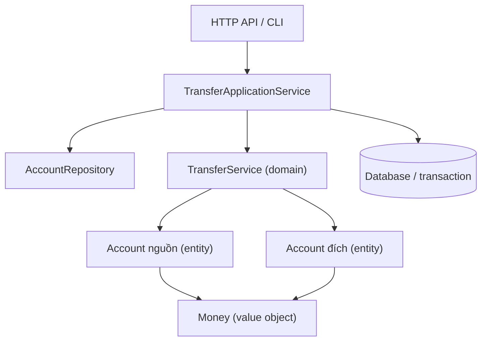
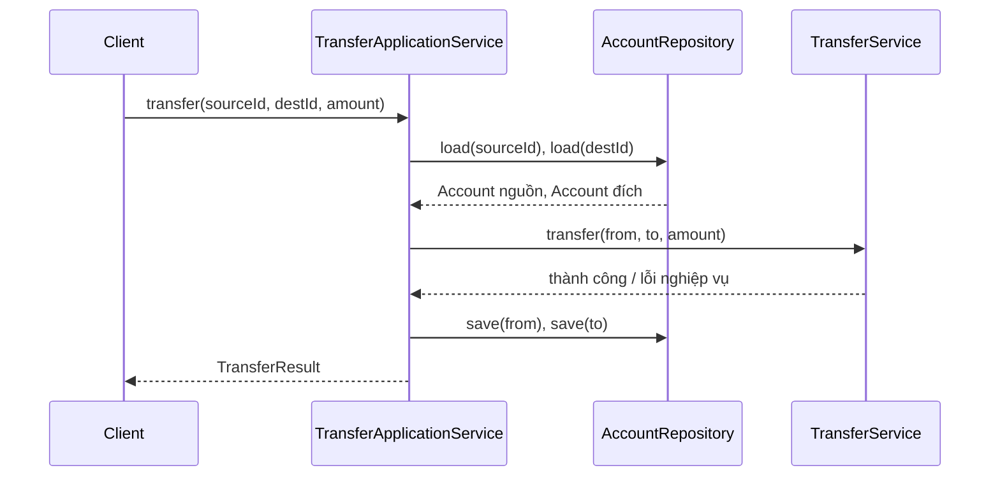

# Đối tượng thực thể, đối tượng giá trị và dịch vụ trong thiết kế lớp OOP

## 1. Ba cách phân chia trách nhiệm trong mô hình miền nghiệp vụ

Giả sử đang thiết kế ứng dụng chuyển tiền. Hệ thống có **tài khoản ngân hàng**, **số tiền** và hành động **chuyển tiền giữa hai tài khoản**. Ba khái niệm này nhìn có vẻ đều có thể biểu diễn bằng class Java, nhưng chúng có cách tồn tại và cách so sánh khác nhau:

- **Entity (đối tượng thực thể):** có *danh tính riêng* xuyên suốt vòng đời. Tài khoản mang ID `ACC-001` vẫn là tài khoản ấy sau khi số dư thay đổi.
- **Value Object (đối tượng giá trị):** được xác định bằng *các giá trị cấu thành*. Hai đối tượng biểu diễn cùng 50.000 VND là tương đương về mặt giá trị, không cần ID riêng.
- **Service (dịch vụ):** cung cấp *một thao tác hoặc quy trình* không thuộc tự nhiên về một object đơn lẻ. Chuyển tiền phải làm việc với hai tài khoản nên có thể được điều phối bởi `TransferService`.

Đây là các **vai trò thiết kế**, thường được dùng trong Domain-Driven Design (DDD) và mô hình miền nghiệp vụ hướng đối tượng. Chúng không phải ba từ khóa đặc biệt của Java, cũng không đồng nghĩa máy móc với `@Entity`, `record`, `@Service` trong framework.

Một câu hỏi định hướng hữu ích là: **“Ta cần nhận diện chính đối tượng đó, cần giữ một giá trị, hay cần thực hiện một hành vi?”**

## 2. Bảng so sánh

| Tiêu chí | Entity | Value Object | Service |
|---|---|---|---|
| Đặc trưng | **Danh tính** phân biệt các thực thể | **Thuộc tính và giá trị** xác định sự tương đương | **Hành vi/quy trình** |
| Ví dụ | `Account`, `Customer`, `Order` | `Money`, `EmailAddress`, `DateRange` | `TransferService`, `ShippingFeeCalculator` |
| Bình đẳng | Thường theo ID ổn định trong phạm vi miền | Theo toàn bộ thành phần mang ý nghĩa | Thường không cần so sánh theo ID miền |
| Trạng thái | Có thể thay đổi qua hành vi hợp lệ | Nên bất biến (*immutable*) | Domain Service thường hạn chế trạng thái nghiệp vụ; Application Service có thể giữ các dependency |
| Vòng đời | Tạo, thay đổi, vô hiệu hóa/xóa; ID tiếp tục xác định cùng thực thể | Có thể thay bằng instance mới cùng giá trị | Thực hiện thao tác khi được gọi |
| Vị trí logic | Quy tắc thuộc về chính thực thể | Quy tắc kiểm tra/tính toán của giá trị | Quy tắc phối hợp nhiều đối tượng hoặc điều phối use case |
| Rủi ro khi dùng sai | Đồng nhất hai entity vì tên/số dư giống nhau | Sửa nội dung VO sau khi dùng làm khóa Map/Set | Biến service thành “god class” chứa hết logic |

Không phải cứ là **danh từ** thì thành Entity, cứ là **số/chuỗi** thì thành Value Object, hoặc cứ là **động từ** thì cần Service. Vai trò phụ thuộc vào ý nghĩa nghiệp vụ và nhu cầu duy trì danh tính, bất biến, giao dịch.

## 3. Sơ đồ: ba vai trò liên kết thế nào?



Trong sơ đồ:

- `Account` có định danh riêng và giữ **giá trị số dư hiện tại**. Mỗi khi số dư đổi, ta có thể tạo một `Money` mới.
- `Money` biểu diễn số lượng đơn vị tiền tệ và mã tiền tệ; *hai Money bằng giá trị* không đồng nghĩa các tài khoản giữ chúng là một tài khoản.
- `TransferService` phối hợp thay đổi hai entity, dùng cùng một Money làm số tiền chuyển.

Hình thoi ở đây minh họa **sở hữu giá trị số dư như một phần trạng thái tài khoản**; vòng đời và các ràng buộc được quyết định bởi mô hình, không phải do cú pháp Java tự thực hiện. Một Value Object hoàn toàn có thể được chia sẻ giữa nhiều entity nếu nó bất biến.

## 4. Entity: điều cốt lõi là danh tính

Một `Account` có các thuộc tính:

```text
id       = 4d3d... (định danh ổn định)
balance  = 100.000 VND
status   = ACTIVE
```

Sau khi chủ tài khoản rút 30.000 VND, `balance` còn 70.000 VND nhưng `id` không đổi. Hệ thống phải nhận ra đây **vẫn là cùng tài khoản**.

Ví dụ tối giản:

```java
import java.util.Objects;
import java.util.UUID;

final class Customer {
    private final UUID id;
    private String displayName;

    Customer(UUID id, String displayName) {
        this.id = Objects.requireNonNull(id, "id");
        rename(displayName);
    }

    UUID id() {
        return id;
    }

    String displayName() {
        return displayName;
    }

    void rename(String newName) {
        if (newName == null || newName.isBlank()) {
            throw new IllegalArgumentException("Name is required");
        }
        this.displayName = newName;
    }

    @Override
    public boolean equals(Object other) {
        return other instanceof Customer customer
                && id.equals(customer.id);
    }

    @Override
    public int hashCode() {
        return id.hashCode();
    }
}
```

Trong thiết kế này, **hai instance `Customer` với cùng UUID đại diện cho cùng thực thể**, dù `displayName` khác nhau (ví dụ hai bản chụp của dữ liệu trước/sau khi đổi tên). Sử dụng `displayName` để tính `hashCode()` sẽ rất rủi ro nếu tên thay đổi trong khi object nằm trong `HashSet`.

Tuy nhiên, không có một quy tắc `equals()/hashCode()` áp dụng máy móc cho mọi hệ thống:

- **ID được cấp khi tạo** và bất biến (UUID, ULID, ID miền nghiệp vụ): có thể dùng so sánh theo ID ổn định như ví dụ.
- **ID do database cấp sau khi lưu:** entity chưa được persist có ID `null`; nếu dùng ID tùy tiện, hai entity mới có thể bị coi bằng nhau, hoặc hash thay đổi sau persist.
- **ORM/JPA proxy và kế thừa:** cần quy tắc so sánh tương thích với vòng đời persistence và kiểu proxy. Không sao chép bừa `getClass()`/`instanceof` từ bài ví dụ vào entity JPA phức tạp.
- Nếu không thực sự cần *logical equality* giữa các instance, cân nhắc so sánh ID một cách tường minh thay vì override equality.

Một Entity tốt thường **đóng gói trạng thái và quy tắc chuyển trạng thái**: `account.withdraw(...)`, `order.cancel(...)`, `customer.rename(...)`. Việc chỉ có hàng loạt getter/setter công khai khiến logic nghiệp vụ dễ bị phân tán.

## 5. Value Object: bằng nhau vì giá trị, không vì danh tính

Một `Money` gồm **số tiền theo đơn vị nhỏ nhất** (*minor units*) và **loại tiền**:

- `new Money(10_000, VND)` tương đương một đối tượng khác có cùng cặp thuộc tính.
- `new Money(10_000, USD)` **không bằng** Money 10.000 VND.
- Ở VND, minor unit phổ biến là 1 đồng (ISO 4217 quy định 0 chữ số thập phân). Ở USD, 1.999 minor units là 19,99 USD (100 cents = 1 USD).
- Phép cộng chỉ hợp lệ khi cùng tiền tệ; nếu cần quy đổi, phải có tỷ giá và chính sách làm tròn rõ ràng.

**Tại sao cần một class Money thay vì dùng `long` hoặc `double` đơn thuần?**

```java
double price = 0.1 + 0.2;
System.out.println(price == 0.3); // false
```

Kiểu `double` biểu diễn các số nhị phân dấu phẩy động, nên không thích hợp để biểu diễn chính xác nhiều giá trị tiền thập phân. `long` với minor units hoặc `BigDecimal` với scale/rounding có quy ước rõ ràng thường phù hợp hơn.

Với **Java 17+**, `record` là cách ngắn gọn tạo Value Object bất biến ở mức trường dữ liệu:

```java
import java.util.Currency;
import java.util.Objects;

record Money(long minorUnits, Currency currency) {
    Money {
        Objects.requireNonNull(currency, "currency");
    }

    static Money vnd(long dong) {
        return new Money(dong, Currency.getInstance("VND"));
    }

    Money plus(Money other) {
        sameCurrency(other);
        return new Money(
                Math.addExact(minorUnits, other.minorUnits), currency);
    }

    Money minus(Money other) {
        sameCurrency(other);
        return new Money(
                Math.subtractExact(minorUnits, other.minorUnits), currency);
    }

    private void sameCurrency(Money other) {
        Objects.requireNonNull(other, "other");
        if (!currency.equals(other.currency)) {
            throw new IllegalArgumentException("Currency mismatch");
        }
    }
}
```

`record` sinh `equals()`, `hashCode()` và `toString()` dựa trên các thành phần của record. Ví dụ:

```java
Money first = Money.vnd(50_000);
Money second = Money.vnd(50_000);

System.out.println(first == second);      // false: hai instance
System.out.println(first.equals(second)); // true: cùng giá trị
System.out.println(first.plus(second));   // Money[minorUnits=100000, currency=VND]
```

Phương thức `plus()` **tạo Money mới**, không sửa đối tượng gốc. `Math.addExact()` và `Math.subtractExact()` phát hiện tràn số nguyên thay vì âm thầm cho kết quả sai.

**Record chỉ bất biến nông (*shallow immutability*)**. Nếu field chứa `List` có thể sửa hoặc object lồng nhau mutable, cần sao chép phòng vệ và thiết kế cẩn thận. Ví dụ `record Basket(List<Item> items)` mặc định vẫn có thể bị thay đổi qua `basket.items().add(...)` nếu không bảo vệ danh sách. Ở `Money` trên, `Currency` bất biến nên an toàn để chia sẻ.

**Một điểm quan trọng về BigDecimal:** `new BigDecimal("10.0").equals(new BigDecimal("10.00"))` trả `false` vì khác scale, dù `compareTo() == 0`. Nếu Money dùng BigDecimal, hãy chuẩn hóa scale/ràng buộc ngay ở constructor và thống nhất cách so sánh, làm tròn.

## 6. Service: hành vi không thuộc riêng một entity hay value object

Một tài khoản có thể tự đảm bảo rằng **số dư không âm khi rút tiền**. Một Money có thể tự kiểm tra **cùng loại tiền khi cộng**. Nhưng hành vi “chuyển tiền từ A sang B” liên quan **hai Account**, nên việc đặt nó vào `Account A` hoặc `Account B` có thể làm trách nhiệm một bên bị méo.

Một **Domain Service** thể hiện hành vi miền nghiệp vụ phối hợp các object, khi hành vi ấy **không có chủ thể tự nhiên duy nhất**. Ví dụ `TransferService.transfer(from, to, amount)`. Trong nhiều trường hợp domain service có thể stateless; điều này **không đồng nghĩa mọi service đều không có field**.

Một **Application Service** lại điều phối *use case* hoàn chỉnh: xác thực/quyền, mở transaction, tải các entity từ repository, gọi hành vi domain, lưu kết quả, phát sự kiện hoặc gửi thông báo. Nó nên tránh làm thay những quy tắc thực chất thuộc Entity/Value Object.

Ví dụ hai tầng:



Đường `ApplicationService → repository/transaction` giúp tách công việc lấy/lưu dữ liệu khỏi **quy tắc chuyển tiền**. Trong ứng dụng rất nhỏ, có thể không cần tách mọi tầng thành class riêng; điều quan trọng là trách nhiệm đúng nơi và dễ kiểm thử.

## 7. Ví dụ hoàn chỉnh Java 17+: Account, Money và TransferService

Lưu toàn bộ mã sau vào file `EntityValueServiceDemo.java`:

```java
import java.util.Currency;
import java.util.Objects;
import java.util.UUID;

public class EntityValueServiceDemo {

    // VALUE OBJECT: bằng nhau theo nội dung, bất biến.
    record Money(long minorUnits, Currency currency) {
        Money {
            Objects.requireNonNull(currency, "currency");
        }

        static Money vnd(long dong) {
            return new Money(dong, Currency.getInstance("VND"));
        }

        Money plus(Money other) {
            requireSameCurrency(other);
            return new Money(
                    Math.addExact(minorUnits, other.minorUnits),
                    currency);
        }

        Money minus(Money other) {
            requireSameCurrency(other);
            return new Money(
                    Math.subtractExact(minorUnits, other.minorUnits),
                    currency);
        }

        private void requireSameCurrency(Money other) {
            Objects.requireNonNull(other, "other");
            if (!currency.equals(other.currency)) {
                throw new IllegalArgumentException(
                        "Currency mismatch: " + currency
                                + " vs " + other.currency);
            }
        }
    }

    // ENTITY: định danh riêng, số dư thay đổi theo thời gian.
    static final class Account {
        private final UUID id;
        private Money balance;

        Account(UUID id, Money openingBalance) {
            this.id = Objects.requireNonNull(id, "id");
            this.balance = Objects.requireNonNull(
                    openingBalance, "openingBalance");
            if (balance.minorUnits() < 0) {
                throw new IllegalArgumentException(
                        "Opening balance must be nonnegative");
            }
        }

        UUID id() {
            return id;
        }

        Money balance() {
            return balance;
        }

        void deposit(Money amount) {
            requirePositive(amount);
            balance = balance.plus(amount);
        }

        void withdraw(Money amount) {
            requirePositive(amount);
            Money next = balance.minus(amount);
            if (next.minorUnits() < 0) {
                throw new IllegalStateException("Insufficient funds");
            }
            balance = next;
        }

        private static void requirePositive(Money amount) {
            Objects.requireNonNull(amount, "amount");
            if (amount.minorUnits() <= 0) {
                throw new IllegalArgumentException(
                        "Amount must be positive");
            }
        }

        @Override
        public boolean equals(Object other) {
            return other instanceof Account account
                    && id.equals(account.id);
        }

        @Override
        public int hashCode() {
            return id.hashCode();
        }
    }

    // DOMAIN SERVICE: quy tắc chuyển tiền qua hai Entity.
    static final class TransferService {
        void transfer(Account from, Account to, Money amount) {
            Objects.requireNonNull(from, "from");
            Objects.requireNonNull(to, "to");
            Objects.requireNonNull(amount, "amount");

            if (from.id().equals(to.id())) {
                throw new IllegalArgumentException(
                        "Cannot transfer to the same account");
            }

            if (amount.minorUnits() <= 0) {
                throw new IllegalArgumentException(
                        "Amount must be positive");
            }

            // Kiểm tra cả hai số dư trước khi bắt đầu thay đổi.
            Money sourceAfter = from.balance().minus(amount);
            if (sourceAfter.minorUnits() < 0) {
                throw new IllegalStateException("Insufficient funds");
            }
            to.balance().plus(amount); // Kiểm tra cùng currency và tràn số.

            from.withdraw(amount);
            to.deposit(amount);
        }
    }

    public static void main(String[] args) {
        Money a = Money.vnd(50_000);
        Money b = Money.vnd(50_000);
        System.out.println("Money equals: " + a.equals(b));

        Account source = new Account(
                UUID.fromString(
                        "00000000-0000-0000-0000-000000000001"),
                Money.vnd(100_000));
        Account destination = new Account(
                UUID.fromString(
                        "00000000-0000-0000-0000-000000000002"),
                Money.vnd(20_000));

        TransferService transfers = new TransferService();
        transfers.transfer(source, destination, Money.vnd(30_000));

        System.out.println("Source: "
                + source.balance().minorUnits() + " VND");
        System.out.println("Destination: "
                + destination.balance().minorUnits() + " VND");

        Account anotherSnapshot = new Account(
                source.id(), Money.vnd(999));
        System.out.println("Same Account identity: "
                + source.equals(anotherSnapshot));

        // Transfer không hợp lệ: source chỉ còn 70.000 VND.
        try {
            transfers.transfer(
                    source, destination, Money.vnd(90_000));
            throw new AssertionError("Expected insufficient funds");
        } catch (IllegalStateException expected) {
            System.out.println("Rejected: " + expected.getMessage());
        }

        System.out.println("Source after rejection: "
                + source.balance().minorUnits() + " VND");
    }
}
```

Biên dịch và chạy với JDK 17 hoặc mới hơn:

```bash
javac EntityValueServiceDemo.java
java EntityValueServiceDemo
```

Kết quả dự kiến:

```text
Money equals: true
Source: 70000 VND
Destination: 50000 VND
Same Account identity: true
Rejected: Insufficient funds
Source after rejection: 70000 VND
```

### Phân tích vai trò trong ví dụ

**`Account` là Entity.** Sau chuyển tiền, số dư từ 100.000 VND giảm còn 70.000 VND nhưng `source.id()` không đổi. Hai đối tượng Account cùng UUID được xem là cùng *danh tính miền nghiệp vụ* trong quy ước của ví dụ, dù snapshot số dư khác nhau. Không nên đồng thời dùng hai snapshot cùng ID như hai bản ghi độc lập có thể cập nhật tự do.

**`Money` là Value Object.** Hai Money 50.000 VND khác instance nhưng `equals()` bằng nhau. Mỗi phép cộng/trừ trả một Money mới. `Money` tự giữ quy tắc về loại tiền và phát hiện tràn số; nó không cần biết số dư thuộc tài khoản nào.

**`TransferService` là Domain Service.** Nó phối hợp hai tài khoản: cấm chuyển về cùng tài khoản, yêu cầu amount dương, kiểm tra đủ tiền và currency trước khi gọi hành vi của các entity. Đây là quy tắc trên *mối tương tác*, không phải trách nhiệm tự nhiên của riêng Money.

**Giới hạn thực tế cần hiểu:** ví dụ chỉ mô hình hóa thao tác **tuần tự trong bộ nhớ**. Việc kiểm tra trước rồi gọi `withdraw()` và `deposit()` **chưa tạo ra atomic transaction** trong trường hợp đa luồng, nhiều tiến trình, crash hoặc có DB. Với hệ thống chuyển tiền thật, phải bổ sung cơ chế transaction, locking/optimistic concurrency, kiểm tra số dư nhất quán tại cơ sở dữ liệu, idempotency, audit và cách xử lý lỗi. Preflight ở code demo chỉ giúp tránh một số lỗi trước khi bắt đầu cập nhật.

## 8. Quy tắc nào đặt ở đâu?

Giả sử cùng miền nghiệp vụ quản lý đơn hàng:

| Quy tắc/hành vi | Nơi thường phù hợp | Vì sao |
|---|---|---|
| Email phải đúng định dạng mà hệ thống chấp nhận | `EmailAddress` (Value Object) | Bất biến thuộc chính dữ liệu email |
| Không được thêm dòng đơn có số lượng âm | `Order.addLine()` hoặc `OrderLine` | Bất biến của thực thể/giá trị trong đơn |
| Một đơn đã hủy không thể chuyển sang đã thanh toán | `Order.pay()` | Quy tắc chuyển trạng thái của cùng Entity |
| Hai khoản Money chỉ cộng khi cùng tiền tệ | `Money.plus()` | Quy tắc toán học của giá trị |
| Chọn cách tính phí vận chuyển từ cân nặng, vùng và chính sách áp dụng | Có thể là `ShippingFeeCalculator` (Domain Service) | Nếu chính sách tính phí không thuộc riêng một entity |
| Tải đơn, kiểm tra quyền, gọi thanh toán, lưu và phát sự kiện | `PlaceOrderApplicationService` | Điều phối use case và hạ tầng |
| Truy vấn đơn hàng theo mã từ DB | `OrderRepository` | Trừu tượng hóa truy cập dữ liệu, không phải Entity |
| Trả JSON dữ liệu hiển thị cho client | DTO/Presenter/API layer | Trách nhiệm giao tiếp, không phải Entity miền nghiệp vụ |

**Đừng đẩy mọi quy tắc vào Service.** Nếu `Order` chỉ có getter/setter còn mọi kiểm tra “đã hủy chưa”, “được thanh toán chưa”, “có thể thêm dòng không” nằm rải rác ở hàng chục service, mô hình dễ trở thành *anemic domain model*. Ứng dụng CRUD đơn giản đôi khi chấp nhận thiết kế này, nhưng miền nghiệp vụ nhiều bất biến thường hưởng lợi khi hành vi nằm gần dữ liệu của Entity/Value Object.

**Cũng đừng cố gắn mọi hàm vào Entity.** Một thuật toán tính giá vận chuyển có thể liên quan chính sách bảng giá, vùng giao hàng và gói dịch vụ. Nếu không có một entity rõ ràng sở hữu thuật toán, Domain Service là lựa chọn hợp lý.

## 9. Domain Service khác Application Service thế nào?

Cả hai có thể có hậu tố `Service`, nhưng nằm ở trách nhiệm khác nhau.



Một thiết kế hướng đối tượng có thể dùng các hợp đồng:

```java
// Trích đoạn minh họa về cấu trúc tầng ứng dụng,
// giả định Account, Money và TransferService là các kiểu của domain.
interface AccountRepository {
    Account load(java.util.UUID id);
    void save(Account account);
}

final class TransferApplicationService {
    private final AccountRepository accounts;
    private final TransferService domainTransfers;

    TransferApplicationService(
            AccountRepository accounts,
            TransferService domainTransfers) {
        this.accounts = java.util.Objects.requireNonNull(accounts);
        this.domainTransfers =
                java.util.Objects.requireNonNull(domainTransfers);
    }

    void transfer(java.util.UUID sourceId,
                  java.util.UUID destinationId,
                  Money amount) {
        Account from = accounts.load(sourceId);
        Account to = accounts.load(destinationId);

        domainTransfers.transfer(from, to, amount);

        accounts.save(from);
        accounts.save(to);
    }
}
```

Trích đoạn này trình bày **phân công trách nhiệm**, không phải implementation giao dịch production. Hai lệnh `save()` riêng biệt có thể thất bại giữa chừng. Trong ứng dụng có DB, *ranh giới transaction* thường thuộc Application Service/infrastructure: cần bảo đảm hai cập nhật số dư được commit/rollback thống nhất; với hệ phân tán còn có những giới hạn khác.

Sự phân biệt chính:

- **Domain Service:** thể hiện quy tắc miền (*chuyển tiền hợp lệ ra sao?*), có thể kiểm thử bằng entity/VO thuần.
- **Application Service:** điều phối thao tác của người dùng/hệ thống (*tải gì, xác thực ai, mở transaction, lưu gì, trả gì?*).
- **Infrastructure Service/Adapter:** hiện thực việc gửi email, truy cập database, gọi HTTP, lưu file hoặc cache.

Không nhất thiết cứ một nghiệp vụ là phải có ba lớp service riêng. Nếu Entity đã sở hữu trọn hành vi, gọi trực tiếp Entity từ Application Service có thể đơn giản và rõ hơn.

## 10. Phân biệt Entity miền nghiệp vụ với JPA Entity

Một class có `@jakarta.persistence.Entity` là **thực thể persistence** trong JPA. Điều đó không tự đảm bảo class được thiết kế tốt như **Domain Entity**:

- JPA thường cần constructor, chiến lược khóa chính, lazy-loading và quy tắc quản lý phiên.
- ID dùng trong database không nhất thiết là **định danh miền** hiển thị ra API hoặc người dùng.
- Một Domain Value Object có thể được map bằng `@Embeddable`, converter hoặc lưu dưới dạng cột khác.
- Một Domain Entity có thể được lưu qua repository bằng JDBC, tài liệu NoSQL, event store, file, hoặc thậm chí tồn tại chỉ trong bộ nhớ; nó không bắt buộc phải có `@Entity`.
- Spring `@Service` là stereotype để framework phát hiện bean; annotation đó **không quyết định** bean là Domain Service hay Application Service.

Ví dụ minh họa giá trị nhúng trong JPA:

```java
// Pseudocode minh họa ý tưởng ánh xạ; cần JPA dependency/annotation
// và cấu hình phù hợp trong dự án thực.
@Embeddable
class MoneyEmbeddable {
    long minorUnits;
    String currencyCode;
}
```

Không chọn Entity/Value Object **chỉ vì cách lưu vào DB**. Nên xuất phát từ quy tắc miền, rồi mới chọn ánh xạ persistence phù hợp.

## 11. Những lỗi thiết kế thường gặp

### Sai lầm 1: coi hai Entity có cùng thuộc tính là một

Hai khách hàng cùng tên “Lan” và cùng ngày sinh chưa chắc là cùng người. Equality của Entity phải dựa vào khái niệm danh tính đúng phạm vi nghiệp vụ, tránh chọn thuộc tính có thể trùng hoặc thay đổi.

### Sai lầm 2: lưu Value Object mutable và dùng làm khóa Map

```java
// Không nên: lớp địa chỉ có thể sửa và hashCode phụ thuộc thành phần.
Map<Address, Integer> counts = new HashMap<>();
counts.put(address, 1);
address.setStreet("Đường khác");
```

Nếu hash thay đổi sau khi chèn, thao tác `get(address)` có thể trả kết quả không mong đợi. Dùng Value Object bất biến; thay địa chỉ bằng một instance mới.

### Sai lầm 3: dùng primitive trần cho giá trị nhiều quy tắc

```java
void charge(double amount, String currency);
```

Caller có thể truyền âm, NaN, mã tiền tệ sai hoặc làm tròn tùy ý. Một `Money` VO có constructor kiểm tra hợp lệ và API tính toán rõ ràng sẽ an toàn hơn.

### Sai lầm 4: Service biết/sửa toàn bộ field nội bộ

```java
// Tránh mở public field để service tự gán không có kiểm soát:
account.balance = account.balance.minus(amount);
```

Đặt bất biến gần Entity và cung cấp hành vi có tên. Với logic qua nhiều entity, domain service **phối hợp thông qua API hợp lệ** của entity, hạn chế xuyên thủng encapsulation.

### Sai lầm 5: tạo Service cho mọi phép tính

Nếu `Money.plus()` chỉ là cộng hai giá trị và kiểm tra currency, không cần `MoneyAdditionService` riêng. Logic tự nhiên thuộc Value Object.

### Sai lầm 6: tạo Entity cho từng value

Nếu `EmailAddress("a@example.test")` không có vòng đời độc lập và không cần ID riêng, việc thêm `emailId` cùng repository cho từng email chỉ làm mô hình phức tạp. Cần Entity khi **danh tính và lịch sử độc lập thật sự có ý nghĩa**.

### Sai lầm 7: nhầm stateless service với không có dependency

```java
final class ShippingFeeService {
    private final FeePolicy policy;

    ShippingFeeService(FeePolicy policy) {
        this.policy = policy;
    }

    Money calculate(Shipment shipment) {
        return policy.feeFor(shipment);
    }
}
```

Service có thể giữ **tham chiếu đến dependency**, ví dụ chính sách tính phí, nhưng vẫn không lưu **trạng thái nghiệp vụ thay đổi theo từng lần tính**. Stateless mô tả cách quản lý trạng thái xử lý, không có nghĩa field phải luôn rỗng.

## 12. Khi thiết kế lớp mới, tự hỏi sáu điều

1. **Thay đổi thuộc tính có làm nó thành một đối tượng khác không?** Nếu không, có thể là Entity. Một đơn hàng thay trạng thái vẫn là đơn hàng ấy.
2. **Hai object có cùng nội dung có thay thế được cho nhau không?** Nếu có và không cần danh tính riêng, nghiêng về Value Object.
3. **Có quy tắc hợp lệ/tính toán gắn chặt với dữ liệu này không?** Đặt trong VO hoặc Entity thay vì sao chép ở các service.
4. **Hành vi tác động đến nhiều Entity hoặc một chính sách miền không thuộc hẳn object nào?** Cân nhắc Domain Service.
5. **Hành vi chủ yếu điều phối transaction, repository, quyền, network?** Cân nhắc Application Service hoặc infrastructure adapter.
6. **Nếu business rule thay đổi, có sửa tại một nơi dễ tìm không?** Nếu phải dò nhiều controller/service/mapper, ranh giới trách nhiệm có thể chưa hợp lý.

## 13. Bài tập và cách tự kiểm chứng

**Bài 1 — Customer và EmailAddress.** Mỗi khách hàng có UUID và email. Khách có thể đổi email.

- **Gợi ý:** `Customer` là Entity vì UUID vẫn giữ nguyên; `EmailAddress` là VO bất biến, có thể thay instance khi đổi email. Đổi email cần đi qua hành vi của Customer và qua kiểm tra uniqueness ở ranh giới phù hợp nếu hệ thống yêu cầu.

**Bài 2 — Hai địa chỉ giống nhau.** Hai khách hàng khác nhau cùng nhận hàng tại “12 Nguyễn Huệ, TP.HCM”.

- **Gợi ý:** hai VO Address có thể bằng nhau theo giá trị, nhưng hai Entity Customer vẫn khác nhau. Không dùng địa chỉ làm danh tính khách hàng.

**Bài 3 — Giảm số dư khi rút.** Nên đặt điều kiện “không được âm số dư” ở đâu?

- **Gợi ý:** Entity `Account` bảo vệ bất biến số dư khi rút; `Money` bảo vệ currency và phép toán. Nếu nhiều tài khoản tương tác, domain service phối hợp.

**Bài 4 — Thanh toán rồi gửi email.** `PayOrderApplicationService` cần tải order, kiểm tra quyền, gọi cổng thanh toán, lưu trạng thái và phát thông báo.

- **Gợi ý:** orchestration ở Application Service. Entity `Order` quyết định liệu trạng thái được phép chuyển sang `PAID`; gateway/email nằm ở adapter. Tránh dồn mọi quyết định vào service.

**Bài 5 — Test với Java ví dụ.** Hãy mở rộng `EntityValueServiceDemo.java` để xác nhận:

```java
// Đặt trong main, sau khi khởi tạo hai Account:
Money x = Money.vnd(5_000);
Money y = Money.vnd(5_000);
if (!x.equals(y) || x == y) {
    throw new AssertionError("Value Object equality failed");
}

Money beforeSource = source.balance();
Money beforeDest = destination.balance();
try {
    transfers.transfer(source, destination, Money.vnd(-10));
    throw new AssertionError("Negative amount must fail");
} catch (IllegalArgumentException expected) {
    // Thao tác không hợp lệ đã bị chặn.
}

if (!source.balance().equals(beforeSource)
        || !destination.balance().equals(beforeDest)) {
    throw new AssertionError("Invalid transfer changed balances");
}
```

Đây là kiểm thử quy tắc **đầu vào âm bị từ chối** trong luồng tuần tự. Muốn bảo đảm chuyển tiền thật sự nguyên tử khi có hai luồng hoặc nhiều tiến trình, cần kiểm thử ở mức transaction/concurrency của hệ thống lưu trữ.

---

**Ghi nhớ:** **Entity** được nhận diện bằng *danh tính*, **Value Object** được nhận diện bằng *giá trị*, còn **Service** thể hiện *hành vi/phối hợp* phù hợp với ranh giới miền hoặc use case. Phân vai chính xác giúp các bất biến nằm đúng chỗ, giảm lặp logic và khiến việc thay đổi, kiểm thử lớp Java dễ hơn.