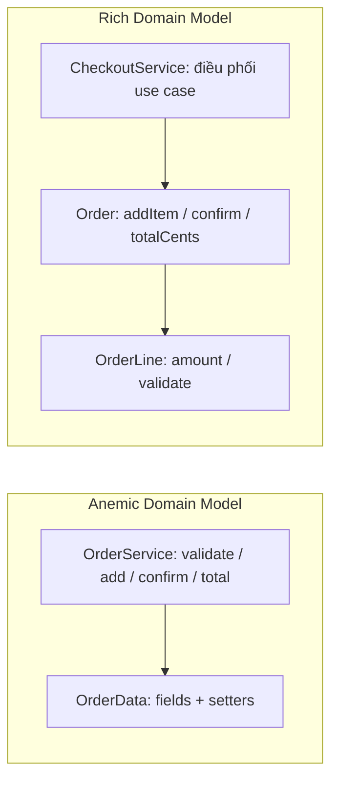
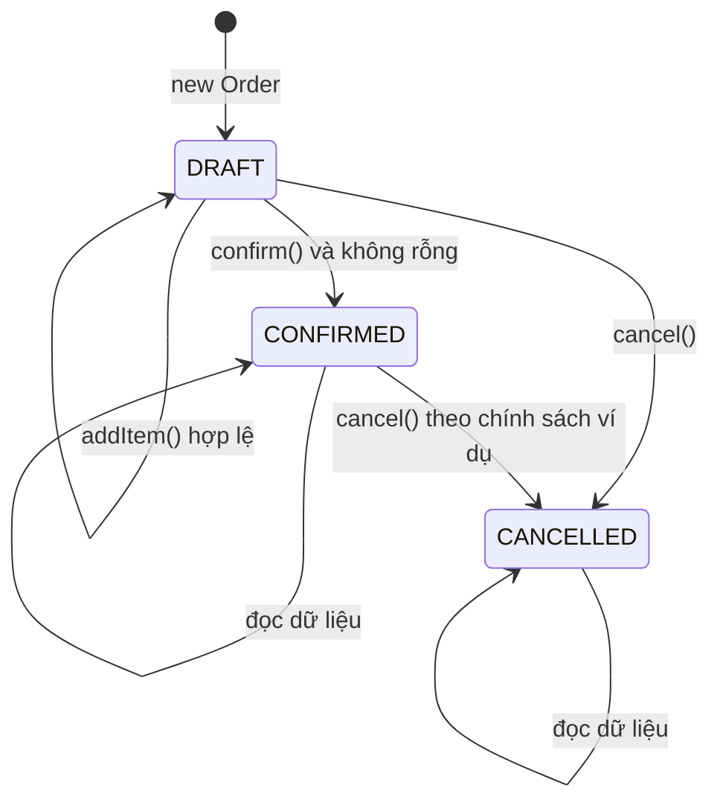
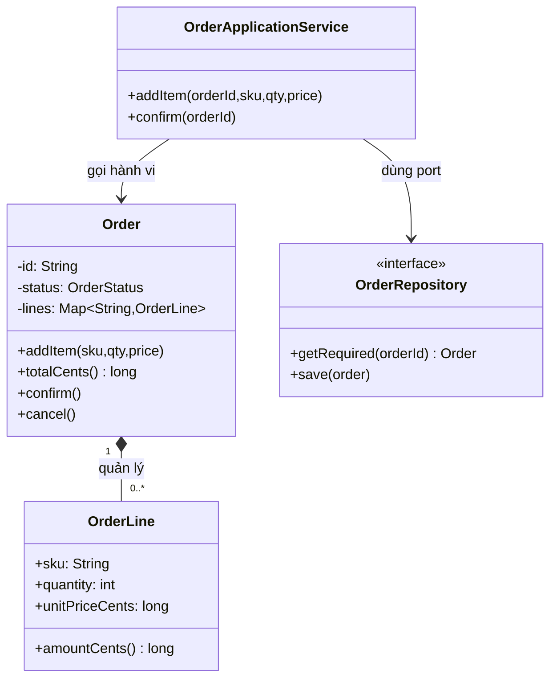

# Mô hình giàu hành vi và mô hình chỉ chứa dữ liệu trong OOP (Java)

Khi thiết kế các lớp, ta thường đứng trước một lựa chọn: lớp `Order` chỉ chứa các trường `status`, `items`, `total` cùng getter/setter, hay nó phải biết **cách thêm sản phẩm, tính tổng tiền, xác nhận đơn và từ chối thay đổi không hợp lệ**?

Đây là điểm khác biệt cốt lõi giữa **Rich Domain Model (mô hình miền giàu hành vi)** và **Anemic Domain Model (mô hình miền thiếu hành vi, thường chỉ chứa dữ liệu)**. Cả hai đều có các lớp biểu diễn dữ liệu, nhưng khác nhau về **nơi đặt quy tắc nghiệp vụ, quyền thay đổi trạng thái và cách bảo vệ bất biến**.

Mục tiêu bài này: hiểu sự khác biệt, đọc và thiết kế Java đúng, chọn kiến trúc theo độ phức tạp nghiệp vụ, biết khi nào cần một domain service và kiểm thử các trạng thái hợp lệ.

## 1. Hai cách mô hình hóa cùng một bài toán

Giả sử ứng dụng bán hàng có quy tắc:

1. Một đơn hàng bắt đầu ở `DRAFT`.
2. Có thể thêm sản phẩm khi còn `DRAFT`; mỗi dòng hàng có số lượng dương và đơn giá không âm.
3. Chỉ được xác nhận khi đơn có ít nhất một dòng.
4. Sau khi `CONFIRMED`, không được thêm sản phẩm.
5. Tổng tiền phải luôn bằng tổng thành tiền của các dòng hàng.

### Mô hình chỉ chứa dữ liệu (anemic)

```java
// Minh họa một kiểu anemic có thể gây lỗi nếu mở setter công khai.
class OrderData {
    public String id;
    public String status;
    public java.util.List<OrderLineData> lines;
    public long totalCents;
}

class OrderLineData {
    public String sku;
    public int quantity;
    public long unitPriceCents;
}
```

Logic nghiệp vụ thường bị đẩy sang service:

```java
// Phác thảo: toàn bộ nghiệp vụ ở service.
void confirm(OrderData order) {
    if (order.lines == null || order.lines.isEmpty()) {
        throw new IllegalStateException("Empty order");
    }
    order.status = "CONFIRMED";
}
```

Vấn đề là một caller khác vẫn có thể sửa thẳng `order.status = "CONFIRMED"` hoặc `order.totalCents = -1` mà không cần qua `confirm`. Nếu nhiều service tự thực hiện các bước kiểm tra, quy tắc dễ trùng lặp và không đồng nhất.

**Không phải mọi lớp dữ liệu đều xấu.** DTO để nhận/trả HTTP, đối tượng cấu hình, record truyền dữ liệu hay dữ liệu kết quả truy vấn có thể rất hợp lý khi chỉ mang giá trị. “Anemic Domain Model” đáng chú ý khi **mô hình nghiệp vụ vốn có nhiều quy tắc**, nhưng entity không giữ được hành vi hay bất biến của mình.

### Mô hình giàu hành vi (rich)

```java
// API ở mức ý tưởng:
order.addItem("BOOK", 2, 120_00);
order.confirm();
long payable = order.totalCents();

// Không cung cấp order.setStatus(...) hoặc
// order.setTotalCents(...) cho bên ngoài gọi tùy ý.
```

Tại đây `Order` biết **cái gì được phép làm với trạng thái của chính nó**. Code gọi đơn hàng dùng ngôn ngữ nghiệp vụ (`addItem`, `confirm`) thay vì lắp ghép setter và hy vọng mọi nơi nhớ hết quy tắc.



Sơ đồ không nói Rich Model phải chứa **mọi** thao tác. Lưu database, gửi email, gọi API vận chuyển vẫn thuộc những thành phần bên ngoài; chúng không phải hành vi tự nhiên của đối tượng `Order`.

## 2. So sánh theo các tiêu chí quan trọng

| Tiêu chí | Rich Domain Model | Anemic Domain Model |
| --- | --- | --- |
| Entity có gì? | Dữ liệu, hành vi và ràng buộc đi cùng nhau | Chủ yếu field, getter/setter hoặc record |
| Nơi giữ invariant của entity | Trong constructor/factory và phương thức nghiệp vụ | Thường ở service bên ngoài, dễ bị bỏ qua nếu mở mutation |
| Cách cập nhật | `order.confirm()`, `account.withdraw(amount)` | `order.setStatus(...)` hoặc service sửa field |
| Độ gắn kết (*cohesion*) | Hành vi liên quan tới dữ liệu ở gần nhau | Có thể tách xa dữ liệu và hành vi |
| Nguy cơ trùng quy tắc | Thấp hơn nếu API bảo vệ trạng thái | Cao hơn nếu nhiều service cùng sửa dữ liệu |
| Độ đơn giản ban đầu | Cần thiết kế domain API và trạng thái | Ít code hơn cho dữ liệu đơn giản/CRUD |
| Tính phù hợp | Nghiệp vụ nhiều quy tắc, trạng thái, chuyển đổi | DTO, mapping, báo cáo, CRUD đơn giản với quy tắc ít |
| Điểm cần cảnh giác | Entity phình to, gọi I/O trong domain, khó load ORM | “Transaction script” rải rác và setter làm mất invariant |

**Không thể kết luận một kiến trúc chỉ bằng việc có getter/setter hay không.** Một entity có thể dùng getter, có method update được kiểm soát và vẫn là mô hình giàu hành vi. Một lớp dữ liệu bất biến do service tạo ra vẫn có thể tạo thành thiết kế tốt nếu nghiệp vụ thực sự đơn giản.

## 3. Bất biến (invariant): tiêu chí quan trọng nhất

**Invariant** là điều kiện phải đúng với mọi trạng thái được công khai là hợp lệ của đối tượng.

Đối với đơn hàng:

- `lines` không được chứa dòng có `quantity <= 0`.
- `totalCents` không âm, bằng tổng các `quantity × unitPriceCents`.
- `CONFIRMED` chỉ đạt được khi có dòng hàng.
- Sau `CONFIRMED`, không thể gọi `addItem` thành công.
- Trạng thái chỉ chuyển theo những quy tắc được định nghĩa.

Trong rich model, các hành vi được thiết kế quanh bất biến:



Trong dự án thật, việc hủy đơn đã thanh toán có thể cần hoàn tiền, kiểm tra vận chuyển và nhiều bước khác. Sơ đồ chỉ thể hiện **một chính sách đơn giản**. Phải xác định trạng thái và bước chuyển theo nghiệp vụ cụ thể, không tự áp đặt trạng thái `CANCELLED` cho mọi hệ thống.

## 4. Ví dụ Java 17 hoàn chỉnh: Rich Domain Model

Đoạn dưới là **một file Java chạy được**, không cần Spring, JPA, database hay thư viện ngoài. Để việc phân vai rõ ràng, file có:

- `OrderLine`: value object chứa dữ liệu và cách tính thành tiền.
- `Order`: entity/aggregate quản lý dòng hàng, tổng tiền, trạng thái và hành vi.
- `OrderRepository`: cổng lưu/truy vấn.
- `OrderApplicationService`: điều phối use case.
- `ConsoleOrderNotifier`: adapter minh họa tương tác ngoài.

Tạo file `RichVsAnemicDemo.java`:

```java
import java.util.ArrayList;
import java.util.LinkedHashMap;
import java.util.List;
import java.util.Map;
import java.util.Objects;

public class RichVsAnemicDemo {

    enum OrderStatus {
        DRAFT, CONFIRMED, CANCELLED
    }

    // Value object: một dòng đơn hàng hợp lệ ngay từ lúc khởi tạo.
    record OrderLine(String sku, int quantity, long unitPriceCents) {
        OrderLine {
            if (sku == null || sku.isBlank()) {
                throw new IllegalArgumentException("SKU is required");
            }
            if (quantity <= 0) {
                throw new IllegalArgumentException("Quantity must be positive");
            }
            if (unitPriceCents < 0) {
                throw new IllegalArgumentException("Negative unit price");
            }
        }

        long amountCents() {
            return Math.multiplyExact((long) quantity, unitPriceCents);
        }
    }

    static final class Order {
        private final String id;
        private final Map<String, OrderLine> lines = new LinkedHashMap<>();
        private OrderStatus status = OrderStatus.DRAFT;

        Order(String id) {
            if (id == null || id.isBlank()) {
                throw new IllegalArgumentException("Order id is required");
            }
            this.id = id;
        }

        String id() {
            return id;
        }

        OrderStatus status() {
            return status;
        }

        List<OrderLine> lines() {
            // Chỉ trả snapshot; caller không thể sửa danh sách nội bộ.
            return List.copyOf(lines.values());
        }

        void addItem(String sku, int quantity, long unitPriceCents) {
            requireDraft();

            // Tạo value object sẽ tự kiểm tra số lượng/đơn giá.
            OrderLine incoming = new OrderLine(sku, quantity, unitPriceCents);
            OrderLine old = lines.get(incoming.sku());

            OrderLine candidate;
            if (old == null) {
                candidate = incoming;
            } else {
                if (old.unitPriceCents() != incoming.unitPriceCents()) {
                    throw new IllegalArgumentException(
                            "Different price for the same SKU");
                }
                int merged = Math.addExact(
                        old.quantity(), incoming.quantity());
                candidate = new OrderLine(
                        incoming.sku(), merged, incoming.unitPriceCents());
            }

            // Bảo đảm tổng tiền không tràn long trước khi sửa trạng thái.
            long oldAmount = old == null ? 0 : old.amountCents();
            long nextTotal = Math.subtractExact(totalCents(), oldAmount);
            Math.addExact(nextTotal, candidate.amountCents());

            lines.put(candidate.sku(), candidate);
        }

        long totalCents() {
            long total = 0;
            for (OrderLine line : lines.values()) {
                total = Math.addExact(total, line.amountCents());
            }
            return total;
        }

        void confirm() {
            requireDraft();
            if (lines.isEmpty()) {
                throw new IllegalStateException("Cannot confirm empty order");
            }
            status = OrderStatus.CONFIRMED;
        }

        void cancel() {
            if (status == OrderStatus.CANCELLED) {
                return; // gọi lặp giữ nguyên kết quả
            }
            // Chính sách demo cho phép hủy DRAFT và CONFIRMED.
            status = OrderStatus.CANCELLED;
        }

        private void requireDraft() {
            if (status != OrderStatus.DRAFT) {
                throw new IllegalStateException(
                        "Order is not editable: " + status);
            }
        }
    }

    // Port: hợp đồng lưu trữ, domain không biết JDBC hay SQL.
    interface OrderRepository {
        Order getRequired(String orderId);
        void save(Order order);
    }

    // Adapter trong bộ nhớ dùng cho ví dụ.
    static final class InMemoryOrderRepository implements OrderRepository {
        private final Map<String, Order> byId = new LinkedHashMap<>();

        @Override
        public Order getRequired(String orderId) {
            Order found = byId.get(orderId);
            if (found == null) {
                throw new IllegalArgumentException("Order not found");
            }
            return found;
        }

        @Override
        public void save(Order order) {
            Objects.requireNonNull(order, "order");
            byId.put(order.id(), order);
        }
    }

    interface OrderNotifier {
        void confirmed(Order order);
    }

    static final class ConsoleOrderNotifier implements OrderNotifier {
        @Override
        public void confirmed(Order order) {
            System.out.println("Notified: " + order.id());
        }
    }

    // Application service: phối hợp, không lặp quy tắc của Order.
    static final class OrderApplicationService {
        private final OrderRepository orders;
        private final OrderNotifier notifier;

        OrderApplicationService(
                OrderRepository orders, OrderNotifier notifier) {
            this.orders = Objects.requireNonNull(orders);
            this.notifier = Objects.requireNonNull(notifier);
        }

        void addItem(String orderId, String sku, int qty, long priceCents) {
            Order order = orders.getRequired(orderId);
            order.addItem(sku, qty, priceCents);
            orders.save(order);
        }

        void confirm(String orderId) {
            Order order = orders.getRequired(orderId);
            order.confirm();
            orders.save(order);
            notifier.confirmed(order);
        }
    }

    public static void main(String[] args) {
        InMemoryOrderRepository repository = new InMemoryOrderRepository();
        Order order = new Order("O-100");
        repository.save(order);

        OrderApplicationService service = new OrderApplicationService(
                repository, new ConsoleOrderNotifier());

        service.addItem("O-100", "BOOK", 2, 12_000);
        service.addItem("O-100", "PEN", 3, 2_500);

        System.out.println("Total cents: " + order.totalCents());
        service.confirm("O-100");
        System.out.println("State: " + order.status());

        try {
            service.addItem("O-100", "ERASER", 1, 500);
        } catch (IllegalStateException expected) {
            System.out.println(expected.getMessage());
        }

        try {
            Order empty = new Order("O-200");
            empty.confirm();
        } catch (IllegalStateException expected) {
            System.out.println(expected.getMessage());
        }

        order.cancel();
        System.out.println("After cancel: " + order.status());
    }
}
```

Biên dịch và chạy:

```bash
javac RichVsAnemicDemo.java
java RichVsAnemicDemo
```

Kết quả dự kiến:

```text
Total cents: 31500
Notified: O-100
State: CONFIRMED
Order is not editable: CONFIRMED
Cannot confirm empty order
After cancel: CANCELLED
```

### Vì sao ví dụ là “giàu hành vi”?

1. **Không có setter `status` hoặc `totalCents`.** Trạng thái chỉ đổi qua những method có tên và quy tắc cụ thể.
2. **`OrderLine` kiểm tra bất biến của mình.** Dòng hàng không thể được tạo hợp lệ với số lượng bằng 0 hay giá âm.
3. **`Order` giữ quy tắc của aggregate.** Nó quyết định thời điểm được thêm dòng, cộng gộp SKU, từ chối giá không nhất quán và không xác nhận đơn rỗng.
4. **Tổng tiền được tính từ nguồn dữ liệu thực.** Không có field `totalCents` mutable dễ lệch với chi tiết đơn.
5. **Tràn số bị phát hiện rõ.** `Math.multiplyExact` và `Math.addExact` ném `ArithmeticException` thay vì âm thầm tạo tổng sai. Nếu đơn không thể tính tổng hợp lệ, `addItem` không cập nhật dòng mới.
6. **Collection nội bộ không bị lộ ra ngoài.** `lines()` trả `List.copyOf` từ `OrderLine` bất biến; caller không thể thêm/xóa hoặc sửa từng dòng qua getter.

Application service vẫn có giá trị: lấy đơn từ repository, gọi nghiệp vụ, lưu thay đổi, yêu cầu gửi thông báo. Nó không cần tự viết lại `if (status != DRAFT)` hay tính tổng dòng hàng.

### Giới hạn cần hiểu

Ví dụ này **chỉ chạy tuần tự trong bộ nhớ**. `InMemoryOrderRepository` giữ tham chiếu đến cùng một `Order`; nếu `confirm()` thành công mà `save()` hoặc notifier gặp lỗi, ví dụ không có rollback giao dịch. Trong hệ thống thực, thao tác cần transaction phù hợp, cơ chế load/save entity đúng, kiểm soát version/locking khi cập nhật đồng thời và chính sách gửi thông báo sau commit (chẳng hạn transactional outbox).

`long` cent phù hợp để giải thích số học chính xác và giới hạn tràn; với nhiều loại tiền và cách làm tròn khác nhau, nên dùng value object `Money` gồm amount và currency cùng quy tắc scale/rounding rõ ràng. Không sử dụng `double` làm đơn vị lưu trữ cho số tiền nghiệp vụ cần chính xác.

`Order.cancel()` trong demo cho phép hủy đơn đã xác nhận; ứng dụng thực có thể yêu cầu không được hủy khi đã giao, phải hoàn tiền hoặc có phân quyền. Các quy tắc đó cần được đưa vào domain model hoặc service có trách nhiệm phù hợp.

## 5. Điều gì vẫn nên nằm ngoài entity?

“Rich” nghĩa là **giàu hành vi nghiệp vụ**, không phải là một đối tượng biết làm mọi thứ.

| Hành vi | Vị trí thường hợp lý | Lý do |
| --- | --- | --- |
| `Order.addItem` | `Order` | Thay đổi trạng thái và bất biến của chính đơn |
| `Order.confirm` | `Order` | Chuyển trạng thái của aggregate |
| `OrderLine.amountCents` | `OrderLine` | Tính toán trên chính dữ liệu của dòng |
| `CheckoutService.checkout` | Application service | Điều phối nhiều domain object, repository, giao dịch |
| `PricingPolicy.calculate` | Domain policy/service | Quy tắc giá có thể độc lập và cần nhiều đầu vào |
| `OrderRepository.save` | Port + adapter persistence | Tương tác database / kho dữ liệu |
| `EmailSender.send` | Port + adapter email | Giao tiếp với hệ thống ngoài |
| Nhận JSON, trả HTTP status | Controller / web adapter | Hợp đồng giao tiếp API |
| Chạy `@Transactional` | Thường ở application boundary | Phạm vi giao dịch của use case |

Một dấu hiệu sai là để `Order.confirm()` tự gọi `new JdbcConnection(...)` hay `smtp.send(...)`. Khi đó entity phụ thuộc hạ tầng, test chuyển trạng thái phải kéo cả DB/email vào, và lỗi I/O có thể làm rối bất biến. Domain method tốt nhất chỉ thay đổi trạng thái hoặc trả giá trị/sự kiện nghiệp vụ, còn bên ngoài thực hiện side effect.

### Domain service không đồng nghĩa với anemic model

Đôi khi một quy tắc không thuộc rõ về **một** entity:

- Chuyển tiền giữa hai tài khoản đòi kiểm tra cả hai và ghi atomically.
- Áp giá ưu đãi theo cấp khách hàng có thể cần `Customer`, `Order`, `Promotion` và một policy.
- Phân bổ chỗ ngồi có thể cần cả chuyến bay, sơ đồ ghế và quyền đặt.

Dùng domain service/policy cho quy tắc có ngữ cảnh riêng, còn mỗi entity vẫn giữ invariant nội tại. Ví dụ dịch vụ chuyển tiền điều phối `source.withdraw(...)` và `destination.deposit(...)` trong transaction; `Account` chịu trách nhiệm không cho số dư âm khi rút nếu đó là luật của tài khoản.

Ngược lại, đặt tất cả quy tắc ngay trong một service duy nhất, chỉ gọi `setBalance`, `setStatus`, `setLines` thường là dấu hiệu entity đã mất quyền bảo vệ trạng thái.

## 6. Tránh nhầm với DTO, record và POJO

**Record không tự động là anemic.** Một Java record có thể có compact constructor để validate, method tính toán và hành vi bất biến:

```java
record Quantity(int value) {
    Quantity {
        if (value <= 0) {
            throw new IllegalArgumentException("Positive only");
        }
    }

    Quantity plus(Quantity other) {
        return new Quantity(Math.addExact(value, other.value));
    }
}
```

`Quantity` tuy chỉ có một field nhưng có hành vi ý nghĩa, là value object tốt. Ngược lại `record CheckoutRequest(String sku, int quantity)` có thể chỉ là dữ liệu đầu vào, và điều đó hoàn toàn hợp lý.

**POJO** (*Plain Old Java Object*) nói về việc một class Java không bắt buộc kế thừa framework hay base class đặc biệt; không cho biết nó rich hay anemic. **Entity** nói về danh tính/vòng đời; **DTO** nói về vận chuyển dữ liệu; **Rich/Anemic** nói về nơi đặt hành vi nghiệp vụ. Đây là những trục phân loại khác nhau.

| Loại | Mục đích chính | Rich/anemic có bắt buộc không? |
| --- | --- | --- |
| HTTP request DTO | Nhận dữ liệu qua API | Chỉ chứa dữ liệu thường hợp lý |
| HTTP response DTO | Trả dữ liệu cho client | Chỉ chứa dữ liệu thường hợp lý |
| Value object `Money` | Tiền hợp lệ và phép toán trên tiền | Nên bảo vệ invariant và cung cấp hành vi hữu ích |
| Domain entity `Order` | Danh tính, vòng đời, bất biến đơn hàng | Giàu hành vi hữu ích khi có quy tắc/trạng thái |
| ORM persistence entity | Biểu diễn dữ liệu DB | Có thể tách domain, tùy kiến trúc |
| Projection/read model | Dữ liệu báo cáo, query/read-only | Chủ yếu dữ liệu là đủ |
| Domain service | Quy tắc nghiệp vụ xuyên nhiều đối tượng | Có hành vi, không nhất thiết có nhiều trạng thái |

Một hệ thống có thể **kết hợp cả hai cách**: rich model ở phần giao dịch phức tạp; record/DTO cho danh sách tra cứu, báo cáo, nhập xuất và màn hình chỉ đọc.

## 7. Nhìn sâu vào thay đổi nghiệp vụ

Một thiết kế tốt được kiểm chứng khi yêu cầu thay đổi.

**Yêu cầu A:** “Sau khi xác nhận đơn, không cho sửa mặt hàng.”

- Với rich model, quy tắc được đặt trong `Order.addItem` (và mọi phương thức thay đổi tương đương).
- Với mô hình chỉ dữ liệu và setter public, phải đảm bảo tất cả controller/service/job đều nhớ kiểm tra. Bỏ sót một đường ghi là dữ liệu sai.

**Yêu cầu B:** “Thêm trạng thái `PAID`, không được hủy đơn đã thanh toán.”

- Rich: thêm chuyển trạng thái `markPaid()`, cập nhật điều kiện `cancel()` và test state machine.
- Anemic: sửa nhiều service nếu mỗi service kiểm tra status riêng; nếu đã gom mọi cập nhật vào một domain service kiểm soát chặt thì vẫn có thể giữ nhất quán.

**Yêu cầu C:** “Chuyển lưu đơn từ database A sang database B.”

- Đây là thay đổi adapter/repository, không phải lý do sửa `Order.confirm()`.
- Nếu entity gọi thẳng SQL, ranh giới thiết kế đã bị trộn lẫn bất kể entity giàu bao nhiêu method.

**Yêu cầu D:** “Thay cách tính thuế dựa trên địa phương và cấu hình bên thứ ba.”

- Không nên bắt entity tự gọi HTTP đến nhà cung cấp thuế.
- Application service lấy dữ liệu đầu vào qua adapter rồi dùng domain policy `TaxCalculator` để áp dụng giá trị; nếu quy tắc cần nhiều loại tham số, policy có thể là đối tượng chuyên trách.

## 8. Khi nào Anemic Model vẫn phù hợp?

Anemic không phải nhãn để loại bỏ mọi class chỉ có dữ liệu. Nó có thể là **lựa chọn có ý thức** khi:

1. Ứng dụng chủ yếu là **CRUD đơn giản**: lưu/chỉnh/sửa một biểu mẫu với ít quy tắc.
2. Lớp là **DTO/projection** dùng để truyền hoặc đọc dữ liệu, không phải nơi quyết định trạng thái nghiệp vụ.
3. Logic chủ yếu là **biến đổi dữ liệu theo pipeline**, ít danh tính/vòng đời; cách thiết kế hàm thuần có thể rõ ràng hơn nhồi hành vi vào object.
4. Các thao tác nghiệp vụ đã được quản lý tập trung và không cho caller vượt qua quy tắc bằng setter tùy tiện.
5. Đây là đoạn code phụ trợ nội bộ đơn giản; thêm aggregate/policy/service phức tạp làm chi phí vượt lợi ích.

Ví dụ mô hình chỉ đọc:

```java
record MonthlySalesReport(
        java.time.YearMonth month,
        long orderCount,
        long revenueCents) { }
```

Nó không cần tự gọi SQL, cũng không phải tự quyết định cách tổng hợp báo cáo: một query service tạo `MonthlySalesReport`, còn report chỉ chứa kết quả. Đây là mô hình dữ liệu phù hợp chứ không phải một rich entity còn thiếu method.

**Điểm quyết định:** nếu có nhiều invariant và chuyển trạng thái cần được bảo vệ ở nhiều luồng xử lý, rich domain model thường đem lại lợi ích rõ rệt. Nếu chủ yếu đọc/ghi dữ liệu và không có hành vi cốt lõi đáng đóng gói, DTO/data model có thể đơn giản hơn.

## 9. Những sai lầm khi áp dụng Rich Model

### Sai lầm 1 — Entity trở thành God Object

```java
class Order {
    void confirm() { /* domain */ }
    void persistByJdbc() { /* SQL */ }
    void emailCustomer() { /* SMTP */ }
    void renderJson() { /* HTTP serialization */ }
}
```

Đây không phải rich domain model lành mạnh. `Order` đang ôm trách nhiệm I/O và giao diện. Tách adapter và application service, giữ ở entity hành vi thuộc trạng thái/quy tắc đơn hàng.

### Sai lầm 2 — “Rich” bằng cách thêm nhiều getter bọc lại

```java
class Order {
    long getTotal() { return total; }
    String getStatus() { return status; }
    void setStatus(String next) { status = next; }
}
```

Nhiều method không có nghĩa là giàu hành vi. Quan trọng là API diễn đạt **ý định nghiệp vụ** và ngăn trạng thái sai.

### Sai lầm 3 — Để trạng thái phụ thuộc bên ngoài quyết định một phần, rồi quên kiểm tra lại

Ví dụ `Order` không thể tự biết tồn kho thực tế nếu dữ liệu nằm tại service bên ngoài. Quy trình đúng cần application service/đối tượng chính sách có nguồn dữ liệu tương ứng để kiểm tra hoặc giữ chỗ tồn kho; `Order` chỉ chịu những bất biến mà nó có đủ thông tin để đảm bảo.

### Sai lầm 4 — Dồn mọi công thức vào entity dù không thuộc entity

Giảm giá theo hợp đồng khách hàng hoặc thuế theo quốc gia có thể cần `PromotionPolicy`, `TaxPolicy` hoặc domain service; làm tất cả trong `Order` khiến entity biết quá nhiều và dễ coupling.

### Sai lầm 5 — Quên ràng buộc DB và xử lý đồng thời

`Order.confirm()` bảo vệ trạng thái của **một instance**. Nếu hai request khác nhau cùng load và thay đổi một đơn, vẫn có thể mất cập nhật (*lost update*). Khi lưu vào JPA/SQL cần transaction, optimistic locking (ví dụ `@Version`) hoặc kỹ thuật đồng bộ hóa phù hợp. Một phương thức domain đúng trong bộ nhớ **không tự bảo đảm** tính nhất quán khi chạy phân tán.

### Sai lầm 6 — Gọi service bên ngoài từ entity trong transaction

Gửi email trong `Order.confirm()` không khiến database và SMTP commit atomically. Nếu gửi mail thành công rồi DB rollback, người dùng thấy xác nhận cho đơn chưa lưu. Một lựa chọn thực tế là ghi sự kiện/outbox cùng giao dịch DB, xử lý gửi sau commit và có idempotency/retry.

## 10. Liên hệ với DDD Aggregate, encapsulation và Spring/JPA

Trong **Domain-Driven Design (DDD)**, *aggregate root* là điểm quản lý các bất biến cần nhất quán ngay của một cụm đối tượng. `Order` có thể là aggregate root, `OrderLine` là thành phần bên trong.



**Aggregate** không có nghĩa mọi quan hệ 1–N đều là composition hay mọi object trong sơ đồ đều lưu trong cùng một bảng. Ranh giới aggregate được chọn theo invariant cần đảm bảo khi cập nhật. Ví dụ `Order` không nên trực tiếp sở hữu toàn bộ `Customer` hay `Product` chỉ vì có quan hệ tham chiếu.

Với Spring Boot/JPA, cách tổ chức có thể gồm:

```text
orders/
  application/
    OrderApplicationService.java
  domain/
    Order.java
    OrderLine.java
    OrderStatus.java
    OrderRepository.java
    PricingPolicy.java
  infrastructure/
    JpaOrderRepositoryAdapter.java
    OrderJpaEntity.java
    OrderJpaMapper.java
    OutboxPublisher.java
  web/
    OrderController.java
    OrderRequest.java
    OrderResponse.java
```

Có hai lựa chọn thực tế:

- **Domain entity độc lập JPA:** mapper chuyển giữa domain và persistence entity. Domain test gọn, ít ràng buộc framework, đổi persistence dễ hơn nhưng cần mapping code.
- **JPA entity kiêm domain entity:** có thể tiết kiệm mapping; cần chú ý constructor cho ORM, proxy, lazy loading, setter công khai, dirty checking và cách `equals/hashCode` hoạt động. Dù dùng một class hay hai class, các public method nghiệp vụ vẫn nên bảo vệ invariant.

`@Transactional` nên đặt ở ranh giới use case phù hợp, nơi nhiều bước lưu cần đi cùng nhau. Nó không thay thế việc áp quy tắc qua domain method và không tự giao dịch được với mail server hay dịch vụ HTTP.

**Thiết kế test hợp lý:**

| Mức test | Nội dung nên kiểm tra |
| --- | --- |
| Domain unit test | `Order.addItem` chỉ cho `DRAFT`; số lượng/giá sai bị từ chối; tổng tiền chính xác |
| State transition test | Không xác nhận đơn rỗng; không sửa sau confirm; chính sách cancel đúng |
| Application service test | Load đúng ID, gọi domain method, save và phát yêu cầu thông báo theo hợp đồng |
| Persistence integration test | Save/load lại entity giữ nguyên invariant; kiểm tra unique/locking/transaction |
| API test | JSON, validation đầu vào, HTTP status và quyền truy cập |
| Concurrent/integration test | Hai request đổi cùng một đơn, không âm thầm ghi đè trạng thái của nhau |

## 11. Cách refactor từ Anemic sang Rich một cách an toàn

Giả sử hiện tại hệ thống dùng `OrderData` với field công khai và `OrderService` tính mọi quy tắc. Không cần viết lại tất cả trong một lượt.

1. **Tìm các đường sửa trạng thái:** controller, service, batch job, import dữ liệu, consumer message; liệt kê chỗ set status/lines/total.
2. **Viết invariant rõ ràng:** trạng thái hợp lệ, điều kiện xác nhận, cách tính tiền và quy tắc số lượng.
3. **Bổ sung test hành vi hiện có:** test các luồng hợp lệ, lỗi và trạng thái sau lỗi trước khi chuyển code.
4. **Đưa hành vi sát dữ liệu cần bảo vệ:** thêm `Order.confirm()`, `Order.addItem()`, tạo `OrderLine` bất biến.
5. **Di chuyển điểm gọi:** các service chuyển từ `setStatus` hoặc sửa `List` trực tiếp sang phương thức nghiệp vụ.
6. **Thu hẹp API:** khi caller đã chuyển hết, bỏ/giới hạn setter nguy hiểm và getter trả collection mutable.
7. **Giữ orchestration ở application service:** giao dịch, repository, idempotency và thông báo vẫn được tổ chức ở tầng thích hợp.
8. **Kiểm tra persistence:** ORM mapping, migration, concurrency và khả năng load lại đối tượng có trạng thái cũ.
9. **Dừng ở nơi có giá trị:** không biến mọi DTO/report thành entity phức tạp khi không có bất biến nghiệp vụ cần bảo vệ.

Các bước trên giúp các thay đổi có thể review và kiểm chứng. Khi dữ liệu DB cũ có khả năng vi phạm invariant mới, cần có chiến lược xử lý/migration rõ ràng thay vì giả định constructor mới luôn đọc được mọi bản ghi.

## 12. Câu hỏi ôn tập và bài tập

### Bài 1 — Chỉ ra mô hình thiếu hành vi

```java
class BankAccount {
    public String id;
    public long balanceCents;
}
class TransferService {
    void transfer(BankAccount a, BankAccount b, long amount) {
        a.balanceCents -= amount;
        b.balanceCents += amount;
    }
}
```

Hãy tìm ít nhất bốn vấn đề: số tiền âm/0, số dư không đủ, tràn số, tài khoản null, cập nhật dở dang hoặc đồng thời. Thiết kế lại `Account.withdraw`/`deposit` để mỗi tài khoản bảo vệ invariant của mình. Xác định giao dịch chuyển tiền giữa **hai** account thuộc trách nhiệm của application/domain service và transaction ở đâu.

### Bài 2 — Phân biệt DTO và rich entity

Dùng `CreateOrderRequest`, `Order`, `OrderLine`, `OrderResponse`. Xác định class nào chỉ cần mang dữ liệu, class nào cần hành vi và tại sao. Không để `OrderResponse` trở thành nơi tính tổng tiền thay domain.

### Bài 3 — Bổ sung quy tắc nghiệp vụ

Mở rộng ví dụ Java: chỉ cho `cancel()` khi `DRAFT`, thêm `pay()` chuyển `CONFIRMED` sang `PAID`, cấm thêm dòng và hủy đơn đã thanh toán. Vẽ state machine và viết test cho mọi bước chuyển hợp lệ/không hợp lệ.

### Bài 4 — Thiết kế giới hạn tồn kho

Một `Product` có tồn kho thay đổi theo hàng nghìn đơn. Nên lưu toàn bộ số tồn kho trong `Order` không? Hãy đề xuất `InventoryReservationService` hoặc aggregate tồn kho riêng, làm rõ transaction/locking giữa việc giữ hàng và đặt hàng.

### Bài 5 — Phản biện lựa chọn kiến trúc

Một màn hình chỉ có `MonthlySalesReport(month, totalOrders, revenue)`, xây từ câu truy vấn SQL và không có state transition. Việc thêm class domain giàu hành vi có lợi ích gì? Có cần không? Nêu lý do chọn record/projection đơn giản.

## 13. Checklist quyết định sử dụng Rich hay Anemic

- **Nghiệp vụ có nhiều trạng thái/chuyển đổi không?** Nếu có, entity nên cung cấp hành vi để thực thi các bước chuyển.
- **Có invariant phải đúng qua mọi nơi gọi không?** Đưa invariant vào constructor/factory/method nghiệp vụ của owner phù hợp.
- **Có nhiều service đang lặp cùng một quy tắc không?** Chọn một nơi làm nguồn chân lý, loại bỏ đường sửa trạng thái trái quy tắc.
- **Mô hình chỉ là DTO/projection hoặc CRUD đơn giản?** Một data-only class có thể đủ và dễ hiểu hơn.
- **Hành vi có thực sự thuộc đối tượng này không?** Nếu phải đọc nhiều entity hoặc chính sách bên ngoài, cân nhắc domain service/policy.
- **Entity đang tự gọi SQL/email/HTTP không?** Tách ra port/adapter/application service để bảo vệ ranh giới.
- **Có public setter làm bỏ qua bất biến không?** Thu hẹp API và cho phép thao tác bằng ngôn ngữ nghiệp vụ.
- **Đồng thời/persistence có bảo vệ invariant không?** Cần transaction, ràng buộc DB, locking và test phù hợp khi thiết kế mở rộng.
- **Mô hình có dễ hiểu và test hơn sau khi chia không?** Nếu chỉ nhiều class hơn nhưng luật bị phân tán thì chưa đạt mục tiêu.

**Kết luận:** Rich Domain Model phù hợp khi trạng thái và quy tắc của đối tượng cần được bảo vệ nhất quán; mô hình chỉ chứa dữ liệu phù hợp với DTO, projection và nghiệp vụ đơn giản. Chọn cách tổ chức theo **trách nhiệm thực tế và nơi bất biến được kiểm soát**, không theo số lượng getter/setter hoặc độ dài class.