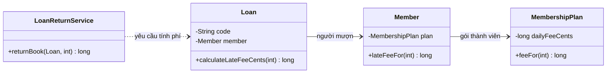
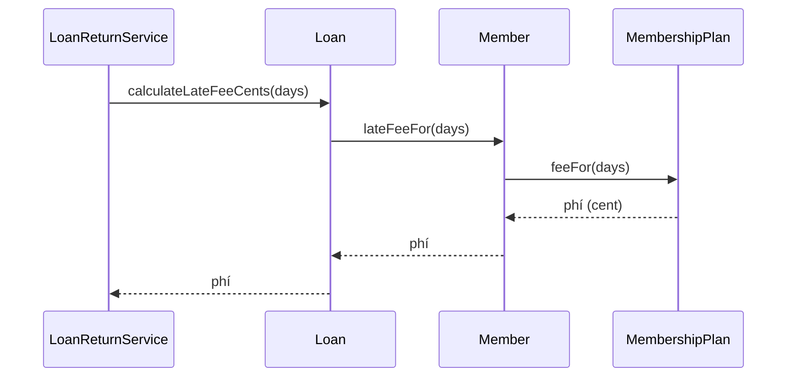

# Giới hạn việc truy cập sâu vào chuỗi đối tượng trong thiết kế lớp OOP

## 1. Vấn đề: một lớp “biết” quá nhiều lớp phía sau

Giả sử ứng dụng thư viện cần tính tiền phạt khi bạn đọc trả sách trễ. Một đoạn mã có thể viết rất nhanh:

```java
long fee = loan.getMember()
               .getMembershipPlan()
               .getDailyLateFeeCents()
           * overdueDays;
```

Đoạn trên giả định các phương thức getter tồn tại. Nó trông dễ hiểu, nhưng `LoanReturnService` (nơi chạy đoạn mã) phải biết đến **ít nhất ba nấc cấu trúc nội bộ**:

1. `Loan` lưu người mượn `Member`;
2. `Member` lưu gói thành viên `MembershipPlan`;
3. `MembershipPlan` chứa mức phạt theo ngày.

Nếu sau này phí phạt phụ thuộc loại sách, thời điểm mượn, số ngày được miễn hoặc chương trình ưu đãi, service sẽ phải đào sâu thêm vào các lớp khác. Việc thay đổi cấu trúc `Member` hay `MembershipPlan` cũng có thể khiến service lỗi biên dịch hoặc tính phí sai.

Đây là hiện tượng thường được gọi là **message chain**, **train wreck** (chuỗi dấu chấm gọi phương thức dài), hoặc vi phạm quy tắc thực dụng của **Law of Demeter (LoD) – nguyên tắc ít hiểu biết**.

Một thiết kế giàu hành vi hơn có thể là:

```java
long fee = loan.calculateLateFeeCents(overdueDays);
```

Ở đây service nêu yêu cầu nghiệp vụ **“tính phí trễ của khoản mượn này”**, còn khoản mượn và các đối tượng gần nó quyết định cách tính. Service không cần biết *phí được lấy qua bao nhiêu nấc object*.

> Ý chính: một lớp nên giao tiếp qua giao diện mà những đối tượng trực tiếp cộng tác cung cấp, thay vì đi xuyên qua chúng để hỏi chi tiết và điều khiển các đối tượng ở xa.

## 2. Law of Demeter thực sự nói gì?

Một cách diễn giải thường dùng của LoD là: trong một phương thức, ưu tiên gọi phương thức của những **đối tượng gần gũi** (*friends*):

- chính đối tượng hiện tại (`this`);
- các tham số truyền trực tiếp vào phương thức;
- các đối tượng thuộc trạng thái trực tiếp của nó (field/cộng tác viên trực tiếp);
- các đối tượng được tạo trong phương thức đó.

Và hãy hạn chế gọi phương thức trên một đối tượng **vừa lấy được từ đối tượng khác**:

```java
// Cấu trúc sâu: a nhận b từ một object rồi tiếp tục điều khiển b.
a.getB().getC().perform();

// Gọi trực tiếp một hành vi được a cung cấp.
a.performRequiredOperation();
```

Trong cách phát biểu chặt của LoD có nhiều biến thể và ngoại lệ cho đối tượng toàn cục, các kết quả trả về hoặc cấu trúc dữ liệu. Vì vậy, các gạch đầu dòng trên là **quy tắc thiết kế dễ áp dụng**, không phải thuật toán kiểm tra cú pháp tuyệt đối.

**Một dấu chấm không tự tạo vấn đề, và nhiều dấu chấm không tự khẳng định thiết kế sai.** Điều cần đánh giá là caller có phải **biết quá nhiều về cấu trúc và trách nhiệm của những object khác** hay không.

Ví dụ:

```java
// Không phải cứ có dấu chấm là vi phạm có ý nghĩa:
String normalized = input.trim().toLowerCase();

// Fluent API/query DSL chủ động thiết kế để gọi chuỗi:
query.select("name").from("customers").where("active = true");
```

Các API xử lý dữ liệu hoặc builder có thể cố ý trả lại một object để tiếp tục thao tác. LoD hữu ích nhất khi bảo vệ **ranh giới hành vi của các đối tượng có trách nhiệm riêng** trong miền nghiệp vụ.

## 3. “Ask for data” và “Tell, don't ask”

Cùng một yêu cầu trả sách trễ có thể được viết theo hai hướng:

| Cách tiếp cận | Ví dụ | Hệ quả thiết kế |
|---|---|---|
| **Đào sâu rồi tự xử lý** | `loan.getMember().getPlan().getRate() * days` | Caller biết cấu trúc của Loan, Member, Plan và công thức nghiệp vụ |
| **Gửi thông điệp về hành vi** | `loan.calculateLateFeeCents(days)` | Caller biết năng lực của Loan; chi tiết có thể được ẩn bên trong |
| **Truyền đúng giá trị cần thiết vào cộng tác viên** | `feePolicy.calculate(loanSnapshot, days)` | Hữu ích nếu tính phí là chính sách độc lập, không thuộc riêng Loan |

Câu khẩu quyết **“Tell, don't ask”** nhấn mạnh việc yêu cầu một object *thực hiện công việc thuộc trách nhiệm của nó*, thay vì lấy toàn bộ trạng thái của nó rồi thao tác từ bên ngoài.

Điều này liên quan đến:

- **Encapsulation:** bảo vệ bất biến và trạng thái nội bộ, công khai hành vi có chủ đích.
- **Information hiding:** khi cấu trúc bên trong thay đổi, ít lớp bên ngoài bị ảnh hưởng.
- **Coupling:** giảm số chi tiết của các lớp xa mà caller phải biết.
- **High cohesion:** quy tắc nào thuộc đối tượng nào thì đặt gần trạng thái và khái niệm đó.

Nhưng **“Tell, don't ask” không có nghĩa cấm mọi getter**. Đọc dữ liệu để hiển thị UI, serialize DTO, tính báo cáo và giao tiếp với một cấu trúc dữ liệu được công khai có thể hoàn toàn phù hợp.

## 4. Minh họa UML: cấu trúc nội bộ và hướng gọi hành vi



Sơ đồ mô tả việc `LoanReturnService` biết trực tiếp `Loan`. `Loan` biết `Member`; `Member` biết `MembershipPlan`. Mỗi lớp chỉ cần gọi **cộng tác viên trực tiếp** của nó.



Chuỗi tương tác runtime vẫn có nhiều bước. Điểm khác biệt là **service không trực tiếp điều hướng đến Plan** hay tự diễn giải số ngày và mức phí. Các bước ở trong ranh giới trách nhiệm của từng đối tượng.

**Cần phân biệt:** LoD không cấm hệ thống có nhiều tầng đối tượng, cũng không cấm một lời gọi nghiệp vụ cuối cùng thực hiện nhiều lời gọi nội bộ. Nó hạn chế việc *caller* biết và phụ thuộc không cần thiết vào cấu trúc xa.

## 5. Ví dụ Java chạy được: tính phí trả sách trễ

Ví dụ sử dụng tiền theo đơn vị nhỏ nhất (cent), tránh dùng `double` để cộng/trừ số tiền không chính xác. Lưu vào tệp `DemeterDemo.java`, biên dịch bằng JDK 11 hoặc mới hơn:

```java
import java.util.Objects;

public class DemeterDemo {

    // Value object: mức phí theo ngày.
    static final class MembershipPlan {
        private final String name;
        private final long dailyLateFeeCents;

        MembershipPlan(String name, long dailyLateFeeCents) {
            this.name = Objects.requireNonNull(name, "name");
            if (dailyLateFeeCents < 0) {
                throw new IllegalArgumentException(
                        "Daily late fee cannot be negative");
            }
            this.dailyLateFeeCents = dailyLateFeeCents;
        }

        long feeFor(int overdueDays) {
            if (overdueDays < 0) {
                throw new IllegalArgumentException(
                        "Overdue days cannot be negative");
            }
            return Math.multiplyExact(dailyLateFeeCents, overdueDays);
        }
    }

    // Entity: thành viên biết gói của chính mình.
    static final class Member {
        private final String id;
        private MembershipPlan plan;

        Member(String id, MembershipPlan plan) {
            this.id = Objects.requireNonNull(id, "id");
            this.plan = Objects.requireNonNull(plan, "plan");
        }

        String id() {
            return id;
        }

        void changePlan(MembershipPlan next) {
            plan = Objects.requireNonNull(next, "next");
        }

        long lateFeeFor(int overdueDays) {
            return plan.feeFor(overdueDays);
        }
    }

    // Entity: phiếu mượn biết người mượn, bảo vệ trạng thái đã trả.
    static final class Loan {
        private final String code;
        private final Member borrower;
        private boolean returned;

        Loan(String code, Member borrower) {
            this.code = Objects.requireNonNull(code, "code");
            this.borrower = Objects.requireNonNull(borrower, "borrower");
        }

        long calculateLateFeeCents(int overdueDays) {
            if (returned) {
                throw new IllegalStateException(
                        "Loan already returned: " + code);
            }
            return borrower.lateFeeFor(overdueDays);
        }

        void markReturned() {
            if (returned) {
                throw new IllegalStateException(
                        "Loan already returned: " + code);
            }
            returned = true;
        }
    }

    // Application-level collaborator: chỉ biết hành vi công khai của Loan.
    static final class LoanReturnService {
        long returnBook(Loan loan, int overdueDays) {
            Objects.requireNonNull(loan, "loan");

            long fee = loan.calculateLateFeeCents(overdueDays);
            // Demo: giả định phí được thu/xác nhận thành công tại đây.
            loan.markReturned();
            return fee;
        }
    }

    public static void main(String[] args) {
        MembershipPlan basic = new MembershipPlan("Basic", 125);
        MembershipPlan premium = new MembershipPlan("Premium", 40);
        Member member = new Member("M001", basic);
        LoanReturnService returns = new LoanReturnService();

        Loan first = new Loan("L001", member);
        System.out.println(
                "First fee: " + returns.returnBook(first, 4)); // 500

        member.changePlan(premium);
        Loan second = new Loan("L002", member);
        System.out.println(
                "Second fee: " + returns.returnBook(second, 4)); // 160

        try {
            returns.returnBook(second, 2);
            throw new AssertionError("Expected already-returned error");
        } catch (IllegalStateException expected) {
            System.out.println("Rejected duplicate return");
        }
    }
}
```

Lệnh chạy:

```bash
javac DemeterDemo.java
java DemeterDemo
```

Kết quả dự kiến:

```text
First fee: 500
Second fee: 160
Rejected duplicate return
```

Hãy quan sát:

1. `LoanReturnService` chỉ gọi `loan.calculateLateFeeCents(...)` và `loan.markReturned()`. Nó không cần getter `getBorrower()` hay `getPlan()`.
2. `Loan` gọi phương thức của field trực tiếp `borrower`.
3. `Member` gọi phương thức của field trực tiếp `plan`.
4. `MembershipPlan` sở hữu công thức mức phí và kiểm tra số ngày. `Math.multiplyExact()` phát hiện overflow.
5. Khi thay đổi mức phí theo gói, caller không phải được sửa để đọc một chuỗi thuộc tính khác.
6. `Loan` sở hữu quy tắc “mỗi phiếu chỉ được đánh dấu trả một lần”.

**Giới hạn nghiệp vụ của demo:** phép tính dùng gói *hiện tại* của thành viên tại thời điểm trả. Nếu hệ thống yêu cầu phí theo gói *lúc mượn* (không đổi khi người dùng nâng cấp sau đó), `Loan` phải chụp (*snapshot*) biểu phí lúc tạo hoặc lưu một chính sách áp dụng tương ứng. Đây là quyết định nghiệp vụ, không phải kết quả tự động của LoD.

**Giới hạn triển khai:** demo đánh dấu `returned` sau khi tính phí và giả định việc thu phí thành công. Hệ thống thật cần xử lý đồng bộ trạng thái thanh toán, transaction/idempotency và concurrency; LoD không tự cung cấp các bảo đảm đó.

## 6. Vì sao đổi cấu trúc bên trong ít tác động hơn?

Giả sử ngày mai công thức phạt đổi từ “số ngày × phí/ngày” sang “miễn hai ngày đầu, có mức phí tối đa”. Với thiết kế đào sâu, nhiều service có thể đang thực hiện:

```java
long fee = loan.getMember()
               .getMembershipPlan()
               .getDailyLateFeeCents() * overdueDays;
```

Mỗi nơi phải tìm và sửa cùng quy tắc. Với thiết kế hành vi:

```java
long fee = loan.calculateLateFeeCents(overdueDays);
```

Ta có thể đổi `MembershipPlan.feeFor(...)`, hoặc thay cơ chế tính phí bằng policy phù hợp, **giữ nguyên hợp đồng của Loan** nếu ý nghĩa và dữ liệu đầu vào không đổi.

Ví dụ công thức khác:

```java
long feeFor(int overdueDays) {
    if (overdueDays < 0) {
        throw new IllegalArgumentException("days");
    }

    int billableDays = Math.max(0, overdueDays - 2);
    long calculated = Math.multiplyExact(
            dailyLateFeeCents, billableDays);
    return Math.min(calculated, 2_000L);
}
```

Đây là **một phương án thay thế** cho phương thức `feeFor` ở trên, không dùng đồng thời hai phương thức trùng chữ ký trong cùng lớp. Mức miễn và trần tiền chỉ để minh họa; trong dự án thực chúng phải đến từ quy tắc đã được phê duyệt và cần kiểm thử.

Nhờ API đúng mức trừu tượng, caller bớt bị ràng buộc vào cách lưu/cách tính.

## 7. Có phải cứ getter là sai?

**Không.** Getter có nhiều vai trò hợp lý:

- Cung cấp dữ liệu cho DTO hoặc lớp trình bày.
- Truy vấn trạng thái đọc mà caller thực sự có quyền biết.
- Trả về Value Object bất biến dùng làm dữ liệu cho thuật toán khác.
- Cho phép test quan sát kết quả công khai.
- Truy cập cấu trúc data-centric như `record`, JSON DTO hoặc kết quả truy vấn được thiết kế để điều hướng.

Vấn đề cần chú ý là **getter tạo ra sự lệ thuộc vào cấu trúc lồng nhau và kéo theo logic nghiệp vụ phân tán**.

| Biểu thức | Nhận xét |
|---|---|
| `order.getCustomer().getMembership().getPlan().getDiscountRate()` | Tín hiệu đáng xem xét nếu service dùng nó để tự áp mức giảm giá |
| `order.calculateTotalAfterDiscount()` | Phù hợp nếu Order/miền đặt quy tắc tổng tiền ở đây |
| `address.getCity()` | Hợp lý khi object `address` là tham số dữ liệu trực tiếp của formatter |
| `dto.customer().address().city()` | Có thể chấp nhận ở tầng trình bày nếu DTO cố ý phơi bày cấu trúc |
| `builder.withName("A").withEmail("b@c.test").build()` | Fluent builder, không phải đào xuyên qua các entity miền |
| `users.stream().filter(...).map(...).toList()` | Chuỗi thao tác của Stream API được thiết kế để compose |
| `service.getDao().getConnection().getMetaData().getTables(...)` | Có thể tạo coupling đến chi tiết tài nguyên và vòng đời kết nối; xem lại ranh giới |

Một kiểm tra đơn giản: **nếu thay cách cất dữ liệu ở lớp giữa mà phải sửa lớp đang gọi, liệu caller có đang biết chi tiết mà nó không cần biết?** Nếu có, cân nhắc đưa hành vi về nơi phù hợp hoặc đưa dữ liệu qua một contract rõ ràng.

## 8. Không “chữa cháy” bằng hàng loạt getter bọc ngoài

Giả sử service cần mã bưu chính để tính cước vận chuyển:

```java
String postalCode = order.getCustomer()
                         .getAddress()
                         .getPostalCode();
```

Có thể thêm:

```java
String Order.getCustomerPostalCode() {
    return customer.getAddress().getPostalCode();
}
```

Điều này rút ngắn chuỗi trong caller nhưng **chưa chắc làm mô hình tốt hơn**. Nếu từ đó tạo thêm hàng chục phương thức `getCustomerCity()`, `getCustomerStreet()`, `getCustomerDistrict()`..., `Order` trở thành “mặt tiền chuyển tiếp” cho mọi field của `Customer`, trong khi chưa rõ trách nhiệm chính của Order.

Hai cách tốt hơn tùy nhu cầu:

**Cách A: Đưa hành vi đến nơi sở hữu quy tắc.** Nếu Order chịu trách nhiệm chuẩn bị địa chỉ giao của chính đơn hàng, `order.shippingLabel()` hoặc `order.confirmDeliveryDestination()` có thể là API hợp lý. Bên trong, nó cộng tác với các thành phần gần nó.

**Cách B: Chọn một ranh giới dữ liệu rõ ràng.** Nếu `ShippingRateCalculator` cần nhiều trường địa chỉ, truyền trực tiếp một **`ShippingAddress` Value Object** bất biến, thay vì cho calculator tự đi từ Order → Customer → Address:

```java
record ShippingAddress(String city, String postalCode) {
    ShippingAddress {
        java.util.Objects.requireNonNull(city);
        java.util.Objects.requireNonNull(postalCode);
    }
}

interface ShippingRateCalculator {
    long rateCents(ShippingAddress destination, int grams);
}
```

Bộ tính phí phụ thuộc vào **hợp đồng đầu vào cần thiết**, không phụ thuộc vào cấu trúc Order/Customer. `Order` hoặc tầng ứng dụng chịu trách nhiệm cung cấp địa chỉ phù hợp từ nghiệp vụ (ví dụ địa chỉ được *chụp lại khi tạo đơn*, khác địa chỉ hiện tại của khách).

**Trade-off:** truyền VO qua một tầng ứng dụng là hợp lý khi đây là **dữ liệu độc lập cần cho phép tính**. Nếu mọi đối tượng chỉ phát tán dữ liệu thô để service tự viết quy tắc nghiệp vụ của chúng, hệ thống lại trở về thiết kế thiếu đóng gói.

## 9. Phân biệt tránh chuỗi truy cập và tránh phụ thuộc

LoD **không đồng nghĩa** “mỗi method chỉ được có một dấu chấm”. Số lượng dấu chấm là tín hiệu ban đầu, không phải thước đo đầy đủ về thiết kế.

| Vấn đề | Law of Demeter gợi ý | Điều chưa được bảo đảm |
|---|---|---|
| Caller đọc quá sâu vào domain model | Giao tiếp với object gần nhất qua hành vi | Không tự xác định chính xác trách nhiệm của lớp |
| Đổi cấu trúc bên trong làm caller hỏng | Che giấu điều hướng nội bộ sau contract ổn định | Contract vẫn có thể thiết kế mơ hồ hoặc quá rộng |
| Logic nghiệp vụ bị sao chép ngoài Entity | Chuyển quy tắc về đối tượng sở hữu hoặc domain policy | Không thay thế việc phân tích miền nghiệp vụ |
| Test phải dựng graph object rất sâu | Tách ranh giới giao tiếp phù hợp | Không có nghĩa mọi đối tượng đều cần interface/mock |
| Hiệu năng kém do truy vấn lồng nhau | Xem lại mô hình dữ liệu và cách truy cập | Rút ngắn chain Java không tự loại bỏ database round-trip |

LoD liên quan mạnh đến **encapsulation**, nhưng **Single Responsibility Principle (SRP)** và **cohesion** vẫn cần được cân nhắc. Đưa toàn bộ hành vi của hệ thống vào một “God Object” để không phải gọi sâu **không phải** cách áp dụng LoD tốt.

## 10. Đối tượng “bạn bè” ở cấp phương thức

Ví dụ sau phân loại mức gần gũi của các object:

```java
final class InvoiceMailer {
    private final MailGateway gateway; // Cộng tác viên trực tiếp.

    InvoiceMailer(MailGateway gateway) {
        this.gateway = gateway;
    }

    void send(Invoice invoice) { // invoice là tham số trực tiếp.
        String content = "Invoice " + invoice.number();

        MailMessage message = new MailMessage(
                invoice.recipientEmail(), content); // object vừa tạo.

        gateway.send(message); // gọi trực tiếp field gateway.
    }
}
```

Giả định `Invoice`, `MailMessage` và `MailGateway` đã được định nghĩa. Những lời gọi trên tương tác với tham số `invoice`, đối tượng tạo trong phương thức `message` và field trực tiếp `gateway`, nên khá phù hợp với cách đọc thông dụng của LoD.

Ngược lại:

```java
// Mailer phải biết cấu trúc internal của invoice → customer → profile.
gateway.send(new MailMessage(
    invoice.getCustomer().getProfile().getPrimaryEmail(),
    "Invoice " + invoice.number()));
```

Nếu địa chỉ nhận hóa đơn là một khái niệm của Invoice, hãy cung cấp `invoice.recipientEmail()`. Điều đó bảo đảm lựa chọn email hóa đơn nằm ở nơi sở hữu quy tắc: có thể dùng email đã được xác nhận lúc lập hóa đơn, khác với email hiện tại của khách hàng.

**Điểm cốt lõi:** phương thức gọi trực tiếp trên tham số là bình thường; thứ nên xét lại là khi caller tiếp tục **đào sâu object được lấy ra từ tham số** để điều khiển các chi tiết bên trong.

## 11. Khi gặp Optional, null, Stream và builder

### Chuỗi null-check không giải quyết coupling

```java
String zip = order != null
    && order.getCustomer() != null
    && order.getCustomer().getAddress() != null
    ? order.getCustomer().getAddress().getZip()
    : "";
```

Thêm kiểm tra null có thể tránh `NullPointerException`, nhưng caller vẫn phụ thuộc vào toàn bộ đường đi. Hơn nữa gọi getter lặp lại có thể có tác dụng phụ hoặc trả snapshot khác nếu dữ liệu thay đổi.

Dùng `Optional` cũng không tự khắc phục vấn đề:

```java
Optional.ofNullable(order)
    .map(Order::getCustomer)
    .map(Customer::getAddress)
    .map(Address::getZip)
    .orElse("");
```

Chuỗi `map` tránh một số kiểm tra null thủ công, nhưng caller vẫn biết cấu trúc `Order → Customer → Address`. Nếu mục đích là lấy mã bưu chính phục vụ nghiệp vụ thuộc Order, hãy thiết kế API đó đúng chỗ.

### Fluent APIs là ngoại lệ có chủ đích

```java
String output = "  HELLO  ".trim().toLowerCase();

List<String> names = users.stream()
    .filter(User::isActive)
    .map(User::getName)
    .toList();
```

Lưu ý `Stream.toList()` cần Java 16+; với Java 11 có thể dùng `collect(Collectors.toList())`. Những API bất biến/fluent này có giao thức công khai rõ ràng; gọi chuỗi là cách sử dụng hợp lý. Không cần tạo một lớp wrapper riêng chỉ để làm giảm số dấu chấm.

## 12. Vấn đề đặc biệt ở ORM và JPA/Hibernate

Một chuỗi như:

```java
String country = order.getCustomer()
                      .getAddress()
                      .getCountryCode();
```

có thể không chỉ là vấn đề coupling. Nếu `customer` hoặc `address` là quan hệ ORM được tải **lazy**, truy cập getter có thể kích hoạt truy vấn SQL; trong vòng lặp nhiều đơn hàng, có thể xảy ra **N+1 queries**, hoặc lỗi như `LazyInitializationException` nếu session đã đóng (tùy mapping và trạng thái).

Tuy nhiên:

- Đưa chain vào `order.shippingCountryCode()` **không tự loại bỏ SQL query**; chỉ chuyển vị trí gọi.
- Chọn fetch strategy, query projection, entity graph, batch fetching hoặc DTO phù hợp mới giải quyết chi phí truy xuất.
- Không nhất thiết thêm mọi mối quan hệ hai chiều để tiện điều hướng.
- Tránh serialize nguyên object graph JPA trực tiếp ra JSON nếu quan hệ hai chiều hoặc lazy proxy gây vòng tham chiếu, rò dữ liệu hay load quá nhiều. Một DTO/API contract rõ ràng thường dễ kiểm soát hơn.

Vì vậy cần đánh giá **cả ranh giới hướng đối tượng lẫn truy cập dữ liệu**, không coi LoD như một kỹ thuật tối ưu hiệu năng tự động.

## 13. Quy trình refactor một chuỗi truy cập sâu

Giả sử phát hiện đoạn mã:

```java
if (order.getCustomer().getMembership().getTier().isGold()) {
    total = total * 90 / 100;
}
```

Hãy làm theo trình tự:

1. **Đặt tên câu hỏi nghiệp vụ:** “Đơn hàng này được giảm bao nhiêu theo chính sách thành viên?” thay vì “tier có phải GOLD?”.
2. **Tìm nơi chịu trách nhiệm:** nếu thành viên tự xác định mức ưu đãi, có thể đặt `membership.discountFor(orderAmount)`. Nếu chính sách phức tạp và liên quan nhiều yếu tố, dùng `DiscountPolicy` hoặc domain service.
3. **Thiết kế contract rõ:** ví dụ `order.discountedTotal(policy)` hoặc `policy.calculate(orderSnapshot)`; xác định đơn vị tiền tệ, làm tròn, quy tắc khuyến mãi và thời điểm chụp dữ liệu.
4. **Giữ bất biến trong miền:** entity chịu trách nhiệm tính tổng hợp lệ, policy chịu trách nhiệm quy tắc giảm giá, không để controller tự nhân `90 / 100`.
5. **Thay caller bằng API mới:** controller/service chỉ cần kết quả mức giá; không phải duyệt đồ thị của khách hàng.
6. **Kiểm thử hành vi trước/sau:** GOLD, không GOLD, thiếu membership, làm tròn, thay đổi chính sách, không để giá âm.
7. **Bỏ các getter không còn cần nếu an toàn:** giảm API công khai, nhưng không xóa getter còn phục vụ nhu cầu truy vấn dữ liệu hợp lệ.

**Không nên mặc định** mọi cấu trúc điều hướng sâu đều được sửa bằng một phương thức “get” khác. Đôi khi đúng hơn là **phân định lại trách nhiệm nghiệp vụ**, hoặc trích Value Object/policy có ý nghĩa rõ ràng.

## 14. Lỗi phổ biến và cách xử lý

| Cách làm dễ mắc | Hệ quả | Hướng suy nghĩ tốt hơn |
|---|---|---|
| Caller tự đọc nhiều cấp để tính quy tắc | Phụ thuộc vào cấu trúc sâu, logic phân tán | Gọi hành vi của object sở hữu quy tắc |
| Thêm hàng chục forwarding getter | Lớp trung gian phình to, API rối | Bộc lộ capability thực sự hoặc VO đúng ranh giới |
| Xóa mọi getter vì “LoD cấm getter” | Tầng hiển thị/truy vấn dữ liệu khó dùng | Phân biệt domain behavior và data projection |
| Đưa mọi quy tắc vào một Service khổng lồ | Entity không có hành vi, cohesion thấp | Giữ bất biến cùng entity/VO; dùng service khi cần |
| Mock toàn bộ object graph sâu trong test | Test giòn, gắn vào chi tiết getter | Test hành vi công khai qua đối tượng/cổng cộng tác |
| Chuyển chain Java sang một method nhưng giữ nguyên việc gọi DB nhiều lần | N+1/lazy lỗi vẫn tồn tại | Thiết kế fetch/projection/transaction hợp lý |
| Dùng `Optional.map(...)` để che mọi chain | Giảm null-check nhưng coupling không đổi | Phân tích trách nhiệm và API |
| Áp dụng LoD tuyệt đối lên builder, Stream, DTO | Tạo wrapper thừa, code khó đọc | Cho phép chuỗi có hợp đồng data/fluent rõ |
| Giấu field bằng API nhưng API còn phụ thuộc tên bảng/cột SDK | Coupling chỉ chuyển hình thức | Thiết kế hợp đồng theo ngữ nghĩa nghiệp vụ ổn định |

## 15. Bài tập tự luyện

### Bài 1: xác định lớp đang biết quá nhiều

```java
void sendReminder(Loan loan) {
    String email = loan.getMember()
                       .getProfile()
                       .getEmailAddress()
                       .getValue();
    mailGateway.send(email, "Please return the book");
}
```

**Câu hỏi:** Có bao nhiêu tầng cấu trúc bị lộ ra cho mã gửi nhắc nhở? Nếu email liên hệ của khoản mượn phải được chốt lúc mượn, nên làm gì?

**Gợi ý:** thay bằng API như `loan.reminderRecipientEmail()` hoặc một VO/DTO chứa thông tin nhắc nhở của phiếu mượn. Nếu địa chỉ phải được chốt, lưu snapshot hoặc chính sách chọn người nhận tại ranh giới phù hợp. Không nhầm email hiện tại của profile với email được dùng lúc mượn.

### Bài 2: LoD và Value Object

```java
long cents = invoice.total().minorUnits();
```

**Câu hỏi:** Có nên cấm biểu thức này chỉ vì có hai dấu chấm?

**Gợi ý:** `invoice.total()` trả `Money` bất biến; tầng API cần chuyển sang JSON hoặc hiển thị có thể đọc `minorUnits()` hợp lý. Nếu business caller phải làm một loạt quy tắc tiền tệ thủ công, nên dùng hành vi của Money/invoice thay vì tách giá trị primitive.

### Bài 3: bảo vệ hành vi trong Entity

Một `Order` có `status` và `paidAt`. Controller viết:

```java
if (order.getStatus().equals("NEW")) {
    order.setStatus("PAID");
    order.setPaidAt(Instant.now());
}
```

**Gợi ý:** dùng `order.markPaid(paymentReference, paidAt)` (hoặc API đúng nghiệp vụ), đặt điều kiện chuyển trạng thái và tính nhất quán của thời điểm thanh toán bên trong Order. Quy tắc chỉ cho phép thanh toán một lần nên thuộc cùng nơi với trạng thái.

### Bài 4: hoàn thiện ví dụ Java

Trong `DemeterDemo`, bổ sung chính sách “gói Premium miễn ngày đầu tiên, tính phí từ ngày thứ hai” và kiểm thử phí cho 0, 1, 2, 4 ngày trễ.

**Gợi ý:** có thể mô hình hóa một `LateFeePolicy` Value Object hoặc interface nếu thật sự có nhiều chính sách, đặt ở phía `MembershipPlan`. Giữ nguyên lời gọi `loan.calculateLateFeeCents(days)` tại service. Đặt ràng buộc tránh số âm và tràn số.

### Bài 5: xét ngoại lệ

Màn hình báo cáo nhận DTO:

```java
String city = reportDto.customer()
                       .shippingAddress()
                       .city();
```

**Câu hỏi:** Có nhất thiết sửa thành `reportDto.getShippingCity()` không?

**Gợi ý:** không. DTO thường được tạo để đọc cấu trúc dữ liệu; hãy đánh giá xem schema là hợp đồng công khai và UI có quyền sử dụng các trường đó hay không. Chỉ cần cân nhắc ranh giới nếu trình bày phải tự viết các quy tắc domain hoặc bị ràng buộc vào cấu trúc persistence.

---

**Ghi nhớ:** hạn chế truy cập sâu không phải một cuộc thi giảm dấu chấm. Hãy để lớp gọi **yêu cầu hành vi có ý nghĩa** từ cộng tác viên trực tiếp, để lớp sở hữu dữ liệu **giữ những quy tắc và bất biến của mình**, và chỉ bộc lộ cấu trúc dữ liệu khi đó là một hợp đồng chủ đích. Nhờ vậy, sửa cấu trúc một lớp ít kéo theo sửa hàng loạt lớp xung quanh.