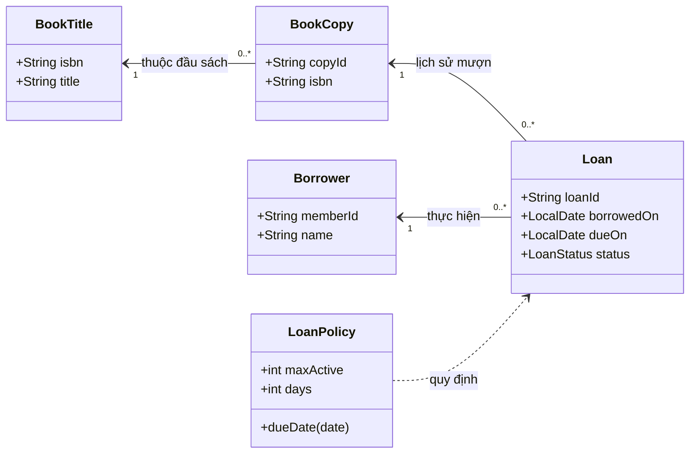
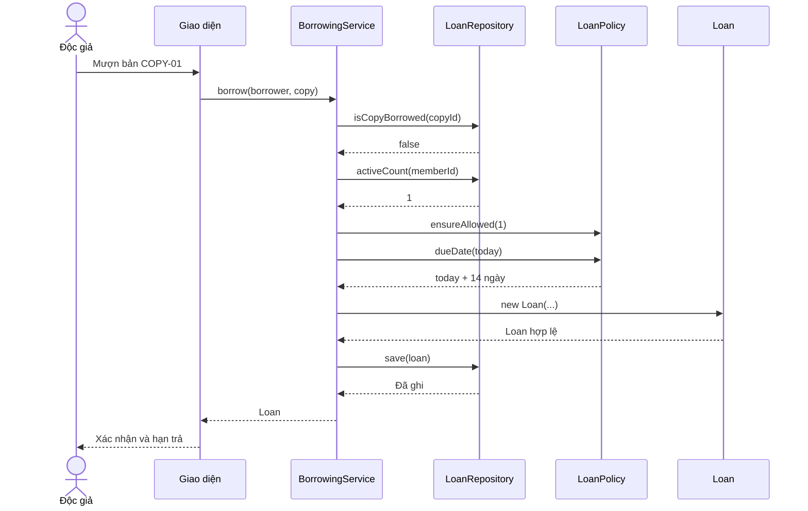
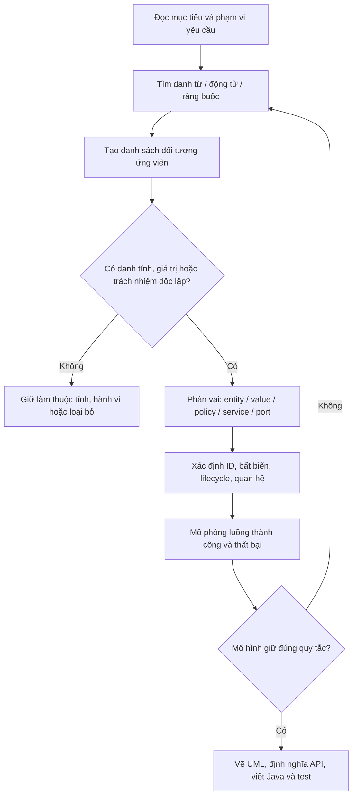

# Nhận diện đối tượng từ yêu cầu trong OOP (Java)

## Bài toán của bước mô hình hóa

Khi nhận một yêu cầu như “Độc giả mượn bản sách, hệ thống kiểm tra bản sách còn cho mượn được hay không, ghi nhận lượt mượn và tính hạn trả”, người thiết kế chưa nên viết ngay một class cho mỗi danh từ. Trước hết cần tìm ra **các khái niệm có ý nghĩa trong nghiệp vụ**, thông tin nào thuộc về chúng, hành vi nào chúng chịu trách nhiệm và quan hệ nào phải được giữ nhất quán.

**Nhận diện đối tượng từ yêu cầu** là quá trình chuyển cách diễn đạt của người dùng thành các *đối tượng ứng viên* (*candidate objects*), kiểm tra vai trò của từng ứng viên, rồi đề xuất mô hình lớp. Đây là bước khám phá và kiểm chứng giả thuyết, không phải thao tác tìm danh từ một cách máy móc.

Kết thúc bài, bạn sẽ có thể:

- Đọc mô tả nghiệp vụ để trích xuất đối tượng, thuộc tính, hành vi, sự kiện và quy tắc.
- Phân biệt **entity**, **value object**, đối tượng điều phối và các phụ thuộc bên ngoài.
- Loại bỏ những “class giả” chỉ là thuộc tính, màn hình, vai trò hay cách triển khai kỹ thuật.
- Kiểm chứng mô hình bằng tình huống nghiệp vụ, bất biến, sơ đồ UML và ví dụ Java chạy độc lập.
- Biết khi nào nên sửa mô hình vì yêu cầu chưa rõ hoặc quy tắc mới làm xuất hiện đối tượng có vòng đời riêng.

## 1. Bắt đầu từ ngôn ngữ nghiệp vụ

Xét yêu cầu mẫu:

> “Độc giả có mã thành viên và tên. Thư viện có nhiều bản sách, mỗi bản có mã riêng và thuộc một đầu sách. Độc giả được mượn tối đa hai bản cùng lúc. Một bản sách không được có hai lượt mượn đang hoạt động. Khi mượn, hệ thống ghi ngày mượn và hạn trả sau 14 ngày. Nhân viên có thể tra cứu các lượt mượn đang hoạt động.”

Đây là **một yêu cầu ví dụ** để luyện kỹ năng phân tích, không phải hệ thống thư viện chuẩn áp dụng cho mọi tổ chức. Các con số hai bản và 14 ngày là quy tắc riêng của ví dụ.

Gạch chân những nhóm từ cần làm rõ:

| Cụm từ trong yêu cầu | Ứng viên đầu tiên | Câu hỏi để xác nhận |
| --- | --- | --- |
| Độc giả | `Borrower` | Có mã định danh, vòng đời và lịch sử riêng không? |
| Mã thành viên, tên | Thuộc tính của `Borrower` | Có cần quy tắc định dạng/một kiểu giá trị riêng không? |
| Đầu sách | `BookTitle` hoặc `Book` | Có ISBN, tác giả, thông tin xuất bản riêng không? |
| Bản sách | `BookCopy` | Có mã riêng, có thể mượn độc lập các bản khác không? |
| Mượn bản sách | `Loan` và hành vi `borrow(...)` | Một lượt mượn có ngày, trạng thái và danh tính riêng không? |
| Hai bản cùng lúc | `LoanPolicy` hoặc quy tắc miền | Áp dụng cho ai? Có ngoại lệ theo loại độc giả không? |
| Lượt mượn đang hoạt động | Trạng thái/điều kiện trên `Loan` | Trả sách có kết thúc lượt mượn hay xóa lịch sử? |
| Ngày mượn, hạn trả | Thuộc tính của `Loan` | Dùng `LocalDate` hay `Instant`? Hạn tính theo múi giờ nào? |
| Tra cứu | Hành vi use case/query | Có cần `LoanQueryService` hay chỉ một repository query? |
| Thư viện | Khái niệm bối cảnh | Có thực sự cần đối tượng `Library` trong phạm vi chức năng này không? |

**Đầu sách và bản sách là hai khái niệm khác nhau.** Có thể có ba bản vật lý của cùng một tựa sách. Nếu chỉ tạo `Book(title)` mà bỏ danh tính từng bản, hệ thống không thể xác định chính xác bản nào đang được mượn. Đây là ví dụ quan trọng về việc hỏi đúng câu hỏi nghiệp vụ trước khi chọn class.

## 2. Kỹ thuật danh từ – động từ – quy tắc

Có thể thực hiện bước phân tích đầu tiên bằng ba lượt đọc:

1. **Danh từ và cụm danh từ:** tìm thực thể, vật, tài liệu, vai trò, kết quả có thể có danh tính hoặc giá trị riêng.
2. **Động từ:** tìm hành vi như *mượn*, *trả*, *xác nhận*, *tính*, *chuyển*, *hủy*, *tra cứu*.
3. **Điều kiện/ràng buộc:** đánh dấu *phải*, *không được*, *tối đa*, *ít nhất*, *chỉ khi*, *nếu... thì...*, *sau ... ngày*.

Ví dụ:

```text
"Cá nhân [độc giả] mượn [bản sách]."
  Danh từ: độc giả, bản sách
  Động từ: mượn
  Câu hỏi: ai quyết định cho mượn, ai ghi nhận kết quả?

"Mỗi bản sách không có quá một [lượt mượn đang hoạt động]."
  Ứng viên: lượt mượn (Loan)
  Invariant: active-loan-count(copyId) <= 1

"Hạn trả sau 14 ngày."
  Dữ liệu: ngày mượn, hạn trả
  Quy tắc: dueDate = borrowedOn + 14 ngày
  Vị trí ứng viên: LoanPolicy hoặc nghiệp vụ tạo Loan
```

Kỹ thuật này chỉ **tạo danh sách ứng viên**. Không áp dụng công thức “mỗi danh từ → một class”, “mỗi động từ → một service”. Chẳng hạn “ngày mượn” thường là một `LocalDate` trong `Loan`, còn “kiểm tra” có thể là một method, không cần class `Check`.

## 3. Phân loại đối tượng ứng viên bằng những câu hỏi có thể kiểm chứng

Một ứng viên đáng trở thành class nếu có **vai trò riêng** mà việc gom vào class khác sẽ làm mất thông tin hoặc khiến trách nhiệm lẫn lộn.

| Loại | Cách nhận diện | Ví dụ | Cách biểu diễn |
| --- | --- | --- | --- |
| Entity | Có danh tính và vòng đời; cùng ID vẫn là cùng thực thể dù thuộc tính đổi | `Borrower`, `BookCopy`, `Loan` | Class có ID, hành vi và bất biến |
| Value object | Phân biệt bằng giá trị; thường bất biến, không cần ID riêng | `DateRange`, `Money`, `Address` | `record` hoặc class immutable |
| Aggregate root | Quản lý bất biến và cập nhật của một nhóm đối tượng | `Loan` hoặc một đối tượng quản lý việc mượn theo thiết kế cụ thể | API thay đổi có kiểm soát |
| Domain policy/service | Quy tắc cần nhiều đầu vào, không thuộc riêng một entity | `LoanPolicy` | Class/record có hành vi rõ |
| Application service | Điều phối một use case: lấy dữ liệu, áp chính sách, ghi nhận | `BorrowingService` | Service phụ thuộc port |
| Repository/port | Hợp đồng truy cập dữ liệu bên ngoài domain | `LoanRepository` | Interface và adapter |
| DTO/Command | Dữ liệu vào/ra qua API, CLI, message | `BorrowRequest` | Record/data carrier |
| Domain event | Sự kiện đã xảy ra có ích cho các phần khác | `LoanCreated` | Record/event object khi cần |

Không phải phải có đủ mọi loại. Với chức năng nhỏ, chỉ vài class rõ trách nhiệm là đủ. **Entity, value object, service** là những cách phân vai theo vấn đề cần giải quyết, không phải các nhãn buộc mọi đối tượng đi vào một khuôn.

### Ba phép thử cho một ứng viên

- **Phép thử danh tính:** nếu đổi tên nhưng giữ mã, có phải vẫn là cùng một đối tượng? Nếu có, rất có thể đó là entity.
- **Phép thử trách nhiệm:** đối tượng này có dữ liệu hoặc hành vi riêng mà không đối tượng khác nào nên quản lý không?
- **Phép thử vòng đời:** khi tạo, thay đổi, kết thúc hoặc lưu lịch sử, có cần theo dõi nó độc lập không?

Ví dụ một “lượt mượn” có người mượn, bản sách, ngày bắt đầu, ngày trả và trạng thái. Nó có vòng đời khác bản sách và người mượn, nên `Loan` là một đối tượng có ý nghĩa, thay vì chỉ đặt `borrowerId` trực tiếp trong `BookCopy` rồi mất lịch sử.

## 4. Từ ứng viên đến mô hình quan hệ

Đặt câu hỏi ở **cả hai đầu** của mỗi quan hệ:

- Một đầu sách có bao nhiêu bản sách? Mỗi bản thuộc bao nhiêu đầu sách?
- Một độc giả có bao nhiêu lượt mượn? Mỗi lượt mượn thuộc bao nhiêu độc giả?
- Một bản sách có thể có bao nhiêu lượt mượn **trong lịch sử**, và bao nhiêu lượt **đang hoạt động**?



**Không suy luận sai từ số lượng:** `BookCopy 1 <-- 0..* Loan` không có nghĩa một bản được nhiều người mượn cùng lúc. Đây là **số lượt mượn trong lịch sử**. Ràng buộc “tối đa một lượt active cho một bản” phải được bảo vệ riêng bằng logic và, trong hệ thống lưu trữ thực, bằng chiến lược giao dịch/ràng buộc dữ liệu phù hợp.

Trong UML, hướng mũi tên chỉ là một quyết định điều hướng (*navigability*). Chưa cần đặt collection hai chiều trong mọi class. Nếu một hướng đã đáp ứng use case, có thể truy vấn những hướng còn lại qua repository.

## 5. Chọn thuộc tính và hành vi đúng chủ sở hữu

Không phải sau khi tìm thấy class là đặt tất cả field công khai. Cần quyết định lớp nào **biết** thông tin, lớp nào **được quyền thay đổi** và luật nào phải đúng trong suốt vòng đời.

| Đối tượng | Dữ liệu có nghĩa | Hành vi hoặc bất biến |
| --- | --- | --- |
| `Borrower` | `memberId`, `name` | ID hợp lệ; có thể thêm trạng thái thành viên khi có yêu cầu |
| `BookTitle` | ISBN, tiêu đề | Kiểm tra ISBN/metadata nếu phạm vi yêu cầu |
| `BookCopy` | `copyId`, ID đầu sách | Mã bản không rỗng; độc lập với các bản cùng đầu sách |
| `Loan` | ID lượt, ID người, ID bản, ngày mượn, hạn trả | Ngày hạn trả sau ngày mượn; trạng thái chuyển hợp lệ |
| `LoanPolicy` | Giới hạn số lượt, số ngày | Từ chối vượt giới hạn; tính hạn trả |
| `BorrowingService` | Repository, policy, clock, ID generator | Điều phối kiểm tra điều kiện, tạo Loan, lưu kết quả |
| `LoanRepository` | Không cần lưu trạng thái trong interface | Truy vấn lượt active, đếm lượt theo người và lưu |

**Nguyên tắc Information Expert:** ưu tiên đặt hành vi nơi có thông tin cần thiết để thực hiện nó. `Loan` đủ biết ngày mượn và hạn trả để bảo vệ thứ tự ngày; `LoanPolicy` biết thời hạn cho phép. `BorrowingService` cần nhiều thành phần để điều phối quá trình mượn, nhưng không nên tự nhân bản công thức tính ngày ở nhiều nơi.

## 6. Ví dụ Java 17 hoàn chỉnh: biến yêu cầu thành object model

Để tập trung vào bước nhận diện đối tượng, ví dụ là chương trình **mượn sách trong bộ nhớ**. Mỗi lần mượn hợp lệ tạo một `Loan`; `LoanRepository` trong demo chỉ giữ các lượt active, chưa triển khai trả sách/lưu lịch sử. Độc giả, bản sách, policy và Loan có trách nhiệm riêng, còn service điều phối.

Tạo file `IdentifyObjectsDemo.java`:

```java
import java.time.Clock;
import java.time.Instant;
import java.time.LocalDate;
import java.time.ZoneOffset;
import java.util.LinkedHashMap;
import java.util.Map;
import java.util.Objects;
import java.util.concurrent.atomic.AtomicInteger;

public class IdentifyObjectsDemo {

    private static String required(String value, String label) {
        if (value == null || value.isBlank()) {
            throw new IllegalArgumentException(label + " must not be blank");
        }
        return value;
    }

    // Entity ứng viên: có mã thành viên riêng.
    record Borrower(String memberId, String name) {
        Borrower {
            memberId = required(memberId, "memberId");
            name = required(name, "name");
        }
    }

    // Entity ứng viên: từng bản sách có mã độc lập với đầu sách.
    record BookCopy(String copyId, String title) {
        BookCopy {
            copyId = required(copyId, "copyId");
            title = required(title, "title");
        }
    }

    // Một lượt mượn có danh tính và ngày tháng riêng.
    record Loan(String loanId, String memberId, String copyId,
                LocalDate borrowedOn, LocalDate dueOn) {
        Loan {
            loanId = required(loanId, "loanId");
            memberId = required(memberId, "memberId");
            copyId = required(copyId, "copyId");
            Objects.requireNonNull(borrowedOn, "borrowedOn");
            Objects.requireNonNull(dueOn, "dueOn");
            if (!dueOn.isAfter(borrowedOn)) {
                throw new IllegalArgumentException(
                        "Due date must be after borrowed date");
            }
        }
    }

    // Domain policy: số lượt cho phép và thời hạn.
    record LoanPolicy(int maxActiveLoans, int loanDays) {
        LoanPolicy {
            if (maxActiveLoans <= 0 || loanDays <= 0) {
                throw new IllegalArgumentException("Policy must be positive");
            }
        }

        void ensureAllowed(int activeCount) {
            if (activeCount >= maxActiveLoans) {
                throw new IllegalStateException("Borrow limit reached");
            }
        }

        LocalDate dueDate(LocalDate borrowedOn) {
            return borrowedOn.plusDays(loanDays);
        }
    }

    // Port: service biết hợp đồng, không biết SQL/JPA.
    interface LoanRepository {
        boolean isCopyBorrowed(String copyId);
        int activeCount(String memberId);
        void save(Loan loan);
    }

    // Adapter trong bộ nhớ; dùng để minh họa và unit test tuần tự.
    static final class InMemoryLoanRepository implements LoanRepository {
        private final Map<String, Loan> activeByCopy = new LinkedHashMap<>();

        @Override
        public boolean isCopyBorrowed(String copyId) {
            return activeByCopy.containsKey(copyId);
        }

        @Override
        public int activeCount(String memberId) {
            int count = 0;
            for (Loan loan : activeByCopy.values()) {
                if (loan.memberId().equals(memberId)) count++;
            }
            return count;
        }

        @Override
        public void save(Loan loan) {
            Objects.requireNonNull(loan, "loan");
            if (activeByCopy.putIfAbsent(loan.copyId(), loan) != null) {
                throw new IllegalStateException(
                        "Copy " + loan.copyId() + " is already borrowed");
            }
        }
    }

    interface LoanIdSource {
        String nextLoanId();
    }

    // Application service: thực hiện trình tự của use case.
    static final class BorrowingService {
        private final LoanRepository loans;
        private final LoanPolicy policy;
        private final Clock clock;
        private final LoanIdSource ids;

        BorrowingService(LoanRepository loans, LoanPolicy policy,
                         Clock clock, LoanIdSource ids) {
            this.loans = Objects.requireNonNull(loans);
            this.policy = Objects.requireNonNull(policy);
            this.clock = Objects.requireNonNull(clock);
            this.ids = Objects.requireNonNull(ids);
        }

        Loan borrow(Borrower borrower, BookCopy copy) {
            Objects.requireNonNull(borrower, "borrower");
            Objects.requireNonNull(copy, "copy");

            if (loans.isCopyBorrowed(copy.copyId())) {
                throw new IllegalStateException(
                        "Copy " + copy.copyId() + " is already borrowed");
            }

            policy.ensureAllowed(loans.activeCount(borrower.memberId()));

            LocalDate today = LocalDate.now(clock);
            Loan loan = new Loan(
                    ids.nextLoanId(),
                    borrower.memberId(),
                    copy.copyId(),
                    today,
                    policy.dueDate(today));

            loans.save(loan);
            return loan;
        }
    }

    public static void main(String[] args) {
        Borrower an = new Borrower("MEM-01", "An");
        Borrower binh = new Borrower("MEM-02", "Binh");
        BookCopy copy1 = new BookCopy("COPY-01", "OOP Java");
        BookCopy copy2 = new BookCopy("COPY-02", "SQL");
        BookCopy copy3 = new BookCopy("COPY-03", "Algorithms");

        InMemoryLoanRepository repo = new InMemoryLoanRepository();
        LoanPolicy policy = new LoanPolicy(2, 14);
        Clock clock = Clock.fixed(
                Instant.parse("2026-10-15T00:00:00Z"),
                ZoneOffset.UTC);
        AtomicInteger seq = new AtomicInteger();
        LoanIdSource ids = () -> "LOAN-" + seq.incrementAndGet();

        BorrowingService service =
                new BorrowingService(repo, policy, clock, ids);

        Loan first = service.borrow(an, copy1);
        System.out.println(
                "Loan: " + first.loanId() + ", due " + first.dueOn());

        try {
            service.borrow(binh, copy1);
        } catch (IllegalStateException ex) {
            System.out.println(ex.getMessage());
        }

        service.borrow(an, copy2);
        System.out.println("Active of An: " + repo.activeCount(an.memberId()));

        try {
            service.borrow(an, copy3);
        } catch (IllegalStateException ex) {
            System.out.println(ex.getMessage());
        }
    }
}
```

Chạy:

```bash
javac IdentifyObjectsDemo.java
java IdentifyObjectsDemo
```

Kết quả dự kiến:

```text
Loan: LOAN-1, due 2026-10-29
Copy COPY-01 is already borrowed
Active of An: 2
Borrow limit reached
```

### Gắn ví dụ code trở lại từng câu yêu cầu

| Câu yêu cầu | Thành phần trong code | Điểm chứng minh |
| --- | --- | --- |
| Độc giả có mã, tên | `Borrower` | `record Borrower(memberId, name)` |
| Bản sách có mã riêng | `BookCopy` | `copyId` định danh bản |
| Hệ thống ghi một lần mượn | `Loan` | Có `loanId`, borrower, copy, ngày |
| Một bản không được cho mượn trùng | `LoanRepository`, `BorrowingService` | Kiểm tra active; `putIfAbsent` từ chối trùng |
| Tối đa hai bản | `LoanPolicy` | `ensureAllowed(activeCount)` |
| Hạn trả sau 14 ngày | `LoanPolicy` | `borrowedOn.plusDays(loanDays)` |
| Quy trình mượn cần nhiều thành phần | `BorrowingService` | Kiểm tra, tạo Loan, lưu |
| Cần thay DB/nguồn thời gian | `LoanRepository`, `Clock` | Dependency injection vào service |

Code dùng `record` để ngắn gọn và bất biến trong demo. **Một entity không bắt buộc là record**, và có thể cần class có method chuyển trạng thái khi bổ sung nghiệp vụ trả sách, gia hạn, mất sách hoặc hủy mượn. Ở đây đối tượng `Loan` có danh tính riêng theo nghĩa domain dù được hiện thực bằng record bất biến.

**Giới hạn kỹ thuật:** mẫu này chạy tuần tự. Hai request đồng thời có thể cùng thấy độc giả còn hạn mức rồi cùng `save`, vượt giới hạn tổng; `LinkedHashMap` cũng không thread-safe. Để chạy production, phải áp đặt giao dịch/khóa hoặc cách đảm bảo atomicity phù hợp, xác thực mã độc giả/bản sách thực sự tồn tại, lưu lịch sử khi trả sách và có ràng buộc database ngăn hai lượt mượn active cho cùng một bản. **Phân chia object hợp lý là điều kiện giúp xử lý đúng, không tự thay thế kiểm soát đồng thời.**

## 7. Mô phỏng sự cộng tác để kiểm chứng mô hình

Sau khi đề xuất class, hãy **chạy thử use case trên giấy**. Nếu không giải thích được ai sở hữu một bước hoặc phải trao quyền sửa dữ liệu lung tung, mô hình chưa ổn.



Đây là một **đường đi thành công**. Phải mô phỏng thêm đường đi thất bại: bản đang được mượn, người mượn đạt hạn mức, đầu vào không hợp lệ, lưu DB lỗi. Mỗi đường đi cần có một nơi chịu trách nhiệm xử lý và trạng thái không được sai lệch.

Đừng để giao diện quyết định thay `LoanPolicy` rằng 3 bản vẫn hợp lệ; giao diện có thể kiểm tra nhanh để phản hồi tốt hơn, nhưng quy tắc nghiệp vụ cần được thực thi ở tầng có thẩm quyền.

## 8. Các dấu hiệu nhận diện class sai

### 8.1 Biến mọi danh từ thành class

Từ “ngày mượn”, “tên”, “số lượng” thường chỉ là field hoặc value object quen thuộc (`LocalDate`, `String`, `int`). Chỉ nâng thành kiểu miền riêng khi có **quy tắc/ý nghĩa** đáng được bảo vệ, ví dụ `MembershipId` có định dạng đặc biệt hoặc `Money` có currency và phép toán.

### 8.2 Biến mọi động từ thành class service

Có thể thiết kế một service `AddItemService`, `SetDueDateService`, `ChangeStatusService` cho mọi thao tác nhỏ, nhưng nếu hành vi gắn với trạng thái và bất biến của entity, method trực tiếp trên entity có thể rõ nghĩa hơn. `Loan.extendDueDate(...)` có thể phù hợp hơn cho quy tắc gia hạn nội tại, còn `RenewalService` hữu ích nếu gia hạn phải phối hợp tồn kho, tài khoản và chính sách ngoài entity.

### 8.3 Gộp hai khái niệm có vòng đời khác nhau

Gộp “đầu sách” và “bản sách” khiến không lưu được số bản và từng tình trạng. Gộp “độc giả” với “lượt mượn” khiến lịch sử, gia hạn và trả sách phức tạp. Hãy so sánh **ID, tuổi thọ và nguyên nhân thay đổi** của từng khái niệm.

### 8.4 Nhầm role/actor với đối tượng miền

“Nhân viên thư viện” là actor trong use case; có thể cần entity `StaffMember` nếu hệ thống thực sự quản lý nhân viên, phân quyền và ca làm. Nếu chức năng chỉ mô tả “nhân viên nhấn nút tra cứu”, chưa đủ cơ sở để thêm một lớp miền `Librarian`. Vai trò sử dụng hệ thống và mô hình dữ liệu bên trong là hai phạm vi khác nhau.

### 8.5 Biến `System`, `Manager`, `Helper` thành kho mọi trách nhiệm

Một `LibrarySystem` biết từ ISBN, lịch, tính phí đến gửi email thường là “God Object”. Hỏi lại mỗi hành vi cần thông tin nào và thuộc một khái niệm nghiệp vụ nào. Một service điều phối nhiều thành phần được phép tồn tại nhưng không nên tự sở hữu mọi quy tắc nội tại.

### 8.6 Thiết kế quá sớm từ bảng hoặc màn hình

Một bảng DB có thể chứa nhiều cột không đồng nghĩa chính xác với một domain object. Một trang “Thông tin độc giả và lịch sử mượn” có thể hiển thị dữ liệu tổng hợp từ nhiều thực thể. Mô hình nghiệp vụ nên dựa vào **định danh, hành vi và bất biến**, sau đó mới quyết định bảng, màn hình và DTO tương ứng.

## 9. Kiểm chứng class ứng viên bằng vòng CRC ngắn

Sau khi xác định các class ứng viên, thử một lượt **Class–Responsibilities–Collaborators (CRC)**: mỗi ứng viên phải có một nghĩa vụ riêng và chỉ biết những cộng tác viên cần thiết.

- `Borrower`: danh tính độc giả; không cần biết kho sách.
- `BookCopy`: danh tính bản vật lý; không quyết định hạn mức độc giả.
- `Loan`: một lượt mượn có ngày tháng, identity và vòng đời.
- `LoanPolicy`: quy tắc hạn mức, hạn trả.
- `BorrowingService`: điều phối policy, repository, đồng hồ và nguồn ID.

Thử kịch bản **trả sách rồi mượn lại**: class nào kết thúc lượt cũ, class nào bảo vệ bản sách còn sẵn, class nào giữ lịch sử? Nếu xóa một ứng viên mà không mất khái niệm hay trách nhiệm nào, ứng viên đó có thể chỉ cần là field/method.

Đây chỉ là bước *xác minh đối tượng vừa tìm được*; cách viết thẻ CRC và role-play cộng tác đầy đủ được trình bày ở bài **Thẻ CRC: lớp, trách nhiệm và cộng tác**.

## 10. Khi yêu cầu mới làm thay đổi mô hình

Không có mô hình nào cố định ngay từ lần đọc đầu. Ví dụ:

**Bổ sung “Có thể đặt trước khi bản sách đã được mượn.”** Khái niệm `Reservation` xuất hiện, có thứ tự chờ và trạng thái. Đừng nhét toàn bộ hàng chờ vào một biến `nextBorrowerId` của `BookCopy` nếu nghiệp vụ đặt trước có vòng đời riêng.

**Bổ sung “Gia hạn tối đa hai lần, trừ khi đã có người đặt trước.”** `Loan` có thể cần `renewalCount` và hành vi gia hạn; điều kiện về hàng chờ cần dữ liệu từ `ReservationRepository`/policy, không nhất thiết đặt toàn bộ truy vấn vào entity.

**Bổ sung “Mỗi bản sách có nhiều lịch sử sửa chữa.”** Có thể cần `MaintenanceRecord` với ngày, chi phí, loại lỗi; một field `lastRepairDate` không giữ được danh sách lịch sử.

**Bổ sung “Trả sách có thể phát sinh tiền phạt.”** `Fine` có thể là value object số tiền, entity nghĩa vụ thanh toán hoặc kết quả tính toán tạm thời tùy cách theo dõi thu/hoàn tiền. Không thể quyết định chỉ từ từ “phạt”; phải hỏi về định danh, trạng thái và vòng đời.

| Thay đổi yêu cầu | Dấu hiệu xuất hiện đối tượng mới | Cần hỏi |
| --- | --- | --- |
| Đặt trước sách | Hàng chờ có lượt, trạng thái, thứ tự | Mỗi người đặt một hay nhiều lượt? Khi nào hết hạn? |
| Gia hạn | Lượt mượn có chuyển trạng thái/quy tắc | Ai được gia hạn? Có cần lưu lịch sử? |
| Sửa chữa bản sách | Sự kiện và chi phí theo từng lần | Có cần audit và truy vấn nhiều năm? |
| Phí phạt | Tiền, hạn nộp, thanh toán | Đây là giá trị tính được hay khoản nợ có ID? |
| Email nhắc hạn | Tác vụ bên ngoài/asynchronous | Sự kiện nào kích hoạt? Retry/idempotency ra sao? |

Nhận diện đối tượng là **hoạt động lặp lại theo hiểu biết nghiệp vụ**: từ use case → class ứng viên → thử cộng tác → làm rõ câu hỏi → chỉnh sửa mô hình.

## 11. Một quy trình thực hành có thể áp dụng ngay



Trong một buổi phân tích thực tế:

1. **Giữ nguyên câu nói của người dùng.** Tránh đổi ngay mọi từ nghiệp vụ sang ngôn ngữ kỹ thuật như “table”, “controller”, “service”.
2. **Viết danh sách ứng viên có lý do.** Mỗi tên nên có một câu cho biết tại sao nó cần tồn tại.
3. **Xác định thuật ngữ mơ hồ.** “Sách” là tựa sách hay bản vật lý? “Đăng ký” là tài khoản hay lượt đăng ký một khóa?
4. **Thử hai tình huống trái ngược.** Một người mượn hai bản, hai người muốn mượn cùng một bản, trả rồi mượn lại.
5. **Chọn nguồn chân lý.** Bản sách “đang mượn” được suy ra từ lượt active hay lưu cờ riêng? Nếu lưu cả hai, ai phải cập nhật đồng bộ?
6. **Chỉ sau đó mới chọn kiểu Java.** `record`, class, enum, interface, `List`, `Map`, repository, DTO.
7. **Viết test từ câu yêu cầu.** Tên test nên phản ánh chính sách, ví dụ `cannotBorrowCopyAlreadyOnLoan`, không chỉ `testGetter`.

Một mô hình tốt không nhất thiết có nhiều class. Nó phải mô tả đúng **đối tượng quan trọng của bài toán** và tạo ra điểm đặt hành vi/ràng buộc rõ ràng.

## 12. Những câu hỏi nên hỏi người cung cấp yêu cầu

Khi mô hình chưa rõ, hỏi những câu có thể làm thay đổi thiết kế:

- “Một đầu sách có thể có nhiều bản vật lý độc lập không? Mỗi bản có mã duy nhất trên toàn hệ thống chứ?”
- “Lượt mượn đã trả có còn phải lưu lại để tra cứu lịch sử không?”
- “Hai lần mượn cùng bản sách ở hai ngày khác nhau là hai lượt độc lập hay sửa lượt cũ?”
- “Giới hạn hai bản áp dụng cho mọi loại độc giả hay mỗi nhóm một chính sách?”
- “Hạn 14 ngày là ngày lịch, ngày làm việc hay tính đến giờ chính xác?”
- “Có trạng thái mất, hỏng, bảo trì khiến bản sách không thể cho mượn dù không có lượt active không?”
- “Khi hai yêu cầu mượn đến đồng thời, điều kiện nào bắt buộc phải được đảm bảo ở database?”

Những câu hỏi này giúp nhận ra `BookCopy`, `Loan`, `LoanPolicy`, `CopyStatus`, `Reservation` có cần là các khái niệm riêng. Đừng coi mọi câu trả lời “chưa biết” như một tín hiệu phải thêm abstraction phòng xa.

## 13. Bài tập tự luyện

### Bài 1 — Hệ thống bán vé xem phim

Yêu cầu: “Khán giả chọn suất chiếu, chọn hai ghế trống, thanh toán và nhận vé. Một ghế của cùng suất chiếu không được bán hai lần. Vé có mã QR.”

Hãy tìm danh từ/động từ/ràng buộc, sau đó đề xuất các class ứng viên. Phân biệt `Movie` (phim), `Screening` (suất chiếu), `Seat` (ghế vật lý), `SeatReservation` (giữ ghế theo suất) và `Ticket` (vé) nếu chúng cần vòng đời riêng. Giải thích vì sao “ghế A5” không thể bị đánh dấu đã bán vĩnh viễn cho mọi suất.

### Bài 2 — Giỏ hàng

Yêu cầu: “Người mua thêm sản phẩm vào giỏ, chỉnh số lượng, xem tổng tiền và áp mã giảm giá.”

Xác định ứng viên `Cart`, `CartLine`, `Product`, `Money`, `DiscountPolicy`. Chỉ ra trường hợp “mã giảm giá” nên là `String`, value object hoặc entity riêng. Thiết kế ít nhất ba invariant của `Cart`.

### Bài 3 — Quản lý khóa học

Yêu cầu: “Sinh viên đăng ký nhiều lớp học phần, mỗi lớp có tối đa 30 sinh viên, một sinh viên không được đăng ký trùng cùng một lớp.”

Xác định `Student`, `Course`, `Section`, `Enrollment`; cho biết `Course` và `Section` có cần tách không. Vẽ UML multiplicity và giải thích luật “tối đa 30” được kiểm soát ở đâu khi có đăng ký đồng thời.

### Bài 4 — Phản biện danh sách class

Một người đề xuất: `Library`, `Name`, `Borrow`, `Check`, `Date`, `Database`, `Screen`, `Book`, `Loan`.

Hãy phân loại: class miền có cơ sở, hành vi, thuộc tính/value có sẵn, adapter kỹ thuật, và ứng viên chưa đủ thông tin. Giải thích bằng **danh tính, trách nhiệm và vòng đời**, không chỉ bằng “từ này là danh từ”.

### Bài 5 — Mở rộng demo Java

Bổ sung `returnCopy(copyId, date)`: giữ lịch sử, một lượt mượn chỉ được trả một lần, sau khi trả bản sách có thể được mượn tiếp. Chọn giữa biến `Loan` thành entity có status hoặc tạo record lịch sử mới; cập nhật repository và viết test cho thứ tự mượn → trả → mượn lại.

## 14. Checklist trước khi chốt mô hình

| Câu hỏi | Dấu hiệu đã sẵn sàng |
| --- | --- |
| Mỗi ứng viên có ý nghĩa nghiệp vụ riêng không? | Có một câu mô tả trách nhiệm/định danh rõ |
| Có tách khái niệm chỉ giống tên nhưng khác vòng đời không? | Ví dụ phân biệt đầu sách, bản sách, lượt mượn |
| Có loại những ứng viên chỉ là từ ngữ/thuộc tính/hành vi không? | Không tạo class rỗng vô nghĩa |
| Entity và value object có được phân biệt không? | Biết so sánh theo ID hay theo giá trị |
| Đã xác định invariant và nơi kiểm soát chưa? | “Tối đa một lượt active” có điểm thực thi rõ |
| Quan hệ hai phía và multiplicity đã đúng chưa? | Có ví dụ phản chứng, không lẫn lịch sử với trạng thái hiện tại |
| Hành vi nằm ở nơi có đủ thông tin không? | Entity giữ bất biến, policy giữ chính sách, service điều phối |
| Mô hình có phụ thuộc thừa vào HTTP/DB/UI không? | Có thể kiểm thử logic chính mà không khởi động công nghệ bên ngoài |
| Có xử lý được các tình huống lỗi và cạnh tranh không? | Biết cần transaction/constraint ở đâu |
| Có thể nối mỗi câu yêu cầu tới code/test không? | Không có quy tắc “biến mất” sau khi triển khai |

**Ghi nhớ:** trích danh từ chỉ là cách **khởi đầu**. Đối tượng đúng phải có lý do tồn tại trong miền, dữ liệu và hành vi tương ứng, quan hệ rõ ràng cùng bất biến được bảo vệ. Hãy mô phỏng yêu cầu thực tế và điều chỉnh mô hình trước khi viết nhiều code.