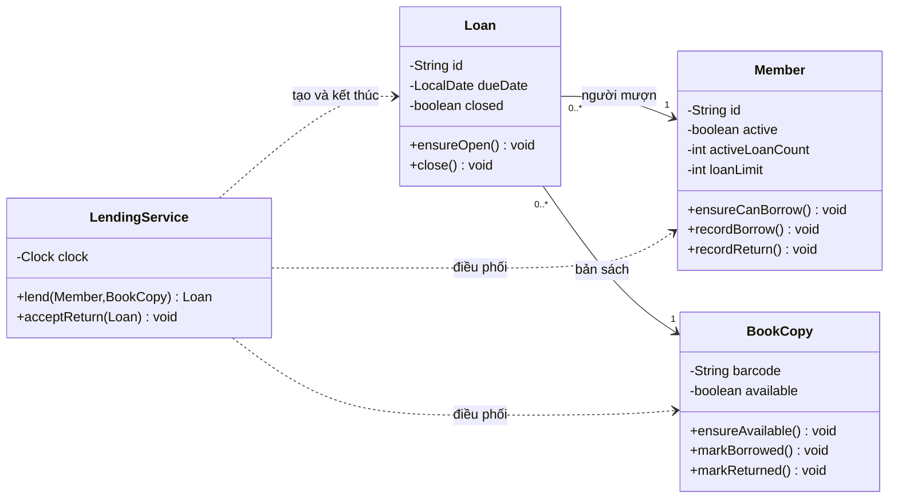
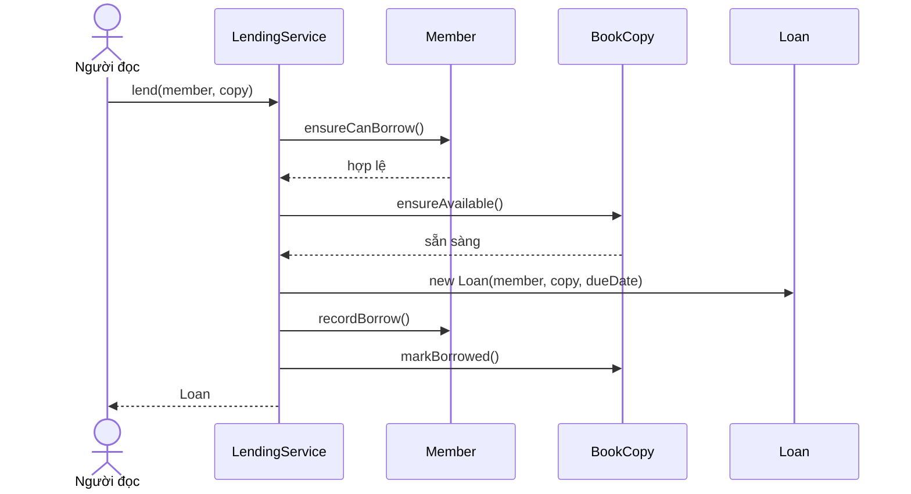
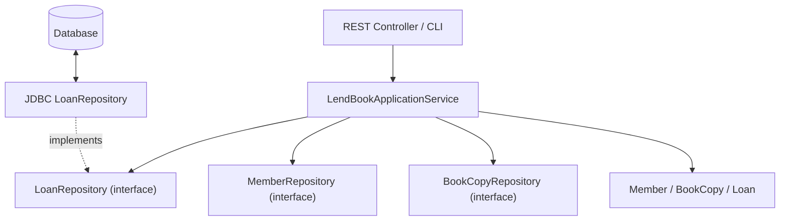

# Phân chia trách nhiệm và đối tượng cộng tác khi mô hình hóa OOP

## 1. Từ yêu cầu nghiệp vụ đến các đối tượng biết làm việc cùng nhau

Giả sử xây dựng hệ thống thư viện với yêu cầu:

> Một thành viên có thể mượn sách nếu tài khoản còn hoạt động, chưa đạt giới hạn số lượt mượn và bản sách còn sẵn. Khi mượn, hệ thống lập phiếu có hạn trả. Khi trả, phiếu được đóng, bản sách lại sẵn sàng và số lượt mượn đang hoạt động của thành viên giảm đi.

Ta có thể đặt toàn bộ kiểm tra và thao tác trong một `LibraryService` khổng lồ. Nhưng khi quy tắc thay đổi, mọi phần của service phải hiểu chi tiết trạng thái `Member`, `BookCopy` và `Loan`. Cách mô hình hóa hướng đối tượng hữu ích hơn là xác định:

- **Trách nhiệm (responsibility):** một đối tượng cần *biết gì* và *làm gì* để thực hiện vai trò của nó?
- **Đối tượng cộng tác (collaborator):** đối tượng nào cung cấp thông tin/hành vi để đối tượng hiện tại hoàn thành trách nhiệm đó?
- **Ranh giới (boundary):** phần nào là bất biến cục bộ của một đối tượng, phần nào là quy trình phối hợp nhiều đối tượng?
- **Hợp đồng (contract):** đối tượng cần lời gọi/đầu vào/đầu ra nào từ cộng tác viên, và lỗi được biểu diễn thế nào?

Mô hình tốt không yêu cầu mỗi lớp phải tự làm hết mọi việc. Nó yêu cầu mỗi trách nhiệm **có chủ sở hữu rõ ràng** và các đối tượng cộng tác qua API có ý nghĩa.

### Phân biệt hai kiểu trách nhiệm

| Loại | Câu hỏi | Ví dụ |
|---|---|---|
| **Knowing (biết)** | Đối tượng phải nắm những dữ liệu/quan hệ nào? | `BookCopy` biết mã bản sách và nó đang sẵn sàng hay đã được mượn |
| **Doing (làm)** | Đối tượng chịu trách nhiệm hành động/quy tắc gì? | `BookCopy.markBorrowed()` ngăn cho mượn một bản sách không còn sẵn |

Một đối tượng thường có cả hai: `Member` biết số lượt mượn đang mở và thực thi quy tắc giới hạn; `Loan` biết ngày đến hạn và bảo vệ việc đóng phiếu đúng một lần.

**Không đồng nhất “biết dữ liệu” với “cho lớp ngoài quyền thay đổi mọi field”.** Trạng thái nên được kiểm soát qua hành vi rõ nghĩa, thay vì chuỗi getter/setter công khai.

## 2. Dùng CRC để nhìn **luồng cộng tác**, không chỉ danh sách lớp

Một bảng CRC nhỏ giúp kiểm tra “ai cần nhờ ai” trước khi viết sequence diagram:

| Class | Trách nhiệm trong use case mượn/trả | Cộng tác viên |
|---|---|---|
| `Member` | Bảo vệ điều kiện đủ quyền mượn và số lượt đang hoạt động | Không cần biết `BookCopy` |
| `BookCopy` | Bảo vệ khả năng cho mượn của một bản | Không cần biết quota `Member` |
| `Loan` | Bảo vệ một lượt mượn và quy tắc đóng phiếu | Tham chiếu member/copy |
| `LendingService` | Điều phối đúng thứ tự các hành vi ở trên | `Member`, `BookCopy`, `Loan`, `Clock` |

**Diễn tập:** service yêu cầu member xác nhận quota, copy xác nhận sẵn sàng, tạo loan, rồi mới thay trạng thái. Nếu đổi người kiểm tra quota từ `Member` sang `BookCopy`, đối tượng bản sách phải biết dữ liệu không thuộc vai trò của nó. Đó là dấu hiệu phân công trách nhiệm sai.

CRC chi tiết (cách viết thẻ, role-play và các nhánh lỗi) được học ở bài **Thẻ CRC: lớp, trách nhiệm và cộng tác**. Bài hiện tại đi tiếp câu hỏi **chọn chủ sở hữu cho mỗi quy tắc và thiết kế lời gọi giữa các đối tượng**.

## 3. Chọn nơi đặt quy tắc: đừng tách dữ liệu khỏi chủ sở hữu của nó

Một quy tắc chỉ phụ thuộc vào trạng thái của **một** đối tượng thường nên ở ngay đối tượng đó.

Ví dụ:

```java
// Kiểu thiết kế yếu: service tự đọc rồi sửa trạng thái của Member.
if (member.getActiveLoanCount() < member.getMaxLoans()) {
    member.setActiveLoanCount(
            member.getActiveLoanCount() + 1);
}
```

Đoạn trên khiến nhiều caller có thể bỏ qua điều kiện giới hạn, tăng sai số lượng hoặc gọi setter vào thời điểm không thích hợp.

Thay vào đó:

```java
// API theo ý nghĩa nghiệp vụ:
member.recordBorrow();
```

`Member` tự kiểm tra quy tắc và thực hiện thay đổi hợp lệ. Nếu quy tắc “tài khoản bị khóa không được mượn” xuất hiện, vị trí thay đổi rất rõ.

Tương tự, `BookCopy` nên thực thi “một bản sách không thể được đánh dấu đã mượn hai lần khi chưa trả”, còn `Loan` nên kiểm soát “một phiếu không được đóng hai lần”.

Nhưng hành vi **mượn sách** tác động đồng thời đến thành viên, bản sách và phiếu. Không nên cố bắt `Member` truy cập trực tiếp cơ sở dữ liệu của kho sách để hoàn tất mọi thứ. Đây là nơi **đối tượng điều phối** có thể giúp các object cộng tác.

## 4. Nhìn quan hệ qua UML class diagram



Đọc sơ đồ:

- Một `Loan` liên kết với đúng một `Member` và một `BookCopy`.
- Một thành viên hoặc bản sách có thể xuất hiện trong nhiều phiếu **theo thời gian**. Khả năng đang mượn được bảo vệ bởi trạng thái và bất biến. Bội số `0..*` ở đây **không** cho phép cùng một bản sách được mượn đồng thời nhiều lần.
- `LendingService` nhận các đối tượng và gửi thông điệp tới chúng. Đường phụ thuộc nét đứt không có nghĩa service sở hữu vòng đời những đối tượng này.
- `Clock` là cộng tác viên kỹ thuật cung cấp thời gian có thể kiểm soát khi kiểm thử; nó không phải một thực thể miền.

**Sơ đồ lớp** cho biết ai giữ thông tin và có phương thức gì. Để kiểm chứng quy trình cộng tác thực sự, hãy bổ sung **sơ đồ trình tự**.

## 5. Sơ đồ trình tự: mỗi object thực hiện phần việc của mình



Mỗi bước có một người chịu trách nhiệm. Nếu `ensureCanBorrow()` từ chối, service kết thúc và không thay đổi `BookCopy`. Nếu `ensureAvailable()` từ chối, service không lập phiếu.

Sơ đồ trình tự trên minh họa **luồng bình thường, tuần tự trong bộ nhớ**. Nó chưa phải một transaction nguyên tử trong tình huống đa luồng, nhiều tiến trình hoặc DB. Khi đưa vào hệ thống thật, một lỗi sau bước thay đổi trạng thái có thể cần rollback hoặc cơ chế bù trừ; sẽ bàn ở phần sau.

## 6. Ví dụ Java chạy được: nhiều đối tượng, mỗi đối tượng một trách nhiệm

Lưu toàn bộ mã sau thành `ResponsibilityDemo.java` (JDK 11+):

```java
import java.time.Clock;
import java.time.Instant;
import java.time.LocalDate;
import java.time.ZoneOffset;
import java.util.Objects;
import java.util.UUID;

public class ResponsibilityDemo {

    // Entity: biết và bảo vệ trạng thái mượn của thành viên.
    static final class Member {
        private final String id;
        private final int loanLimit;
        private boolean active;
        private int activeLoanCount;

        Member(String id, int loanLimit) {
            this.id = Objects.requireNonNull(id, "id");
            if (id.isBlank() || loanLimit < 1) {
                throw new IllegalArgumentException(
                        "Invalid member id or limit");
            }
            this.loanLimit = loanLimit;
            this.active = true;
        }

        void ensureCanBorrow() {
            if (!active) {
                throw new IllegalStateException("Member inactive");
            }
            if (activeLoanCount >= loanLimit) {
                throw new IllegalStateException("Loan limit reached");
            }
        }

        void recordBorrow() {
            ensureCanBorrow();
            activeLoanCount++;
        }

        void recordReturn() {
            if (activeLoanCount <= 0) {
                throw new IllegalStateException(
                        "No active loans to return");
            }
            activeLoanCount--;
        }

        int activeLoanCount() {
            return activeLoanCount;
        }

        void deactivate() {
            active = false;
        }
    }

    // Entity: một bản sách vật lý, có mã riêng.
    static final class BookCopy {
        private final String barcode;
        private boolean available = true;

        BookCopy(String barcode) {
            this.barcode = Objects.requireNonNull(
                    barcode, "barcode");
            if (barcode.isBlank()) {
                throw new IllegalArgumentException("Blank barcode");
            }
        }

        void ensureAvailable() {
            if (!available) {
                throw new IllegalStateException(
                        "Book copy is already on loan");
            }
        }

        void markBorrowed() {
            ensureAvailable();
            available = false;
        }

        void markReturned() {
            if (available) {
                throw new IllegalStateException(
                        "Book copy is not on loan");
            }
            available = true;
        }

        boolean isAvailable() {
            return available;
        }

        String barcode() {
            return barcode;
        }
    }

    // Entity: thông tin và vòng đời một lần mượn cụ thể.
    static final class Loan {
        private final String id;
        private final Member borrower;
        private final BookCopy copy;
        private final LocalDate dueDate;
        private boolean closed;

        Loan(String id, Member borrower, BookCopy copy,
             LocalDate dueDate) {
            this.id = Objects.requireNonNull(id, "id");
            this.borrower = Objects.requireNonNull(
                    borrower, "borrower");
            this.copy = Objects.requireNonNull(copy, "copy");
            this.dueDate = Objects.requireNonNull(
                    dueDate, "dueDate");
        }

        Member borrower() {
            return borrower;
        }

        BookCopy copy() {
            return copy;
        }

        LocalDate dueDate() {
            return dueDate;
        }

        void ensureOpen() {
            if (closed) {
                throw new IllegalStateException("Loan already closed");
            }
        }

        void close() {
            ensureOpen();
            closed = true;
        }

        boolean isClosed() {
            return closed;
        }
    }

    // Coordinator: không tự sửa các field riêng tư của entity.
    static final class LendingService {
        private final Clock clock;
        private final int loanDays;

        LendingService(Clock clock, int loanDays) {
            this.clock = Objects.requireNonNull(clock, "clock");
            if (loanDays < 1) {
                throw new IllegalArgumentException(
                        "loanDays must be positive");
            }
            this.loanDays = loanDays;
        }

        Loan lend(Member member, BookCopy copy) {
            Objects.requireNonNull(member, "member");
            Objects.requireNonNull(copy, "copy");

            // Kiểm tra trước khi bắt đầu thay đổi trạng thái.
            member.ensureCanBorrow();
            copy.ensureAvailable();

            Loan loan = new Loan(
                    UUID.randomUUID().toString(),
                    member,
                    copy,
                    LocalDate.now(clock).plusDays(loanDays));

            member.recordBorrow();
            copy.markBorrowed();
            return loan;
        }

        void acceptReturn(Loan loan) {
            Objects.requireNonNull(loan, "loan");
            loan.ensureOpen();

            loan.copy().markReturned();
            loan.borrower().recordReturn();
            loan.close();
        }
    }

    public static void main(String[] args) {
        Clock testClock = Clock.fixed(
                Instant.parse("2026-10-15T00:00:00Z"),
                ZoneOffset.UTC);

        Member lan = new Member("MEM-01", 1);
        BookCopy bookA = new BookCopy("COPY-A");
        BookCopy bookB = new BookCopy("COPY-B");
        LendingService lending = new LendingService(testClock, 14);

        Loan first = lending.lend(lan, bookA);
        System.out.println("Due: " + first.dueDate());
        System.out.println("Active loans: "
                + lan.activeLoanCount());
        System.out.println("Book A available: "
                + bookA.isAvailable());

        try {
            lending.lend(lan, bookB);
            throw new AssertionError(
                    "Expected loan-limit rejection");
        } catch (IllegalStateException expected) {
            System.out.println("Rejected: " + expected.getMessage());
        }

        System.out.println("Book B still available: "
                + bookB.isAvailable());

        lending.acceptReturn(first);
        System.out.println("After return, active loans: "
                + lan.activeLoanCount());

        Loan second = lending.lend(lan, bookB);
        System.out.println("Second loan due: "
                + second.dueDate());

        if (!first.isClosed() || bookB.isAvailable()
                || lan.activeLoanCount() != 1) {
            throw new AssertionError("State invariant failed");
        }
        System.out.println("State checks passed");
    }
}
```

Biên dịch và chạy:

```bash
javac ResponsibilityDemo.java
java ResponsibilityDemo
```

Kết quả dự kiến:

```text
Due: 2026-10-29
Active loans: 1
Book A available: false
Rejected: Loan limit reached
Book B still available: true
After return, active loans: 0
Second loan due: 2026-10-29
State checks passed
```

### Những quyết định đáng chú ý trong ví dụ

**`Member` là nơi duy nhất thực thi giới hạn mượn.** Nếu thay quy tắc từ một lên ba cuốn, hoặc cần khóa thành viên nợ phí, logic điều kiện thuộc về thành viên hoặc policy nghiệp vụ mà nó cộng tác. `LendingService` không truy xuất rồi tự so sánh `activeLoanCount` và `loanLimit`.

**`BookCopy` quyết định trạng thái của bản sách.** Dù service muốn cho mượn, bản sách có quyền từ chối `markBorrowed()` nếu đang được mượn. Service không thể đơn giản đặt `available=false` bằng setter công khai.

**`Loan` giữ danh tính của giao dịch mượn và ngày hẹn trả.** Một `Loan` khác có thể liên kết đến cùng `BookCopy` trong lịch sử, nhưng chỉ một phiếu đang hoạt động được phép chiếm bản sách tại một thời điểm.

**`LendingService` điều phối các bước.** Nó không tự tính xem thành viên còn quota hay bản sách sẵn không. Nó cần biết *gọi ai* và *ở thời điểm nào*, chứ không phải biết cấu trúc field nội bộ. `Clock` được tiêm vào để có thể kiểm tra ngày đến hạn mà không dựa vào đồng hồ máy thực tế.

**Đây là demo mô hình miền trong một luồng.** Hai lệnh thay đổi trạng thái `member.recordBorrow()` và `copy.markBorrowed()` là những thao tác riêng lẻ, chưa được bao bọc trong giao dịch hay khóa. Vì vậy code demo **không an toàn khi hai luồng/tiến trình cho mượn đồng thời**, không bảo đảm atomicity khi tích hợp DB hoặc xảy ra sự cố giữa các bước. Với hệ thống thực tế, phải thiết kế transaction, ràng buộc dữ liệu, chiến lược khóa/optimistic concurrency và thời điểm phát thông báo phù hợp.

## 7. Chọn cộng tác viên theo GRASP

**GRASP** (*General Responsibility Assignment Software Patterns*) là nhóm nguyên tắc giúp trả lời “giao trách nhiệm này cho ai?”. Không cần biến mọi pattern thành một lớp riêng, nhưng các câu hỏi sau rất hữu ích khi mô hình hóa.

| Nguyên tắc | Câu hỏi | Áp dụng trong thư viện |
|---|---|---|
| **Information Expert** | Ai đang sở hữu thông tin cần để thực thi quy tắc? | `Member` biết quota; `BookCopy` biết trạng thái sẵn sàng |
| **Creator** | Ai nên tạo đối tượng mới vì có đủ dữ liệu/quan hệ cần thiết? | Use case `LendingService` tạo `Loan` từ member, copy và hạn trả |
| **Controller** | Ai nhận yêu cầu của một sự kiện/use case và phối hợp? | `LendingService.lend(...)` điều phối luồng mượn |
| **Low Coupling** | Có thể tránh cho một lớp biết chi tiết không liên quan của nhiều lớp khác không? | Service gọi hành vi có tên, không can thiệp field |
| **High Cohesion** | Trách nhiệm của một lớp có cùng mục đích, dễ giải thích không? | `BookCopy` bảo vệ trạng thái của một bản sách |
| **Polymorphism** | Các biến thể hành vi cùng một vai trò có thể dùng hợp đồng chung không? | Chính sách tính phí trễ có thể theo `LateFeePolicy` |
| **Indirection** | Cần một trung gian để tách hai phía đang liên kết chặt không? | Adapter cổng thông báo tách domain khỏi SMTP/HTTP |
| **Pure Fabrication** | Có trách nhiệm kỹ thuật không thuộc tự nhiên về một entity không? | `LoanRepository` để lưu/tải loan |
| **Protected Variations** | Thay đổi nào cần được che sau một hợp đồng ổn định? | `NotificationSender` trừu tượng hóa email/SMS |

Không phải lúc nào áp dụng một nguyên tắc cũng hoàn toàn thỏa mãn nguyên tắc khác. Ví dụ `LendingService` dùng nhiều cộng tác viên là hợp lý vì bản thân nhiệm vụ điều phối đòi hỏi nhiều object; tránh coupling không có nghĩa là service chỉ được biết một class.

## 8. Cộng tác với đối tượng trực tiếp, tránh chuỗi lấy dữ liệu rồi quyết định hộ

Xem hai cách kiểm tra quyền mượn.

**Cách A: service đọc từng field và tự quyết định.**

```java
// Minh họa anti-pattern.
if (member.isActive()
        && member.getActiveLoanCount()
           < member.getLoanLimit()) {
    member.setActiveLoanCount(
            member.getActiveLoanCount() + 1);
}
```

Cách này khiến logic bị phân tán: bất kỳ controller hay service nào cũng có thể bỏ qua một điều kiện.

**Cách B: giao việc cho đối tượng sở hữu quy tắc.**

```java
member.recordBorrow();
```

API theo hành vi bảo vệ quy tắc ngay trong `Member`.

Đôi khi một service đào sâu:

```java
long fee = loan.getBorrower()
               .getMembershipPlan()
               .getLateFeePerDay()
           * overdueDays;
```

Thay bằng một yêu cầu đúng trách nhiệm như `loan.calculateLateFee(overdueDays)` hoặc một `LateFeePolicy` được cung cấp đầu vào phù hợp sẽ giúp caller không phải hiểu nhiều nấc cấu trúc. Đây là tinh thần của **Law of Demeter** và **Tell, Don't Ask**.

Tuy nhiên, không cấm hoàn toàn getter. DTO chỉ để hiển thị, dữ liệu truy vấn, Value Object bất biến và fluent API đều có thể cho phép đọc cấu trúc. Điều cần tránh là **caller tự giữ và sao chép quy tắc thuộc trách nhiệm của đối tượng khác**.

## 9. Khi nào một trách nhiệm nên thuộc Service thay vì Entity?

Đặt hành vi vào Entity/Value Object nếu quy tắc **gắn chặt với trạng thái và bất biến của nó**:

- `BookCopy.markBorrowed()` không cho mượn khi đã mượn;
- `Member.recordBorrow()` không cho vượt quota;
- `Loan.close()` không cho đóng hai lần;
- `Money.plus()` từ chối cộng khác tiền tệ.

Dùng **Domain Service** khi hành vi có ý nghĩa miền rõ ràng nhưng **không thuộc tự nhiên vào một đối tượng duy nhất**. Ví dụ tính lịch xếp ca dựa trên nhiều nhân viên và quy tắc phân công, hoặc áp dụng chính sách phí cho nhiều loại thành viên.

Dùng **Application Service/use-case controller** khi nhiệm vụ chủ yếu là điều phối:

- kiểm tra quyền người gọi;
- tải các entity từ repository;
- mở transaction;
- yêu cầu các domain object thực thi quy tắc;
- lưu kết quả, gửi event hoặc điều phối thông báo.

Trong bài toán mượn sách đơn giản, `LendingService` đang gộp vai trò điều phối luồng vào một lớp để dễ thấy sự cộng tác. Nếu ứng dụng có database và phân lớp rõ, có thể tách `LendBookApplicationService` (tải/lưu/transaction) khỏi logic miền thích hợp. **Không cần ép tách** nếu chưa có độ phức tạp thực tế.

## 10. Nhận diện đối tượng cộng tác ổn định và dependency ở biên

Một service thường cần cộng tác viên hạ tầng như repository, đồng hồ, công cụ gửi thông báo. Đừng cho Entity phải biết SQL, HTTP hay cách tạo email.



Một hợp đồng repository có thể là:

```java
interface LoanRepository {
    void save(Loan loan);
    java.util.Optional<Loan> findById(String loanId);
}

interface BookCopyRepository {
    BookCopy getByBarcode(String barcode);
    void save(BookCopy copy);
}
```

Đoạn trên là **phác thảo interface**, giả định `Loan` và `BookCopy` thuộc cùng miền hoặc được import thích hợp. Các lớp Entity không phải chứa kết nối database; tầng application/infrastructure có thể cấp cộng tác viên qua constructor.

**Dependency injection** hữu ích vì dễ thay adapter và giả lập khi kiểm thử. Nhưng đừng tạo interface cho mọi class ngay từ đầu: `Member`, `BookCopy` và những Value Object có quy tắc ổn định có thể được dùng trực tiếp. Interface đặc biệt có ý nghĩa ở ranh giới có nhiều implementation hoặc cần tách khỏi hạ tầng.

## 11. Vấn đề giao dịch: hợp tác đúng trách nhiệm vẫn phải giữ tính nhất quán

Tưởng tượng quy trình mượn trong ứng dụng thật:

1. Tải `Member` và `BookCopy` từ database.
2. Kiểm tra điều kiện mượn.
3. Tạo bản ghi `Loan`.
4. Cập nhật số lượng phiếu đang mở và trạng thái bản sách.
5. Commit giao dịch.
6. Thông báo cho người đọc.

Nếu một tiến trình khác cũng lấy cùng `BookCopy` trong khoảng giữa kiểm tra và commit, cả hai có thể tưởng bản sách còn sẵn (*race condition*).

Một thiết kế ứng dụng hoàn chỉnh cần trả lời:

| Rủi ro | Cách xử lý cần cân nhắc |
|---|---|
| Hai yêu cầu mượn cùng một bản sách | Optimistic locking/version, khóa phù hợp, kiểm tra điều kiện cập nhật trong transaction |
| DB lỗi sau khi một phần dữ liệu đã được thay đổi | Transaction để commit/rollback các cập nhật liên quan |
| Thông báo gửi lỗi sau khi DB đã commit | Outbox/event sau commit, retry có kiểm soát |
| Người dùng gửi lại cùng yêu cầu | Idempotency key hoặc ràng buộc nghiệp vụ phát hiện bản mượn trùng |
| Đóng phiếu hai lần | Entity bảo vệ trạng thái và ràng buộc DB/concurrency tương ứng |
| Quy tắc quota bị vượt bởi nhiều yêu cầu song song | Lock/version hoặc cập nhật điều kiện tại dữ liệu gốc, kiểm tra lại trước commit |

**Không nên gửi email trong transaction database nếu điều đó giữ khóa quá lâu**. Phối hợp giữa DB và hệ thống gửi thư thường cần cơ chế hậu giao dịch hoặc outbox. Một “Controller” biết phối hợp không có nghĩa được tự sửa dữ liệu bypass các bất biến.

## 12. Mô hình không phải bản sao cơ sở dữ liệu

Nhiều dự án tạo mỗi bảng một class có getter/setter, sau đó dồn tất cả logic vào `XYZService`. Cách này có thể phục vụ CRUD đơn giản, nhưng với miền nghiệp vụ nhiều quy tắc, đối tượng chỉ là túi dữ liệu và khả năng cộng tác OOP chưa được tận dụng.

Hãy thử phân biệt:

| Câu hỏi | Thiết kế chỉ dựa bảng | Thiết kế theo trách nhiệm |
|---|---|---|
| Ai kiểm soát giới hạn mượn? | Controller đọc `member.limit` và đếm loan | Hành vi miền/policy bảo vệ quy tắc quota, application cung cấp dữ liệu cần thiết |
| Ai cho phép trả lại bản sách? | Service gán hai cột `available` và `returned` | `BookCopy.markReturned()` và `Loan.close()` có điều kiện |
| Ai xác định ngày hẹn trả? | Caller tự cộng ngày ở mỗi nơi | Một chính sách hoặc coordinator dùng `Clock` và quy tắc hạn trả |
| Ai truy cập DB? | Mọi Entity tự mở connection | Repository/adapter được cấp qua ranh giới ứng dụng |

Trách nhiệm nghiệp vụ đôi khi cần dữ liệu từ nhiều đối tượng hoặc truy vấn DB. Khi đó chọn một **domain policy/service** hoặc **đối tượng điều phối** hợp lý thay vì cố buộc mọi ràng buộc vào một Entity không đủ thông tin.

## 13. Kiểm tra thiết kế bằng kịch bản thay đổi

Bản thiết kế nào dễ thay đổi khi yêu cầu phát triển?

**Yêu cầu 1: thành viên Premium được mượn nhiều hơn.** Nếu `Member` giữ chính sách giới hạn, thay đổi sẽ tập trung ở Entity hoặc một `BorrowingPolicy` được cung cấp cho Entity. Tránh sửa riêng từng controller.

**Yêu cầu 2: có bản sách điện tử với quyền truy cập khác bản giấy.** Hãy xác định điểm khác nhau thực sự. Có thể thêm một hợp đồng `BorrowableItem` hoặc policy nếu quy trình cho mượn thực sự thay đổi theo loại tài nguyên. Không vội kế thừa mọi thứ từ `BookCopy`.

**Yêu cầu 3: gửi SMS thay email.** Nếu thông báo chỉ đi qua một cổng `NotificationSender`, thay adapter không cần đổi các bất biến mượn/trả.

**Yêu cầu 4: hết hạn mượn phụ thuộc loại thành viên và kỳ nghỉ.** Có thể trích `DueDatePolicy.calculate(member, copy, borrowedAt)` rồi để use case cộng tác với policy. Khi công thức không thuộc tự nhiên của riêng Member hay BookCopy, một domain service/policy là ứng viên phù hợp.

**Yêu cầu 5: phải ghi lịch sử thao tác.** Domain có thể tạo sự kiện “LoanCreated”, “LoanReturned”, còn application lưu/phát sự kiện sau transaction. Đừng bắt mỗi Entity tự mở file log hoặc gọi HTTP.

Một kịch bản thay đổi tốt **chỉ ra nơi cần sửa và các đối tượng cần cộng tác**, thay vì làm mọi lớp biết thêm về nhau.

## 14. Dấu hiệu phân chia trách nhiệm chưa ổn

| Dấu hiệu | Vấn đề thường gặp | Cách xem xét |
|---|---|---|
| `LibraryService` dài hàng nghìn dòng | Một lớp chứa nhiều quy tắc không cùng lý do thay đổi | Di chuyển bất biến về Entity/VO; trích policy/use case khi có ý nghĩa |
| Entity chỉ có getter/setter | Logic nghiệp vụ ở bên ngoài có thể bypass bất biến | Bổ sung hành vi `borrow`, `return`, `close` có điều kiện |
| Lớp A gọi `b.getC().getD().setX()` | A biết quá sâu cấu trúc của nhiều cộng tác viên | Gửi hành vi đến object gần, hoặc truyền VO/policy phù hợp |
| Một thay đổi quota sửa nhiều controller | Quy tắc bị nhân bản | Đặt quy tắc vào một thành phần có chủ sở hữu rõ |
| Mọi lớp đều phụ thuộc vào database hoặc framework | Logic miền khó chạy/kiểm thử độc lập | Dùng repository và adapter ở ranh giới |
| Hai Entity được cập nhật riêng không transaction | Dữ liệu có thể lệch khi lỗi hoặc cạnh tranh | Xác định transaction boundary, locking và tính idempotent |
| Mỗi class nhỏ đều có interface tương ứng | Indirection và file thừa, khó lần theo luồng | Chỉ trừu tượng hóa nơi có biến thể/ranh giới hữu ích |
| Một interface có hàng chục phương thức không liên quan | Caller phụ thuộc nhiều chức năng không dùng | Phân tách interface theo vai trò cộng tác |
| Nhiều nơi vừa kiểm tra vừa sửa cùng một field | Quy tắc mất chủ sở hữu và dễ bị đua tranh | Cung cấp hành vi bảo vệ trạng thái; xử lý concurrency đúng |

## 15. Bài tập thực hành

### Bài 1 – Lập CRC cho chức năng đặt vé

Cho yêu cầu: một khách hàng có thể đặt ghế còn trống; sự kiện có sức chứa; sau khi đặt phải có mã đặt chỗ và gửi xác nhận.

Hãy liệt kê CRC cho `Customer`, `Seat`, `Reservation` và `ReservationService`.

**Gợi ý:**

- `Seat` sở hữu quy tắc ghế có thể đặt;
- `Reservation` ghi định danh/lifecycle của lượt đặt;
- `ReservationService` điều phối yêu cầu;
- `Customer` biết trạng thái hoặc điều kiện đặt nếu đó là quy tắc theo khách;
- một `NotificationSender` gửi thông báo, tránh để `Seat` tự gọi email.

### Bài 2 – Ai sở hữu quy tắc?

Trong một ứng dụng thương mại, `Order` có trạng thái và các dòng hàng. Service viết:

```java
if (!order.getStatus().equals("CANCELLED")) {
    order.getLines().add(line);
}
```

**Đáp án gợi ý:** `Order` nên cung cấp `addLine(...)` để tự bảo vệ trạng thái, quy tắc số lượng, giá và tính nhất quán. Nếu cần tra kho ngoài Order, application/domain service cộng tác với Inventory nhưng không sửa trực tiếp collection nội bộ.

### Bài 3 – Vẽ sequence diagram theo nhánh thất bại

Từ kịch bản mượn sách, giả sử `BookCopy.ensureAvailable()` ném `IllegalStateException`.

Hãy vẽ luồng và nêu đối tượng nào phải giữ nguyên. **Gợi ý:** Service kết thúc trước khi tạo Loan và gọi hai thao tác ghi trạng thái; `Member.activeLoanCount` và `BookCopy.available` vẫn giữ nguyên trong luồng tuần tự.

### Bài 4 – Mở rộng chương trình

Trong `ResponsibilityDemo.java`, thêm `Member.deactivate()` rồi thử mượn một bản sách vẫn còn sẵn.

Cần kiểm tra:

```java
Member blocked = new Member("MEM-02", 2);
blocked.deactivate();
BookCopy free = new BookCopy("COPY-Z");

try {
    lending.lend(blocked, free);
    throw new AssertionError("Expected inactive member rejection");
} catch (IllegalStateException expected) {
    // Đã bị từ chối tại Member.
}

if (!free.isAvailable() || blocked.activeLoanCount() != 0) {
    throw new AssertionError("Rejected request changed state");
}
```

Đặt đoạn mã trong `main` của ví dụ, sau khi có biến `lending`. Điều cần xác nhận là **logic từ chối nằm ở Member**, còn service chỉ gọi hợp đồng.

### Bài 5 – Khi nào không cần thêm Service?

Một Value Object `Money` có hai trường số tiền và loại tiền. Tính năng cộng hai Money cùng currency nên nằm ở `Money.plus(other)` hay `MoneyAdditionService.add(a, b)`?

**Gợi ý:** quy tắc cộng và kiểm tra currency thuộc tự nhiên về Money, nên `plus` thường rõ nghĩa hơn. Dùng service khi bài toán đòi policy/tỷ giá/nguồn dữ liệu nằm ngoài một Money, hoặc liên quan nhiều đối tượng khác nhau.

---

**Điều cần nắm:** thiết kế lớp không dừng ở việc tìm danh từ để tạo class. Hãy **giao đúng trách nhiệm cho đối tượng sở hữu thông tin và bất biến**, xác định **những cộng tác viên tối thiểu cần thiết**, rồi diễn tả sự phối hợp bằng thông điệp, hợp đồng và sơ đồ trình tự. Nhờ vậy các thay đổi thường tập trung đúng nơi, code dễ kiểm thử và các lớp giữ được mục đích rõ ràng.