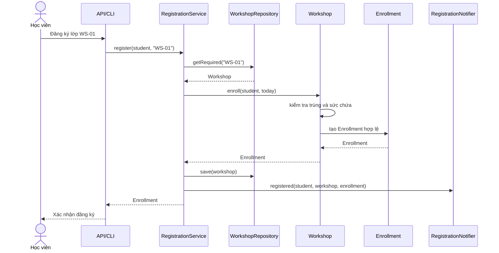
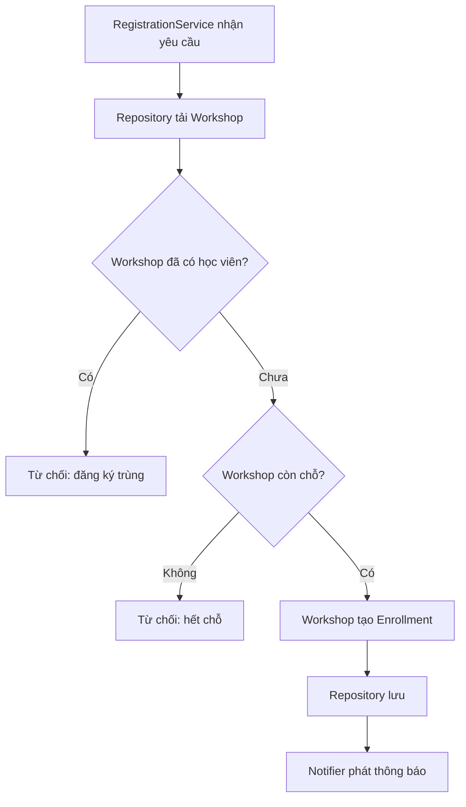
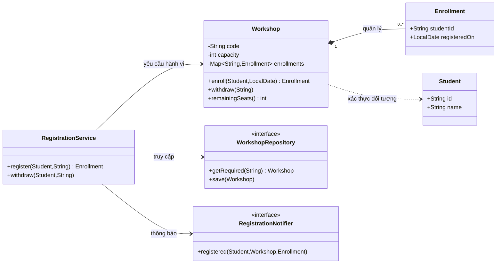
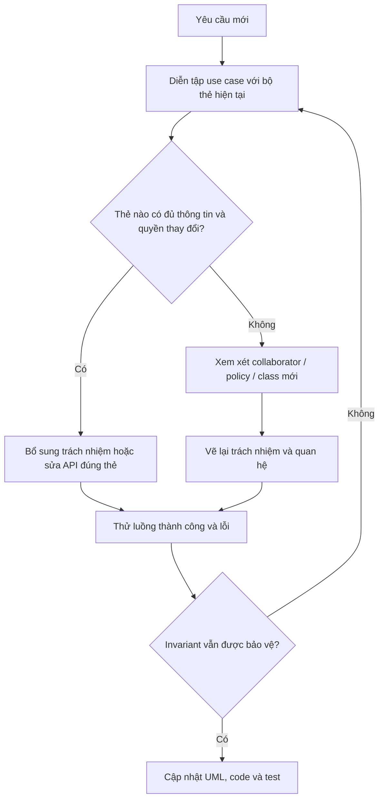

# Thẻ CRC: lớp, trách nhiệm và cộng tác trong mô hình hóa OOP

Thẻ **CRC** (*Class–Responsibilities–Collaborators*) là công cụ phân tích thiết kế hướng đối tượng: mỗi thẻ nêu **lớp nào**, lớp đó **chịu trách nhiệm gì**, và cần **cộng tác với lớp nào** để hoàn thành công việc. Khi các thẻ được đặt cạnh nhau và dùng để diễn tập tình huống nghiệp vụ, nhóm thiết kế có thể phát hiện những trách nhiệm bị bỏ quên, bị trùng lặp hoặc bị đặt sai nơi trước khi đầu tư vào code.

CRC đặc biệt hữu ích khi yêu cầu được diễn đạt theo ngôn ngữ người dùng nhưng chưa rõ cách chia thành các lớp Java. Nó giúp trả lời ba câu hỏi xuyên suốt:

1. **Class:** Khái niệm hoặc vai trò nào thực sự cần được mô hình hóa?
2. **Responsibilities:** Mỗi lớp phải biết hoặc phải làm điều gì để các quy tắc nghiệp vụ đúng?
3. **Collaborators:** Khi một lớp không có đủ thông tin để làm một việc, nó cần hỏi hoặc nhờ lớp nào?

CRC là phương pháp khám phá **trách nhiệm và sự cộng tác**, không phải bản đặc tả mọi field, constructor hay chữ ký method. Sau khi trách nhiệm ổn định mới triển khai API, UML và code phù hợp.

## 1. Cấu trúc của một thẻ CRC

Một thẻ có ba phần:

```text
+-----------------------------------------------------+
| CLASS: Workshop                                     |
+-----------------------------+-----------------------+
| RESPONSIBILITIES            | COLLABORATORS         |
| - Biết mã lớp và sức chứa    | - Student             |
| - Quản lý người đã đăng ký   | - Enrollment          |
| - Chặn đăng ký trùng         |                       |
| - Chặn vượt sức chứa         |                       |
| - Cho hủy đăng ký hợp lệ     |                       |
+-----------------------------+-----------------------+
```

**Class:** tên thể hiện khái niệm đủ cụ thể trong ngữ cảnh, chẳng hạn `Workshop`, `Enrollment` thay vì `DataManager` hay `Helper`.

**Responsibilities:** mô tả **nghĩa vụ** và **kết quả** của lớp bằng câu nghiệp vụ: “không cho đăng ký trùng”, “giữ giới hạn sức chứa”, “tính hạn trả”. Tránh chỉ ghi “có hàm `setX`” vì đó là chi tiết cài đặt, chưa giải thích trách nhiệm.

**Collaborators:** những lớp mà nó thực sự cần trao đổi để hoàn thành trách nhiệm; không phải toàn bộ các class có trong dự án. Một class không có collaborator vẫn có thể hoàn toàn hợp lệ, như một value object tự kiểm tra dữ liệu của mình.

| Phần trên thẻ | Câu hỏi kiểm tra | Dấu hiệu chưa tốt |
| --- | --- | --- |
| Class | Có một vai trò rõ, cần phân biệt với các khái niệm khác không? | `EverythingService`, `GeneralUtils` |
| Responsibilities | Lớp sở hữu tri thức hay hành vi nghiệp vụ nào? | Chỉ liệt kê getter/setter |
| Collaborators | Cần ai cung cấp thông tin hoặc thực hiện phần việc khác? | Liệt kê mọi class trong hệ thống |
| Ranh giới | Thay đổi quy tắc này nên sửa lớp nào trước? | Cùng một quy tắc nằm ở ba lớp |

Thẻ CRC có thể viết trên giấy, bảng trắng, trong tài liệu Markdown hoặc công cụ thiết kế. Hình thức vật lý không quyết định chất lượng; **tranh luận và kiểm nghiệm trách nhiệm** mới là giá trị chính.

## 2. Tình huống thực tế để xây dựng các thẻ

Ví dụ nghiệp vụ: “Một trung tâm tổ chức lớp thực hành. Học viên chọn một lớp có mã riêng để đăng ký. Mỗi lớp có số chỗ giới hạn. Một học viên chỉ được đăng ký **một lần** vào cùng lớp. Khi đăng ký hợp lệ, hệ thống lưu lượt đăng ký, ghi ngày đăng ký và gửi thông báo. Học viên có thể hủy đăng ký để trả lại chỗ.”

Hãy ghi các trường hợp tối thiểu:

- **Luồng thành công:** An đăng ký lớp Java còn chỗ.
- **Đăng ký trùng:** An đăng ký lại cùng lớp, phải từ chối.
- **Hết chỗ:** Chi đăng ký lớp đã đầy, phải từ chối và không tạo lượt đăng ký.
- **Hủy:** Một người đã đăng ký hủy lượt, số chỗ trống tăng.
- **Thông báo lỗi:** Lưu được đăng ký nhưng gửi thông báo thất bại; cần chính sách xử lý rõ.
- **Đồng thời:** Hai người cùng tranh chỗ cuối; số lượt thành công không được vượt sức chứa.

Chưa cần quyết định SQL, REST API hay JPA trong bước này. Hãy tìm trách nhiệm tồn tại **dù công nghệ thay đổi**.

### Danh sách lớp ứng viên

| Ứng viên | Lý do xuất hiện | Kết luận bước đầu |
| --- | --- | --- |
| `Student` | Có danh tính học viên riêng | Lớp/record miền |
| `Workshop` | Có mã, sức chứa và danh sách đăng ký | Lớp miền quản lý quy tắc |
| `Enrollment` | Một lần đăng ký có học viên, ngày và vòng đời riêng | Lớp/record miền |
| `RegistrationService` | Điều phối tìm lớp, đăng ký, lưu, thông báo | Application service |
| `WorkshopRepository` | Tải/lưu trạng thái lớp | Interface truy cập dữ liệu |
| `RegistrationNotifier` | Thông báo sau khi đăng ký | Port tương tác ngoài |
| `RegistrationDate` | Ngày đăng ký | Chưa cần class mới: dùng `LocalDate` |
| `RegisterButton` | Nút trong giao diện | Không phải đối tượng miền cần CRC ở phạm vi này |
| `RegistrationValidator` | Tên được nghĩ ra cho “kiểm tra” | Chưa cần nếu `Workshop` đã biết và bảo vệ quy tắc |
| `Database` | Chi tiết lưu trữ | Adapter/infrastructure, không phải quy tắc miền |

Một ứng viên chưa được xác nhận vĩnh viễn. Ví dụ khi đăng ký có trạng thái `WAITLISTED`, thanh toán và lịch sử, `Enrollment` có thể trở thành entity có hành vi thay vì record bất biến chỉ mô tả kết quả.

## 3. Lập bộ thẻ CRC đầu tiên

Các thẻ dưới đây là bản thử nghiệm để **diễn tập**, không phải bộ lớp bắt buộc cho mọi hệ thống đăng ký.

| Class | Responsibilities | Collaborators |
| --- | --- | --- |
| `Student` | Giữ danh tính hợp lệ của học viên | Không bắt buộc |
| `Workshop` | Biết sức chứa; giữ danh sách đăng ký; quyết định thêm/hủy; ngăn trùng và quá chỗ | `Student`, `Enrollment` |
| `Enrollment` | Biểu diễn lượt đăng ký hợp lệ: học viên và ngày đăng ký | `Student` qua ID |
| `RegistrationService` | Điều phối use case đăng ký/hủy; lấy ngày hiện tại; tải/lưu lớp; yêu cầu thông báo | `Workshop`, `WorkshopRepository`, `RegistrationNotifier`, `Clock` |
| `WorkshopRepository` | Cung cấp cách lấy và lưu `Workshop` | `Workshop`; adapter thực thi |
| `RegistrationNotifier` | Công bố thông tin đăng ký tới kênh ngoài | `Student`, `Workshop`, `Enrollment` |

**Quan sát:** Quy tắc không trùng và không vượt sức chứa được đặt ở `Workshop`, vì đối tượng này quản lý toàn bộ tập đăng ký của một lớp. `RegistrationService` không nên tự sửa collection hay chép lại các điều kiện đó. Ngược lại, `Workshop` không cần biết cách ghi database hoặc gửi email.

Nếu bỏ `RegistrationService` và để `Workshop.register()` tự mở JDBC connection và gửi SMTP, class miền sẽ phụ thuộc công nghệ; như vậy trách nhiệm đang đặt sai.

### CRC khác bảng phân công công việc

Thẻ `Workshop` không ghi “developer A chịu trách nhiệm” mà ghi “**đối tượng Workshop** chịu trách nhiệm bảo vệ sức chứa”. CRC nói về **vai trò của các đối tượng trong phần mềm**, không phải người triển khai.

“Collaborator” cũng không nhất thiết là quan hệ sở hữu. `RegistrationService` sử dụng `WorkshopRepository`; điều đó không khiến service sở hữu vòng đời database hay có quyền đóng kết nối dùng chung.

## 4. Cách diễn tập thẻ CRC (*role-playing*)

Một người hoặc một tấm thẻ đại diện cho mỗi lớp. Người điều phối đọc từng tình huống. Đối tượng nào có trách nhiệm phải “nhận việc”; nếu cần dữ liệu khác, nó nhờ collaborator. Nhờ vậy nhóm phát hiện được bước bị thiếu hoặc vòng phụ thuộc không tự nhiên.

**Kịch bản A — An đăng ký thành công:**

1. Giao diện đưa yêu cầu `register(student, workshopCode)` cho `RegistrationService`.
2. `RegistrationService` nhờ `WorkshopRepository` tải `Workshop` theo mã.
3. Service lấy ngày hiện tại qua `Clock`, giao `Workshop` thực hiện đăng ký.
4. `Workshop` kiểm tra trùng và sức chứa; tạo `Enrollment` rồi giữ nó.
5. Service yêu cầu repository lưu `Workshop` đã thay đổi.
6. Service nhờ `RegistrationNotifier` gửi thông báo.



**Kịch bản B — Đăng ký trùng:** `Workshop` phát hiện đã có `studentId`, từ chối trước khi sửa trạng thái. Service không gọi `save` và không thông báo thành công.

**Kịch bản C — Hết chỗ:** `Workshop` thấy số đăng ký bằng sức chứa, từ chối. Không tạo `Enrollment`. Chính lớp giữ ràng buộc cũng quyết định có được sửa hay không.

**Kịch bản D — Hủy đăng ký:** `RegistrationService` tải `Workshop`; `Workshop` kiểm tra người đó có đăng ký và loại liên kết; service lưu kết quả. Nếu sau này cần email xác nhận hủy, bổ sung cộng tác với notifier ở luồng hủy.



Sau mỗi lượt role-play, hãy hỏi: “Bước này ai sở hữu trách nhiệm?”, “Nếu thất bại thì class nào chịu trách nhiệm xử lý?”, “Cần thêm collaborator hay chỉ cần sửa một thẻ?”. Một thẻ có quá nhiều hành vi không liên quan là dấu hiệu xem lại phân chia.

## 5. Từ thẻ CRC sang sơ đồ lớp

CRC Cards xác định *trách nhiệm và cộng tác*. UML class diagram giúp cụ thể hơn về association, multiplicity và API:



Một số quyết định trong sơ đồ là **lựa chọn thiết kế cho ví dụ**: `Workshop` là điểm kiểm soát tập đăng ký, còn `Enrollment` thuộc vòng đời của tập này. Nếu yêu cầu lưu lịch sử đăng ký đã hủy, đổi lớp và quan hệ cho phù hợp. CRC **không tự suy ra** composition, interface, transaction hay kiểu collection; các chi tiết này được xác nhận khi thiết kế sâu hơn.

### Từ trách nhiệm thành API

| Trách nhiệm CRC | API Java dự kiến | Kiểm chứng |
| --- | --- | --- |
| Mã và tên học viên hợp lệ | `Student` constructor | ID/tên rỗng bị từ chối |
| Lớp giới hạn sức chứa | `Workshop.enroll(...)` | Đủ chỗ được thêm; đầy bị từ chối |
| Cấm học viên đăng ký trùng | `Workshop.enroll(...)` | Cùng ID lần hai bị từ chối |
| Hủy và trả chỗ | `Workshop.withdraw(...)` | Số chỗ trống tăng |
| Tìm lớp theo mã | `WorkshopRepository.getRequired(...)` | Không tìm thấy báo lỗi |
| Điều phối một yêu cầu | `RegistrationService.register(...)` | Gọi đúng bước và xử lý lỗi |
| Thông báo sau đăng ký | `RegistrationNotifier.registered(...)` | Chỉ thực hiện sau ghi thành công ở luồng đơn giản |

Đây là **cầu nối từ tư duy CRC đến thiết kế lớp**. Một method có thể thực hiện nhiều phần của một trách nhiệm; không cần ánh xạ một trách nhiệm thành đúng một method.

## 6. Chương trình Java 17 hoàn chỉnh

Tạo file `CrcCardsDemo.java`. Ví dụ sử dụng repository trong bộ nhớ và notifier in console để làm rõ việc cộng tác; có thời gian cố định để kết quả tái lập.

```java
import java.time.Clock;
import java.time.Instant;
import java.time.LocalDate;
import java.time.ZoneOffset;
import java.util.LinkedHashMap;
import java.util.List;
import java.util.Map;
import java.util.Objects;

public class CrcCardsDemo {

    // CRC: Student — giữ danh tính học viên hợp lệ.
    record Student(String id, String name) {
        Student {
            if (id == null || id.isBlank()) {
                throw new IllegalArgumentException("Student id is required");
            }
            if (name == null || name.isBlank()) {
                throw new IllegalArgumentException("Student name is required");
            }
        }
    }

    // CRC: Enrollment — thông tin hợp lệ của một lượt đăng ký.
    record Enrollment(String studentId, LocalDate registeredOn) {
        Enrollment {
            if (studentId == null || studentId.isBlank()) {
                throw new IllegalArgumentException("Student id is required");
            }
            Objects.requireNonNull(registeredOn, "registeredOn");
        }
    }

    // CRC: Workshop — điểm kiểm soát giới hạn và danh sách đăng ký.
    static final class Workshop {
        private final String code;
        private final int capacity;
        private final Map<String, Enrollment> enrollments =
                new LinkedHashMap<>();

        Workshop(String code, int capacity) {
            if (code == null || code.isBlank()) {
                throw new IllegalArgumentException("Workshop code is required");
            }
            if (capacity < 1) {
                throw new IllegalArgumentException(
                        "Workshop capacity must be positive");
            }
            this.code = code;
            this.capacity = capacity;
        }

        String code() {
            return code;
        }

        int remainingSeats() {
            return capacity - enrollments.size();
        }

        List<Enrollment> enrollments() {
            // Trả snapshot, không trao quyền sửa Map nội bộ.
            return List.copyOf(enrollments.values());
        }

        Enrollment enroll(Student student, LocalDate today) {
            Objects.requireNonNull(student, "student");
            Objects.requireNonNull(today, "today");

            // Các điều kiện được kiểm tra trước khi thay đổi dữ liệu.
            if (enrollments.containsKey(student.id())) {
                throw new IllegalStateException("Already registered");
            }
            if (enrollments.size() >= capacity) {
                throw new IllegalStateException("Workshop is full");
            }

            Enrollment enrollment = new Enrollment(student.id(), today);
            enrollments.put(student.id(), enrollment);
            return enrollment;
        }

        void withdraw(String studentId) {
            if (studentId == null || studentId.isBlank()) {
                throw new IllegalArgumentException("Student id is required");
            }
            if (!enrollments.containsKey(studentId)) {
                throw new IllegalStateException("Registration not found");
            }
            enrollments.remove(studentId);
        }
    }

    // CRC: WorkshopRepository — hợp đồng tìm và lưu lớp.
    interface WorkshopRepository {
        Workshop getRequired(String code);
        void save(Workshop workshop);
    }

    // Infrastructure adapter, thay được bằng một cài đặt JDBC/JPA.
    static final class InMemoryWorkshopRepository
            implements WorkshopRepository {
        private final Map<String, Workshop> workshops =
                new LinkedHashMap<>();

        @Override
        public Workshop getRequired(String code) {
            Workshop found = workshops.get(code);
            if (found == null) {
                throw new IllegalArgumentException("Workshop not found");
            }
            return found;
        }

        @Override
        public void save(Workshop workshop) {
            Objects.requireNonNull(workshop, "workshop");
            workshops.put(workshop.code(), workshop);
        }
    }

    // CRC: RegistrationNotifier — hợp đồng gửi thông báo.
    interface RegistrationNotifier {
        void registered(Student student, Workshop workshop,
                        Enrollment enrollment);
    }

    static final class ConsoleRegistrationNotifier
            implements RegistrationNotifier {
        @Override
        public void registered(Student student, Workshop workshop,
                               Enrollment enrollment) {
            System.out.println(
                    "Notified " + student.id() +
                    " for " + workshop.code() +
                    " on " + enrollment.registeredOn());
        }
    }

    // CRC: RegistrationService — điều phối use case qua collaborators.
    static final class RegistrationService {
        private final WorkshopRepository repository;
        private final RegistrationNotifier notifier;
        private final Clock clock;

        RegistrationService(WorkshopRepository repository,
                            RegistrationNotifier notifier, Clock clock) {
            this.repository = Objects.requireNonNull(repository);
            this.notifier = Objects.requireNonNull(notifier);
            this.clock = Objects.requireNonNull(clock);
        }

        Enrollment register(Student student, String workshopCode) {
            Objects.requireNonNull(student, "student");

            Workshop workshop = repository.getRequired(workshopCode);
            Enrollment result =
                    workshop.enroll(student, LocalDate.now(clock));
            repository.save(workshop);
            notifier.registered(student, workshop, result);
            return result;
        }

        void withdraw(Student student, String workshopCode) {
            Objects.requireNonNull(student, "student");

            Workshop workshop = repository.getRequired(workshopCode);
            workshop.withdraw(student.id());
            repository.save(workshop);
        }
    }

    public static void main(String[] args) {
        InMemoryWorkshopRepository repository =
                new InMemoryWorkshopRepository();
        Workshop java = new Workshop("WS-01", 2);
        repository.save(java);

        Clock clock = Clock.fixed(
                Instant.parse("2026-10-15T00:00:00Z"), ZoneOffset.UTC);
        RegistrationService service = new RegistrationService(
                repository, new ConsoleRegistrationNotifier(), clock);

        Student an = new Student("ST-01", "An");
        Student binh = new Student("ST-02", "Binh");
        Student chi = new Student("ST-03", "Chi");

        service.register(an, "WS-01");
        service.register(binh, "WS-01");

        try {
            service.register(an, "WS-01");
        } catch (IllegalStateException expected) {
            System.out.println(expected.getMessage());
        }

        try {
            service.register(chi, "WS-01");
        } catch (IllegalStateException expected) {
            System.out.println(expected.getMessage());
        }

        System.out.println("Remaining: " + java.remainingSeats());
        service.withdraw(binh, "WS-01");
        System.out.println("After withdrawal: " + java.remainingSeats());
    }
}
```

Biên dịch và chạy:

```bash
javac CrcCardsDemo.java
java CrcCardsDemo
```

Kết quả:

```text
Notified ST-01 for WS-01 on 2026-10-15
Notified ST-02 for WS-01 on 2026-10-15
Already registered
Workshop is full
Remaining: 0
After withdrawal: 1
```

### Đối chiếu chương trình với từng thẻ

- **`Student`** không biết database, danh sách lớp hay cách gửi email. Định danh và tên được xác thực khi tạo.
- **`Enrollment`** là giá trị ghi lại một lượt đăng ký với ngày cụ thể; ở phạm vi demo nó bất biến.
- **`Workshop`** sở hữu tập người đăng ký của lớp và từ chối trùng/hết chỗ; không có setter tùy ý cho collection.
- **`WorkshopRepository`** định nghĩa việc lấy/lưu; cài đặt `InMemoryWorkshopRepository` giữ `Map`, không chứa quy tắc sức chứa.
- **`RegistrationNotifier`** là cổng thông báo. `ConsoleRegistrationNotifier` chịu trách nhiệm in ra console, không quyết định đăng ký hợp lệ.
- **`RegistrationService`** phối hợp repository, đối tượng nghiệp vụ, clock và notifier. Phương thức này không tự tính sức chứa hoặc ghi trực tiếp vào `enrollments`.

Trong `Workshop.enroll(...)`, các lỗi về trùng/hết chỗ xảy ra **trước khi sửa Map**. Thao tác `withdraw` từ chối nếu người học chưa có trong lớp. Do đó kết quả đơn luồng khớp các quy tắc được phân công trên thẻ.

**Ranh giới demo:** `InMemoryWorkshopRepository` lưu và trả cùng một tham chiếu `Workshop`; phương thức `enroll` làm thay đổi đối tượng trước khi `save` được gọi. Đây là mô hình trong bộ nhớ tuần tự để giảng về trách nhiệm, **không phải transaction có rollback**. Trong hệ thống thật, cần kiểm tra sức chứa và lưu dưới cơ chế đồng bộ/giao dịch phù hợp để hai yêu cầu không vượt quá chỗ trống. Nếu notifier lỗi sau khi đã lưu, phải có chính sách phát lại, trạng thái đơn và idempotency; ví dụ thường dùng transactional outbox.

## 7. Kiểm chứng CRC bằng test tình huống

Một bộ CRC tốt phải hỗ trợ suy ra test từ trách nhiệm, đặc biệt test khi quy tắc thất bại.

| Thẻ | Tình huống test | Kết quả cần có |
| --- | --- | --- |
| `Student` | ID rỗng, tên rỗng | Constructor từ chối |
| `Workshop` | Tạo lớp capacity 0 | Constructor từ chối |
| `Workshop` | Đăng ký lần đầu khi còn chỗ | Có thêm một `Enrollment` |
| `Workshop` | Cùng học viên đăng ký lại | Từ chối, tập đăng ký không đổi |
| `Workshop` | Lớp đầy | Từ chối, số chỗ không âm |
| `Workshop` | Hủy người chưa đăng ký | Từ chối, trạng thái không đổi |
| `RegistrationService` | Đăng ký hợp lệ | Tải lớp, áp hành vi, lưu, yêu cầu thông báo |
| `RegistrationService` | Lớp từ chối | Không báo thành công, không yêu cầu gửi thông báo |
| Repository adapter | Lớp không tồn tại | Trả lỗi rõ ràng |
| Tích hợp nhiều request | Hai người đăng ký chỗ cuối | Tối đa một yêu cầu thành công |

Có thể mở rộng ví dụ bằng fake `RegistrationNotifier` để đếm số lần gọi; thay `ConsoleRegistrationNotifier` mà không sửa `Workshop`. Đó là phép thử trực tiếp cho **sự phân chia trách nhiệm và mức phụ thuộc**.

Unit test thuần trên `Workshop` kiểm tra quy tắc đơn luồng. Nó chưa chứng minh thread safety; cần integration/concurrency test tại tầng DB hoặc transaction để xác nhận bất biến toàn hệ thống.

## 8. Đánh giá chất lượng thẻ CRC

### Tính gắn kết (*cohesion*)

Các trách nhiệm trên cùng một thẻ có cùng phục vụ một mục tiêu không?

- Tốt: `Workshop` quản lý sức chứa, danh sách đăng ký và tính hợp lệ khi đăng ký.
- Đáng xem lại: `Workshop` vừa quản lý sức chứa vừa xuất PDF, kết nối SMTP và parse JSON.

### Mức phụ thuộc (*coupling*)

Class có phụ thuộc quá nhiều chi tiết của class khác không?

- Tốt: `RegistrationService` dùng `WorkshopRepository` interface.
- Đáng xem lại: service biết cấu trúc bảng SQL của repository và phải tự sửa `Workshop.enrollments` bên trong.

### Nguồn chân lý của quy tắc

Nếu giới hạn sức chứa được kiểm tra ở `Workshop`, không nên có bản sao công thức giới hạn trong controller, notifier và repository. Controller có thể kiểm tra nhanh để hiển thị lỗi, nhưng điểm có thẩm quyền giữ bất biến phải được xác định rõ.

### Khả năng thay đổi

Thử những biến động độc lập:

| Thay đổi | Thẻ nào nên được xem xét? | Thẻ nào ít cần đổi? |
| --- | --- | --- |
| Lớp giới hạn 30 người thay vì 20 | Dữ liệu cấu hình `Workshop` | Notifier, repository interface |
| Chuyển từ console sang email | Cài đặt `RegistrationNotifier` | `Workshop`, `Enrollment` |
| Chuyển lưu bộ nhớ sang PostgreSQL | Adapter của `WorkshopRepository` | Quy tắc đăng ký trong `Workshop` |
| Cho phép danh sách chờ | `Workshop`, có thể thêm `WaitlistEntry` | HTTP adapter có thể chỉ đổi DTO cần thiết |
| Thu phí trước khi xác nhận | Quy trình/service, payment port, trạng thái enrollment | Các lớp không liên quan đến thanh toán |
| Học viên có quyền ưu tiên | `RegistrationPolicy` hoặc quy tắc miền phù hợp | Adapter gửi thông báo |

Nếu một thay đổi hạ tầng buộc sửa nhiều lớp domain, hãy kiểm tra lại collaborators và hướng phụ thuộc.

## 9. Tái phân công trách nhiệm khi yêu cầu mở rộng

CRC là tài liệu **sống** trong lúc mô hình hóa. Những tình huống mới có thể làm thay đổi thẻ chứ không phải chỉ thêm một method.

**Tình huống: “Khi lớp đầy, học viên được vào danh sách chờ theo thời gian.”**

Các câu hỏi mới: ai giữ thứ tự chờ, khi có người hủy ai được mời, lời mời có hết hạn không? Nếu danh sách chờ có ngày và trạng thái riêng, cân nhắc class `WaitlistEntry`. `Workshop` có thể điều phối chỗ trống và hàng chờ, hoặc cộng tác với một policy để quyết định người ưu tiên. Cập nhật CRC trước khi thêm field tùy tiện.

**Tình huống: “Mỗi học viên có một hạng thành viên, hạng VIP được ưu tiên.”**

Đừng để notifier quyết định ai được nhận vào lớp chỉ vì nó nhìn thấy email VIP. Đây là **quy tắc phân bổ**; cân nhắc thẻ `AdmissionPolicy` cộng tác với `Workshop` và thông tin hạng học viên.

**Tình huống: “Đăng ký chỉ hợp lệ sau thanh toán.”**

`Enrollment` không còn chỉ là giá trị bất biến một dòng. Có thể cần entity `Enrollment` với trạng thái `PENDING_PAYMENT`, `CONFIRMED`, `CANCELLED`, thêm `PaymentGateway`, timeout và quy tắc giải phóng chỗ. Xác định rõ chỗ được giữ từ lúc nào, giao dịch nào tạo entitlement và cách xử lý webhook trả về nhiều lần.

**Tình huống: “Một học viên không thể đăng ký hai lớp trùng giờ.”**

`Workshop` riêng lẻ không biết lịch ở các lớp khác. Quy tắc này cần collaborator có quyền truy vấn danh sách đăng ký/lịch của học viên hoặc một service/policy ở ranh giới thích hợp. Đó là dấu hiệu bổ sung trách nhiệm mới **vượt phạm vi một lớp**.



## 10. Lỗi thường gặp khi dùng CRC Cards

**Lỗi 1 — Class nào cũng thành service.** Ghi `WorkshopService` “quản lý tất cả”, `Workshop` chỉ có setter. Hãy thử chuyển những bất biến của lớp về `Workshop`, còn service giữ nhiệm vụ điều phối use case. Nhưng không ép các quy tắc cần nhiều aggregate vào một entity thiếu dữ liệu.

**Lỗi 2 — Chỉ mô tả method và field.** “Có `getCapacity`, `setCapacity`, `getStudents`” chưa làm rõ *lớp chịu trách nhiệm ngăn quá chỗ*. Viết trách nhiệm trước, suy ra API sau.

**Lỗi 3 — Tạo một class cho mỗi danh từ.** “Ngày đăng ký” không nhất thiết cần `RegistrationDateManager`; `LocalDate` có thể đủ. Một class mới cần có ý nghĩa, quy tắc hoặc vòng đời độc lập.

**Lỗi 4 — Collaborators là toàn bộ dependency trong ứng dụng.** Nếu thẻ `Workshop` liệt kê database, REST controller, log framework, email client mà không dùng trực tiếp cho hành vi miền, đó có thể là ghép tầng kỹ thuật vào sai nơi.

**Lỗi 5 — Hai lớp cùng làm chủ một quyết định.** Nếu cả `RegistrationService` và `Workshop` đều tự kiểm tra và cập nhật sức chứa theo logic khác nhau, dễ xuất hiện hai câu trả lời mâu thuẫn. Chọn nơi có thẩm quyền bảo vệ bất biến và định nghĩa rõ hợp đồng.

**Lỗi 6 — Chỉ diễn tập luồng thành công.** Đăng ký trùng, hết chỗ, lỗi lưu, mất mạng, hủy lặp, request đồng thời mới phát hiện phân công thiếu trách nhiệm.

**Lỗi 7 — Nghĩ CRC thay thế thiết kế chi tiết.** CRC giúp hình dung trách nhiệm và cộng tác; nó **không** chứng minh tính đúng đắn của code, thread safety, thiết kế bảng, transactional outbox hay permission. Các quyết định đó cần thêm UML/API, test, review và kiểm chứng hệ thống.

**Lỗi 8 — Gộp actor người dùng với class miền một cách máy móc.** “Nhân viên hỗ trợ gửi thông báo” có thể là một vai trò trong use case, không có nghĩa phải có object `SupportStaff` nếu không quản lý định danh/quy tắc của nhân viên trong phạm vi ứng dụng.

## 11. CRC, UML và các công cụ thiết kế khác

| Công cụ | Trả lời tốt nhất | Nên dùng lúc nào |
| --- | --- | --- |
| User story / use case | Người dùng muốn kết quả gì? Khi nào thành công/thất bại? | Khi khám phá nhu cầu |
| CRC Cards | Lớp nào nhận trách nhiệm gì và nhờ ai? | Khi phân chia đối tượng và điều phối |
| UML class diagram | Lớp, quan hệ, multiplicity và API là gì? | Khi cần mô tả cấu trúc chính xác |
| UML sequence diagram | Các collaborator gọi nhau theo thứ tự nào? | Khi kiểm tra luồng tương tác |
| State machine | Đối tượng có thể chuyển những trạng thái nào? | Khi nghiệp vụ có vòng đời phức tạp |
| Unit/integration tests | Hành vi đã triển khai có đúng yêu cầu không? | Khi xác thực code và tích hợp |

Một quá trình hiệu quả là **use case → CRC role-play → UML ở mức cần thiết → Java/test → sửa lại thẻ khi học thêm về nghiệp vụ**. CRC không phải tài liệu phải giữ nguyên bất chấp code và thực tế đổi khác.

## 12. Bài tập thực hành

### Bài 1 — Thẻ CRC cho đặt vé xem phim

Yêu cầu: “Khán giả chọn suất chiếu, giữ ghế trong 5 phút, thanh toán rồi nhận vé. Một ghế trong cùng một suất không được bán cho hai người.”

Hãy đề xuất CRC cho `Screening`, `SeatHold`, `Ticket`, `BookingService`, `PaymentGateway`, `BookingRepository`. Chỉ rõ lớp nào quyết định giữ ghế hợp lệ, lớp nào biết thời hạn giữ, và class nào điều phối xác nhận thanh toán.

### Bài 2 — Tìm trách nhiệm trùng lặp

Một thiết kế có `RegistrationController`, `RegistrationService`, `Workshop` và `WorkshopRepository`; cả bốn đều kiểm tra “lớp đã đủ 30 người chưa?”. Hãy viết lại thẻ CRC để chỉ rõ nguồn chân lý, giữ validation cần thiết tại ranh giới mà không nhân bản quyết định nghiệp vụ.

### Bài 3 — Diễn tập luồng lỗi

Dùng bộ thẻ của bài Java, giả sử `save(workshop)` thất bại rồi notifier vẫn gửi email “đã đăng ký”. Thẻ nào cần thay đổi trách nhiệm hoặc hợp đồng? Đề xuất trạng thái, transaction và chính sách retry hợp lý. Giải thích tại sao không thể giải quyết chỉ bằng cách gọi lại `register` tùy ý.

### Bài 4 — Thêm danh sách chờ

Lớp 30 người đã đầy; học viên tiếp theo được thêm vào hàng chờ. Khi một người hủy, hệ thống dành chỗ cho học viên đầu tiên trong hàng chờ trong 15 phút. Vẽ CRC mới, mô tả trạng thái `WAITING/OFFERED/CONFIRMED/EXPIRED` và ai quản lý thời gian hết hạn.

### Bài 5 — Chuyển CRC thành test và code

Bổ sung `registrationCount()`, test `Workshop` từ 0 đến sức chứa, test đăng ký trùng không làm thay đổi count, test hủy trả chỗ. Viết fake notifier đếm số lần gọi và kiểm tra `RegistrationService` không báo thành công khi `Workshop` từ chối.

## 13. Checklist hoàn thành một vòng thiết kế CRC

- Mỗi class có **một mục đích dễ giải thích bằng ngôn ngữ nghiệp vụ**?
- Các responsibility dùng động từ có ý nghĩa và thể hiện **nghĩa vụ** thay vì chỉ liệt kê method?
- Mọi điều kiện “phải/không được/tối đa/chỉ khi” đều có một nơi chịu trách nhiệm bảo vệ?
- Những collaborator được liệt kê có thực sự cần để hoàn thành trách nhiệm?
- Có vòng gọi lại, phụ thuộc chéo hoặc hai class cùng làm chủ một quy tắc?
- Mỗi class có đủ thông tin để giữ invariant của mình hay đang sửa lén dữ liệu class khác?
- Đã diễn tập luồng thành công, lỗi và trạng thái cần hoàn tác?
- Đã phân biệt đối tượng miền, policy, service điều phối, repository và adapter bên ngoài?
- Nếu yêu cầu thay đổi, có biết **thẻ nào cần sửa** và vì sao không?
- Đã chuyển trách nhiệm thành API/UML và tình huống kiểm thử rõ ràng?
- Khi chạy đồng thời hoặc có DB/network, đã xác định nơi cần transaction, locking, retry và idempotency?

**Ghi nhớ:** một thẻ CRC tốt không thắng vì có nhiều class hay nhiều dòng. Nó tốt khi người đọc có thể kể được “ai làm gì, vì sao người đó làm, và nhờ ai khi cần”, rồi kiểm chứng được câu trả lời đó bằng các tình huống thực tế và code OOP rõ ràng.