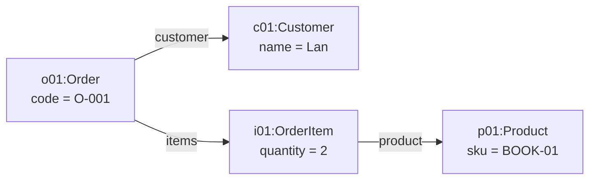
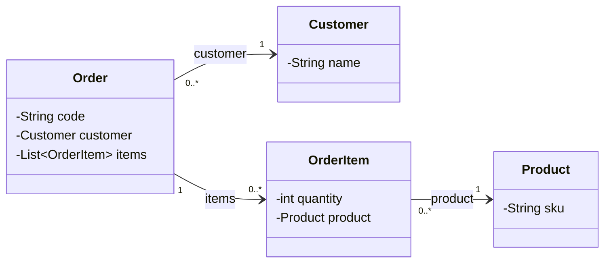
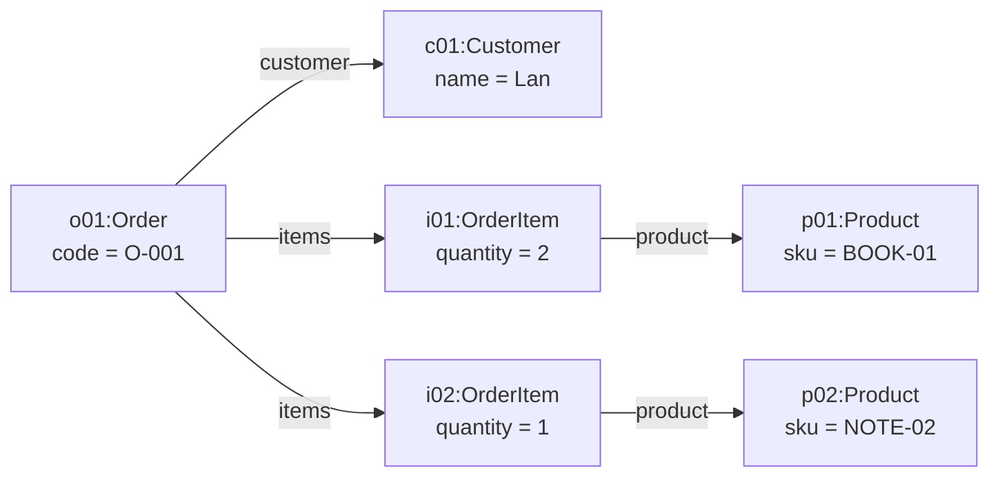
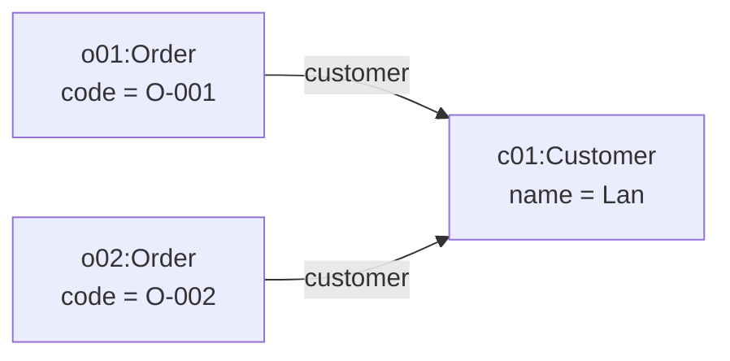

# Sơ đồ đối tượng (Object Diagram): các thể hiện tại một thời điểm

## 1. Sơ đồ đối tượng trả lời câu hỏi gì?

**Sơ đồ đối tượng (UML Object Diagram)** biểu diễn **những đối tượng cụ thể, giá trị thuộc tính và liên kết giữa chúng tại một thời điểm**. Đây là một “ảnh chụp” của trạng thái hệ thống, còn gọi là *snapshot*.

Xét một ứng dụng bán hàng: lớp `Order` mô tả đơn hàng nói chung, nhưng khi khách Lan đặt đơn `O-001`, chương trình có **một object Order cụ thể** chứa mã đơn và tham chiếu đến object khách hàng Lan. Đơn có thể chứa nhiều object `OrderItem`; mỗi item liên kết đến một object `Product`.

Sơ đồ đối tượng giúp trả lời những câu hỏi có tính cụ thể:

- Đúng thời điểm này, đơn `O-001` đang trỏ tới khách hàng **nào**?
- Đơn đang có **bao nhiêu** item; item nào ứng với sản phẩm nào?
- Hai item có tham chiếu cùng một object sản phẩm hay hai object khác nhau?
- Nếu thêm item, đồ thị đối tượng thay đổi ra sao?

Đừng nhầm với sơ đồ lớp: “Một Order **có thể có** nhiều OrderItem” là quy tắc ở mức **kiểu/lớp**; “Object `o01` hiện có hai item `i01`, `i02`” là sự thật ở mức **instance** tại một thời điểm.

## 2. Ký pháp UML: đối tượng, thuộc tính và liên kết

Một **object** thường được vẽ bằng hình chữ nhật. Phần tiêu đề theo dạng `tênĐốiTượng:TênLớp` và **được gạch chân** trong ký pháp UML chuẩn. Ví dụ `o01:Order` nghĩa là thể hiện mang tên `o01` của lớp `Order`. Có thể viết `:Order` khi không quan tâm đến tên object, hoặc `o01` khi kiểu đã rõ trong ngữ cảnh.

Trong phần thân object, UML có thể hiển thị *slot* — giá trị của thuộc tính tại lúc chụp:

```text
┌──────────────────────────────┐
│         o01:Order            │  ← Tiêu đề được gạch chân khi vẽ UML chuẩn
├──────────────────────────────┤
│ code = "O-001"               │
│ status = "DRAFT"             │
└──────────────────────────────┘
```

**Link** là đường nối giữa **hai object cụ thể**, thể hiện một instance của association. Khi muốn làm rõ field/role, có thể ghi nhãn `customer`, `items`, `product` lên liên kết.

Phân biệt các thành phần:

| Thành phần | Trên sơ đồ lớp | Trên sơ đồ đối tượng |
|---|---|---|
| Kiểu | `Order`, `Customer` | `o01:Order`, `c01:Customer` |
| Thuộc tính | `code: String` | `code = "O-001"` |
| Quan hệ | `Order → Customer` | Link từ `o01` đến `c01` |
| Bội số | `0..*`, `1` cho **mọi** instance hợp lệ | Số object/link **đang có** trong snapshot |
| Mục đích | Khai báo cấu trúc có thể xảy ra | Minh họa trạng thái thực tế đang xảy ra |

Tên object và giá trị trong sơ đồ là **nhãn để con người theo dõi**; chúng không nhất thiết là tên biến Java, cũng không nhất thiết là khóa chính của một bản ghi database.

## 3. Ví dụ xuyên suốt: đơn hàng lúc t0

Giả sử hệ thống có các đối tượng sau:

- `c01:Customer` — khách hàng Lan.
- `o01:Order` — đơn `O-001`, đang thuộc về Lan.
- `i01:OrderItem` — dòng hàng số 1, số lượng 2.
- `p01:Product` — sản phẩm có SKU `BOOK-01`.

**Snapshot t0:** đơn vừa có một dòng hàng.



Sơ đồ được vẽ bằng **Mermaid flowchart** để tiện hiển thị trong Markdown; đây là **cách minh họa object graph tương đương về ý nghĩa**, không phải một trình biên dịch UML Object Diagram đầy đủ. Trong UML chính thức, tiêu đề instance được gạch chân và liên kết thường thể hiện bằng đường nối. Mũi tên Mermaid ở đây chỉ làm rõ **tham chiếu nào được lần theo**, không mô tả trình tự thực thi, lời gọi hàm hay dữ liệu đang di chuyển.

Đọc hình theo một đường dẫn:

```text
o01 (Order) --items--> i01 (OrderItem) --product--> p01 (Product)
```

Và một đường khác:

```text
o01 (Order) --customer--> c01 (Customer)
```

Điểm quan trọng: **link nối các instance**, ví dụ `o01 → c01`, chứ không nối khái niệm `Order` và `Customer` chung chung.

## 4. Sơ đồ lớp cho phép những trạng thái nào?

Trước khi vẽ object diagram, cần hiểu quy tắc cấu trúc do lớp và association quy định. Với ví dụ đang xét:



Cách đọc bội số trên association:

- Mỗi `Order` liên kết với **1 Customer**; một `Customer` có thể được **0 hoặc nhiều Order** tham chiếu.
- Mỗi `OrderItem` thuộc **1 Order** theo quy tắc nghiệp vụ mô hình; một `Order` có thể chứa **0 hoặc nhiều OrderItem**. Đoạn Java dưới đây đảm bảo mỗi item chỉ được thêm vào một order theo luồng demo, nhưng nếu muốn cưỡng chế tuyệt đối quy tắc “mỗi item có đúng một order” trong mọi trường hợp, ta cần bổ sung ownership/validation phù hợp.
- Mỗi `OrderItem` có **1 Product**; một `Product` có thể được **nhiều item** tham chiếu.

Ở sơ đồ đối tượng lúc **t0**, ta chỉ thấy *một* customer, *một* order, *một* item và *một* product. Điều đó không có nghĩa ứng dụng chỉ cho phép bốn object hoặc đơn hàng bị giới hạn một dòng hàng.

**Một object diagram không cần liệt kê toàn bộ object trong JVM.** Nó thường chọn một phần của object graph vừa đủ để minh họa một kịch bản, một bất biến hoặc một lỗi.

## 5. Java chạy được: tạo object graph và chụp hai thời điểm

Tạo tệp `ObjectDiagramDemo.java`. Ví dụ không cần framework, tương thích Java 11 trở lên.

```java
import java.util.ArrayList;
import java.util.List;
import java.util.Objects;

public class ObjectDiagramDemo {

    static final class Customer {
        final String label;  // Nhãn minh họa trên sơ đồ.
        final String name;

        Customer(String label, String name) {
            this.label = Objects.requireNonNull(label);
            this.name = Objects.requireNonNull(name);
        }
    }

    static final class Product {
        final String label;
        final String sku;

        Product(String label, String sku) {
            this.label = Objects.requireNonNull(label);
            this.sku = Objects.requireNonNull(sku);
        }
    }

    static final class OrderItem {
        final String label;
        final Product product;
        final int quantity;

        OrderItem(String label, Product product, int quantity) {
            this.label = Objects.requireNonNull(label);
            this.product = Objects.requireNonNull(product);

            if (quantity <= 0) {
                throw new IllegalArgumentException("quantity must be positive");
            }
            this.quantity = quantity;
        }
    }

    static final class Order {
        final String label;
        final String code;
        final Customer customer;
        final List<OrderItem> items = new ArrayList<>();

        Order(String label, String code, Customer customer) {
            this.label = Objects.requireNonNull(label);
            this.code = Objects.requireNonNull(code);
            this.customer = Objects.requireNonNull(customer);
        }

        void addItem(OrderItem item) {
            Objects.requireNonNull(item);
            if (items.contains(item)) {
                throw new IllegalArgumentException("Item already added");
            }
            items.add(item);
        }

        List<OrderItem> getItems() {
            return List.copyOf(items); // Không lộ collection sửa được.
        }
    }

    static void printSnapshot(String time, Order order) {
        System.out.println("=== " + time + " ===");
        System.out.println(order.label + ":Order code=" + order.code);
        System.out.println(order.label + " --customer--> " + order.customer.label);
        System.out.println(order.customer.label + ":Customer name=" + order.customer.name);

        for (OrderItem item : order.getItems()) {
            System.out.println(order.label + " --items--> " + item.label);
            System.out.println(item.label + ":OrderItem quantity=" + item.quantity);
            System.out.println(item.label + " --product--> " + item.product.label);
            System.out.println(item.product.label + ":Product sku=" + item.product.sku);
        }
    }

    public static void main(String[] args) {
        Customer c01 = new Customer("c01", "Lan");
        Product p01 = new Product("p01", "BOOK-01");
        Product p02 = new Product("p02", "NOTE-02");

        Order o01 = new Order("o01", "O-001", c01);
        OrderItem i01 = new OrderItem("i01", p01, 2);
        o01.addItem(i01);

        printSnapshot("t0", o01);

        OrderItem i02 = new OrderItem("i02", p02, 1);
        o01.addItem(i02);

        printSnapshot("t1", o01);

        // Những object cũ vẫn giữ nguyên danh tính tham chiếu.
        System.out.println("Same customer: " + (o01.customer == c01));
        System.out.println("Same first item: " + (o01.getItems().get(0) == i01));
    }
}
```

Biên dịch và chạy:

```bash
javac ObjectDiagramDemo.java
java ObjectDiagramDemo
```

Kết quả:

```text
=== t0 ===
o01:Order code=O-001
o01 --customer--> c01
c01:Customer name=Lan
o01 --items--> i01
i01:OrderItem quantity=2
i01 --product--> p01
p01:Product sku=BOOK-01
=== t1 ===
o01:Order code=O-001
o01 --customer--> c01
c01:Customer name=Lan
o01 --items--> i01
i01:OrderItem quantity=2
i01 --product--> p01
p01:Product sku=BOOK-01
o01 --items--> i02
i02:OrderItem quantity=1
i02 --product--> p02
p02:Product sku=NOTE-02
Same customer: true
Same first item: true
```

**Vì sao đây là snapshot?** `printSnapshot("t0", o01)` quan sát graph trước khi thêm `i02`. Lần gọi thứ hai quan sát **cùng object `o01`** sau khi danh sách `items` có thêm một liên kết. Java không cần tạo một object `Order` mới để có sơ đồ khác.

Lưu ý: `label` chỉ giúp ánh xạ instance sang tên trong hình. Java sử dụng **tham chiếu object**; dấu `==` trong hai dòng cuối xác nhận hai tham chiếu trỏ đến đúng **cùng instance**. Hai object có cùng `code` hoặc `sku` chưa chắc là cùng instance.

## 6. Snapshot t1: cùng đơn hàng, nhiều liên kết hơn

Sau khi thêm item thứ hai, object graph trông như sau:



*Hai snapshot chỉ hiển thị những field thực sự có trong mã Java minh họa (`code`, `name`, `quantity`, `sku`) và các link giữa instance. Nếu nghiệp vụ bổ sung `status`, hãy thêm cả field Java, giá trị snapshot và test thay vì đặt một nhãn trạng thái chưa được triển khai.*

So sánh:

| Quan sát | Snapshot `t0` | Snapshot `t1` |
|---|---|---|
| `o01:Order` | Có | Cùng object `o01` |
| `c01:Customer` | Có | Cùng object `c01` |
| `i01:OrderItem` | Có, quantity = 2 | Vẫn có, quantity = 2 |
| `i02:OrderItem` | Chưa liên kết vào `o01`; trong demo chưa được tạo | Có, quantity = 1 |
| Link `o01 → i01` | Có | Có |
| Link `o01 → i02` | Không | Có |
| Lớp `Order`, `OrderItem` | Không đổi | Không đổi |

Việc có hai ảnh tĩnh **không tự tạo thành sequence diagram**. Hai ảnh thể hiện trạng thái “trước/sau”; còn sequence diagram trả lời **ai gọi ai, thông điệp gì, theo trình tự nào**.

## 7. Nhiều tham chiếu đến cùng một object

Một lợi ích nổi bật của sơ đồ đối tượng là chỉ rõ **chia sẻ tham chiếu (aliasing)**.

Giả sử hai đơn hàng khác nhau đều thuộc về một khách Lan:



Đây là **ba object**, không phải bốn: hai object `Order`, một object `Customer`. Hai link cùng đi tới `c01`. Trong Java:

```java
Customer c01 = new Customer("c01", "Lan");
Order o01 = new Order("o01", "O-001", c01);
Order o02 = new Order("o02", "O-002", c01);

System.out.println(o01.customer == o02.customer); // true
```

Đoạn này chạy khi đặt bên trong `main` của `ObjectDiagramDemo` (dùng các lớp lồng đã khai báo). Nếu tạo **hai** object `Customer` khác nhau cùng tên “Lan”, snapshot phải vẽ **hai hộp** riêng. Việc trùng nội dung thuộc tính không làm chúng thành một instance.

Điều này rất hữu ích khi tìm lỗi cập nhật dữ liệu: sửa một object được chia sẻ có thể được nhìn thấy qua nhiều đường tham chiếu; sửa một object khác có cùng dữ liệu thì không.

## 8. Khi nào dùng sơ đồ đối tượng?

**Làm rõ yêu cầu và ví dụ nghiệp vụ.** Trong hệ thống đặt chỗ, chụp trạng thái có `room01`, `booking17`, `guest03` để cùng kiểm tra “phòng này đã được đặt bởi ai vào thời điểm xác định”.

**Kiểm tra ràng buộc và bội số.** Nếu class diagram nói mỗi `OrderItem` phải gắn một `Product`, snapshot có item không có product là **một trạng thái vi phạm quy tắc**. Diagram giúp đưa ra phản ví dụ trực quan.

**Giải thích aliasing và trạng thái dùng chung.** Hai đường link đến cùng một object làm rõ tại sao một thay đổi có thể được quan sát từ nhiều object khác.

**Gỡ lỗi object graph.** Khi test thất bại do item thuộc sai đơn hoặc user giữ quyền truy cập cũ, sơ đồ trước/sau có thể chỉ ra link nào sai. Nên chú ý rằng object graph trong heap và quan hệ lưu trong database có thể khác nhau nếu dữ liệu chưa được flush hoặc đang bị cache.

**Thiết kế test.** Snapshot mô tả trạng thái đầu vào mong muốn, rồi mô tả trạng thái kết quả của một hành vi. Kỳ vọng test có thể kiểm tra số link, identity, giá trị thuộc tính và bất biến nghiệp vụ.

### Dùng cùng test Java để kiểm tra snapshot

Thêm các kiểm tra phù hợp vào cuối `main` trong ví dụ:

```java
if (o01.getItems().size() != 2) {
    throw new AssertionError("Order must contain two items at t1");
}

if (o01.customer != c01) {
    throw new AssertionError("Order customer link is incorrect");
}

if (o01.getItems().get(1).product != p02) {
    throw new AssertionError("Second item points to wrong product");
}
```

Các kiểm tra khẳng định những quan hệ **tại t1**. Nếu thay đổi yêu cầu làm đơn cho phép nhiều khách hàng, class diagram, object diagram và test phải được cập nhật nhất quán.

## 9. Những sai lầm thường gặp

| Sai lầm | Vì sao sai | Cách làm đúng |
|---|---|---|
| Vẽ các lớp `Order`, `Customer` rồi gọi là object diagram | Chưa có instance cụ thể | Viết `o01:Order`, `c01:Customer` và link cụ thể |
| Ghi `quantity: int` trong hộp instance | Đó là khai báo kiểu thuộc tính | Ghi `quantity = 2` để thể hiện trạng thái |
| Vẽ hai hộp cho cùng một instance | Làm người đọc tưởng hai object khác nhau | Dùng một hộp, nối nhiều link đến hộp đó |
| Cho rằng thiếu link là link không thể xảy ra | Snapshot có thể cố ý lược bớt phần graph | Nêu rõ phạm vi được chụp và các giả định |
| Đọc snapshot thành trình tự xử lý | Object diagram không mang thời gian trên từng cạnh | Vẽ t0, t1 riêng; cần diễn tiến chi tiết thì dùng sequence/activity diagram |
| Đồng nhất nhãn `o01` với biến/ID DB | Object identity khác tên biến, khóa nghiệp vụ hay khóa DB | Ghi rõ quy ước đặt nhãn; kiểm tra identity bằng tham chiếu khi cần |
| Vẽ một trạng thái trái bội số mà không giải thích | Dễ khiến quy tắc miền bị hiểu sai | Đánh dấu đây là ví dụ lỗi hoặc chỉnh quan hệ |
| Cho rằng mũi tên của hình Mermaid là lời gọi hàm | Link giữa object biểu diễn association | Dùng nhãn field/role, tránh nhầm với message của sequence diagram |

## 10. Bài tập tự luyện

**Bài 1 — Nhận diện instance:** Hệ thống có `Student` và `Course`. Sinh viên An và Bình cùng đăng ký khóa Java. Cần vẽ bao nhiêu object sinh viên và object khóa học?

**Gợi ý:** hai object `Student` khác nhau, **một** object `Course` được cả hai liên kết đến, nếu đó là cùng khóa Java.

**Bài 2 — Từ lớp sang snapshot:** Sơ đồ lớp có `Library 1 — 0..* Book`. Tại thời điểm chụp, thư viện `L1` giữ hai cuốn sách `B1`, `B2`. Hãy vẽ ba hộp instance và hai link. Điều gì thay đổi khi chuyển `B2` sang thư viện `L2`?

**Gợi ý:** trước: `L1—B1` và `L1—B2`. Sau: `L1—B1` và `L2—B2`. Các object sách có thể vẫn là chính những instance ban đầu.

**Bài 3 — Phát hiện trạng thái lỗi:** Quy tắc là mỗi `OrderItem` phải có đúng một sản phẩm. Snapshot có `i03:OrderItem` nhưng không có link đến `Product`. Có thể kết luận lỗi chắc chắn không?

**Gợi ý:** nếu snapshot được công bố là **đầy đủ cho các link product**, đây là trạng thái vi phạm; nếu là hình cố ý lược bỏ chi tiết, cần kiểm tra trước khi kết luận.

**Bài 4 — Hai ảnh có phải sequence diagram?** Một ảnh có đơn ở trạng thái `DRAFT`, ảnh khác có `PAID`. Hai ảnh cho biết điều gì, và không cho biết điều gì?

**Gợi ý:** biết giá trị ở hai thời điểm; không biết ai gọi API nào, transaction thực hiện ra sao hoặc thứ tự thông điệp giữa các thành phần.

**Bài 5 — Kiểm tra identity:** Hai đơn hàng cùng trỏ tới `customerA` và `customerB`, cả hai có tên Lan nhưng `customerA != customerB`. Hãy vẽ sơ đồ với đúng số hộp và liên kết.

**Gợi ý:** bốn object — hai đơn và hai customer — vì có hai instance customer riêng.

---

**Ghi nhớ:** sơ đồ lớp mô tả *kiểu và quy tắc cấu trúc*, còn sơ đồ đối tượng mô tả *các instance, giá trị và link tại một thời điểm được chọn*. Để sơ đồ có ích, hãy nêu rõ thời điểm, phạm vi snapshot, nhãn identity và mối liên hệ giữa từng link với trạng thái thực của chương trình.