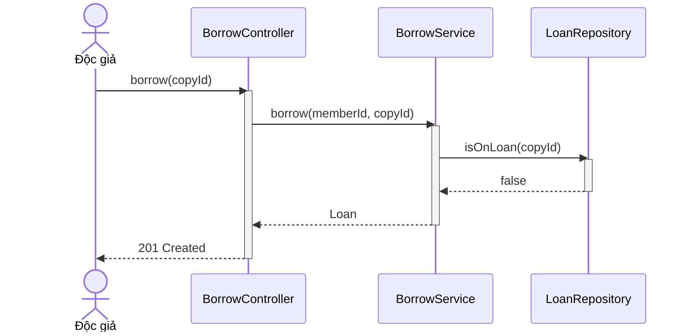
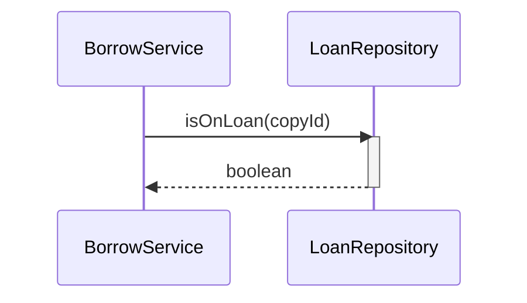
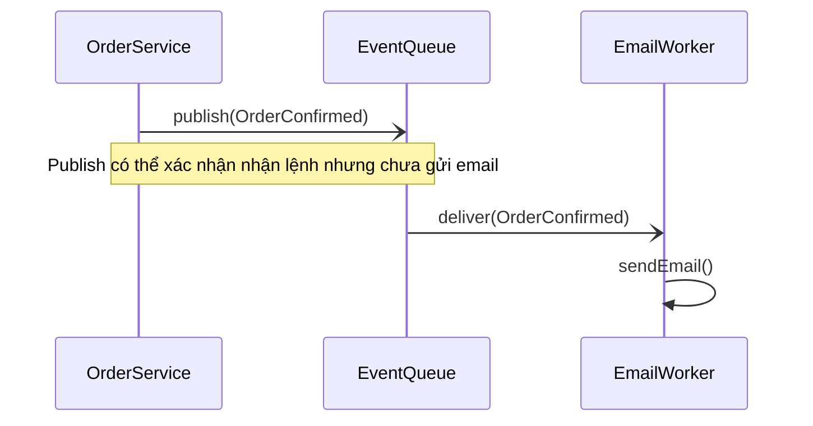
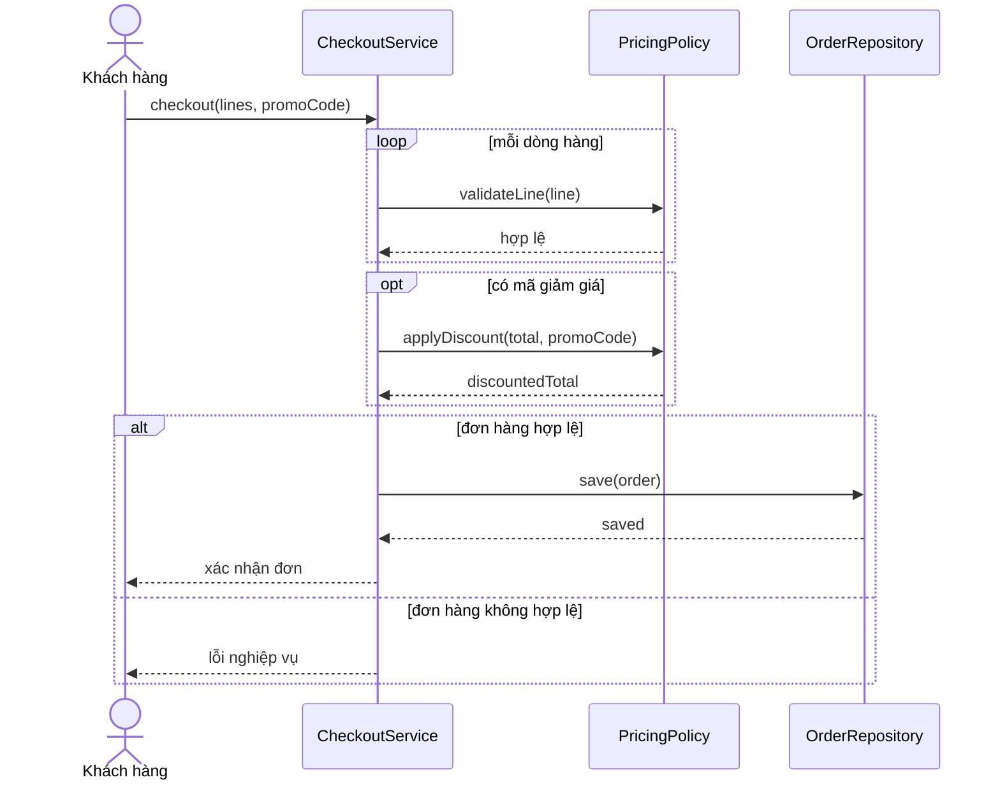
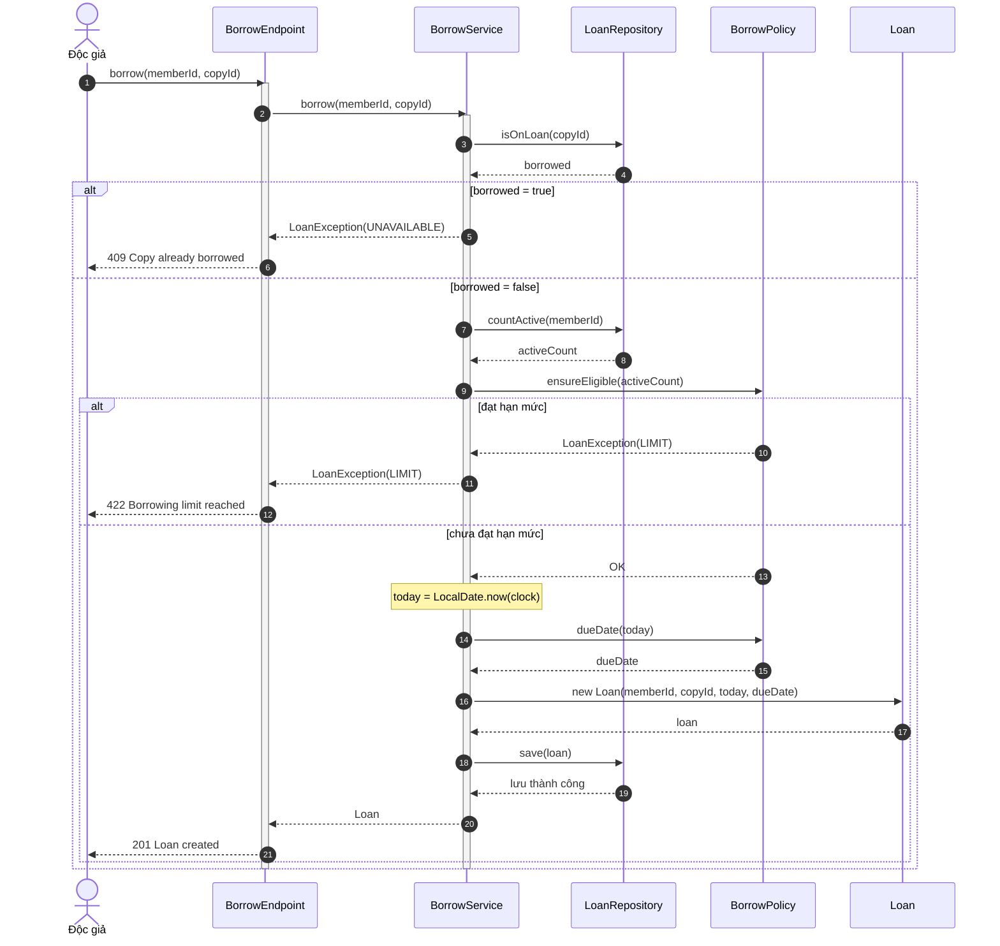
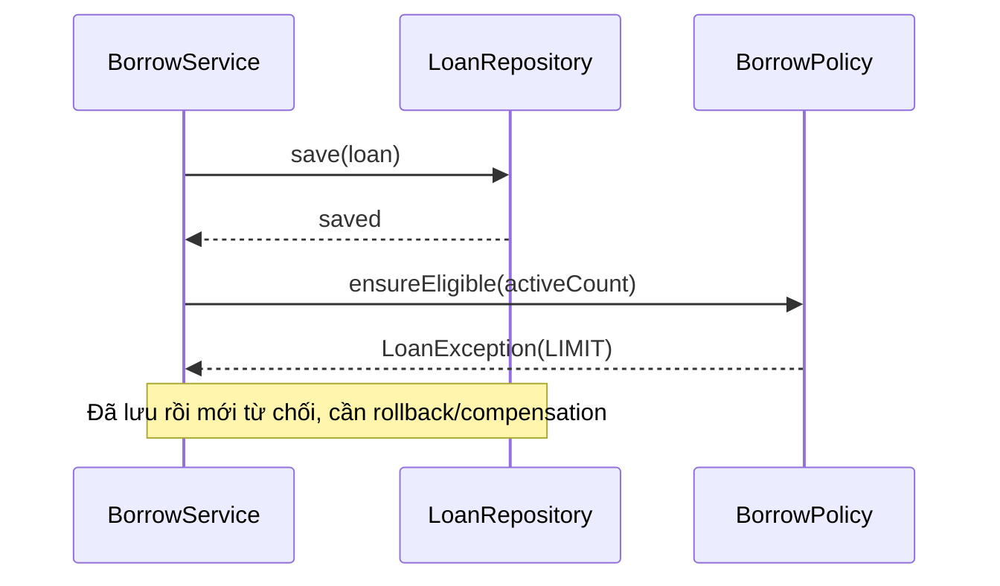

# Sơ đồ tuần tự (Sequence Diagram): thứ tự tương tác trong OOP

Khi một tính năng liên quan đến nhiều đối tượng, sơ đồ lớp cho ta biết **những đối tượng nào có quan hệ**, còn **sơ đồ tuần tự (UML Sequence Diagram)** cho thấy **đối tượng nào gọi đối tượng nào, theo thứ tự nào và kết quả được trả về ra sao** trong một tình huống cụ thể.

Ví dụ: độc giả nhấn “Mượn sách”, hệ thống phải kiểm tra bản sách còn trống, kiểm tra số sách độc giả đang mượn, xác định hạn trả, lưu phiếu mượn, rồi phản hồi. Một sơ đồ tuần tự tốt làm rõ **ai chịu trách nhiệm ở từng bước** và **nhánh nào xảy ra khi yêu cầu không hợp lệ**.

## 1. Khi nào cần sơ đồ tuần tự?

Dùng sơ đồ tuần tự để trả lời những câu hỏi như:

- Lời gọi nào xuất phát từ tác nhân (actor), và đối tượng nào tiếp nhận đầu tiên?
- Một use case cần qua controller, service, repository, domain object theo **thứ tự** nào?
- Kết quả của mỗi lời gọi được dùng để ra quyết định gì?
- Khi kiểm tra thất bại, luồng dừng tại đâu? Có tiếp tục ghi dữ liệu không?
- Có lời gọi lặp, tùy chọn hoặc xử lý song song/bất đồng bộ nào?
- Trách nhiệm đang nằm đúng lớp hay controller/service đang ôm quá nhiều việc?

Sơ đồ mô tả **một tương tác hoặc một nhóm tình huống của một hành vi**, không nhất thiết vẽ toàn bộ hệ thống. Thường bắt đầu từ **một use case có thể phát biểu thành câu**: “Độc giả mượn một bản sách”.

| Câu hỏi | Loại sơ đồ thường phù hợp hơn |
| --- | --- |
| Lớp nào có thuộc tính/phương thức và liên hệ gì? | Class diagram |
| Các bước xử lý, nhánh quyết định trong một thuật toán? | Activity diagram |
| Đối tượng nào gửi thông điệp cho ai và theo thứ tự nào? | **Sequence diagram** |
| Đối tượng chuyển qua các trạng thái nào? | State machine |
| Thành phần triển khai/kết nối theo kiến trúc nào? | Component/deployment diagram |

Sequence diagram rất hữu ích khi nhiều đối tượng cộng tác, nhưng nếu chỉ cần mô tả phép cộng hai số bên trong một phương thức thì sơ đồ có thể phức tạp hơn chính đoạn code.

## 2. Thành phần và cách đọc từ trên xuống

Một sơ đồ tuần tự có **trục ngang** là các bên tham gia (*participants/lifelines*) và **trục dọc** thể hiện thứ tự diễn ra của các thông điệp. Các thông điệp ở vị trí càng thấp thường xuất hiện càng muộn trong tình huống được mô tả.



| Thành phần | Ý nghĩa | Cách đọc trong Mermaid |
| --- | --- | --- |
| **Actor** | Người hoặc hệ thống bên ngoài khởi tạo tương tác | `actor U as Độc giả` |
| **Participant** | Đối tượng, service, thành phần nhận/gửi thông điệp | `participant S as BorrowService` |
| **Lifeline** | Đường thẳng đứng thể hiện một bên tham gia xuyên suốt tương tác | Hiện dưới tên participant |
| **Message (call)** | Một lời gọi/yêu cầu có hướng từ bên gửi đến bên nhận | `S->>R: isOnLoan(copyId)` |
| **Return message** | Kết quả quay về bên gọi, thường vẽ nét đứt | `R-->>S: false` |
| **Activation** | Khoảng một participant đang thực hiện công việc trong tương tác | `activate S`, `deactivate S` |
| **Combined fragment** | Khung thể hiện nhánh, lặp, tùy chọn, song song... | `alt`, `opt`, `loop`, `par` |
| **Note** | Ghi chú quy tắc/giả định quan trọng | `Note over S,R: ...` |

Trong UML chuẩn, khái niệm *activation* còn được gọi là **execution specification**; nó biểu diễn khoảng thực thi, **không bắt buộc** trùng thời lượng CPU hoặc thời gian đo đạc thực. Mỗi lifeline cũng không nhất thiết là một thread riêng.

**Lưu ý quan trọng về thứ tự:** sơ đồ cho biết thứ tự tương đối của các tương tác được biểu diễn. Khoảng cách dọc giữa hai mũi tên **không mặc nhiên** cho biết số mili giây; nếu cần thời lượng, timeout hoặc deadline, phải ghi rõ bằng note/ràng buộc hay sơ đồ phục vụ mục đích định thời.

## 3. Các loại thông điệp cần phân biệt

### 3.1. Lời gọi đồng bộ và trả về

Với một lời gọi Java thông thường:

```java
boolean borrowed = repository.isOnLoan(copyId);
```

Đối tượng gọi chờ lời gọi hoàn thành hoặc ném exception, rồi mới xử lý tiếp trên cùng luồng điều khiển. Biểu diễn phổ biến:



Trong Mermaid, `->>` là nét liền có đầu mũi tên và `-->>` là mũi tên nét đứt; **ngữ nghĩa đồng bộ/bất đồng bộ phải dựa cả vào nội dung và cách diễn đạt**, không chỉ vào một ký tự mũi tên. Trong UML chuẩn, call/return cũng là những loại message có ký hiệu riêng.

### 3.2. Lời gọi bất đồng bộ

Ví dụ ứng dụng gửi lệnh tạo email vào queue và tiếp tục xử lý mà không chờ email được gửi xong:



Cách viết `-)` trong Mermaid diễn tả thông điệp có đầu mũi tên mở, thường dùng để diễn giải asynchronous message. Tuy nhiên **chỉ đổi ký hiệu trên sơ đồ không làm code Java tự trở nên bất đồng bộ**. Cần có cơ chế thực tế: queue, event bus, callback, `CompletableFuture`, worker, hoặc một giao thức không chờ kết quả.

Ngoài ra, `publish(...)` có thể vẫn là lời gọi đồng bộ của client queue (chờ broker nhận message), trong khi **việc xử lý email** mới diễn ra bất đồng bộ. Phải chỉ rõ ranh giới giữa *ghi/đẩy sự kiện* và *thực thi tác vụ*.

### 3.3. Thông điệp tự gọi, tạo và kết thúc đối tượng

- **Self-message:** một đối tượng gọi chính phương thức khác của nó, ví dụ `validator.validateState()`.
- **Create message:** một đối tượng yêu cầu tạo instance mới, như `new Loan(...)`.
- **Destroy message:** mô tả kết thúc vòng đời của đối tượng trong mô hình tương tác.

Không nhầm dấu kết thúc lifeline với thao tác Java garbage collection. JVM không đảm bảo thời điểm thu hồi object chỉ vì một biến ra khỏi scope; tài nguyên `AutoCloseable` cũng phải có chính sách đóng tường minh.

## 4. Combined fragments: biểu diễn nhánh và lặp

Các khung điều khiển trong sequence diagram giúp không cần vẽ một hình riêng cho từng kết quả.

| Fragment | Ý nghĩa | Ví dụ |
| --- | --- | --- |
| `alt` | Các nhánh thay thế nhau theo điều kiện | Sách đã mượn / sách còn trống |
| `opt` | Khối tùy chọn: chạy hoặc bỏ qua | Có mã giảm giá mới tính giảm |
| `loop` | Lặp khối tương tác | Kiểm tra lần lượt từng dòng hàng |
| `par` | Các phần có thể diễn ra song song/đan xen | Hai công việc độc lập chạy đồng thời |
| `break` | Kết thúc sớm phần tương tác bao quanh khi điều kiện thỏa | Xác thực thất bại thì dừng xử lý |
| `critical` | Vùng tương tác quan trọng cần thực hiện không bị xen ngang theo ràng buộc mô hình | Thao tác cần bảo vệ khỏi cập nhật tranh chấp |

Ví dụ ba fragment thường gặp:



**Không được hiểu `par` hay `critical` là cơ chế đồng bộ hóa đã tồn tại trong ứng dụng.** Fragment chỉ ghi nhận ý đồ thiết kế. Nếu nhiều transaction cùng tranh chấp dữ liệu, code vẫn cần lock, isolation, optimistic concurrency, unique constraint hoặc giải pháp tương đương tại đúng ranh giới.

## 5. Tình huống xuyên suốt: mượn một bản sách

Bài toán:

1. Độc giả gửi `memberId` và `copyId`.
2. Hệ thống từ chối nếu bản sách đang được mượn.
3. Hệ thống từ chối nếu độc giả đã đạt giới hạn số lượt mượn đang hoạt động.
4. Nếu hợp lệ, hệ thống tính hạn trả từ ngày mượn và chính sách, tạo phiếu mượn, lưu kết quả.
5. Đầu vào thành công nhận **201** và dữ liệu phiếu mượn; bản sách không sẵn có nhận **409**; vượt hạn mức nhận **422** (đây là quyết định API minh họa, không phải luật bắt buộc cho mọi API).

### Sơ đồ tuần tự cho luồng đầy đủ



Sơ đồ dùng `autonumber` để đánh số **thứ tự message hiển thị**, không phải mã dòng Java hoặc số request HTTP. Các mũi tên exception được dùng như cách diễn giải phản hồi lỗi ở ranh giới service/controller; trong Java, exception thực tế **không phải** giá trị trả về thông thường.

Ở nhánh “bản sách đã mượn”, **không có** lời gọi `countActive` hay `save`. Ở nhánh “đạt hạn mức”, **không có** lời gọi `dueDate` hoặc `save`. Những chi tiết này cho phép kiểm tra thứ tự và tác dụng phụ, không chỉ kết quả cuối cùng.

## 6. Chương trình Java 17 chạy được khớp với sơ đồ

Đặt toàn bộ code sau vào một file `SequenceDiagramDemo.java`:

```java
import java.time.Clock;
import java.time.Instant;
import java.time.LocalDate;
import java.time.ZoneOffset;
import java.util.LinkedHashMap;
import java.util.Map;
import java.util.Objects;

public class SequenceDiagramDemo {

    enum Reason { UNAVAILABLE, LIMIT }

    static final class LoanException extends RuntimeException {
        private final Reason reason;

        LoanException(Reason reason, String message) {
            super(message);
            this.reason = Objects.requireNonNull(reason);
        }

        Reason reason() { return reason; }
    }

    // Entity/value: bất biến nội tại được kiểm tra ở constructor.
    record Loan(String memberId, String copyId,
                LocalDate borrowedOn, LocalDate dueOn) {
        Loan {
            memberId = required(memberId, "memberId");
            copyId = required(copyId, "copyId");
            Objects.requireNonNull(borrowedOn, "borrowedOn");
            Objects.requireNonNull(dueOn, "dueOn");
            if (!dueOn.isAfter(borrowedOn)) {
                throw new IllegalArgumentException("dueOn must be later");
            }
        }
    }

    // Domain policy: luật hạn mức và hạn trả.
    record BorrowPolicy(int maxActive, int loanDays) {
        BorrowPolicy {
            if (maxActive <= 0 || loanDays <= 0) {
                throw new IllegalArgumentException("Invalid policy");
            }
        }

        void ensureEligible(long activeCount) {
            if (activeCount >= maxActive) {
                throw new LoanException(
                        Reason.LIMIT, "Borrowing limit reached");
            }
        }

        LocalDate dueDate(LocalDate start) {
            return start.plusDays(loanDays);
        }
    }

    // Port: hợp đồng truy vấn/lưu, không phụ thuộc database cụ thể.
    interface LoanRepository {
        boolean isOnLoan(String copyId);
        long countActive(String memberId);
        void save(Loan loan);
    }

    // Adapter cho demo: mỗi copyId có tối đa một Loan active.
    static final class InMemoryLoanRepository implements LoanRepository {
        private final Map<String, Loan> activeByCopy = new LinkedHashMap<>();

        @Override
        public boolean isOnLoan(String copyId) {
            return activeByCopy.containsKey(copyId);
        }

        @Override
        public long countActive(String memberId) {
            return activeByCopy.values().stream()
                    .filter(x -> x.memberId().equals(memberId))
                    .count();
        }

        @Override
        public void save(Loan loan) {
            Objects.requireNonNull(loan, "loan");
            if (activeByCopy.putIfAbsent(loan.copyId(), loan) != null) {
                throw new LoanException(
                        Reason.UNAVAILABLE, "Copy already borrowed");
            }
        }
    }

    // Application service: thứ tự gọi như trên sequence diagram.
    static final class BorrowService {
        private final LoanRepository loans;
        private final BorrowPolicy policy;
        private final Clock clock;

        BorrowService(LoanRepository loans, BorrowPolicy policy, Clock clock) {
            this.loans = Objects.requireNonNull(loans);
            this.policy = Objects.requireNonNull(policy);
            this.clock = Objects.requireNonNull(clock);
        }

        Loan borrow(String memberId, String copyId) {
            memberId = required(memberId, "memberId");
            copyId = required(copyId, "copyId");

            // Message 1: kiểm tra bản sách.
            if (loans.isOnLoan(copyId)) {
                throw new LoanException(
                        Reason.UNAVAILABLE, "Copy already borrowed");
            }

            // Message 2: truy vấn số lượt mượn của độc giả.
            long activeCount = loans.countActive(memberId);

            // Message 3: policy quyết định có được mượn thêm không.
            policy.ensureEligible(activeCount);

            // Message 4: thời gian được truyền từ ngoài để test ổn định.
            LocalDate today = LocalDate.now(clock);

            // Message 5: policy tính hạn trả, domain tạo đối tượng.
            Loan loan = new Loan(memberId, copyId,
                    today, policy.dueDate(today));

            // Message 6: repository ghi nhận.
            loans.save(loan);
            return loan;
        }
    }

    // Giao diện mô phỏng controller, không phụ thuộc HTTP framework.
    record Response(int status, String body) {
        @Override
        public String toString() {
            return status + " " + body;
        }
    }

    static final class BorrowEndpoint {
        private final BorrowService service;

        BorrowEndpoint(BorrowService service) {
            this.service = Objects.requireNonNull(service);
        }

        Response borrow(String memberId, String copyId) {
            try {
                Loan loan = service.borrow(memberId, copyId);
                return new Response(201,
                        "Loan created, due " + loan.dueOn());
            } catch (LoanException ex) {
                int status = ex.reason() == Reason.UNAVAILABLE ? 409 : 422;
                return new Response(status, ex.getMessage());
            }
        }
    }

    static String required(String s, String name) {
        if (s == null || s.isBlank()) {
            throw new IllegalArgumentException(name + " is required");
        }
        return s;
    }

    public static void main(String[] args) {
        Clock fixedClock = Clock.fixed(
                Instant.parse("2026-10-15T00:00:00Z"), ZoneOffset.UTC);

        LoanRepository repo = new InMemoryLoanRepository();
        BorrowPolicy policy = new BorrowPolicy(1, 14);
        BorrowEndpoint endpoint = new BorrowEndpoint(
                new BorrowService(repo, policy, fixedClock));

        System.out.println(endpoint.borrow("MEM-01", "COPY-01"));
        System.out.println(endpoint.borrow("MEM-02", "COPY-01"));
        System.out.println(endpoint.borrow("MEM-01", "COPY-02"));
        System.out.println(endpoint.borrow("MEM-02", "COPY-02"));
    }
}
```

Chạy:

```bash
javac SequenceDiagramDemo.java
java SequenceDiagramDemo
```

Kết quả dự kiến:

```text
201 Loan created, due 2026-10-29
409 Copy already borrowed
422 Borrowing limit reached
201 Loan created, due 2026-10-29
```

### Đối chiếu message với phương thức Java

| Thứ tự logic | Mũi tên trên sơ đồ | Lời gọi trong code | Kết quả/nhánh |
| --- | --- | --- | --- |
| 1 | Endpoint → Service | `service.borrow(memberId, copyId)` | Bắt đầu use case |
| 2 | Service → Repository | `loans.isOnLoan(copyId)` | Nếu true: ném `UNAVAILABLE`, dừng |
| 3 | Service → Repository | `loans.countActive(memberId)` | Trả số lượt active |
| 4 | Service → Policy | `policy.ensureEligible(activeCount)` | Nếu vượt giới hạn: ném `LIMIT`, dừng |
| 5 | Service → Clock/Policy | `LocalDate.now(clock)`, `policy.dueDate(today)` | Tính ngày mượn/hạn trả |
| 6 | Service → Loan | `new Loan(...)` | Tạo Loan hợp lệ |
| 7 | Service → Repository | `loans.save(loan)` | Lưu, hoặc từ chối nếu copy bị chiếm |
| 8 | Service → Endpoint → Actor | `return loan` / `Response` | Thành công 201 hoặc lỗi 409/422 |

Sơ đồ đặt `Loan` như một participant để minh họa tạo object. Không nhất thiết tạo participant riêng cho mọi `String`, `List` hoặc hàm hỗ trợ đơn giản; chỉ vẽ những nơi quan trọng với **trách nhiệm và giao tiếp** của use case.

Ví dụ cố tình giới hạn các Loan trong repository đều là lượt đang hoạt động. Luồng trả sách, phân quyền người mượn và việc đăng ký bản sách hợp lệ chưa được mô hình hóa.

**Giới hạn về đồng thời:** code in-memory ở trên minh họa thứ tự tuần tự cho một lời gọi, chưa cung cấp transaction đa request. Hai lời gọi đồng thời có thể cùng vượt qua `countActive` và làm một độc giả vượt giới hạn; `LinkedHashMap` còn không thread-safe. Với ứng dụng thật, phải kiểm tra/ràng buộc dưới giao dịch, khóa hoặc cơ chế duy trì invariant thích hợp, dùng repository/database có xử lý đồng thời. Sequence diagram là mô hình tương tác, **không tự bảo đảm atomicity**.

## 7. Dùng sơ đồ để phát hiện lỗi thiết kế

### Lỗi A: gọi nhầm thứ tự làm phát sinh tác dụng phụ



Nếu `save` đã commit, kiểm tra policy sau đó là quá muộn. Trong code chạy dưới transaction, một exception có thể kích hoạt rollback nếu cấu hình đúng; nhưng không nên xây thiết kế dựa trên giả định transaction luôn tồn tại.

### Lỗi B: controller làm thay domain rule

Nếu sơ đồ có chuỗi `Controller -> Repository -> Controller -> Policy -> Controller -> Repository` và controller tự tính tiền/hạn mức, có thể đang phân bổ trách nhiệm chưa tốt. Khi đó application service hoặc domain service có thể là nơi điều phối hợp lý hơn. **Không phải mọi sơ đồ nhiều mũi tên đều xấu**; chỉ cảnh báo khi giao tiếp lộ chi tiết nghiệp vụ sang sai tầng.

### Lỗi C: bỏ qua đường thất bại

Sơ đồ chỉ có “save → success” có thể thiếu kiểm tra, lỗi timeout hoặc trường hợp lưu dữ liệu không thành công. Ít nhất mô tả các nhánh ảnh hưởng tới **hợp đồng của use case**: người dùng nhận thông báo gì, có gọi tiếp không, có trạng thái được ghi dở dang không.

### Lỗi D: nhầm thông báo bất đồng bộ với kết quả đã hoàn tất

Nếu service phát sự kiện `OrderCreated` rồi trả thành công, đó là thành công của phần đồng bộ. Không thể vẽ như thể email đã được gửi, trừ khi hệ thống thực sự chờ kết quả. Với event bus, mô tả riêng xử lý retry, dead-letter và bảo đảm at-least-once khi cần.

## 8. Từ yêu cầu đến sơ đồ tuần tự: quy trình 7 bước

1. **Chọn một scenario rõ ràng.** Đầu vào, tiền điều kiện, kết quả thành công, các kết quả thất bại quan trọng.
2. **Xác định participants thật.** Actor, adapter/controller, application service, domain policy/entity, repository, dịch vụ ngoài. Đừng tự tạo một class chỉ để có thêm mũi tên.
3. **Đặt luồng thành công trước.** Viết lần lượt các lời gọi thực tế từ trên xuống; bên nhận phải có trách nhiệm phù hợp.
4. **Bổ sung return có ý nghĩa.** Giá trị trả về hoặc exception làm thay đổi quyết định; không cần vẽ mọi câu lệnh `return`.
5. **Thêm `alt`, `opt`, `loop`.** Diễn đạt rõ các điều kiện và chỗ luồng dừng, tránh những nhánh chỉ xuất hiện vì chi tiết nhỏ.
6. **Kiểm tra các tác dụng phụ.** Các lời gọi `save`, `publish`, `send`, `charge` có xảy ra sau kiểm tra chưa? Khi lỗi, trạng thái còn đúng không?
7. **So với code và test.** Đối chiếu thứ tự giữa sơ đồ và phương thức thật; chỉnh lại một trong hai khi thiết kế thay đổi.

Sơ đồ là tài liệu để trao đổi và kiểm tra thiết kế. Nó hữu ích nhất khi đủ chính xác để người khác đối chiếu với mã nguồn, đồng thời đủ gọn để đọc được.

## 9. Kiểm thử thứ tự tương tác

Không phải luồng nào cũng cần kiểm tra đúng **toàn bộ** thứ tự các lời gọi nội bộ. Nên kiểm tra thứ tự khi thứ tự đó là một **yêu cầu hành vi**:

- Nếu bản sách đã có người mượn, tuyệt đối không gọi `save`.
- Nếu vượt hạn mức, không gọi `save`.
- Nếu kiểm tra không hợp lệ, không phát thông báo xác nhận thành công.
- Nếu hệ thống phát event sau commit, cần kiểm chứng vị trí phát event so với lưu dữ liệu (hoặc outbox).

Một **spy repository** có thể ghi các lời gọi quan sát được:

```java
// Minh họa ý tưởng spy; có thể viết thành class implements LoanRepository.
List<String> calls = new ArrayList<>();
// isOnLoan -> calls.add("isOnLoan")
// countActive -> calls.add("countActive")
// save -> calls.add("save")

// Với nhánh thành công, mong đợi:
List<String> expected =
        List.of("isOnLoan", "countActive", "save");
```

Với nhánh `UNAVAILABLE`, mong đợi chỉ `["isOnLoan"]`. Với `LIMIT`, mong đợi `["isOnLoan", "countActive"]`. Các test này xác nhận không xảy ra **tác dụng phụ sai thứ tự**, thay vì khóa chặt mọi chi tiết implementation. Trong dự án có JUnit/Mockito, có thể dùng spy/mock và xác nhận tương tác nếu đó là hợp đồng cần bảo vệ.

Khi có tính đồng thời, một sequence diagram tuần tự đơn lẻ không đủ chứng minh thứ tự giữa các request độc lập. Phải bổ sung mô hình cạnh tranh, constraint ở nơi lưu và integration/concurrency test.

## 10. Những lưu ý UML để tránh hiểu sai

| Hiểu sai thường gặp | Cách hiểu đúng |
| --- | --- |
| Mỗi participant là một thread | Participant thường là instance hoặc vai trò tham gia, không nhất thiết là thread |
| Mũi tên nằm thấp hơn tức chạy chậm hơn N mili giây | Vị trí dọc mô tả thứ tự tương tác, không tự biểu diễn độ trễ |
| Mũi tên nét đứt là message “bất đồng bộ” | Return message thường là nét đứt; asynchronous message là khái niệm riêng |
| Có `par` trên sơ đồ thì Java chắc chắn chạy song song | Phải có cơ chế thực thi song song thật |
| `alt` là hai nhánh đồng thời xảy ra | `alt` chọn một nhánh theo điều kiện |
| Sơ đồ phải chứa từng setter/getter | Chỉ cần message quan trọng cho kịch bản và trách nhiệm cần làm rõ |
| Sequence diagram thay thế class diagram | Hai sơ đồ trả lời câu hỏi khác nhau và bổ sung cho nhau |
| Diagram thể hiện lưu thành công là đã an toàn đa luồng | Cần transaction/locking/constraint theo invariant |
| Mọi exception đều vẽ như giá trị return | Có thể mô hình hóa đường lỗi, nhưng phải phân biệt exception với normal return |

Đặt nhãn message theo **ý nghĩa thực tế** như `countActive(memberId)`, `save(loan)`, `publish(event)`; tránh chỉ ghi những từ mơ hồ như “xử lý”, “gọi”, “trả dữ liệu”. Ở mỗi nhánh `alt`, ghi điều kiện đủ cụ thể để người đọc phân biệt.

## 11. Bài tập thực hành

**Bài A — Đăng nhập.** Vẽ sequence diagram cho actor, `LoginController`, `AuthenticationService`, `UserRepository`, `PasswordVerifier`, `TokenIssuer`. Mô tả nhánh không tìm thấy người dùng, mật khẩu sai và đăng nhập thành công. Chỉ phát token sau xác thực; không vẽ việc so sánh mật khẩu bằng `==` với chuỗi plaintext trong ứng dụng thực tế.

**Bài B — Giỏ hàng.** Vẽ `loop` kiểm tra từng dòng hàng, `opt` có promo và `alt` đơn hợp lệ/không hợp lệ. Đối chiếu mũi tên trong sơ đồ với phương thức Java của các lớp do bạn tự thiết kế.

**Bài C — Sửa thứ tự sai.** Một sơ đồ thanh toán đang có `notifySuccess()` trước `charge()`, `charge()` trước `checkAvailability()`. Hãy vẽ lại quy trình và giải thích tại sao hoàn trả tiền/giữ hàng cần một chính sách rõ khi tác dụng phụ từ hệ thống ngoài đã xảy ra.

**Bài D — Không nhầm đồng bộ và bất đồng bộ.** Sau khi ghi đơn, ứng dụng đặt một sự kiện vào queue rồi lập tức trả `202 Accepted`. Vẽ rõ phần publish và consumer xử lý sau; thêm note cho retry/idempotency và chỉ ra điều kiện nào mới có thể gọi là “email đã gửi”.

**Bài E — Kiểm thử theo sơ đồ.** Viết fake/spy `LoanRepository` cho ví dụ Java trên. Ghi nhận thứ tự lời gọi ở ba trường hợp: bản sách đã được mượn, độc giả đạt hạn mức, và mượn thành công. Đảm bảo không có `save` trong hai trường hợp bị từ chối.

### Checklist trước khi hoàn thành sequence diagram

- Sơ đồ phục vụ một scenario hoặc một use case được phát biểu rõ ràng?
- Mỗi participant có vai trò cụ thể trong mã nguồn/thiết kế?
- Các message đi **đúng người nhận và đúng thứ tự**?
- Nhánh `alt` thể hiện kết quả thành công và thất bại cần thiết?
- Return/exception có được phân biệt với asynchronous delivery?
- `loop`, `opt`, `par` chỉ được dùng khi có lý do nghiệp vụ/thực thi?
- Tác dụng phụ như lưu, thanh toán, phát sự kiện có đúng vị trí?
- Sơ đồ có khớp với thứ tự trong code và test?
- Những giả định về transaction, độ đồng thời và thời gian có được nói rõ?

**Ghi nhớ:** sơ đồ tuần tự là cách kể lại **một hành vi OOP theo thời gian** bằng những thông điệp giữa các đối tượng. Giá trị của nó không nằm ở số lượng mũi tên mà ở việc phát hiện sai thứ tự, trách nhiệm đặt sai lớp và luồng lỗi còn thiếu trước khi những sai sót đó đi vào mã nguồn.