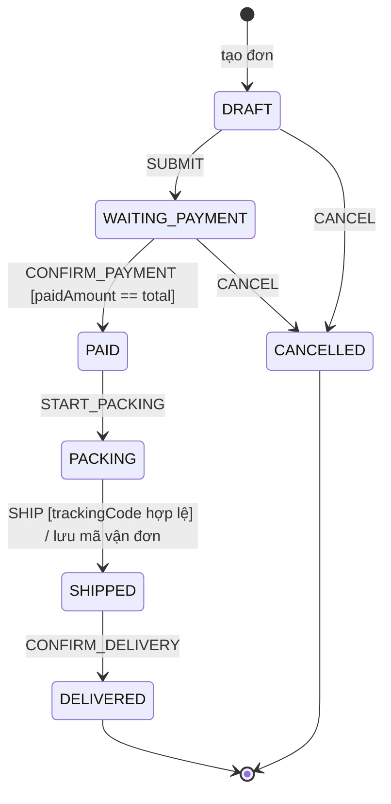
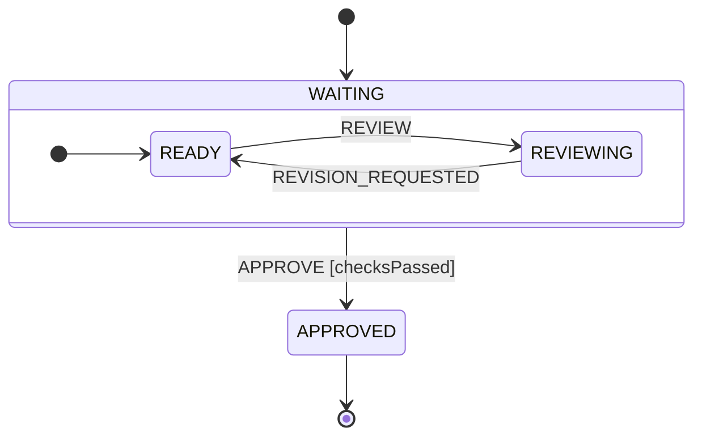
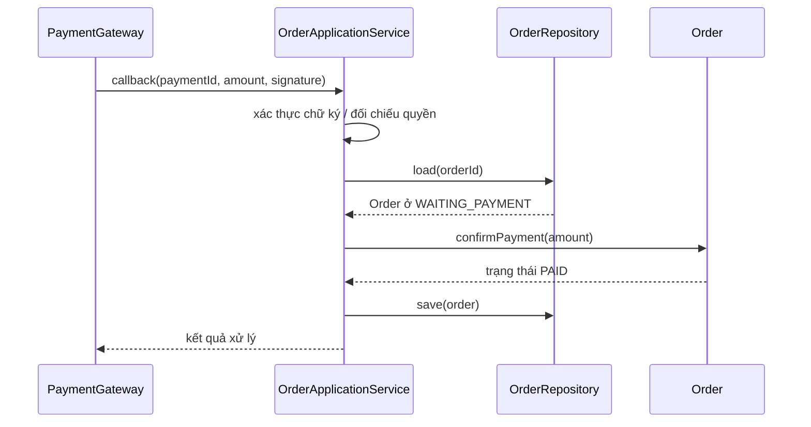
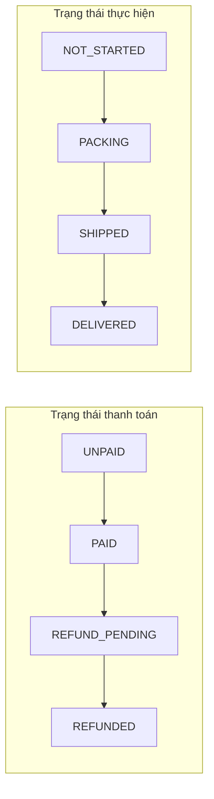
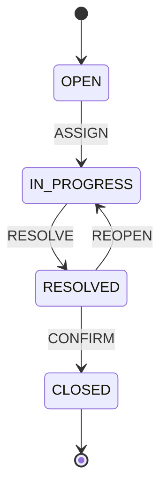

# Sơ đồ trạng thái: chuyển trạng thái hợp lệ trong OOP

## 1. Vì sao phải mô hình hóa trạng thái?

Một đối tượng không phải lúc nào cũng được phép thực hiện mọi hành động. Đơn hàng mới tạo có thể được gửi để chờ thanh toán; đơn đã thanh toán có thể chuyển sang đóng gói; đơn đã giao không thể quay trở lại trạng thái mới tạo chỉ bằng cách gán một giá trị khác vào trường `status`.

Nếu chỉ dùng:

```java
order.setStatus("SHIPPED");
```

thì bất kỳ đoạn mã nào cũng có thể đánh dấu “đã gửi hàng”, kể cả khi đơn chưa thanh toán hoặc chưa có mã vận đơn. Khi quy tắc nằm rải rác trong controller, service và repository, việc bổ sung luồng mới dễ tạo ra các trạng thái bất hợp lệ.

**Sơ đồ trạng thái (UML state machine/state diagram)** diễn tả vòng đời của **một đối tượng**: nó có những trạng thái nào, sự kiện nào làm phát sinh chuyển trạng thái, điều kiện nào phải thỏa mãn và hành động nào được thực hiện khi chuyển.

Mô hình này hữu ích cho đơn hàng, phiếu hỗ trợ, hợp đồng, tài khoản, yêu cầu phê duyệt, đơn vận chuyển hoặc tác vụ nền có vòng đời rõ ràng.

## 2. Năm thành phần cần đọc trên một sơ đồ trạng thái

| Thành phần | Ý nghĩa | Ví dụ đơn hàng |
|---|---|---|
| **State – trạng thái** | Tình huống mà đối tượng đang ở trong đó; chi phối các hành vi được phép | `DRAFT`, `PAID`, `SHIPPED` |
| **Event/trigger – sự kiện kích hoạt** | Điều gì được gửi/xảy ra để yêu cầu chuyển trạng thái | `SUBMIT`, `CONFIRM_PAYMENT` |
| **Guard – điều kiện gác** | Biểu thức Boolean phải đúng để chuyển theo một nhánh | `[paidAmount == total]` |
| **Effect/action – hiệu ứng chuyển trạng thái** | Việc thực hiện khi chuyển thành công | Lưu mã vận đơn; tạo dữ liệu nghiệp vụ |
| **Transition – cạnh chuyển** | Quy tắc nối trạng thái nguồn với trạng thái đích | `PAID --START_PACKING--> PACKING` |

Một nhãn chuyển trạng thái trong UML thường có dạng:

```text
event [guard] / effect
```

Ví dụ:

```text
PACKING --> SHIPPED : SHIP [trackingCode hợp lệ] / lưu trackingCode
```

Đọc thành lời: “Khi đơn ở trạng thái `PACKING` và nhận yêu cầu `SHIP`, chỉ cho phép chuyển sang `SHIPPED` nếu mã vận đơn hợp lệ; khi chuyển, lưu mã vận đơn”.

Một **guard không đạt** nghĩa là nhánh chuyển này **không được thực hiện**. Cần xác định rõ chính sách xử lý yêu cầu không hợp lệ: trả lỗi nghiệp vụ, giữ nguyên trạng thái, hoặc xử lý qua một nhánh khác. Trong ví dụ Java, ta chọn **ném ngoại lệ và giữ nguyên trạng thái**.

## 3. Sơ đồ vòng đời của một đơn hàng



Trong sơ đồ:

- **`[*]` bên trái** là ký hiệu bắt đầu (initial pseudostate). Nó biểu diễn việc khởi tạo state machine ở `DRAFT`.
- **Hình chữ nhật bo góc** (Mermaid thể hiện tên trạng thái) là các trạng thái ổn định của đơn hàng.
- **Mũi tên** diễn tả chuyển trạng thái; nhãn chỉ sự kiện, guard và action khi có.
- **`[*]` bên phải** là trạng thái kết thúc (final state) của vòng đời được mô tả. Điều đó **không có nghĩa object Java hoặc bản ghi database tự bị xóa**.
- `CANCELLED` là đích hợp lệ chỉ từ `DRAFT` và `WAITING_PAYMENT` **trong ví dụ này**. Sau thanh toán, nghiệp vụ hoàn tiền thường đòi hỏi một quy trình khác, không nên tự ý cho `PAID → CANCELLED` rồi bỏ qua tiền đã thu.

Sơ đồ trả lời ngay những câu hỏi:

- Đơn đang `DRAFT` có thể gửi hoặc hủy: **có**.
- Đơn đang `PAID` có thể chuyển thẳng sang `SHIPPED`: **không**, phải sang `PACKING`.
- Đơn đang `SHIPPED` có thể xác nhận đã giao: **có**.
- Đơn đã `DELIVERED` có thể bị hủy theo luồng đơn giản này: **không**.

Không cần vẽ mọi chuyển trạng thái không hợp lệ bằng mũi tên cấm. **Những cạnh không tồn tại mặc định không được phép** trong một state machine có danh sách chuyển đóng, trừ khi mô hình định nghĩa cách xử lý khác.

## 4. Bảng chuyển trạng thái là “hợp đồng” kiểm chứng được

| Trạng thái hiện tại | Event | Guard | Hành động/hiệu ứng trong domain | Trạng thái tiếp theo |
|---|---|---|---|---|
| `DRAFT` | `SUBMIT` | Không thêm điều kiện | Ghi nhận đơn đã gửi | `WAITING_PAYMENT` |
| `DRAFT` | `CANCEL` | Không thêm điều kiện | Ghi nhận hủy | `CANCELLED` |
| `WAITING_PAYMENT` | `CONFIRM_PAYMENT` | Số tiền xác nhận bằng tổng tiền đơn | Chấp nhận thanh toán đã xác thực | `PAID` |
| `WAITING_PAYMENT` | `CANCEL` | Không thêm điều kiện | Ghi nhận hủy | `CANCELLED` |
| `PAID` | `START_PACKING` | Không thêm điều kiện | Bắt đầu xử lý đóng gói | `PACKING` |
| `PACKING` | `SHIP` | Mã vận đơn có nội dung hợp lệ | Lưu mã vận đơn | `SHIPPED` |
| `SHIPPED` | `CONFIRM_DELIVERY` | Không thêm điều kiện trong ví dụ | Ghi nhận giao thành công | `DELIVERED` |

Mọi tổ hợp `(state, event)` ngoài bảng đều **bị từ chối**. Thêm một trạng thái mới phải xem lại những cạnh vào/ra, guard, tác động và ca kiểm thử; chỉ bổ sung một hằng số vào enum là chưa đủ.

Một số quy tắc quan trọng:

1. **Guard được đánh giá dựa trên trạng thái hiện tại và dữ liệu của event.** Tránh làm thay đổi dữ liệu trong quá trình “chỉ kiểm tra”.
2. **Transition không phải setter tùy ý.** Một event có thể cần tham số; ví dụ xác nhận thanh toán cần số tiền, gửi hàng cần mã vận đơn.
3. **Những trạng thái kết thúc cần chính sách rõ.** Có thể vẫn cho phép xem, xuất báo cáo, tra cứu; chỉ các event thay đổi vòng đời bị khóa.
4. **Danh sách trạng thái chỉ là một phần của mô hình.** Chính bảng event/guard/transition mới xác định hành vi hợp lệ.

## 5. Ví dụ Java hoàn chỉnh: từ chối mọi chuyển trạng thái sai

Lưu mã sau vào `OrderStateMachineDemo.java`. Ví dụ dùng JDK 11+ và **không cần thư viện ngoài**.

```java
import java.util.ArrayList;
import java.util.EnumMap;
import java.util.List;
import java.util.Map;
import java.util.Objects;

public class OrderStateMachineDemo {

    enum Status {
        DRAFT, WAITING_PAYMENT, PAID, PACKING,
        SHIPPED, DELIVERED, CANCELLED
    }

    enum Event {
        SUBMIT, CONFIRM_PAYMENT, START_PACKING,
        SHIP, CONFIRM_DELIVERY, CANCEL
    }

    static final class InvalidTransitionException
            extends IllegalStateException {
        InvalidTransitionException(Status from, Event event) {
            super(from + " --" + event + "--> không hợp lệ");
        }
    }

    static final class Order {
        // Tập các cạnh duy nhất được phép trong vòng đời.
        private static final Map<Status, Map<Event, Status>> RULES =
                new EnumMap<>(Status.class);

        static {
            for (Status status : Status.values()) {
                RULES.put(status, new EnumMap<>(Event.class));
            }

            allow(Status.DRAFT, Event.SUBMIT, Status.WAITING_PAYMENT);
            allow(Status.DRAFT, Event.CANCEL, Status.CANCELLED);
            allow(Status.WAITING_PAYMENT, Event.CONFIRM_PAYMENT,
                    Status.PAID);
            allow(Status.WAITING_PAYMENT, Event.CANCEL,
                    Status.CANCELLED);
            allow(Status.PAID, Event.START_PACKING, Status.PACKING);
            allow(Status.PACKING, Event.SHIP, Status.SHIPPED);
            allow(Status.SHIPPED, Event.CONFIRM_DELIVERY,
                    Status.DELIVERED);
        }

        private static void allow(
                Status from, Event event, Status to) {
            if (RULES.get(from).putIfAbsent(event, to) != null) {
                throw new IllegalStateException(
                        "Duplicate rule: " + from + " / " + event);
            }
        }

        private final String id;
        private final long totalCents;
        private final List<String> history = new ArrayList<>();
        private Status status = Status.DRAFT;
        private String trackingCode;

        Order(String id, long totalCents) {
            if (id == null || id.isBlank()) {
                throw new IllegalArgumentException("Blank order id");
            }
            if (totalCents <= 0) {
                throw new IllegalArgumentException(
                        "Total must be positive");
            }
            this.id = id;
            this.totalCents = totalCents;
        }

        String id() {
            return id;
        }

        Status status() {
            return status;
        }

        String trackingCode() {
            return trackingCode;
        }

        List<String> history() {
            return List.copyOf(history);
        }

        // Chỉ những hành vi được đặt tên mới thay đổi trạng thái.
        void submit() {
            advance(Event.SUBMIT);
        }

        void cancel() {
            advance(Event.CANCEL);
        }

        void confirmPayment(long paidAmountCents) {
            // Kiểm tra event hợp lệ với trạng thái trước.
            Status next = nextStatus(Event.CONFIRM_PAYMENT);

            // Guard phụ thuộc dữ liệu của event.
            if (paidAmountCents != totalCents) {
                throw new IllegalArgumentException(
                        "Payment amount mismatch");
            }

            change(Event.CONFIRM_PAYMENT, next);
        }

        void startPacking() {
            advance(Event.START_PACKING);
        }

        void ship(String newTrackingCode) {
            Status next = nextStatus(Event.SHIP);
            if (newTrackingCode == null
                    || newTrackingCode.isBlank()) {
                throw new IllegalArgumentException(
                        "Tracking code is required");
            }

            // Tất cả validation trước khi đổi trạng thái.
            trackingCode = newTrackingCode;
            change(Event.SHIP, next);
        }

        void confirmDelivery() {
            advance(Event.CONFIRM_DELIVERY);
        }

        private Status nextStatus(Event event) {
            Objects.requireNonNull(event, "event");
            Status next = RULES.get(status).get(event);
            if (next == null) {
                throw new InvalidTransitionException(status, event);
            }
            return next;
        }

        private void advance(Event event) {
            Status next = nextStatus(event);
            change(event, next);
        }

        private void change(Event event, Status next) {
            Status previous = status;
            status = next;
            history.add(previous + " --" + event + "--> " + next);
        }
    }

    public static void main(String[] args) {
        Order order = new Order("OD-100", 120_000L);
        order.submit();

        try {
            order.confirmPayment(99_000L); // Sai số tiền.
            throw new AssertionError("Must reject wrong amount");
        } catch (IllegalArgumentException expected) {
            System.out.println("Từ chối số tiền sai");
        }

        System.out.println(
                "Sau guard thất bại: " + order.status());

        order.confirmPayment(120_000L);
        System.out.println("Sau thanh toán: " + order.status());

        try {
            order.cancel(); // Không có cạnh PAID -> CANCELLED.
            throw new AssertionError("Must reject cancel");
        } catch (InvalidTransitionException expected) {
            System.out.println("Từ chối hủy: "
                    + expected.getMessage());
        }

        System.out.println("Sau event sai: " + order.status());

        order.startPacking();
        order.ship("VN123");
        order.confirmDelivery();

        System.out.println("Đã giao: " + order.status()
                + ", tracking=" + order.trackingCode());

        Order draft = new Order("OD-101", 50_000L);
        draft.cancel();

        try {
            draft.submit();
            throw new AssertionError("Cancelled order cannot submit");
        } catch (InvalidTransitionException expected) {
            System.out.println("Không gửi lại đơn đã hủy");
        }

        if (order.status() != Status.DELIVERED
                || order.history().size() != 5
                || draft.status() != Status.CANCELLED) {
            throw new AssertionError("Invalid state history");
        }

        System.out.println("Các chuyển trạng thái đều hợp lệ");
    }
}
```

Chạy chương trình:

```bash
javac OrderStateMachineDemo.java
java OrderStateMachineDemo
```

Kết quả dự kiến:

```text
Từ chối số tiền sai
Sau guard thất bại: WAITING_PAYMENT
Sau thanh toán: PAID
Từ chối hủy: PAID --CANCEL--> không hợp lệ
Sau event sai: PAID
Đã giao: DELIVERED, tracking=VN123
Không gửi lại đơn đã hủy
Các chuyển trạng thái đều hợp lệ
```

### Điều gì đảm bảo trạng thái hợp lệ?

- `status` là `private`, bên ngoài không có `setStatus(...)`.
- `RULES` chứa **duy nhất** các cạnh được phép, không có “chuyển tự do” giữa hai enum bất kỳ.
- `nextStatus(event)` thất bại nếu không có cạnh tương ứng.
- `confirmPayment(...)` và `ship(...)` kiểm tra dữ liệu **trước khi cập nhật trạng thái**.
- `change(...)` là nơi tập trung cập nhật state và ghi lịch sử; caller sử dụng các API nghiệp vụ có tên.
- `history()` trả bản sao không sửa được, tránh người gọi tùy tiện thay đổi lịch sử nội bộ.

Lớp `Order` trong ví dụ đóng vai trò **entity nắm giữ bất biến vòng đời**. Việc điều phối cổng thanh toán, repository, quyền người dùng hoặc email nằm ở các đối tượng khác; không nên bắt `Order` tự mở HTTP/SQL để hoàn thành một chuyển trạng thái.

**Giới hạn kỹ thuật của demo:** các thao tác cập nhật field và danh sách lịch sử chỉ dành cho luồng xử lý tuần tự trong bộ nhớ. Chúng **không** tạo atomic transaction đa luồng hay cơ sở dữ liệu; phần dưới sẽ nói cách bảo toàn trạng thái trong ứng dụng thực.

## 6. Khi nào nên dùng enum, bảng chuyển, State Pattern hoặc workflow engine?

| Cách hiện thực | Phù hợp khi | Điểm cần chú ý |
|---|---|---|
| `enum Status` + phương thức nghiệp vụ | Vài trạng thái, luật đơn giản, ít thay đổi | Dễ tạo `if/switch` lớn nếu hành vi phình to |
| Bảng chuyển (như `RULES`) | Muốn liệt kê cạnh rõ ràng, kiểm tra trạng thái nguồn/event/đích | Guard phụ thuộc dữ liệu vẫn phải được mô hình hóa |
| **State Pattern** | Mỗi trạng thái có nhiều hành vi riêng, dễ phát triển độc lập | Tăng số lớp; không cần thiết cho 3–5 trạng thái đơn giản |
| State machine library | Nhiều nhánh, guard, entry/exit action, cấp trạng thái lồng nhau | Cần hiểu cơ chế event, persistence và idempotency của thư viện |
| Workflow/process engine | Quy trình dài ngày, nhiều bên tham gia, retry/timer/approval | Phức tạp vận hành; không thay thế các bất biến miền nghiệp vụ |

Một ví dụ nhỏ của **State Pattern**:

```java
interface OrderState {
    void submit(OrderContext context);
    void cancel(OrderContext context);
}

final class DraftState implements OrderState {
    @Override
    public void submit(OrderContext context) {
        context.changeTo(new WaitingPaymentState());
    }

    @Override
    public void cancel(OrderContext context) {
        context.changeTo(new CancelledState());
    }
}
```

Đoạn này **chỉ minh họa cấu trúc pattern**, giả định các lớp `OrderContext`, `WaitingPaymentState` và `CancelledState` được xây dựng riêng. Trong project thật, các state implementation phải cùng bảo đảm rằng mọi event khác đều bị từ chối, và context chỉ cho phép chuyển thông qua cơ chế kiểm soát. Chưa cần tạo một lớp cho mỗi trạng thái nếu enum và bảng chuyển đã đủ rõ.

## 7. Các ký hiệu mở rộng trong UML state machine

Sơ đồ trạng thái có thể phong phú hơn một đồ thị các enum. Những ký hiệu quan trọng cần biết:

| Ký hiệu/khái niệm | Cách đọc | Trường hợp áp dụng |
|---|---|---|
| Initial pseudostate | Điểm bắt đầu mặc định của state machine hoặc vùng | Đơn mới tạo vào `DRAFT` |
| Final state | Hoàn tất tiến trình của state machine hoặc vùng | Luồng đặt hàng đã kết thúc |
| Self-transition | Một event đưa trạng thái quay lại chính nó, có thể chạy exit/entry | Tiếp nhận lại thông tin khi vẫn chờ duyệt |
| Internal transition | Xử lý event *trong* trạng thái, không rời rồi vào lại trạng thái | Cập nhật thông tin phụ khi đang chờ |
| Entry / exit / do activity | Hành vi khi vào trạng thái, khi rời, hoặc trong lúc ở trạng thái | Khởi động/tắt một tác vụ theo trạng thái |
| Choice / junction | Rẽ nhánh hoặc ghép các đường chuyển | Dựa trên kết quả xét duyệt |
| Composite state | Trạng thái chứa các trạng thái con | `PROCESSING` chứa đóng gói và kiểm tra |
| History pseudostate | Quay lại một substate trước đó của composite state | Tiếp tục quy trình bị tạm dừng |
| Orthogonal regions | Nhiều vùng trạng thái tiến triển đồng thời | Thanh toán và vận chuyển là hai chiều trạng thái |

Cần cẩn thận với **self-transition** và **internal transition**: cả hai có thể giữ nguyên *tên* trạng thái, nhưng hành vi entry/exit có thể khác. Không nên suy rằng mọi event không đổi enum đều là “không có gì xảy ra”.

Ví dụ thể hiện entry/exit trong Mermaid:



Sơ đồ này dùng **composite state** `WAITING` chứa hai trạng thái con `READY` và `REVIEWING`. Khi hệ thống lớn hơn, trạng thái lồng nhau giảm trùng lặp điều kiện so với việc ép mọi biến thể vào một enum phẳng.

## 8. Guard, action, invariant và quyền gọi là bốn việc khác nhau

Đừng gom mọi quy tắc thành một điều kiện `if` mơ hồ:

**Guard:** điều kiện để đi theo một cạnh cụ thể, chẳng hạn `paidAmount == total`.

**Action/effect:** tác động nghiệp vụ khi cạnh được thực hiện, chẳng hạn ghi mã vận đơn, tạo sự kiện miền hoặc cập nhật thời điểm xác nhận.

**Invariant:** điều luôn phải đúng với đối tượng ở trạng thái hợp lệ, ví dụ:

- Nếu `status == SHIPPED` hoặc `DELIVERED` thì `trackingCode` phải tồn tại và không trống.
- Nếu `status == PAID` thì phải có một xác nhận thanh toán hợp lệ tương ứng (trong hệ thống thực).
- Một trạng thái kết thúc không thể được quay về trạng thái chưa xử lý nếu không có chuyển trạng thái được định nghĩa tường minh.

**Authorization:** ai có quyền phát sinh event? Ví dụ nhân viên kho có thể gọi `ship()`; cổng thanh toán đã xác minh mới có thể yêu cầu `confirmPayment()`. Một transition **hợp lệ về trạng thái** vẫn có thể **không được phép về bảo mật** nếu người gọi không có quyền. Quyền thường được kiểm tra ở tầng application/API, cùng với dữ liệu xác thực của yêu cầu.

Mỗi quy tắc cần có nơi chịu trách nhiệm rõ để không bị bỏ qua khi hệ thống thêm API mới.

## 9. Sơ đồ trạng thái khác sơ đồ lớp và sơ đồ trình tự

| Sơ đồ | Trả lời câu hỏi gì? | Cách dùng với bài toán đơn hàng |
|---|---|---|
| **Class diagram** | Có những lớp, field, method và quan hệ nào? | `Order` có `status`, `totalCents`, `ship()` |
| **State diagram** | Đối tượng đang ở trạng thái nào, event nào cho phép sang đâu? | `PACKING --SHIP--> SHIPPED` |
| **Sequence diagram** | Trong một kịch bản cụ thể, object nào gọi object nào theo thời gian? | Controller → service → payment gateway → Order → repository |
| **Activity diagram** | Công việc và các nhánh xử lý thực hiện theo luồng nào? | Kiểm tra thanh toán, nhập kho, đóng gói, giao hàng |

Ví dụ phối hợp xác nhận thanh toán:



**State diagram** quy định `WAITING_PAYMENT → PAID` là hợp lệ khi guard đúng; **sequence diagram** cho thấy *ai* xác thực callback, tải object và lưu state. Hai sơ đồ bổ trợ, không thay thế nhau.

## 10. Lỗi thực tế: callback trùng, hai luồng và transaction

Sơ đồ chỉ xác định chuyển hợp lệ trong mô hình. Khi nhiều request tác động vào cùng một object lưu trong database, cần cơ chế bảo đảm dữ liệu.

### Callback thanh toán bị gửi hai lần

Nhà cung cấp thanh toán có thể gửi lại callback. Lần đầu đơn chuyển `WAITING_PAYMENT → PAID`, lần thứ hai thấy đơn ở `PAID`. Nếu cứ ném lỗi HTTP và nhà cung cấp tiếp tục retry, hệ thống có thể lặp vô hạn.

Có thể áp dụng **idempotency** ở lớp xử lý event:

1. Xác thực chữ ký và đối chiếu thanh toán.
2. Kiểm tra event ID/payment ID đã xử lý chưa.
3. Nếu cùng event đã xử lý thành công, trả kết quả phù hợp mà **không ghi nhận thêm lần thanh toán**.
4. Nếu event mới, thực hiện transition hợp lệ trong transaction và lưu khóa idempotency.
5. Nếu event có cùng mã nhưng nội dung khác, xử lý như lỗi hoặc dấu hiệu bất thường.

Không nên đơn giản thêm `PAID --CONFIRM_PAYMENT--> PAID` mà bỏ qua xác minh dữ liệu; việc chấp nhận một self-transition tùy tiện có thể che giấu callback sai.

### Hai yêu cầu cùng xử lý trạng thái cũ

Giả sử hai nhân viên kho cùng tải đơn `PACKING` rồi cả hai gửi `SHIP`. Cả hai object trong bộ nhớ đều thấy event hợp lệ. Nếu update database không kiểm tra phiên bản, có thể xảy ra **lost update**, ghi đè mã vận đơn hoặc tạo hai yêu cầu vận chuyển.

Cơ chế điển hình là **optimistic locking**:

```sql
-- Ví dụ giả định bảng orders có cột version.
UPDATE orders
SET status = 'SHIPPED',
    tracking_code = :trackingCode,
    version = version + 1
WHERE id = :orderId
  AND status = 'PACKING'
  AND version = :expectedVersion;
```

Chỉ một request có thể cập nhật thành công phiên bản mong đợi; nếu số dòng bị ảnh hưởng là 0, cần tải lại và trả lỗi xung đột hoặc xử lý lại theo chính sách. Đây là SQL minh họa, cách binding tham số phụ thuộc thư viện.

### Ghi DB thành công nhưng gửi thông báo lỗi

Đổi state và ghi database nên nằm trong transaction phù hợp. Gửi email/HTTP ra ngoài **không tự tham gia ACID transaction** với database. Thường nên ghi **outbox event** trong cùng transaction, sau commit mới chuyển thông báo bằng worker có retry/idempotency.

Đừng đặt các hành động mạng khó kiểm soát trực tiếp vào setter trạng thái nếu chúng có thể thất bại giữa chừng và khiến object hoặc DB rơi vào tình trạng không nhất quán.

## 11. Kiểm thử chuyển trạng thái theo bảng

Thay vì chỉ kiểm thử “đơn giao thành công”, hãy kiểm thử **mọi cạnh hợp lệ** và những event bất hợp lệ quan trọng.

| Trạng thái ban đầu | Thao tác | Kết quả cần kiểm tra |
|---|---|---|
| `DRAFT` | `submit()` | `WAITING_PAYMENT` |
| `DRAFT` | `cancel()` | `CANCELLED` |
| `WAITING_PAYMENT` | `confirmPayment(total)` | `PAID` |
| `WAITING_PAYMENT` | `confirmPayment(wrongAmount)` | Lỗi, vẫn `WAITING_PAYMENT` |
| `WAITING_PAYMENT` | `cancel()` | `CANCELLED` |
| `PAID` | `startPacking()` | `PACKING` |
| `PAID` | `cancel()` | Lỗi, vẫn `PAID` |
| `PACKING` | `ship("")` | Lỗi, vẫn `PACKING` |
| `PACKING` | `ship("VN123")` | `SHIPPED` và tracking được lưu |
| `SHIPPED` | `confirmDelivery()` | `DELIVERED` |
| `CANCELLED` | `submit()` | Lỗi, vẫn `CANCELLED` |
| `DELIVERED` | `confirmDelivery()` lần nữa | Lỗi hoặc idempotent theo chính sách cụ thể |

Với mỗi yêu cầu không hợp lệ, xác nhận **cả trạng thái lẫn các dữ liệu liên quan không bị thay đổi ngoài ý muốn**. Ví dụ `ship("")` không được lưu chuỗi rỗng rồi mới ném ngoại lệ.

### Trường hợp nên kiểm thử thêm

- Số tiền biên `0`, âm, lớn và rủi ro tràn số.
- Mã vận đơn chỉ có dấu cách.
- Nhận callback trùng, callback đến sai thứ tự và callback từ nguồn không được xác thực.
- Hai request đồng thời chuyển cùng một đơn, nhất là khi có versioning.
- Từ chối thao tác khi user không đúng vai trò, dù trạng thái đang cho phép.
- Lưu state trong DB rồi tải lại: kết quả vẫn đúng; việc cache stale phải được xử lý.
- Thay đổi từ phiên bản state machine cũ sang mới khi còn những đơn đang dở dang.

Kiểm thử theo cạnh có thể kết hợp **state transition coverage** (đã đi qua bao nhiêu cạnh) và **negative transition coverage** (đã kiểm tra bao nhiêu thao tác không được phép). Không nhất thiết thử mọi chuỗi vô hạn; có thể ưu tiên các cạnh và ranh giới nghiệp vụ có rủi ro cao.

## 12. Khi trạng thái phình to: tránh kết hợp mọi chiều vào một enum

Một đơn hàng có thể chứa **hai chiều trạng thái tương đối độc lập**:

- Thanh toán: `UNPAID`, `PAID`, `REFUND_PENDING`, `REFUNDED`.
- Thực hiện đơn: `NOT_STARTED`, `PACKING`, `SHIPPED`, `DELIVERED`.

Nếu tạo enum `PAID_PACKING`, `PAID_SHIPPED`, `REFUNDED_PACKING`, ... số tổ hợp có thể tăng rất nhanh.

Có thể biểu diễn bằng hai state machine hoặc các vùng trực giao (*orthogonal regions*):



Đây là **hai đồ thị minh họa các chiều trạng thái** trong flowchart, không phải ký pháp UML orthogonal state machine đầy đủ. Khi tách, vẫn cần **ràng buộc liên chiều**: không được bắt đầu đóng gói nếu chưa thanh toán; không tự động hoàn tiền nếu hàng đã giao, v.v.

Chọn một enum phẳng nếu vòng đời thực sự tuyến tính và dễ đọc; cân nhắc tách nhiều state machine khi những chiều trạng thái tiến triển riêng và tạo quá nhiều tổ hợp.

## 13. Những lỗi thiết kế thường gặp

| Lỗi | Hậu quả | Hướng xử lý |
|---|---|---|
| Chỉ có enum và setter status công khai | Bất kỳ caller nào cũng chuyển sai trạng thái | Dùng hành vi có tên và bảng/quy tắc chuyển |
| Không đọc bội số nhánh từ trạng thái nguồn | Dễ bỏ sót đường hủy hoặc đường hồi phục | Vẽ rõ cạnh nguồn–event–đích |
| Guard đặt sau khi đã sửa state | Thất bại vẫn để lại thay đổi dở dang | Kiểm tra trước và cập nhật trong transaction phù hợp |
| Mọi event đều được âm thầm bỏ qua | Caller tưởng thao tác thành công nhưng không có thay đổi | Trả kết quả rõ ràng hoặc lỗi nghiệp vụ; idempotency có chủ đích |
| Guard thực hiện network I/O có side effect | Khó lặp lại phép kiểm tra, khó rollback | Tách xác minh dữ liệu, effect và orchestration |
| Kết thúc state machine đồng nghĩa xóa object | Nhầm lẫn vòng đời trạng thái và vòng đời lưu trữ | Xác định retention/archiving độc lập |
| Gộp thanh toán và giao hàng thành nhiều trạng thái tổ hợp | State explosion, khó bảo trì | Tách chiều khi cần và định nghĩa cross-state constraints |
| Chỉ kiểm thử happy path | Lỗi ở cạnh cấm, retry, guard thất bại | Dùng transition matrix và negative tests |
| Nghĩ sơ đồ tự bảo vệ DB trước concurrent update | Race condition, lost update | Lock/version/conditional update/transaction |
| Thêm trạng thái mới mà không di chuyển dữ liệu cũ | Dữ liệu tồn tại ở state không còn hợp lệ | Kế hoạch migration và backward compatibility |

## 14. Bài tập mô hình hóa một phiếu hỗ trợ

Một hệ thống helpdesk có yêu cầu:

- Phiếu mới ở `OPEN`.
- Nhân viên nhận phiếu: `IN_PROGRESS`.
- Nhân viên giải quyết xong: `RESOLVED`.
- Người dùng xác nhận: `CLOSED`.
- Nếu chưa hài lòng, người dùng mở lại từ `RESOLVED` về `IN_PROGRESS`.
- Không được đóng phiếu chưa giải quyết.

Hãy tự vẽ sơ đồ rồi so với mô hình sau:



Câu hỏi tự kiểm tra:

1. **Tại sao `OPEN → CLOSED` không có?** Vì nghiệp vụ đòi phiếu phải được giải quyết trước.
2. **Có nên cho `CLOSED → IN_PROGRESS`?** Chỉ khi nghiệp vụ cho phép mở lại phiếu đã đóng; nếu có, phải thêm event và kiểm tra quyền/thời hạn.
3. **Guard nào có thể cần ở `RESOLVE`?** Nhân viên đã được phân công, nội dung xử lý không rỗng, quyền phù hợp.
4. **Action nào gắn với `CONFIRM`?** Ghi thời điểm xác nhận và có thể phát domain event để gửi thông báo.
5. **Nếu người dùng nhấn xác nhận hai lần?** Cần chính sách idempotency và cách phản hồi rõ ràng.
6. **Nếu một nhân viên đóng phiếu trong khi người khác mở lại?** Cần transaction/version để bảo đảm chỉ một trạng thái cuối hợp lệ được ghi.
7. **Thêm `WAITING_CUSTOMER` có ảnh hưởng gì?** Phải định nghĩa những event vào/ra mới và xem lại bộ kiểm thử, không chỉ sửa enum.

## 15. Danh sách kiểm tra khi hoàn thiện state machine

- Mỗi trạng thái có **tên phản ánh ý nghĩa nghiệp vụ** và điều kiện hợp lệ cụ thể.
- Có **trạng thái bắt đầu**; các trạng thái kết thúc được xác định khi cần.
- Mỗi event có **nguồn và đích hợp lệ**, guard rõ ràng, effect được phân biệt với kiểm tra.
- Trường hợp không có transition được xử lý **tường minh**.
- Không có setter/truy cập dữ liệu cho phép bỏ qua bất biến.
- Test có **happy path, guard thất bại và cạnh cấm**, kiểm tra state không đổi sau lỗi.
- Xác thực/quyền người gọi được kiểm tra ở ranh giới phù hợp.
- Nếu dùng DB hoặc nhiều worker, có **transaction, concurrency control và idempotency**.
- Các side effect ngoài DB được xử lý theo chính sách retry/after-commit/outbox.
- Việc thêm trạng thái/event có kế hoạch cho dữ liệu cũ và callback còn đang đến.

**Điểm cốt lõi:** trạng thái chỉ nói “đối tượng đang ở đâu”; **transition + event + guard** mới xác định “khi nào được đi sang đâu”, còn **effect và transaction** quyết định “thay đổi nào được ghi nhận thành công”. Mã Java nên bảo vệ mô hình này bằng hành vi có tên, chặn cạnh không tồn tại và kiểm chứng cả trường hợp hợp lệ lẫn bất hợp lệ.