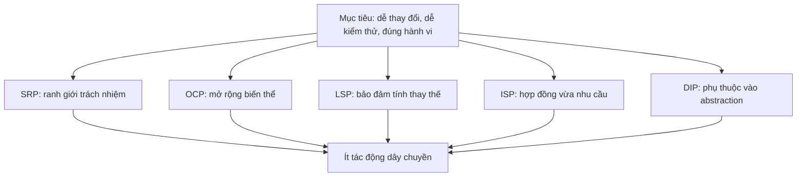
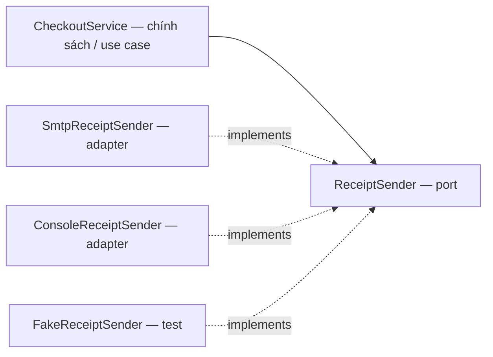
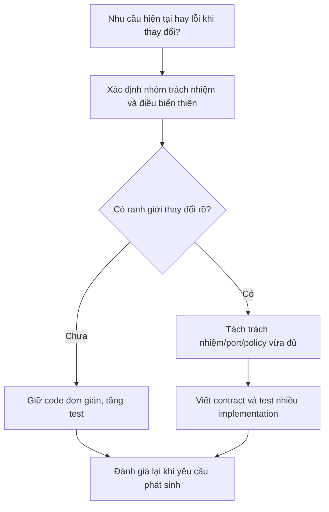

# SOLID trong OOP: mục đích và phạm vi áp dụng

**SOLID** là năm nguyên tắc thiết kế hướng đối tượng giúp phần mềm dễ thay đổi, dễ kiểm thử và giảm tác động dây chuyền khi yêu cầu phát triển. Đây là **các nguyên tắc định hướng**, không phải cú pháp bắt buộc của Java, công thức tự động tạo kiến trúc tốt, hay yêu cầu mọi class phải có interface.

Bài học tập trung vào hai câu hỏi: **SOLID giải quyết vấn đề gì?** và **nên áp dụng đến mức nào trong từng bối cảnh?** Sau khi hiểu phạm vi, ta mới quyết định cách dùng SRP, OCP, LSP, ISP, DIP trong một thiết kế cụ thể.

## 1. Vì sao cần SOLID?

Hãy hình dung ứng dụng bán hàng có một `CheckoutService` vừa tính tiền, áp khuyến mãi, gọi SQL trực tiếp và gửi email. Khi chính sách giảm giá thay đổi, bạn phải sửa service; khi chuyển sang PostgreSQL, vẫn sửa service; khi đổi nhà cung cấp email, tiếp tục sửa service. Một lỗi nhỏ ở bất kỳ phần nào có thể tác động đến quy trình đặt hàng.

SOLID hướng tới những kết quả cụ thể:

- **Dễ thay đổi có kiểm soát:** đổi một quy tắc không bắt buộc viết lại các thành phần ít liên quan.
- **Giảm phụ thuộc vào chi tiết biến động:** code nghiệp vụ không phải biết chính xác thư viện SQL, SMTP hay hình thức lưu trữ.
- **Dễ kiểm thử:** có thể kiểm tra phép tính và quy tắc bằng dữ liệu giả mà không cần mọi dịch vụ bên ngoài cùng chạy.
- **Giữ đúng hợp đồng:** các triển khai khác nhau của cùng một abstraction không làm code sử dụng chúng bị sai bất ngờ.
- **Làm rõ trách nhiệm:** khi có bug hoặc yêu cầu mới, biết nơi cần thay đổi và nơi cần kiểm tra hồi quy.

Tuy vậy, dùng SOLID có **chi phí**: thêm abstraction, lớp điều phối, hợp đồng và công việc hiểu luồng phụ thuộc. Nếu áp dụng cơ học cho chức năng nhỏ, số lượng lớp có thể tăng mà không đem lại lợi ích thực tế.

> Mục tiêu của SOLID là quản lý **chi phí thay đổi theo thời gian** và chất lượng hợp đồng giữa các thành phần, chứ không phải tối đa hóa số interface hay số class.

## 2. Năm chữ cái SOLID nói về điều gì?

| Chữ | Nguyên tắc | Câu hỏi tự kiểm tra | Nguy cơ nếu bỏ qua |
| --- | --- | --- | --- |
| **S** | **Single Responsibility Principle (SRP)** — một trách nhiệm chính | Class/module đang thay đổi vì bao nhiêu nhóm yêu cầu độc lập? | Một thay đổi SQL/email/nghiệp vụ cùng buộc sửa một class |
| **O** | **Open/Closed Principle (OCP)** — mở rộng được, hạn chế sửa code ổn định | Có thêm cách tính/chiến lược bằng implementation mới được không? | Mỗi biến thể mới phải thêm nhánh `if/switch` vào lõi |
| **L** | **Liskov Substitution Principle (LSP)** — thay thế được | Triển khai subtype có giữ đúng hợp đồng kỳ vọng của kiểu cha không? | Code gọi qua interface bất ngờ sai với một implementation |
| **I** | **Interface Segregation Principle (ISP)** — giao diện theo nhu cầu | Consumer có bị ép phụ thuộc method nó không dùng? | Class phải implement method vô nghĩa hoặc ném `UnsupportedOperationException` |
| **D** | **Dependency Inversion Principle (DIP)** — đảo chiều phụ thuộc | Quy tắc cấp cao đang phụ thuộc trực tiếp chi tiết công nghệ? | Domain/application bị trói với DB, HTTP hoặc thư viện cụ thể |

Năm nguyên tắc **hỗ trợ nhau**, không phải năm quy tắc tách biệt tuyệt đối. Một interface nhỏ giúp ISP; application service phụ thuộc interface thay vì SMTP cụ thể thể hiện DIP; nhiều triển khai tuân cùng hợp đồng liên quan đến LSP; thêm triển khai mới mà ít sửa luồng chính hỗ trợ OCP.



## 3. Hiểu phạm vi áp dụng trước khi thiết kế

SOLID thường phát huy tác dụng ở hệ thống có **nhiều quy tắc, nhiều biến thể hoặc nhiều tác nhân gây thay đổi**. Nhưng quy tắc nghiệp vụ đơn giản không nhất thiết cần cả hệ thống phân tầng phức tạp.

| Bối cảnh | Mức áp dụng hợp lý | Lý do |
| --- | --- | --- |
| Value object `Money` chỉ cần kiểm tra và cộng/trừ tiền | Giữ dữ liệu và hành vi gắn kết, tránh abstraction dư | Không cần interface cho phép cộng hai số tiền |
| CRUD nội bộ ít quy tắc, một kiểu lưu trữ cố định | Class rõ trách nhiệm và validation đủ dùng | Tách quá nhiều tầng làm khó đọc mà ít lợi ích |
| Nhiều cách giảm giá/vận chuyển thay đổi thường xuyên | Policy/strategy có hợp đồng chung | OCP, LSP giúp thêm biến thể có kiểm soát |
| Use case đọc/ghi DB, phát email hoặc gọi API ngoài | Tách rule khỏi adapter; tạo port tại chỗ cần thay thế | SRP, DIP, ISP làm logic dễ test |
| Thư viện/SDK cung cấp interface công khai cho nhiều consumer | Thiết kế hợp đồng chính xác, nhỏ và ổn định | LSP, ISP đặc biệt quan trọng vì khách hàng phụ thuộc lâu dài |
| Hệ thống có nhiều nhóm phát triển và module | Phân rõ quyền sửa, abstraction ở biên thay đổi | Giảm ảnh hưởng khi nhiều nhóm sửa song song |
| Script xử lý tạm một lần, không có quy tắc tái sử dụng | Ưu tiên đơn giản, đúng và có kiểm tra cần thiết | Chi phí thiết kế hơn lợi ích vòng đời ngắn |

Nên đặt câu hỏi **“điều gì thực sự thay đổi?”** trước câu hỏi **“cần tạo interface nào?”**. Chẳng hạn nếu chỉ có một cách tính thuế đơn giản và không có yêu cầu đa vùng, một hàm `calculateTax(...)` rõ ràng có thể đủ. Khi có nhiều chính sách theo vùng và đổi thường xuyên, abstraction mới bắt đầu có giá trị rõ.

## 4. SRP: xác định ranh giới trách nhiệm

SRP thường được giải thích là một class nên có **một lý do để thay đổi**. “Một” ở đây gắn với một nhóm trách nhiệm phục vụ cùng quy tắc/người sở hữu nghiệp vụ, **không phải một method**.

Ví dụ một lớp làm mọi việc:

```java
// Phác thảo một cách viết cần xem lại, không phải chương trình chạy độc lập.
class CheckoutManager {
    void checkout(Order order) {
        // Tự áp dụng discount
        // Tự tạo SQL và lưu đơn
        // Tự xây nội dung email rồi gửi SMTP
        // Tự chuyển kết quả sang JSON
    }
}
```

Những thay đổi trong công thức giảm giá, schema DB, nhà cung cấp email và định dạng JSON đều làm `CheckoutManager` biến động. Hãy phân vai:

- `Order` bảo vệ bất biến của đơn và tính tổng dựa trên các dòng.
- `DiscountPolicy` quyết định số tiền giảm theo chính sách.
- `CheckoutService` phối hợp quy trình.
- `OrderRepository` lưu/truy vấn đơn theo một hợp đồng.
- `ReceiptSender` gửi biên nhận qua cổng bên ngoài.
- Controller/API adapter xử lý HTTP và DTO.

Không có nghĩa bắt buộc **mỗi dòng yêu cầu một class**. Nếu hai method cùng phục vụ một trách nhiệm, hoàn toàn có thể để cạnh nhau. SRP bị áp dụng sai khi tạo hàng chục lớp chỉ để đạt “một method một class”.

## 5. OCP: chọn đúng điểm mở rộng

OCP thường được diễn đạt: đối tượng/module nên **mở cho mở rộng nhưng đóng đối với sửa đổi**. Ý nghĩa thực tế không phải “không bao giờ sửa source”. Một bug, hợp đồng sai hoặc yêu cầu mới chưa từng được dự liệu vẫn cần sửa code. OCP nhắm tới những **biến thể đã biết có khả năng tăng**, sao cho thêm biến thể ít phải sửa lõi đã ổn định.

Ví dụ khi giảm giá có nhiều chính sách:

```java
interface DiscountPolicy {
    long discountCents(long subtotalCents);
}

final class NoDiscount implements DiscountPolicy {
    public long discountCents(long subtotalCents) {
        return 0;
    }
}

final class TenPercentDiscount implements DiscountPolicy {
    public long discountCents(long subtotalCents) {
        return subtotalCents / 10;
    }
}
```

`CheckoutService` chỉ phụ thuộc `DiscountPolicy`. Khi bổ sung một loại giảm giá có điều kiện, tạo implementation mới và cấu hình chọn nó; không phải chỉnh code tính tiền của toàn bộ checkout.

**Lưu ý:** vị trí **chọn implementation nào** vẫn cần thay đổi/cấu hình theo yêu cầu: composition root, factory, Spring DI configuration hoặc một policy selector. OCP không xóa hoàn toàn việc sửa code, mà **giới hạn vùng ảnh hưởng**.

## 6. LSP: cùng interface phải giữ cùng kỳ vọng

Nếu `CheckoutService` chấp nhận `DiscountPolicy`, mọi policy đều phải giữ hợp đồng:

- Input subtotal hợp lệ là số cent không âm.
- Output discount là số cent trong khoảng `0..subtotal`.
- Không tự ý tạo order, ghi database hoặc đột nhiên trả `null`.
- Nếu code caller kỳ vọng policy hoạt động cho subtotal hợp lệ, implementation không được âm thầm thu hẹp đầu vào chỉ vì “loại policy này không hỗ trợ”.

Ví dụ vi phạm LSP:

```java
final class BrokenDiscount implements DiscountPolicy {
    @Override
    public long discountCents(long subtotalCents) {
        return subtotalCents + 100; // Giảm nhiều hơn giá trị đơn!
    }
}
```

Dù Java cho phép compile, triển khai này không đáp ứng hậu điều kiện của `DiscountPolicy`. Khi thay nó cho policy khác, checkout có thể tính số tiền phải trả âm.

Cách bảo vệ gồm **viết rõ contract**, test chung cho các implementation và kiểm tra các invariant quan trọng tại ranh giới (nhất là khi implementation do plugin/đối tác ngoài cung cấp).

LSP không chỉ áp dụng cho `extends`: đối tượng triển khai interface cũng phải thay thế được nhau về mặt **hành vi**, chứ không chỉ cùng chữ ký method.

## 7. ISP: interface đủ nhỏ cho vai trò sử dụng

Một interface vừa lưu đơn, gửi email, xuất PDF, hoàn tiền và thống kê khiến mỗi implementation hoặc consumer phải phụ thuộc những phần nó không cần.

```java
// Dễ gây ép buộc không cần thiết:
interface BusinessGateway {
    void saveOrder(Order order);
    void emailReceipt(Order order);
    void exportMonthlyReport();
}
```

Thay vì buộc một test fake repository phải implement `emailReceipt`, có thể tách:

```java
interface OrderRepository {
    void save(Order order);
}

interface ReceiptSender {
    void sendReceipt(Order order, long payableCents);
}
```

Service cần lưu đơn chỉ phụ thuộc `OrderRepository`; thành phần gửi biên nhận chỉ quan tâm `ReceiptSender`. Hợp đồng nhỏ còn làm test dễ hiểu.

Tuy nhiên, ISP **không yêu cầu chia vô hạn** thành interface một method. Nếu nhiều operation cùng thuộc một giao thức ổn định và những consumer liên quan đều dùng chúng, một interface gắn kết vẫn hợp lý.

## 8. DIP và Dependency Injection có gì khác nhau?

**DIP** là nguyên tắc thiết kế **hướng phụ thuộc**: phần chính sách cấp cao nên phụ thuộc abstraction mô tả những gì nó cần; chi tiết cấp thấp cài đặt abstraction đó.

**Dependency Injection (DI)** là kỹ thuật truyền dependency từ bên ngoài (ví dụ qua constructor). DI thường giúp hiện thực DIP, nhưng **tự tiêm một class công nghệ cụ thể không tự động đạt DIP**.

```java
// Có constructor injection nhưng vẫn phụ thuộc chi tiết SMTP:
class CheckoutService {
    private final SmtpMailClient client;
    CheckoutService(SmtpMailClient client) {
        this.client = client;
    }
}
```

Một thiết kế theo DIP:

```java
interface ReceiptSender {
    void sendReceipt(Order order, long payableCents);
}

class CheckoutService {
    private final ReceiptSender sender;

    CheckoutService(ReceiptSender sender) {
        this.sender = sender;
    }
}
```

Lúc chạy có thể truyền `SmtpReceiptSender`, `ConsoleReceiptSender` hoặc fake để test. Service vẫn quan tâm tới nghĩa vụ “gửi biên nhận” nhưng không bị ràng buộc bởi lớp SMTP cụ thể.



Đặt interface ở module nghiệp vụ/application hoặc module contract thích hợp là một cách để **source code của phần cấp cao không import adapter**. Đừng đánh giá hướng phụ thuộc bằng thứ tự gọi lúc chạy: việc service gọi adapter qua interface không có nghĩa module service phải biết chi tiết adapter.

## 9. Ví dụ Java 17 chạy độc lập: SOLID ở đúng điểm cần thay đổi

Bài toán: checkout đơn giản có nhiều chương trình giảm giá, có thể thay cách lưu và cách gửi biên nhận. Phần **tiền và trạng thái đơn hợp lệ** thuộc mô hình; phần **điều phối** thuộc service; **tương tác bên ngoài** qua hai interface nhỏ.

Tạo file `SolidScopeDemo.java`. Chương trình dùng một lớp chính và các lớp nested để bạn biên dịch bằng một lệnh.

```java
import java.util.LinkedHashMap;
import java.util.List;
import java.util.Map;
import java.util.Objects;
import java.util.Optional;

public class SolidScopeDemo {

    // Domain value object: trường hợp quantity > 0, unit price >= 0.
    record OrderLine(String sku, int quantity, long unitPriceCents) {
        OrderLine {
            if (sku == null || sku.isBlank()) {
                throw new IllegalArgumentException("SKU is required");
            }
            if (quantity <= 0 || unitPriceCents < 0) {
                throw new IllegalArgumentException("Invalid order line");
            }
        }

        long amountCents() {
            return Math.multiplyExact((long) quantity, unitPriceCents);
        }
    }

    // Domain model: luôn có ít nhất một dòng hợp lệ.
    record Order(String id, List<OrderLine> lines) {
        Order {
            if (id == null || id.isBlank()) {
                throw new IllegalArgumentException("Order id is required");
            }
            Objects.requireNonNull(lines, "lines");
            lines = List.copyOf(lines);
            if (lines.isEmpty()) {
                throw new IllegalArgumentException("Order must have items");
            }
        }

        long subtotalCents() {
            long sum = 0;
            for (OrderLine line : lines) {
                sum = Math.addExact(sum, line.amountCents());
            }
            return sum;
        }
    }

    // Contract: 0 <= discount <= subtotal với subtotal không âm.
    interface DiscountPolicy {
        long discountCents(long subtotalCents);
    }

    static final class NoDiscount implements DiscountPolicy {
        @Override
        public long discountCents(long subtotalCents) {
            if (subtotalCents < 0) {
                throw new IllegalArgumentException("Negative subtotal");
            }
            return 0;
        }
    }

    static final class PercentDiscount implements DiscountPolicy {
        private final int percent;

        PercentDiscount(int percent) {
            if (percent < 0 || percent > 100) {
                throw new IllegalArgumentException("Invalid percent");
            }
            this.percent = percent;
        }

        @Override
        public long discountCents(long subtotalCents) {
            if (subtotalCents < 0) {
                throw new IllegalArgumentException("Negative subtotal");
            }
            // floor(subtotal * percent / 100) không tràn ở phép nhân.
            long whole = (subtotalCents / 100) * percent;
            long fraction = ((subtotalCents % 100) * percent) / 100;
            return Math.addExact(whole, fraction);
        }
    }

    interface OrderRepository {
        void save(Order order);
        Optional<Order> findById(String id);
    }

    interface ReceiptSender {
        void sendReceipt(Order order, long payableCents);
    }

    record CheckoutResult(Order order, long discountCents, long payableCents) { }

    static final class CheckoutService {
        private final DiscountPolicy discount;
        private final OrderRepository repository;
        private final ReceiptSender sender;

        CheckoutService(DiscountPolicy discount,
                        OrderRepository repository,
                        ReceiptSender sender) {
            this.discount = Objects.requireNonNull(discount);
            this.repository = Objects.requireNonNull(repository);
            this.sender = Objects.requireNonNull(sender);
        }

        CheckoutResult checkout(Order order) {
            Objects.requireNonNull(order, "order");
            long subtotal = order.subtotalCents();
            long reduction = discount.discountCents(subtotal);

            // Thực thi contract của policy tại ranh giới.
            if (reduction < 0 || reduction > subtotal) {
                throw new IllegalStateException("Invalid discount policy");
            }

            long payable = subtotal - reduction;
            repository.save(order);
            sender.sendReceipt(order, payable);
            return new CheckoutResult(order, reduction, payable);
        }
    }

    // Adapter bộ nhớ — thay bằng JDBC mà không phải sửa policy.
    static final class MemoryOrderRepository implements OrderRepository {
        private final Map<String, Order> data = new LinkedHashMap<>();

        @Override
        public void save(Order order) {
            Objects.requireNonNull(order);
            if (data.putIfAbsent(order.id(), order) != null) {
                throw new IllegalStateException("Duplicate order id");
            }
        }

        @Override
        public Optional<Order> findById(String id) {
            return Optional.ofNullable(data.get(id));
        }
    }

    // Adapter console — thay bằng SMTP hoặc message bus khi cần.
    static final class ConsoleReceiptSender implements ReceiptSender {
        @Override
        public void sendReceipt(Order order, long payableCents) {
            System.out.println(
                    "Receipt " + order.id() + ": " + payableCents + " cents");
        }
    }

    public static void main(String[] args) {
        MemoryOrderRepository repository = new MemoryOrderRepository();
        ReceiptSender sender = new ConsoleReceiptSender();

        Order first = new Order("O-01", List.of(
                new OrderLine("BOOK", 1, 15_000),
                new OrderLine("PEN", 2, 2_500)));

        CheckoutService promotionalCheckout = new CheckoutService(
                new PercentDiscount(10), repository, sender);
        CheckoutResult result = promotionalCheckout.checkout(first);
        System.out.println("Discount: " + result.discountCents());
        System.out.println("Saved: " +
                repository.findById("O-01").isPresent());

        Order second = new Order("O-02", List.of(
                new OrderLine("NOTE", 1, 10_000)));

        CheckoutService normalCheckout = new CheckoutService(
                new NoDiscount(), repository, sender);
        normalCheckout.checkout(second);
    }
}
```

Chạy bằng JDK 17 hoặc mới hơn:

```bash
javac SolidScopeDemo.java
java SolidScopeDemo
```

Kết quả dự kiến:

```text
Receipt O-01: 18000 cents
Discount: 2000
Saved: true
Receipt O-02: 10000 cents
```

Cách tính đơn đầu tiên: `15_000 + 2 × 2_500 = 20_000` cent; giảm 10% là `2_000` cent; số phải trả `18_000` cent.

**Giới hạn của ví dụ:** chưa có thuế, hoàn tiền, thanh toán thật hoặc giao dịch database. `MemoryOrderRepository` không thread-safe, chỉ phục vụ demo. `CheckoutService` lưu đơn rồi gửi biên nhận; nếu gửi thất bại, đơn có thể **đã lưu** dù caller gặp exception. Trong sản phẩm cần quy định transaction, retry/idempotency và có thể dùng *transactional outbox* để phát thông báo sau commit. SOLID giúp tách trách nhiệm nhưng **không tự bảo đảm atomicity, tính đúng đắn khi đồng thời hoặc consistency giữa các hệ thống**.

### Mỗi nguyên tắc xuất hiện ở đâu trong ví dụ?

| Nguyên tắc | Bằng chứng từ Java | Giá trị thực tế |
| --- | --- | --- |
| SRP | `Order` giữ invariant/tính tổng; `CheckoutService` điều phối; adapter lo I/O | Đổi nơi lưu không ảnh hưởng công thức tổng tiền |
| OCP | `PercentDiscount` và `NoDiscount` cùng implement `DiscountPolicy` | Thêm chính sách mới qua implementation thay vì sửa checkout |
| LSP | Mọi policy phải trả `0..subtotal` | Thay policy không làm `CheckoutService` trả số âm |
| ISP | `OrderRepository` và `ReceiptSender` là hợp đồng nhỏ | Fake test chỉ implement đúng phần cần |
| DIP | Service nhận ba interface qua constructor | Không phụ thuộc trực tiếp `MemoryOrderRepository`/`ConsoleReceiptSender` |

**Một thiết kế có thể dùng cùng lúc nhiều nguyên tắc** mà không cần đặt tên mỗi nguyên tắc vào tên class. Hợp đồng rõ và các mối phụ thuộc ít bất ngờ quan trọng hơn việc có đủ “năm mẫu” trong code.

## 10. Kiểm thử điều gì để biết thiết kế thật sự có ích?

Bạn nên kiểm tra **hành vi** và **khả năng thay thế**:

1. Chính sách 0%, 10%, 100% luôn trả mức giảm trong giới hạn.
2. Trường hợp `subtotal=1` cent với 10% phải giảm `0` cent theo quy tắc làm tròn xuống.
3. `Order` từ chối danh sách rỗng, dòng có số lượng không dương, giá âm hoặc dữ liệu khiến tổng tràn `long`.
4. Nếu policy vi phạm contract, checkout từ chối **trước khi lưu**.
5. Nếu repository từ chối ghi, `ReceiptSender` không được gọi trong luồng triển khai này.
6. Nếu thay `ConsoleReceiptSender` bằng fake, cách tính giá và lưu đơn không đổi.
7. Nếu thay repository bằng một adapter khác, code `Order` và các policy không phải sửa.

Một fake sender tối giản để kiểm thử:

```java
class CountingReceiptSender implements SolidScopeDemo.ReceiptSender {
    int sends;

    @Override
    public void sendReceipt(
            SolidScopeDemo.Order order, long payableCents) {
        sends++;
    }
}
```

Nếu test đoạn này **từ file khác**, các nested type trong demo đang có mức truy cập *package-private*: đặt test cùng package (ví dụ file mặc định không khai báo package) hoặc sửa visibility phù hợp khi chuyển thành project thật. Để test tự động, dùng JUnit 5 và assert kết quả thay vì phụ thuộc `System.out`.

Ví dụ test hợp đồng cho policy:

```java
// Phác thảo phép kiểm thử, thêm vào test/JUnit của dự án.
void assertPolicyContract(
        SolidScopeDemo.DiscountPolicy policy, long subtotal) {
    long discount = policy.discountCents(subtotal);
    if (discount < 0 || discount > subtotal) {
        throw new AssertionError("Policy violates contract");
    }
}
```

Chạy cùng một bộ kiểm tra cho mọi implementation của `DiscountPolicy` là phương pháp thực tế để duy trì LSP. Riêng tính đúng đắn khuyến mãi theo yêu cầu còn cần test công thức và ranh giới số học.

## 11. SOLID không thay thế những nguyên tắc nào?

Một thiết kế tuân SOLID vẫn có thể lỗi nếu bỏ qua:

- **Đúng nghiệp vụ:** thời gian, đơn vị tiền, điều kiện khuyến mãi hay chính sách trả hàng bị hiểu sai.
- **Đóng gói dữ liệu:** public setter có thể phá invariant dù service đã tách interface đẹp.
- **Transaction và concurrency:** hai request cùng kiểm tra tồn kho/giới hạn rồi cập nhật có thể tạo race condition.
- **Bảo mật và phân quyền:** interface nhỏ không tự kiểm tra ai được thực hiện thao tác.
- **Hiệu năng:** quá nhiều truy vấn, gọi mạng tuần tự hoặc cấp phát đối tượng vẫn có thể chậm.
- **Khả năng quan sát:** log, metric, trace và lỗi cần được xử lý rõ ràng.
- **Mô hình dữ liệu:** khóa ngoại, uniqueness và constraints ở database không được tự sinh từ SOLID.
- **Đơn giản hóa:** có những nơi một class/factory đơn giản dễ bảo trì hơn một hệ thống chiến lược không cần thiết.

Vì vậy SOLID là **một phần** của thiết kế tốt, không phải thước đo duy nhất của chất lượng code.

## 12. Các dấu hiệu đang dùng SOLID quá mức

| Dấu hiệu | Vì sao cần xem lại? | Cách đơn giản hơn |
| --- | --- | --- |
| Mỗi helper có một interface và một class `Impl` duy nhất | Không tạo ra ranh giới thay thế thực sự | Class hoặc hàm thuần, có test |
| Mỗi thao tác nhỏ trong `Money`/entity thành một service | Tách rời các hành vi cùng bảo vệ một bất biến | Giữ `add`, `subtract`, `compareTo` trong value object |
| Xây cây kế thừa nhiều tầng cho biến thể còn chưa tồn tại | Phụ thuộc sâu, nhiều điểm override và hợp đồng khó giữ | Composition/policy khi có yêu cầu |
| Cấm sửa module ổn định dù hợp đồng đang sai | OCP bị hiểu nhầm thành “không được sửa code” | Sửa hợp đồng, chạy test hồi quy |
| Mỗi cách đổi nhỏ cần cấu hình plugin động | Chi phí thiết kế và vận hành vượt ích lợi | `if/switch` rõ ràng nếu tập biến thể nhỏ và ổn định |

Đừng đánh giá SOLID bằng số lượng class/interface. Bài **Cân bằng các nguyên tắc với độ phức tạp thực tế** cho một tình huống giao hàng tăng từ một chính sách lên nhiều chính sách, rồi đo cụ thể chi phí mở rộng và chi phí abstraction.

## 13. Quy trình nhanh trước khi thêm abstraction



1. **Xác định áp lực có thật:** bug do phụ thuộc, nhiều biến thể cùng phải sửa một chỗ, test cần hạ tầng, hoặc subclass không giữ hợp đồng.
2. **Chọn điểm cần bảo vệ:** nghiệp vụ/domain, dữ liệu và invariant trước; chi tiết SQL/SMTP hoặc quy tắc riêng đưa ra ranh giới phù hợp.
3. **Mở rộng ở đúng chỗ:** OCP cho điểm biến thiên, DIP cho hướng dependency, ISP cho API của consumer, LSP cho tính thay thế, SRP cho trách nhiệm.
4. **Giữ kết quả cũ bằng test:** so sánh output, exception và side effect của ca cũ; test riêng ca mới, tình huống biên và lỗi.
5. **Đánh giá chi phí:** abstraction có làm ít chỗ phải sửa hơn, dễ test/đọc hơn hay chỉ thêm bước chuyển tiếp?

Đây là bản định hướng đầu chương, không phải quy trình luôn phải áp dụng nguyên xi. Không có tỷ lệ “số interface / số class” hay phần trăm code phải giảm để chứng minh SOLID đúng.

## 14. Bài tập thực hành

**Bài 1 — Nhận diện phạm vi.** Ứng dụng ghi chú cá nhân chỉ cần tạo, sửa, xóa ghi chú, lưu trên một file JSON. Hãy nêu hai cách thiết kế: đơn giản và phân tầng đầy đủ. Phương án nào hợp lý ở thời điểm hiện tại? Điều kiện nào khiến bạn cần repository port hoặc policy riêng?

**Bài 2 — SRP và DIP.** Một `ReportService` vừa tổng hợp số liệu, vừa ghi CSV, vừa tải lên cloud storage. Thiết kế lại trách nhiệm và port để có thể test cách tổng hợp khi cloud không có mạng.

**Bài 3 — OCP và LSP.** Thêm `FixedAmountDiscount` giảm tối đa 5.000 cent nhưng không vượt subtotal. Viết contract test cho các giá trị subtotal 0, 1.000 và 10.000. Giải thích vì sao trả -100 hoặc giảm quá subtotal vi phạm LSP.

**Bài 4 — ISP.** Hệ thống có `Device` với `print()`, `scan()`, `fax()`; một máy in chỉ hỗ trợ print. Hãy thiết kế các interface năng lực riêng để lớp máy in không phải ném `UnsupportedOperationException` cho `scan/fax`.

**Bài 5 — Kiểm chứng giá trị.** Đếm những file phải sửa khi thêm một chính sách giảm giá mới **trước** và **sau** refactor. Cũng kiểm tra chi phí tạo thêm class/interface và độ dễ hiểu. Không kết luận refactor thành công chỉ vì số file phải sửa ít hơn: chức năng phải đúng và người bảo trì phải hiểu được.

**Bài 6 — Quan sát side effect.** Giả sử repository lưu thành công nhưng gửi biên nhận lỗi. Thiết kế kết quả trả về, quy tắc retry/idempotency và ranh giới transaction phù hợp. Phân biệt phần SOLID hỗ trợ với phần yêu cầu kỹ thuật consistency ngoài SOLID.

## 15. Checklist trước khi quyết định đưa SOLID vào code

- Quy tắc hoặc thành phần nào có khả năng thay đổi **thật sự**?
- Một class đang có nhiều **lý do thay đổi độc lập** hay chỉ có nhiều method cùng chức năng?
- Điểm biến thể có đủ nhu cầu để được trừu tượng hóa không?
- Interface được mô tả theo điều consumer cần, hay chỉ sao chép y nguyên mọi method của implementation?
- Các implementation có cùng **ngữ nghĩa và contract** không?
- Logic cấp cao có import hoặc tạo trực tiếp client I/O khó thay thế không?
- Có thể test quy tắc miền bằng input/output độc lập database và HTTP không?
- Dữ liệu và invariant có được bảo vệ ngoài phạm vi interface không?
- Transaction, concurrent updates, security và lỗi hệ thống ngoài đã được xem xét riêng chưa?
- Lợi ích bảo trì có lớn hơn chi phí lớp, interface và cấu hình được thêm vào không?

**Điểm cần nhớ:** SOLID giúp thiết kế *những ranh giới đáng ổn định trước thay đổi*. Áp dụng có chọn lọc dựa trên trách nhiệm, biến thể và phụ thuộc của hệ thống. Với chức năng đơn giản, một class rõ ràng có thể tốt hơn nhiều abstraction; với nghiệp vụ lớn và thay đổi thường xuyên, hợp đồng nhỏ và trách nhiệm rõ đem lại lợi ích bền vững.