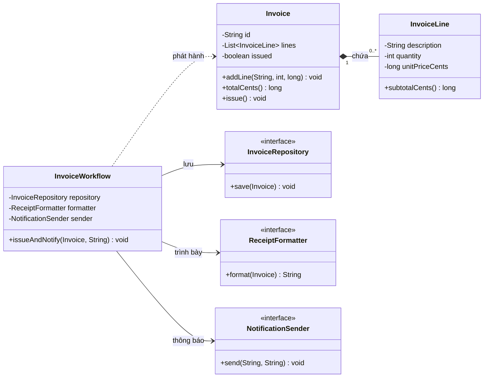
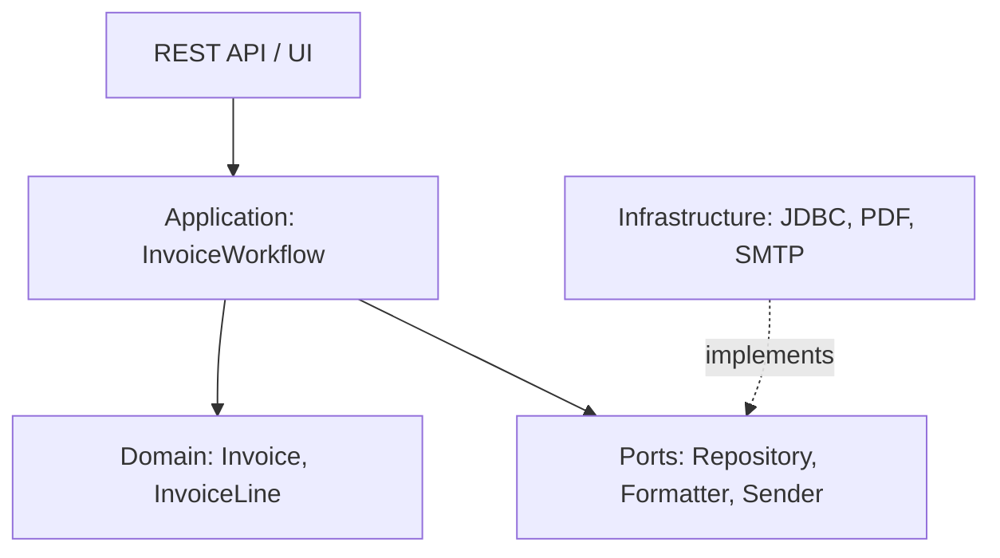

# Trách nhiệm đơn: một nhóm lý do thay đổi (Single Responsibility Principle – SRP)

## 1. SRP thực sự muốn nói gì?

**Single Responsibility Principle (SRP)** là chữ **S** trong **SOLID**. Cách phát biểu quen thuộc là:

> Một module/lớp nên có một lý do để thay đổi.

Tuy nhiên, nếu hiểu “một lý do” là **một phương thức**, **một dòng chức năng**, hoặc “mỗi lớp chỉ làm một việc nhỏ nhất có thể”, ta rất dễ thiết kế hàng chục lớp vụn vặt khó theo dõi.

Diễn giải hữu ích hơn là: **một lớp nên chịu trách nhiệm với một nhóm yêu cầu thay đổi có cùng mục đích/nguồn phát sinh**. Trong các tài liệu của Robert C. Martin, cách nhìn SRP còn được giải thích theo *actor* – nhóm người hoặc bộ phận yêu cầu thay đổi. Nếu một lớp phải thay đổi vì các nhóm yêu cầu độc lập, nó có thể đang gộp nhiều trách nhiệm.

Ví dụ lớp `Invoice` (hóa đơn) có thể cần:

- Thêm dòng hàng khi hóa đơn còn ở trạng thái nháp.
- Kiểm tra số lượng và đơn giá hợp lệ.
- Tính tổng tiền từ các dòng hàng.
- Phát hành hóa đơn và từ chối phát hành lặp.

Các hành vi này khác nhau, nhưng cùng bảo vệ **vòng đời và tính đúng đắn của một hóa đơn**. Không cần tách mỗi phép kiểm tra thành một service chỉ để mỗi lớp có một phương thức.

Ngược lại, nếu `Invoice` còn tự tạo PDF, tự ghi SQL và tự gửi email, nó phải sửa khi *quy tắc hóa đơn*, *bố cục tài liệu*, *hệ quản trị dữ liệu* hoặc *nhà cung cấp email* thay đổi. Những nhóm thay đổi đó có thể thuộc các trách nhiệm khác nhau.

**Mục tiêu SRP là tăng sự gắn kết (cohesion) của lớp và giảm việc một thay đổi không liên quan buộc sửa cùng một nơi.** SRP không cấm lớp có nhiều phương thức, nhiều field hay nhiều đối tượng cộng tác.

## 2. “Một nhóm lý do thay đổi” nghĩa là gì?

Hãy lấy ví dụ hệ thống xuất hóa đơn:

| Yêu cầu thay đổi | Ai/nhóm nào thường đề xuất? | Trách nhiệm liên quan |
|---|---|---|
| Chỉ cho phát hành hóa đơn khi có dòng hàng | Nhóm nghiệp vụ hóa đơn | Quy tắc miền của hóa đơn |
| Đơn giá, số lượng phải hợp lệ | Nhóm nghiệp vụ/kế toán | Bất biến của dòng hóa đơn |
| Đổi cách hiển thị tiêu đề/logo biên nhận | Thiết kế thương hiệu hoặc vận hành | Định dạng biên nhận |
| Chuyển lưu từ file sang database | Nhóm vận hành hạ tầng | Lưu trữ |
| Đổi email sang dịch vụ gửi khác | Nhóm tích hợp/hạ tầng | Gửi thông báo |
| Quy trình phát hành cần xác thực quyền | Chủ sản phẩm/bảo mật | Điều phối use case/quyền |

Bảng này **không bắt buộc mỗi hàng phải là một class**. Các nhóm yêu cầu được dùng để xem **những thay đổi nào đi cùng nhau**, rồi tìm ranh giới mô hình thích hợp.

Ví dụ “không có dòng hàng thì không phát hành” và “không thể thêm dòng sau phát hành” đều là **một nhóm bất biến vòng đời hóa đơn**, dù là hai quy tắc. Chúng thường nên nằm cùng `Invoice`.

Ngược lại, thay logo biên nhận không nên buộc sửa quy tắc chuyển trạng thái của `Invoice`.

### Thử nghiệm nhanh

Hãy đặt câu hỏi: “Nếu ngày mai chỉ đổi định dạng biên nhận, class nào cần sửa?” Nếu câu trả lời bao gồm cả class bảo vệ trạng thái hóa đơn, có thể SRP đã bị ảnh hưởng.

Và chiều ngược lại: “Nếu đổi điều kiện phát hành hóa đơn, phải sửa bao nhiêu nơi?” Nếu hàng loạt controller, trình render và repository đều tự kiểm tra trạng thái bằng chuỗi `"DRAFT"`, quy tắc có thể đang bị phân tán.

## 3. Dấu hiệu một lớp gánh nhiều trách nhiệm

Ví dụ thiết kế dồn mọi thứ vào `InvoiceManager`:

```java
// Đoạn minh họa vấn đề, không phải chương trình độc lập.
class InvoiceManager {
    void issueInvoice(Invoice invoice) {
        // 1. Kiểm tra nghiệp vụ.
        if (invoice.getLines().isEmpty()) {
            throw new IllegalStateException("Empty invoice");
        }

        // 2. Tự tính tiền và chuyển trạng thái.
        long total = invoice.getLines().stream()
                .mapToLong(l -> l.getQuantity() * l.getPrice())
                .sum();
        invoice.setStatus("ISSUED");

        // 3. Tự dựng HTML/PDF và biết logo công ty.
        String html = "<h1>My Brand</h1><p>" + total + "</p>";

        // 4. Tự thực hiện câu lệnh SQL.
        // connection.prepareStatement("INSERT INTO invoices ...");

        // 5. Tự gọi hệ thống gửi email.
        // smtpClient.send(invoice.getCustomerEmail(), html);
    }
}
```

Những vấn đề:

- **Độ gắn kết thấp:** kiểm tra miền, tính tiền, dựng nội dung, lưu trữ và gửi email có các động lực thay đổi riêng.
- **Sửa một nơi dễ ảnh hưởng hành vi khác:** chỉnh HTML cũng phải mở class chứa logic phát hành.
- **Khó kiểm thử:** muốn thử điều kiện “hóa đơn rỗng không được phát hành” có thể phải cấu hình SQL/SMTP.
- **Rủi ro thiếu nhất quán:** nơi khác cũng có thể cập nhật `status` mà bỏ qua kiểm tra.
- **Khó thay thế tích hợp:** class phụ thuộc trực tiếp nhiều công nghệ.

Lưu ý: đoạn trên được cố ý viết thiếu các lớp phụ thuộc để làm rõ vấn đề thiết kế. Chương trình đầy đủ ở phần sau sẽ minh họa cách phân chia trách nhiệm và có thể biên dịch độc lập.

## 4. Phân chia theo trách nhiệm, không theo số câu lệnh

Một mô hình phù hợp:



Vai trò của từng phần:

- **`Invoice`** bảo vệ trạng thái và bất biến của hóa đơn.
- **`InvoiceLine`** giữ dữ liệu và phép tính của một dòng.
- **`ReceiptFormatter`** chuyển nội dung hóa đơn sang cách thể hiện (text, HTML, PDF…).
- **`InvoiceRepository`** đại diện cho trách nhiệm lưu/tải.
- **`NotificationSender`** đại diện cho trách nhiệm giao tiếp với người nhận.
- **`InvoiceWorkflow`** điều phối *use case phát hành hóa đơn*: gọi các cộng tác viên theo trình tự. Việc biết nhiều đối tượng cộng tác là bình thường đối với một lớp chuyên **điều phối**.

Đây là mô hình trách nhiệm, không phải yêu cầu phải tạo framework hay mỗi interface có đủ ba implementation. Những ranh giới được giới thiệu để minh họa các loại thay đổi độc lập.

## 5. Ví dụ Java 11+ chạy được

Tạo tệp `SrpDemo.java` với toàn bộ nội dung sau:

```java
import java.util.ArrayList;
import java.util.HashMap;
import java.util.List;
import java.util.Map;
import java.util.Objects;

public class SrpDemo {

    // Value Object: dữ liệu và phép tính của một dòng hóa đơn.
    static final class InvoiceLine {
        private final String description;
        private final int quantity;
        private final long unitPriceCents;

        InvoiceLine(String description, int quantity, long unitPriceCents) {
            if (description == null || description.isBlank()) {
                throw new IllegalArgumentException("Description required");
            }
            if (quantity <= 0 || unitPriceCents < 0) {
                throw new IllegalArgumentException(
                        "Invalid quantity or unit price");
            }
            this.description = description;
            this.quantity = quantity;
            this.unitPriceCents = unitPriceCents;
        }

        String description() {
            return description;
        }

        int quantity() {
            return quantity;
        }

        long unitPriceCents() {
            return unitPriceCents;
        }

        long subtotalCents() {
            return Math.multiplyExact(quantity, unitPriceCents);
        }
    }

    // Entity: sở hữu quy tắc và vòng đời hóa đơn.
    static final class Invoice {
        private final String id;
        private final List<InvoiceLine> lines = new ArrayList<>();
        private boolean issued;

        Invoice(String id) {
            if (id == null || id.isBlank()) {
                throw new IllegalArgumentException("Invoice id required");
            }
            this.id = id;
        }

        String id() {
            return id;
        }

        boolean isIssued() {
            return issued;
        }

        void addLine(String description, int quantity,
                     long unitPriceCents) {
            if (issued) {
                throw new IllegalStateException(
                        "Cannot modify an issued invoice");
            }
            lines.add(new InvoiceLine(
                    description, quantity, unitPriceCents));
        }

        List<InvoiceLine> lines() {
            // Không cho code bên ngoài sửa collection nội bộ.
            return List.copyOf(lines);
        }

        long totalCents() {
            long sum = 0L;
            for (InvoiceLine line : lines) {
                sum = Math.addExact(sum, line.subtotalCents());
            }
            return sum;
        }

        void issue() {
            if (issued) {
                throw new IllegalStateException(
                        "Invoice has already been issued");
            }
            if (lines.isEmpty()) {
                throw new IllegalStateException(
                        "Cannot issue an empty invoice");
            }
            totalCents(); // Phát hiện tràn số trước khi đổi trạng thái.
            issued = true;
        }
    }

    // Contract trình bày: có thể thay text bằng HTML/PDF adapter.
    interface ReceiptFormatter {
        String format(Invoice invoice);
    }

    static final class PlainTextReceiptFormatter
            implements ReceiptFormatter {
        @Override
        public String format(Invoice invoice) {
            Objects.requireNonNull(invoice);
            StringBuilder sb = new StringBuilder();
            sb.append("HOA DON ").append(invoice.id()).append("\n");

            for (InvoiceLine line : invoice.lines()) {
                sb.append(line.description())
                  .append(" x ")
                  .append(line.quantity())
                  .append(" = ")
                  .append(line.subtotalCents())
                  .append(" VND\n");
            }

            return sb.append("TONG: ")
                     .append(invoice.totalCents())
                     .append(" VND")
                     .toString();
        }
    }

    // Contract lưu trữ: logic miền không biết SQL/file/NoSQL.
    interface InvoiceRepository {
        void save(Invoice invoice);
    }

    static final class InMemoryInvoiceRepository
            implements InvoiceRepository {
        private final Map<String, Invoice> invoices = new HashMap<>();

        @Override
        public void save(Invoice invoice) {
            Objects.requireNonNull(invoice);
            invoices.put(invoice.id(), invoice);
        }

        int size() {
            return invoices.size();
        }
    }

    // Contract gửi thông báo: logic hóa đơn không biết SMTP.
    interface NotificationSender {
        void send(String recipient, String content);
    }

    static final class RecordingNotificationSender
            implements NotificationSender {
        private final List<String> recipients = new ArrayList<>();
        private final List<String> messages = new ArrayList<>();

        @Override
        public void send(String recipient, String content) {
            if (recipient == null || recipient.isBlank()) {
                throw new IllegalArgumentException("Recipient required");
            }
            recipients.add(recipient);
            messages.add(Objects.requireNonNull(content));
        }

        int sentCount() {
            return recipients.size();
        }

        String lastRecipient() {
            return recipients.get(recipients.size() - 1);
        }

        String lastMessage() {
            return messages.get(messages.size() - 1);
        }
    }

    // Application Service: một trách nhiệm là điều phối use case.
    static final class InvoiceWorkflow {
        private final InvoiceRepository repository;
        private final ReceiptFormatter formatter;
        private final NotificationSender sender;

        InvoiceWorkflow(InvoiceRepository repository,
                        ReceiptFormatter formatter,
                        NotificationSender sender) {
            this.repository = Objects.requireNonNull(repository);
            this.formatter = Objects.requireNonNull(formatter);
            this.sender = Objects.requireNonNull(sender);
        }

        void issueAndNotify(Invoice invoice, String recipient) {
            Objects.requireNonNull(invoice, "invoice");
            if (recipient == null || recipient.isBlank()) {
                throw new IllegalArgumentException("Recipient required");
            }

            invoice.issue();
            repository.save(invoice);
            sender.send(recipient, formatter.format(invoice));
        }
    }

    public static void main(String[] args) {
        Invoice invoice = new Invoice("INV-9");
        invoice.addLine("But", 2, 5_000L);
        invoice.addLine("So", 1, 25_000L);

        InMemoryInvoiceRepository repository =
                new InMemoryInvoiceRepository();
        RecordingNotificationSender sender =
                new RecordingNotificationSender();
        ReceiptFormatter formatter = new PlainTextReceiptFormatter();

        InvoiceWorkflow workflow = new InvoiceWorkflow(
                repository, formatter, sender);
        workflow.issueAndNotify(invoice, "buyer@example.test");

        System.out.println("Issued: " + invoice.isIssued());
        System.out.println("Total: " + invoice.totalCents());
        System.out.println("Saved invoices: " + repository.size());
        System.out.println("Recipient: " + sender.lastRecipient());
        System.out.println("Receipt has total: "
                + sender.lastMessage().contains("TONG: 35000 VND"));

        try {
            workflow.issueAndNotify(invoice, "buyer@example.test");
            throw new AssertionError(
                    "An issued invoice must not be reissued");
        } catch (IllegalStateException expected) {
            System.out.println("Duplicate issue rejected");
        }

        if (sender.sentCount() != 1
                || invoice.totalCents() != 35_000L) {
            throw new AssertionError("Unexpected invoice state");
        }
    }
}
```

Chạy bằng JDK 11 hoặc mới hơn:

```bash
javac SrpDemo.java
java SrpDemo
```

Kết quả mong đợi:

```text
Issued: true
Total: 35000
Saved invoices: 1
Recipient: buyer@example.test
Receipt has total: true
Duplicate issue rejected
```

### SRP được thể hiện ở đâu?

1. Đổi quy tắc “hóa đơn rỗng không thể phát hành” hoặc “không sửa dòng sau phát hành” → xem ở **`Invoice`**.
2. Đổi cách định dạng dòng, đổi sang HTML hoặc thêm bố cục biên nhận → xem ở **`ReceiptFormatter`** và implementation.
3. Đổi nơi lưu từ bộ nhớ sang database → cung cấp một **`InvoiceRepository`** implementation mới.
4. Đổi hệ thống gửi email sang hàng đợi thông báo → xem ở **`NotificationSender`** và adapter.
5. Đổi trình tự use case hoặc chính sách xử lý lỗi giữa các bước → xem ở **`InvoiceWorkflow`**.

Lưu ý **`InvoiceWorkflow` có ba dependency vẫn có thể tuân SRP**: chúng cùng phục vụ trách nhiệm điều phối một use case. Chỉ việc đếm field hoặc import không xác định lớp có tuân SRP hay không.

### Giới hạn của chương trình minh họa

Ví dụ trên chạy **tuần tự trong bộ nhớ**. Việc `invoice.issue()` thành công nhưng `repository.save(...)` hoặc `sender.send(...)` thất bại có thể để lại trạng thái cục bộ đã phát hành mà thông báo chưa gửi. Trong ứng dụng thật, việc lưu dữ liệu và ghi sự kiện để gửi thông báo thường cần transaction và outbox/retry/idempotency phù hợp.

Ngoài ra, `InMemoryInvoiceRepository` giữ tham chiếu trực tiếp đến object. Nó không mô phỏng persistence độc lập, isolation, optimistic locking, concurrency hoặc quá trình tải lại một entity từ database. Đây là bản demo làm rõ **ranh giới trách nhiệm**, không phải hệ thống hóa đơn sản xuất.

## 6. Cohesion và coupling liên quan thế nào đến SRP?

**Cohesion (độ gắn kết):** các field và phương thức của một lớp có cùng phục vụ một mục đích nhất quán không?

**Coupling (mức phụ thuộc):** lớp cần hiểu hoặc lệ thuộc vào bao nhiêu chi tiết của những lớp khác?

SRP hướng tới *cohesion cao* trong một ranh giới trách nhiệm. Việc phân chia hợp lý thường giúp giảm các phụ thuộc không liên quan, nhưng không tự động bảo đảm coupling thấp.

| Thiết kế | Cohesion | Coupling | Đánh giá |
|---|---|---|---|
| Một lớp vừa dựng PDF, tính thuế, gửi email, tự viết SQL | Thường thấp | Thường cao | Nhiều nguồn thay đổi dồn một chỗ |
| `Invoice` giữ các bất biến về dòng và phát hành | Cao | Có thể thấp/vừa | Một nhóm trách nhiệm nghiệp vụ |
| Một method `calculateTotal()` trong một lớp riêng chỉ để gọi lại `invoice.totalCents()` | Có vẻ cao | Thêm indirection | Tách lớp không đem lại giá trị rõ rệt |
| `InvoiceWorkflow` gọi repository, formatter và sender | Cao nếu chuyên điều phối | Có dependency cần thiết | Có nhiều cộng tác viên nhưng mục đích rõ |
| Một `Utils` chứa xác thực email, định dạng JSON, tính phí và SQL | Thấp | Khó kiểm soát | Tên “Utils” che giấu nhiều trách nhiệm |

Tránh nhầm lẫn rằng một lớp có **nhiều hành vi** là không cohesive. Chẳng hạn `Invoice.addLine()`, `Invoice.totalCents()`, `Invoice.issue()` đều làm việc với cùng bất biến hóa đơn; mối quan hệ giữa chúng là điều tốt.

## 7. Tại sao “một method một class” lại có thể phá SRP?

Các thao tác `Invoice.addLine()`, `Invoice.totalCents()` và `Invoice.issue()` cùng bảo vệ **một nhóm bất biến**. Nếu tách thành `AddLineService`, `TotalCalculatorService` và `IssueService` chỉ để mỗi lớp có một method, code caller phải ghép lại trạng thái và logic vòng đời ở nhiều nơi. Việc này tăng indirection và có thể làm yếu đóng gói.

Hãy phân biệt *nhiều thao tác của một trách nhiệm* với *nhiều nguồn thay đổi độc lập*: thêm dòng và phát hành thuộc nghiệp vụ hóa đơn; dựng PDF, ghi SQL và gửi email là các trục biến thiên khác. Xác nhận ranh giới bằng tình huống thay đổi và test, không bằng phép đếm method/import.

## 8. Đặt trách nhiệm vào Entity, Value Object hay Service?

Một phương án phân chia phổ biến trong thiết kế miền nghiệp vụ:

| Trách nhiệm | Nơi thường phù hợp | Ví dụ |
|---|---|---|
| Bảo vệ trạng thái và chuyển trạng thái của một thực thể | Entity | `Invoice.issue()` |
| Tính toán gắn với một giá trị bất biến | Value Object | `Money.plus()` hoặc `InvoiceLine.subtotalCents()` |
| Quy tắc nghiệp vụ trải qua nhiều đối tượng mà không thuộc tự nhiên một object | Domain Service/policy | `TaxPolicy.calculate(invoiceSnapshot)` |
| Điều phối use case: tải, gọi domain, lưu, báo kết quả | Application Service | `InvoiceWorkflow` |
| Đọc/ghi nơi lưu trữ | Repository/adapter | `SqlInvoiceRepository` |
| Chuyển dữ liệu sang định dạng giao tiếp | Formatter/Presenter | `PdfReceiptFormatter` |
| Tích hợp dịch vụ bên ngoài | Adapter/gateway | `SmtpNotificationSender` |

Đây là **gợi ý tìm ranh giới**, không phải công thức bắt buộc.

Ví dụ “thuế của hóa đơn” có thể đơn giản là phép tính cố định theo một chính sách nhất quán, khi đó `Invoice.totalTax()` có thể hợp lý. Nếu thuế phụ thuộc nhiều khu vực, ngày, loại hàng và nguồn quy định cập nhật độc lập, một `TaxPolicy` là lựa chọn đáng xem xét hơn. Trách nhiệm được quyết định bởi **ý nghĩa và nguồn thay đổi**, chứ không phải tên lớp.

## 9. SRP ở cấp package/module cũng quan trọng

Nguyên tắc trách nhiệm đơn được nói đến nhiều ở cấp class, nhưng ở hệ thống lớn, **module và package** cũng có thể chứa quá nhiều trách nhiệm thay đổi độc lập.

Ví dụ package `billing` vừa gồm nghiệp vụ hóa đơn, cơ sở dữ liệu, email và UI có thể trở thành nơi phải chỉnh sửa khi bất kỳ nhóm công việc nào thay đổi. Có thể tổ chức theo ranh giới:

```text
billing/
  domain/
    Invoice.java
    InvoiceLine.java
  application/
    InvoiceWorkflow.java
    InvoiceRepository.java
    ReceiptFormatter.java
    NotificationSender.java
  infrastructure/
    JdbcInvoiceRepository.java
    PdfReceiptFormatter.java
    SmtpNotificationSender.java
```

Đây chỉ là một tổ chức tham khảo. Dự án nhỏ hoàn toàn có thể đặt vài class cùng package nếu tên gọi, mức kết dính và dependency đã rõ.



Các component nên biết điều cần biết để hoàn thành vai trò của mình. **Đổi SMTP không nên buộc domain model phải biên dịch với thư viện SMTP**, và đổi quy tắc phát hành cũng không nên yêu cầu sửa lớp vẽ PDF nếu hợp đồng dữ liệu vẫn tương thích.

## 10. SRP và các nguyên tắc SOLID khác: phần nào trùng, phần nào khác?

SRP liên quan đến các nguyên tắc khác nhưng có **câu hỏi riêng**:

| Nguyên tắc | Câu hỏi trung tâm | Ví dụ |
|---|---|---|
| **SRP** | Lớp có một nhóm lý do thay đổi nhất quán không? | Hóa đơn không tự xử lý SMTP |
| **OCP** | Có thể thêm biến thể hành vi mà ít sửa code ổn định không? | Thêm một formatter mới qua interface |
| **LSP** | Implementation có giữ được hợp đồng của kiểu cha/interface không? | Formatter nào cũng phải trả chuỗi hợp lệ theo contract |
| **ISP** | Một client có bị buộc phụ thuộc những phương thức không dùng không? | Tránh `CommunicationManager` với 30 API không liên quan |
| **DIP** | Module nghiệp vụ có phụ thuộc abstraction thay vì chi tiết thay đổi không? | Workflow phụ thuộc `NotificationSender`, không phụ thuộc SMTP SDK |

Dùng interface **không tự động tuân SRP**. Có thể có `AllPurposeService` chứa mười interface dependency nhưng vẫn quyết định cùng lúc thuế, giao diện và phân quyền. Và một Entity không dùng interface nào vẫn có thể tuân SRP nếu trách nhiệm của nó rõ ràng.

## 11. Actor là cách tìm lý do thay đổi, không phải một nhãn tổ chức cứng nhắc

Kế toán, bảo mật và vận hành đều có thể yêu cầu thay đổi quy trình phát hành hóa đơn. **Không phải ba actor đồng nghĩa ba class**. Cần xác định quy tắc đang thuộc đâu:

- `Invoice` giữ bất biến “đã phát hành thì không được sửa”; đó là luật vòng đời thực thể.
- Application/authorization boundary xác nhận **ai có quyền** ra lệnh phát hành.
- Adapter/audit ghi log theo chính sách an toàn, không cấp quyền tùy ý sửa trạng thái của `Invoice`.

Một thay đổi hợp lệ vẫn có thể ảnh hưởng nhiều tầng cùng lúc (domain, API, lưu trữ). SRP giảm các *lý do thay đổi không liên quan* trong cùng nơi, chứ không hứa mọi yêu cầu sẽ chạm đúng một file.

## 12. Lộ trình refactor một lớp có nguy cơ vi phạm SRP

Giả sử đang có `OrderService` chứa hơn 1.000 dòng: kiểm tra tồn kho, áp voucher, tính tiền, ghi DB, gửi thông báo.

### Bước 1 – Liệt kê lý do thay đổi thực tế

Chỉ ra việc sửa nào từng xảy ra hoặc có khả năng xảy ra độc lập: chính sách voucher, công thức giá, cơ chế kho, công nghệ DB, template email. Đừng tự suy đoán rằng mỗi method có lý do thay đổi riêng.

### Bước 2 – Tìm hành vi và invariant của từng object

Trạng thái/điều kiện thuộc Order nên gần Order. Quy tắc kho thuộc hệ thống quản lý kho; quy tắc giảm giá có thể thuộc policy. Tránh tạo “service tiện ích” chỉ chuyển getter/setter từ nơi này sang nơi khác.

### Bước 3 – Xác định đầu vào và hợp đồng rõ nghĩa

Ví dụ nghiệp vụ cần `reserveStock(productId, quantity)`, không cần biết mã bảng SQL để tự `UPDATE warehouse_stock`. Đầu ra và lỗi phải được ghi rõ.

### Bước 4 – Tách từng ranh giới có giá trị

Ưu tiên phần có lý do thay đổi rõ, có thể kiểm thử độc lập: email gateway, repository, formatter, chính sách giảm giá. Đừng tạo hàng loạt lớp cùng lúc nếu chưa đánh giá tác động.

### Bước 5 – Giữ use case dễ theo dõi

Một application service có thể điều phối các thành phần theo trình tự. Điều này không vi phạm SRP khi trách nhiệm thống nhất của nó là **hoàn thành một ca sử dụng**.

### Bước 6 – Kiểm thử hành vi thay vì hình dạng lớp

Kiểm tra:
- Hóa đơn rỗng bị từ chối.
- Sau phát hành không được thêm dòng.
- Tổng tiền đúng, phát hiện tràn số.
- Formatter thay đổi không làm thay quy tắc Invoice.
- Repository và sender fake có thể thay thế.
- Lỗi lưu/gửi được xử lý nhất quán theo chính sách ứng dụng.

### Bước 7 – Đánh giá sau thay đổi

Số file không phải KPI. Đánh giá xem các yêu cầu thay đổi đã **tập trung đúng nơi**, số ca kiểm thử tích hợp không cần thiết có giảm, và người mới có thể nhanh chóng tìm trách nhiệm của từng lớp hay chưa.

## 13. Kiểm thử cho đúng mục đích của SRP

Một lợi ích của ranh giới trách nhiệm rõ là kiểm thử theo **hành vi có thể quan sát**, không phải kiểm thử getters hoặc nội bộ implementation.

Ví dụ kiểm thử Entity đơn thuần:

```java
Invoice invoice = new Invoice("INV-TEST");
invoice.addLine("Notebook", 2, 18_000L);
invoice.issue();

if (invoice.totalCents() != 36_000L || !invoice.isIssued()) {
    throw new AssertionError("Invoice invariant failed");
}

try {
    invoice.addLine("Pen", 1, 2_000L);
    throw new AssertionError("Issued invoice was modified");
} catch (IllegalStateException expected) {
    // Hợp lệ: bất biến ngăn thay đổi sau phát hành.
}
```

Đoạn trên được đặt trong phạm vi có thể truy cập lớp `Invoice`, ví dụ `main` của `SrpDemo`. Nó không cần database hay email.

Kiểm thử formatter độc lập:

```java
String receipt = new PlainTextReceiptFormatter().format(invoice);
if (!receipt.contains("TONG: 36000 VND")) {
    throw new AssertionError("Wrong total in receipt");
}
```

Kiểm thử use case cần xác nhận repository, sender, formatter được sử dụng đúng. Có thể dùng fake hoặc spy ở các ranh giới tích hợp, không cần mock từng đối tượng miền nhỏ.

**Hạn chế:** tách lớp không tự bảo đảm correctness. Tích hợp với database/email thật, lỗi mạng, transaction và retry vẫn cần ca kiểm thử thích hợp.

## 14. Checklist tránh ngộ nhận SRP

| Nhầm lẫn | Cách sửa cách hiểu |
|---|---|
| “Một class chỉ nên có một method hoặc một `if`.” | Những hành vi cùng giữ một invariant có thể nằm trong cùng class. |
| “Có nhiều dependency/interface là vi phạm SRP.” | Một application coordinator có thể cần nhiều cổng để hoàn thành **một use case**. |
| “Cứ tách càng nhỏ là càng tốt.” | Lớp chỉ chuyển tiếp một lời gọi làm tăng coupling và khó theo dõi. |
| “Một class lớn là bằng chứng sai SRP.” | Phải xem nguồn thay đổi: quy tắc miền, định dạng, lưu trữ, tích hợp có đang trộn nhau không? |
| “Tách formatter xong UI không bao giờ cần sửa vì domain đổi.” | Hợp đồng dữ liệu thay đổi chính đáng vẫn có thể cần sửa cả hai. |
| “Repository và sender đã tách nên tự động có transaction an toàn.” | SRP không thay thế transaction, retry, idempotency hay ràng buộc dữ liệu. |

Đối chiếu thiết kế bằng *trách nhiệm và hậu quả của yêu cầu thực*, không chỉ bằng tên lớp `Service`, kích thước file hoặc số import.

## 15. Bài tập tự luyện

### Bài 1 – Nhận diện những lý do thay đổi

Một lớp `UserManager` có các phương thức:

```java
registerUser();
changePassword();
deactivateUser();
generateCsvExport();
sendWelcomeEmail();
```

Hãy nhóm theo trách nhiệm.

**Gợi ý:** quản lý trạng thái và quy tắc tài khoản có thể thuộc cùng một miền; CSV export và email thường thuộc presentation/infrastructure. Tuy nhiên cần xem `UserManager` có phải application coordinator chủ định hay đang tự xử lý chi tiết CSV/SMTP.

### Bài 2 – Không tách quá mức

Một `Money` immutable có `plus()`, `minus()`, `multiply()` và `sameCurrency()`. Có nên tách thành bốn service?

**Gợi ý:** không cần nếu tất cả cùng bảo vệ và vận hành các giá trị Money. Tách khi có chính sách ngoài Money, như tỷ giá lấy từ nhà cung cấp bên ngoài.

### Bài 3 – Viết kiểm thử nguyên tắc phát hành

Dựa trên `SrpDemo.java`, hãy thử phát hành một `Invoice` chưa có dòng, kiểm tra `isIssued()` vẫn là `false`. Sau đó thêm một dòng, phát hành và xác nhận không thể sửa dòng nữa.

**Gợi ý:** hai điều kiện này cùng phục vụ bất biến vòng đời hóa đơn; đặt trong `Invoice`, không đặt riêng trong formatter hay email sender.

### Bài 4 – Thay định dạng mà không sửa domain

Thêm `HtmlReceiptFormatter implements ReceiptFormatter`. Chỉ thay object truyền cho `InvoiceWorkflow`:

```java
ReceiptFormatter formatter = new HtmlReceiptFormatter();
```

Nếu thiết kế hợp đồng đúng, `Invoice` không phải thay đổi. Kiểm tra formatter trả HTML đã escape đúng các trường do người dùng nhập, chẳng hạn mô tả sản phẩm, để tránh chèn markup không mong muốn.

### Bài 5 – Nhận diện lý do thực sự cần tách

Một ứng dụng có một lớp `TaxCalculator` chỉ làm một phép nhân cố định, không dự kiến có thêm quy tắc; một lớp `Invoice` khác có 12 phương thức toàn bộ cùng quản lý vòng đời và dòng hóa đơn.

**Câu hỏi:** lớp nào nhiều khả năng cần xem lại ranh giới trước?

**Gợi ý:** không thể kết luận từ số lượng method. Hãy xét nguồn thay đổi, policy, dữ liệu cần bảo vệ và phạm vi sử dụng. Một `Invoice` cohesive có thể tốt, còn `TaxCalculator` vẫn có thể hợp lý nếu chính sách thuế độc lập và thay đổi thường xuyên.

### Bài 6 – Tình huống production

`InvoiceWorkflow` đánh dấu `invoice.issue()` rồi lưu và gửi thông báo. Giả sử việc lưu thành công nhưng email thất bại.

**Câu hỏi:** Có nên tự đảo `invoice.issued = false` trong NotificationSender không?

**Gợi ý:** không. Sender không nên sửa bất biến hóa đơn. Hãy định nghĩa transaction quanh phần lưu trạng thái và sự kiện gửi, sau đó xử lý thông báo qua outbox/retry/idempotency theo chính sách. Đây cũng là ví dụ vì sao ranh giới trách nhiệm có giá trị khi xảy ra lỗi.

---

**Ghi nhớ:** SRP yêu cầu **một nhóm trách nhiệm có cùng mục đích và nguồn thay đổi**, không yêu cầu “một class = một method”. Hãy giữ các bất biến gần đối tượng sở hữu chúng, tách những chi tiết hiển thị/lưu trữ/tích hợp có nguồn thay đổi riêng, và để một đối tượng điều phối các cộng tác viên khi cần. Một thiết kế tuân SRP sẽ giúp người bảo trì biết chính xác nên sửa đâu khi yêu cầu thay đổi, mà không làm mất sự gắn kết tự nhiên của mô hình miền.