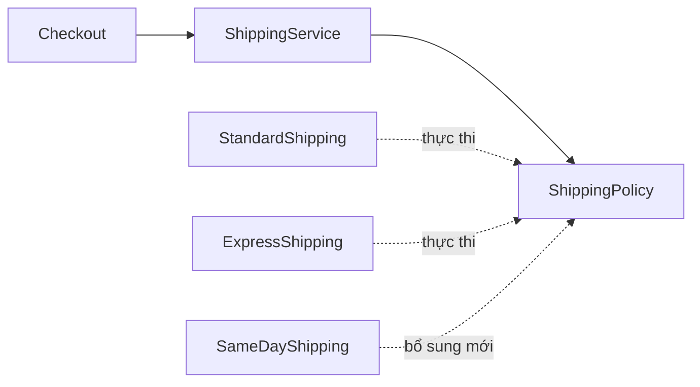
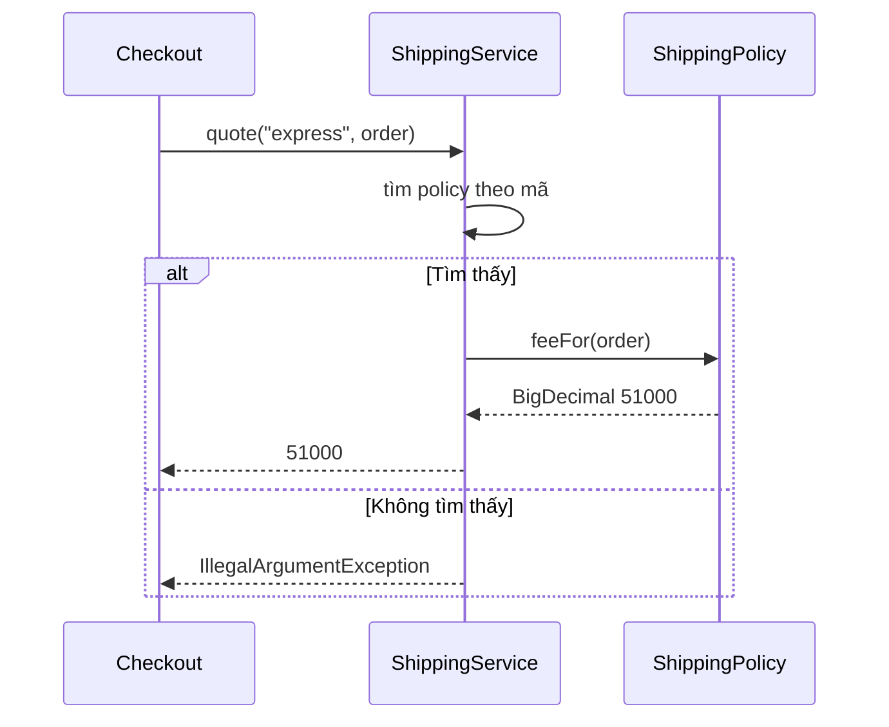

# Nguyên lý Đóng–Mở (Open/Closed Principle): mở rộng hành vi với thay đổi có kiểm soát

> **Mục tiêu:** Khi xuất hiện một quy tắc nghiệp vụ mới, có thể bổ sung cách xử lý mới qua điểm mở rộng được thiết kế sẵn; phần điều phối ổn định không phải sửa theo từng biến thể.

## 1. OCP thực sự nói gì?

Open/Closed Principle (OCP), chữ **O** trong SOLID, thường được diễn đạt: một thành phần phần mềm nên **mở cho việc mở rộng** và **đóng trước những sửa đổi do biến thể mới**.

- **Mở cho mở rộng:** có thể đưa vào cách tính phí, hình thức thanh toán, cách xuất báo cáo… mới thông qua hợp đồng (interface/abstract class), composition hoặc callback.
- **Đóng trước sửa đổi:** phần nghiệp vụ cốt lõi đã ổn định không cần thêm nhánh `if`, `switch`, `instanceof` mỗi khi có biến thể.
- **Có kiểm soát:** hợp đồng của điểm mở rộng quy định đầu vào, đầu ra, ngoại lệ, các bất biến và cách đăng ký thành phần. Mã mở rộng phải tuân thủ hợp đồng; bổ sung không được vô tình đổi hành vi hiện hành.

OCP **không** có nghĩa “đã viết class thì tuyệt đối không sửa”. Vẫn cần sửa lỗi, tăng tính rõ ràng, thay đổi yêu cầu nền tảng hoặc điều chỉnh một abstraction thiết kế sai. Mục tiêu là giảm số chỗ phải chỉnh và rủi ro hồi quy **khi thêm một biến thể đã được dự liệu**.

### Khi nào vấn đề xuất hiện?

Giả sử hệ thống bán hàng hiện có hai cách giao hàng: tiêu chuẩn và nhanh. Mỗi tháng lại thêm một dịch vụ mới. Nếu bộ phận tính phí chứa mọi công thức, mỗi dịch vụ mới buộc phải mở lại cùng một hàm và có thể làm hỏng logic cũ.

```java
// Thiết kế ban đầu: thêm dịch vụ mới luôn phải sửa hàm này.
BigDecimal shippingFee(String service, int weightGrams) {
    if ("STANDARD".equals(service)) {
        return new BigDecimal("20000");
    } else if ("EXPRESS".equals(service)) {
        long kilograms = (weightGrams + 999L) / 1000;
        return new BigDecimal("35000")
                .add(new BigDecimal("8000")
                .multiply(BigDecimal.valueOf(kilograms)));
    }
    throw new IllegalArgumentException("Dịch vụ không hỗ trợ: " + service);
}
```

Vấn đề không nằm ở riêng cú pháp `if/else`. Nó nằm ở **lý do thay đổi**: mỗi dịch vụ là một quy tắc độc lập, nhưng tất cả đều sửa cùng một điểm điều phối. Điều này tăng xung đột khi nhiều người phát triển, khối lượng kiểm thử hồi quy và nguy cơ bỏ quên một nhánh. Nếu tập lựa chọn là cố định và rất nhỏ thì `switch` vẫn có thể là thiết kế hợp lý.

## 2. Thiết kế điểm mở rộng bằng Strategy và đa hình

Trong ví dụ dưới đây, `ShippingService` chỉ biết hợp đồng `ShippingPolicy`, không phụ thuộc công thức của từng hãng giao hàng. Từng chính sách chịu trách nhiệm tính giá và có thể được thử nghiệm độc lập.



### Ví dụ Java 17 chạy được

Lưu toàn bộ mã dưới đây vào file `OpenClosedDemo.java`, chạy bằng `javac OpenClosedDemo.java` rồi `java OpenClosedDemo`.

```java
import java.math.BigDecimal;
import java.util.Map;
import java.util.Objects;

public class OpenClosedDemo {

    // Hợp đồng ổn định: mỗi chính sách trả về phí giao hàng bằng VND.
    interface ShippingPolicy {
        BigDecimal feeFor(Order order);
    }

    record Order(BigDecimal subtotal, int weightGrams) {
        Order {
            Objects.requireNonNull(subtotal, "subtotal");
            if (subtotal.signum() < 0) {
                throw new IllegalArgumentException("subtotal phải >= 0");
            }
            if (weightGrams <= 0) {
                throw new IllegalArgumentException("weightGrams phải > 0");
            }
        }
    }

    static final class StandardShipping implements ShippingPolicy {
        @Override
        public BigDecimal feeFor(Order order) {
            Objects.requireNonNull(order, "order");
            return new BigDecimal("20000");
        }
    }

    static final class ExpressShipping implements ShippingPolicy {
        @Override
        public BigDecimal feeFor(Order order) {
            Objects.requireNonNull(order, "order");
            long kilograms = (order.weightGrams() + 999L) / 1000L;
            return new BigDecimal("35000")
                    .add(new BigDecimal("8000")
                    .multiply(BigDecimal.valueOf(kilograms)));
        }
    }

    // Ví dụ mở rộng: thêm một chính sách, không sửa ShippingService.
    static final class SameDayShipping implements ShippingPolicy {
        @Override
        public BigDecimal feeFor(Order order) {
            Objects.requireNonNull(order, "order");
            if (order.subtotal().compareTo(new BigDecimal("500000")) >= 0) {
                return new BigDecimal("45000");
            }
            return new BigDecimal("70000");
        }
    }

    static final class ShippingService {
        private final Map<String, ShippingPolicy> policies;

        ShippingService(Map<String, ShippingPolicy> policies) {
            Objects.requireNonNull(policies, "policies");
            // Bản sao không sửa được để tránh thay đổi đăng ký từ bên ngoài.
            this.policies = Map.copyOf(policies);
        }

        BigDecimal quote(String serviceCode, Order order) {
            Objects.requireNonNull(serviceCode, "serviceCode");
            Objects.requireNonNull(order, "order");
            ShippingPolicy policy = policies.get(serviceCode);
            if (policy == null) {
                throw new IllegalArgumentException(
                        "Dịch vụ không hỗ trợ: " + serviceCode);
            }
            BigDecimal amount = Objects.requireNonNull(
                    policy.feeFor(order), "ShippingPolicy returned null");
            if (amount.signum() < 0) {
                throw new IllegalStateException(
                        "ShippingPolicy returned a negative fee");
            }
            return amount;
        }
    }

    public static void main(String[] args) {
        ShippingService service = new ShippingService(Map.of(
                "standard", new StandardShipping(),
                "express", new ExpressShipping(),
                "same-day", new SameDayShipping()
        ));
        Order order = new Order(new BigDecimal("150000"), 1200);

        System.out.println(service.quote("standard", order)); // 20000
        System.out.println(service.quote("express", order));  // 51000
        System.out.println(service.quote("same-day", order)); // 70000
    }
}
```

Lưu ý thực tế:

1. `ShippingPolicy` là **điểm biến thiên**. Chính sách mới thêm một lớp thực thi interface này, không buộc `ShippingService` sửa công thức tính.
2. `ShippingService` là **phần ổn định**, tra cứu chính sách, gọi `feeFor` và từ chối kết quả `null` hoặc phí âm để bảo vệ ranh giới tích hợp. Nó không dùng `instanceof` hoặc hỏi kiểu cụ thể để xử lý khác nhau.
3. `Map<String, ShippingPolicy>` là **cơ chế chọn và đăng ký**. Khi thêm dịch vụ, thay đổi ở nơi lắp ráp ứng dụng (composition root: ví dụ `main`, cấu hình hoặc DI container) là có chủ đích; OCP không đòi hỏi cả hệ thống tuyệt đối không thay đổi dòng nào.
4. `BigDecimal` phù hợp với tiền hơn `double` để tránh sai số nhị phân. Ví dụ giữ số tiền VND là giá trị nguyên, không tự ý làm tròn tại nhiều chỗ.
5. Đối tượng `Order` tự bảo vệ dữ liệu tối thiểu; chính sách mới phải trả phí hợp lệ. Trong dự án thật, có thể cần lớp `Money`/`Currency`, quy tắc làm tròn, giới hạn khối lượng và mức phí riêng.

Một hợp đồng tốt còn phải nêu điều **không được phép thay đổi**: `feeFor` không trả `null`, không trả phí âm, không thay đổi `Order`, áp dụng cùng đơn vị VND và có quy định rõ xử lý dữ liệu không hợp lệ. Những ràng buộc này không được diễn đạt hết bằng chữ ký phương thức; cần tài liệu, kiểm thử hợp đồng và review.

## 3. Hướng thay đổi: trước và sau

| Tình huống | Hàm tập trung `if/else` | Thiết kế qua `ShippingPolicy` |
|---|---|---|
| Thêm giao hàng trong ngày | Chèn nhánh vào hàm tính chung | Viết `SameDayShipping`, đăng ký chính sách |
| Sửa biểu phí giao nhanh | Sửa nhánh chung, dễ ảnh hưởng dịch vụ khác | Sửa `ExpressShipping` và test của nó |
| Đơn vị kiểm thử | Phải dựng nhiều trường hợp trong một hàm | Test từng chính sách theo hợp đồng chung |
| Phần cần ổn định | Dễ biến thành điểm thay đổi liên tục | `ShippingService` và lời gọi `feeFor` |
| Chi phí | Ban đầu rất ngắn, tăng dần khi có nhiều biến thể | Thêm interface, lớp, cấu hình và quản lý vòng đời |

Việc thêm `SameDayShipping` vẫn phải đăng ký vào `Map`. Nếu triển khai Spring, có thể để mỗi implementation là bean có tên và inject `Map<String, ShippingPolicy>` vào service; Spring tập hợp những bean tương ứng. Điều này hữu ích khi có nhiều plugin, nhưng không bắt buộc đối với ứng dụng Java thuần. Không cần đưa reflection hoặc plugin loader vào bài toán chỉ có hai công thức đơn giản.

### Sơ đồ luồng thực thi



Trong phương thức `quote`, `if (policy == null)` vẫn tồn tại, vì đó là **kiểm soát tính hợp lệ của yêu cầu**. OCP không cấm mọi `if`; điều cần tránh là điều phối bằng danh sách kiểu cụ thể liên tục phình to theo các biến thể.

## 4. “Đóng” ở cấp nào và thay đổi có kiểm soát ra sao?

OCP thường chỉ có giá trị khi xác định đúng **ranh giới biến thiên**:

- **Thay đổi thường xuyên:** cách tính phí, cách đánh giá khuyến mãi, cách gửi thông báo… → là ứng viên cho interface.
- **Thay đổi hiếm hoặc luôn đồng bộ:** các bước bất biến như xác thực mã dịch vụ, chặn đầu vào vô nghĩa, cách ghi nhận lỗi… → giữ ở thành phần điều phối.
- **Thay đổi hợp đồng nền tảng:** nếu tất cả phương thức phải bổ sung `DeliveryContext`, giao diện và các implementation có thể phải sửa. Đây là thay đổi kiến trúc có chủ đích, không phải vi phạm OCP tự động.

Ví dụ, khi muốn áp dụng phụ phí khu vực, có hai tình huống khác nhau:

- Nếu **mỗi chính sách tự quyết phụ phí vùng** và logic này thay đổi theo từng dịch vụ, thiết kế hợp đồng đầu vào (ví dụ thêm `Destination` vào `Order` hoặc `ShippingRequest`) rồi để chính sách phụ trách.
- Nếu **mọi chính sách luôn chịu cùng một phụ phí nền tảng**, nên cân nhắc xử lý chung trong service hoặc một decorator bọc chính sách thay vì sao chép vào từng implementation.

Không nên mở rộng `ShippingPolicy` thành một interface với hàng chục tham số dự phòng cho các kịch bản chưa xuất hiện. Mọi abstraction tạo ra chi phí: tên gọi, tài liệu hợp đồng, kiểm thử, DI, truyền dependency, khả năng debug.

## 5. Ví dụ mở rộng nâng cao bằng Decorator

Giả sử cần phụ thu cố định **5.000 VND** cho mọi dịch vụ khi giao đến vùng xa. Nếu yêu cầu mới này áp dụng như một lớp phủ nhất quán, có thể bọc chính sách hiện có thay vì sao chép công thức của từng dịch vụ.

```java
static final class RemoteAreaSurcharge implements ShippingPolicy {
    private final ShippingPolicy delegate;

    RemoteAreaSurcharge(ShippingPolicy delegate) {
        this.delegate = Objects.requireNonNull(delegate);
    }

    @Override
    public BigDecimal feeFor(Order order) {
        return delegate.feeFor(order).add(new BigDecimal("5000"));
    }
}

// Ví dụ sử dụng trong cùng OpenClosedDemo:
ShippingPolicy policy =
        new RemoteAreaSurcharge(new ExpressShipping());
BigDecimal total = policy.feeFor(
        new Order(new BigDecimal("150000"), 1200));
// total = 56000
```

Đoạn `RemoteAreaSurcharge` được viết như **lớp lồng trong `OpenClosedDemo`**, nên tái sử dụng được `ShippingPolicy`, `Order`, `ExpressShipping` từ ví dụ trước. Đây là ví dụ áp dụng decorator; khi tích hợp thực tế, chỉ bọc những chuyến hàng đủ điều kiện vùng xa (ví dụ tại composition root theo địa chỉ đã xác thực). Không nên bọc tất cả một cách mù quáng.

Mở rộng kiểu này khác với tạo subclass của `ShippingService` và ghi đè phương thức không được thiết kế cho việc ghi đè. **Ưu tiên composition khi muốn phối hợp nhiều hành vi độc lập.** Đừng biến inheritance thành điểm mở rộng mặc định.

## 6. Kiểm thử để bảo vệ phần “đóng”

Chỉ tách thành interface không tự bảo đảm an toàn. Mỗi implementation có thể âm thầm vi phạm hợp đồng (trả số âm, `null`, dùng sai đơn vị, thay đổi input, ném exception bất ngờ). Nên có hai tầng kiểm thử:

**Kiểm thử quy tắc riêng** (JUnit 5, giả sử mã ví dụ nằm trong `OpenClosedDemo` và các kiểu lồng trong đó có thể truy cập từ test cùng package):

```java
import static org.junit.jupiter.api.Assertions.*;
import java.math.BigDecimal;
import org.junit.jupiter.api.Test;

class ShippingPolicyTest {
    private final OpenClosedDemo.Order order =
            new OpenClosedDemo.Order(new BigDecimal("150000"), 1200);

    @Test
    void expressRoundsWeightUpToFullKilograms() {
        OpenClosedDemo.ShippingPolicy policy =
                new OpenClosedDemo.ExpressShipping();
        assertEquals(new BigDecimal("51000"), policy.feeFor(order));
    }

    @Test
    void aNewPolicyDoesNotChangeExistingExpressResult() {
        var policies = java.util.Map.<String, OpenClosedDemo.ShippingPolicy>of(
                "express", new OpenClosedDemo.ExpressShipping(),
                "same-day", new OpenClosedDemo.SameDayShipping()
        );
        var service = new OpenClosedDemo.ShippingService(policies);

        assertEquals(new BigDecimal("51000"), service.quote("express", order));
        assertEquals(new BigDecimal("70000"), service.quote("same-day", order));
    }
}
```

**Kiểm thử hợp đồng dùng chung:** với **mọi** `ShippingPolicy` đã đăng ký, chạy các trường hợp đầu vào hợp lệ, xác nhận kết quả khác `null`, không âm, đúng đơn vị; xác định hành vi với đầu vào bị từ chối. Trong hệ thống plugin, có thể dùng `@ParameterizedTest` kết hợp `@MethodSource` để thử cùng một contract cho mọi implementation. Chỉ kiểm tra kết quả không âm là chưa đủ: cần assert các mốc nghiệp vụ, biên khối lượng và những quy tắc của từng chiến lược.

Khi tích hợp, thêm thử nghiệm xem tên dịch vụ mới đã được đăng ký chưa và mã dịch vụ không xác định bị từ chối rõ ràng. Nếu sử dụng DI/container, kiểm tra trùng tên bean, thiếu bean, vòng đời singleton và dữ liệu trạng thái dùng chung.

## 7. Cạm bẫy khi áp dụng OCP

| Cạm bẫy | Vì sao có hại | Cách xử lý |
|---|---|---|
| Tạo interface cho mọi lớp | Phức tạp mà không có biến thể thực tế | Chỉ mở điểm có thay đổi độc lập và lặp lại |
| Sau khi tạo interface vẫn `instanceof` từng implementation | Service vẫn phải sửa khi có kiểu mới | Giao hành vi vào phương thức đa hình của interface |
| Đưa mọi công thức và bảng giá vào service | Điểm điều phối liên tục nhận yêu cầu mới | Tách chính sách độc lập; có thể dùng dữ liệu/cấu hình khi phù hợp |
| Sửa interface công khai theo từng biến thể | Gây dây chuyền sửa tất cả implementation | Chọn hợp đồng đủ ổn định; bổ sung capability riêng nếu thật sự khác biệt |
| Dùng kế thừa sâu | Dễ phụ thuộc implementation, khó phối hợp hành vi | Ưu tiên interface nhỏ và composition/decorator |
| Che lỗi bằng default policy | Mã dịch vụ nhập sai có thể âm thầm áp phí sai | Fail fast với thông báo rõ hoặc fallback theo quy định nghiệp vụ |
| Bỏ qua chất lượng implementation mới | Một plugin xấu làm hỏng luồng chung | Contract test, logging, code review và quy tắc tích hợp |
| Xem OCP là “không bao giờ sửa code cũ” | Bám abstraction lỗi thời, phát sinh vá víu | Refactor có kiểm soát khi dữ liệu thực tế chỉ ra cần đổi hợp đồng |

**OCP liên hệ với các nguyên lý SOLID khác:**

- **SRP:** mỗi chính sách có lý do thay đổi riêng. Nếu một chính sách vừa tính phí vừa gửi email, nó đang ôm nhiều trách nhiệm.
- **LSP:** implementation thay thế được cho `ShippingPolicy` mà không phá vỡ giả định của client. Điều này rất quan trọng để “mở rộng” vẫn an toàn.
- **ISP:** hợp đồng nhỏ khiến implementation không phải viết những hàm vô nghĩa.
- **DIP:** `ShippingService` phụ thuộc abstraction `ShippingPolicy` thay vì class cụ thể.

## 8. Quy trình refactor một đoạn code đang vi phạm OCP

1. **Nhận diện sự biến thiên:** liệt kê lý do gần đây phải sửa cùng một `if/switch`. Nếu là các quy tắc nghiệp vụ khác nhau, cân nhắc tách.
2. **Rút hợp đồng tối thiểu:** đặt tên từ nghiệp vụ như `ShippingPolicy.feeFor(Order)`, mô tả bất biến và xử lý lỗi.
3. **Di chuyển từng hành vi:** viết `StandardShipping` và `ExpressShipping` cho logic có sẵn; giữ kết quả giống trước.
4. **Chuyển client sang interface:** inject policy hoặc registry; xác nhận service không còn hỏi kiểu cụ thể.
5. **Bảo vệ bằng kiểm thử:** test kết quả cũ, điều kiện biên và hợp đồng chung.
6. **Thử thêm biến thể thật:** tạo `SameDayShipping`. Nếu vẫn phải sửa công thức trong service thì điểm mở rộng chưa đúng.
7. **Theo dõi độ phức tạp:** số lớp, wiring, khả năng quan sát lỗi và hiệu năng thực tế. Có thể giữ giải pháp đơn giản nếu chi phí abstraction vượt lợi ích.

### Bài tập tự luyện

**Bài 1 – Thanh toán.** Hệ thống hiện xử lý `CASH` và `BANK_TRANSFER` bằng `switch`. Thiết kế `PaymentMethod` với thao tác thanh toán và kết quả tường minh; mở rộng `QR_PAYMENT`. Phân biệt phần chung (validation, idempotency, logging) với phần thay đổi theo phương thức. Không lưu số thẻ hoặc thông tin nhạy cảm vào log.

**Bài 2 – Xuất báo cáo.** Đang có `PDF` và `CSV`. Chuyển sang `ReportExporter` với phương thức `export(ReportData)`. Thêm JSON mà không chỉnh thuật toán điều phối xuất báo cáo. Ghi rõ MIME type và quy tắc xử lý lỗi.

**Bài 3 – Phản biện thiết kế.** Một hệ thống chỉ có đúng hai trạng thái đóng/mở đã ổn định nhiều năm. Việc thêm ba interface, registry và dynamic plugin loader có giúp gì không? Giải thích bằng tần suất thay đổi, chi phí bảo trì và độ phức tạp vận hành.

## 9. Tự kiểm tra đã hiểu OCP chưa?

- Có chỉ rõ **điểm ổn định** và **trục biến thiên** cần mở rộng không?
- Khi thêm biến thể mới, có cần chỉnh các nhánh điều phối đã ổn định không?
- Interface có mô tả hành vi chung thực sự và đủ rõ để viết contract test không?
- Implementation mới có thay thế được implementation cũ tại vị trí client kỳ vọng không?
- Việc đăng ký/cấu hình có tường minh, fail fast và kiểm thử được không?
- Độ phức tạp bổ sung có tương xứng với tần suất yêu cầu thay đổi không?

**Ghi nhớ:** OCP là một quyết định về *ranh giới thay đổi*. Thiết kế tốt đặt phần thay đổi thường xuyên phía sau hợp đồng ổn định, cho phép thêm hành vi mới và khoanh vùng kiểm thử, nhưng vẫn sẵn sàng sửa abstraction khi yêu cầu nền tảng thật sự đổi.