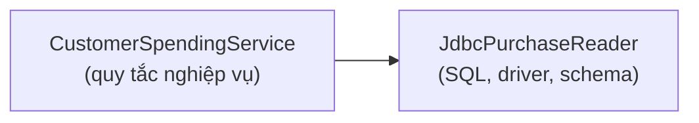
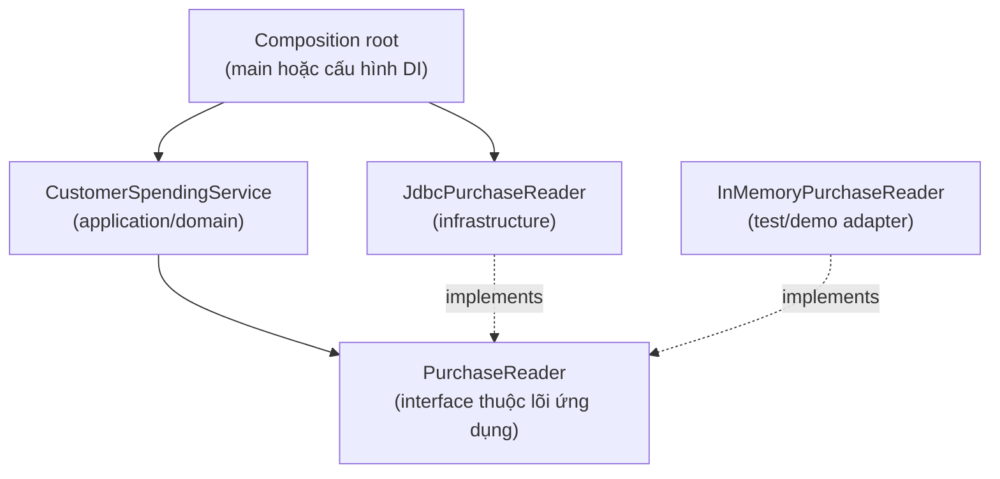
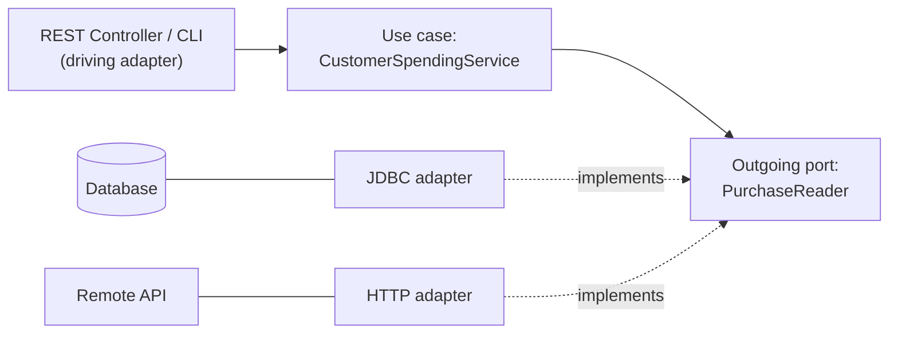

# Đảo ngược phụ thuộc (Dependency Inversion Principle – DIP): phụ thuộc vào sự trừu tượng

> **Mục tiêu:** Thiết kế để quy tắc nghiệp vụ quan trọng không bị buộc phải thay đổi mỗi khi thay cơ sở dữ liệu, API bên ngoài, cách lưu trữ hoặc công cụ gửi thông báo. Sau bài này, bạn có thể nhận diện hướng phụ thuộc sai, tự viết interface đúng ranh giới và lắp ráp các implementation bằng Java/Spring.

## 1. DIP là gì?

**Dependency Inversion Principle (DIP)** là chữ **D** trong SOLID, gồm hai ý quan trọng:

1. **Module cấp cao không nên phụ thuộc module cấp thấp; cả hai nên phụ thuộc vào abstraction.**
2. **Abstraction không nên phụ thuộc chi tiết triển khai; chi tiết triển khai phải phụ thuộc abstraction.**

Ở đây, **cấp cao** là thành phần diễn đạt quyết định nghiệp vụ, ví dụ tính doanh thu hợp lệ của một khách hàng. **Cấp thấp** là chi tiết kỹ thuật như SQL/JDBC, HTTP client, đọc file hoặc cache. Phân loại này nói về **mức độ chính sách và sự ổn định**, không phải “class ở package nào nằm phía trên”.

DIP quan tâm đến **hướng phụ thuộc ở mã nguồn** (import, sử dụng kiểu, tham chiếu module, liên kết khi biên dịch). Lúc chạy, nghiệp vụ vẫn có thể *gọi qua interface* để thực thi JDBC/HTTP; đó là luồng thực thi bình thường và không mâu thuẫn với DIP.

### Minh họa hướng phụ thuộc

**Trước – nghiệp vụ biết trực tiếp công nghệ:**



Ví dụ thiếu linh hoạt:

```java
// Phác họa một thiết kế bị phụ thuộc hạ tầng.
// Giả sử JdbcPurchaseReader đã được định nghĩa ở nơi khác.
class CustomerSpendingService {
    private final JdbcPurchaseReader reader = new JdbcPurchaseReader();

    long totalSpentVnd(String customerId) {
        // Mọi xử lý nghiệp vụ giờ gắn cứng với JDBC.
        return reader.findByCustomer(customerId)
                .stream()
                .filter(p -> !p.refunded())
                .mapToLong(Purchase::amountVnd)
                .sum();
    }
}
```

Nếu chuyển từ database sang API hoặc muốn chạy unit test không có database, lớp nghiệp vụ phải sửa cách khởi tạo/sử dụng dependency hoặc tạo môi trường hạ tầng thật. Đoạn mã trên mang tính **minh họa**, không phải ví dụ độc lập để biên dịch.

**Sau – cả nghiệp vụ và JDBC đều hướng về hợp đồng:**



Điểm mấu chốt: `CustomerSpendingService` chỉ biết **nó cần đọc những đơn mua nào**; nó không biết dữ liệu lấy từ JDBC, HTTP hay bộ nhớ. Implementation bên hạ tầng phải tuân theo yêu cầu đó.

## 2. Ví dụ Java 17 hoàn chỉnh: tổng tiền mua hàng chưa hoàn

Giả định nghiệp vụ: tính tổng giá trị các giao dịch **chưa hoàn tiền** của một khách hàng, số tiền được lưu dạng số nguyên VND. Nguồn giao dịch có thể đổi, nhưng quy tắc tính tổng vẫn giữ nguyên.

Lưu ví dụ sau thành `DipDemo.java` và chạy:

```bash
javac DipDemo.java
java DipDemo
```

```java
import java.util.ArrayList;
import java.util.HashMap;
import java.util.List;
import java.util.Map;
import java.util.Objects;

public class DipDemo {

    // Dữ liệu nghiệp vụ: độc lập SQL, HTTP, Spring và driver.
    record Purchase(String customerId, long amountVnd, boolean refunded) {
        Purchase {
            Objects.requireNonNull(customerId, "customerId");
            if (customerId.isBlank()) {
                throw new IllegalArgumentException("customerId phải có giá trị");
            }
            if (amountVnd < 0) {
                throw new IllegalArgumentException("amountVnd không được âm");
            }
        }
    }

    // PORT/ABSTRACTION do phía ứng dụng định nghĩa.
    // Hợp đồng: trả List khác null, rỗng khi không có giao dịch,
    // chỉ chứa giao dịch của customerId tương ứng.
    @FunctionalInterface
    interface PurchaseReader {
        List<Purchase> findByCustomer(String customerId);
    }

    // Chính sách nghiệp vụ: chỉ phụ thuộc PurchaseReader.
    static final class CustomerSpendingService {
        private final PurchaseReader reader;

        // Constructor injection: caller cung cấp implementation.
        CustomerSpendingService(PurchaseReader reader) {
            this.reader = Objects.requireNonNull(reader, "reader");
        }

        long totalSpentVnd(String customerId) {
            Objects.requireNonNull(customerId, "customerId");
            if (customerId.isBlank()) {
                throw new IllegalArgumentException("customerId phải có giá trị");
            }

            long total = 0L;
            List<Purchase> purchases =
                    Objects.requireNonNull(reader.findByCustomer(customerId),
                            "PurchaseReader phải trả List khác null");

            for (Purchase p : purchases) {
                Objects.requireNonNull(p, "giao dịch không được null");
                if (!customerId.equals(p.customerId())) {
                    throw new IllegalStateException(
                            "PurchaseReader trả sai customerId");
                }
                if (!p.refunded()) {
                    total = Math.addExact(total, p.amountVnd());
                }
            }
            return total;
        }
    }

    // ADAPTER: dữ liệu bộ nhớ phục vụ demo và test.
    static final class InMemoryPurchaseReader implements PurchaseReader {
        private final Map<String, List<Purchase>> data;

        InMemoryPurchaseReader(Map<String, List<Purchase>> source) {
            Objects.requireNonNull(source, "source");
            Map<String, List<Purchase>> copy = new HashMap<>();
            source.forEach((customerId, purchases) ->
                    copy.put(customerId, List.copyOf(purchases)));
            this.data = Map.copyOf(copy);
        }

        @Override
        public List<Purchase> findByCustomer(String customerId) {
            return data.getOrDefault(customerId, List.of());
        }
    }

    // COMPOSITION ROOT: là nơi duy nhất ví dụ biết implementation cụ thể.
    public static void main(String[] args) {
        PurchaseReader reader = new InMemoryPurchaseReader(Map.of(
            "KH01", List.of(
                new Purchase("KH01", 250_000, false),
                new Purchase("KH01", 100_000, true),
                new Purchase("KH01", 80_000, false)
            )
        ));

        CustomerSpendingService service = new CustomerSpendingService(reader);
        System.out.println(service.totalSpentVnd("KH01")); // 330000
        System.out.println(service.totalSpentVnd("KH02")); // 0
    }
}
```

**Vì sao đúng DIP?**

- `CustomerSpendingService` chứa phép tính và điều kiện lọc `refunded`. Nó không import JDBC, không khởi tạo repository cụ thể và không phụ thuộc framework.
- `PurchaseReader` diễn đạt **nhu cầu dữ liệu của nghiệp vụ** bằng các kiểu Java đơn giản, không lộ `ResultSet`, `Connection`, `ResponseEntity` hay `HttpResponse`.
- `InMemoryPurchaseReader` **phụ thuộc ngược vào hợp đồng** thông qua `implements PurchaseReader`. Sau này thêm adapter SQL/REST mà lớp tính tổng không cần thay đổi.
- `main` biết các lớp cụ thể vì nó **chịu trách nhiệm lắp ráp hệ thống**. Đây là ngoại lệ có chủ đích ở composition root, không phải vi phạm DIP của service.
- `Math.addExact` ném `ArithmeticException` nếu tổng `long` tràn. Với hệ thống tài chính đa tiền tệ hoặc cần phần lẻ, nên dùng kiểu `Money`/`BigDecimal` kèm đơn vị và quy tắc làm tròn.

DIP không làm cho mã hạ tầng biến mất. Nó **đặt ranh giới** để kiến thức hạ tầng ở đúng chỗ.

## 3. DIP, DI và IoC không phải ba tên gọi của cùng một thứ

| Khái niệm | Câu hỏi | Thể hiện trong ví dụ |
|---|---|---|
| **DIP** — nguyên lý kiến trúc | Mã nguồn của use case phụ thuộc **abstraction nào**, adapter có phụ thuộc ngược vào nó không? | `CustomerSpendingService → PurchaseReader ← InMemoryPurchaseReader` |
| **DI** — kỹ thuật lắp ghép | Dependency cụ thể được **truyền vào đối tượng** bằng cách nào? | `new CustomerSpendingService(reader)` |
| **IoC** — đảo quyền điều khiển ở phạm vi rộng | Bên ngoài có kiểm soát khởi tạo/luồng gọi/callback của thành phần không? | `main` hoặc Spring container tạo và nối object |
| **Composition root** | Ở đâu ứng dụng chọn implementation thật? | `main`, cấu hình Spring hoặc bootstrap |

```java
// DI có, nhưng DIP chưa đạt nếu nghiệp vụ phụ thuộc hạ tầng cụ thể:
class BadService {
    private final JdbcPurchaseReader jdbc;
    BadService(JdbcPurchaseReader jdbc) { this.jdbc = jdbc; }
}
```

Một constructor nhận `PurchaseReader` và được cấp `InMemoryPurchaseReader` hoặc adapter SQL **vừa sử dụng DI vừa hỗ trợ DIP**, miễn là package/module đặt abstraction đúng ranh giới. Không cần Spring để làm điều đó. Với dependency bắt buộc, constructor injection và field `final` thường rõ nhất; setter/field injection có chi phí về trạng thái khởi tạo. Phần chuyên sâu **Phân biệt đảo ngược phụ thuộc và tiêm phụ thuộc** trình bày mã thanh toán độc lập, Spring `@Bean`, fake tests, các kiểu injection và lỗi nhầm DI với DIP.

## 4. Ứng dụng cùng JDBC: thay nguồn dữ liệu mà giữ quy tắc tính tổng

Ví dụ adapter dưới đây phù hợp khi bảng `purchases` có ba cột `customer_id`, `amount_vnd`, `refunded`. Dùng Java JDBC chuẩn; đặt các type `Purchase` và `PurchaseReader` thành kiểu public/package phù hợp khi tách file thành nhiều package.

```java
import java.sql.*;
import java.util.ArrayList;
import java.util.List;
import java.util.Objects;
import javax.sql.DataSource;

// Phác họa adapter thực tế; Purchase/PurchaseReader dùng chung
// hợp đồng từ ví dụ phần 2.
final class JdbcPurchaseReader implements PurchaseReader {
    private final DataSource dataSource;

    JdbcPurchaseReader(DataSource dataSource) {
        this.dataSource = Objects.requireNonNull(dataSource);
    }

    @Override
    public List<Purchase> findByCustomer(String customerId) {
        String sql = """
            SELECT customer_id, amount_vnd, refunded
            FROM purchases
            WHERE customer_id = ?
            """;
        List<Purchase> result = new ArrayList<>();

        try (Connection connection = dataSource.getConnection();
             PreparedStatement stmt = connection.prepareStatement(sql)) {
            stmt.setString(1, customerId);
            try (ResultSet rs = stmt.executeQuery()) {
                while (rs.next()) {
                    result.add(new Purchase(
                        rs.getString("customer_id"),
                        rs.getLong("amount_vnd"),
                        rs.getBoolean("refunded")
                    ));
                }
            }
        } catch (SQLException ex) {
            throw new IllegalStateException("Không thể đọc giao dịch", ex);
        }
        return List.copyOf(result);
    }
}
```

Trong ứng dụng thật, adapter nên **ánh xạ** lỗi hạ tầng sang lỗi phù hợp với API của ứng dụng (ví dụ `PurchaseReadException`), có metrics, timeout, connection pool và logging an toàn. Nếu các cột SQL có thể `NULL`, cần xác định chính sách và kiểm tra `ResultSet.wasNull()` khi đọc kiểu nguyên thủy; ví dụ giả định database áp dụng `NOT NULL`. Dùng `PreparedStatement` để binding tham số, tránh ghép `customerId` trực tiếp vào SQL.

**Sau khi tạo `JdbcPurchaseReader`:** thay cách lắp ráp từ `new InMemoryPurchaseReader(...)` sang `new JdbcPurchaseReader(dataSource)`. `CustomerSpendingService` vẫn giữ nguyên. Tại ranh giới triển khai thật, cấu hình DB và định nghĩa bảng nằm ở tầng infrastructure, không được kéo vào `PurchaseReader`.

### Nơi đặt abstraction

Một tổ chức package thường gặp:

```text
com.example.shop
├── application
│   ├── CustomerSpendingService.java
│   └── port
│       └── PurchaseReader.java
├── domain
│   └── Purchase.java
├── infrastructure
│   ├── jdbc
│   │   └── JdbcPurchaseReader.java
│   └── memory
│       └── InMemoryPurchaseReader.java
└── bootstrap
    └── Application.java
```

Tầng `application` có thể biết `domain`; `infrastructure` biết contract của `application`; `bootstrap` biết các implementation để ghép nối. Không để application import infrastructure. Nếu tách thành **module** Maven/Gradle, kiểm tra dependency ở mức module thay vì chỉ tin vào tên package.

Chú ý: DIP không bắt buộc mọi interface phải nằm ở domain. Đặt ở **phía sở hữu nhu cầu**: hợp đồng lấy dữ liệu phục vụ use case có thể nằm ở `application.port`, còn quy tắc domain thuần túy có thể thuộc `domain`. Interface ở một module “common” khổng lồ đôi khi lại tạo phụ thuộc chung khó quản lý.

## 5. DI với Spring: framework chỉ quản lý khởi tạo

Khi sử dụng Spring Boot và Spring JDBC, adapter có thể nhận `JdbcTemplate` bằng constructor; service vẫn chỉ biết `PurchaseReader`.

```java
// Ví dụ dạng nhiều file trong project Spring Boot có spring-jdbc.
// Imports rút gọn: @Repository/@Service/JdbcTemplate/List.

@Repository
class SpringJdbcPurchaseReader implements PurchaseReader {
    private final JdbcTemplate jdbc;

    SpringJdbcPurchaseReader(JdbcTemplate jdbc) {
        this.jdbc = jdbc;
    }

    @Override
    public List<Purchase> findByCustomer(String customerId) {
        return jdbc.query(
            "SELECT customer_id, amount_vnd, refunded " +
            "FROM purchases WHERE customer_id = ?",
            (rs, rowNum) -> new Purchase(
                rs.getString("customer_id"),
                rs.getLong("amount_vnd"),
                rs.getBoolean("refunded")
            ),
            customerId
        );
    }
}

@Service
class CustomerSpendingService {
    private final PurchaseReader reader;

    CustomerSpendingService(PurchaseReader reader) {
        this.reader = reader;
    }

    // totalSpentVnd(...) giữ nguyên nghiệp vụ ở phần 2.
}
```

Spring tự inject implementation nếu chỉ có **một bean `PurchaseReader`** phù hợp. Nếu có nhiều implementation cùng kiểu, cần chọn minh bạch bằng `@Qualifier`, `@Primary`, cấu hình `@Bean` hoặc `@Profile`. Đây là trách nhiệm **wiring/deployment**, không đưa `if (isProduction) new Jdbc...` vào service.

**Lưu ý khả năng biên dịch:** đây là phác họa các class tách file, cần import `org.springframework.stereotype.Repository`, `org.springframework.stereotype.Service`, `org.springframework.jdbc.core.JdbcTemplate`, Java `List`, và khai báo các loại `Purchase`/`PurchaseReader` phù hợp; không thể ghép nguyên xi bên cạnh các lớp lồng cùng tên trong `DipDemo.java`. Ví dụ Java thuần ở phần 2 là ví dụ chạy trực tiếp, không cần Spring.

Một lựa chọn có tính tách biệt cao hơn là giữ service Java thuần không gắn `@Service`, đăng ký nó ở configuration:

```java
@Configuration
class SpendingConfiguration {
    @Bean
    CustomerSpendingService customerSpendingService(PurchaseReader reader) {
        return new CustomerSpendingService(reader);
    }
}
```

Khi đó service không cần import Spring. Chọn cách phù hợp quy mô và mục tiêu độc lập framework; cả hai đều có thể tuân DIP nếu hướng phụ thuộc đúng.

## 6. Kiểm thử: lợi ích đo được của DIP

Trong unit test, không cần kết nối database; cung cấp một implementation đơn giản của `PurchaseReader`. Vì interface chỉ có một phương thức, có thể dùng lambda Java để tạo **fake/stub**.

Ví dụ JUnit 5 (đặt test cùng package và tham chiếu type lồng `DipDemo` từ phần 2):

```java
import static org.junit.jupiter.api.Assertions.*;
import java.util.List;
import org.junit.jupiter.api.Test;

class CustomerSpendingServiceTest {
    @Test
    void ignoresRefundedPurchases() {
        DipDemo.PurchaseReader fake = customerId -> List.of(
            new DipDemo.Purchase(customerId, 90_000, false),
            new DipDemo.Purchase(customerId, 40_000, true),
            new DipDemo.Purchase(customerId, 10_000, false)
        );

        var service = new DipDemo.CustomerSpendingService(fake);
        assertEquals(100_000L, service.totalSpentVnd("KH01"));
    }

    @Test
    void returnsZeroForCustomerWithoutPurchases() {
        DipDemo.PurchaseReader fake = customerId -> List.of();
        var service = new DipDemo.CustomerSpendingService(fake);

        assertEquals(0L, service.totalSpentVnd("UNKNOWN"));
    }

    @Test
    void rejectsWrongCustomerReturnedByAdapter() {
        DipDemo.PurchaseReader faulty = customerId ->
            List.of(new DipDemo.Purchase("KH_KHAC", 50_000, false));
        var service = new DipDemo.CustomerSpendingService(faulty);

        assertThrows(IllegalStateException.class,
            () -> service.totalSpentVnd("KH01"));
    }
}
```

Kiểm thử đủ tốt cần ba lớp khác nhau:

| Lớp kiểm thử | Xác nhận | Có cần DB thực? |
|---|---|---|
| **Unit test của service** | Lọc hoàn tiền, cộng đúng, validate đầu vào, xử lý contract sai | Không; fake `PurchaseReader` |
| **Integration test adapter JDBC** | SQL đúng, map `NULL`/kiểu dữ liệu, transaction, lỗi kết nối, thứ tự nếu được yêu cầu | Có; dùng test database/Testcontainers khi phù hợp |
| **Application wiring test** | Container/`main` chọn đúng bean/adapter, không thiếu dependency, cấu hình ổn | Tùy phạm vi; có thể mock hạ tầng |

DIP làm giảm nhu cầu truy cập hạ tầng cho **unit test**, nhưng không thay thế integration test. Một fake trả dữ liệu đúng không chứng minh SQL đã viết đúng.

## 7. Hợp đồng tốt giúp đảo ngược phụ thuộc mà không rò rỉ chi tiết

Một interface đạt mục đích DIP nên mô tả **khả năng nghiệp vụ cần**, thay vì chép nguyên API kỹ thuật.

| Hợp đồng dễ rò rỉ hạ tầng | Hợp đồng hướng nhu cầu ứng dụng | Lý do |
|---|---|---|
| `ResultSet executeQuery(String sql)` | `List<Purchase> findByCustomer(String id)` | Use case không biết SQL và vòng đời connection |
| `HttpResponse<byte[]> fetch(String url)` | `ExchangeRate getRate(CurrencyPair pair)` | Ẩn URL, status code, cách parse |
| `void sendSmtp(MimeMessage message)` | `void notifyOrderConfirmed(OrderConfirmation confirmation)` | Use case không tự tạo SMTP message |
| `RedisTemplate getCache()` | `Optional<Product> findProduct(ProductId id)` | Không buộc logic ứng dụng phụ thuộc Redis |

Khi thiết kế port, viết ra các điều kiện sau:

1. **Đơn vị và bất biến:** `amountVnd` là số nguyên VND không âm; không tự động trộn VND và USD.
2. **Dữ liệu thiếu:** không có giao dịch thì danh sách rỗng; không trả `null`. Phân biệt “không tìm thấy” và “hạ tầng lỗi”.
3. **Ngữ nghĩa kết quả:** trả giao dịch đúng khách hàng; có hay không giao dịch đã hoàn tiền; yêu cầu sắp xếp nếu cần.
4. **Hành vi khi lỗi:** timeouts, retry, loại ngoại lệ, có thể lặp lại an toàn hay không. Không biến mọi lỗi DB thành “danh sách rỗng”.
5. **Thời gian và nhất quán:** nếu báo cáo theo kỳ hoặc nhiều nguồn, xác định timezone, snapshot, mức nhất quán và cơ chế phân trang.
6. **An toàn và bảo mật:** xác thực/quyền truy cập dữ liệu nên ở đúng ranh giới; không coi “đã có interface” là đủ chống SQL injection hoặc lộ dữ liệu.

Nếu nghiệp vụ cần phân trang lớn, việc port trả tất cả `List` có thể gây vấn đề bộ nhớ. Hãy thiết kế `Page`/`Cursor` phù hợp use case thực tế, nhưng tránh đưa class phân trang của một thư viện hạ tầng vào cốt lõi khi yêu cầu độc lập với framework.

## 8. Liên hệ DIP với Ports & Adapters (Hexagonal Architecture)

DIP là **nguyên lý về hướng phụ thuộc**. Ports & Adapters là một cách tổ chức kiến trúc giúp hiện thực nguyên lý đó.



Ở runtime, `CustomerSpendingService` gọi `findByCustomer` và Java dynamic dispatch chạy implementation tương ứng; nhưng **source dependency** của service chỉ hướng tới `PurchaseReader`.

Đây cũng là cách áp dụng DIP trong Clean Architecture, với tên tầng và vị trí interface có thể khác nhau giữa các tổ chức. Không cần dùng toàn bộ kiến trúc hexagonal mới được phép áp dụng DIP; ngay cả ứng dụng nhỏ vẫn có thể tách một phụ thuộc biến động cao.

**Khi nào không nên tạo port?**

- Logic thuần tính toán, ít khả năng thay đổi: dùng lớp/hàm trực tiếp có thể đơn giản hơn.
- Đối tượng dữ liệu hoặc utility ổn định và không đóng vai trò công nghệ bên ngoài: tạo interface vô cớ làm khó điều hướng.
- Chỉ có một implementation nhưng hạ tầng rất biến động hoặc unit test cần cô lập nó: vẫn có lý do tốt để có port.
- Mọi interface chỉ lặp lại đúng public methods của library (`IJdbcTemplate` chứa mọi hàm) mà nghiệp vụ không sở hữu: chưa đạt ranh giới có ý nghĩa.

Nguyên tắc thực tế: đặt abstraction khi nó **bảo vệ chính sách ổn định khỏi chi tiết dễ thay đổi** hoặc cho phép test độc lập có giá trị. Không đếm số lượng interface để đánh giá DIP.

## 9. Các lỗi làm đảo ngược phụ thuộc không hiệu quả

| Triệu chứng | Lỗi cốt lõi | Hướng sửa |
|---|---|---|
| `new JdbcPurchaseReader()` hoặc `JdbcTemplate` trong use case | Chính sách import trực tiếp chi tiết | Inject port `PurchaseReader` do ứng dụng sở hữu |
| Constructor có DI nhưng kiểu là `JdbcPurchaseReader` | Mới đổi cách lắp ghép, chưa đổi hướng phụ thuộc | Tham số/field theo port |
| Port trả `ResultSet`, `ResponseEntity`, `EntityManager` | Hạ tầng rò rỉ qua chữ ký | Trả model/kết quả thuộc miền ứng dụng |
| Port nằm trong module infrastructure | Module lõi vẫn phải import tầng thấp | Chuyển port vào application/domain hoặc module contract phù hợp |
| Adapter lỗi DB nhưng trả `List.of()` | Trộn “không có dữ liệu” với “không thể đọc” | Có exception/result phân biệt lỗi rõ |
| Fake pass, JDBC sai hợp đồng | Chỉ test logic với dữ liệu giả | Contract test và integration test của adapter |
| Tạo interface cho mọi helper | Chi phí abstraction không đem lại ranh giới ổn định | Giữ class/hàm thuần ở nơi ít biến động |

Một port nhỏ `PurchaseReader` giúp ISP; thêm adapter mới ít sửa chính sách giúp OCP; adapter phải trả đúng customer/không null để giữ LSP. **DIP không thay thế hợp đồng, kiểm tra đầu vào, transaction hay phân quyền.**

## 10. Quy trình refactor an toàn một dependency cụ thể

1. **Xác định logic cần bảo vệ:** ví dụ `CustomerSpendingService.totalSpentVnd` là quy tắc kinh doanh.
2. **Liệt kê các chi tiết đang bị gắn chặt:** `JdbcTemplate`, `DataSource`, SQL, SDK HTTP, cách khởi tạo.
3. **Đề xuất port từ nhu cầu của use case:** `PurchaseReader.findByCustomer` với model và quy tắc trả dữ liệu rõ ràng.
4. **Cho adapter hiện tại thực hiện port:** di chuyển mã SQL/HTTP vào infrastructure, ánh xạ dữ liệu về model chung.
5. **Inject vào use case qua constructor:** bỏ thao tác khởi tạo adapter khỏi business class.
6. **Lắp ráp ở composition root:** chọn adapter theo môi trường bằng code cấu hình minh bạch.
7. **Giữ behavior bằng test:** unit test cho nghiệp vụ, integration test cho adapter, wiring test nếu có DI.
8. **Đánh giá coupling còn sót:** package import, kiểu dữ liệu trả về, lỗi, transactions, logging, test fixtures, khả năng thay adapter.
9. **Chỉ thêm abstraction khi có lợi:** đo bằng số lý do phải sửa use case, tính độc lập kiểm thử và khả năng thay đổi hạ tầng.

### Bài tập thực hành

**Bài 1 – Đổi adapter:** Viết `CsvPurchaseReader implements PurchaseReader` đọc tập tin CSV thử nghiệm (đặt rule rõ về separator, encoding UTF-8, cột bắt buộc, lỗi định dạng). Giữ `CustomerSpendingService` và unit test của nó không đổi.

**Bài 2 – Thông báo đơn hàng:** Ban đầu `OrderService` gọi trực tiếp `SmtpClient`. Thiết kế một `OrderNotificationPort` theo nhu cầu nghiệp vụ và hai implementation `EmailNotificationAdapter`, `FakeNotificationAdapter`. Giải thích nơi tạo bean, xử lý khi gửi thất bại và cách tránh gửi trùng nếu retry.

**Bài 3 – Phản biện:** Một lập trình viên tạo `IStringFormatter` cho mọi `String.format` và gọi đây là DIP. Phân tích xem lớp nghiệp vụ có đang phụ thuộc chi tiết biến động cao nào không; số interface mới có đem lại lợi ích thực tế nào không.

**Bài 4 – Kiến trúc nhiều module:** Thiết kế phụ thuộc Maven/Gradle cho `domain`, `application`, `infrastructure`, `bootstrap`. Vẽ mũi tên phụ thuộc build-time và chứng minh `application` không được import package `infrastructure`.

## 11. Checklist tự đánh giá

- [ ] Tôi chỉ ra được **chính sách cấp cao** và **chi tiết cấp thấp** trong bài toán.
- [ ] Service không gọi `new` adapter cụ thể hoặc import thư viện hạ tầng.
- [ ] Abstraction diễn đạt *nhu cầu nghiệp vụ*, không lộ API kỹ thuật không cần thiết.
- [ ] Adapter thực thi hợp đồng; lựa chọn adapter được quyết định tại composition root.
- [ ] Tôi phân biệt rõ DIP (nguyên lý), DI (kỹ thuật) và IoC (điều khiển).
- [ ] Có unit test với fake đơn giản và integration test xác minh adapter thực tế.
- [ ] Hợp đồng quy định kết quả rỗng, lỗi, đơn vị, tính nhất quán và điều kiện biên.
- [ ] Mức độ abstraction tương xứng với chi phí thay đổi và khả năng bảo trì.

**Ghi nhớ:** DIP không có nghĩa “luôn phải dùng interface hoặc Spring”. DIP yêu cầu **chi tiết phải đi theo nhu cầu của phần nghiệp vụ ổn định**, để công nghệ có thể thay đổi trong phạm vi kiểm soát và logic quan trọng vẫn dễ hiểu, dễ kiểm thử.