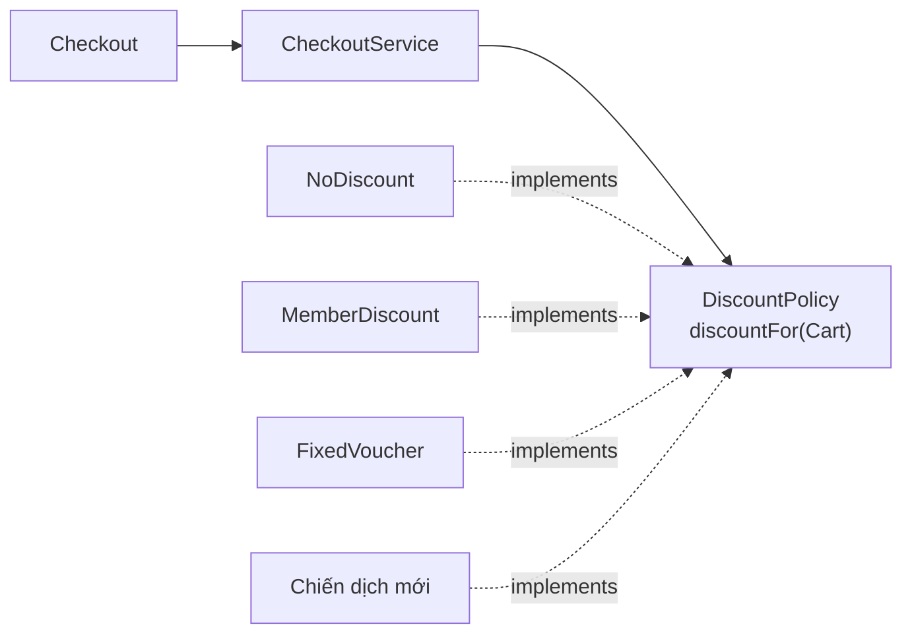
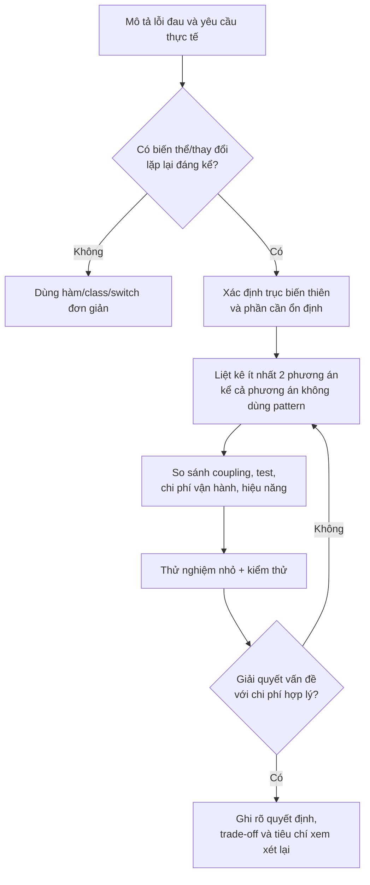

# Mẫu thiết kế: vấn đề, bối cảnh và đánh đổi

> **Mục tiêu học tập:** Không chỉ nhớ tên các Design Pattern, mà biết phân tích vấn đề đang gặp, đọc bối cảnh và ràng buộc, so sánh các phương án, lựa chọn mẫu thiết kế phù hợp rồi đo tác động thực tế của lựa chọn đó bằng mã Java và kiểm thử.

## 1. Mẫu thiết kế giải quyết điều gì?

**Design Pattern (mẫu thiết kế)** là một cách tổ chức sự cộng tác giữa các đối tượng hoặc thành phần đã được đúc kết để giải quyết **một vấn đề thiết kế lặp lại trong một bối cảnh nhất định**.

Mẫu thiết kế **không phải**:
- Một class, thư viện hoặc đoạn mã có thể chép nguyên xi vào mọi dự án.
- Một yêu cầu bắt buộc khi lập trình hướng đối tượng.
- Bằng chứng tự động rằng kiến trúc tốt, hiệu năng cao hay dễ bảo trì.
- Thay thế cho hiểu biết về domain, thiết kế dữ liệu, bảo mật, transaction và kiểm thử.

Một cách đọc đầy đủ một pattern thường gồm:

| Thành phần | Câu hỏi cần trả lời |
|---|---|
| **Tên / ý định (intent)** | Mẫu này giải quyết loại vấn đề nào? |
| **Vấn đề (problem)** | Điều gì hiện tại gây khó sửa, khó thay thế, dễ lỗi hoặc lặp mã? |
| **Bối cảnh (context)** | Hệ thống có bao nhiêu biến thể, thay đổi thường xuyên đến đâu, ai dùng, có ràng buộc gì? |
| **Lực kéo / mâu thuẫn (forces)** | Những mục tiêu nào đang cạnh tranh: linh hoạt với đơn giản, tái sử dụng với cô lập, hiệu năng với dễ hiểu? |
| **Giải pháp (solution)** | Đối tượng nào đảm nhiệm vai trò gì; quan hệ và điểm thay đổi nằm ở đâu? |
| **Hệ quả (consequences)** | Giảm coupling ở đâu, thêm abstraction gì, chi phí runtime và kiểm thử thế nào? |
| **Điều kiện áp dụng** | Tín hiệu nào cho thấy pattern phù hợp, và tình huống nào nên chọn cách đơn giản hơn? |

**Công thức tư duy:** vấn đề cụ thể + bối cảnh thực tế + các đánh đổi chấp nhận được → **quyết định thiết kế**. Tên pattern chỉ là ngôn ngữ ngắn gọn để trao đổi sau khi đã hiểu quyết định.

### Ví dụ về phát biểu vấn đề

Phát biểu mơ hồ: “Module tính chiết khấu của chúng ta cần Strategy Pattern.”

Phát biểu có thể kiểm chứng:

> “Có bốn nhóm quy tắc chiết khấu độc lập, dự kiến thêm theo từng chiến dịch. Mỗi quy tắc đang làm phải sửa lại `CheckoutService` qua một nhánh `if/else`. Chúng ta muốn thêm quy tắc mới mà không thay đổi thuật toán chốt đơn và có thể thử nghiệm từng quy tắc độc lập.”

Phát biểu thứ hai làm rõ **nỗi đau**, **động lực thay đổi** và **tiêu chí thành công**. Lúc đó Strategy mới trở thành một phương án đáng cân nhắc.

## 2. Bối cảnh quyết định mẫu nào phù hợp

Hai chương trình trông giống nhau trên biểu đồ lớp chưa chắc nên dùng cùng một pattern. Trước khi lựa chọn, hãy hỏi:

1. **Điều gì thay đổi?** Số loại xử lý, thuật toán, định dạng, trạng thái, API bên ngoài hay vòng đời đối tượng?
2. **Tần suất và chủ sở hữu thay đổi?** Một quy tắc đổi vài lần một năm hay có nhiều đội bổ sung biến thể mỗi tuần?
3. **Cái gì phải ổn định?** Hợp đồng public, kết quả tính tiền, schema, latency, cách kiểm soát lỗi hay tiến trình release?
4. **Đường đi của lời gọi?** Xử lý đồng bộ hay bất đồng bộ; có đa luồng, transaction hoặc network không?
5. **Chi phí tổ chức?** Đội ngũ có dễ tra cứu luồng xử lý qua interface/DI registry không? Người trực vận hành có xác định được implementation chạy thật không?
6. **Khả năng quan sát và kiểm thử?** Có test cho quy tắc cũ, kiểm thử hợp đồng cho implementation mới, logging/metrics đủ để điều tra lỗi không?
7. **Bài toán nào chưa cần giải?** Tránh tạo điểm mở rộng cho hàng chục khả năng chỉ mới tưởng tượng.

Bốn tín hiệu thường gợi ý cân nhắc pattern:

- Một nhánh lựa chọn hành vi liên tục tăng và mỗi nhánh là **quy tắc độc lập** → xem xét **Strategy**.
- Có nhiều cách tạo object phức tạp, không muốn client phụ thuộc lớp cụ thể → cân nhắc **Factory Method / Abstract Factory**.
- Cần nói chuyện với API không cùng hợp đồng hoặc phải bọc thêm hành vi → cân nhắc **Adapter / Decorator** tùy mục tiêu.
- Nhiều thành phần phải phản ứng khi một sự kiện/trạng thái đổi → cân nhắc **Observer** hoặc một cơ chế thông báo sự kiện phù hợp.

Đây là **gợi ý chẩn đoán**, không phải luật cứng. Cùng một vấn đề vẫn có thể giải quyết đơn giản bằng một hàm thuần túy, một `switch`, một bảng dữ liệu, composition thông thường hoặc một module riêng.

## 3. Một ví dụ xuyên suốt: tính chiết khấu trong checkout

Giả sử hệ thống bán hàng có ba lựa chọn:

- Không chiết khấu.
- Thành viên nhận **5% giá trị giỏ hàng**.
- Mã khuyến mãi cố định **30.000 VND**, không vượt giá trị giỏ hàng.

Trong ví dụ, giỏ hàng được biểu diễn bằng tổng tiền VND nguyên; quy tắc làm tròn phần trăm là `HALF_UP` tới đơn vị VND. Mỗi checkout áp dụng **một chính sách** đã chọn. Đây là giả định nghiệp vụ để ví dụ rõ ràng, không phải khẳng định mọi hệ thống thương mại chỉ được dùng một khuyến mãi.

### 3.1. Cách đơn giản, phù hợp khi biến thể ít và ổn định

```java
enum DiscountKind { NONE, MEMBER, VOUCHER }

static long discountVnd(long subtotalVnd, DiscountKind kind) {
    if (subtotalVnd < 0) {
        throw new IllegalArgumentException("Tổng tiền không được âm");
    }
    return switch (kind) {
        case NONE -> 0L;
        // Ví dụ số nguyên gần đúng: phải thận trọng với quy tắc làm tròn,
        // overflow và đơn vị tiền khi xây dựng hệ thống thật.
        case MEMBER -> java.math.BigDecimal.valueOf(subtotalVnd)
                .multiply(new java.math.BigDecimal("0.05"))
                .setScale(0, java.math.RoundingMode.HALF_UP)
                .longValueExact();
        case VOUCHER -> Math.min(30_000L, subtotalVnd);
    };
}
```

`switch` ở đây **không sai**. Nếu ba lựa chọn ổn định, được sở hữu bởi cùng một nhóm và toàn bộ quy tắc ngắn gọn, đây có thể là thiết kế tốt nhất: ít lớp, dễ lần theo luồng, ít nơi phải cấu hình. Đừng tự động đổi mọi `switch` thành Strategy.

### 3.2. Khi biến thể là một trục thay đổi thật: Strategy

Khi nhiều đội bổ sung các hình thức chiết khấu và mỗi loại có kiểm thử riêng, có thể tách thành các chính sách thống nhất bởi một hợp đồng.



Ví dụ **Java 17 độc lập**, lưu thành `PatternDecisionDemo.java`, chạy bằng `javac PatternDecisionDemo.java` và `java PatternDecisionDemo`:

```java
import java.math.BigDecimal;
import java.math.RoundingMode;
import java.util.Objects;

public class PatternDecisionDemo {

    record Cart(BigDecimal subtotalVnd) {
        Cart {
            Objects.requireNonNull(subtotalVnd, "subtotalVnd");
            if (subtotalVnd.signum() < 0 ||
                    subtotalVnd.stripTrailingZeros().scale() > 0) {
                throw new IllegalArgumentException(
                        "subtotalVnd phải là số nguyên VND không âm");
            }
        }
    }

    // Hợp đồng nhỏ, diễn đạt một khả năng thay đổi độc lập.
    interface DiscountPolicy {
        BigDecimal discountFor(Cart cart);
    }

    static final class NoDiscount implements DiscountPolicy {
        @Override
        public BigDecimal discountFor(Cart cart) {
            Objects.requireNonNull(cart, "cart");
            return BigDecimal.ZERO;
        }
    }

    static final class MemberDiscount implements DiscountPolicy {
        @Override
        public BigDecimal discountFor(Cart cart) {
            Objects.requireNonNull(cart, "cart");
            return cart.subtotalVnd()
                    .multiply(new BigDecimal("0.05"))
                    .setScale(0, RoundingMode.HALF_UP);
        }
    }

    static final class FixedVoucher implements DiscountPolicy {
        private final BigDecimal amountVnd;

        FixedVoucher(BigDecimal amountVnd) {
            Objects.requireNonNull(amountVnd, "amountVnd");
            if (amountVnd.signum() < 0 ||
                    amountVnd.stripTrailingZeros().scale() > 0) {
                throw new IllegalArgumentException(
                        "amountVnd phải là số nguyên VND không âm");
            }
            this.amountVnd = amountVnd;
        }

        @Override
        public BigDecimal discountFor(Cart cart) {
            Objects.requireNonNull(cart, "cart");
            return amountVnd.min(cart.subtotalVnd());
        }
    }

    // Không hỏi cụ thể từng kiểu chính sách.
    static final class CheckoutService {
        private final DiscountPolicy policy;

        CheckoutService(DiscountPolicy policy) {
            this.policy = Objects.requireNonNull(policy, "policy");
        }

        BigDecimal payableFor(Cart cart) {
            Objects.requireNonNull(cart, "cart");
            BigDecimal discount = Objects.requireNonNull(
                    policy.discountFor(cart), "discount không được null");

            // Bảo vệ invariant của phần điều phối.
            if (discount.signum() < 0 ||
                    discount.compareTo(cart.subtotalVnd()) > 0 ||
                    discount.stripTrailingZeros().scale() > 0) {
                throw new IllegalStateException(
                        "Chính sách trả mức chiết khấu không hợp lệ");
            }
            return cart.subtotalVnd().subtract(discount);
        }
    }

    public static void main(String[] args) {
        Cart cart = new Cart(new BigDecimal("400000"));

        CheckoutService member = new CheckoutService(
                new MemberDiscount());
        CheckoutService voucher = new CheckoutService(
                new FixedVoucher(new BigDecimal("30000")));
        CheckoutService none = new CheckoutService(
                new NoDiscount());

        System.out.println(member.payableFor(cart));  // 380000
        System.out.println(voucher.payableFor(cart)); // 370000
        System.out.println(none.payableFor(cart));    // 400000
    }
}
```

**Vai trò trong mẫu Strategy:**

| Thành phần | Vai trò | Lý do |
|---|---|---|
| `DiscountPolicy` | Strategy interface | Định nghĩa thao tác chung và kỳ vọng đầu vào/đầu ra |
| `MemberDiscount`, `FixedVoucher`, `NoDiscount` | Concrete strategies | Mỗi loại giữ một công thức độc lập |
| `CheckoutService` | Context | Chỉ điều phối checkout, gọi strategy và kiểm tra invariant |
| `main` | Composition root | Chọn strategy được sử dụng tại thời điểm lắp ráp |

**Mở rộng hành vi:** bổ sung `SeasonalDiscount implements DiscountPolicy` mà không phải thêm nhánh mới trong `CheckoutService`. Nếu có giao diện cho người dùng chọn loại chiết khấu, phần **wiring** vẫn phải biết ánh xạ mã chiến dịch sang strategy hoặc nhận qua cơ chế đăng ký phù hợp; sự thay đổi này là bình thường.

**Đánh đổi thật sự:** tăng số lớp, thêm interface, cấu hình lựa chọn strategy và đòi hỏi hợp đồng chặt chẽ giữa các implementation. Lợi ích chủ yếu là tách rời biến thể, giảm sửa phần điều phối và kiểm thử chiến lược độc lập; không phải tăng tốc độ chạy chương trình.

### 3.3. So sánh trước khi quyết định

| Tiêu chí | `switch` tập trung | Strategy |
|---|---|---|
| Ba quy tắc ngắn, hiếm đổi | Thường đơn giản và rõ hơn | Có thể dư abstraction |
| Thêm quy tắc mới thường xuyên | Phải sửa `switch` | Thêm implementation và wiring |
| Kiểm thử từng quy tắc | Có thể làm được, thường chung một đơn vị mã | Dễ cô lập từng strategy |
| Theo dõi luồng | Đọc một hàm | Theo interface, implementation, lắp ráp |
| Hỗ trợ plugin/đội khác bổ sung quy tắc | Khó tách quyền sở hữu | Phù hợp hơn nếu có contract rõ |
| Chi phí nhận thức | Thấp lúc ban đầu, có thể tăng theo nhánh | Cao hơn lúc ban đầu, ổn định hơn khi nhiều biến thể |
| Rủi ro hệ thống | Hàm lớn, thêm nhánh dễ ảnh hưởng nhánh khác | Cấu hình nhầm strategy, implementation vi phạm hợp đồng |

Không nên chọn Strategy chỉ vì nhìn thấy `if`. Cần chứng minh rằng **cách xử lý là trục biến thiên** có tần suất và độc lập đủ lớn.

## 4. Cơ chế đánh đổi: pattern giải quyết một lực kéo và tạo lực kéo khác

Các nguyên tắc thiết kế thường xung đột:

- **Ít coupling** với implementation ↔ **nhiều indirection** (thêm lớp trung gian khi điều hướng).
- **Mở rộng bằng lớp mới** ↔ **nhiều loại object và cấu hình** cần quản lý.
- **Ẩn chi tiết hạ tầng** ↔ **khó thấy implementation thực tế** nếu DI/registry thiếu minh bạch.
- **Composition linh hoạt** ↔ **thứ tự ghép thành phần** có thể ảnh hưởng hành vi.
- **Thông báo sự kiện tách rời** ↔ **khó xác định thứ tự, lỗi và tính nhất quán**.
- **Tạo object qua factory** ↔ **logic lựa chọn loại object tập trung thêm tại factory**.

Một pattern thành công khi những chi phí mới **được chủ động chấp nhận** và nhỏ hơn nỗi đau nó giải quyết. Trong review thiết kế, hỏi “Pattern này chuyển trách nhiệm và chi phí sang đâu?” thường hữu ích hơn hỏi “Pattern này thuộc nhóm nào?”.

## 5. Những nhóm pattern thường gặp

Danh mục kinh điển **Gang of Four (GoF)** chia 23 mẫu thành ba nhóm theo ý định. Bảng dưới đây chỉ chọn một số mẫu điển hình; phân nhóm không thay thế việc phân tích tình huống cụ thể.

| Nhóm | Pattern | Khi nào cân nhắc | Đánh đổi cần nhớ |
|---|---|---|---|
| **Creational** | Factory Method | Cần hoãn việc quyết định class cụ thể cho lớp con/điểm mở rộng tạo object | Tăng phân cấp và gián tiếp hóa |
| **Creational** | Abstract Factory | Tạo **họ** đối tượng liên quan nhất quán (ví dụ bộ UI Windows/Mac) | Khó bổ sung một *loại sản phẩm mới* vào mọi factory |
| **Creational** | Builder | Object có nhiều tùy chọn hoặc quá trình tạo phức tạp, cần xây dựng dễ đọc | Thêm builder/state và bước validate |
| **Creational** | Singleton | Thật sự cần một instance duy nhất trong phạm vi xác định | Trạng thái toàn cục, coupling và khó kiểm thử; DI singleton scope có ý nghĩa khác với constructor private |
| **Structural** | Adapter | Bên gọi cần một interface nhưng thư viện bên ngoài có API khác | Thêm lớp chuyển đổi, có thể mất thông tin/ngữ nghĩa |
| **Structural** | Decorator | Cần thêm hành vi quanh object mà vẫn giữ cùng interface | Thứ tự bọc quan trọng, khó theo dõi nhiều lớp |
| **Structural** | Facade | Nhiều API con phức tạp, muốn một điểm tiếp cận đơn giản | Facade có thể phình to và che mất các khả năng đặc thù |
| **Behavioral** | Strategy | Nhiều thuật toán có thể hoán đổi theo ngữ cảnh | Nhiều implementation, cần cơ chế chọn phù hợp |
| **Behavioral** | Observer | Một thay đổi cần thông báo nhiều đối tượng quan sát | Thứ tự, vòng đời đăng ký, lỗi callback và backpressure |
| **Behavioral** | Command | Cần biểu diễn một yêu cầu như object để queue, log, undo hoặc retry | Thêm object/cấu trúc dữ liệu, quản lý idempotency khi retry |
| **Behavioral** | State | Hành vi phụ thuộc trạng thái, chuyển trạng thái phức tạp | Nhiều lớp trạng thái, cần kiểm soát transition hợp lệ |
| **Behavioral** | Template Method | Khung thuật toán cố định, vài bước được chuyên biệt bằng kế thừa | Coupling qua inheritance, thay thế khó hơn composition |

**Phân biệt mức độ:** Design Pattern dạng GoF thường nói về cộng tác giữa các đối tượng; **architectural pattern** (ví dụ Layered Architecture, Hexagonal Architecture) tác động đến ranh giới toàn hệ thống. **Idiom** là lối viết theo ngôn ngữ (ví dụ `try-with-resources` trong Java). Không nên áp một pattern ở mọi cấp độ chỉ vì chúng có tên quen thuộc.

## 6. Cùng một yêu cầu, chọn đúng pattern theo mục tiêu

Ví dụ cần tích hợp dịch vụ gửi tin nhắn của nhà cung cấp mới. Nếu mục tiêu là đổi giao diện từ SDK sang hợp đồng nội bộ:

```java
interface SmsSender {
    void send(String phoneNumber, String message);
}

// API nhà cung cấp bên ngoài có chữ ký khác.
final class VendorSmsSdk {
    void dispatchText(String destination, String payload) {
        // Gọi API thực tế, xử lý HTTP/auth tại adapter.
    }
}

// Adapter biến lời gọi nội bộ thành lời gọi SDK.
final class VendorSmsAdapter implements SmsSender {
    private final VendorSmsSdk sdk;

    VendorSmsAdapter(VendorSmsSdk sdk) {
        this.sdk = java.util.Objects.requireNonNull(sdk);
    }

    @Override
    public void send(String phoneNumber, String message) {
        sdk.dispatchText(phoneNumber, message);
    }
}
```

Đây là **Adapter**: đổi *hình thức hợp đồng*, đồng thời che API vendor. Nó không tự động xử lý retry, cước tin nhắn, bảo mật hay tính đúng đắn của số điện thoại.

Nếu hợp đồng `SmsSender` đã ổn, nhưng muốn **bổ sung metric** cho mọi lần gửi:

```java
interface SendMetrics {
    void countSuccess();
    void countFailure();
}

final class MeteredSmsSender implements SmsSender {
    private final SmsSender delegate;
    private final SendMetrics metrics;

    MeteredSmsSender(SmsSender delegate, SendMetrics metrics) {
        this.delegate = java.util.Objects.requireNonNull(delegate);
        this.metrics = java.util.Objects.requireNonNull(metrics);
    }

    @Override
    public void send(String phoneNumber, String message) {
        try {
            delegate.send(phoneNumber, message);
            metrics.countSuccess();
        } catch (RuntimeException e) {
            metrics.countFailure();
            throw e;
        }
    }
}
```

Đây là **Decorator**: giữ cùng interface và bọc thêm chức năng trước/sau khi delegate xử lý. Các đoạn Java ở mục này là **mẫu tách file/ghép theo package** để giải thích cấu trúc; phần `main` hoàn chỉnh có thể biên dịch độc lập nằm ở mục 3.

**Vấn đề khác nhau, pattern khác nhau:**

| Điều cần thay đổi | Phương án có thể xét | Vì sao |
|---|---|---|
| Thay API vendor bằng cùng hợp đồng ứng dụng | Adapter | Chuyển đổi interface |
| Thêm metrics, tracing hoặc hành vi bao quanh | Decorator | Bọc đối tượng giữ nguyên interface |
| Có nhiều cách chọn kênh SMS/email/push | Strategy | Hoán đổi thuật toán/cách gửi |
| Nhiều hệ thống muốn phản ứng sau khi đơn hàng được duyệt | Observer hoặc event messaging | Thông báo bên quan tâm |
| Cần gói yêu cầu gửi lại vào job có thể queue/retry | Command/job object | Biểu diễn yêu cầu thành dữ liệu có thể chuyển giao |

Nếu thông báo phải đảm bảo giao dịch và giao hàng tin cậy qua mạng, **Observer in-process** không đủ: cần xử lý message broker, outbox, retry, idempotency và các trường hợp partial failure. Pattern không thay thế các yêu cầu phân tán.

### Thứ tự bọc thay đổi kết quả

```text
new RetrySender(new MeteredSmsSender(actual, metrics))
    → metrics ghi nhận từng attempt được retry

new MeteredSmsSender(new RetrySender(actual), metrics)
    → metrics ghi nhận một lần gửi logic sau retry
```

Hai cách ghép đều có thể hợp lệ; chọn theo yêu cầu đo lường. Đây là ví dụ minh họa về hệ quả của **Decorator/composition**, không phải code hoàn chỉnh của `RetrySender`.

## 7. Quy trình lựa chọn mẫu từ tình huống thực tế



Thực hiện bằng một tình huống cụ thể:

1. **Ghi nhận thay đổi gần đây:** đếm số lần sửa module trong 3–6 tháng, số branch độc lập và số lỗi hồi quy (đừng dựa hoàn toàn vào cảm giác).
2. **Tách “what” khỏi “how”:** chính sách nghiệp vụ cần hành vi gì và implementation thực hiện bằng kỹ thuật nào?
3. **Nêu ràng buộc bắt buộc:** độ đúng, bảo mật, độ trễ, thread-safety, transaction, backward compatibility.
4. **So sánh baseline với ứng viên:** trước tiên thử cải thiện tên hàm, tách phương thức hoặc mapping dữ liệu; chỉ nâng lên Strategy/Factory/Observer khi có lợi.
5. **Dựng spike nhỏ:** có thể thử thêm một biến thể hoàn toàn mới mà ít sửa phần lõi không? Luồng debug có bị khó quá mức không?
6. **Định nghĩa contract và test:** xác định kết quả, ngoại lệ, bất biến, giới hạn và concurrency.
7. **Viết một quyết định thiết kế ngắn:** bối cảnh, phương án đã xem, lý do chọn, hệ quả và tình huống cần xét lại.
8. **Đánh giá sau khi có dữ liệu:** pattern được giữ, thu gọn hoặc thay thế khi bối cảnh thay đổi.

### Một bản ghi quyết định kiến trúc (ADR) mẫu

```markdown
# ADR: Tách chính sách chiết khấu khỏi CheckoutService

Trạng thái: Chấp nhận (ví dụ minh họa)

Bối cảnh:
- Có nhiều chương trình khuyến mãi được phát triển độc lập.
- Phần điều phối checkout phải ổn định và dùng chung validation.
- Các quy tắc cần unit test riêng, thêm mới thường xuyên.

Phương án:
1. Duy trì switch tập trung.
2. Dùng bảng cấu hình nếu mọi quy tắc thuần dữ liệu.
3. Dùng DiscountPolicy (Strategy) cho quy tắc có hành vi khác nhau.

Quyết định:
- Chọn Strategy cho các chiến dịch có thuật toán khác biệt.
- Composition root ánh xạ mã chiến dịch sang implementation.

Hệ quả:
+ Ít sửa luồng checkout khi thêm chiến dịch.
+ Test được từng chính sách riêng.
- Thêm interface, class và cấu hình.
- Phải kiểm tra contract: mức giảm nằm trong [0, subtotal].

Xem xét lại khi:
- Các chiến dịch chủ yếu chuyển thành cấu hình dữ liệu,
  hoặc số chiến dịch giảm và rất hiếm thay đổi.
```

## 8. Kiểm thử pattern theo hành vi và hợp đồng

Pattern tốt phải giúp **kiểm soát thay đổi** mà không phá invariant. Với ví dụ Strategy, các test sau nên được ưu tiên:

- Khi `subtotalVnd = 400000`, thành viên được giảm 20000 VND.
- Khi giỏ hàng 20000 VND, voucher 30000 VND chỉ giảm tối đa 20000 VND; payable bằng 0.
- Với `subtotalVnd = 0`, payable bằng 0 cho mọi chính sách hợp lệ.
- Một implementation mới trả chiết khấu âm, vượt giỏ hàng hoặc `null` phải bị từ chối.
- Nếu có dynamic registry/DI: mã chính sách không tồn tại phải trả lỗi rõ ràng, không âm thầm chọn chính sách khác.

Ví dụ JUnit 5, đặt lớp test cùng package với `PatternDecisionDemo`:

```java
import static org.junit.jupiter.api.Assertions.*;
import java.math.BigDecimal;
import org.junit.jupiter.api.Test;

class PatternDecisionDemoTest {

    @Test
    void memberDiscountIsFivePercent() {
        var cart = new PatternDecisionDemo.Cart(
                new BigDecimal("400000"));
        var checkout = new PatternDecisionDemo.CheckoutService(
                new PatternDecisionDemo.MemberDiscount());

        assertEquals(new BigDecimal("380000"),
                checkout.payableFor(cart));
    }

    @Test
    void fixedVoucherNeverMakesPayableNegative() {
        var cart = new PatternDecisionDemo.Cart(
                new BigDecimal("20000"));
        var checkout = new PatternDecisionDemo.CheckoutService(
                new PatternDecisionDemo.FixedVoucher(
                        new BigDecimal("30000")));

        assertEquals(BigDecimal.ZERO,
                checkout.payableFor(cart));
    }

    @Test
    void invalidStrategyIsRejected() {
        PatternDecisionDemo.DiscountPolicy bad =
                cart -> new BigDecimal("-1");
        var checkout = new PatternDecisionDemo.CheckoutService(bad);

        assertThrows(IllegalStateException.class,
                () -> checkout.payableFor(
                        new PatternDecisionDemo.Cart(
                                new BigDecimal("100000"))));
    }
}
```

Các test này chứng minh tính đúng đắn của **hành vi đang sử dụng**. Chúng chưa chứng minh mọi chiến dịch trong tương lai đều đúng; cần contract test chung, test ranh giới và test riêng với những thuật toán mới. Nếu hệ thống áp dụng đồng thời nhiều loại voucher, cần định nghĩa thêm thứ tự, khả năng kết hợp và các quy tắc khóa chéo. **Không tự ý áp dụng nhiều Strategy liên tiếp** nếu hợp đồng chưa cho phép.

## 9. Những lỗi tư duy thường gặp khi học Design Pattern

| Lỗi | Vì sao gây hại | Cách sửa |
|---|---|---|
| Nhớ tên rồi tìm chỗ áp dụng | Tăng code và abstraction nhưng không giải quyết vấn đề | Bắt đầu từ rủi ro thay đổi thực tế |
| Coi `if/switch/new` là code smell tuyệt đối | Làm mất giải pháp ngắn gọn vốn đang đúng | Đánh giá tần suất biến thể, độ phức tạp và ownership |
| Đặt nhiều interface cho một trường hợp cố định | Tạo thêm indirection và chi phí điều hướng | Giữ thiết kế đơn giản cho đến khi xuất hiện nhu cầu |
| Dùng Singleton để chia sẻ dữ liệu mutable | Tăng coupling toàn cục, race condition, test phụ thuộc nhau | Quản lý vòng đời rõ ràng, ưu tiên immutable/dependency injection |
| Adapter chỉ đổi tên hàm nhưng làm mất lỗi/ngữ nghĩa | Client hiểu sai hợp đồng của bên thứ ba | Xác định mapping dữ liệu, timeout, exception và giới hạn rõ |
| Decorator có thứ tự bọc không được kiểm tra | Metrics, retry, cache hoặc transaction có nghĩa khác nhau | Test thứ tự composition và hiệu ứng biên |
| Observer mặc định callback luôn an toàn | Lỗi một observer có thể ảnh hưởng publisher, unsubscribe bị quên | Thiết kế policy lỗi, vòng đời, ordering và backpressure |
| Factory trả object không tương thích hợp đồng | Lỗi chỉ xuất hiện ở runtime | Kiểm tra type, invariant và tính tương thích |
| Pattern kết hợp tạo vòng phụ thuộc | Khó khởi tạo, khó sửa, vòng đời không rõ | Sơ đồ hóa dependency; tách ranh giới |
| Đo “chất lượng” bằng số pattern | Khó bảo trì hơn dù nhìn có vẻ kiến trúc | Đo bằng thời gian sửa lỗi, test, coupling, khả năng debug |

**Một câu hỏi quan trọng:** Nếu ngày mai loại thay đổi mà pattern được thiết kế để hỗ trợ **không còn xảy ra**, liệu kiến trúc có còn hợp lý không? Nếu câu trả lời là không, hãy xem lại chi phí abstraction.

## 10. Những câu hỏi phân biệt pattern

**Strategy hay State?** Cả hai đều có thể dùng interface và composition, nhưng ý định khác nhau. Strategy hoán đổi **thuật toán/chính sách**; State biểu diễn **trạng thái hiện tại và chuyển trạng thái hợp lệ**, nơi hành vi của đối tượng phụ thuộc state machine. Việc đổi class lúc chạy chưa đủ để gọi là State.

**Adapter hay Decorator?** Adapter làm cho hai interface không tương thích nói chuyện được. Decorator thường giữ **cùng interface** và thêm chức năng quanh đối tượng được bọc. Trong hệ thống thật có thể cần cả hai.

**Factory Method hay một hàm factory?** Factory Method theo GoF dựa vào phương thức tạo object có thể được lớp con chuyên biệt hóa; một **static factory method** trong Java (ví dụ `Color.of(...)`) không tự động là mẫu GoF Factory Method. Tránh lẫn thuật ngữ khi review thiết kế.

**Observer hay event bus?** Observer là mô hình quan hệ publisher–subscriber trong phạm vi ứng dụng hoặc object. Event bus/message broker có thể mang ý tưởng publish–subscribe nhưng phải giải quyết thêm delivery, retry, ordering, phân tán và idempotency.

**Builder hay constructor?** Builder phù hợp khi nhiều tham số tùy chọn hoặc quá trình xây dựng cần kiểm tra theo bước. Với record có hai tham số bắt buộc rõ ràng, constructor có thể dễ hiểu hơn.

## 11. Bài tập ứng dụng

### Bài 1 – Chọn hay không chọn Strategy

Hệ thống tính phí dịch vụ có hai quy tắc cố định, chỉ sửa mỗi năm một lần. Hãy viết hai phương án: một bằng `switch`, một bằng Strategy. Ước tính số class, số điểm thay đổi và tình huống nào sẽ làm phương án thứ hai hữu ích hơn. Giải thích lựa chọn cuối cùng.

### Bài 2 – Adapter theo contract

Bên ngoài trả thông tin nhiệt độ Fahrenheit, còn domain cần Celsius. Thiết kế `TemperatureProvider` trả độ C, một adapter cho SDK ngoài và quy tắc xử lý giá trị lỗi. Viết test cho ngưỡng 32°F → 0°C và 212°F → 100°C; phân biệt adapter chuyển đơn vị với quy tắc cảnh báo nhiệt.

### Bài 3 – Decorator và thứ tự

Thiết kế `Notifier` có bọc retry và metrics. Giải thích cách đặt `RetryNotifier` **ngoài** hay **trong** `MetricsNotifier` ảnh hưởng số lần đếm. Nếu một lần gửi thất bại cuối cùng, cách nào phản ánh số lần thử, cách nào phản ánh một yêu cầu nghiệp vụ?

### Bài 4 – Chẩn đoán bối cảnh

Một nhóm muốn dùng Observer cho hành vi “gửi email sau khi thanh toán thành công”. Phân tích nếu thanh toán và email nằm ở các tiến trình khác nhau, có sự cố mạng, yêu cầu không gửi trùng, cần lưu bền và có retry. Chỉ ra vì sao Observer đồng bộ trong bộ nhớ chưa đủ; đề xuất những cơ chế cần bổ sung.

### Bài 5 – Viết ADR

Chọn một đoạn Java hiện có dùng nhiều điều kiện. Viết một ADR ngắn nêu: vấn đề thực tế, bối cảnh, hai lựa chọn (trong đó có một lựa chọn đơn giản), phương án quyết định, lợi ích, rủi ro và điều kiện xem xét lại. Không được kết luận chỉ bằng “vì SOLID”.

## 12. Checklist trước khi đưa pattern vào mã sản phẩm

- [ ] Có **vấn đề đo hoặc quan sát được**, không chỉ là mong muốn dùng pattern.
- [ ] Bối cảnh, tần suất thay đổi và giới hạn hiệu năng/bảo mật đã rõ.
- [ ] Có **phương án đơn giản** để so sánh.
- [ ] Phân biệt **điểm ổn định** với **điểm cần mở rộng**.
- [ ] Lợi ích của pattern lớn hơn số lớp, cấu hình và chi phí debug tăng thêm.
- [ ] Interface/contract nói rõ giá trị hợp lệ, lỗi và tác dụng phụ.
- [ ] Có test cho hành vi hiện tại, điều kiện biên và các implementation.
- [ ] Có kế hoạch đăng ký, khởi tạo, quản lý vòng đời và theo dõi object.
- [ ] Review có thể giải thích **tại sao chọn** và **khi nào bỏ** pattern.

**Ghi nhớ:** một thiết kế tốt không phải là thiết kế dùng nhiều mẫu nhất. Mẫu thiết kế đáng dùng khi nó xử lý một vấn đề **đang tồn tại trong bối cảnh cụ thể**, mang lại lợi ích dài hạn đủ lớn và có các đánh đổi được hiểu, kiểm thử và chấp nhận rõ ràng.