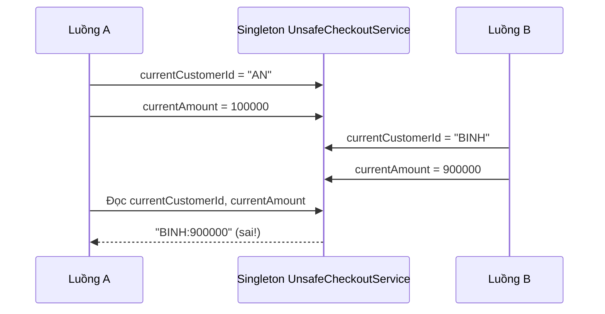
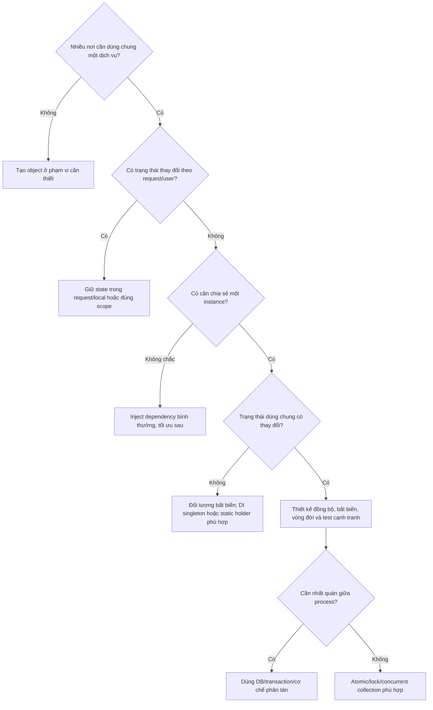

# Singleton và rủi ro trạng thái dùng chung trong Java

**Bối cảnh:** Một ứng dụng có rất nhiều nơi cần sử dụng một bộ cấu hình, logger hoặc bộ điều phối chung. Ta muốn tránh tạo đối tượng lặp lại không cần thiết. Nhưng nếu một đối tượng duy nhất còn lưu dữ liệu thay đổi theo từng người dùng hoặc từng yêu cầu, chuyện gì xảy ra khi nhiều luồng cùng truy cập?

Bài học này giải thích đúng phạm vi của **Singleton**, các cách triển khai trong Java, vì sao **một instance không đồng nghĩa với thread-safe**, cách thiết kế trạng thái dùng chung an toàn, và khi nào nên chọn **dependency injection (DI)** thay vì một biến toàn cục.

## 1. Singleton là gì?

**Singleton** là mẫu thiết kế khởi tạo (*creational design pattern*) hướng đến hai ý:

1. Kiểm soát việc tạo để chỉ có một instance của một kiểu trong **phạm vi được định nghĩa**.
2. Cung cấp cách truy cập instance đó cho những thành phần cần sử dụng.

Định nghĩa kinh điển thường mô tả một điểm truy cập toàn cục. Tuy nhiên, trong ứng dụng lớn, truy cập toàn cục khiến dependency bị ẩn; thường nên để container DI quản lý vòng đời và truyền dependency một cách tường minh.

Ví dụ bài toán phù hợp: cấu hình **đọc duy nhất sau khi khởi động**, tập luật bất biến, hoặc một dịch vụ chia sẻ dùng đúng tài nguyên với chính sách đồng bộ rõ ràng.

Ví dụ dễ gây lỗi: giỏ hàng đang xử lý, người dùng đăng nhập hiện tại, request ID, tổng tiền đơn hàng đang tính, hoặc đối tượng chứa bộ đệm tạm thay đổi sau mỗi request. Các dữ liệu đó thuộc **phạm vi request/phiên hoặc biến cục bộ**, không thuộc Singleton toàn cục.

### Phạm vi “một instance” không phải tuyệt đối

- Với Singleton Java dựa trên `static`, instance thường là **một cho mỗi class loader** tải lớp đó. Nhiều class loader có thể có các bản riêng.
- Nếu ứng dụng chạy nhiều process, container hoặc pod, mỗi tiến trình có Singleton riêng. Singleton **không** bảo đảm một instance trên cả cụm máy.
- Với Spring, bean có scope `singleton` mặc định là **một instance cho mỗi bean definition trong mỗi IoC container**; điều này khác với khẳng định toàn JVM chỉ có một object thuộc lớp đó.
- Nếu nghiệp vụ đòi hỏi điều phối toàn hệ thống (ví dụ số thứ tự giao dịch không trùng qua nhiều máy), hãy dùng cơ chế thích hợp như **database sequence, transaction, distributed lock hoặc coordinator**, thay vì dựa vào Singleton trong bộ nhớ.

## 2. Ví dụ Singleton chỉ đọc: Initialization-on-demand holder

Khi thật sự cần API truy cập tĩnh, một cách gọn và thường an toàn trong Java là **static holder**. Java bảo đảm quá trình khởi tạo lớp được đồng bộ theo quy tắc class initialization.

Tạo file `AppSettings.java`:

```java
import java.util.Map;

public final class AppSettings {
    private final Map<String, String> properties;

    private AppSettings() {
        // Giả lập cấu hình cố định đã được nạp.
        this.properties = Map.of(
                "currency", "VND",
                "region", "VN",
                "supportEmail", "support@example.com"
        );
    }

    // Holder chỉ được khởi tạo khi AppSettings.getInstance()
    // truy cập Holder.INSTANCE lần đầu tiên.
    private static final class Holder {
        private static final AppSettings INSTANCE = new AppSettings();
    }

    public static AppSettings getInstance() {
        return Holder.INSTANCE;
    }

    public String get(String key) {
        return properties.get(key);
    }

    public static void main(String[] args) {
        AppSettings a = AppSettings.getInstance();
        AppSettings b = AppSettings.getInstance();

        System.out.println(a == b);                // true
        System.out.println(a.get("currency"));       // VND
    }
}
```

Chạy bằng Java 17+:

```bash
javac AppSettings.java
java AppSettings
```

**Điểm cần hiểu:**

- `private` constructor ngăn mã Java thông thường bên ngoài gọi `new AppSettings()`.
- `final` class ngăn kế thừa lớp đó theo cách thông thường.
- Lớp `Holder` cung cấp **lazy initialization** và cơ chế công bố instance an toàn qua việc khởi tạo lớp; không cần tự viết khối `synchronized` trong `getInstance()`.
- `Map.of(...)` tạo map không cho sửa phần tử. `String` cũng bất biến, nên dữ liệu cấu hình ví dụ không bị thay đổi trong quá trình sử dụng.
- `private final Map` **không đủ** để bảo đảm bất biến nếu ta khởi tạo bằng `HashMap` rồi cho bên ngoài sửa nội dung của map. `final` chỉ ngăn gán lại **tham chiếu**, không tự khóa trạng thái của object được tham chiếu.

Đây là ví dụ minh họa kỹ thuật, không phải lời khuyên đưa mọi cấu hình vào class `static`. Trong ứng dụng thực tế, cấu hình nên được inject vào thành phần cần nó để dễ kiểm thử và thay đổi theo môi trường.

## 3. Một instance không đồng nghĩa với an toàn đa luồng

Hai khái niệm rất khác nhau:

| Thuộc tính | Câu hỏi nó giải quyết | Nó **không** tự bảo đảm |
|---|---|---|
| Singleton | Có bao nhiêu instance trong phạm vi quản lý? | Các phương thức được gọi đồng thời có an toàn không? |
| Thread safety | Các thao tác đồng thời có bảo toàn bất biến, thứ tự và khả năng quan sát hợp lệ không? | Toàn chương trình chỉ có một instance |
| Immutability | Trạng thái có thể thay đổi sau khi tạo không? | Mọi dependency tham chiếu đều bất biến |
| Safe publication | Luồng khác có thấy trạng thái đã khởi tạo hợp lệ không? | Các thao tác cập nhật sau đó đều nguyên tử |
| Transaction/concurrency control | Các thay đổi nhiều bước có giữ đúng quy tắc nghiệp vụ không? | Chỉ cần thêm `volatile` là đủ |

### Phản ví dụ: lưu trạng thái của request vào Singleton

```java
import java.math.BigDecimal;

final class UnsafeCheckoutService {
    // Nếu class này chỉ có một instance và phục vụ nhiều request,
    // các trường này sẽ bị mọi request chia sẻ.
    private String currentCustomerId;
    private BigDecimal currentAmount;

    String prepareReceipt(String customerId, BigDecimal amount) {
        currentCustomerId = customerId;
        currentAmount = amount;

        // Thực tế có thể có I/O hoặc scheduler chuyển luồng ở đây.
        return currentCustomerId + ":" + currentAmount;
    }
}
```

Giả sử luồng A xử lý khách `AN`, 100.000 VND; luồng B xử lý khách `BINH`, 900.000 VND:



Đây là một **interleaving có thể xảy ra**, chưa cần bàn đến quy tắc Java Memory Model. Khi thiếu quan hệ đồng bộ, việc nhìn thấy giá trị trên các luồng còn có thể phức tạp hơn. Không thể dùng `Thread.sleep` để “sửa” tình huống này.

Lỗi không phụ thuộc vào việc Singleton viết bằng holder, `enum`, `synchronized getInstance()`, Spring bean hay constructor injection. **Nếu trạng thái thay đổi theo request nằm trong object dùng chung, thiết kế vẫn nguy hiểm.**

### Cách sửa đúng: dùng biến cục bộ và dependency phù hợp

```java
import java.math.BigDecimal;
import java.util.Objects;

public final class SafeCheckoutService {
    private final PaymentGateway gateway;

    public SafeCheckoutService(PaymentGateway gateway) {
        this.gateway = Objects.requireNonNull(gateway, "gateway");
    }

    public Receipt checkout(String customerId, BigDecimal amount) {
        Objects.requireNonNull(customerId, "customerId");
        Objects.requireNonNull(amount, "amount");

        if (customerId.isBlank() || amount.signum() <= 0) {
            throw new IllegalArgumentException("Thông tin đơn hàng không hợp lệ");
        }

        // Không có currentCustomerId/currentAmount làm field.
        // Mỗi lời gọi chỉ dùng tham số và biến cục bộ của chính nó.
        String confirmationCode = gateway.charge(customerId, amount);
        return new Receipt(customerId, amount, confirmationCode);
    }

    public interface PaymentGateway {
        String charge(String customerId, BigDecimal amount);
    }

    public record Receipt(String customerId,
                          BigDecimal amount,
                          String confirmationCode) {}

    public static void main(String[] args) {
        PaymentGateway fakeGateway = (id, amount) -> "CONFIRMED-" + id;
        SafeCheckoutService service = new SafeCheckoutService(fakeGateway);

        System.out.println(service.checkout("AN", new BigDecimal("100000")));
        System.out.println(service.checkout("BINH", new BigDecimal("900000")));
    }
}
```

`SafeCheckoutService` có thể được chia sẻ giữa nhiều request **vì bản thân nó không có trạng thái thay đổi theo request**. Nhưng điều kiện đi kèm là `gateway.charge(...)` cũng phải an toàn khi được gọi đồng thời; tính an toàn của thành phần phụ thuộc phải được xét riêng. Trong ứng dụng thật, việc xử lý thanh toán còn cần idempotency key, timeout, retry được kiểm soát và tránh log dữ liệu nhạy cảm.

**Nguyên tắc thực hành:** dữ liệu theo request → tham số, biến cục bộ hoặc dependency đúng scope. Dữ liệu bất biến dùng chung → có thể đặt trong object sống lâu. Dữ liệu thay đổi dùng chung → phải có bất biến, chiến lược đồng bộ và phương án kiểm thử rõ ràng.

## 4. Khi Singleton bắt buộc mang trạng thái thay đổi

Một số trạng thái có lý do chính đáng để chia sẻ: thống kê trong tiến trình, cache, pool tài nguyên hoặc một hàng đợi công việc. Khi đó, câu hỏi chính không còn là “lấy instance bằng cách nào” mà là “mọi phép cập nhật có đúng khi chạy đồng thời không?”.

### Sai: thao tác cộng một không nguyên tử

```java
final class UnsafeCounter {
    private long total = 0L;

    public void increment() {
        total++; // Đọc -> cộng -> ghi: nhiều bước, có thể mất cập nhật.
    }

    public long get() {
        return total;
    }
}
```

Kể cả có đúng **một** `UnsafeCounter`, hai luồng vẫn có thể cùng đọc `total = 5`, cùng ghi `6`, và làm mất một lần tăng. Khai báo `volatile long total` chỉ cải thiện vấn đề visibility/ordering liên quan đến biến đó; phép `total++` vẫn không trở thành phép cộng nguyên tử.

### Đúng cho bộ đếm trong một process: AtomicLong

Tạo file `CounterDemo.java`:

```java
import java.util.ArrayList;
import java.util.List;
import java.util.concurrent.Callable;
import java.util.concurrent.ExecutorService;
import java.util.concurrent.Executors;
import java.util.concurrent.Future;
import java.util.concurrent.atomic.AtomicLong;

public class CounterDemo {
    enum RequestCounter {
        INSTANCE;

        private final AtomicLong count = new AtomicLong();

        public long incrementAndGet() {
            return count.incrementAndGet();
        }

        public long get() {
            return count.get();
        }
    }

    public static void main(String[] args) throws Exception {
        int workers = 8;
        int incrementsPerWorker = 10_000;
        ExecutorService executor = Executors.newFixedThreadPool(workers);

        try {
            List<Callable<Void>> jobs = new ArrayList<>();
            for (int worker = 0; worker < workers; worker++) {
                jobs.add(() -> {
                    for (int i = 0; i < incrementsPerWorker; i++) {
                        RequestCounter.INSTANCE.incrementAndGet();
                    }
                    return null;
                });
            }

            List<Future<Void>> futures = executor.invokeAll(jobs);
            for (Future<Void> future : futures) {
                future.get(); // Chờ tác vụ hoàn tất và nhận lỗi nếu có.
            }

            System.out.println(RequestCounter.INSTANCE.get());
            // 80000 khi chạy một lần trong một JVM mới, không có caller khác.
        } finally {
            executor.shutdown();
        }
    }
}
```

`enum RequestCounter` thể hiện dạng Singleton gọn: ngôn ngữ Java tạo các constant của enum với cơ chế khởi tạo an toàn; xử lý serialization của enum theo ngữ nghĩa riêng và ngăn tạo instance enum theo cách reflection thông thường. `AtomicLong` làm cho **mỗi phép tăng** là nguyên tử. Tuy nhiên:

- Bộ đếm chỉ thuộc **một JVM/class loader**; không gom thống kê từ các pod khác.
- Giá trị mất khi tiến trình khởi động lại; không dùng làm mã giao dịch duy nhất bền vững.
- Nếu có nhiều trường cần nhất quán với nhau, một `AtomicLong` không giải quyết giao dịch nhiều bước.
- `enum` cũng không làm các kiểu trạng thái tùy ý trong nó trở nên thread-safe.

Ví dụ này chứng minh việc tạo Singleton và việc cập nhật trạng thái là **hai quyết định thiết kế độc lập**.

## 5. Những bẫy đồng bộ thường gặp

| Vấn đề | Ví dụ | Cách kiểm soát |
|---|---|---|
| Lost update | `count++` trong nhiều luồng | `AtomicLong`, `synchronized`, `Lock` tùy bất biến |
| Visibility | Một luồng ghi flag, luồng khác mãi không thấy | `volatile`, lock, atomic hoặc cơ chế đồng bộ phù hợp |
| Collection thay đổi đồng thời | Nhiều luồng cùng ghi `HashMap` | `ConcurrentHashMap` hoặc khóa bảo vệ truy cập |
| Nhiều bước phải nhất quán | Trừ tồn kho rồi ghi đơn hàng | Transaction/CAS/lock, xác định điểm nguyên tử |
| Rò rỉ dữ liệu request | Field `currentUser`, `currentOrder` | Biến cục bộ, tham số hoặc đúng scope |
| Dependency không thread-safe | Đưa object có trạng thái nội bộ không an toàn vào Singleton | Dùng API thread-safe, bảo vệ bằng khóa hoặc không chia sẻ |
| Trạng thái giữa các lần test | Test A tăng counter, test B mong counter bằng 0 | Inject instance mới, fixture cô lập, tránh global mutable |
| Xung đột qua nhiều instance ứng dụng | Mỗi pod cấp cùng mã số 101 | Cơ chế đồng bộ/danh tính ở lớp dữ liệu hoặc phân tán |

Đặc biệt, `ConcurrentHashMap` làm các phương thức riêng lẻ an toàn khi dùng đồng thời, **không tự biến chuỗi `get` + tính toán + `put` thành một giao dịch nguyên tử**. Khi tăng bộ đếm theo khóa, dùng `merge` hoặc `compute` thích hợp:

```java
import java.util.concurrent.ConcurrentHashMap;

final class OperationMetrics {
    private final ConcurrentHashMap<String, Long> counts =
            new ConcurrentHashMap<>();

    void record(String operation) {
        counts.merge(operation, 1L, Long::sum);
    }

    long count(String operation) {
        return counts.getOrDefault(operation, 0L);
    }
}
```

Ở đây, một lần gọi `merge` thực hiện phép cập nhật nguyên tử đối với khóa tương ứng theo hợp đồng `ConcurrentHashMap`. Việc đọc nhiều khóa liên tiếp vẫn **không** tạo ra một snapshot nhất quán toàn map. Nếu báo cáo yêu cầu số liệu chính xác tại cùng một thời điểm hoặc liên quan đến một transaction DB, cần cơ chế khác.

### Vì sao `synchronized getInstance()` không bảo vệ các phương thức?

```java
public static synchronized SharedState getInstance() {
    // Chỉ tuần tự hóa việc truy cập phương thức getInstance().
    return INSTANCE;
}
```

Đoạn trên không bảo vệ những thao tác như `getInstance().addItem()` hoặc `getInstance().updateBalance()` **trừ khi chính các thao tác đó** được đồng bộ phù hợp. Nếu cần double-checked locking để lazy initialization, trường instance phải được công bố với các quy tắc memory visibility đúng (chẳng hạn `volatile`). Trong trường hợp thông thường, holder hoặc DI đơn giản và ít lỗi hơn.

## 6. Singleton trong Spring: scope và trạng thái

Spring mặc định dùng scope `singleton` cho bean, nghĩa là các nơi inject cùng bean definition trong một application context nhận cùng object. Spring quản lý vòng đời, injection, proxy tùy cấu hình; phạm vi này **không phải bảo đảm một object duy nhất trên tất cả context/JVM**.

Ví dụ bean service không giữ dữ liệu request:

```java
import java.math.BigDecimal;
import org.springframework.stereotype.Service;

@Service // Mặc định scope singleton trong Spring
public class PriceService {
    public BigDecimal total(BigDecimal unitPrice, int quantity) {
        if (unitPrice == null || unitPrice.signum() < 0 || quantity < 0) {
            throw new IllegalArgumentException("Giá hoặc số lượng không hợp lệ");
        }
        // Chỉ dùng tham số và kết quả cục bộ.
        return unitPrice.multiply(BigDecimal.valueOf(quantity));
    }
}
```

Khi nhiều HTTP request gọi `PriceService.total(...)` đồng thời, không có field tạm theo request để ghi đè nhau. Trường hợp này có thể dùng singleton vì code **stateless**.

Ngược lại, cách viết sau rất nguy hiểm:

```java
@Service
public class BadCartService {
    private String activeUserId; // Dữ liệu của request hiện tại!

    public void setActiveUser(String id) {
        activeUserId = id;
    }

    public String activeUser() {
        return activeUserId;
    }
}
```

Không nên “vá” bằng `synchronized` nếu bản chất dữ liệu thuộc từng user/request. Khóa toàn cục vừa làm nghẽn tải vừa vẫn dễ sai nếu request có nhiều lần gọi tách biệt.

### Chọn đúng scope và vòng đời

| Dữ liệu/Thành phần | Phạm vi thường phù hợp | Ghi chú |
|---|---|---|
| Dịch vụ xử lý nghiệp vụ stateless | Spring singleton | Dependency bên trong cũng cần an toàn |
| Thông tin chỉ dùng trong một lời gọi | Biến cục bộ, tham số | Đơn giản và tránh chia sẻ ngoài ý muốn |
| Trạng thái của một HTTP request | `request` scope hoặc truyền tường minh | Request scope cần web-aware context |
| Trạng thái gắn với HTTP session | `session` scope hoặc kho lưu phù hợp | Có vấn đề đồng thời khi cùng session mở nhiều tab |
| Object phải mới cho mỗi lần lấy | `prototype` scope | Inject prototype trực tiếp vào singleton không tự tạo mới mỗi lần dùng |
| Cache/pool dùng chung | Singleton kết hợp primitive/thiết kế thread-safe | Có giới hạn kích thước, timeout, eviction, giám sát |
| Dữ liệu giao dịch bền vững | Database/transaction | Không lưu bản chuẩn duy nhất trong field của bean |

Khi bean singleton cần dùng bean request-scoped, Spring phải có cơ chế lấy instance tương ứng ngữ cảnh đang hoạt động (ví dụ scoped proxy, `ObjectProvider` hoặc truyền dependency từ request layer). Việc chú thích scope một cách tùy tiện không tự giải quyết được các quy tắc phiên, bảo mật hoặc xử lý async.

## 7. Singleton và dependency injection: vấn đề kiểm thử

Một trong những rủi ro lớn của `GlobalState.getInstance()` là **hidden dependency**. Constructor của lớp không cho biết lớp đó phụ thuộc hệ thống toàn cục, test dễ bị ảnh hưởng thứ tự chạy, và rất khó thay implementation riêng cho môi trường thử nghiệm.

**Ví dụ phụ thuộc ẩn:**

```java
final class NotificationService {
    void sendWelcome(String email) {
        GlobalMailClient.getInstance().send(email, "Welcome!");
    }
}
```

Mã trên trực tiếp lấy service toàn cục. Trong unit test, ta khó đưa một fake client độc lập hoặc kiểm tra chính xác lần gọi mà không can thiệp global state.

**Thiết kế bằng constructor injection:**

```java
import java.util.Objects;

interface MailClient {
    void send(String recipient, String message);
}

final class NotificationService {
    private final MailClient mailClient;

    NotificationService(MailClient mailClient) {
        this.mailClient = Objects.requireNonNull(mailClient);
    }

    void sendWelcome(String email) {
        mailClient.send(email, "Welcome!");
    }
}

final class FakeMailClient implements MailClient {
    int sent = 0;

    @Override
    public void send(String recipient, String message) {
        sent++;
    }
}
```

Ở đây, có thể tạo `new NotificationService(new FakeMailClient())` trong từng test. Fake lưu biến `sent` **chỉ thuộc fixture của test đó**; fake không cần chia sẻ toàn ứng dụng và không cần tự đồng bộ nếu mỗi test gọi tuần tự. Với production, container có thể quản lý `MailClient` theo singleton nếu implementation phù hợp.

**Không nên tự động đánh đồng:**

- Singleton pattern: lớp tự kiểm soát instance và thường cung cấp điểm truy cập toàn cục.
- Singleton scope của DI container: container quyết định chia sẻ một instance của bean; mã sử dụng có thể chỉ biết interface được inject.
- Trạng thái toàn cục: dữ liệu hoặc dịch vụ được truy cập rộng rãi, có thể có hoặc không được quản lý bằng Singleton. Vấn đề chính là phạm vi, tính thay đổi và khả năng kiểm soát.

Một component hoàn toàn stateless thường không cần pattern Singleton Java truyền thống; việc tái sử dụng instance có thể do DI container hoặc composition root quyết định.

## 8. Kiểm thử sự an toàn của Singleton

Kiểm thử nên đi từ các **bất biến nghiệp vụ** cụ thể, không chỉ từ việc gọi `getInstance()` hai lần.

### Kiểm tra danh tính cùng class loader

```java
import static org.junit.jupiter.api.Assertions.*;
import org.junit.jupiter.api.Test;

class AppSettingsTest {
    @Test
    void returnsSameInstanceWithinTestClassLoader() {
        assertSame(AppSettings.getInstance(), AppSettings.getInstance());
    }

    @Test
    void exposesExpectedImmutableConfiguration() {
        assertEquals("VND", AppSettings.getInstance().get("currency"));
    }
}
```

Phép `assertSame` xác minh hành vi một instance **ở ngữ cảnh test đó**. Nó không xác minh thread-safety của mọi method trong Singleton, cũng không chứng minh một instance trên cụm phân tán.

### Kiểm tra cập nhật dưới tải cạnh tranh

Ví dụ `CounterDemo` ở mục 4 cho nhiều tác vụ tăng `AtomicLong` và chờ mọi `Future`. Với ứng dụng thật, nên kiểm tra cả trường hợp exception, timeout, đóng executor và các bất biến phối hợp nhiều field.

Lưu ý quan trọng: unit test race có thể chạy qua dù code sai, vì lịch xen kẽ của thread không được bảo đảm. Có thể dùng latch/barrier để điều phối tình huống cạnh tranh và kiểm thử lặp lại, nhưng **kiểm thử không thay thế được lập luận về đồng bộ**. Tránh phép kiểm tra dựa vào `sleep(...)` hoặc thời gian chạy ngẫu nhiên.

Với global mutable Singleton, nhiều test cùng chạy song song có thể làm kết quả không ổn định. Tốt hơn là **inject stateful collaborator mới cho từng test**, hoặc thiết kế một cơ chế reset được bảo vệ và kiểm soát thứ tự nếu thật sự bắt buộc.

## 9. Vòng đời và tài nguyên cũng là trách nhiệm

Singleton sống lâu thường giữ tài nguyên: connection pool, file watcher, scheduler, thread pool hoặc cache. Cần quan tâm:

- **Đóng tài nguyên** đúng lúc ứng dụng shutdown (`AutoCloseable`, callback lifecycle của container như `@PreDestroy`).
- **Không giữ tham chiếu lâu dài** đến request/session/user khiến dữ liệu không được giải phóng.
- **Giới hạn bộ nhớ** đối với cache (TTL, số mục, kích thước và eviction).
- **Không nhét lock quá rộng** quanh I/O kéo dài; nguy cơ giảm thông lượng hoặc deadlock.
- **Không dùng Singleton thay thế transaction DB** khi có nhiều tiến trình hoặc yêu cầu bền vững.
- **Không tin rằng một object tự đảm bảo chính xác một lần xử lý**: retry, crash và nhiều worker cần thiết kế idempotency riêng.

Singleton chứa nhiều dependency có vòng đời và trạng thái khác nhau đặc biệt khó vận hành. Việc tách trách nhiệm, giảm trạng thái và quản lý vòng đời trong container thường giúp dễ giám sát hơn.

## 10. Khi nào nên dùng Singleton?



**Những dấu hiệu nên tránh Singleton thủ công:** số lượng user đang hoạt động; context hiện tại; data mutable lấy từ HTTP request; object cần fake/test thay thế; yêu cầu chạy nhiều instance; lớp biết quá nhiều dependency; biến toàn cục gây phụ thuộc thứ tự khởi tạo.

**Những trường hợp có thể hợp lý:** giá trị cấu hình được nạp một lần và bất biến, registry đọc nhiều/ghi ít với cơ chế đồng bộ rõ, facade đến một tài nguyên sống lâu do container quản lý, hoặc thống kê cục bộ trong process với `AtomicLong` và đặc tả về vòng đời.

## 11. Bài tập áp dụng

### Bài 1 – Phát hiện race condition

Một singleton service khai báo:

```java
private String currentOrderId;

public void process(String orderId) {
    currentOrderId = orderId;
    audit(currentOrderId);
}
```

Hãy mô tả một thứ tự xen kẽ của hai request khiến `audit` nhận sai order ID. Refactor dùng tham số cục bộ, không đưa dữ liệu request vào field chung. Giải thích vì sao khóa `synchronized process` là giải pháp có thể chạy nhưng không giải quyết đúng nhu cầu sở hữu dữ liệu.

### Bài 2 – Thiết kế bộ đếm

Triển khai `RequestMetrics` đếm số request theo loại. Đề xuất hai lựa chọn:

- Dùng `ConcurrentHashMap<String, AtomicLong>` hoặc `ConcurrentHashMap.merge` để cập nhật theo khóa.
- Lưu số liệu thống kê trong database hoặc dịch vụ metrics khi cần tổng hợp qua nhiều container.

Phân tích khác biệt ở khả năng reset, tính chính xác snapshot và độ bền dữ liệu.

### Bài 3 – Refactor để dễ kiểm thử

Một `InvoiceService` gọi `TaxRules.getInstance()` trong mọi phương thức. Chuyển sang interface `TaxCalculator` inject qua constructor; viết fake tax calculator cho test. Giải thích trường hợp `TaxRules` bất biến vẫn có thể tái sử dụng một instance nhưng không cần để client biết đến `getInstance()`.

### Bài 4 – Phạm vi Spring

Một singleton `OrderService` inject `ShoppingCart` dạng mutable prototype bằng constructor. Người học cần giải thích vì sao điều đó **không** bảo đảm một cart mới cho mỗi request, rồi đề xuất cách truyền cart qua tham số hoặc dùng scope/phương án tạo instance phù hợp.

## 12. Những điều cần tự kiểm tra trước khi thiết kế

1. “Một” instance được hiểu trong phạm vi **class loader, IoC container, process hay toàn cụm**?
2. Object chỉ có phương thức xử lý stateless hay giữ trạng thái mutable? Ai sở hữu trạng thái?
3. Nếu hai thread gọi cùng phương thức, có tương tác vào field nào? Các phép cập nhật có nguyên tử không?
4. `final`, `volatile`, `synchronized`, `AtomicLong` hay concurrent collections được chọn để bảo vệ **bất biến cụ thể nào**?
5. Trường hợp dùng nhiều server, mất điện hoặc restart thì dữ liệu có phải còn nguyên hoặc thống nhất không?
6. Test có thể tạo dependency riêng và chạy độc lập, song song hay không?
7. Ai chịu trách nhiệm khởi tạo, cấu hình, dọn dẹp tài nguyên và quan sát lỗi?

**Ghi nhớ:** Singleton chỉ trả lời câu hỏi **số lượng và điểm truy cập instance trong một phạm vi**. Độ an toàn khi chia sẻ phụ thuộc vào **trạng thái, hợp đồng đồng thời, vòng đời và ranh giới triển khai**. Ưu tiên dữ liệu cục bộ, object bất biến và dependency injection; chỉ dùng trạng thái chia sẻ có chủ đích khi đã xác định cách đồng bộ và kiểm thử tương ứng.