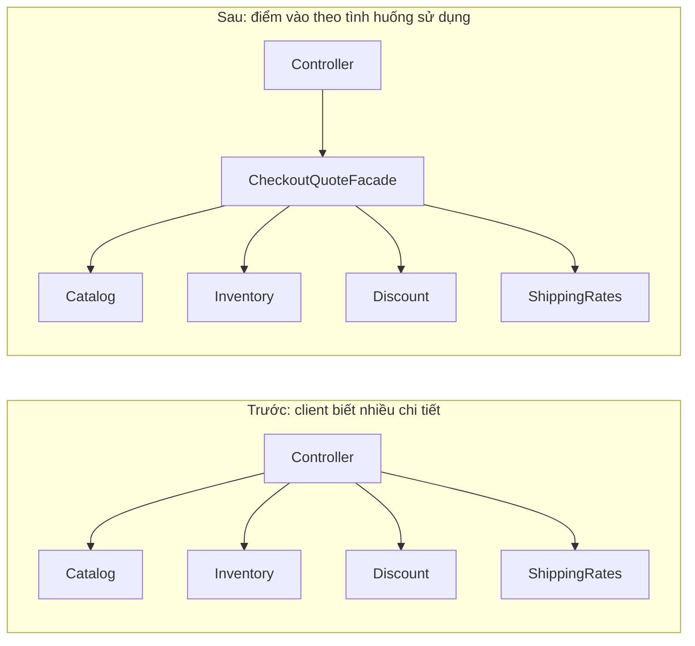
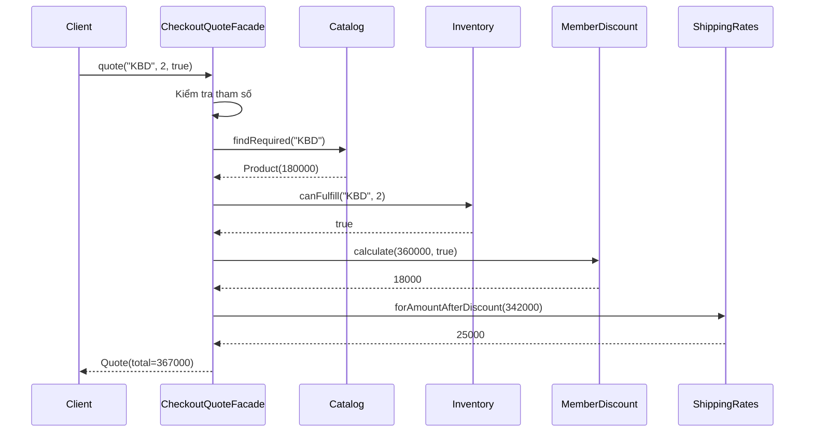

# Facade Pattern: đơn giản hóa cách sử dụng một hệ thống nhiều thành phần

> **Chủ đề:** Facade và đơn giản hóa cách sử dụng (Design Patterns – OOP).  
> **Mục tiêu:** Nhận ra khi client đang phụ thuộc quá nhiều lớp con, thiết kế một điểm vào cấp cao gọn và có chủ đích, cài đặt Facade bằng Java, kiểm thử hợp đồng của nó và hiểu rõ những đánh đổi về coupling, ranh giới và xử lý lỗi.

## 1. Vấn đề Facade giải quyết

Trong một ứng dụng thực tế, một thao tác người dùng thường đòi hỏi phối hợp nhiều dịch vụ hoặc thư viện con. Ví dụ, để **báo giá một giỏ hàng**, mã ở controller có thể phải:

1. Tìm thông tin sản phẩm.
2. Kiểm tra tồn kho.
3. Tính tiền hàng.
4. Áp dụng chiết khấu dành cho thành viên.
5. Tính phí giao hàng.
6. Ghép kết quả thành báo giá.

Nếu controller, tác vụ batch và API đối tác đều tự thực hiện chuỗi trên, mỗi client phải biết chi tiết về nhiều lớp, thứ tự gọi, quy tắc lỗi và cách tạo kết quả. Một thay đổi nhỏ về thứ tự áp dụng phí có thể buộc nhiều client sửa theo.

**Facade** là mẫu thiết kế cấu trúc (*structural pattern*) cung cấp **một giao diện cấp cao thống nhất, thuận tiện hơn** cho một hệ thống con vốn có nhiều giao diện riêng.

- **Ý định:** đơn giản hóa cách sử dụng một khả năng cụ thể của subsystem.
- **Vai trò:** client gọi Facade; Facade phối hợp các subsystem để hoàn tất thao tác cấp cao.
- **Lợi ích:** giảm số dependency mà client phải biết và gom quy trình sử dụng chung về một chỗ.
- **Giới hạn:** Facade không làm các lớp con “biến mất”; không tự bảo đảm transaction, retry, concurrency, tính đúng đắn nghiệp vụ hay bảo mật.

Một câu mô tả đúng bài toán: “Nhiều client đang phải biết và lặp lại **quy trình phối hợp** giữa các lớp con; chúng ta cần một API đơn giản, ổn định cho thao tác thường dùng”.

### Trước và sau khi có Facade



Ở phương án sau, **tổng độ phức tạp của subsystem không tự nhiên giảm đi**. Độ phức tạp được **đóng gói sau một ranh giới**, làm cho mã client ngắn và ít biết chi tiết hơn.

## 2. Thành phần của mẫu Facade

| Thành phần | Trách nhiệm | Nên biết điều gì? |
|---|---|---|
| **Client** | Thực hiện thao tác người dùng, gọi API cấp cao | Nhu cầu báo giá, dữ liệu đầu vào, kết quả |
| **Facade** | Phối hợp các bước thường dùng, xử lý/ánh xạ lỗi phù hợp | Hợp đồng của các subsystem và quy trình cấp cao |
| **Subsystem classes** | Thực hiện các thao tác chuyên biệt | Catalog, tồn kho, chính sách giá, phí vận chuyển |
| **Composition root / DI container** | Khởi tạo và lắp các dependency | Implementation nào được dùng trong môi trường hiện tại |

Facade thường dùng **composition**: nó giữ reference tới các đối tượng cấp dưới, chứ không cần kế thừa chúng.

Một API Facade tốt thể hiện mục đích rõ ràng, ví dụ `quote(sku, quantity, member)`; không chỉ biến thành hàng chục phương thức `getCatalog()`, `getInventory()`, `getDiscountCalculator()`. Các getter chỉ làm client tiếp tục phụ thuộc sâu vào subsystem.

## 3. Ví dụ Java 17 chạy độc lập: báo giá thanh toán

**Bối cảnh ví dụ:** một đơn hàng chỉ chứa một loại sản phẩm, giá tính bằng **VND nguyên**. Báo giá dành cho thành viên được giảm 5% tiền hàng; phí giao là 25.000 VND, miễn phí nếu **tiền hàng sau giảm** ít nhất 500.000 VND. Báo giá chỉ **kiểm tra** số tồn hiện tại, không giữ hàng hoặc trừ tồn kho.

Quy tắc vừa nêu phải rõ ràng trước khi viết Facade: nếu phí giao dựa trên tiền hàng *trước* giảm, hoặc cho phép nhiều sản phẩm, API và thuật toán đều cần điều chỉnh theo nghiệp vụ.

Tạo file `FacadeDemo.java`, sau đó chạy:

```bash
javac FacadeDemo.java
java FacadeDemo
```

```java
import java.math.BigDecimal;
import java.math.RoundingMode;
import java.util.Map;
import java.util.Objects;

public class FacadeDemo {

    // ----- Các loại dữ liệu công khai ở mức ví dụ -----
    record Product(String sku, BigDecimal unitPriceVnd) {
        Product {
            Objects.requireNonNull(sku, "sku");
            Objects.requireNonNull(unitPriceVnd, "unitPriceVnd");
            if (sku.isBlank() || unitPriceVnd.signum() < 0 ||
                    unitPriceVnd.stripTrailingZeros().scale() > 0) {
                throw new IllegalArgumentException(
                        "SKU phải có giá trị, đơn giá là số nguyên VND không âm");
            }
        }
    }

    record Quote(
            BigDecimal subtotalVnd,
            BigDecimal discountVnd,
            BigDecimal shippingVnd,
            BigDecimal totalVnd) {}

    // ----- Các subsystem độc lập -----
    static final class Catalog {
        private final Map<String, Product> products;

        Catalog(Map<String, Product> products) {
            this.products = Map.copyOf(Objects.requireNonNull(products));
        }

        Product findRequired(String sku) {
            Product product = products.get(sku);
            if (product == null) {
                throw new IllegalArgumentException(
                        "Không tìm thấy sản phẩm: " + sku);
            }
            return product;
        }
    }

    static final class Inventory {
        private final Map<String, Integer> availableUnits;

        Inventory(Map<String, Integer> availableUnits) {
            this.availableUnits =
                    Map.copyOf(Objects.requireNonNull(availableUnits));
        }

        boolean canFulfill(String sku, int quantity) {
            return availableUnits.getOrDefault(sku, 0) >= quantity;
        }
    }

    static final class MemberDiscount {
        BigDecimal calculate(BigDecimal subtotalVnd, boolean isMember) {
            Objects.requireNonNull(subtotalVnd, "subtotalVnd");
            if (!isMember) {
                return BigDecimal.ZERO;
            }
            return subtotalVnd.multiply(new BigDecimal("0.05"))
                    .setScale(0, RoundingMode.HALF_UP);
        }
    }

    static final class ShippingRates {
        BigDecimal forAmountAfterDiscount(BigDecimal amountVnd) {
            Objects.requireNonNull(amountVnd, "amountVnd");
            return amountVnd.compareTo(new BigDecimal("500000")) >= 0
                    ? BigDecimal.ZERO : new BigDecimal("25000");
        }
    }

    // ----- FACADE: một thao tác cấp cao dễ dùng -----
    static final class CheckoutQuoteFacade {
        private final Catalog catalog;
        private final Inventory inventory;
        private final MemberDiscount discounts;
        private final ShippingRates shipping;

        CheckoutQuoteFacade(
                Catalog catalog,
                Inventory inventory,
                MemberDiscount discounts,
                ShippingRates shipping) {
            this.catalog = Objects.requireNonNull(catalog);
            this.inventory = Objects.requireNonNull(inventory);
            this.discounts = Objects.requireNonNull(discounts);
            this.shipping = Objects.requireNonNull(shipping);
        }

        Quote quote(String sku, int quantity, boolean isMember) {
            Objects.requireNonNull(sku, "sku");
            if (sku.isBlank() || quantity <= 0) {
                throw new IllegalArgumentException(
                        "SKU phải có giá trị và quantity phải > 0");
            }

            // Client không phải tự gọi các bước này.
            Product product = catalog.findRequired(sku);
            if (!inventory.canFulfill(sku, quantity)) {
                throw new IllegalStateException("Không đủ hàng cho " + sku);
            }

            BigDecimal subtotal = product.unitPriceVnd()
                    .multiply(BigDecimal.valueOf(quantity));
            BigDecimal discount =
                    discounts.calculate(subtotal, isMember);
            BigDecimal amountAfterDiscount = subtotal.subtract(discount);
            BigDecimal delivery =
                    shipping.forAmountAfterDiscount(amountAfterDiscount);
            BigDecimal total = amountAfterDiscount.add(delivery);

            return new Quote(subtotal, discount, delivery, total);
        }
    }

    // ----- Composition root: nơi biết các lớp cụ thể -----
    public static void main(String[] args) {
        Catalog catalog = new Catalog(Map.of(
                "KBD", new Product("KBD", new BigDecimal("180000"))));
        Inventory inventory = new Inventory(Map.of("KBD", 10));

        CheckoutQuoteFacade checkout = new CheckoutQuoteFacade(
                catalog, inventory,
                new MemberDiscount(), new ShippingRates());

        Quote twoItems = checkout.quote("KBD", 2, true);
        System.out.println(twoItems);
        // Quote[subtotalVnd=360000, discountVnd=18000,
        //       shippingVnd=25000, totalVnd=367000]

        Quote threeItems = checkout.quote("KBD", 3, true);
        System.out.println(threeItems.totalVnd()); // 513000
        // 540000 - 27000 = 513000, đạt ngưỡng miễn phí giao
    }
}
```

Đây là ví dụ tự chứa: không yêu cầu Spring, cơ sở dữ liệu hay thư viện ngoài JDK 17. Các class lồng trong `FacadeDemo` có scope phục vụ ví dụ; khi chuyển vào dự án thực tế có thể đặt mỗi class vào file/package phù hợp và công khai những API mà client cần.

### Vì sao ví dụ trên là Facade?

1. **Một thao tác cấp cao:** client chỉ gọi `checkout.quote(...)` để lấy báo giá.
2. **Ẩn trình tự phối hợp:** các bước tìm sản phẩm, kiểm tra tồn, tính giảm giá và vận chuyển nằm trong Facade.
3. **Dùng lại trách nhiệm sẵn có:** `Catalog` quản lý việc tìm sản phẩm, `Inventory` trả lời về tồn kho; Facade không tự cài lại những chi tiết đó.
4. **Chỉ trả kết quả cần thiết:** `Quote` diễn đạt chi tiết báo giá, không rò rỉ `Map` lưu tồn kho hay cấu trúc của catalog.
5. **Lắp ráp bên ngoài:** Facade nhận dependency bằng constructor; việc chọn implementation ở `main` giúp thay adapter, mock hoặc fake khi kiểm thử.

**Điểm cần nhớ:** Facade có thể đóng vai trò entry point và điều phối nghiệp vụ, nhưng bản thân **mẫu Facade** được định nghĩa bởi việc **cung cấp bề mặt sử dụng đơn giản cho subsystem**. Nó không tự xác định đây là Domain Service, Application Service hay lớp transaction.

## 4. Luồng xử lý của một lời gọi



Lỗi được xử lý ở ranh giới hợp lý: SKU không tồn tại báo `IllegalArgumentException`, lượng không đủ báo `IllegalStateException`. API bên ngoài (ví dụ REST controller) có thể ánh xạ chúng thành mã HTTP phù hợp. Không nên xem hai loại exception trong bản demo là quy chuẩn bắt buộc: production nên dùng mô hình lỗi nghiệp vụ rõ hơn, có mã lỗi ổn định và kiểm thử được.

**Đường đi lỗi:** nếu sản phẩm không tồn tại hoặc tồn kho không đủ, Facade dừng trước khi tính giá tiếp. Đừng “nuốt” lỗi đọc tồn kho thành kết quả `false` khi hệ thống kho thật gặp timeout: **không đủ hàng** và **không kiểm tra được tồn kho** là hai trường hợp khác nhau.

## 5. Facade làm đơn giản API ở đâu?

Trước Facade, mã dùng từ nhiều client có thể lặp quy trình (mã phác họa; giả sử các dependency đã được khởi tạo):

```java
Product product = catalog.findRequired(sku);
if (!inventory.canFulfill(sku, quantity)) {
    throw new IllegalStateException("Không đủ hàng");
}
BigDecimal subtotal = product.unitPriceVnd()
        .multiply(BigDecimal.valueOf(quantity));
BigDecimal discount = discounts.calculate(subtotal, isMember);
BigDecimal net = subtotal.subtract(discount);
BigDecimal fee = shipping.forAmountAfterDiscount(net);
Quote quote = new Quote(subtotal, discount, fee, net.add(fee));
```

Sau Facade:

```java
Quote quote = checkoutQuoteFacade.quote(sku, quantity, isMember);
```

Điều đáng giá không đơn thuần là **ít dòng code**. Quan trọng hơn là client **không phải biết** thứ tự áp dụng chiết khấu và phí, cách đọc catalog hay API của từng subsystem.

Khi logic “tính phí giao sau khi giảm giá” đổi vì một quyết định nghiệp vụ có chủ đích, một điểm điều phối có thể được sửa và kiểm thử tập trung. Facade giúp giảm **coupling của client với chi tiết phối hợp**, trong khi chính Facade vẫn phụ thuộc các subsystem mà nó sử dụng.

### Hai loại đơn giản hóa cần tách bạch

- **Đơn giản hóa giao diện:** ít lời gọi hơn, tên API theo nhiệm vụ, input/output dễ hiểu hơn.
- **Đơn giản hóa kiến trúc:** không nhất thiết xảy ra. Vẫn có catalog, kho, chiết khấu và phí giao, cùng nhiều quy định nghiệp vụ.

Một Facade kém thiết kế có thể biến thành nút thắt mới nếu mọi use case và mọi quy tắc bị dồn hết vào đó.

## 6. Facade khác Adapter, Decorator, Proxy và Mediator thế nào?

Các pattern đều có thể có một đối tượng “đứng giữa”, nhưng **ý định** khác nhau.

| Pattern | Ý định chính | Hình thức điển hình | Ví dụ |
|---|---|---|---|
| **Facade** | Cung cấp API đơn giản cho nhiều thành phần/phân hệ | `checkout.quote(...)` phối hợp 4 subsystem | Một cửa báo giá giỏ hàng |
| **Adapter** | Chuyển đổi **giao diện không tương thích** sang giao diện client cần | `VendorSmsAdapter implements SmsSender` gọi SDK khác tên hàm | Ẩn khác biệt API nhà cung cấp |
| **Decorator** | Bổ sung hành vi mà vẫn giữ cùng hợp đồng của đối tượng được bọc | `CachedCatalog implements CatalogReader` delegate đến nguồn gốc | Thêm cache, metrics, logging có kiểm soát |
| **Proxy** | Đại diện thay thế để quản lý truy cập/vòng đời/lời gọi đến đối tượng thực | `RemoteImageProxy` trì hoãn tải hoặc kiểm tra quyền | Lazy load, remote proxy, protection proxy |
| **Mediator** | Trung gian hóa các quan hệ tương tác giữa nhiều đồng nghiệp | `DialogMediator` phối hợp nút, trường nhập, thông báo | Giảm các callback chéo giữa UI controls |

**Nhận diện bằng câu hỏi:**

- “Client đang phải gọi **quá nhiều bước** của subsystem?” → Facade.
- “Thư viện này có **API khác** với giao diện ứng dụng cần?” → Adapter.
- “Muốn **bọc thêm chức năng** cho cùng interface?” → Decorator.
- “Muốn **kiểm soát việc truy cập** tới một đối tượng?” → Proxy.
- “Nhiều đối tượng **gọi lẫn nhau theo mạng quan hệ rối**?” → Mediator.

Một lớp có thể có nhiều vai trò thực tế, nhưng khi giải thích thiết kế nên gọi theo **lý do chủ yếu** khiến nó tồn tại. “Có lớp trung gian” chưa phải tiêu chí đủ để kết luận là Facade.

## 7. Facade có phải là Service Layer hoặc Controller không?

Không đồng nghĩa.

- **Controller** tiếp nhận HTTP/request, phân tích input, xác thực/ủy quyền ở tầng thích hợp và chuyển đổi response. Controller có thể dùng Facade để thực hiện nghiệp vụ cấp cao.
- **Application Service** điều phối một use case, áp đặt ranh giới transaction và các chính sách luồng ứng dụng. Nó có thể **đồng thời đóng vai trò Facade** nếu cung cấp API đơn giản cho nhiều subsystem; nhưng không phải Application Service nào cũng nên mang tên `Facade`.
- **Domain Service** chứa quy tắc nghiệp vụ không thuộc tự nhiên về một entity/value object nào. Không nên cho domain phụ thuộc SQL/HTTP chỉ vì muốn dùng Facade.
- **Facade** nói về việc **giảm độ phức tạp khi client tương tác subsystem**. Nó không quy định tầng kiến trúc, framework, transaction hoặc bất biến nghiệp vụ phải đặt ở đâu.

Một ví dụ tổ chức:

```text
application/
  CheckoutQuoteFacade.java   # API báo giá cấp cao
domain/
  Product.java
  PricingPolicy.java
infrastructure/
  JdbcCatalog.java
  WarehouseInventoryClient.java
bootstrap/
  Configuration.java         # Lắp dependency
web/
  CheckoutController.java    # HTTP ↔ API ứng dụng
```

Đừng sao chép mô hình package này máy móc. Với hệ thống nhỏ, một vài lớp và một Facade là đủ; với hệ thống lớn, Facade có thể nằm ở một **module API** riêng và phụ thuộc các port/hợp đồng do ứng dụng sở hữu.

## 8. Tổ chức dependency để Facade dễ kiểm thử và thay công nghệ

Trong demo, Facade nhận trực tiếp `Catalog`, `Inventory` và hai lớp tính toán. Trong ứng dụng thực tế, catalog có thể đọc từ MySQL, kho từ HTTP, hoặc API đối tác có nhiều môi trường. Khi các chi tiết này biến động, dùng interface mô tả khả năng client cần.

```java
// Phác họa khi tách các class ra package rõ ràng:
interface ProductLookup {
    Product findRequired(String sku);
}

interface StockAvailability {
    boolean canFulfill(String sku, int quantity);
}

// CheckoutQuoteFacade phụ thuộc các interface,
// JdbcProductLookup/HttpStockAvailability implements interface.
```

Với Spring, có thể inject dependencies vào constructor và khai báo Facade thành bean:

```java
// Phác họa với Spring Boot. Imports tương ứng:
// org.springframework.stereotype.Service
@Service
public class CheckoutQuoteFacade {
    private final ProductLookup catalog;
    private final StockAvailability inventory;

    public CheckoutQuoteFacade(
            ProductLookup catalog, StockAvailability inventory) {
        this.catalog = catalog;
        this.inventory = inventory;
    }

    // quote(...) phối hợp thêm các pricing policy liên quan.
}
```

Đoạn Spring là **phác họa kiến trúc**, không phải code để ghép nguyên xi với `FacadeDemo` có lớp lồng cùng tên. Nếu có nhiều bean cùng interface, lựa chọn implementation cần được cấu hình rõ ràng (`@Qualifier`, `@Primary`, `@Bean`, v.v.).

**Facade không bắt buộc dùng interface.** Nếu chỉ có một cách điều phối và không có nhu cầu thay thế Facade, class `CheckoutQuoteFacade` thông thường là hợp lý. Tạo `ICheckoutQuoteFacade` chỉ để tăng số interface không làm thiết kế tốt hơn; abstraction có ích khi bảo vệ client khỏi dependency dễ biến động hoặc khi có hợp đồng rõ cho nhiều implementation.

## 9. Đánh đổi và giới hạn cần biết

| Lợi ích | Giá phải trả / rủi ro |
|---|---|
| Client chỉ cần nhớ vài thao tác cấp cao | Tăng thêm lớp và indirection, phải lần từ client qua Facade |
| Giảm coupling trực tiếp giữa client và subsystem | Facade có thể trở thành điểm phụ thuộc tập trung, dễ phình to |
| Tập trung thứ tự gọi và chính sách lỗi cho thao tác chung | Nếu Facade quá rộng, thay đổi một use case có thể tác động nhiều client |
| Dễ fake/mocking ranh giới của client | Cần kiểm thử cả hợp đồng Facade và cách nó phối hợp subsystem |
| Ẩn chi tiết kỹ thuật không liên quan với người dùng API | Có nguy cơ che mất timeout, partial failure và ngữ nghĩa dữ liệu |
| Dễ chuẩn hóa API công khai của module | Versioning và backward compatibility trở thành trách nhiệm rõ ràng |
| Có thể giữ các subsystem chuyên biệt, dễ dùng trực tiếp khi cần | Dễ bị lạm dụng thành “đường duy nhất”, cấm mọi tình huống nâng cao |

### Facade không tự tạo transaction phân tán

Ví dụ **báo giá** phía trên cố tình tránh ghi dữ liệu: kiểm tra tồn chỉ là **ảnh chụp tức thời**, không phải đặt hàng. Hai khách hàng có thể cùng được báo “còn hàng”, nhưng chỉ người đầu tiên đặt thành công. Điều đó không vi phạm hợp đồng nếu API được gọi rõ là **quote**, không phải **reserve/order**.

Nếu xây Facade `placeOrder(...)` có các bước giữ hàng, thanh toán và gửi thông báo:

- Các thao tác có thể nằm ở **nhiều hệ thống**, không chung một DB transaction.
- Lỗi sau khi thanh toán có thể tạo trạng thái dở dang.
- Cần thiết kế **idempotency key**, trạng thái đơn, saga/compensation hoặc outbox tùy yêu cầu.
- Retry phải phân biệt lỗi tạm thời và lỗi nghiệp vụ; không mặc định retry một charge sẽ an toàn.

Facade chỉ cung cấp **điểm phối hợp**. Nó không biến các thao tác mạng thành một giao dịch nguyên tử. Đừng “nuốt” lỗi partial failure rồi trả thành công.

### Độ trễ cũng không tự biến mất

Một lời gọi `facade.quote` có thể vẫn tạo bốn lời gọi tới DB/API ở dưới. Giảm số lời gọi **ở phía client** không bảo đảm giảm latency tổng:

```text
Tổng thời gian xấp xỉ:
  validation + catalog + inventory + discount + shipping + overhead

Nếu các thành phần gọi dịch vụ từ xa, network latency,
timeout, số lần retry và contention thường chi phối kết quả.
```

Chỉ thực hiện song song những bước **thật sự độc lập** và hiểu giới hạn consistency. Ví dụ pricing sau discount phụ thuộc kết quả discount, không thể chạy bừa mọi thao tác cùng lúc.

## 10. Khi nào nên dùng, khi nào nên tránh?

**Rất phù hợp khi:**

- Một phân hệ có nhiều API nhỏ, nhưng hầu hết client chỉ cần 2–3 thao tác cấp cao.
- Nhiều client đang lặp cùng một chuỗi gọi có thứ tự.
- Muốn giảm việc controller/API consumer phải biết cấu trúc nội bộ của module.
- Thư viện/SDK có API phức tạp, cần một điểm vào phục vụ nghiệp vụ phổ biến.
- Muốn giới hạn tác động khi cấu trúc nội bộ subsystem đổi, trong khi contract phía ngoài ổn định.

**Nên cân nhắc cách đơn giản hơn khi:**

- Client chỉ gọi một API đơn giản và không lặp quy trình.
- Facade chỉ chuyển tiếp một lời gọi y hệt mà không cung cấp abstraction hoặc ranh giới hữu ích.
- Mỗi client có quy trình hoàn toàn khác biệt; ép dùng chung một Facade khiến nó chứa hàng loạt `if` theo loại client.
- Không thể mô tả rõ trách nhiệm, dẫn đến “God Facade” vừa tính giá, vừa ghi DB, gửi email, chạy báo cáo và làm mọi thứ.
- Facade che lỗi hạ tầng bằng giá trị mặc định sai, làm người dùng hiểu nhầm dữ liệu đã chắc chắn.

### Thiết kế API Facade tốt

Một vài gợi ý thực hành:

1. **Đặt tên từ mục đích sử dụng:** `quote`, `previewInvoice`, `generateReport`, `startCheckout`. Tránh phương thức `processEverything`.
2. **Giữ input/output ổn định:** dùng DTO/value object phù hợp; đừng trả kết quả thô `ResultSet`, `Connection`, `HttpResponse` của một thư viện hạ tầng.
3. **Không làm lộ object nội bộ tùy tiện:** nếu client phải lấy `getInventoryService()` để tiếp tục tự điều phối, Facade chưa thực sự đơn giản hóa.
4. **Tách Facade theo nhóm client/use case nếu cần:** `CheckoutQuoteFacade` và `AdminPricingFacade` có thể cùng dùng subsystem mà giữ API riêng.
5. **Không gom mọi công thức nghiệp vụ vào Facade:** giữ thuật toán/điều kiện chuyên biệt trong lớp có trách nhiệm phù hợp, Facade điều phối.
6. **Quy ước rõ lỗi và trạng thái:** không tìm thấy, không đủ hàng, giá đã cũ, timeout, permission denied là những tình huống khác nhau.
7. **Thiết kế thread-safety:** Facade kiểu singleton nên tránh giữ trạng thái request mutable trong field; ví dụ demo dùng biến cục bộ trong `quote`.
8. **Có quan sát vận hành:** log/trace ở ranh giới tác vụ cấp cao, nhưng tránh log dữ liệu thanh toán hoặc thông tin nhạy cảm.

## 11. Kiểm thử Facade: kiểm tra kết quả lẫn thứ tự phối hợp

Unit test không chỉ kiểm một class có tồn tại. Nó phải xác nhận **hợp đồng từ góc nhìn client**, bao gồm nhánh thành công, lỗi và bất biến.

Ví dụ JUnit 5, đặt file test cùng package với `FacadeDemo` (các loại lồng có phạm vi package):

```java
import static org.junit.jupiter.api.Assertions.*;
import java.math.BigDecimal;
import java.util.Map;
import org.junit.jupiter.api.Test;

class FacadeDemoTest {

    private FacadeDemo.CheckoutQuoteFacade newFacade(int stock) {
        var catalog = new FacadeDemo.Catalog(Map.of(
                "KBD", new FacadeDemo.Product(
                        "KBD", new BigDecimal("180000"))));
        var inventory =
                new FacadeDemo.Inventory(Map.of("KBD", stock));
        return new FacadeDemo.CheckoutQuoteFacade(
                catalog, inventory,
                new FacadeDemo.MemberDiscount(),
                new FacadeDemo.ShippingRates());
    }

    @Test
    void memberQuoteIncludesDiscountAndShipping() {
        var quote = newFacade(10).quote("KBD", 2, true);

        assertEquals(new BigDecimal("360000"), quote.subtotalVnd());
        assertEquals(new BigDecimal("18000"), quote.discountVnd());
        assertEquals(new BigDecimal("25000"), quote.shippingVnd());
        assertEquals(new BigDecimal("367000"), quote.totalVnd());
    }

    @Test
    void freeShippingUsesAmountAfterDiscount() {
        var quote = newFacade(10).quote("KBD", 3, true);
        assertEquals(BigDecimal.ZERO, quote.shippingVnd());
        assertEquals(new BigDecimal("513000"), quote.totalVnd());
    }

    @Test
    void insufficientStockStopsQuote() {
        assertThrows(IllegalStateException.class,
                () -> newFacade(1).quote("KBD", 2, false));
    }

    @Test
    void invalidQuantityIsRejected() {
        assertThrows(IllegalArgumentException.class,
                () -> newFacade(10).quote("KBD", 0, true));
    }
}
```

Các test này dùng subsystem in-memory thật, đủ nhỏ để chạy nhanh. Nếu component bên dưới gọi database/HTTP, nên **fake các port** ở unit test và có integration test riêng cho adapter thật.

**Về thứ tự:** ví dụ có phụ thuộc dữ liệu rõ ràng — phải tính discount trước mới có giá sau giảm để tính shipping. Assert con số `513000` và `shippingVnd = 0` kiểm tra được ý nghĩa thứ tự đó. Nếu những bước có **side effect**, test cần kiểm tra không gửi thanh toán/ghi DB sau một lỗi xác thực, và policy rollback/compensation tùy yêu cầu. Không nên lạm dụng test “gọi đúng 4 phương thức ở thứ tự đúng” nếu trình tự đó là chi tiết triển khai không quan trọng với hành vi client.

### Checklist chất lượng kiểm thử

| Trường hợp | Kỳ vọng |
|---|---|
| Sản phẩm tồn tại, có đủ hàng, là thành viên | Báo giá đúng tiền hàng, giảm giá, vận chuyển và tổng |
| Không phải thành viên | Không có chiết khấu; phí giao tính theo số tiền tương ứng |
| Không có SKU hoặc lượng mua không hợp lệ | Lỗi đầu vào rõ ràng, không trả báo giá sai |
| SKU không tồn tại | Lỗi “không tìm thấy”, không giả định giá 0 |
| Không đủ tồn | Không sinh báo giá thành công |
| Tồn kho/giá từ dịch vụ ngoài bị timeout | Trả lỗi truy xuất dữ liệu phù hợp; không tráo thành hết hàng |
| Ranh giới miễn phí vận chuyển | Giá ngay dưới/bằng/ngay trên ngưỡng |
| Có yêu cầu đa luồng | Không lưu dữ liệu request vào field dùng chung |
| Thêm subsystem implementation mới | Hợp đồng Facade giữ ổn định, các test chính tiếp tục qua |

## 12. Refactor sang Facade từng bước

Giả sử một controller đang dài vì phải gọi 5 subsystem. Cách chuyển an toàn:

1. **Khoanh một use case cụ thể:** “xem báo giá”, không bắt đầu bằng “tập hợp tất cả service vào Facade”.
2. **Liệt kê thao tác và điều kiện:** xác định input, thứ tự, loại lỗi, dữ liệu trả về, side effect và những ranh giới bất biến.
3. **Đặt một phương thức cấp cao:** `Quote quote(String sku, int quantity, boolean member)`.
4. **Di chuyển logic phối hợp:** controller chỉ còn chuyển input và ánh xạ response; business rule thực sự vẫn ở lớp thích hợp.
5. **Constructor-inject dependency:** tạo/lắp các đối tượng ở composition root hoặc DI container.
6. **Duy trì hành vi bằng test:** so sánh kết quả trước và sau với các trường hợp biên và lỗi.
7. **Chuyển từng client sang Facade:** tránh thay đồng thời mọi luồng lớn mà chưa đo tương thích.
8. **Xóa sự điều phối trùng lặp** khi tất cả client liên quan đã dùng API mới và không còn phụ thuộc cũ.
9. **Đo lại độ phức tạp:** coupling của client, API surface, thời gian test/debug, latency, tỷ lệ lỗi.
10. **Rà soát phạm vi:** nếu Facade bắt đầu có quá nhiều phương thức độc lập, cân nhắc chia theo use case.

Một Facade có thể cùng tồn tại với quyền truy cập **trực tiếp** vào subsystem cho những client cần chức năng chuyên sâu. Việc **cấm mọi truy cập khác** là quyết định module/API, không phải quy tắc bắt buộc của Facade Pattern.

## 13. Bài tập tự luyện

**Bài 1 – Facade cho xuất báo cáo.** Hệ thống có `DataFetcher`, `SalesAggregator`, `CsvRenderer`, `FileStore`. Viết `SalesReportFacade.exportMonthlyReport(YearMonth month)`; nêu cách truyền timezone, định dạng file, cách xử lý file lớn và lỗi ghi file. Không cần gom tất cả hàm truy vấn thành API public của Facade.

**Bài 2 – Refactor controller.** Một `OrderController` đang trực tiếp gọi `Catalog`, `Inventory`, `Discount` và `ShippingRates`. Tách API báo giá của ví dụ Java thành Facade, viết test so sánh kết quả và chỉ ra trách nhiệm còn giữ ở controller.

**Bài 3 – Lỗi phân tán.** Thay báo giá bằng đặt đơn thật với giữ kho, thu tiền và thông báo. Thiết kế bảng trạng thái đơn tối thiểu và thảo luận khả năng thanh toán thành công nhưng thông báo thất bại. Facade giải quyết phần **điều phối API** nào, phần nào cần outbox/saga/idempotency?

**Bài 4 – So sánh pattern.** Một thư viện thanh toán bên ngoài có `payWithRawSdkRequest(...)`. Ứng dụng muốn có `PaymentGateway.pay(PaymentRequest)` và một API `Checkout.placeOrder()` phối hợp kho, gateway, hóa đơn. Chỉ ra thành phần nào hợp lý là **Adapter**, thành phần nào là **Facade**.

**Bài 5 – Review thiết kế.** Một class `SystemFacade` có 45 phương thức: gửi email, import CSV, tính điểm, tạo hóa đơn, tải ảnh và cập nhật mật khẩu. Tại sao dễ trở thành God Object? Đề xuất cách tách API theo chức năng hoặc bounded context, nêu hệ quả với client.

## 14. Tự kiểm tra đã nắm được Facade chưa?

- [ ] Tôi mô tả được **vấn đề cụ thể**: client biết quá nhiều API hoặc lặp trình tự phối hợp.
- [ ] Tôi thiết kế được **API cấp cao có ý nghĩa**, ít tham số và trả dữ liệu cần thiết.
- [ ] Tôi biết Facade dùng **composition** để phối hợp subsystem.
- [ ] Tôi phân biệt được Facade với Adapter, Decorator, Proxy, Mediator.
- [ ] Tôi không xem Facade như giải pháp tự động cho transaction, network latency, caching và thread-safety.
- [ ] Tôi giữ business invariant, xử lý lỗi, kiểm thử và khả năng quan sát một cách tường minh.
- [ ] Tôi biết khi nào một lớp Facade trở nên quá rộng và cần tách nhỏ.
- [ ] Tôi sẵn sàng giữ giải pháp đơn giản khi client chỉ cần một lời gọi trực tiếp.

**Ghi nhớ:** Facade hữu ích khi nó tạo ra một **đường vào đơn giản, ổn định và giàu ý nghĩa** cho một khả năng có nhiều chi tiết phối hợp. Nó giảm kiến thức mà client phải mang theo, đồng thời chuyển trách nhiệm điều phối vào đúng một ranh giới có thể kiểm thử và bảo trì.