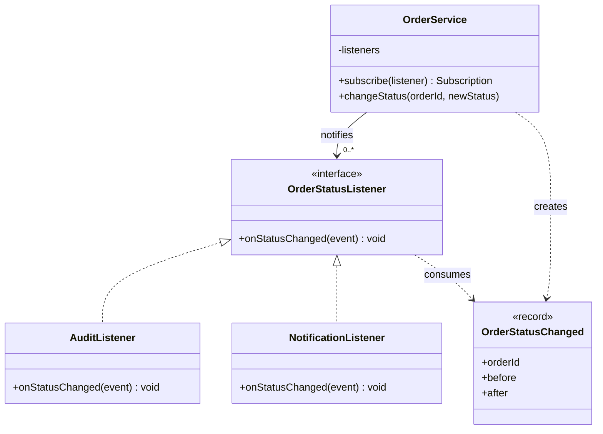
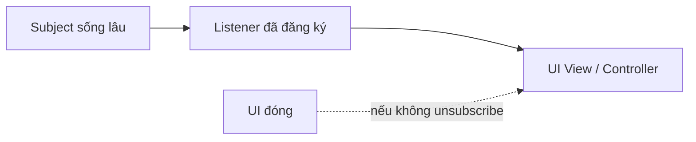
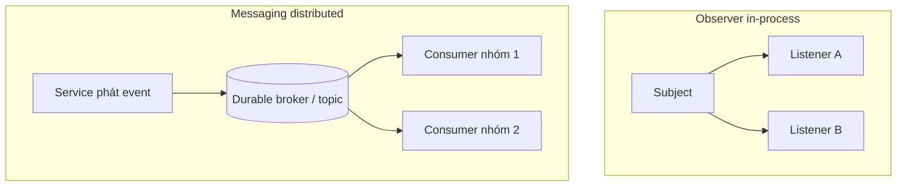
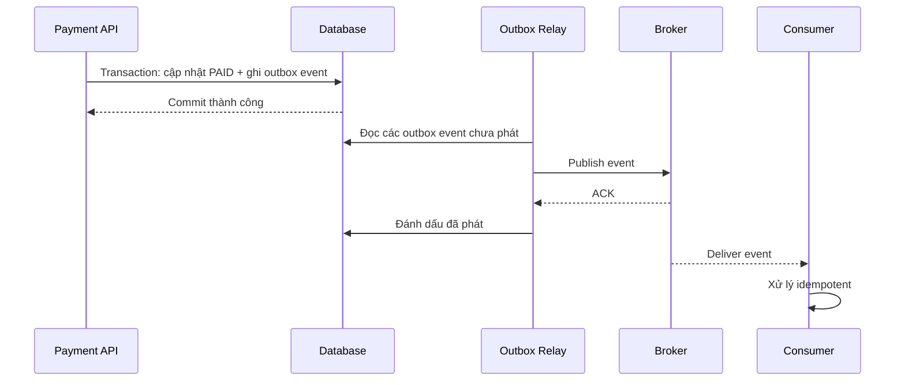

# Observer Pattern – thông báo khi trạng thái thay đổi

> **Chủ đề:** Observer và thông báo thay đổi, thuộc nhóm mẫu thiết kế hành vi (*behavioral design patterns*). Mục tiêu của bài là biết **khi nào cần Observer**, thiết kế hợp đồng sự kiện và vòng đời đăng ký, cài đặt bằng Java, kiểm thử hành vi và nhận diện rủi ro khi chuyển từ callback trong một tiến trình sang hệ thống phân tán.

## 1. Vấn đề: một thay đổi, nhiều thành phần quan tâm

Giả sử đơn hàng chuyển từ `CREATED` sang `PAID`. Nhiều bộ phận có thể muốn phản ứng:

- Giao diện cập nhật nhãn trạng thái.
- Hệ thống audit ghi nhận việc đổi trạng thái.
- Module gửi thông báo cho khách hàng.
- Bộ phận phân tích cập nhật chỉ số.

Một cách triển khai là để `OrderService` gọi trực tiếp từng thành phần:

```java
// Mã minh họa vấn đề coupling; các tên bên dưới giả định đã có class.
void markPaid(String orderId) {
    repository.updateStatus(orderId, "PAID");
    auditLogger.record(orderId, "PAID");
    emailSender.sendPaymentConfirmation(orderId);
    dashboard.refresh(orderId);
}
```

Những cuộc gọi này có thể hợp lý trong một ứng dụng rất nhỏ, nhưng nếu danh sách phản ứng thường xuyên thay đổi, `OrderService` phải biết ngày càng nhiều dịch vụ. Việc thêm một chức năng phụ (metrics, notification, UI) lại buộc sửa mã phát sinh thay đổi.

**Observer Pattern** cho phép một đối tượng nguồn (*Subject/Publisher*) duy trì danh sách các đối tượng theo dõi (*Observers/Subscribers*). Khi có sự thay đổi đáng quan tâm, nguồn phát **thông báo** qua một hợp đồng thống nhất; các observer quyết định phải xử lý gì.

Nội dung cốt lõi của Observer:

1. Observer có thể **đăng ký** quan tâm tới một loại thay đổi.
2. Khi thay đổi xảy ra, Subject **phát thông báo**.
3. Observer nhận thông báo và thực thi phản ứng riêng.
4. Observer có thể **hủy đăng ký**, tránh giữ tham chiếu và nhận sự kiện không mong muốn.

Observer giúp **giảm phụ thuộc trực tiếp** giữa đối tượng phát sự kiện và những phản ứng phụ; nó **không xóa** mọi phụ thuộc, không đảm bảo thông báo được lưu bền hoặc được chuyển tới hệ thống khác khi có sự cố.

## 2. Vai trò và cấu trúc

| Vai trò | Chức năng | Ví dụ |
|---|---|---|
| **Subject / Publisher** | Quản lý đăng ký và phát thông báo | `OrderService` phát `OrderStatusChanged` |
| **Observer / Listener** | Hợp đồng nhận thông báo | `OrderStatusListener` |
| **Concrete observers** | Phản ứng theo mục đích riêng | Audit, email notification, cập nhật UI |
| **Event payload** | Mô tả *điều đã xảy ra*, thường là dữ liệu bất biến | `OrderStatusChanged(orderId, before, after)` |
| **Subscription** | Đại diện cho đăng ký, cho phép hủy bỏ | `Subscription.close()` |



**Một điểm dễ nhầm:** sơ đồ mô tả hợp đồng cộng tác. Nó không đòi hỏi Observer phải kế thừa một abstract class nặng nề. Với Java hiện đại, một **functional interface** là đủ cho các listener đơn giản.

## 3. Java 17 hoàn chỉnh: đăng ký, phát sự kiện, hủy đăng ký

Ví dụ này mô phỏng thay đổi trạng thái của một đơn hàng trong **một luồng xử lý**. Trạng thái hợp lệ lần lượt là `CREATED → PAID → SHIPPED`. Không phát sự kiện khi gọi cập nhật với chính trạng thái hiện tại; những chuyển trạng thái sai bị từ chối.

Thiết kế sự kiện kiểu `record` bất biến, và thao tác đăng ký trả về một đối tượng `Subscription` để hủy theo đúng lần đăng ký.

Tạo file `ObserverDemo.java` và chạy:

```bash
javac ObserverDemo.java
java ObserverDemo
```

```java
import java.util.HashMap;
import java.util.Map;
import java.util.Objects;
import java.util.concurrent.CopyOnWriteArrayList;

public class ObserverDemo {

    enum OrderStatus { CREATED, PAID, SHIPPED }

    // Payload chỉ đọc: observer không thể thay đổi trạng thái event.
    record OrderStatusChanged(
            String orderId,
            OrderStatus before,
            OrderStatus after) {
        OrderStatusChanged {
            Objects.requireNonNull(orderId, "orderId");
            Objects.requireNonNull(before, "before");
            Objects.requireNonNull(after, "after");
        }
    }

    @FunctionalInterface
    interface OrderStatusListener {
        void onStatusChanged(OrderStatusChanged event);
    }

    // AutoCloseable, nhưng close() không ném checked exception.
    @FunctionalInterface
    interface Subscription extends AutoCloseable {
        @Override
        void close();
    }

    static final class OrderService {
        private final Map<String, OrderStatus> orders = new HashMap<>();
        private final CopyOnWriteArrayList<Registration> listeners =
                new CopyOnWriteArrayList<>();

        // Một token riêng cho mỗi lần đăng ký: cùng listener có thể
        // đăng ký nhiều lần nhưng hủy đúng subscription tương ứng.
        private static final class Registration {
            private final OrderStatusListener listener;

            private Registration(OrderStatusListener listener) {
                this.listener = listener;
            }
        }

        void createOrder(String id) {
            requireId(id);
            if (orders.putIfAbsent(id, OrderStatus.CREATED) != null) {
                throw new IllegalArgumentException(
                        "Đơn hàng đã tồn tại: " + id);
            }
        }

        Subscription subscribe(OrderStatusListener listener) {
            Objects.requireNonNull(listener, "listener");
            Registration registration = new Registration(listener);
            listeners.add(registration);
            return () -> listeners.remove(registration);
        }

        void changeStatus(String id, OrderStatus next) {
            requireId(id);
            Objects.requireNonNull(next, "next");
            OrderStatus current = orders.get(id);

            if (current == null) {
                throw new IllegalArgumentException(
                        "Không tìm thấy đơn hàng: " + id);
            }

            if (current == next) {
                return; // Không có sự thay đổi: không phát event.
            }

            boolean allowed =
                    current == OrderStatus.CREATED &&
                            next == OrderStatus.PAID
                    || current == OrderStatus.PAID &&
                            next == OrderStatus.SHIPPED;

            if (!allowed) {
                throw new IllegalStateException(
                        "Không thể chuyển từ " + current + " sang " + next);
            }

            orders.put(id, next);
            OrderStatusChanged event =
                    new OrderStatusChanged(id, current, next);

            // Best effort, đồng bộ, trong tiến trình.
            for (Registration r : listeners) {
                try {
                    r.listener.onStatusChanged(event);
                } catch (RuntimeException ex) {
                    // Demo: một listener lỗi không chặn listener còn lại.
                    // Production: log/metrics, error policy rõ ràng.
                    System.err.println(
                            "Listener gặp lỗi: " + ex.getMessage());
                }
            }
        }

        OrderStatus statusOf(String id) {
            requireId(id);
            OrderStatus status = orders.get(id);
            if (status == null) {
                throw new IllegalArgumentException(
                        "Không tìm thấy đơn hàng: " + id);
            }
            return status;
        }

        private static void requireId(String id) {
            Objects.requireNonNull(id, "orderId");
            if (id.isBlank()) {
                throw new IllegalArgumentException(
                        "orderId không được rỗng");
            }
        }
    }

    public static void main(String[] args) {
        OrderService orders = new OrderService();
        orders.createOrder("DH-100");

        Subscription audit = orders.subscribe(event ->
                System.out.printf(
                        "AUDIT %s: %s -> %s%n",
                        event.orderId(),
                        event.before(),
                        event.after()));

        Subscription notification = orders.subscribe(event -> {
            if (event.after() == OrderStatus.PAID) {
                System.out.println(
                        "NOTIFY: Đã thanh toán " + event.orderId());
            }
        });

        orders.changeStatus("DH-100", OrderStatus.PAID);
        // AUDIT DH-100: CREATED -> PAID
        // NOTIFY: Đã thanh toán DH-100

        notification.close(); // Dừng listener notification.
        orders.changeStatus("DH-100", OrderStatus.SHIPPED);
        // AUDIT DH-100: PAID -> SHIPPED

        orders.changeStatus("DH-100", OrderStatus.SHIPPED);
        // Không có thay đổi, không có thông báo mới.

        audit.close();
        System.out.println(orders.statusOf("DH-100")); // SHIPPED
    }
}
```

### Những quyết định quan trọng trong ví dụ

- **Không đặt logic audit/email vào `OrderService`:** service chỉ biết `OrderStatusListener`, không import SDK gửi email hay lớp dashboard.
- **Event chứa dữ liệu đủ dùng:** observer biết đơn nào đổi và từ trạng thái nào sang trạng thái nào, không cần tự đoán biến động từ trạng thái toàn cục.
- **Không phát khi không thay đổi:** lần gọi `SHIPPED → SHIPPED` là thao tác no-op, tránh hiệu ứng phụ trùng lặp trong kịch bản ví dụ.
- **`Subscription` quản lý vòng đời:** `close()` xóa đúng một đăng ký khỏi danh sách. Gọi `close()` nhiều lần không tạo lỗi. Không cần cho Subject truy cập phương thức hủy theo toàn bộ người quan sát.
- **`CopyOnWriteArrayList` giữ snapshot khi duyệt:** thêm/xóa listener trong lúc dispatch không làm ném `ConcurrentModificationException`. Listener được đăng ký hoặc hủy trong lúc dispatch có thể vẫn/không được nhận *event đang xử lý* tùy snapshot; không nên dựa vào hiệu lực tức thì trong callback.
- **Xử lý lỗi là một lựa chọn thiết kế:** demo bắt `RuntimeException` và tiếp tục gọi listener còn lại; sự kiện lỗi chỉ được in ra stderr. Production cần phân loại lỗi, đo metrics và quy tắc retry/điều tra.
- **Chỉ phục vụ single-thread cho trạng thái đơn hàng:** `HashMap` và chuỗi đọc–kiểm tra–ghi chưa được đồng bộ. `CopyOnWriteArrayList` chỉ hỗ trợ danh sách listener khi thay đổi đồng thời, **không** làm `OrderService` thread-safe.

**Bản demo không thay thế hệ thống đặt hàng thực tế**: nó không lưu DB, không có transaction, không xử lý đồng thời nhiều người cập nhật một đơn, và không bảo đảm notification được phát lại sau khi process chết.

## 4. Thứ tự gọi và thời điểm phát sự kiện

```mermaid
sequenceDiagram
    participant U as Client
    participant S as OrderService
    participant A as AuditObserver
    participant N as NotificationObserver
    U->>S: changeStatus("DH-100", PAID)
    S->>S: Validate transition
    S->>S: Lưu PAID
    S->>A: onStatusChanged(event)
    A-->>S: Return
    S->>N: onStatusChanged(event)
    N-->>S: Return
    S-->>U: Return
    Note over S,N: Dispatch đồng bộ; callback chậm làm chậm caller
```

Trong ví dụ, **thứ tự đăng ký** thường cũng là thứ tự lặp qua `CopyOnWriteArrayList` trong một lượt dispatch. Tuy nhiên, ứng dụng không nên đưa quy tắc nghiệp vụ sống còn vào việc “Observer A luôn chạy trước Observer B”. Một observer có thể được thêm, hủy, chạy lâu, ném lỗi hoặc kích hoạt một lần dispatch lồng nhau.

Nếu trình tự A phải hoàn tất thành công **trước** B để bảo đảm tính đúng đắn, đó thường là một **quy trình điều phối bắt buộc** thuộc use case hoặc workflow, không nên ngầm dựa vào thứ tự Observer.

### Push hay Pull?

Có hai cách tổ chức payload:

- **Push model:** nguồn phát gửi dữ liệu liên quan qua `OrderStatusChanged` như ví dụ. Observer dễ xử lý, nhưng contract của sự kiện phải được thiết kế và version cẩn thận.
- **Pull model:** nguồn chỉ báo “đã đổi”; observer phải hỏi ngược Subject để lấy trạng thái mới. Payload nhỏ hơn nhưng tăng coupling và tạo nguy cơ đọc phải trạng thái đã đổi thêm lần nữa.

Đối với các sự kiện cần audit hoặc cần phản ứng chính xác trên từng chuyển trạng thái, **payload bất biến mô tả điều đã xảy ra** thường dễ kiểm thử và ít gặp lỗi thời điểm hơn.

## 5. Kiểm thử Observer: đăng ký, hủy, trạng thái và lỗi

Kiểm thử Observer cần chứng minh hành vi từ góc nhìn client, không chỉ “có listener được gọi”.

Ví dụ JUnit 5; đặt file `ObserverDemoTest.java` trong cùng package với `ObserverDemo`:

```java
import static org.junit.jupiter.api.Assertions.*;
import java.util.ArrayList;
import java.util.List;
import org.junit.jupiter.api.Test;

class ObserverDemoTest {

    @Test
    void notifiesOnceForRealChange() {
        var service = new ObserverDemo.OrderService();
        service.createOrder("DH-1");

        List<ObserverDemo.OrderStatusChanged> received =
                new ArrayList<>();
        service.subscribe(event -> { received.add(event); });

        service.changeStatus("DH-1", ObserverDemo.OrderStatus.PAID);
        service.changeStatus("DH-1", ObserverDemo.OrderStatus.PAID);

        assertEquals(1, received.size());
        assertEquals("DH-1", received.get(0).orderId());
        assertEquals(ObserverDemo.OrderStatus.CREATED,
                received.get(0).before());
        assertEquals(ObserverDemo.OrderStatus.PAID,
                received.get(0).after());
    }

    @Test
    void unsubscribeStopsFutureNotifications() {
        var service = new ObserverDemo.OrderService();
        service.createOrder("DH-2");
        List<ObserverDemo.OrderStatusChanged> events =
                new ArrayList<>();

        ObserverDemo.Subscription sub =
                service.subscribe(event -> { events.add(event); });
        service.changeStatus("DH-2", ObserverDemo.OrderStatus.PAID);
        sub.close();
        sub.close(); // idempotent
        service.changeStatus("DH-2", ObserverDemo.OrderStatus.SHIPPED);

        assertEquals(1, events.size());
    }

    @Test
    void invalidTransitionDoesNotNotifyOrChangeState() {
        var service = new ObserverDemo.OrderService();
        service.createOrder("DH-3");
        List<ObserverDemo.OrderStatusChanged> events =
                new ArrayList<>();
        service.subscribe(event -> { events.add(event); });

        assertThrows(IllegalStateException.class,
                () -> service.changeStatus(
                        "DH-3", ObserverDemo.OrderStatus.SHIPPED));

        assertEquals(ObserverDemo.OrderStatus.CREATED,
                service.statusOf("DH-3"));
        assertTrue(events.isEmpty());
    }

    @Test
    void brokenObserverDoesNotBlockOtherObservers() {
        var service = new ObserverDemo.OrderService();
        service.createOrder("DH-4");
        List<ObserverDemo.OrderStatusChanged> received =
                new ArrayList<>();

        service.subscribe(event -> {
            throw new IllegalStateException("Lỗi mô phỏng");
        });
        service.subscribe(event -> { received.add(event); });

        service.changeStatus("DH-4", ObserverDemo.OrderStatus.PAID);
        assertEquals(1, received.size());
        assertEquals(ObserverDemo.OrderStatus.PAID,
                service.statusOf("DH-4"));
    }
}
```

Test cuối mô tả **chính sách lỗi đã chọn trong demo**: một listener ném `RuntimeException` nhưng các listener sau vẫn chạy. Nếu production cần *fail-fast* hay phải báo về caller việc thông báo chưa thành công, cần sửa **hợp đồng** và kiểm thử tương ứng, đồng thời bảo đảm không làm trạng thái domain bị hiểu sai.

Các test quan trọng khác có thể bổ sung: đăng ký cùng callback hai lần, hủy ngay trong callback, sự kiện gửi sau khi thay đổi thành công, xử lý khi một subscriber chạy rất chậm, và behavior trong trường hợp có nhiều thread. Không cần mock framework để kiểm thử cơ chế đơn giản này.

## 6. Vòng đời đăng ký và rò rỉ bộ nhớ

Subject thông thường **giữ tham chiếu mạnh** tới listener. Nếu listener tham chiếu đến UI controller hoặc một đối tượng lớn đã không còn cần thiết, nhưng vẫn nằm trong danh sách của Subject có vòng đời dài, GC có thể **không giải phóng được** các đối tượng liên quan.



Cách phòng tránh:

- Trả về **subscription token** và gọi `close()` khi đối tượng không còn theo dõi.
- Liên kết subscription với lifecycle của UI, request scope hoặc component.
- Trong API async hoặc framework, sử dụng cơ chế dispose/unsubscribe được framework hỗ trợ.
- Tránh đăng ký lại cùng một listener sau mỗi lần render/request mà không kiểm soát số lượng.
- Kiểm thử thao tác đóng/mở nhiều lần để tìm rò rỉ và nhận event trùng.

**Weak references** có thể hữu ích trong một số framework, nhưng khiến observer bị GC bất ngờ nếu không có tham chiếu giữ sống; không phải thay thế mặc định cho việc quản lý lifecycle tường minh.

## 7. Callback đồng bộ, concurrency và reentrancy

Observer Pattern mô tả quan hệ đăng ký–thông báo, **không mặc định nói “chạy bất đồng bộ”**.

| Thuộc tính | Đồng bộ trong tiến trình (ví dụ) | Dispatch bất đồng bộ qua queue/executor |
|---|---|---|
| Thời điểm xử lý | Ngay trên luồng của publisher | Một luồng/tác vụ khác |
| Độ trễ của publisher | Cộng thời gian các observer | Có thể giảm thời gian chờ, nhưng thêm enqueue/điều phối |
| Thứ tự | Có thể dựa vào thứ tự dispatch một lượt, không nên thành luật nghiệp vụ | Phụ thuộc queue, worker, partition và concurrency |
| Lỗi listener | Có thể ném lên stack hoặc bắt tại publisher | Cần nơi ghi nhận lỗi, retry, dead-letter |
| Backpressure | Listener chậm chặn publisher | Queue đầy, memory tăng hoặc reject task |
| Vòng đời | Trong bộ nhớ process | Cần quản lý executor/queue và shutdown |

### Những vấn đề đặc biệt cần quyết định

**Reentrancy:** một listener có thể gọi lại `changeStatus` trong lúc Subject đang phát sự kiện. Khi đó lời gọi mới chạy lồng bên trong lời gọi cũ; observer khác có thể nhận event mới trước event cũ nếu không thiết kế rõ. Tránh callback tự kích hoạt vô hạn. Nếu cần bảo đảm thứ tự, hãy điều phối thay đổi bằng queue hoặc state machine với cơ chế serialization rõ.

**Race condition:** hai thread đọc cùng `CREATED` rồi cùng thay đổi sẽ gây mất cập nhật hoặc event sai. Khóa/transaction/optimistic locking phải bảo vệ **toàn bộ thao tác kiểm tra–cập nhật**, không chỉ danh sách listeners. Ví dụ `CopyOnWriteArrayList` không làm `HashMap` được cập nhật an toàn.

**Callback lâu:** gửi email hoặc gọi REST trực tiếp trong listener đồng bộ có thể kéo dài thời gian API phản hồi. Có thể chuyển side effect sang task/job; khi đó phải giải quyết hàng đợi đầy, retry, theo dõi lỗi và shutdown an toàn.

**Lỗi:** ba lựa chọn phổ biến là *fail-fast*, *tiếp tục và tổng hợp lỗi*, hoặc *best effort và ghi nhận lỗi*. Không có một chính sách luôn đúng. Quan trọng là người gọi biết update chính đã thành công hay chưa và notification được cam kết ở mức nào.

**Thứ tự và at-most-once:** không nên tự suy ra “có Observer thì mỗi người nhận chính xác một lần”. Đặc biệt sau sự cố, retry hoặc khi callback gọi lại, việc giao sự kiện có thể thiếu hoặc trùng.

## 8. Observer, Event Bus và Publish–Subscribe khác nhau thế nào?

**Observer** trong thiết kế hướng đối tượng thường là quan hệ trực tiếp giữa nguồn và danh sách người quan sát, trong cùng process.

**Event bus (trong process)** thêm một nơi trung gian nhận sự kiện và phân phối theo loại. Producer chỉ biết bus, còn nhiều handler đăng ký với bus. Mô hình này giảm tham chiếu trực tiếp nhưng có thể làm khó tra cứu ai xử lý sự kiện nào nếu cấu hình rải rác.

**Publish–subscribe qua message broker** (như Kafka hoặc RabbitMQ) tách producer và consumer qua mạng và thời gian. Đây là bài toán hệ thống phân tán: lưu bền thông điệp, xác nhận tiêu thụ, retry, thứ tự, nhóm consumer, poison message và idempotency.



| Câu hỏi | Observer trong process | Messaging phân tán |
|---|---|---|
| Có qua mạng? | Thường không | Có |
| Đòi hỏi broker riêng? | Không | Thường có |
| Thông báo có tự được lưu bền? | Không | Tùy cấu hình và xác nhận ghi/đọc |
| Process dừng giữa dispatch? | Observer còn lại có thể không nhận | Có thể phát lại theo semantics của hệ thống |
| Cần xử lý trùng lặp? | Tùy code và retry | Thường cần idempotent consumer |
| Ai quản lý lifecycle? | Subject và subscription | Broker/client/consumer group + ứng dụng |
| Có đảm bảo “exactly once” end-to-end? | Không | Không mặc định; phụ thuộc phạm vi transaction và side effects |

Không nên gọi “Observer qua Kafka” như thể chỉ cần thay danh sách listener bằng topic. Đó là **một thiết kế khác cấp**, thêm nhiều yêu cầu vận hành và tính nhất quán.

## 9. Sự kiện domain và thời điểm publish với database

Giả sử xử lý thanh toán có transaction:

1. Kiểm tra đơn hàng và điều kiện chuyển trạng thái.
2. Ghi `PAID` vào database.
3. Commit.
4. Thông báo cho bộ phận email/audit/analytics.

Nếu phát sự kiện **trước commit**, listener có thể đọc một trạng thái chưa tồn tại bền vững, hoặc nhận “đã thanh toán” dù transaction rollback. Nếu chỉ phát **sau commit** bằng lời gọi trong RAM, có cửa sổ sự cố: DB đã commit nhưng process chết trước khi publish → mất thông báo.

Với yêu cầu tin cậy, xem xét **Transactional Outbox**:



Outbox giải quyết **khoảng cách giữa cập nhật DB và ghi thông điệp** khi cả hai được ghi chung một transaction của DB. Nhưng relay có thể phát trùng nếu crash sau publish trước khi đánh dấu; consumer vẫn phải hỗ trợ **idempotency**. Không tự mặc định mọi event có thứ tự toàn cục hoặc được xử lý đúng một lần.

Các event nên mô tả **sự thật đã xảy ra** bằng tên quá khứ, ví dụ `OrderPaid`, `OrderShipped`. Một lệnh như `SendEmail` lại diễn đạt **yêu cầu làm việc**; phân biệt event và command giúp contract rõ ràng.

### Điều kiện tối thiểu cho event có thể chia sẻ

- Mã sự kiện duy nhất `eventId` để chống trùng.
- `aggregateId`/`orderId` để gắn với đối tượng nghiệp vụ.
- Loại sự kiện, thời điểm phát `occurredAt`, có cân nhắc múi giờ UTC.
- Phiên bản schema khi cần thay đổi hợp đồng lâu dài.
- Payload tối thiểu, tránh dữ liệu nhạy cảm không cần thiết.
- Quy tắc tương thích ngược và điều kiện consumer có thể retry an toàn.

Những trường này là **khuyến nghị cho sự kiện bền vững/phân tán**, không bắt buộc với mỗi observer cục bộ trong bài học.

## 10. Observer so với các Design Pattern gần gũi

| Pattern / cơ chế | Ý định | Khác biệt đáng nhớ |
|---|---|---|
| **Observer** | Một nguồn thay đổi thông báo các listener đăng ký | Chủ yếu quan hệ one-to-many, phản ứng sau thay đổi |
| **Strategy** | Hoán đổi thuật toán/chính sách để thực hiện một công việc | Thường chọn *một chiến lược xử lý*, không phải phát cho nhiều người quan tâm |
| **Mediator** | Tập trung điều phối tương tác qua lại giữa các đồng nghiệp | Quản lý quan hệ phối hợp hai chiều/phức tạp, không đơn thuần “có thay đổi thì báo” |
| **Command** | Đóng gói một yêu cầu hành động thành đối tượng | Command nói về việc *muốn làm*, event nói về việc *đã xảy ra* |
| **Decorator** | Bổ sung hành vi qua lớp bọc giữ cùng interface | Bao quanh một đối tượng/đường gọi, không xây danh sách subscriber |
| **Callback đơn lẻ** | Gọi một hàm khi tác vụ kết thúc | Có thể là phần tử của Observer, nhưng chưa nhất thiết có registry/vòng đời |

Ví dụ: khi nhấn nút đặt hàng, có thể dùng **Command** `PlaceOrder`, logic chọn cách giảm giá dùng **Strategy**, và sau khi trạng thái đổi thì **Observer** thông báo tới view/audit. Các pattern có thể phối hợp, nhưng mỗi cái phải giải quyết một vấn đề cụ thể.

## 11. Không phải phản ứng nào cũng nên là observer

Phân biệt **hành động bắt buộc cho tính đúng đắn** và **phản ứng phát sinh**:

| Tình huống | Thiết kế nên cân nhắc |
|---|---|
| Phải trừ tồn kho thành công trước khi xác nhận đơn | Workflow/use case rõ ràng với transaction hoặc saga; đừng phụ thuộc thứ tự listener ngầm |
| Cập nhật UI khi trạng thái ViewModel thay đổi | Observer/property listener rất phù hợp |
| Ghi metrics best effort sau khi xử lý xong | Observer/listener có thể phù hợp |
| Gửi email xác nhận có thể chậm, cần retry | Job queue, outbox hoặc consumer bền vững |
| Audit bắt buộc không được mất | Lưu audit cùng transaction hoặc cơ chế bền vững tương đương |
| Hai class luôn gọi nhau một-một đơn giản | Gọi phương thức trực tiếp có thể dễ hiểu hơn |
| Hàng nghìn loại event đăng ký khắp nơi không kiểm soát | Cần catalog event, tracing, schema và giới hạn quyền đăng ký |

Một **observer phát lỗi nhưng publisher đã thay đổi state** là trường hợp phải quy định từ trước. Nếu lỗi của observer phải khiến toàn bộ nghiệp vụ thất bại thì cấu trúc đồng bộ có rollback/compensation có thể cần thiết; tuyệt đối không mặc định “đã phát event” đồng nghĩa với “mọi hiệu ứng phụ đã xong”.

## 12. Kỹ thuật thiết kế API Observer dễ bảo trì

**Đặt tên theo domain.** `OrderStatusChanged` tốt hơn event mơ hồ `SomethingUpdated` nếu consumer cần ý nghĩa nghiệp vụ. Đừng lạm dụng kiểu `Object payload` rồi ép kiểu bằng `instanceof` khắp nơi.

**Giữ payload bất biến.** Java `record` thuận tiện cho dữ liệu ít trường, nhưng record chỉ *bất biến nông*: nếu chứa `List` mutable hoặc class mutable, nên sao chép phòng vệ (`List.copyOf`) và thiết kế phần tử bất biến.

**Xác định phạm vi nguồn.** Một `OrderService` riêng cho đơn hay một subject chung mọi đơn? Mỗi cách khác nhau về lọc sự kiện, vòng đời, quyền truy cập và memory.

**Có chính sách trùng lặp.** Nếu cần phát *mỗi lần thao tác* ngay cả khi trạng thái không đổi, dùng event thể hiện “attempted action”, không giả vờ đó là `StatusChanged`. Nếu nhiều listener đăng ký cùng một callback, quyết định có cho phép duplicate subscriptions hay không.

**Quản lý unsubscribe.** Khi view đóng, session hết hạn hay module dỡ tải, subscription cần được giải phóng. Java `AutoCloseable` thích hợp dùng với `try-with-resources` trong scope ngắn:

```java
try (ObserverDemo.Subscription sub =
         service.subscribe(event -> System.out.println(event))) {
    service.changeStatus("DH-10", ObserverDemo.OrderStatus.PAID);
}
// sub.close() tự gọi khi ra khỏi khối
```

Đoạn nhỏ trên giả định `service` đã tạo và có đơn `DH-10` trạng thái `CREATED`, không thể chạy độc lập.

**Quan sát được sự kiện.** Khi triển khai sản phẩm thật, bổ sung metrics số observer, thời gian callback, lỗi callback, độ trễ queue, correlation ID. Tránh log thông tin cá nhân/chi tiết thanh toán không cần thiết.

**Không đưa I/O chậm vào listener đồng bộ không giới hạn.** Callback gửi request mạng có thể treo, làm chậm tất cả các listener và caller. Có timeout, circuit breaker và/hoặc queue nếu cần — lựa chọn phải dựa vào yêu cầu sản phẩm.

## 13. Quy trình refactor từ lời gọi cứng sang Observer

1. **Xác định một thay đổi có ý nghĩa:** ví dụ chuyển trạng thái đơn sang `PAID`.
2. **Phân loại phản ứng:** tác vụ bắt buộc để commit thành công khác với tác vụ phụ như metrics/UI/notification.
3. **Đặt contract sự kiện:** `OrderStatusChanged` chứa dữ liệu tối thiểu observer cần.
4. **Tạo hợp đồng listener:** ví dụ `onStatusChanged(event)`; không để Subject biết các class nhận thông báo.
5. **Quyết định dispatch policy:** đồng bộ hay async; lỗi của observer ảnh hưởng caller thế nào; có cần đảm bảo thứ tự không.
6. **Tạo registry/subscription:** hỗ trợ hủy đăng ký, tránh giữ listener quá lâu.
7. **Chỉ publish khi thay đổi hợp lệ và có ý nghĩa:** không tạo “ghost event” cho lệnh thất bại.
8. **Viết test về hợp đồng:** một thay đổi thật, không thay đổi, trạng thái sai, nhiều observer, một observer lỗi, hủy đăng ký.
9. **Đánh giá bền vững nếu có DB/mạng:** transaction boundary, outbox, retry, idempotency, consumer lag.
10. **Theo dõi và thu gọn:** nếu mọi thứ trở nên khó lần theo, dùng event naming/catalog hoặc chuyển quy trình bắt buộc về application service.

## 14. Cạm bẫy thường gặp

| Cạm bẫy | Triệu chứng | Cách xử lý |
|---|---|---|
| Không unsubscribe | Mỗi lần mở lại UI, một event tạo nhiều callback | Trả subscription handle, gắn vào lifecycle |
| Callback làm I/O chậm | Một observer khiến request chậm toàn bộ | Dispatch phù hợp, queue/timeout |
| Observer A gọi lại Subject | Event lồng nhau, thứ tự khó đoán hoặc recursion | Giới hạn reentrancy, dùng queue nếu cần |
| Catch mọi ngoại lệ rồi bỏ qua | Mất notification mà không ai biết | Log/metrics/alert và error policy |
| Cho observer sửa trực tiếp event mutable | Các listener sau nhìn thấy nội dung thay đổi | Event bất biến, phòng vệ collection |
| Coi `CopyOnWriteArrayList` là thread-safe cho cả domain state | Trạng thái đơn bị race | Lock/transaction/CAS tại phần cập nhật trạng thái |
| Dựa vào thứ tự đăng ký để quyết định nghiệp vụ | Đổi cấu hình làm sai luồng | Đưa bước bắt buộc vào workflow |
| Publish trước commit | Observer nhận event dù transaction rollback | Publish sau commit hoặc outbox phù hợp |
| Publish sau commit trong RAM và tưởng “không mất” | Crash giữa commit và publish gây mất event | Transactional Outbox khi cần bền vững |
| Giả định exactly-once | Consumer lặp hiệu ứng phụ khi redelivery | Event ID, deduplication, idempotent consumer |
| Event quá chung `onChange(Object)` | Ép kiểu runtime và coupling ngầm | Kiểu event rõ và có schema |
| Dùng Observer cho mọi phép gọi | Khó debug, khó truy vết phụ thuộc | Giữ lời gọi trực tiếp cho tương tác rõ, bắt buộc |

## 15. Bài tập thực hành

**Bài 1 — Theo dõi thay đổi giá:** Xây `PriceCatalog` phát `PriceChanged(sku, oldPrice, newPrice)`. Có một observer cập nhật UI và một observer thu thập metric. Không phát sự kiện nếu giá không đổi; test đăng ký và hủy đăng ký.

**Bài 2 — Đăng ký trùng:** Gọi `subscribe` hai lần với cùng một listener. Xác định số thông báo được nhận. Hủy một `Subscription` và kiểm tra đăng ký còn lại vẫn hoạt động. Giải thích vì sao mỗi lần đăng ký cần token có danh tính riêng.

**Bài 3 — Observer gây lỗi:** Một listener ném exception, một listener còn lại thu event vào list. Viết test cho chính sách đã chọn (tiếp tục, fail-fast hoặc tổng hợp lỗi). Mô tả rõ người gọi sẽ quan sát trạng thái nghiệp vụ thế nào sau lỗi.

**Bài 4 — Đa luồng:** Hai thread cùng muốn đổi đơn từ `CREATED` sang `PAID`. Đề xuất cách cập nhật có điều kiện bằng database hoặc lock, và chỉ publish **một** sự kiện cho chuyển trạng thái thành công. Trình bày rủi ro nếu publish sau commit nhưng process chết.

**Bài 5 — Gửi email tin cậy:** Từ ví dụ đơn hàng, nâng yêu cầu thành “không được làm mất nhu cầu gửi email khi giao dịch đã commit; xử lý trùng lặp an toàn”. Vẽ sơ đồ outbox, relay, broker, consumer và đề xuất `eventId`/idempotency key.

## 16. Tự kiểm tra đã hiểu Observer chưa?

- [ ] Tôi chỉ ra được Subject, Observer, event, subscription và thời điểm publish.
- [ ] Tôi biết khi nào **thông báo về thay đổi** khác với **gọi thao tác bắt buộc**.
- [ ] Tôi phân biệt được callback đồng bộ trong Java với pub/sub qua broker.
- [ ] Tôi xử lý được sự kiện không thay đổi, invalid transition và listener ném lỗi.
- [ ] Tôi hiểu nguy cơ memory leak khi Subject giữ listener lâu hơn lifecycle của UI.
- [ ] Tôi không nhầm an toàn của danh sách listener với an toàn cập nhật trạng thái nghiệp vụ.
- [ ] Tôi xác định được policy về thứ tự, reentrancy, latency, error và retry.
- [ ] Tôi biết vì sao outbox/idempotency cần thiết khi nâng yêu cầu thành giao sự kiện tin cậy giữa các dịch vụ.

**Ghi nhớ:** Observer cung cấp cách để *một nguồn thay đổi thông báo tới nhiều đối tượng quan tâm* mà không biết trực tiếp tất cả các phản ứng. Thiết kế tốt phải đi kèm vòng đời đăng ký, hợp đồng sự kiện, cách xử lý lỗi và mức bảo đảm thông báo đúng với bối cảnh — đặc biệt khi đi từ callback cục bộ sang hệ thống phân tán.