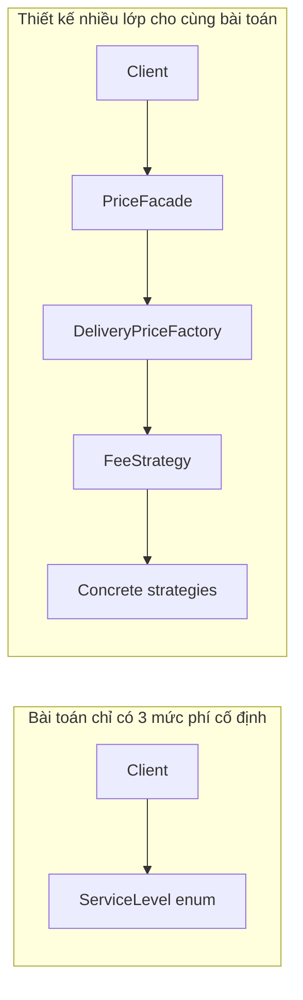
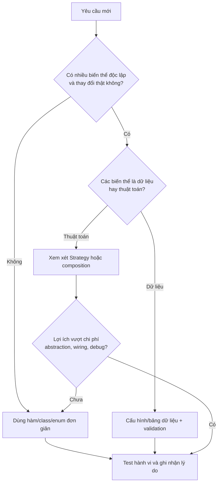

# Khi mẫu thiết kế làm hệ thống phức tạp hơn cần thiết

> **Chủ đề:** Mẫu thiết kế trong OOP – nhận diện và xử lý tình trạng *overengineering*.  
> **Mục tiêu:** Biết phân biệt sự linh hoạt thực sự cần thiết với abstraction dựa trên dự đoán; đánh giá chi phí của một Design Pattern, lựa chọn lời giải đủ đơn giản, kiểm thử và refactor khi bằng chứng cho thấy kiến trúc hiện tại quá nặng.

## 1. Tại sao một mẫu thiết kế “đúng sách” vẫn có thể là thiết kế kém?

**Design Pattern** là một phương án giải quyết vấn đề thiết kế lặp lại trong bối cảnh phù hợp. Nó không phải mục tiêu tự thân. Một lớp `Factory`, một interface `Strategy`, một chuỗi `Decorator` hay một `Observer` đều có thể đúng về cấu trúc nhưng vẫn làm ứng dụng khó hiểu hơn nếu vấn đề mà chúng giải quyết **chưa tồn tại hoặc quá nhỏ**.

Hãy tưởng tượng yêu cầu: “Ứng dụng nội bộ cần xuất một chuỗi CSV có ba cột”. Một thiết kế có thể gồm `IExporterFactory`, `AbstractExportBuilder`, `ExporterRegistry`, `CsvExportStrategy` và `ExportFacade`. Nhưng nếu chỉ có một định dạng, một nơi sử dụng và quy tắc ổn định, một hàm xuất CSV với kiểm thử tốt thường dễ đọc, sửa và vận hành hơn.

**Overengineering** xảy ra khi chi phí cấu trúc (lớp, giao diện, cấu hình, quy trình điều phối) vượt lợi ích dự kiến trong bối cảnh hiện tại và tương lai có cơ sở. Điều đó không có nghĩa “ít class luôn tốt”; đôi khi abstraction giúp giảm độ phức tạp tổng thể của hệ thống. Câu hỏi đúng là:

> Những gì pattern làm *dễ thay đổi, dễ kiểm thử hoặc an toàn hơn* có thực sự bù được những gì nó làm *khó điều hướng, khó cấu hình và khó dự đoán hơn* không?

### Những chi phí thường bị bỏ quên

| Chi phí | Biểu hiện thực tế |
|---|---|
| **Nhận thức** | Muốn hiểu một phép tính phải mở interface, ba implementation, factory, registry và file cấu hình |
| **Điều hướng** | Không nhìn vào call site để biết class nào chạy; phải theo DI container/annotation |
| **Bảo trì** | Sửa một kiểu dữ liệu phải đồng bộ nhiều abstraction và test |
| **Kiểm thử** | Bộ kiểm thử chứa nhiều mock cho luồng đơn giản, dễ kiểm tra lời gọi hơn là hành vi |
| **Cấu hình** | Sai tên bean, key hoặc thứ tự decorator làm lỗi runtime |
| **Rủi ro hợp đồng** | Implementation mới trả giá trị không hợp lệ hoặc mang ngữ nghĩa khác nhưng cùng interface |
| **Hiệu năng** | Thêm cấp gián tiếp, allocation, lookup, remote call hoặc serialization tùy kiểu thiết kế; nhiều pattern thuần Java có overhead không đáng kể |
| **Quyền sở hữu** | Nhóm không biết nên sửa quy tắc ở core, adapter hay factory |
| **Vận hành** | Khó xác định implementation đang hoạt động, nơi phát lỗi, cách cấu hình và giám sát |

Không nên khẳng định “Design Pattern luôn làm chậm chương trình”: một lời gọi interface trong Java thường có thể được JVM tối ưu; chi phí lớn hơn nhiều có thể nằm ở network, database hoặc thiết kế thuật toán. Hãy **đo thực tế** nếu hiệu năng là lý do lựa chọn.

## 2. Nhận diện khi nào abstraction là quá sớm

Một vài dấu hiệu mạnh:

1. **Interface có đúng một implementation**, không có yêu cầu thay thế, cô lập hạ tầng hay ranh giới module thực tế.
2. **Factory chỉ gọi một constructor** không có quyết định tạo đối tượng hoặc bất biến cần bảo vệ.
3. **Pattern được chọn trước khi mô tả vấn đề**: cuộc họp nói “áp dụng GoF” nhưng không chỉ ra thay đổi nào đang khó.
4. **Lớp chỉ chuyển tiếp nguyên xi** tham số và kết quả qua 3–4 tầng, không thêm chính sách, ranh giới hoặc khả năng thay đổi.
5. **Mở điểm extension cho giả định chưa có bằng chứng**, ví dụ plugin system cho ứng dụng chỉ có một cơ chế xử lý.
6. **Hệ thống có nhiều cách cấu hình hơn số tình huống sử dụng**, tạo trạng thái không hợp lệ rất khó test.
7. **Một thay đổi nhỏ chạm quá nhiều lớp**, dù mục tiêu ban đầu là “dễ mở rộng”.
8. **Debug phải truy ngược chuỗi event/callback dài**, khó biết ai xử lý trước hoặc vì sao lỗi không đến caller.

Mỗi dấu hiệu **không phải bằng chứng kết luận**. Một interface có một implementation vẫn hợp lý nếu đó là port ngăn business logic phụ thuộc database/SDK, hoặc là hợp đồng công khai của module. Một factory chỉ tạo một class nhưng đảm bảo validation/kiểm soát vòng đời vẫn có giá trị. Quan trọng là **lý do tồn tại và chi phí tổng thể**.

### Đừng đánh đồng đơn giản với ngắn

Hai trăm dòng trong một phương thức, đầy cờ boolean và trạng thái ẩn, không nhất thiết đơn giản hơn năm class nhỏ có trách nhiệm rõ. Ngược lại, năm class chỉ để bọc một phép cộng cũng không mặc nhiên tốt hơn một hàm.

- **Đơn giản**: dễ hiểu các điều kiện, dễ kiểm tra tính đúng, ít trạng thái và ít giả định ngầm.
- **Ngắn**: ít dòng code hoặc ít file.
- **Linh hoạt**: có thể thay một loại hành vi qua điểm mở rộng.
- **Dễ bảo trì**: thay đổi thường gặp tác động ít nơi, test có ý nghĩa và lỗi dễ quan sát.

Bốn thuộc tính này có thể hỗ trợ nhau nhưng **không tương đương**.

## 3. Ví dụ Java 17: “ba mức phí” có cần Strategy và Factory?

Bài toán: ứng dụng giao hàng nội bộ có ba mức giao đã được quy định sẵn:

| Mã | Phí VND |
|---|---:|
| `STANDARD` | 20.000 |
| `EXPRESS` | 35.000 |
| `PRIORITY` | 50.000 |

Yêu cầu hiện tại: chỉ tra cứu phí theo mã, không có thuật toán độc lập, không có plugin từ bên ngoài và biểu phí hiếm thay đổi. Đầu vào là một trong ba giá trị enum.

### 3.1. Thiết kế quá phức tạp cho bài toán này

Ví dụ dưới là **phác họa**, minh họa vai trò và mức độ gián tiếp:

```java
interface DeliveryPriceStrategy {
    long calculateFeeVnd();
}

final class StandardStrategy implements DeliveryPriceStrategy {
    public long calculateFeeVnd() { return 20_000L; }
}

final class ExpressStrategy implements DeliveryPriceStrategy {
    public long calculateFeeVnd() { return 35_000L; }
}

final class PriorityStrategy implements DeliveryPriceStrategy {
    public long calculateFeeVnd() { return 50_000L; }
}

interface DeliveryPriceFactory {
    DeliveryPriceStrategy create(String code);
}

final class DefaultPriceFactory implements DeliveryPriceFactory {
    public DeliveryPriceStrategy create(String code) {
        return switch (code) {
            case "STANDARD" -> new StandardStrategy();
            case "EXPRESS" -> new ExpressStrategy();
            case "PRIORITY" -> new PriorityStrategy();
            default -> throw new IllegalArgumentException("Mã không hỗ trợ");
        };
    }
}

final class PriceFacade {
    private final DeliveryPriceFactory factory;

    PriceFacade(DeliveryPriceFactory factory) {
        this.factory = factory;
    }

    long quote(String code) {
        return factory.create(code).calculateFeeVnd();
    }
}
```

Mọi class ở trên đều có thể tồn tại hợp lệ, nhưng **chưa giải quyết thêm nhu cầu thực tế nào**. Dù tạo ba strategy và một factory, vẫn phải sửa `DefaultPriceFactory` khi thêm mã mới. Logic tính phí chỉ là một hằng số cho mỗi mã. Bản thân `PriceFacade` cũng chỉ chuyển tiếp một lời gọi.

### 3.2. Một giải pháp đủ tốt, biên dịch và chạy độc lập

Tạo file `SimpleDeliveryPricing.java`:

```java
public final class SimpleDeliveryPricing {

    public enum ServiceLevel {
        STANDARD(20_000),
        EXPRESS(35_000),
        PRIORITY(50_000);

        private final long feeVnd;

        ServiceLevel(long feeVnd) {
            if (feeVnd < 0) {
                throw new IllegalArgumentException("Phí không được âm");
            }
            this.feeVnd = feeVnd;
        }

        public long feeVnd() {
            return feeVnd;
        }
    }

    public static long quote(ServiceLevel level) {
        if (level == null) {
            throw new IllegalArgumentException(
                    "Mức giao hàng không được null");
        }
        return level.feeVnd();
    }

    public static void main(String[] args) {
        System.out.println(quote(ServiceLevel.STANDARD)); // 20000
        System.out.println(quote(ServiceLevel.EXPRESS));  // 35000
        System.out.println(quote(ServiceLevel.PRIORITY)); // 50000
    }
}
```

Chạy:

```bash
javac SimpleDeliveryPricing.java
java SimpleDeliveryPricing
```

**Vì sao cách này phù hợp?**

- `enum` bảo đảm tập giá trị hữu hạn, giúp tránh chuỗi sai chính tả trong phần core.
- Giá của mỗi loại nằm cạnh tên loại, đọc được ngay khi mở một file.
- Không phải tạo object strategy mỗi lần yêu cầu báo giá.
- Bổ sung/đổi giá là thay đổi trực tiếp tại nơi bảng giá được sở hữu, với test tương ứng.
- Logic không dựa vào framework, không cần DI/registry.

Cách này **không phải chuẩn chung cho mọi bảng giá**. Nếu phí phải thay đổi theo thời gian, theo khu vực hoặc do nhân viên kinh doanh cấu hình, hard-code trong enum trở thành giới hạn; khi đó nên cân nhắc **dữ liệu cấu hình/database** hoặc một hệ thống pricing rule phù hợp. Không cần nhảy ngay sang Strategy nếu mọi biến thể thực chất chỉ là giá trị dữ liệu.

## 4. Một tình huống mà Strategy thật sự đáng dùng

Giả sử yêu cầu mới xuất hiện:

- STANDARD: 20.000 VND cố định.
- EXPRESS: 35.000 VND cộng thêm 8.000 VND mỗi kg, làm tròn khối lượng lên kg.
- PRIORITY: giảm 50% phí cơ bản nếu tiền đơn đạt 1 triệu VND.
- Các nhóm khác nhau phát triển quy tắc và có khả năng bổ sung biến thể thường xuyên.

Bây giờ **hành vi tính toán khác biệt**, không chỉ bảng hằng số. Strategy có thể đưa các thuật toán ra khỏi phần điều phối.

Ví dụ Java 17 độc lập, lưu trong `FlexibleDeliveryPricing.java`:

```java
import java.util.Map;
import java.util.Objects;

public final class FlexibleDeliveryPricing {

    record Shipment(long orderValueVnd, int weightGrams) {
        Shipment {
            if (orderValueVnd < 0 || weightGrams <= 0) {
                throw new IllegalArgumentException("Dữ liệu đơn không hợp lệ");
            }
        }
    }

    @FunctionalInterface
    interface FeePolicy {
        long feeVnd(Shipment shipment);
    }

    static final class QuoteService {
        private final Map<String, FeePolicy> policies;

        QuoteService(Map<String, FeePolicy> policies) {
            this.policies = Map.copyOf(Objects.requireNonNull(policies));
        }

        long quote(String code, Shipment shipment) {
            Objects.requireNonNull(code, "code");
            Objects.requireNonNull(shipment, "shipment");
            FeePolicy policy = policies.get(code);
            if (policy == null) {
                throw new IllegalArgumentException(
                        "Dịch vụ không hỗ trợ: " + code);
            }
            long result = policy.feeVnd(shipment);
            if (result < 0) {
                throw new IllegalStateException(
                        "FeePolicy không được trả phí âm");
            }
            return result;
        }
    }

    public static void main(String[] args) {
        FeePolicy standard = shipment -> 20_000L;
        FeePolicy express = shipment -> {
            long kilograms = (shipment.weightGrams() + 999L) / 1000L;
            return Math.addExact(
                    35_000L, Math.multiplyExact(kilograms, 8_000L));
        };
        FeePolicy priority = shipment ->
                shipment.orderValueVnd() >= 1_000_000L
                        ? 25_000L : 50_000L;

        QuoteService service = new QuoteService(Map.of(
                "STANDARD", standard,
                "EXPRESS", express,
                "PRIORITY", priority
        ));

        Shipment shipment = new Shipment(1_200_000L, 1_500);
        System.out.println(service.quote("STANDARD", shipment)); // 20000
        System.out.println(service.quote("EXPRESS", shipment));  // 51000
        System.out.println(service.quote("PRIORITY", shipment)); // 25000
    }
}
```

**Điểm khác về bối cảnh:** interface `FeePolicy` giờ diễn đạt một thuật toán thực sự; các chính sách dùng input khác nhau, có test riêng và có lý do thay đổi riêng. `QuoteService` không cần chứa thêm biểu thức hoặc kiểm tra kiểu cụ thể khi tăng số chính sách. `Map` là phần **đăng ký**, có thể thay bằng DI/container khi dự án lớn lên. Bổ sung chính sách mới vẫn cần cập nhật wiring — điều này bình thường.

**Giới hạn ví dụ:** dùng số nguyên VND, `Math.multiplyExact`/`addExact` tránh tràn số trong phép tính EXPRESS; giả định `weightGrams` dương nên làm tròn theo công thức an toàn trong khoảng `int`. Với tiền tệ có phần thập phân, đa tiền tệ hoặc báo giá đa gói, cần loại giá trị và quy tắc làm tròn tương ứng. Không mặc định công thức demo là chính sách vận chuyển thực tế.

### Lợi ích so với chi phí

| Tiêu chí | Bảng phí enum | Strategy theo thuật toán |
|---|---|---|
| Quy tắc chỉ là 3 hằng số | Ngắn, rõ ràng, ít cơ chế | Thừa nhiều lớp/nhánh lựa chọn |
| Có nhiều công thức độc lập | `enum` dễ phải chứa logic ngày càng lớn | Mỗi thuật toán tự chịu trách nhiệm |
| Thêm thuật toán bởi đội khác | Có thể đụng một file chung | Thêm `FeePolicy` và cập nhật đăng ký |
| Test | Kiểm các giá trị phí | Kiểm từng chính sách và contract chung |
| Tìm class chạy thực tế | Tra thẳng theo enum | Cần kiểm tra map/DI |
| Phí do admin nhập, không có thuật toán mới | Dữ liệu cấu hình có thể tốt hơn | Strategy không tự giải quyết nhu cầu cấu hình |

Không thể kết luận Strategy “tốt hơn” sau khi bối cảnh đã thay đổi. Bài học là **kiến trúc phải đi theo trục biến thiên có thật**.

## 5. Đọc sơ đồ phụ thuộc để thấy chi phí gián tiếp



Sơ đồ không kết luận “ít mũi tên = tốt”. Nó cho thấy **số điểm cần tra cứu để hiểu lời gọi**. Nếu mỗi lớp thực sự cung cấp một ranh giới độc lập và có nhu cầu thay đổi riêng, các mũi tên này có thể hoàn toàn xứng đáng. Nếu mọi lớp chỉ chuyển tiếp lời gọi, chúng tăng chi phí mà không mang thêm ý nghĩa.

## 6. Một số pattern dễ bị áp dụng quá mức

| Pattern | Dấu hiệu áp dụng quá mức | Khi thực sự phù hợp |
|---|---|---|
| **Strategy** | Tạo interface và nhiều class cho các hằng số hoặc hai nhánh không đổi | Nhiều thuật toán có cách xử lý độc lập và thay đổi thường xuyên |
| **Factory Method / Abstract Factory** | Factory chỉ bọc `new SimpleClass()`, không có lý do tạo object khác | Tạo object phức tạp hoặc họ object cần tương thích, thay thế theo môi trường |
| **Builder** | Object có hai tham số bắt buộc rõ, nhưng cần builder nhiều bước | Nhiều lựa chọn tùy chọn, kiểm tra bất biến khi xây dựng, tránh constructor khó đọc |
| **Singleton** | Dùng global mutable singleton chỉ để mọi nơi dễ lấy dependency | Thật sự cần quản lý một instance trong phạm vi phù hợp, vòng đời và đồng thời rõ ràng |
| **Observer** | Một tác vụ quan trọng bị đẩy vào callback khó truy vết, chỉ có một consumer | Một thay đổi có nhiều thành phần độc lập quan tâm, có policy event/lifecycle rõ |
| **Decorator** | Bọc 4 tầng nhưng mỗi tầng chỉ gọi `delegate` | Thêm hành vi cắt ngang với contract và thứ tự composition rõ |
| **Adapter** | Bọc hai API vốn đã tương thích và không có ranh giới cần bảo vệ | Chuyển đổi API bên ngoài không tương thích thành hợp đồng phía client |
| **Facade** | Một lớp chỉ forward cùng tham số tới một phương thức đơn giản | Client phải phối hợp nhiều subsystem/phân hệ phức tạp |
| **Template Method** | Dùng thừa kế để chia sẻ 2 dòng mã, hierarchy sâu | Khung thuật toán thực sự ổn định với các bước có thể chuyên biệt |
| **Command** | Mỗi lần gọi một phương thức tạo command class, handler, dispatcher không có yêu cầu khác | Queue, undo, retry, lưu lịch sử hoặc phân phối yêu cầu dưới dạng object |
| **State** | Có đúng hai trạng thái và một nhánh lựa chọn không đổi | Chuyển trạng thái phức tạp, mỗi state có hành vi và transition riêng |

Lưu ý: các trường hợp ở cột giữa là **tín hiệu xem lại**, không phải phán quyết tự động. Ví dụ `Command` có thể hợp lý dù chỉ một loại tác vụ nếu ứng dụng thật cần lưu lệnh bền vững để xử lý sau.

## 7. Nguyên tắc giúp giữ thiết kế vừa đủ

### YAGNI – You Aren't Gonna Need It

**Không cài chức năng chỉ vì “có thể sau này sẽ cần”.** Nếu chưa có yêu cầu runtime plugin, đừng tự thiết kế một plugin loader phức tạp. Nếu chưa có nhiều thuật toán, có thể bắt đầu bằng một hàm ngắn và tách ra sau khi xuất hiện biến thể thật.

YAGNI không có nghĩa bỏ qua yêu cầu đã biết hoặc những rủi ro lớn. Nếu API công khai rất khó thay đổi sau phát hành, việc chừa một ranh giới hợp lý ngay từ đầu có thể rẻ hơn phá vỡ tương thích về sau.

### KISS – Keep It Simple

Chọn lời giải **đơn giản nhất vẫn đáp ứng đầy đủ ràng buộc**. Đơn giản phải bao gồm độ đúng, bảo mật, khả năng kiểm thử và tính an toàn, chứ không chỉ ít file.

Một `switch` có xử lý hết enum, một phương thức dữ liệu thuần và vài test rõ ràng có thể là thiết kế tốt. Khi `switch` tăng đến hàng chục thuật toán do nhiều đội bảo trì, đó là tín hiệu xem lại.

### DRY – tránh lặp *tri thức*, không phải mọi đoạn cú pháp

Không nên trừu tượng hóa hai đoạn code giống nhau nếu chúng biểu diễn **hai quy tắc nghiệp vụ có thể thay đổi độc lập**. Gộp sớm dễ tạo tham số boolean, nhiều trường hợp đặc biệt và coupling giả tạo.

Ngược lại, một bất biến bắt buộc như kiểm tra phí không âm được lặp khắp nơi có thể xứng đáng được đặt ở kiểu giá trị hoặc một điểm kiểm soát phù hợp.

### Rule of Three – heuristic, không phải luật

Khi đã có **vài trường hợp tương tự thật**, việc xác định phần chung và phần riêng đáng tin cậy hơn so với trừu tượng hóa chỉ từ một ví dụ. Đừng đợi đúng ba lần nếu đã có yêu cầu rõ ràng hoặc chi phí đổi kiến trúc về sau rất lớn.

### Ưu tiên thay đổi đảo ngược được

Trong code ứng dụng nội bộ, tạo một lớp nhỏ rồi refactor sau có thể rẻ. Với API công khai, định dạng sự kiện dùng bởi bên thứ ba hoặc dữ liệu đã lưu bền, quyết định sai có thể đắt: cân nhắc ranh giới, versioning và tính tương thích từ sớm.

## 8. Đừng nhầm khả năng mở rộng với số lượng interface

Một kiến trúc “mở rộng được” nên trả lời được:

- **Có thể thêm loại thay đổi nào mà không làm hỏng phần đang ổn định?**
- **Ai sở hữu hợp đồng chung và bất biến của nó?**
- **Đăng ký implementation mới ở đâu?**
- **Có thể xác định implementation đang chạy bằng logging/metrics không?**
- **Một implementation lỗi có thể gây hại cho hệ thống ở phạm vi nào?**
- **Test nào bảo vệ hành vi cũ khi thêm lựa chọn mới?**

Nếu không giải thích được các câu hỏi này, rất có thể một tập hợp interface vẫn chỉ là **coupling được giấu phía sau DI**.

### Một interface có một implementation có luôn sai?

Không. Ví dụ `PaymentGateway` có một `BankApiGateway` nhưng là ranh giới hạ tầng thực sự: use case cần thanh toán, không cần import HTTP SDK và có thể dùng fake trong unit test. Hợp đồng nên được **định nghĩa theo nhu cầu nghiệp vụ**, không bê nguyên API SDK vào interface.

Ngược lại, `IPriceAdder` chỉ có `PriceAdderImpl` gọi `a + b`, cả hai cùng package và không có ranh giới thay đổi, thường là một lớp indirection không cần thiết.

## 9. Nhận diện “God Factory”, “God Facade” và registry quá rộng

Một sai lầm khác là áp dụng pattern thật, nhưng **mở rộng trách nhiệm của nó quá mức**:

- **God Factory:** biết cách tạo mọi loại đối tượng trong cả hệ thống, cần sửa liên tục theo nhiều domain.
- **God Facade:** gom đăng nhập, thanh toán, vận chuyển, thông báo, báo cáo vào một API lớn.
- **Generic Repository vô hạn:** cố che mọi loại truy vấn, biến thành API có hàng chục tùy chọn, query động khó kiểm tra.
- **Event bus dùng khắp nơi:** thay các lời gọi rõ ràng bằng sự kiện vô danh, khó lần theo kết quả và lỗi.
- **DI registry bằng string tùy tiện:** sai key chỉ xuất hiện lúc chạy, cấu hình trở thành ngôn ngữ lập trình phụ khó debug.

Khi lớp “trung tâm” có nhiều lý do thay đổi không liên quan, giải pháp có thể là **chia theo use case, bounded context hoặc capability** chứ không thêm một lớp điều phối tổng nữa.



Đây là sơ đồ ra quyết định cho một trục biến thiên; những tình huống phức tạp còn cần xem xét concurrency, bảo mật, tương thích và độ bền dữ liệu.

## 10. Kiểm thử tốt không đòi hỏi pattern phức tạp

Ví dụ JUnit 5 cho thiết kế enum ở phần 3, đặt file `SimpleDeliveryPricingTest.java` cạnh `SimpleDeliveryPricing.java`, cùng package:

```java
import static org.junit.jupiter.api.Assertions.*;
import org.junit.jupiter.api.Test;

class SimpleDeliveryPricingTest {
    @Test
    void quotesEachSupportedServiceLevel() {
        assertEquals(20_000L,
                SimpleDeliveryPricing.quote(
                        SimpleDeliveryPricing.ServiceLevel.STANDARD));
        assertEquals(35_000L,
                SimpleDeliveryPricing.quote(
                        SimpleDeliveryPricing.ServiceLevel.EXPRESS));
        assertEquals(50_000L,
                SimpleDeliveryPricing.quote(
                        SimpleDeliveryPricing.ServiceLevel.PRIORITY));
    }

    @Test
    void rejectsNullServiceLevel() {
        assertThrows(IllegalArgumentException.class,
                () -> SimpleDeliveryPricing.quote(null));
    }
}
```

Khi dùng Strategy, nên thêm **contract test** cho mọi implementation: trả giá trị không âm, không đột biến input, tuân thủ đơn vị VND và cách báo lỗi. Nhưng không nên lập một bộ mock phức tạp chỉ để assert “factory được gọi đúng một lần” nếu nhu cầu người dùng chỉ là **tính đúng phí**.

### Kiểm thử khi đơn giản hóa code cũ

Nếu refactor bỏ Factory/Decorator/Observer thừa, viết hoặc giữ các test **ở ranh giới hành vi**:

1. Input hợp lệ trả cùng output.
2. Input sai vẫn sinh loại lỗi/ngữ nghĩa tương ứng.
3. Side effect và thứ tự bắt buộc không thay đổi.
4. Với API công khai, chữ ký và khả năng tương thích được giữ hoặc chuyển đổi theo kế hoạch.
5. Với đối tượng đa luồng, hành vi đồng thời và lifecycle không bị thay đổi âm thầm.

Không cần viết test xác nhận class trung gian còn tồn tại hay không: đó là chi tiết triển khai đang muốn thay đổi.

## 11. Refactor một thiết kế “quá nhiều pattern” thế nào cho an toàn?

Giả sử hiện có:

`OrderController → QuoteFacade → PricingFactory → StrategyRegistry → FixedPriceStrategy`

và cả hệ thống chỉ có một quy tắc giá cố định được dùng tại một nơi. Đừng xóa nhiều lớp cùng lúc rồi hy vọng toàn bộ client tự hoạt động đúng. Áp dụng các bước:

1. **Xác nhận usage:** tìm tất cả caller, cách tạo object, API công khai, cấu hình bean, reflection/serialization và những hệ thống ngoài module có phụ thuộc.
2. **Đóng băng hành vi bằng test:** kiểm tra kết quả, lỗi và side effect hiện có, kể cả trường hợp biên.
3. **Chọn một API đích rõ ràng:** chẳng hạn `PricingService.quote(Order)` hoặc hàm thuần túy nếu không cần state.
4. **Di chuyển logic về nơi sở hữu:** bỏ các lớp chỉ forward; giữ logic nghiệp vụ và adapter hạ tầng thực sự cần thiết.
5. **Chuyển caller theo từng bước:** khi cần, giữ một adapter mỏng tạm thời để tương thích; không tạo ra một hệ thống song song vô hạn.
6. **Loại bỏ cấu hình đã hết giá trị:** xóa mapping, bean, registry, reflection rule sau khi chứng minh không còn caller.
7. **Chạy kiểm thử đúng phạm vi:** unit, integration và test hợp đồng công khai tương ứng.
8. **Đo kết quả:** số điểm sửa khi đổi quy tắc, đường call stack, số file phải đọc, thời gian build/test và số lỗi runtime.
9. **Viết lý do refactor:** lợi ích và chi phí, cùng tiêu chí mở lại điểm extension nếu một ngày nhu cầu thật phát sinh.

Đơn giản hóa nên **giảm khối lượng kiến thức và trạng thái cần quản lý**, không chỉ đổi tên hay gộp file. Nếu một abstraction bảo vệ hợp đồng nhiều đội đang dùng, xóa nó có thể gây coupling lớn hơn lợi ích.

## 12. Hai kiểu “đơn giản hóa” dễ sai

### Chỉ gộp tất cả về một lớp

Một class 1.000 dòng xử lý mọi thứ có thể ít file hơn, nhưng làm tăng số lý do thay đổi và rủi ro hồi quy. Nếu loại bỏ một pattern, vẫn cần giữ **trách nhiệm rõ ràng** và tách các quy tắc thật sự độc lập.

### Chỉ xóa interface để gọi implementation trực tiếp

Nếu việc xóa interface khiến application import SQL driver hoặc HTTP SDK, bạn có thể đang làm **rò rỉ hạ tầng** vào business logic. Điều nên xem lại là port có phù hợp nhu cầu hay không, chứ không phải xóa interface theo số lượng.

Một hướng hợp lý: giữ `PaymentGateway` do application sở hữu, bỏ hai tầng `GatewayFactoryFactory` và `GatewayProviderAdapterBuilder` chỉ chuyển tiếp lời gọi vô ích. Như vậy có thể **giữ DIP nhưng giảm overengineering**.

## 13. So sánh chi phí dự kiến bằng một bảng quyết định

Cho một module cần thêm các cách tính giá mới:

| Câu hỏi | Nếu trả lời “có” | Tác động lên quyết định |
|---|---|---|
| Mỗi biến thể là thuật toán khác và được kiểm thử độc lập? | Có | Ủng hộ Strategy |
| Chỉ khác vài hằng số được cập nhật bởi admin? | Có | Ủng hộ dữ liệu/config |
| Có nhiều nhóm phát triển implementation cùng lúc? | Có | Ủng hộ hợp đồng ổn định |
| API đã public cho bên thứ ba? | Có | Cân nhắc tương thích dài hạn |
| Thay đổi chỉ một lần mỗi năm, 3 nhánh rõ ràng? | Có | Ủng hộ giải pháp trực tiếp |
| Có rủi ro cấu hình sai implementation? | Có | Tăng chi phí Strategy/registry |
| Phụ thuộc vào database hoặc dịch vụ ngoài? | Có | Cân nhắc port/adapter để cô lập hạ tầng |
| Nhóm vận hành cần biết chính xác luồng chạy? | Có | Ưu tiên wiring tường minh, logs/traces |

Không cần gán điểm số giả tạo để “chứng minh” pattern nào thắng. Một **Architecture Decision Record (ADR)** ngắn thường đủ khi quyết định ảnh hưởng lâu dài.

```markdown
# ADR: Giữ bảng phí giao hàng dưới dạng enum

Bối cảnh:
- Có ba mức phí cố định, hiếm thay đổi.
- Không có thuật toán theo đơn hàng hay plugin bên ngoài.
- Nhóm cần dễ đọc và dễ kiểm tra.

Các phương án:
1. Strategy + Factory + Registry.
2. Enum chứa phí và một hàm quote.

Quyết định:
- Chọn phương án 2.

Lý do:
- Chi phí cấu hình và số lớp của phương án 1 chưa tạo ra lợi ích.
- Test có thể kiểm tra toàn bộ mức phí trực tiếp.

Hệ quả:
+ Ít code, dễ truy vết.
- Muốn thêm thuật toán phức tạp sau này sẽ phải refactor.

Xem xét lại khi:
- Phí tính theo trọng lượng/vùng hoặc nhiều đội bổ sung thuật toán.
- Phí trở thành dữ liệu do người dùng quản lý, cần chuyển sang config/DB.
```

## 14. Bài tập thực hành

**Bài 1 — Lựa chọn abstraction.** Một ứng dụng có hai mức phí vận chuyển cố định và không dự kiến thay đổi. Viết một phiên bản dùng `enum` và một phiên bản dùng Strategy. So sánh số điểm thay đổi khi thêm mức phí, số class, cách kiểm thử và độ rõ của đường gọi.

**Bài 2 — Khi yêu cầu đổi.** Bổ sung cách tính “8.000 VND/kg, làm tròn lên” và một dịch vụ giảm phí khi tổng đơn vượt ngưỡng. Refactor code `SimpleDeliveryPricing` sang `FlexibleDeliveryPricing`, giữ test cho các mức phí trước khi thay thế và viết test cho ngưỡng biên.

**Bài 3 — God Facade.** Nhóm có class `ApplicationFacade` gồm 50 phương thức xử lý hóa đơn, người dùng, tìm kiếm, vận chuyển. Đề xuất nhóm API theo trách nhiệm; nêu trường hợp nên giữ facade nhỏ và trường hợp nên gọi trực tiếp application service.

**Bài 4 — “Tự động” không có nghĩa đơn giản.** Một nhóm muốn áp `Observer` để phát “đơn hàng được thanh toán” rồi gửi email bắt buộc. Phân tích trường hợp listener lỗi, lỗi DB commit, phát trùng; chỉ ra khi nào cần workflow rõ và khi nào cần transactional outbox.

**Bài 5 — Thực tế bảo trì.** Chọn một module có ít nhất ba abstraction liên tiếp. Vẽ call graph, liệt kê lý do từng tầng tồn tại, viết ADR giữ/bỏ mỗi tầng. Chỉ refactor sau khi có test kiểm chứng hành vi.

## 15. Checklist trước khi áp dụng một mẫu thiết kế

- [ ] Tôi mô tả được vấn đề đang xảy ra mà không cần gọi tên pattern.
- [ ] Tôi nêu được **loại thay đổi nào** sẽ diễn ra và tần suất dự kiến có bằng chứng.
- [ ] Tôi có một **phương án đơn giản** đủ đúng để so sánh.
- [ ] Mỗi abstraction mới mang một trách nhiệm hoặc ranh giới hữu ích, không chỉ forward.
- [ ] Tôi hiểu chi phí class, DI/config, callback, debug và kiểm thử tăng thêm.
- [ ] Tôi biết giải pháp có còn dễ sử dụng nếu chỉ có một implementation không.
- [ ] Tôi kiểm tra error handling, concurrency và hiệu ứng phụ ngoài chức năng chính.
- [ ] Tôi có test hành vi và hợp đồng cho trường hợp hiện tại.
- [ ] Tôi biết điều kiện cụ thể nào sẽ khiến quyết định thiết kế cần được xem xét lại.
- [ ] Tôi có thể giải thích lựa chọn này cho đồng đội mà không chỉ nói “vì đây là GoF/SOLID”.

**Ghi nhớ:** Mẫu thiết kế là một **công cụ đánh đổi**. Dùng pattern khi nó giải quyết vấn đề thay đổi, tương tác hoặc trách nhiệm **có thật** và bù được chi phí cấu trúc. Giữ giải pháp đơn giản khi nhu cầu đơn giản; refactor có kiểm thử khi bối cảnh thay đổi. Kiến trúc tốt là kiến trúc giúp hệ thống tiếp tục phát triển an toàn, chứ không phải kiến trúc có nhiều tên pattern nhất.