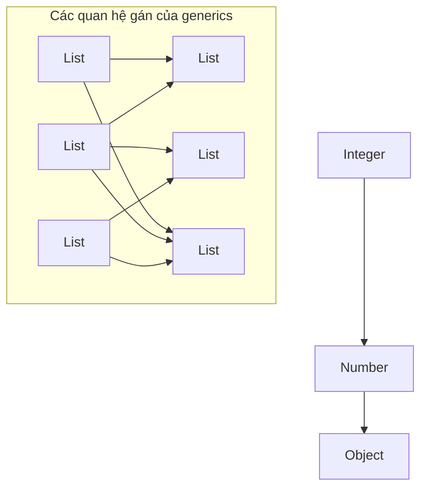
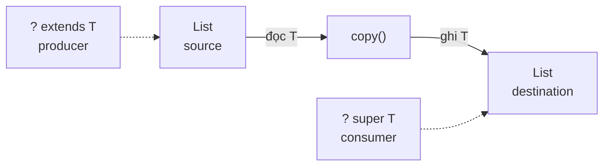

# Quan hệ kiểu của các cấu trúc tổng quát trong Java (Generic Type Relationships)

> **Phạm vi:** Cơ chế ngôn ngữ Java, đặc biệt là *generics*: quan hệ subtype giữa các kiểu tham số hóa, tính bất biến (*invariance*), wildcard `? extends`/`? super`, kiểu bị chặn (*bounded type parameter*), kế thừa generic và ảnh hưởng của *type erasure*. Mục tiêu là đọc đúng chữ ký API, giải thích được mã nào biên dịch và viết các phương thức generic an toàn.

## 1. “Cấu trúc tổng quát” và “quan hệ kiểu” là gì?

Trong Java, generic cho phép một lớp, interface hoặc phương thức diễn đạt thuật toán/hợp đồng với **kiểu dữ liệu chưa được cố định**:

```java
final class Box<T> {
    private T value;

    Box(T value) { this.value = value; }
    T get() { return value; }
    void set(T value) { this.value = value; }
}
```

- `Box<T>` là một khai báo generic; `T` là **type parameter**.
- `Box<String>`, `Box<Number>` là **parameterized types**; `String` và `Number` là **type arguments**.
- `List<Integer>`, `List<? extends Number>` và `List<?>` đều là các kiểu tham số hóa, nhưng khả năng đọc/ghi và quan hệ gán được khác nhau.
- **Subtype** (`A <: B`) nghĩa là một giá trị kiểu `A` có thể dùng ở vị trí yêu cầu `B` mà không cần ép kiểu không an toàn. Ví dụ `Integer <: Number <: Object`.

Một câu hỏi rất quan trọng: nếu `Integer` là subtype của `Number`, liệu `List<Integer>` cũng là subtype của `List<Number>`? **Không.** Quan hệ của *type argument* và quan hệ giữa *toàn bộ parameterized type* không được tự động truyền theo cùng cách.

### Sơ đồ trực giác



Các mũi tên ở phần generics thể hiện **gán tương thích** (`x` có kiểu bên trái có thể gán vào biến kiểu bên phải), không diễn đạt quan hệ kế thừa giữa `Integer` và `Number` trong khai báo generic.

## 2. Generic mặc định là bất biến (*invariant*)

Đối với cùng một generic declaration `G<T>`, Java thông thường **không cho phép suy ra**:

`A <: B` ⟹ `G<A> <: G<B>`.

Ví dụ **không biên dịch**:

```java
List<Integer> integers = new ArrayList<>();
List<Number> numbers = integers; // COMPILE ERROR!
```

Tại sao? Giả sử Java cho gán đó:

```java
List<Integer> integers = new ArrayList<>();
List<Number> numbers = integers;  // Giả sử được, nhưng thực tế bị cấm
numbers.add(3.14);                // Hợp lệ đối với List<Number>
Integer value = integers.get(0);  // Có thể gặp Double: sai type!
```

Nếu được phép, cùng một danh sách vừa “chỉ chứa Integer” vừa cho thêm `Double`. Trình biên dịch chặn ngay **quan hệ gán**, không đợi xảy ra `ClassCastException` khi chạy.

| Kiểu nguồn | Kiểu đích | Kết quả |
|---|---|---|
| `Integer` | `Number` | Hợp lệ: kế thừa lớp |
| `ArrayList<Integer>` | `List<Integer>` | Hợp lệ: `ArrayList<E> implements List<E>` |
| `List<Integer>` | `List<Number>` | **Không hợp lệ**: generic bất biến |
| `List<Integer>` | `List<Object>` | **Không hợp lệ** |
| `List<Number>` | `List<Number>` | Hợp lệ |
| `List<Integer>` | `List<? extends Number>` | Hợp lệ |
| `List<Number>` | `List<? super Integer>` | Hợp lệ |
| `List<String>` | `List<?>` | Hợp lệ |

**Phân biệt hai trục:**

1. **Kế thừa giữa các generic classes/interfaces:** `ArrayList<String>` là subtype của `List<String>` vì `ArrayList<E>` implement `List<E>`.
2. **Thay đổi type argument trong cùng generic:** `List<String>` không phải subtype của `List<Object>`, dù `String` là subtype của `Object`.

Đây là lỗi phổ biến nhất khi đọc các API dùng generic trong Java.

## 3. Ba dạng wildcard: `?`, `? extends U`, `? super L`

Wildcard không tạo một “class runtime” mới. Chúng diễn đạt **một tập các kiểu tham số hóa có thể chấp nhận** tại vị trí sử dụng (*use-site variance*).

### 3.1. `List<?>` — danh sách phần tử chưa biết kiểu

```java
static void printAny(List<?> values) {
    for (Object value : values) {
        System.out.println(value);
    }
}
```

Có thể gọi `printAny(List.of(1, 2))` hay `printAny(List.of("a", "b"))` vì method không giả định kiểu cụ thể của các phần tử.

Với biến `List<?> list`:
- Đọc `list.get(0)` dưới kiểu an toàn chung là `Object`.
- **Không thể** gọi `list.add("x")`, `list.add(12)` hoặc `list.add(new Object())`: kiểu phần tử thực chưa biết.
- `list.add(null)` về mặt kiểm tra kiểu là hợp lệ, nhưng **collection có thể cấm null hoặc không cho chỉnh sửa**; không nên hiểu wildcard là cơ chế làm danh sách immutable.
- `list.clear()` có thể biên dịch vì không thêm phần tử sai kiểu; việc có chạy được hay không còn tùy tính mutable của collection.

**`List<?>` không đồng nghĩa `List<Object>`.** `List<Object>` cho phép thêm bất kỳ object nào (trên danh sách mutable), còn `List<?>` chỉ biết một type argument nào đó chưa xác định.

### 3.2. `? extends U` — giới hạn trên, đọc kiểu U an toàn

```java
static double sum(List<? extends Number> values) {
    double total = 0.0;
    for (Number n : values) {
        total += n.doubleValue();
    }
    return total;
}
```

Method này nhận `List<Integer>`, `List<Double>`, `List<BigDecimal>` và `List<Number>`; đều có phần tử thuộc `Number` hoặc subtype của nó.

```java
List<Integer> ints = new ArrayList<>(List.of(2, 4, 6));
List<? extends Number> source = ints;

Number n = source.get(0); // HỢP LỆ: phần tử là Number
// source.add(10);        // COMPILE ERROR
// source.add(3.5);       // COMPILE ERROR
```

Vì sao không thêm `Integer` dù khai báo “extends Number”? Biến `source` **có thể đang trỏ tới `List<Double>`**, nên Java không cho thêm giá trị khác `null` khi chưa biết chính xác kiểu phần tử. `extends` là **giới hạn kiểu**, không phải chỉ dẫn “collection chỉ đọc”; các phương thức như `remove`, `clear` vẫn có thể được gọi nếu collection hỗ trợ.

### 3.3. `? super L` — giới hạn dưới, ghi L an toàn

```java
static void addDefaults(List<? super Integer> destination) {
    destination.add(10);
    destination.add(20);

    // Integer i = destination.get(0); // COMPILE ERROR
    Object value = destination.get(0);  // Đọc dưới Object
}
```

Biến `List<? super Integer>` có thể trỏ tới:
- `List<Integer>`;
- `List<Number>`;
- `List<Object>`.

Vì mọi tập chứa một trong các kiểu đó đều chứa được `Integer`, Java cho phép thêm `Integer`. Ngược lại, khi đọc ra, kiểu được bảo đảm chung là `Object`, vì có thể chính là `List<Object>`.

**Không được suy ra `List<? super Integer>` chỉ chứa Integer.** Nếu đó là `List<Object>`, nó có thể đã chứa `String` và nhiều loại khác.

### Bảng đọc/ghi

| Kiểu tham chiếu | Đọc an toàn dưới kiểu | Thêm phần tử an toàn |
|---|---|---|
| `List<Integer>` | `Integer` | `Integer` hoặc `null` nếu collection cho phép |
| `List<Number>` | `Number` | `Number` và các subtype |
| `List<?>` | `Object` | Không phần tử khác `null` |
| `List<? extends Number>` | `Number` | Không phần tử khác `null` |
| `List<? super Integer>` | `Object` | `Integer` và subtype của `Integer` (trong thực tế `Integer` là final) |

“Đọc” ở đây là **kiểu được trình biên dịch bảo đảm**, không phải kiểu runtime duy nhất có thể xuất hiện. “Thêm” nói về **kiểm tra kiểu khi biên dịch**; một collection không chỉnh sửa được vẫn có thể ném `UnsupportedOperationException` lúc chạy.

## 4. PECS: Producer Extends, Consumer Super

**PECS** là quy tắc kinh nghiệm khi một tham số là nguồn dữ liệu hoặc nơi nhận dữ liệu.

- **Producer extends:** nếu tham số tạo ra dữ liệu để ta lấy về, dùng `? extends T`.
- **Consumer super:** nếu tham số nhận dữ liệu loại `T` do ta đưa vào, dùng `? super T`.
- Nếu cùng một tham số vừa cần đọc **đúng T** vừa cần ghi **T**, có thể cần `List<T>` hoặc một phương thức generic khác. Đừng cố ép mọi API vào wildcard.

Ví dụ `copy`:

```java
static <T> void copy(
        List<? super T> destination,
        List<? extends T> source) {
    for (T value : source) {
        destination.add(value);
    }
}
```

- `source` sản sinh giá trị `T` ⇒ `? extends T`.
- `destination` tiêu thụ giá trị `T` ⇒ `? super T`.

```java
List<Integer> source = List.of(1, 2, 3);
List<Number> destination = new ArrayList<>();
copy(destination, source); // Hợp lệ: Integer -> Number
```

Tương tự, Java chuẩn có `Collections.copy(List<? super T> dest, List<? extends T> src)`, nhưng chú ý **cách hoạt động khác**: hàm chuẩn **ghi đè các vị trí có sẵn** và đích phải có đủ phần tử; nó không tự `add` để tăng kích thước như hàm minh họa phía trên.

### Luồng dữ liệu



**Không phải mọi `List` đều là producer hoặc consumer tuyệt đối.** Mô tả đó liên quan tới **vai trò trong phương thức cụ thể**. Một `List<Integer>` thực tế có thể vừa đọc vừa ghi ở ngữ cảnh khác.

## 5. Ví dụ Java 17 độc lập, biên dịch được

Ví dụ gồm một generic class `Box<T>`, quan hệ `ArrayList<Integer> → List<Integer>`, wildcard hai chiều, phương thức generic copy, và phương thức chọn giá trị lớn nhất với bound liên quan đến `Comparable`.

Lưu thành `GenericTypeRelationsDemo.java`:

```java
import java.util.ArrayList;
import java.util.List;
import java.util.Objects;

public class GenericTypeRelationsDemo {

    static final class Box<T> {
        private T value;

        Box(T value) {
            this.value = Objects.requireNonNull(value);
        }

        T get() { return value; }

        void set(T value) {
            this.value = Objects.requireNonNull(value);
        }
    }

    static double total(List<? extends Number> values) {
        Objects.requireNonNull(values);
        double sum = 0.0;
        for (Number value : values) {
            sum += Objects.requireNonNull(value).doubleValue();
        }
        return sum;
    }

    static void addDefaults(List<? super Integer> destination) {
        Objects.requireNonNull(destination);
        destination.add(10);
        destination.add(20);
    }

    static <T> void copy(
            List<? super T> destination,
            List<? extends T> source) {
        Objects.requireNonNull(destination);
        Objects.requireNonNull(source);
        for (T item : source) {
            destination.add(item);
        }
    }

    static <T extends Comparable<? super T>> T maximum(
            List<? extends T> values) {
        Objects.requireNonNull(values);
        if (values.isEmpty()) {
            throw new IllegalArgumentException("Danh sách rỗng");
        }
        T best = Objects.requireNonNull(values.get(0));
        for (int i = 1; i < values.size(); i++) {
            T item = Objects.requireNonNull(values.get(i));
            if (item.compareTo(best) > 0) {
                best = item;
            }
        }
        return best;
    }

    public static void main(String[] args) {
        Box<String> text = new Box<>("Java");
        // Box<Object> bad = text; // ERROR: generics bất biến
        Box<Object> objectBox = new Box<>(text.get());
        System.out.println(objectBox.get()); // Java

        ArrayList<Integer> concrete = new ArrayList<>(List.of(2, 3, 5));
        List<Integer> integers = concrete; // Cùng type argument
        List<? extends Number> reader = integers;
        Number first = reader.get(0);
        System.out.println(first);         // 2
        System.out.println(total(integers)); // 10.0

        List<Number> numbers = new ArrayList<>();
        List<? super Integer> writer = numbers;
        addDefaults(writer);
        Object unknown = writer.get(0);
        System.out.println(unknown); // 10

        copy(numbers, integers);
        System.out.println(numbers); // [10, 20, 2, 3, 5]

        System.out.println(maximum(List.of(7, 3, 9)));       // 9
        System.out.println(maximum(List.of("An", "Binh")));   // Binh
    }
}
```

Chạy trong JDK 17 trở lên:

```bash
javac GenericTypeRelationsDemo.java
java GenericTypeRelationsDemo
```

**Tại sao `maximum` dùng `Comparable<? super T>`?**

Một đối tượng kiểu `T` cần so sánh được với đối tượng kiểu `T`, nhưng interface `Comparable` có thể được cài đặt cho **một supertype của T**. Bound `T extends Comparable<? super T>` linh hoạt hơn `T extends Comparable<T>`, đồng thời vẫn cho phép gọi `item.compareTo(best)`. Đây là một ứng dụng khác của nguyên tắc “consumer super”: phương thức `compareTo` **tiêu thụ** đối tượng đem so sánh.

Trong ví dụ, `List.of(...)` trả danh sách không chỉnh sửa được; các lời gọi `total` và `maximum` chỉ đọc nên phù hợp. Hàm `copy` phải nhận đích mutable vì nó thực hiện `add`.

## 6. Bound trong khai báo khác wildcard tại nơi dùng

Bound của một type parameter nói **thuật toán có quyền dùng API nào trên T**:

~~~java
class NumericBox<T extends Number> {
    private final T value;
    NumericBox(T value) { this.value = value; }
    double asDouble() { return value.doubleValue(); }
}
~~~

`NumericBox<Integer>` hợp lệ, `NumericBox<String>` không biên dịch. Một type parameter có thể có nhiều upper bounds, ví dụ `<T extends Number & Comparable<T>>`; class bound phải đứng trước các interface. `? extends Number & Comparable<?>` **không** là cú pháp Java hợp lệ.

Khác với bound khai báo, `List<? extends Number>` và `List<? super Integer>` là **use-site wildcard** để diễn đạt quan hệ gán/khả năng đọc ghi ở vị trí sử dụng. Bài **Ràng buộc tham số kiểu** là phần giảng chính về intersection, `Comparable<? super T>`, recursive bounds và erasure của từng bound. Tại bài này, điều cần giữ là: **giới hạn T không khiến List<T> tự trở thành covariant**.

## 7. Generic class kế thừa generic class/interface

Xem hai quan hệ riêng:

```java
interface Store<T> {
    T find();
}

class MemoryStore<T> implements Store<T> {
    private final T item;

    MemoryStore(T item) { this.item = item; }

    @Override
    public T find() { return item; }
}

class StringStore extends MemoryStore<String> {
    StringStore(String s) { super(s); }
}
```

Khi đó:

- `MemoryStore<String>` **là** `Store<String>`.
- `StringStore` **là** `MemoryStore<String>` và `Store<String>`.
- `Store<String>` **không là** `Store<Object>`.
- `StringStore` có thể gán cho `Store<? extends CharSequence>` vì `String` implement `CharSequence`.

```java
Store<String> a = new MemoryStore<>("abc");
Store<String> b = new StringStore("xyz");
Store<? extends CharSequence> c = b;
CharSequence x = c.find();

// Store<Object> invalid = b; // COMPILE ERROR
```

Trong kiểu `Store<? extends CharSequence>`, việc gọi `find()` an toàn cho `CharSequence`. Vì interface `Store<T>` trong ví dụ **chỉ có thao tác đọc**, có thể bạn tự hỏi vì sao `Store<String>` vẫn không tự động thành `Store<Object>`? Java không phân tích “interface này chỉ đọc” để suy ra covariance cho type argument; generics tại khai báo `Store<T>` vẫn bất biến. Ta diễn đạt nhu cầu covariance bằng wildcard tại vị trí sử dụng.

### Chữ ký generic được kế thừa và cố định T

Nếu lớp con cố định `T` thành `String`, compiler xem `find()` ở lớp con trả về `String` phù hợp khai báo. Điều này khác với cast runtime tùy ý: ràng buộc được compiler kiểm tra.

Một lớp không được triển khai cùng một generic interface ở hai kiểu tham số không tương thích trong cùng cây kế thừa, ví dụ cố có cả `Comparable<String>` và `Comparable<Integer>`; việc xóa type arguments khi biên dịch cũng làm các superinterface dạng đó xung đột.

## 8. Quan hệ kiểu với wildcard không phải phép thay thế tùy ý

Bảng sau giúp đọc các khai báo thường gặp:

| Gán | Kết quả | Giải thích |
|---|---|---|
| `List<Integer> → List<? extends Number>` | Được | Integer là subtype Number |
| `List<Double> → List<? extends Number>` | Được | Double là subtype Number |
| `List<Number> → List<? extends Object>` | Được | Number là subtype Object |
| `List<Integer> → List<? super Integer>` | Được | Giới hạn dưới có thể là Integer |
| `List<Number> → List<? super Integer>` | Được | Number là supertype của Integer |
| `List<Object> → List<? super Integer>` | Được | Object là supertype của Integer |
| `List<String> → List<? extends Number>` | **Không** | String không phải subtype Number |
| `List<Object> → List<? extends Number>` | **Không** | Object có thể chứa kiểu không phải Number |
| `List<Number> → List<? super Number>` | Được | Number là giới hạn dưới |
| `List<Integer> → List<? super Number>` | **Không** | Integer không phải supertype Number |
| `List<Integer> → List<Number>` | **Không** | Invariance |
| `List<?> → List<Object>` | **Không** | Không biết type argument thật |

**Chú ý chiều gán:** biến `List<? extends Number>` có thể tham chiếu tới nhiều kiểu nguồn khác nhau, nhưng bạn không được gán chính biến này cho `List<Number>` vì có thể nó đang tham chiếu `List<Integer>`. Tương tự, `List<? super Integer>` không tự đồng nghĩa `List<Integer>`.

### Wildcard “có thể là nhiều loại” không phải union type

`List<? extends Number>` là cách dùng existential wildcard với một bound. Nó không phải `List<Integer | Double>` và không bảo đảm phần tử đều có cùng kiểu runtime cụ thể mà client có thể biết. API chỉ được khai thác những gì bound bảo đảm.

Cũng không nên cho rằng `? super Integer` là một phép kiểm tra “giá trị phải là Number/Object”. Nó chỉ giới hạn type argument của *collection*, trong khi mỗi phần tử đã có trong collection có thể khác nhau nếu type argument thật là `Object`.

## 9. Wildcard capture: tại sao đôi lúc cần phương thức helper?

Một `List<?>` có một kiểu phần tử **cụ thể nhưng chưa được compiler đặt tên**. Tính năng *capture conversion* cho phép một phương thức generic đặt tên tạm kiểu đó để thao tác mà vẫn an toàn.

Ví dụ hoán đổi hai phần tử đầu của một danh sách mutable:

```java
static void swapFirstTwo(List<?> values) {
    if (values.size() < 2) {
        return;
    }
    swapCaptured(values);
}

private static <T> void swapCaptured(List<T> values) {
    T first = values.get(0);
    values.set(0, values.get(1));
    values.set(1, first);
}
```

Gọi `swapFirstTwo(new ArrayList<>(List.of("A", "B")))` là hợp lệ. `swapCaptured` đảm bảo hai giá trị đều thuộc **cùng kiểu T của danh sách nguồn**. Với `List<?>` trong thân phương thức ngoài, viết `values.set(0, values.get(1))` có thể gặp lỗi capture do compiler không xem các expression wildcard không tên như cùng một tham số kiểu ở lời gọi phù hợp; helper làm ràng buộc đó rõ ràng.

Thư viện Java cũng có `Collections.swap(List<?>, int, int)` đã giải quyết tình huống này; không cần tự viết helper nếu chỉ muốn đổi vị trí.

**Giới hạn:** biên dịch được không có nghĩa danh sách mutable. `List.of("A", "B")` vẫn có thể ném `UnsupportedOperationException` nếu bạn gọi `set`; muốn sửa, hãy dùng `new ArrayList<>(...)`.

## 10. Wildcard khác generic method return type

So sánh:

```java
static Object takeUnknown(List<?> items) {
    return items.get(0);
}

static <T> T takeTyped(List<T> items) {
    return items.get(0);
}
```

Với `List<String> strings`:
- `takeUnknown(strings)` có kiểu trả về `Object`.
- `takeTyped(strings)` có kiểu trả về `String` do compiler suy luận `T = String`.

Khi một API phải **giữ quan hệ giữa kiểu đầu vào và đầu ra**, type parameter có tên thường cần thiết hơn wildcard.

Ví dụ API chọn phần tử đầu tiên của hai danh sách phải cân nhắc việc dùng chung `T`; nếu hai danh sách thuộc những generic type khác nhau, compiler có thể suy luận một **supertype chung**, và kiểu trả về cũng chỉ bảo đảm ở mức đó. Type inference giúp tiết kiệm khai báo, nhưng không thay đổi nguyên lý type safety.

## 11. Mảng và generics có quan hệ khác nhau

Java array **covariant**:

```java
Integer[] numbers = new Integer[2];
Number[] refs = numbers;     // Biên dịch được
refs[0] = 3.14;              // Runtime: ArrayStoreException
```

Mảng biết component type tại runtime, nên JVM có thể phát hiện việc gán `Double` vào mảng `Integer[]`.

Generics mặc định **invariant**:

```java
List<Integer> integers = new ArrayList<>();
// List<Number> refs = integers; // Lỗi lúc biên dịch
```

Không có cảnh báo runtime tương đương cho mảng được tạo là `new List<String>[10]`, vì **không thể tạo mảng generic như vậy**. Java cấm tạo generic array với component type không reifiable:

```java
// List<String>[] a = new List<String>[10]; // COMPILE ERROR
// T[] values = new T[10];                   // COMPILE ERROR
```

Một số thao tác kết hợp arrays, varargs và generic có thể gây **heap pollution** nếu code bỏ qua cảnh báo hoặc dùng raw types. Đó là lý do nên ưu tiên `List<T>` trong API collection thay vì pha trộn mảng generic với cast không kiểm soát.

## 12. Type erasure ảnh hưởng các phép gán như thế nào?

```java
List<String> a = new ArrayList<>();
List<Integer> b = new ArrayList<>();
System.out.println(a.getClass() == b.getClass()); // true
```

Java kiểm tra generic tại compile time nhưng không tạo class runtime riêng cho mỗi type argument. Hệ quả: không thể `instanceof List<String>`, overload chỉ khác `List<String>`/`List<Integer>` hay tạo `new List<String>[10]`. Có thể dùng `instanceof List<?>` và kiểm chứng từng phần tử nếu dữ liệu đến từ API không tin cậy.

~~~java
List<String> names = new ArrayList<>();
List raw = names;       // Legacy raw type.
raw.add(42);           // Unchecked warning: mất kiểm tra kiểu.
String first = names.get(0); // ClassCastException khi đọc Integer.
~~~

**Heap pollution** xảy ra khi biến parameterized type tham chiếu tập dữ liệu chứa phần tử không phù hợp, thường qua raw/unchecked operations. Type erasure không làm compiler mất khả năng kiểm tra những lời gọi generic đúng chuẩn; rủi ro xuất hiện ở ranh giới phá bỏ kiểm tra đó.

Bài nhập môn **Kiểu tổng quát và lớp có tham số kiểu** giới thiệu `Supplier<T>` và metadata reflection; còn bài hiện tại tập trung vào quan hệ gán/đọc-ghi mà compiler chứng minh được.

## 13. Chọn chữ ký bằng dữ liệu thực sự được đọc và ghi

| Nhu cầu của client | Chữ ký phù hợp | Kiểu được bảo đảm |
|---|---|---|
| In mọi phần tử, không cần kiểu cụ thể | `printAll(List<?>)` | Đọc `Object` |
| Tổng từ nhiều loại số | `sum(List<? extends Number>)` | Đọc `Number` |
| Thêm `Integer` vào nhiều loại đích | `seed(List<? super Integer>)` | Thêm `Integer`, đọc `Object` |
| Sao chép giữa danh sách tương thích | `<T> copy(List<? super T>, List<? extends T>)` | Quan hệ nguồn/đích được compiler kiểm tra |
| Giữ kiểu trả về trùng kiểu đầu vào | `<T> T first(List<T>)` | Trả `T` |
| Hoán đổi hai phần tử của cùng `List<?>` | Helper `<T>` capture một kiểu ẩn | Thao tác `set` hợp lệ trên mutable list |

Nếu `average(List<Number>)` chỉ đọc thì nó **không** nhận `List<Integer>`; đổi tham số thành `List<? extends Number>`. Nếu `seed(List<? extends Number>)` muốn `add(1)` thì không biên dịch vì subtype thực có thể là `Double`; đổi thành `List<? super Integer>` khi mục tiêu là ghi.

Đây là cách suy luận theo *producer/consumer*, thay vì chỉ nhớ thuộc lòng PECS. Độ an toàn của phép gán kiểu khác với tính mutable, null policy, thread safety và hợp đồng nghiệp vụ của từng collection.

## 14. Bài kiểm tra nhỏ với JUnit 5

Các test bên dưới sử dụng class độc lập `GenericTypeRelationsDemo` ở mục 5. Đặt file `GenericTypeRelationsDemoTest.java` trong cùng package và thêm dependency JUnit Jupiter phù hợp hệ thống build.

```java
import static org.junit.jupiter.api.Assertions.*;
import java.util.ArrayList;
import java.util.List;
import org.junit.jupiter.api.Test;

class GenericTypeRelationsDemoTest {

    @Test
    void sumReadsNumbersOfDifferentTypes() {
        assertEquals(6.0,
                GenericTypeRelationsDemo.total(List.of(1, 2, 3)));
        assertEquals(4.0,
                GenericTypeRelationsDemo.total(List.of(1.5, 2.5)));
    }

    @Test
    void canCopyIntegerValuesIntoNumberList() {
        List<Integer> source = List.of(7, 8);
        List<Number> destination = new ArrayList<>();

        GenericTypeRelationsDemo.copy(destination, source);

        assertEquals(List.of(7, 8), destination);
    }

    @Test
    void lowerBoundDestinationAcceptsIntegers() {
        List<Object> destination = new ArrayList<>();
        GenericTypeRelationsDemo.addDefaults(destination);
        assertEquals(List.of(10, 20), destination);
    }

    @Test
    void maximumPreservesElementType() {
        String best =
                GenericTypeRelationsDemo.maximum(List.of("A", "Z"));
        assertEquals("Z", best);
    }

    @Test
    void maximumRejectsEmptyInput() {
        assertThrows(IllegalArgumentException.class,
                () -> GenericTypeRelationsDemo.maximum(
                        List.<Integer>of()));
    }
}
```

Để kiểm thử các **lỗi không biên dịch** (ví dụ gán `List<Integer>` cho `List<Number>`), không thể đặt trực tiếp dòng lỗi vào một test Java thông thường rồi mong bộ test chạy. Nên viết snippet giải thích hoặc dùng compile-testing trong một dự án thực sự cần kiểm chứng lỗi compiler.

## 15. Các lỗi thường gặp và cách sửa

| Biểu hiện | Nguyên nhân | Cách xử lý |
|---|---|---|
| `List<Integer> cannot be converted to List<Number>` | Generic bất biến | Dùng `List<? extends Number>` nếu chỉ cần đọc |
| Không `add(Integer)` vào `List<? extends Number>` | Kiểu phần tử thật chưa biết | Nếu cần ghi, cân nhắc `List<? super Integer>` |
| Lấy từ `List<? super Integer>` không gán thẳng vào `Integer` | Có thể là danh sách Number/Object | Nhận `Object` hoặc thiết kế lại contract |
| `List<?>` bị hiểu là `List<Object>` | Wildcard không xác định type argument cụ thể | Dùng đúng yêu cầu đọc/ghi của method |
| Compiler báo `capture of ?` | Không thể chứng minh một thao tác giữ cùng kiểu không tên | Dùng helper `<T>` để capture |
| `new T()`, `new T[]` không biên dịch | Type erasure / generic arrays | Supplier/factory, collection, hoặc mảng tạo có kiểm soát |
| Overload hai `List<T>` khác T báo name clash | Cùng signature sau erasure | Đổi tên/hợp đồng hoặc API phân biệt rõ |
| Ép raw type để hết lỗi | Vô hiệu hóa kiểm tra generic | Loại raw type, sửa bound hoặc adapter |
| Lạm dụng `<T>` cho mọi method | Chữ ký dài, inference khó | Chỉ đặt tên T khi cần kết nối nhiều vị trí |
| `List.of(...)` bị lỗi khi thêm phần tử | Collection không mutable, không liên quan variance | Dùng `new ArrayList<>(...)` nếu cần sửa |
| Tưởng wildcard bảo đảm đồng bộ/immutable | Generics chỉ kiểm tra kiểu | Xem riêng concurrency và tính mutable |
| Dùng `extends`/`super` như kế thừa object thông thường | Nhầm quan hệ type argument với subtype của collection | Vẽ nguồn và đích, xác định đọc/ghi |

## 16. Luyện tập phân tích quan hệ kiểu

**Bài 1 — Chọn kiểu tham số đúng.** Cho `List<Integer>`, `List<Double>` và `List<Number>`. Viết hàm tính tổng hỗ trợ cả ba, không cast và không raw type. Giải thích vì sao tham số `List<Number>` không đủ tổng quát.

**Bài 2 — Di chuyển giá trị.** Viết `<T> void moveAll(List<? super T> dst, List<? extends T> src)` có hành vi thêm từng phần tử nguồn vào đích. Giải thích trường hợp src và dst tham chiếu cùng danh sách có thể gây vấn đề khi vừa lặp vừa thêm; chọn chụp snapshot hoặc ràng buộc điều kiện sử dụng. Cần để ý danh sách nguồn có mutable hay không.

**Bài 3 — Sửa chữ ký.** Một API khai báo `void addScores(List<Number> xs)` nhưng caller có `List<Object>` và chỉ muốn thêm Integer. Hãy sửa chữ ký theo ý định phương thức và kiểm tra điều gì được bảo đảm khi đọc.

**Bài 4 — Đoán compile/error.** Với `List<Integer> a` và `List<Number> b`:

```java
List<?> x = a;
List<? extends Number> y = a;
List<? super Integer> z = b;
// b = a;                // ?
Object o = x.get(0);     // ?
Number n = y.get(0);     // ?
// y.add(3);             // ?
z.add(3);                // ?
Object p = z.get(0);     // ?
```

Giải thích từng dòng bằng **kiểu nguồn, kiểu đích và khả năng đọc/ghi**. Đáp án: `b = a` và `y.add(3)` không biên dịch; các dòng còn lại biên dịch, giả định danh sách có phần tử khi `get(0)` được thực thi.

**Bài 5 — Generic inheritance.** Tạo `Repository<T>` và `InMemoryRepository<T> implements Repository<T>`. Chỉ ra phép gán hợp lệ giữa `InMemoryRepository<String>`, `Repository<String>`, `Repository<Object>` và `Repository<?>`.

**Bài 6 — So sánh với array.** Tại sao `Integer[]` có thể được gán cho `Number[]` nhưng có thể gây `ArrayStoreException`, trong khi `List<Integer>` không gán được cho `List<Number>`? Liên hệ với kiểu phần tử được kiểm tra ở compile time và runtime.

## 17. Checklist trước khi thiết kế một API generic

- [ ] Tôi phân biệt được **kế thừa giữa các type declarations** với **quan hệ giữa type arguments**.
- [ ] Tôi biết generics của Java thường **bất biến**.
- [ ] Tôi dùng `? extends T` khi tham số **cấp dữ liệu kiểu T** cho code đọc.
- [ ] Tôi dùng `? super T` khi tham số **nhận dữ liệu kiểu T** do code ghi.
- [ ] Tôi dùng `<T>` khi cần liên hệ kiểu giữa nhiều tham số hoặc với giá trị trả về.
- [ ] Tôi không nhầm wildcard với collection chỉ đọc hoặc immutable.
- [ ] Tôi kiểm tra riêng mutability, null, thread safety, ngoại lệ và quy tắc nghiệp vụ.
- [ ] Tôi hiểu erasure, raw types, generic array và giới hạn kiểm tra kiểu ở runtime.
- [ ] Ví dụ API của tôi có test với cả các kiểu subtype và supertype cần hỗ trợ.
- [ ] Tôi có thể giải thích **tại sao** một phép gán hoặc lời gọi biên dịch, không chỉ nhớ PECS.

**Ghi nhớ:** `Integer <: Number` **không suy ra** `List<Integer> <: List<Number>`. Quan hệ kiểu generic trong Java được kiểm soát bằng kế thừa của **generic declaration**, bound của **type parameter** và wildcard ở **vị trí sử dụng**. Thiết kế tốt dựa trên dữ liệu được *đọc*, dữ liệu được *ghi* và quan hệ kiểu mà compiler có thể chứng minh an toàn.