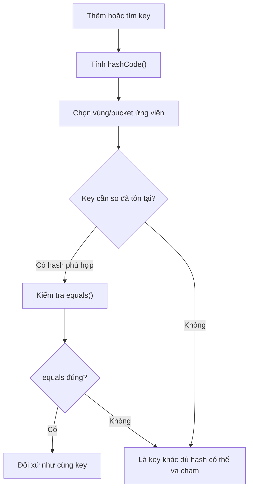
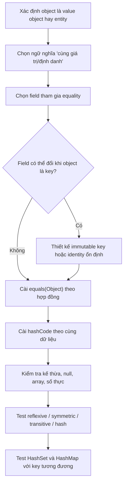

# Hợp đồng so sánh bằng và mã băm trong Java: `equals()` và `hashCode()`

> **Chủ đề:** Cơ chế ngôn ngữ Java – định nghĩa “hai đối tượng bằng nhau”, bảo đảm hai phương thức `equals(Object)` và `hashCode()` nhất quán, và sử dụng an toàn các đối tượng làm phần tử của `HashSet` hoặc khóa của `HashMap`. Bài học sử dụng Java 17.

## 1. Khi nào hai object được coi là “bằng nhau”?

Với đối tượng Java, có ít nhất ba câu hỏi khác nhau:

- **Cùng tham chiếu?** Hai biến có đang trỏ tới cùng một object trên heap không?
- **Bằng nhau theo giá trị/ngữ nghĩa?** Hai object khác nhau có biểu diễn cùng một định danh hoặc giá trị nghiệp vụ không?
- **Sắp xếp ngang nhau?** Một bộ so sánh `Comparator` hoặc `Comparable` có trả kết quả `0` cho hai giá trị không?

Không nên mặc định ba điều này tương đương.

```java
String a = new String("java");
String b = new String("java");

System.out.println(a == b);      // false: hai object riêng
System.out.println(a.equals(b)); // true: String so sánh ký tự
```

Toán tử `==` áp dụng lên hai tham chiếu object để kiểm tra **identity**; `equals` là phương thức có thể được ghi đè để kiểm tra **equality theo ngữ nghĩa**. Với primitive, `==` lại so sánh các giá trị primitive theo quy tắc ngôn ngữ, không phải địa chỉ.

Một đối tượng có thể có:
- **Identity equality:** đúng khi hai biến trỏ cùng object. Đây là mặc định từ `Object.equals`.
- **Value equality:** dựa trên các thuộc tính được định nghĩa trong hợp đồng, ví dụ hai `CustomerId("KH-01")` là cùng định danh logic.
- **Domain-specific equality:** tùy yêu cầu, ví dụ tài khoản có định danh ổn định không nên so sánh toàn bộ số dư hoặc địa chỉ hiện tại.

**Câu hỏi thiết kế đầu tiên:** Những thuộc tính nào xác định cùng một giá trị/định danh, và những thuộc tính nào có thể thay đổi mà không khiến đối tượng trở thành một đối tượng khác?

## 2. Hợp đồng chính thức của `equals(Object)`

Theo hợp đồng của `java.lang.Object.equals`, quan hệ bằng nhau phải đáp ứng các thuộc tính sau đối với các đối tượng không null:

| Tính chất | Công thức trực giác | Ý nghĩa |
|---|---|---|
| **Reflexive – phản xạ** | `x.equals(x) == true` | Một object bằng chính nó |
| **Symmetric – đối xứng** | `x.equals(y) == y.equals(x)` | Không có chuyện A coi B bằng, B lại không coi A bằng |
| **Transitive – bắc cầu** | Nếu A = B và B = C thì A = C | Không tạo nhóm bằng nhau mâu thuẫn |
| **Consistent – nhất quán** | Gọi lặp lại trả cùng kết quả khi dữ liệu dùng so sánh không đổi | Không dựa vào trạng thái ngẫu nhiên, clock hoặc yếu tố không ổn định |
| **Non-null** | `x.equals(null) == false` | Object không bằng null |

Không nên gọi `null.equals(x)` vì `null` không có phương thức: biểu thức ném `NullPointerException`. Khi cần so sánh an toàn với null, có thể dùng `Objects.equals(a, b)`; hàm này trả `true` nếu cả hai cùng null hoặc nếu `a.equals(b)` đúng.

### So sánh bằng không nhất thiết so sánh tất cả field

Ví dụ `CustomerId` chứa duy nhất chuỗi mã khách hàng. Mã này thể hiện định danh; những trường như tên hiển thị, email, thời điểm cập nhật hoặc cache không thuộc equality. Đối với entity, việc so sánh mọi field có thể gây lỗi khi field mutable hoặc quan hệ object có chu kỳ.

Đối với value object như `Money(100_000, "VND")`, cả số tiền và đơn vị tiền có thể là thành phần equality. `100_000 VND` không thể tự coi bằng `100_000 USD`.

## 3. Hợp đồng của `hashCode()`

`hashCode()` trả về một số nguyên `int` dùng để phân nhóm/tra cứu trong các cấu trúc dựa trên hash.

Các yêu cầu quan trọng:

1. Nếu `a.equals(b)` là `true`, thì **bắt buộc** `a.hashCode() == b.hashCode()`.
2. Khi những thuộc tính có mặt trong phép so sánh bằng nhau không thay đổi, các lần gọi `hashCode()` phải trả cùng giá trị trong một lần chạy ứng dụng.
3. Nếu `a.equals(b)` là `false` thì **không bắt buộc** hai hash khác nhau; **hash collision** là hợp lệ.
4. Các lần chạy JVM khác nhau không bị yêu cầu phải có cùng hashCode cho cùng một object hay cùng một giá trị. **Không dùng `hashCode()` như định danh bền vững**, key truyền qua mạng hay checksum bảo mật.

```text
equals(a, b) == true  =>  hash(a) == hash(b)       (BẮT BUỘC)
hash(a) != hash(b)    =>  equals(a, b) == false    (SUY RA)
hash(a) == hash(b)    =>  equals(a, b) ?           (CHƯA BIẾT)
equals(a, b) == false =>  hash(a) == hash(b) ?     (CÓ THỂ)
```

Đây là quan hệ **một chiều**, không có quy tắc “hash bằng nhau thì object bằng nhau”.

### Ví dụ va chạm hash

```java
System.out.println("FB".hashCode()); // 2236
System.out.println("Ea".hashCode()); // 2236
System.out.println("FB".equals("Ea")); // false
```

Hai chuỗi khác nhau có cùng mã băm. `HashMap` phải dùng **cả hashCode và equals** để xác định key trùng nhau; hash chỉ giúp tìm vùng ứng viên nhanh hơn.

## 4. Điều gì xảy ra trong `HashSet` và `HashMap`?

Cách hiểu ở mức API:



Đây là mô hình tư duy; thuật toán cụ thể và cấu trúc bucket bên trong có thể thay đổi theo phiên bản JDK. Không nên dựa vào thứ tự duyệt, bucket index hoặc cấu trúc cây nội bộ như một hợp đồng public.

- `HashSet.add(x)` dùng equality để quyết định phần tử đã tồn tại hay chưa.
- `HashMap.put(key, value)` dùng equality để tìm key tương đương và thay giá trị tương ứng.
- `HashSet.contains(x)` và `HashMap.get(key)` cần `hashCode` phù hợp để tìm tới các key ứng viên.
- Nếu ghi đè `equals` mà bỏ quên `hashCode`, hai object bằng nhau về logic có thể bị đặt vào các vị trí khác nhau, làm tập hợp/map hành xử sai với ý định nghiệp vụ.

**Điểm nhấn:** `HashMap` không gọi `equals` lên tất cả key trong mọi lần tra cứu; nó tìm ứng viên dựa trên mã băm và sau đó mới so sánh equality khi cần.

## 5. Một lỗi điển hình: ghi đè `equals` nhưng quên `hashCode`

Đoạn sau cố ý sai:

```java
final class BrokenCustomerId {
    private final String value;

    BrokenCustomerId(String value) {
        this.value = value;
    }

    @Override
    public boolean equals(Object other) {
        return other instanceof BrokenCustomerId id
                && java.util.Objects.equals(value, id.value);
    }

    // Thiếu hashCode(): kế thừa Object.hashCode()
}
```

```java
var x = new BrokenCustomerId("KH-01");
var y = new BrokenCustomerId("KH-01");

System.out.println(x.equals(y)); // true
System.out.println(x.hashCode() == y.hashCode());
// Không có bảo đảm true: VI PHẠM HỢP ĐỒNG
```

Mặc định `Object.hashCode` không gắn với nội dung field `value`; vì vậy không đáp ứng yêu cầu “hai object equals phải có hash bằng nhau”. Không nên dựa vào một lần chạy thấy hai giá trị hash có vẻ giống nhau hoặc khác nhau để kết luận chính xác về logic của `hashCode` mặc định.

Nếu key có hợp đồng equality sai, các thao tác `HashSet.contains` hoặc `HashMap.get` có thể không tìm thấy key tương đương.

## 6. Java 17 hoàn chỉnh: value object bất biến, `equals` và `hashCode` đúng

Thiết kế một kiểu `CustomerId`:
- Mã khách hàng không null, không trống.
- Equality dựa trên giá trị mã.
- Một instance sau khi tạo không bị thay đổi.
- `hashCode` được tính từ đúng field tham gia equality.

Lưu thành file `EqualityHashDemo.java` rồi chạy:

```bash
javac EqualityHashDemo.java
java EqualityHashDemo
```

```java
import java.util.HashMap;
import java.util.HashSet;
import java.util.Map;
import java.util.Objects;
import java.util.Set;

public class EqualityHashDemo {

    static final class CustomerId {
        private final String value;

        CustomerId(String value) {
            Objects.requireNonNull(value, "value");
            if (value.isBlank()) {
                throw new IllegalArgumentException(
                        "CustomerId không được rỗng");
            }
            this.value = value;
        }

        String value() {
            return value;
        }

        @Override
        public boolean equals(Object other) {
            if (this == other) {
                return true;
            }
            if (!(other instanceof CustomerId that)) {
                return false;
            }
            return value.equals(that.value);
        }

        @Override
        public int hashCode() {
            return value.hashCode();
        }

        @Override
        public String toString() {
            return "CustomerId[" + value + "]";
        }
    }

    // Record tự tạo equals/hashCode/toString từ components.
    record Money(long amountVnd, String currency) {
        Money {
            Objects.requireNonNull(currency, "currency");
            if (amountVnd < 0 || currency.isBlank()) {
                throw new IllegalArgumentException(
                        "Số tiền/đơn vị không hợp lệ");
            }
        }
    }

    public static void main(String[] args) {
        CustomerId a = new CustomerId("KH-01");
        CustomerId b = new CustomerId("KH-01");
        CustomerId c = new CustomerId("KH-02");

        System.out.println(a == b);             // false
        System.out.println(a.equals(b));        // true
        System.out.println(a.hashCode() ==
                           b.hashCode());       // true
        System.out.println(a.equals(c));        // false

        Set<CustomerId> ids = new HashSet<>();
        ids.add(a);
        ids.add(b);
        ids.add(c);
        System.out.println(ids.size());         // 2
        System.out.println(ids.contains(
                new CustomerId("KH-01")));      // true

        Map<CustomerId, String> names = new HashMap<>();
        names.put(a, "An");
        System.out.println(names.get(b));       // An

        Money m1 = new Money(100_000, "VND");
        Money m2 = new Money(100_000, "VND");
        Money m3 = new Money(100_000, "USD");
        System.out.println(m1.equals(m2));      // true
        System.out.println(m1.hashCode() ==
                           m2.hashCode());      // true
        System.out.println(m1.equals(m3));      // false
    }
}
```

**Điểm thiết kế đáng chú ý:**

1. `CustomerId` là `final` để tránh subclass thay đổi ngữ nghĩa equality và làm hỏng tính đối xứng/bắc cầu.
2. Field `value` là `final` và bản thân `String` bất biến, nên mã băm ổn định khi object được dùng làm key.
3. `equals(Object)` dùng đúng chữ ký của `Object`; pattern matching `instanceof CustomerId that` có trong Java 17.
4. `hashCode()` chỉ dựa vào `value` vì `equals` cũng chỉ dựa vào `value`.
5. Một `CustomerId` được tạo riêng vẫn tra được giá trị qua `HashMap.get` nếu có cùng mã; đây là công dụng rõ ràng của value equality.
6. `Money` dùng `record` nhằm minh họa equality dựa trên components; trong ứng dụng thực tế phải thống nhất đơn vị và quy tắc số tiền. `Money(100_000, "VND")` khác `Money(100_000, "USD")`.

Ví dụ giữ nguyên chuỗi mã: `"kh-01"` và `"KH-01"` **khác nhau**. Nếu nghiệp vụ yêu cầu không phân biệt hoa thường, hãy quy định và **chuẩn hóa mã tại constructor** (theo quy tắc domain, ví dụ `Locale.ROOT` khi phù hợp) trước khi áp dụng equality; không âm thầm áp dụng một phép so sánh mà phần còn lại của hệ thống không hiểu.

### Vì sao không cần `Objects.hash(value)` trong ví dụ này?

`Objects.hash(value)` cũng có thể tạo hash nhất quán, nhưng có thêm bước xử lý varargs; `value.hashCode()` đơn giản và phù hợp cho một field bắt buộc khác null. Với nhiều field, có thể dùng `Objects.hash(field1, field2)` để giữ công thức rõ ràng.

## 7. Công thức chuẩn khi có nhiều field

Với một kiểu bất biến, hãy xác định rõ các field tạo thành value equality:

```java
final class ProductKey {
    private final String shopId;
    private final String sku;

    ProductKey(String shopId, String sku) {
        this.shopId = java.util.Objects.requireNonNull(shopId);
        this.sku = java.util.Objects.requireNonNull(sku);
    }

    @Override
    public boolean equals(Object other) {
        if (this == other) return true;
        if (!(other instanceof ProductKey that)) return false;
        return shopId.equals(that.shopId)
                && sku.equals(that.sku);
    }

    @Override
    public int hashCode() {
        return java.util.Objects.hash(shopId, sku);
    }
}
```

**Bắt buộc sử dụng cùng tập dữ liệu mang ý nghĩa equality** ở cả hai phương thức. Không được so sánh bằng `shopId + sku` rồi chỉ hash `sku`? Về hợp đồng, hash một tập con field **vẫn có thể hợp lệ** nếu các object bằng nhau chắc chắn hash bằng nhau, nhưng làm nhiều collision và thường không phản ánh tốt ý định. Ngược lại, hash **thêm một field không tham gia equals** có thể làm hai object equals nhưng hash khác nhau, **vi phạm hợp đồng**.

```java
// Sai nếu "displayName" không được dùng trong equals():
@Override
public int hashCode() {
    return java.util.Objects.hash(shopId, sku, displayName);
}
```

Đối với primitive:
- `int`, `long`: dùng `Integer.hashCode`, `Long.hashCode` hoặc `Objects.hash`.
- `boolean`: dùng `Boolean.hashCode`.
- `double`/`float`: cân nhắc kỹ biểu diễn số thực, `NaN`, `+0.0` và `-0.0`; `Double.compare` và `Double.hashCode` tuân một chiến lược nhất quán cho boxed double, nhưng không đồng nhất với so sánh primitive bằng `==` ở mọi trường hợp.
- `String`/enum/value object bất biến: gọi `equals` và `hashCode` tương ứng.
- Array: `Objects.equals(arrayA, arrayB)` kiểm tra **tham chiếu** của mảng, không so sánh từng phần tử.

## 8. Mảng và collection: so sánh đúng cấu trúc

Nếu một class chứa `byte[]` hoặc `int[]` và muốn equality theo **nội dung phần tử**, phải chọn công cụ phù hợp:

```java
import java.util.Arrays;

byte[] a = {1, 2, 3};
byte[] b = {1, 2, 3};

System.out.println(a.equals(b));               // false
System.out.println(Arrays.equals(a, b));       // true
System.out.println(Arrays.hashCode(a) ==
                   Arrays.hashCode(b));         // true
```

| Dữ liệu | So sánh theo nội dung | Tính hash phù hợp |
|---|---|---|
| `byte[]`, `int[]`, `String[]` một chiều | `Arrays.equals(a,b)` | `Arrays.hashCode(a)` |
| Mảng lồng nhau | `Arrays.deepEquals(a,b)` | `Arrays.deepHashCode(a)` |
| `List<E>` | `List.equals` so sánh phần tử theo thứ tự | `List.hashCode` tương ứng |
| `Set<E>` | `Set.equals` so sánh thành viên không phụ thuộc thứ tự | `Set.hashCode` tương ứng |
| `Map<K,V>` | `Map.equals` so sánh mapping key/value | `Map.hashCode` tương ứng |

Nếu value object **giữ mảng mutable** bên trong, cần copy phòng vệ trong constructor và khi trả getter để object bất biến thật sự:

```java
final class BinaryKey {
    private final byte[] bytes;

    BinaryKey(byte[] bytes) {
        this.bytes = java.util.Arrays.copyOf(
                java.util.Objects.requireNonNull(bytes), bytes.length);
    }

    byte[] bytes() {
        return java.util.Arrays.copyOf(bytes, bytes.length);
    }

    @Override
    public boolean equals(Object other) {
        return other instanceof BinaryKey that
                && java.util.Arrays.equals(bytes, that.bytes);
    }

    @Override
    public int hashCode() {
        return java.util.Arrays.hashCode(bytes);
    }
}
```

Đáng chú ý: **record chứa một component `byte[]` không tự động so sánh nội dung mảng**. Phần triển khai `equals`/`hashCode` được sinh cho record sử dụng equality/hash của component; với mảng, đó là so sánh theo tham chiếu. Muốn semantics theo nội dung mảng, phải tự thiết kế lại và xử lý copy phòng vệ.

## 9. Khóa mutable: `hashCode` đúng mà `HashMap` vẫn tra sai

Một object có thể hiện thực `equals`/`hashCode` đúng về mặt công thức **nhưng vẫn không phù hợp làm key** nếu field tham gia hash bị thay đổi sau khi chèn.

Ví dụ phản ví dụ:

```java
import java.util.HashMap;
import java.util.Map;
import java.util.Objects;

final class MutableUserKey {
    String username;

    MutableUserKey(String username) {
        this.username = username;
    }

    @Override
    public boolean equals(Object other) {
        return other instanceof MutableUserKey key
                && Objects.equals(username, key.username);
    }

    @Override
    public int hashCode() {
        return Objects.hashCode(username);
    }
}

class MutableKeyProblem {
    public static void main(String[] args) {
        MutableUserKey key = new MutableUserKey("A");
        Map<MutableUserKey, String> map = new HashMap<>();
        map.put(key, "admin");

        key.username = "B"; // Thay field dùng làm hash sau put()
        System.out.println(map.get(key)); // Có thể null: key sai bucket
    }
}
```

Map ghi lại vị trí phục vụ tra cứu khi key được chèn. Khi mã băm của key thay đổi, lời gọi tìm kiếm có thể bắt đầu ở một bucket khác và bỏ lỡ entry đang tồn tại. Kết quả là một dạng **lỗi logic do sử dụng key không ổn định**, không thể khắc phục bằng cách “hashCode tính lại thật chính xác”.

**Cách đúng:** dùng value object bất biến hoặc một định danh ổn định không đổi trong suốt thời gian object là key; nếu bắt buộc đổi thông tin tạo key, hãy **remove entry bằng key cũ trước khi thay đổi rồi put lại** (hoặc tạo object key mới).

Thêm nữa, tránh dùng các field liên quan dữ liệu quan hệ có thể bị lazy load hoặc thay đổi như `List<OrderItem>` vào hash của entity JPA. Các entity ORM cần chọn chính sách identity phù hợp với lifecycle và proxy của framework, thay vì chép một công thức `getClass() + id` duy nhất cho mọi dự án.

## 10. Kế thừa khiến tính đối xứng dễ bị phá vỡ

Giả sử một class `Point` so sánh chỉ theo `x` và `y`, còn `ColoredPoint` thêm `color`:

```java
class Point {
    final int x, y;

    Point(int x, int y) {
        this.x = x; this.y = y;
    }

    @Override
    public boolean equals(Object other) {
        return other instanceof Point p
                && x == p.x && y == p.y;
    }

    @Override
    public int hashCode() {
        return java.util.Objects.hash(x, y);
    }
}

class ColoredPoint extends Point {
    final String color;

    ColoredPoint(int x, int y, String color) {
        super(x, y);
        this.color = color;
    }

    @Override
    public boolean equals(Object other) {
        return other instanceof ColoredPoint p
                && super.equals(p)
                && java.util.Objects.equals(color, p.color);
    }

    @Override
    public int hashCode() {
        return java.util.Objects.hash(super.hashCode(), color);
    }
}
```

```java
Point plain = new Point(1, 2);
Point red = new ColoredPoint(1, 2, "red");

System.out.println(plain.equals(red)); // true
System.out.println(red.equals(plain)); // false
```

**Vi phạm symmetry.** Nguyên nhân: lớp cha chấp nhận mọi subclass qua `instanceof Point`, nhưng lớp con yêu cầu thêm `color`.

Có nhiều chiến lược, **không có một mẹo áp dụng cho mọi hệ phân cấp**:

1. **Ưu tiên composition và `final` cho value object**. `ColoredPoint` có thể chứa `Point` thay vì kế thừa nếu equality cần thêm component.
2. **Dùng `getClass()` để chỉ chấp nhận đúng runtime class** trong một hierarchy mà các lớp cùng thống nhất quy tắc; nhưng có thể không phù hợp với **proxy của ORM** hoặc những hệ phân cấp đòi hỏi tính thay thế.
3. Một số mô hình dùng cơ chế `canEqual` để kiểm soát symmetry, nhưng làm hợp đồng phức tạp; phải thử symmetry/transitivity giữa mọi cặp lớp.
4. Đối với **entity**, cân nhắc định danh bền vững và trạng thái chưa lưu DB; không quyết định chỉ dựa trên việc “hai object có cùng tên” hoặc “id mặc định đều null”.

**Tại sao `final` giúp?** Nếu không có subclass, `instanceof CustomerId` kiểm tra đúng loại mong đợi; không thể có lớp con bổ sung điều kiện equality trái với lớp cha.

## 11. `record` có giúp khỏi viết `equals`/`hashCode` không?

Có, với **record thông thường** Java tự sinh `equals`/`hashCode` và `toString` từ các component:

```java
record Coordinate(int row, int column) {}

Coordinate p = new Coordinate(2, 4);
Coordinate q = new Coordinate(2, 4);

System.out.println(p.equals(q)); // true
System.out.println(p.hashCode() == q.hashCode()); // true
```

Record hữu ích cho **dữ liệu bất biến nông**, nhất là DTO/value object nhỏ. Tuy nhiên:
- Record không cho phép kế thừa class thông thường (record ngầm `final`), giảm nhiều rủi ro equality do subclass.
- Nếu component là collection/mảng mutable, bản thân record chưa bảo đảm bất biến sâu.
- Với array component, equality mặc định **không so sánh phần tử trong mảng**.
- Nếu cần so sánh chỉ trên một phần subset các component, hoặc áp dụng ngữ nghĩa đặc biệt (chuẩn hóa code, bỏ timestamp khỏi equality), phải cân nhắc class riêng hoặc ghi đè hợp đồng nhất quán.
- Record có tất cả component trong cấu trúc equality theo mặc định, do đó không nhất thiết phù hợp làm entity mutable hoặc object cần identity theo một field.

Không nên nói “record luôn tự động deep equals”. Đối với một `record Snapshot(List<String> items)`, `List.equals` so sánh phần tử theo thứ tự, nhưng nếu ai đó còn giữ list mutable và thay nội dung, equality/hash của record cũng có thể thay đổi.

## 12. `BigDecimal`: `equals` và `compareTo` không giống nhau

Đây là ví dụ quan trọng trong nghiệp vụ tiền:

```java
import java.math.BigDecimal;

BigDecimal a = new BigDecimal("1.0");
BigDecimal b = new BigDecimal("1.00");

System.out.println(a.compareTo(b)); // 0: cùng giá trị số học
System.out.println(a.equals(b));    // false: khác scale
System.out.println(a.hashCode() == b.hashCode()); // thường false
```

`BigDecimal.equals` xét **cả giá trị và scale**. `compareTo` so sánh theo giá trị số học.

Hệ quả với collection:

```java
var hashSet = new java.util.HashSet<BigDecimal>();
hashSet.add(new BigDecimal("1.0"));
hashSet.add(new BigDecimal("1.00"));
System.out.println(hashSet.size()); // 2

var treeSet = new java.util.TreeSet<BigDecimal>();
treeSet.add(new BigDecimal("1.0"));
treeSet.add(new BigDecimal("1.00"));
System.out.println(treeSet.size()); // 1
```

`HashSet` dùng `equals`/`hashCode`; `TreeSet` dùng `compareTo` hoặc `Comparator` để phân biệt phần tử. Hai collection có thể cho cardinality khác nhau là **đúng theo hợp đồng riêng** của chúng.

Nếu domain muốn coi `1.0` và `1.00` bằng nhau, có thể chuẩn hóa quy tắc scale, hoặc xây một value object riêng với equality được định nghĩa rõ. Đừng tùy tiện dùng `stripTrailingZeros()` mà chưa thống nhất biểu diễn giá trị, quy tắc số tiền và đơn vị: `new BigDecimal("1000").stripTrailingZeros()` có thể dùng scientific notation/scale âm.

### Đồng nhất thức so sánh trong sorted collections

Với `TreeSet` và `TreeMap`, một comparator nhất quán với `equals` là điều **được khuyến nghị mạnh** để hành vi giống quy ước của `Set`/`Map` nói chung. Nếu `compare(a,b)==0` nhưng `!a.equals(b)`, collection có thể coi hai key là một mặc dù `HashMap` xem là hai.

```java
record Person(String id, String name) {}

var byName = java.util.Comparator.comparing(Person::name);
var people = new java.util.TreeSet<>(byName);
people.add(new Person("1", "An"));
people.add(new Person("2", "An"));

System.out.println(people.size()); // 1 theo comparator
```

Hai người khác `id` nhưng trùng `name`: comparator xem tương đương. Nếu yêu cầu lưu cả hai, comparator nên có tie-breaker bằng `id`, ví dụ `comparing(Person::name).thenComparing(Person::id)`.

## 13. `Objects.equals`, `Objects.hash`, `identityHashCode`

Một số tiện ích chuẩn rất hữu ích:

| API | Ý nghĩa | Lưu ý |
|---|---|---|
| `Objects.equals(a,b)` | So sánh null-safe theo `equals` của đối tượng | Không tự thực hiện deep equals |
| `Objects.deepEquals(a,b)` | Với hai object là mảng, hỗ trợ so sánh nội dung sâu | Chỉ dùng khi đúng ngữ nghĩa dữ liệu |
| `Objects.hash(f1,f2)` | Tạo mã băm từ nhiều field | Dùng cùng các field trong equality |
| `Objects.hashCode(x)` | Null-safe, trả 0 cho null | Tốt cho một field có thể null |
| `Arrays.equals(a,b)` | So sánh mảng theo phần tử | Khác `a.equals(b)` của mảng |
| `Arrays.hashCode(a)` | Hash dựa trên phần tử mảng | Dùng cùng `Arrays.equals` |
| `System.identityHashCode(x)` | Mã băm identity theo cơ chế mặc định | Không phải định danh duy nhất hoặc bền vững |

```java
String nullable = null;
System.out.println(java.util.Objects.equals(nullable, null)); // true
System.out.println(java.util.Objects.hashCode(nullable));     // 0
```

**Cảnh báo:** `System.identityHashCode(x)` có thể trùng nhau cho hai object khác nhau, và không được dùng làm unique ID. Với `hashCode()` bị override, `System.identityHashCode` bỏ qua override để trả hash identity, nhưng điều này cũng không chứng minh hai object có cùng hay khác danh tính.

## 14. Nguyên tắc chọn field và đối tượng làm key

Trước khi viết equality cho một kiểu dùng làm key, hãy trả lời:

1. Hai instance khác nhau nhưng cùng **mã định danh nghiệp vụ** có cần được xem là bằng nhau không?
2. Mã đó có **duy nhất trong đúng phạm vi** không? Ví dụ `customerId` có thể cần cả `tenantId`.
3. Các field tham gia equality có **được giữ ổn định** suốt thời gian object ở trong hash collection không?
4. Dữ liệu có cần **chuẩn hóa** (hoa thường, khoảng trắng, Unicode normalization, timezone, đơn vị tiền) không?
5. Field nào có thể null, và hai null có phải là “cùng giá trị” không?
6. Có subclass/ORM proxy nào có thể làm ngữ nghĩa `instanceof` hoặc `getClass` thay đổi không?
7. Có bắt buộc định nghĩa thứ tự bằng `Comparable`/`Comparator` và giữ nó nhất quán với equality không?

Ví dụ hệ thống đa khách thuê:

```java
record CustomerKey(String tenantId, String customerId) {
    CustomerKey {
        java.util.Objects.requireNonNull(tenantId);
        java.util.Objects.requireNonNull(customerId);
        if (tenantId.isBlank() || customerId.isBlank()) {
            throw new IllegalArgumentException("ID không được rỗng");
        }
    }
}
```

Chỉ so sánh `customerId` có thể làm trùng khách hàng ở hai tenant. Equality nên dựa vào **định danh thực tế của domain**, không tự động theo tên một field thường gặp.

## 15. Equality của entity ORM/JPA cần thận trọng

Entity khác value object vì nó có **identity và lifecycle**:

- Một entity mới tạo có thể **chưa có database ID**.
- Sau khi persist, ID có thể được database sinh và gán.
- ORM có thể dùng **proxy subclass** để lazy-load.
- Quan hệ hai chiều có thể tạo vòng lặp nếu tự động gọi `equals`/`hashCode` trên mọi field.
- Hash code đổi sau khi entity được cho vào `HashSet` có thể khiến tra cứu thất bại.

Vì vậy không có một công thức “mọi JPA entity dùng `Objects.hash(id)`” luôn đúng. Một số dự án dùng **business key bất biến**, một số áp dụng **ID sau persist** với chính sách hash đặc biệt, và cần xem xét proxy/lifecycle cụ thể.

Một chiến lược thường gặp là dành equality theo khóa DB cho các entity đã persist, và dùng **reference equality** cho transient entities; nhưng phải kiểm soát tính nhất quán của `hashCode` và cách so class thực khi có proxy. Đừng sao chép code từ framework khác mà không thử create–persist–load–detach, hash collection và proxy.

**Với value object thuần Java, nên ưu tiên bất biến**; với entity, nên bắt đầu từ định nghĩa identity của mô hình và tài liệu ORM đang sử dụng.

## 16. Test hợp đồng bằng JUnit 5

Sau khi có `EqualityHashDemo.java` ở mục 6, tạo `EqualityHashDemoTest.java` trong cùng package, dùng JUnit Jupiter 5:

```java
import static org.junit.jupiter.api.Assertions.*;
import java.util.HashMap;
import java.util.HashSet;
import java.util.Map;
import java.util.Set;
import org.junit.jupiter.api.Test;

class EqualityHashDemoTest {

    @Test
    void equalityIsReflexiveSymmetricTransitiveAndNullSafe() {
        var a = new EqualityHashDemo.CustomerId("KH-01");
        var b = new EqualityHashDemo.CustomerId("KH-01");
        var c = new EqualityHashDemo.CustomerId("KH-01");
        var other = new EqualityHashDemo.CustomerId("KH-02");

        assertEquals(a, a);  // Reflexive
        assertEquals(a, b);
        assertEquals(b, a);  // Symmetric
        assertEquals(b, c);
        assertEquals(a, c);  // Transitive
        assertNotEquals(a, other);
        assertNotEquals(null, a);
    }

    @Test
    void equalValuesHaveEqualHashesAndWorkAsKeys() {
        var a = new EqualityHashDemo.CustomerId("KH-01");
        var b = new EqualityHashDemo.CustomerId("KH-01");

        assertEquals(a, b);
        assertEquals(a.hashCode(), b.hashCode());

        Set<EqualityHashDemo.CustomerId> ids = new HashSet<>();
        ids.add(a);
        ids.add(b);
        assertEquals(1, ids.size());

        Map<EqualityHashDemo.CustomerId, String> names =
                new HashMap<>();
        names.put(a, "An");
        assertEquals("An", names.get(b));
    }

    @Test
    void currencyIsPartOfMoneyValueEquality() {
        var a = new EqualityHashDemo.Money(100_000L, "VND");
        var b = new EqualityHashDemo.Money(100_000L, "VND");
        var c = new EqualityHashDemo.Money(100_000L, "USD");

        assertEquals(a, b);
        assertEquals(a.hashCode(), b.hashCode());
        assertNotEquals(a, c);
    }
}
```

Những test này kiểm tra **một tập representative cases**, không tự động chứng minh hợp đồng đúng với **mọi object có thể tạo**. Khi equality có nhiều field, kiểu kế thừa phức tạp hoặc dữ liệu ngẫu nhiên, có thể dùng property-based testing để tạo nhiều trường hợp và kiểm tra phản xạ, đối xứng, bắc cầu, nhất quán hash.

### Một bảng ca kiểm thử nên có

| Trường hợp | Điều cần xác nhận |
|---|---|
| Cùng reference | `x.equals(x)` là `true` |
| Hai instance cùng field equality | Hai chiều `equals` đều true, hash bằng nhau |
| Khác một field có ý nghĩa | `equals` là false |
| Một field không tham gia equality thay đổi | Không làm thay đổi equality/hash theo hợp đồng |
| `null` hoặc object khác kiểu | `equals` false, không ném exception không cần thiết |
| Ba object có cùng giá trị | Bắc cầu |
| Thêm key tương đương vào `HashSet` | Kích thước không tăng |
| Tra `HashMap` bằng key mới nhưng tương đương | Lấy được value đã chèn |
| Đối tượng chứa array | So sánh theo nội dung nếu domain yêu cầu |
| Lớp cha và lớp con | Không phá đối xứng/bắc cầu |
| Khóa bất biến | Hash không thay đổi suốt lifecycle trong collection |

Không nên viết test đòi hỏi hash của hai object **không bằng nhau** phải luôn khác. Không có yêu cầu đó; collision là hợp lệ.

## 17. Những sai lầm thường gặp

| Sai lầm | Hậu quả | Khắc phục |
|---|---|---|
| Override `equals` nhưng quên `hashCode` | `HashSet`/`HashMap` có thể không nhận diện key tương đương | Override cả hai theo cùng equality fields |
| Viết `boolean equals(CustomerId x)` thay vì `equals(Object)` | Đây là overload, `Object.equals` vẫn giữ identity | Thêm `@Override`, dùng đúng chữ ký |
| Equality so một tập field, hash lại thêm field khác | Hai object bằng nhau có thể hash khác nhau | Đồng bộ dữ liệu quyết định equality/hash |
| Coi hash bằng nhau là hai object bằng nhau | Collision làm nhận diện sai | Luôn dùng `equals` để xác nhận |
| Cho field mutable vào hash rồi sửa khi object đang là key | Không tìm thấy entry | Dùng key bất biến hoặc remove/reinsert |
| Dùng `==` cho `String`/value object | So sánh reference thay vì giá trị | Dùng `equals`/`Objects.equals` |
| So sánh array bằng `array.equals` | So sánh identity của mảng | Dùng `Arrays.equals`/`deepEquals` và hash tương ứng |
| Kế thừa rồi mỗi lớp thêm một điều kiện equals | Có thể mất symmetry/transitivity | Thiết kế value object final/composition hoặc protocol rõ |
| Đồng nhất `BigDecimal.compareTo` với `equals` | `HashSet`/`TreeSet` cho kết quả khác | Chọn normalization/equality/comparator theo domain |
| Dùng `hashCode` làm ID hay checksum bảo mật | Va chạm và thiếu ổn định giữa JVM/run | Dùng ID thích hợp hoặc cryptographic hash đúng yêu cầu |
| Dùng record chứa list/array mutable và tưởng deep immutable | Hash thay đổi hoặc equality không đúng mong đợi | Defensive copy, thiết kế component bất biến |
| Tạo equality trên toàn bộ entity ORM | Chu kỳ tham chiếu, lazy load, hash đổi khi persist | Thiết kế theo identity và lifecycle của ORM |
| Dùng `Objects.hash` tràn lan cho logic hiệu năng nhạy cảm | Có thể có overhead boxing/varargs | Đo benchmark trước khi tối ưu, chọn công thức phù hợp |

## 18. Quy trình thiết kế và review `equals`/`hashCode`



Trình tự gợi ý:

1. Viết định nghĩa domain bằng một câu: “hai `CustomerKey` bằng nhau nếu cùng `tenantId` và `customerId`”.
2. Quyết định có cần normalize giá trị ở constructor, và có những validation bất biến nào.
3. Nếu là value object, ưu tiên `record` hoặc `final class` bất biến với field không mutable.
4. Chọn cách so field: primitive bằng quy tắc phù hợp, reference bằng `Objects.equals`/`equals`, array bằng `Arrays.equals` nếu cần so nội dung.
5. Cài `hashCode` nhất quán với equality, không kỳ vọng không có collision.
6. Rà soát kế thừa và ORM proxy, đặc biệt nếu kiểu này là entity.
7. Kiểm thử các thuộc tính hợp đồng và hành vi với hash collections.
8. Đánh giá tính ổn định nếu object là key lâu dài hoặc sống trong cache.
9. Nếu sử dụng Lombok/IDE sinh mã, **vẫn review tập field được chọn**; công cụ chỉ sinh code theo cấu hình, không quyết định ngữ nghĩa domain thay bạn.

## 19. Bài tập thực hành

**Bài 1 – Khóa sản phẩm nhiều tenant.** Viết `record ProductKey(String tenantId, String sku)` và test: hai product cùng SKU nhưng khác tenant phải khác nhau trong `HashMap`. Thử thêm cùng giá trị bằng instance khác và giải thích số lượng entry.

**Bài 2 – Kiểu email.** Tạo `EmailAddress` bất biến, nêu rõ quy tắc canonicalization của hệ thống (ví dụ domain có thể không phân biệt hoa thường; local-part theo nghiệp vụ riêng). Viết `equals`/`hashCode` và test cả input chưa chuẩn hóa. Không tự ý áp quy tắc case-insensitive cho mọi email nếu sản phẩm chưa quy định.

**Bài 3 – Lớp chứa array.** Viết `ImageFingerprint` có field `byte[]` và semantics bằng nhau theo nội dung. Bảo vệ khỏi sửa mảng sau khi constructor nhận vào và sau khi getter trả về. Viết test hash collection và thử sửa mảng nguồn.

**Bài 4 – Phân tích lỗi kế thừa.** Dùng `Point` và `ColoredPoint`, chỉ ra tại sao `plain.equals(red)` khác `red.equals(plain)`. Thiết kế một cách thay thế dùng composition hoặc final class, giải thích trade-off.

**Bài 5 – BigDecimal.** Với `1.0` và `1.00`, so sánh kết quả `equals`, `compareTo`, `HashSet`, `TreeSet`. Nếu nghiệp vụ muốn lưu giá trị tiền quy định 2 chữ số thập phân, đề xuất bước chuẩn hóa trước khi tạo value object.

**Bài 6 – Entity với generated ID.** Phác họa lifecycle transient → persisted → detached. Đặt câu hỏi về ID null, proxy class và hash stability. Thiết kế ít nhất hai chiến lược equality khác nhau, nêu điểm mạnh/yếu và các test cần có trước khi áp dụng thật.

## 20. Checklist ghi nhớ

- [ ] `==` trên object là **cùng tham chiếu**; `equals` có thể là **bằng nhau theo giá trị**.
- [ ] `equals` tuân **phản xạ, đối xứng, bắc cầu, nhất quán, khác null**.
- [ ] **`equals(a,b)` true ⇒ `hash(a) == hash(b)`**, nhưng chiều ngược lại sai.
- [ ] Tôi không dùng hashCode làm định danh duy nhất hay hash bảo mật.
- [ ] Field tham gia equality/hash ổn định khi object là key.
- [ ] Tôi viết đúng `equals(Object)` và `hashCode()` với `@Override`.
- [ ] Tôi phân biệt cách xử lý `String`, mảng, collection, `BigDecimal` và số thực.
- [ ] Tôi đặc biệt chú ý khi có inheritance hoặc entity ORM.
- [ ] Test kiểm tra trực tiếp `HashSet`/`HashMap` ngoài các thuộc tính hợp đồng.
- [ ] Tôi dùng record/IDE/Lombok có ý thức: ngữ nghĩa equality vẫn do domain quyết định.

**Ghi nhớ:** `equals` quyết định “cùng giá trị theo nghĩa nào”; `hashCode` phải phù hợp với định nghĩa ấy để các cấu trúc băm hoạt động đúng. Điều quan trọng nhất không phải công thức số băm thật phức tạp, mà là **hợp đồng rõ ràng, nhất quán và ổn định**.