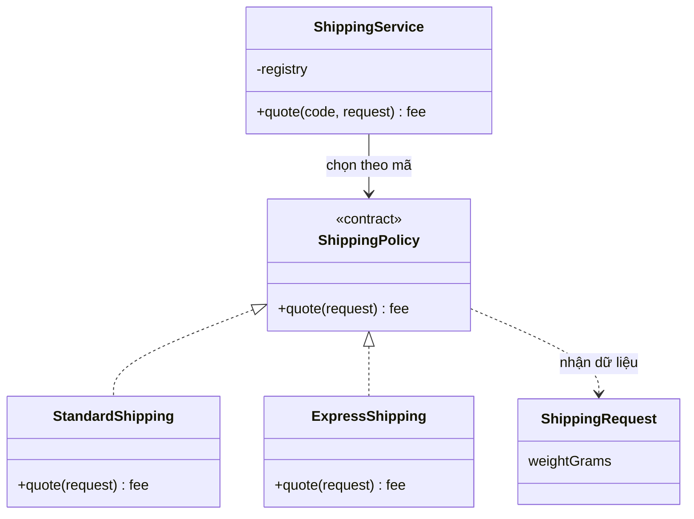
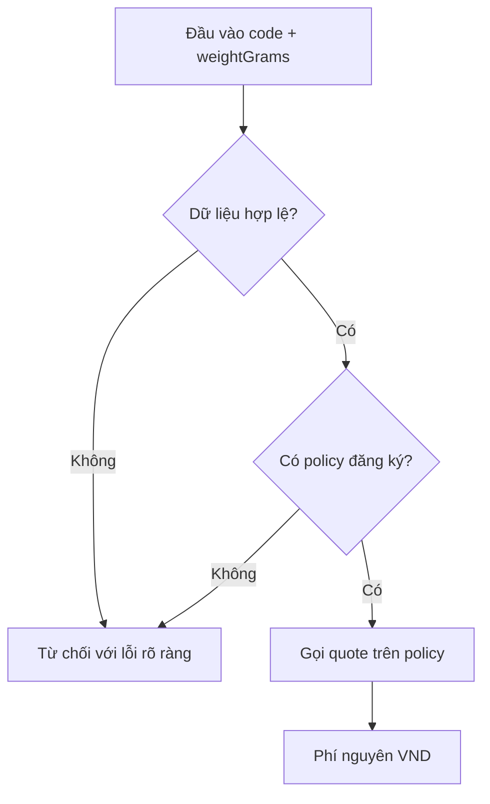

# Khác biệt ngôn ngữ khi hiện thực cùng một thiết kế OOP

**Một thiết kế hướng đối tượng có thể giữ nguyên ý tưởng nhưng mang hình thức rất khác nhau trong Java, Kotlin, Python, TypeScript và C#.** Có ngôn ngữ yêu cầu khai báo rõ interface; có ngôn ngữ chấp nhận đối tượng miễn là nó cung cấp đúng phương thức. Có ngôn ngữ kiểm tra kiểu chủ yếu lúc biên dịch; có ngôn ngữ chỉ kiểm tra khi chương trình chạy. Cả hai nhóm đều có thể xây dựng hệ thống OOP tốt nếu hợp đồng nghiệp vụ được giữ vững.

Bài học sẽ dùng **cùng một thiết kế tính phí vận chuyển** xuyên suốt các ví dụ. Mục tiêu là nhận ra điều gì thuộc về thiết kế OOP, điều gì là quy tắc của từng ngôn ngữ, và cách tránh lỗi khi chuyển thiết kế giữa các hệ sinh thái.

## 1. Giữ nguyên bài toán, không giữ nguyên từng dòng mã

Một hệ thống đặt hàng cần tính phí vận chuyển theo mã dịch vụ:

| Dịch vụ | Quy tắc |
|---|---|
| `standard` | Phí cố định **20.000 VND** |
| `express` | **35.000 VND + 8.000 VND × số kg làm tròn lên** |

Đầu vào là trọng lượng tính bằng **gram nguyên**, hợp lệ từ **1 đến 100.000 gram**. Phí trả về là **số nguyên VND**, không dùng số thực để biểu diễn phần lẻ tiền. Mã dịch vụ không được hỗ trợ hoặc trọng lượng không hợp lệ đều phải bị từ chối rõ ràng.

Ví dụ: 1.200 gram tương ứng 2 kg tính phí; `express` trả `35.000 + 8.000 × 2 = 51.000 VND`.

Ta xác định ba vai trò:

1. **Request:** giữ dữ liệu đầu vào và quy tắc hợp lệ.
2. **ShippingPolicy:** hợp đồng tính phí, cho phép nhiều cách hiện thực.
3. **ShippingService:** chọn chính sách theo mã và gọi hợp đồng mà không cần biết chi tiết công thức.



Sơ đồ là **thiết kế khái niệm**, không áp đặt phải tạo cùng số lượng class ở mọi ngôn ngữ. Việc chọn interface, protocol, function type, record hay data class tùy tính năng và phong cách của từng ngôn ngữ.

## 2. Java: interface danh nghĩa, kiểu tường minh và đa hình

Trong Java, một class cần khai báo `implements ShippingPolicy` để được xem là hiện thực của interface đó theo hệ thống kiểu danh nghĩa (*nominal typing*). Lời gọi `policy.quote(request)` được phân phối động đến implementation thực tế.

Ví dụ chạy với **Java 17+**. Lưu vào `ShippingDemo.java`:

```java
import java.util.Map;
import java.util.Objects;

public class ShippingDemo {
    record ShippingRequest(int weightGrams) {
        ShippingRequest {
            if (weightGrams < 1 || weightGrams > 100_000) {
                throw new IllegalArgumentException(
                        "Trọng lượng phải từ 1 đến 100000 gram");
            }
        }
    }

    interface ShippingPolicy {
        long quote(ShippingRequest request);
    }

    static final class StandardShipping implements ShippingPolicy {
        @Override
        public long quote(ShippingRequest request) {
            return 20_000L;
        }
    }

    static final class ExpressShipping implements ShippingPolicy {
        @Override
        public long quote(ShippingRequest request) {
            long kilograms = (request.weightGrams() + 999L) / 1_000L;
            return 35_000L + 8_000L * kilograms;
        }
    }

    static final class ShippingService {
        private final Map<String, ShippingPolicy> policies;

        ShippingService(Map<String, ShippingPolicy> policies) {
            this.policies = Map.copyOf(
                    Objects.requireNonNull(policies, "policies"));
        }

        long quote(String code, ShippingRequest request) {
            Objects.requireNonNull(code, "code");
            Objects.requireNonNull(request, "request");

            ShippingPolicy policy = policies.get(code);
            if (policy == null) {
                throw new IllegalArgumentException(
                        "Dịch vụ không hỗ trợ: " + code);
            }
            return policy.quote(request);
        }
    }

    public static void main(String[] args) {
        var service = new ShippingService(Map.of(
                "standard", new StandardShipping(),
                "express", new ExpressShipping()
        ));
        var request = new ShippingRequest(1_200);

        System.out.println(service.quote("standard", request)); // 20000
        System.out.println(service.quote("express", request));  // 51000
    }
}
```

Chạy:

```bash
javac ShippingDemo.java
java ShippingDemo
```

Những lựa chọn quan trọng:

- `interface` biểu diễn hợp đồng; `implements` khai báo tường minh quan hệ kiểu.
- `record` (Java 16+) tự tạo accessor, `equals`, `hashCode`, `toString` theo các thành phần; compact constructor giúp chặn trọng lượng sai ngay khi tạo request. `record` tạo **bất biến nông**, không tự biến mọi đối tượng tham chiếu bên trong thành bất biến.
- `final` ở implementation ngăn kế thừa class đó; không ngăn implementation khác tham gia cùng interface.
- `Map.copyOf` tạo bản map không sửa được qua API chuẩn, giúp tránh sửa registry từ bên ngoài sau khi khởi tạo. Nó không tự làm các `ShippingPolicy` bên trong thread-safe.
- `long` đủ cho phạm vi phí đã định; nếu bài toán có tiền thập phân, có thể cần `BigDecimal` và quy tắc làm tròn rõ ràng.

**Điểm OOP cốt lõi:** `ShippingService` phụ thuộc vào hợp đồng `ShippingPolicy`. Bổ sung `SameDayShipping implements ShippingPolicy` là mở rộng hành vi; phần chọn và gọi chính sách không phải chứa thêm nhánh công thức.

## 3. Kotlin: thiết kế tương tự Java, biểu đạt ngắn hơn

Kotlin vẫn dùng hệ thống kiểu danh nghĩa cho interface/class. Tuy nhiên, ngôn ngữ có `data class`, cú pháp property gọn và null-safety tại thời điểm biên dịch. Các class Kotlin là `final` theo mặc định, khác với class Java thông thường.

Ví dụ Kotlin/JVM trong `ShippingDemo.kt`:

```kotlin
data class ShippingRequest(val weightGrams: Int) {
    init {
        require(weightGrams in 1..100_000) {
            "Trọng lượng phải từ 1 đến 100000 gram"
        }
    }
}

interface ShippingPolicy {
    fun quote(request: ShippingRequest): Long
}

class StandardShipping : ShippingPolicy {
    override fun quote(request: ShippingRequest): Long = 20_000L
}

class ExpressShipping : ShippingPolicy {
    override fun quote(request: ShippingRequest): Long {
        val kilograms = (request.weightGrams.toLong() + 999L) / 1_000L
        return 35_000L + 8_000L * kilograms
    }
}

class ShippingService(policies: Map<String, ShippingPolicy>) {
    private val registry = policies.toMap()

    fun quote(code: String, request: ShippingRequest): Long {
        val policy = registry[code]
            ?: throw IllegalArgumentException("Dịch vụ không hỗ trợ: $code")
        return policy.quote(request)
    }
}

fun main() {
    val service = ShippingService(
        mapOf(
            "standard" to StandardShipping(),
            "express" to ExpressShipping()
        )
    )
    val request = ShippingRequest(1_200)
    println(service.quote("standard", request)) // 20000
    println(service.quote("express", request))  // 51000
}
```

Điểm khác Java:

- `data class` tạo `equals`/`hashCode`/`toString` và `copy` từ các property trong primary constructor.
- `val` ngăn gán lại property từ phía mã gọi, nhưng **không bảo đảm bất biến sâu**. `registry = policies.toMap()` tạo bản sao map thông thường; interface `Map` của Kotlin là read-only ở góc nhìn API, không mang nghĩa collection bất biến tuyệt đối trong mọi tình huống.
- Kiểu `ShippingPolicy` mặc định không nhận `null`; muốn nullable phải viết `ShippingPolicy?`. Điều này giúp loại một nhóm lỗi ở mã Kotlin thuần, nhưng dữ liệu đến từ Java, reflection hoặc nguồn ngoài vẫn cần chú ý.
- `override` là bắt buộc khi hiện thực phương thức interface. Không cần `new` khi tạo object.

Có thể dùng **function type** khi điểm mở rộng chỉ có một thao tác:

```kotlin
typealias FeeRule = (ShippingRequest) -> Long

val expressRule: FeeRule = { request ->
    35_000L + 8_000L * ((request.weightGrams.toLong() + 999L) / 1_000L)
}
```

Cùng ý tưởng “truyền hành vi vào service” nhưng không cần class cho mỗi quy tắc. Khi mỗi chính sách có thêm cấu hình, dependency, logging riêng hoặc nhiều phương thức, interface/class lại có thể rõ ràng hơn. Không có lý do ép mọi thiết kế OOP sang một dạng cú pháp duy nhất.

## 4. Python: Protocol, duck typing và kiểm tra lúc chạy

Python cho phép đa hình nhờ **duck typing**: đối tượng dùng được nếu ở thời điểm gọi nó có thao tác cần thiết. `Protocol` cung cấp cách mô tả hợp đồng **structural typing** để công cụ như mypy hoặc Pyright kiểm tra tĩnh; Python thông thường không tự thực thi chú giải kiểu khi chạy.

Ví dụ với **Python 3.10+**, lưu `shipping_demo.py`:

```python
from dataclasses import dataclass
from typing import Mapping, Protocol


@dataclass(frozen=True, slots=True)
class ShippingRequest:
    weight_grams: int

    def __post_init__(self) -> None:
        # bool là subclass của int trong Python: từ chối True/False.
        if type(self.weight_grams) is not int:
            raise ValueError("Trọng lượng phải là số nguyên")
        if not 1 <= self.weight_grams <= 100_000:
            raise ValueError("Trọng lượng phải từ 1 đến 100000 gram")


class ShippingPolicy(Protocol):
    def quote(self, request: ShippingRequest) -> int:
        ...


class StandardShipping:
    def quote(self, request: ShippingRequest) -> int:
        return 20_000


class ExpressShipping:
    def quote(self, request: ShippingRequest) -> int:
        kilograms = (request.weight_grams + 999) // 1_000
        return 35_000 + 8_000 * kilograms


class ShippingService:
    def __init__(self, policies: Mapping[str, ShippingPolicy]) -> None:
        self._registry = dict(policies)

    def quote(self, code: str, request: ShippingRequest) -> int:
        if code not in self._registry:
            raise ValueError(f"Dịch vụ không hỗ trợ: {code}")
        return self._registry[code].quote(request)


if __name__ == "__main__":
    service = ShippingService({
        "standard": StandardShipping(),
        "express": ExpressShipping(),
    })
    request = ShippingRequest(1_200)
    print(service.quote("standard", request))  # 20000
    print(service.quote("express", request))   # 51000
```

Chạy `python shipping_demo.py`.

Điểm đặc trưng:

- `StandardShipping` và `ExpressShipping` **không cần kế thừa** `ShippingPolicy`. Chúng đáp ứng protocol bằng chữ ký và hành vi được kỳ vọng. Công cụ kiểm tra kiểu mới có thể xác nhận mức độ phù hợp.
- `@dataclass(frozen=True)` ngăn phép gán field thông thường sau khi tạo, nhưng chỉ bất biến nông. `__post_init__` thực thi ràng buộc trọng lượng tại runtime.
- `int` có độ chính xác nguyên không giới hạn theo kích thước số nguyên (giới hạn thực tế bởi bộ nhớ), khác `long` 64-bit trong Java/Kotlin/C#.
- Toán tử `//` là phép chia lấy phần nguyên theo hướng âm vô cực; với đầu vào dương đã được bảo đảm, công thức làm tròn lên ở trên khớp Java.
- Chú thích `request: ShippingRequest` không ngăn caller truyền sai object vào lúc chạy. Nếu truyền một đối tượng không có thuộc tính/phương thức cần thiết, lỗi có thể chỉ xuất hiện khi truy cập.

Không nên hiểu “Python linh hoạt” là khỏi cần hợp đồng. Vì trình thông dịch không kiểm tra trước mọi đường gọi, **kiểm thử hợp đồng và kiểm tra input ở ranh giới hệ thống** càng có giá trị.

## 5. TypeScript: interface cấu trúc, biến mất khi chạy

TypeScript cũng hỗ trợ structural typing: object có đúng các thành phần cần thiết thường được xem là phù hợp với interface dù không khai báo `implements`. Tuy nhiên, phần lớn khai báo kiểu bị **xóa khi biên dịch thành JavaScript**. Vì vậy object từ API/JSON phải được kiểm tra tại runtime; `interface` và `Readonly` không tự làm được việc đó.

Ví dụ lưu `shipping_demo.ts`:

```typescript
type ShippingRequest = Readonly<{ weightGrams: number }>;

interface ShippingPolicy {
  quote(request: ShippingRequest): number;
}

class StandardShipping implements ShippingPolicy {
  quote(_request: ShippingRequest): number {
    return 20_000;
  }
}

class ExpressShipping implements ShippingPolicy {
  quote(request: ShippingRequest): number {
    return 35_000 + 8_000 * Math.ceil(request.weightGrams / 1_000);
  }
}

class ShippingService {
  private readonly registry: ReadonlyMap<string, ShippingPolicy>;

  constructor(policies: ReadonlyMap<string, ShippingPolicy>) {
    this.registry = new Map(policies);
  }

  quote(code: string, request: ShippingRequest): number {
    // TypeScript không kiểm tra dữ liệu JSON bên ngoài tại runtime.
    if (!Number.isSafeInteger(request.weightGrams) ||
        request.weightGrams < 1 || request.weightGrams > 100_000) {
      throw new RangeError("Trọng lượng phải từ 1 đến 100000 gram");
    }

    const policy = this.registry.get(code);
    if (policy === undefined) {
      throw new Error("Dịch vụ không hỗ trợ: " + code);
    }
    return policy.quote(request);
  }
}

const service = new ShippingService(
  new Map<string, ShippingPolicy>([
    ["standard", new StandardShipping()],
    ["express", new ExpressShipping()],
  ])
);

const request: ShippingRequest = { weightGrams: 1_200 };
console.log(service.quote("standard", request)); // 20000
console.log(service.quote("express", request));  // 51000
```

Sau khi cài TypeScript compiler, có thể dùng:

```bash
tsc shipping_demo.ts --strict --target ES2020 --module commonjs
node shipping_demo.js
```

Một object literal cũng có thể đáp ứng hợp đồng mà không cần class:

```typescript
const weekendPolicy: ShippingPolicy = {
  quote: (_request) => 40_000
};
```

Những điểm cần phân biệt:

- TypeScript kiểm tra kiểu **trước lúc chạy**; JavaScript runtime không giữ interface `ShippingPolicy` để dùng `instanceof ShippingPolicy`.
- `readonly` trong type và `private` thông thường là ràng buộc chủ yếu của TypeScript compiler, không phải lớp bảo vệ bất biến hoặc quyền truy cập lúc chạy. JavaScript có trường tư hữu `#field` với cơ chế runtime khác.
- `number` là số dấu phẩy động IEEE 754. Với trọng lượng giới hạn tối đa 100.000 gram và phí trong ví dụ, mọi phép tính đều cho giá trị nguyên chính xác trong phạm vi số nguyên an toàn. Với tiền lớn, tỷ giá hoặc số lẻ, hãy chọn biểu diễn tiền phù hợp (ví dụ đơn vị nguyên nhỏ nhất cùng kiểm tra phạm vi, `bigint` khi tương thích, hoặc thư viện decimal).
- `ReadonlyMap` chỉ mô tả API cho phép đọc từ TypeScript; `new Map(policies)` giúp service giữ bản sao registry. Không nên giả định type là cơ chế bảo vệ dữ liệu chạy trên server.
- Event loop JavaScript cũng không chứng minh mọi state dùng chung an toàn: các bước bất đồng bộ có thể xen kẽ logic theo thời gian.

**Ví dụ lỗi chuyển ngôn ngữ:** trong Java, compiler có thể thấy class không hiện thực interface; với một JSON tùy ý ở TypeScript, compiler không tự xác minh object thực tế của HTTP response. Ranh giới nhận dữ liệu cần runtime validation.

## 6. C#: interface danh nghĩa, record struct và decimal

C# có interface danh nghĩa như Java, property và access modifier, cùng hệ thống generic và tính năng record riêng. Dưới đây là ví dụ console **.NET 8**, đặt trong `Program.cs` của dự án console:

```csharp
using System;
using System.Collections.Generic;

var service = new ShippingService(
    new Dictionary<string, IShippingPolicy>(StringComparer.Ordinal)
    {
        ["standard"] = new StandardShipping(),
        ["express"] = new ExpressShipping()
    }
);

var request = new ShippingRequest(1_200);
Console.WriteLine(service.Quote("standard", request)); // 20000
Console.WriteLine(service.Quote("express", request));  // 51000

public readonly record struct ShippingRequest(int WeightGrams);

public interface IShippingPolicy
{
    long Quote(ShippingRequest request);
}

public sealed class StandardShipping : IShippingPolicy
{
    public long Quote(ShippingRequest request) => 20_000L;
}

public sealed class ExpressShipping : IShippingPolicy
{
    public long Quote(ShippingRequest request)
    {
        long kilograms = (request.WeightGrams + 999L) / 1_000L;
        return 35_000L + 8_000L * kilograms;
    }
}

public sealed class ShippingService
{
    private readonly Dictionary<string, IShippingPolicy> _registry;

    public ShippingService(Dictionary<string, IShippingPolicy> policies)
    {
        _registry = new Dictionary<string, IShippingPolicy>(
            policies, StringComparer.Ordinal);
    }

    public long Quote(string code, ShippingRequest request)
    {
        if (request.WeightGrams < 1 || request.WeightGrams > 100_000)
            throw new ArgumentOutOfRangeException(nameof(request));

        if (!_registry.TryGetValue(code, out IShippingPolicy? policy))
            throw new ArgumentException(
                "Dịch vụ không hỗ trợ: " + code, nameof(code));

        return policy.Quote(request);
    }
}
```

Có thể tạo project bằng `dotnet new console -n ShippingDemo`, thay nội dung `Program.cs` và chạy `dotnet run` trong thư mục project.

Điểm đáng chú ý:

- `: IShippingPolicy` xác nhận class thực thi interface; lời gọi interface có phân phối động tương tự Java.
- `readonly record struct` là **kiểu giá trị**; khi truyền như tham số trong ví dụ, dữ liệu nhỏ này được sao chép theo value semantics. Ngược lại, Java `record` là **kiểu tham chiếu** và có `equals` theo giá trị các thành phần.
- Ví dụ C# chủ ý đặt validation tại `ShippingService`. Điều đó bảo đảm đầu vào của nghiệp vụ `Quote`; tuy nhiên vẫn có thể tạo `new ShippingRequest(0)`. Nếu cần bất biến ngay lúc tạo request như Java/Kotlin/Python, nên đưa validation vào constructor/factory phù hợp.
- C# có `decimal` cho số thập phân cơ số 10 với độ chính xác và giới hạn riêng; không có nghĩa cứ đổi `long` sang `decimal` là khỏi cần quy tắc làm tròn, currency và overflow.
- `readonly` trên field `_registry` ngăn gán lại tham chiếu field, **không** tự biến mọi giá trị trong dictionary thành bất biến. Đây là dictionary nội bộ được sao chép một lần và service không cung cấp phương thức sửa nó.

Nếu ứng dụng chạy qua ASP.NET Core, DI container có thể khởi tạo `ShippingService` và các policy. Đừng nhầm lifetime của DI với lựa chọn record/class hay tính an toàn của trạng thái thay đổi.

## 7. So sánh trực diện: cùng vai trò, khác cơ chế

| Câu hỏi | Java | Kotlin | Python | TypeScript | C# |
|---|---|---|---|---|---|
| Hợp đồng hành vi | `interface` | `interface` hoặc function type | `Protocol`, ABC hoặc duck typing | `interface` hoặc type/function | `interface` hoặc delegate |
| Một class được xem là hiện thực hợp đồng | Phải `implements` (nominal) | Phải khai báo `: Interface` (nominal) | `Protocol` có thể khớp theo cấu trúc; runtime duck typing | Khớp theo cấu trúc ở compile time | Phải khai báo `: Interface` (nominal) |
| Kiểm tra kiểu | Chủ yếu compile time + runtime type checks | Chủ yếu compile time + runtime type checks | Type hints không ép kiểu runtime; optional type checker | Compile time; kiểu bị xóa phần lớn khi transpile | Compile time + thông tin kiểu CLR ở runtime |
| Biểu diễn dữ liệu request | `record` hoặc class | `data class` | `dataclass` | Object + `type`/`interface` | `record`/`record struct`/class |
| Giá trị rỗng | Reference có thể `null`; annotations tùy công cụ | `T` khác `T?` | `None`, annotation dạng `T \| None` | `null`/`undefined`, `strictNullChecks` | Nullable reference types: `T?` |
| Phí nguyên | `long` có giới hạn 64-bit | `Long` 64-bit | `int` độ lớn linh hoạt | `number` giới hạn chính xác số nguyên | `long` 64-bit |
| Interface còn tồn tại lúc chạy? | Có kiểu runtime | Có kiểu trên JVM | `Protocol` chủ yếu cho static typing; tùy cơ chế kiểm tra runtime | Không; bị xóa trong JS | Có kiểu CLR runtime |
| Runtime validation đầu vào ngoài | Cần | Cần | Cần | Cần đặc biệt với JSON/`unknown` | Cần |

**Lưu ý:** bảng tóm tắt hành vi phổ biến trong cấu hình ngôn ngữ/hệ runtime được nêu. Một số cơ chế tùy compiler, platform hoặc thư viện; không nên suy từ một ô trong bảng rằng mọi chương trình thuộc ngôn ngữ đó luôn có tính chất ấy.

### Danh tính đối tượng khác bình đẳng về giá trị

Hai object chứa cùng trọng lượng có thể **bằng nhau về dữ liệu** nhưng **không phải cùng object**. Đây là điểm rất dễ nhầm khi dịch mã OOP.

| Ngôn ngữ | So sánh giá trị | So sánh danh tính/tham chiếu |
|---|---|---|
| Java | `a.equals(b)` (với `record` được tạo sẵn) | `a == b` đối với hai tham chiếu |
| Kotlin | `a == b` gọi equality an toàn với null | `a === b` |
| Python | `a == b` qua `__eq__` | `a is b` |
| TypeScript/JavaScript | `===` so sánh giá trị primitive, nhưng object theo identity | `a === b` với object |
| C# | Phụ thuộc overload `==`/`Equals`; record hỗ trợ value equality | `ReferenceEquals(a,b)` cho đối tượng tham chiếu |

Trong Java, `new ShippingRequest(1200).equals(new ShippingRequest(1200))` là `true` nhưng `==` giữa hai record vừa tạo là `false`. Với TypeScript, hai object literal `{weightGrams: 1200}` riêng biệt so sánh bằng `===` là `false`. Lựa chọn key trong map, caching, deduplication và test có thể thay đổi kết quả nếu nhầm **identity** với **value equality**.

## 8. Phần thiết kế nào phải bất biến khi chuyển ngôn ngữ?

Điểm không thể “dịch máy móc” nằm ở chỗ **hợp đồng quan sát được** quan trọng hơn tên lớp.



**Các hợp đồng phải giữ nguyên:**

- Trọng lượng chỉ nhận số nguyên trong `[1, 100000]` gram. Lưu ý Python có `bool` là subclass của `int`; TypeScript có thể nhận giá trị ngoài type khi đọc dữ liệu không tin cậy.
- `standard` trả `20000` cho mọi trọng lượng hợp lệ.
- `express` trả `35000 + 8000 × ceil(weightGrams / 1000)`.
- Mã không có trong registry tạo lỗi; không âm thầm trả 0 hoặc chuyển sang dịch vụ mặc định.
- Service không chứa từng công thức; chọn implementation và gọi theo hợp đồng.
- Mỗi implementer cần trả phí hợp lệ, không sửa input và tuân thủ đơn vị VND.

Phần **có thể khác**: nơi đặt validation (constructor hoặc service), cách mô tả interface, kiểu số, naming convention, exception class, cú pháp registry, cơ chế tạo instance, kiểu bất biến và DI framework.

### Bộ kiểm thử chung cho cả năm phiên bản

| Trường hợp | `standard` | `express` | Giải thích |
|---|---:|---:|---|
| 1 gram | 20.000 | 43.000 | Tối thiểu 1 kg tính phí |
| 1.000 gram | 20.000 | 43.000 | Tròn đúng 1 kg |
| 1.001 gram | 20.000 | 51.000 | Bước qua mốc, tính 2 kg |
| 1.200 gram | 20.000 | 51.000 | Làm tròn lên 2 kg |
| 100.000 gram | 20.000 | 835.000 | Tối đa 100 kg |
| 0 hoặc 100.001 gram | Lỗi | Lỗi | Vi phạm input contract |
| Mã `unknown` | Lỗi | Lỗi | Không có policy đăng ký |

Với ca 100.000 gram, phép tính là `35.000 + 8.000 × 100 = 835.000`. Nếu bất kỳ implementation nào trả con số khác, lỗi nằm ở logic chuyển đổi/thi hành, dù cú pháp trông “đúng OOP”.

Đừng chỉ kiểm thử các lời gọi thành công. Cần test ranh giới kiểu (ví dụ `true` trong Python, `NaN` hay số không nguyên từ JavaScript), đầu vào bất hợp lệ và registration missing. Mục tiêu là **parity về hành vi** chứ không phải parity về số lượng class hoặc tên phương thức.

## 9. Khi nào một interface là quá nhiều?

Ví dụ vận chuyển dùng hai chính sách để làm rõ đa hình. Nhưng thiết kế thật có thể chỉ cần **một hàm** truyền vào service:

- Java: `ToLongFunction<ShippingRequest>` (lưu ý xử lý tên mã và dependency nơi gọi).
- Kotlin: `(ShippingRequest) -> Long`.
- Python: `Callable[[ShippingRequest], int]`.
- TypeScript: `(request: ShippingRequest) => number`.
- C#: `Func<ShippingRequest, long>`.

Các lựa chọn này vẫn diễn đạt **đảo ngược phụ thuộc vào hành vi được cung cấp**. Chọn class/interface khi policy có danh tính nghiệp vụ rõ, có nhiều phương thức, dependency, vòng đời hoặc cần công khai một hợp đồng bền vững. Chọn function khi hành vi nhỏ, độc lập và dễ đọc.

Ví dụ Java có thể chấp nhận các rule dưới dạng function:

```java
import java.util.Map;
import java.util.function.ToLongFunction;

// Dùng record ShippingRequest của ví dụ Java ở trên.
Map<String, ToLongFunction<ShippingRequest>> rules = Map.of(
    "standard", request -> 20_000L,
    "express", request -> 35_000L
        + 8_000L * ((request.weightGrams() + 999L) / 1_000L)
);

long fee = rules.get("express").applyAsLong(
        new ShippingRequest(1_200)); // 51000
```

Đoạn này là **mảnh mã minh họa đặt trong phạm vi có thể truy cập `ShippingRequest`**. Khi viết ứng dụng thật, cần kiểm tra mã tồn tại trước khi gọi `applyAsLong`; `rules.get(...)` trả `null` nếu key không có. Function type giảm số class nhưng không tự giải quyết validation, registry, logging và quy tắc lỗi.

## 10. Khác biệt về đóng gói, kế thừa và đa hình

Một thiết kế OOP tốt cần nêu **ai sở hữu trạng thái** và **người ngoài được phép làm gì**, bởi mỗi ngôn ngữ bảo vệ ranh giới này ở mức khác nhau.

**Đóng gói:**

- Java/C#: `private`, `protected` và các mức truy cập khác được ngôn ngữ/runtime hỗ trợ. Reflection hoặc các cơ chế đặc biệt vẫn cần xét riêng.
- Kotlin: `private`, `protected`, `internal`, `public`; `internal` phục vụ ranh giới module ở mức ngôn ngữ, cần hiểu thêm cách biên dịch/interop.
- Python: tiền tố `_field` chủ yếu là quy ước API nội bộ; `__field` dùng *name mangling* để giảm xung đột tên, không tạo ranh giới bảo mật tuyệt đối.
- TypeScript: `private` thường được compiler kiểm tra; trường JavaScript `#field` có kiểm soát runtime. Đừng dùng `readonly` để thay cơ chế bảo vệ dữ liệu không tin cậy.

**Kế thừa:**

- Java, Kotlin, C#, TypeScript: một class thường chỉ kế thừa trực tiếp **một class nền**, nhưng có thể hiện thực nhiều interface; các ngôn ngữ hỗ trợ khác nhau về default implementation.
- Python: hỗ trợ kế thừa nhiều class và tra cứu theo **MRO** (*method resolution order*). Đây là công cụ mạnh nhưng có thể gây khó hiểu khi nhiều class nền cùng định nghĩa một phương thức.

**Đa hình:**

- Java/Kotlin/C#: quan hệ khai báo với interface/class có vai trò trung tâm trong static typing.
- Python: runtime dispatch dựa trên object thực tế; `Protocol` giúp static tooling mô tả kỳ vọng.
- TypeScript: compiler kiểm tra shape, còn JavaScript thực thi lời gọi method trên object thực tế; interface không có runtime identity.

Đừng cố sao chép một hệ phân cấp class sâu từ Java sang Python/TypeScript. Nếu ngôn ngữ có function, composition, protocol hoặc object literal phù hợp hơn, có thể giữ **cùng trách nhiệm và hợp đồng** bằng cấu trúc gọn hơn.

## 11. Rủi ro khi port thiết kế OOP giữa ngôn ngữ

| Tình huống | Sai lầm thường gặp | Hướng xử lý |
|---|---|---|
| Copy công thức `(w + 999) / 1000` | Quên khác biệt phép chia nguyên/dấu phẩy động | Java/Kotlin/C# dùng phép chia nguyên với toán hạng nguyên; Python `//`; TypeScript `Math.ceil` |
| Giả định type annotation chặn runtime input | JSON sai lọt vào TypeScript/Python | Validation ở boundary; test `NaN`/`bool`/giá trị ngoài phạm vi |
| Dùng `==`/`===` như nhau | Trộn identity và value equality | Test rõ semantics từng kiểu và ngôn ngữ |
| Tin `readonly`/`final` bảo đảm deep immutability | Collection bên trong vẫn thay đổi | Defensive copy, immutable data và ownership rõ |
| Dịch mọi class 1:1 | Quá nhiều boilerplate hoặc bỏ qua idiom địa phương | Bảo toàn trách nhiệm, hợp đồng và đường phụ thuộc |
| Dùng inheritance để tái sử dụng mọi thứ | Phụ thuộc implementation và override khó đoán | Composition và interface/function type khi phù hợp |
| Cho rằng DI singleton = an toàn đa luồng | Service có field thay đổi theo request | Thiết kế stateless hoặc kiểm soát concurrency thật sự |
| Bỏ qua xử lý lỗi và lifecycle | Resource leak, retry khác nhau, API bất nhất | Đặc tả lỗi, transaction, close/dispose và thử nghiệm tích hợp |

Một vấn đề thường ẩn sau “cùng code nhưng chạy khác” là **hệ sinh thái thực thi**: Java trên JVM, Kotlin có nhiều target, Python runtime, JavaScript engine của Node/browser và CLR của .NET có mô hình I/O, GC, scheduling, reflection, serialization, package khác nhau. Không được suy ra hiệu năng, thread safety hay cách giải phóng tài nguyên chỉ từ sơ đồ class.

Ví dụ, Java có `AutoCloseable`/try-with-resources, C# có `IDisposable`/`using`, Python có context manager/`with`; TypeScript/JavaScript thường dùng `try/finally` và API close/dispose tương ứng. **Ý đồ** vẫn là giải phóng tài nguyên có trách nhiệm, còn **cơ chế** phụ thuộc runtime.

## 12. Một cách chuyển thiết kế có kiểm soát

Giả sử đội ngũ đã có bản Java và muốn viết dịch vụ tương đương bằng TypeScript:

1. **Chốt hợp đồng trước:** đầu vào, đơn vị, phạm vi, công thức, quy tắc lỗi, trạng thái và kỳ vọng đồng thời.
2. **Chuyển các vai trò:** Request, Policy, Service. Chỉ sau đó mới quyết định dùng `class`, function hay object literal.
3. **Đổi biểu diễn dữ liệu có chủ ý:** `long` Java sang `number` TypeScript chỉ được khi chứng minh giới hạn giá trị; thêm runtime checks.
4. **Kiểm tra boundary thực tế:** HTTP JSON không mang interface TypeScript; validate trước khi đưa vào domain.
5. **Áp dụng cùng bảng ca kiểm thử:** kết quả phải khớp về VND và trường hợp lỗi, dù exception class khác.
6. **Rà soát runtime và lifecycle:** registry có bị sửa ngoài ý muốn không, async có gây xen kẽ trạng thái không, tài nguyên giải phóng thế nào.
7. **Đánh giá idiomatic code:** code nhận diện được ý tưởng ban đầu nhưng vẫn dễ hiểu với lập trình viên của ngôn ngữ đích.

### Bài tập

**Bài 1:** Bổ sung `same-day` giá cố định 70.000 VND vào hai trong năm implementation. Không sửa công thức của `ShippingService`; chỉ viết policy mới và đăng ký mã. Phân tích ngôn ngữ nào bắt buộc khai báo quan hệ interface.

**Bài 2:** Thay `ShippingRequest` thành đối tượng chứa `List<String> notes` hoặc mảng ghi chú. So sánh mức “bất biến” của Java record, Kotlin data class, Python frozen dataclass, TypeScript Readonly và C# record khi collection bên trong vẫn mutable.

**Bài 3:** Tạo hai request có cùng trọng lượng 1.200 gram và thử so sánh equality vs identity trong Java, Kotlin, Python, TypeScript và C#. Giải thích kết quả; không giả định ký hiệu `==` có ý nghĩa giống nhau ở mọi ngôn ngữ.

**Bài 4:** Phân tích hai đầu vào đến từ JSON: `{"weightGrams": 1200}` và `{"weightGrams": "1200"}`. Xác định ở đâu cần parse/validate để không tự chuyển chuỗi sang số một cách mập mờ. Viết một test ngăn cả TypeScript lẫn Python vô tình chấp nhận kiểu dữ liệu sai.

**Câu hỏi tự đánh giá:** Nếu bỏ tên `interface`, `Protocol`, `data class` và `record` khỏi bản mô tả, bạn còn giải thích được ai chịu trách nhiệm tính phí, ai chọn chính sách, hợp đồng nào phải được giữ và cách kiểm chứng hay không? Nếu có, bạn đã nắm được **thiết kế OOP độc lập với cú pháp**.

**Điều cần nhớ:** một thiết kế OOP được nhận diện bằng **trách nhiệm, hợp đồng, ranh giới trạng thái và cách các đối tượng cộng tác**. Java, Kotlin, Python, TypeScript và C# cung cấp những công cụ khác nhau để biểu đạt các quyết định đó. Dịch thiết kế thành công là giữ đúng hành vi và bất biến nghiệp vụ, đồng thời dùng đúng cơ chế kiểu, runtime và idiom của ngôn ngữ đích.