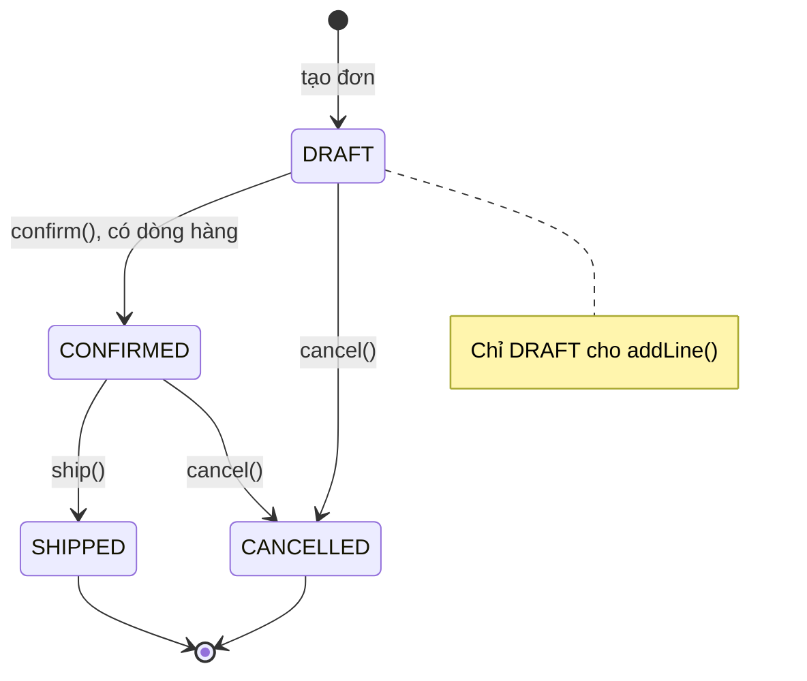
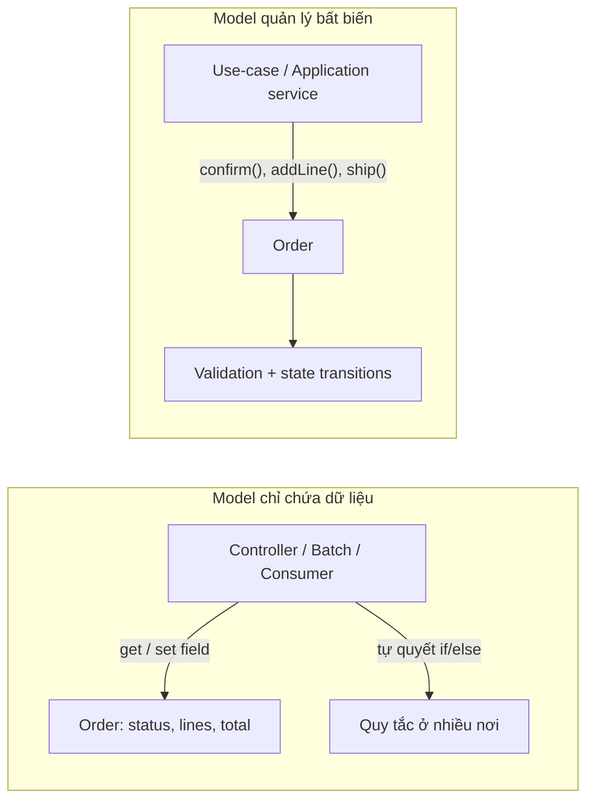
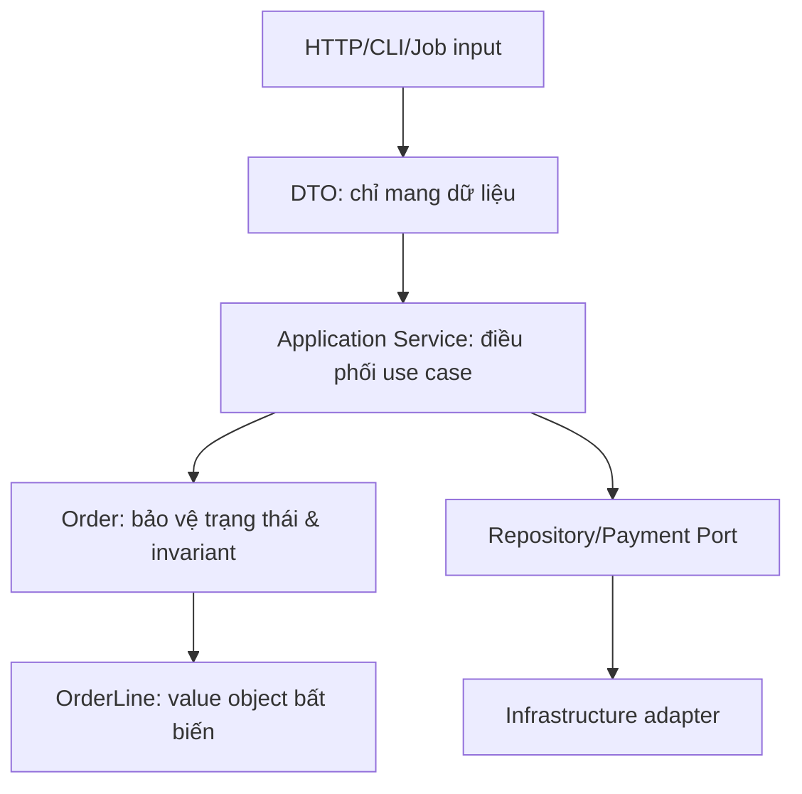

# Getter, setter tràn lan nhưng thiếu hành vi: nhận diện và sửa lỗi thiết kế OOP

> **Chủ đề:** Lỗi thiết kế trong lập trình hướng đối tượng – các đối tượng được tạo ra chủ yếu để chứa dữ liệu, trong khi mọi quyết định nghiệp vụ bị đẩy ra ngoài. Mục tiêu là phân biệt getter/setter hợp lý với **Anemic Domain Model**, hiểu vì sao **đóng gói** không chỉ là đặt field `private`, và biết refactor sang các phương thức diễn đạt hành vi mà vẫn giữ đúng quy tắc nghiệp vụ.

## 1. Vấn đề thật sự nằm ở đâu?

Hãy xem một class `Order` có các field `status`, `totalVnd`, `items` và các phương thức `getStatus()`, `setStatus()`, `getTotalVnd()`, `setTotalVnd()`, `getItems()`, `setItems()`. Về cú pháp, đây vẫn là một **class Java hợp lệ**. Nhưng nếu mọi quyết định như “được xác nhận đơn khi nào”, “có thể hủy đơn đã gửi chưa”, “tổng tiền tính ra sao” đều đặt ở controller hay service khác thì đối tượng `Order` chỉ còn là **túi dữ liệu**.

Vấn đề không phải tên phương thức bắt đầu bằng `get` hay `set`. Vấn đề là **quyền thay đổi trạng thái và trách nhiệm bảo vệ quy tắc nghiệp vụ** nằm sai chỗ.

Hai kiểu thiết kế cần phân biệt:

- **Anemic Domain Model (mô hình miền thiếu hành vi):** entity/domain object chứa dữ liệu và các thao tác truy cập đơn giản; service bên ngoài sở hữu hầu hết quy tắc nghiệp vụ liên quan đến dữ liệu đó.
- **Rich Domain Model (mô hình miền có hành vi):** đối tượng chứa hoặc cộng tác với những hành vi và bất biến thuộc trách nhiệm của chính nó; những thay đổi có ý nghĩa được diễn đạt bằng ngôn ngữ nghiệp vụ.

Không nên hiểu “rich” là **một class phải chứa mọi business logic**. Một số quy tắc liên quan nhiều entity hoặc gọi hệ thống ngoài thích hợp ở domain service, application service hay workflow. Thiết kế tốt là **phân bổ trách nhiệm đúng**, không phải nhét tất cả code vào entity.

### Triệu chứng dễ nhận thấy

| Dấu hiệu | Vì sao đáng xem lại? |
|---|---|
| Class domain có hàng chục getter/setter, gần như không có phương thức nghiệp vụ | Client phải tự biết cách thay đổi trạng thái hợp lệ |
| Service viết `if (order.getStatus() == ...)` rồi `order.setStatus(...)` ở nhiều nơi | Quy tắc chuyển trạng thái bị phân tán, dễ sửa thiếu |
| `setTotalVnd` cho phép client nhập tổng tiền tùy ý | Dữ liệu tính toán có thể lệch với các dòng hàng |
| `getItems()` trả trực tiếp `ArrayList` bên trong | Client có thể thêm/xóa dòng hàng, vượt qua validation |
| Mỗi controller tự quyết khi nào hủy, xác nhận, vận chuyển | Một use case có thể áp dụng luật khác use case còn lại |
| Mọi field `private` nhưng setter lại `public` vô điều kiện | Encapsulation về mặt cú pháp không bảo vệ invariant |
| Unit test chỉ kiểm `setX` xong `getX` trả X | Chưa kiểm tra quy tắc nghiệp vụ và các trạng thái bị cấm |

**Đóng gói (encapsulation)** có nghĩa là gom **trạng thái cùng hành vi quản lý trạng thái** phía sau một hợp đồng rõ ràng, giới hạn những thao tác mà code bên ngoài có quyền thực hiện. Đặt field `private` rồi phát hành setter cho tất cả field có thể chỉ chuyển cách truy cập từ `order.status = ...` sang `order.setStatus(...)` mà không thay đổi quyền lực thực sự của client.

## 2. Phản ví dụ: “OOP” chỉ có getter/setter

Giả sử đơn hàng có các trạng thái:

- `DRAFT`: đang tạo, có thể thêm sản phẩm.
- `CONFIRMED`: đã xác nhận, không được sửa dòng hàng.
- `SHIPPED`: đã gửi đi, không thể hủy theo quy tắc ví dụ.
- `CANCELLED`: đã hủy, không thể xác nhận/gửi đi.

Mỗi dòng hàng có mã SKU, đơn giá VND nguyên và số lượng dương.

Một mô hình thiếu hành vi thường như sau (minh họa, các import/getter còn lại đã lược bỏ):

```java
class Order {
    private String id;
    private String status;
    private long totalVnd;
    private java.util.List<OrderLine> lines;

    String getStatus() { return status; }
    void setStatus(String status) { this.status = status; }

    long getTotalVnd() { return totalVnd; }
    void setTotalVnd(long totalVnd) { this.totalVnd = totalVnd; }

    java.util.List<OrderLine> getLines() { return lines; }
    void setLines(java.util.List<OrderLine> lines) {
        this.lines = lines;
    }
}
```

Một controller có thể tự làm:

```java
// Phác họa service dùng model ở trên.
if ("DRAFT".equals(order.getStatus())) {
    order.setStatus("CONFIRMED");
}
```

Trong khi nơi khác có thể gọi:

```java
order.setStatus("SHIPPED");    // Bỏ qua bước CONFIRMED?
order.setTotalVnd(-100_000L);  // Tổng tiền âm?
order.getLines().clear();      // Xóa hàng mà không cập nhật tổng?
```

Các lời gọi trên thể hiện **API quá rộng**: class công khai cho client thao tác mà đáng ra phải bị hạn chế theo trạng thái và quy tắc nghiệp vụ. Chỗ nguy hiểm là đối tượng có thể đi vào trạng thái sai **mà không có điểm kiểm soát thống nhất**.

Chỉ thêm `if` ở controller hiện tại chưa đủ. Một tác vụ batch, consumer message hoặc API thứ hai có thể quên đúng cùng điều kiện đó. Cách thiết kế bền hơn là khiến **thao tác bất hợp lệ không có đường đi công khai hợp lệ**, hoặc ít nhất phải bị chính đối tượng từ chối.

## 3. Tư duy lại API: từ “cho thay field” đến “yêu cầu thực hiện hành vi”

Thay:

- `setStatus(CONFIRMED)` bằng `confirm()`.
- `setStatus(SHIPPED)` bằng `ship()`.
- `setStatus(CANCELLED)` bằng `cancel()`.
- `getLines().add(line)` bằng `addLine(sku, unitPriceVnd, quantity)`.
- `setTotalVnd(...)` bằng `totalVnd()` **tính từ dữ liệu nguồn**.

Mỗi hành vi có thể:
1. Kiểm tra điều kiện trước (*precondition*).
2. Từ chối những chuyển đổi sai.
3. Thay đổi trạng thái theo một quy tắc duy nhất.
4. Bảo toàn những điều kiện luôn đúng (*invariants*).
5. Trả về kết quả hoặc phát sinh lỗi có ý nghĩa.

Đây là tư tưởng thường được gọi là **Tell, Don't Ask**: thay vì bên ngoài hỏi trạng thái rồi tự sửa dữ liệu, hãy **yêu cầu đối tượng thực hiện một hành động có nghĩa**.

Tuy nhiên, Tell, Don't Ask **không cấm truy vấn trạng thái**. UI cần hiển thị tổng tiền, API cần serialize thông tin, báo cáo cần đọc trạng thái. Getter chỉ đọc và query method là hoàn toàn bình thường khi phù hợp yêu cầu.

### Hợp đồng mới theo ngôn ngữ nghiệp vụ

| API dạng dữ liệu | API diễn đạt hành vi | Quy tắc bảo vệ |
|---|---|---|
| `setStatus(CONFIRMED)` | `confirm()` | Chỉ xác nhận đơn `DRAFT` có ít nhất một dòng |
| `setStatus(SHIPPED)` | `ship()` | Chỉ gửi đơn `CONFIRMED` |
| `setStatus(CANCELLED)` | `cancel()` | Không hủy đơn đã gửi; hủy lại có thể là no-op |
| `getLines().add(...)` | `addLine(...)` | Chỉ sửa dòng hàng trong `DRAFT`; giá/số lượng hợp lệ |
| `setTotalVnd(x)` | `totalVnd()` | Tổng được tính từ từng dòng hàng, không nhập tùy ý |
| `getLines()` trả mutable list | `lines()` trả snapshot không sửa được | Client không thay dữ liệu bên trong qua tham chiếu |

Một API hướng hành vi có thể dễ đọc hơn: `order.confirm()` là **một quyết định nghiệp vụ**, khác với `order.setStatus(OrderStatus.CONFIRMED)` chỉ diễn đạt **một phép gán dữ liệu**.

## 4. Sơ đồ: một đối tượng tự kiểm soát vòng đời



Các mũi tên là **các chuyển trạng thái được phép**, không phải tất cả đường có thể tạo bằng setter. Trong ví dụ:

- Không được `ship()` khi đơn còn `DRAFT`.
- Không được `confirm()` hai lần.
- Không được thêm dòng hàng sau khi đã `CONFIRMED`.
- Không được `cancel()` nếu đã `SHIPPED`.
- Hủy một đơn đã `CANCELLED` được thiết kế là no-op (*idempotent*) để thao tác lặp lại không gây hại.

Quy tắc “không hủy sau khi gửi” là một **giả định của ví dụ**, không phải luật áp dụng cho tất cả hệ thống thương mại. Một sản phẩm khác có thể cho phép return/refund sau giao hàng, nhưng khi đó cần hành vi và trạng thái riêng chứ không chỉ mở lại setter.

## 5. Ví dụ Java 17 hoàn chỉnh: đặt bất biến vào `Order`

Lưu đoạn sau thành `BehaviorRichOrderDemo.java`. Có thể biên dịch/chạy không cần thư viện ngoài JDK:

```bash
javac BehaviorRichOrderDemo.java
java BehaviorRichOrderDemo
```

```java
import java.util.ArrayList;
import java.util.List;
import java.util.Objects;

public final class BehaviorRichOrderDemo {

    enum Status {
        DRAFT, CONFIRMED, SHIPPED, CANCELLED
    }

    // Value object bất biến cho một dòng hàng.
    record OrderLine(String sku, long unitPriceVnd, int quantity) {
        OrderLine {
            Objects.requireNonNull(sku, "sku");
            if (sku.isBlank()) {
                throw new IllegalArgumentException("SKU không được rỗng");
            }
            if (unitPriceVnd < 0) {
                throw new IllegalArgumentException(
                        "Đơn giá không được âm");
            }
            if (quantity <= 0) {
                throw new IllegalArgumentException(
                        "Số lượng phải dương");
            }
        }

        long amountVnd() {
            return Math.multiplyExact(unitPriceVnd, (long) quantity);
        }
    }

    static final class Order {
        private final String id;
        private final List<OrderLine> lines = new ArrayList<>();
        private Status status = Status.DRAFT;

        Order(String id) {
            Objects.requireNonNull(id, "id");
            if (id.isBlank()) {
                throw new IllegalArgumentException("ID không được rỗng");
            }
            this.id = id;
        }

        String id() {
            return id;
        }

        Status status() {
            return status;
        }

        // Snapshot không cho client sửa danh sách nội bộ.
        List<OrderLine> lines() {
            return List.copyOf(lines);
        }

        // Giá trị suy ra, không cung cấp setTotalVnd(...).
        long totalVnd() {
            long result = 0L;
            for (OrderLine line : lines) {
                result = Math.addExact(result, line.amountVnd());
            }
            return result;
        }

        void addLine(String sku, long unitPriceVnd, int quantity) {
            requireDraft();
            OrderLine line = new OrderLine(sku, unitPriceVnd, quantity);

            // Kiểm trước phép cộng/tràn số để không thêm dòng lỗi.
            long nextTotal = Math.addExact(totalVnd(), line.amountVnd());
            if (nextTotal < 0L) {
                throw new IllegalStateException("Tổng không hợp lệ");
            }
            lines.add(line);
        }

        void confirm() {
            requireDraft();
            if (lines.isEmpty()) {
                throw new IllegalStateException(
                        "Không thể xác nhận đơn trống");
            }
            // Kiểm tra tổng để lỗi được phát hiện trước đổi status.
            totalVnd();
            status = Status.CONFIRMED;
        }

        void ship() {
            if (status != Status.CONFIRMED) {
                throw new IllegalStateException(
                        "Chỉ gửi được đơn đã xác nhận");
            }
            status = Status.SHIPPED;
        }

        void cancel() {
            if (status == Status.CANCELLED) {
                return; // Hủy lặp lại được định nghĩa là no-op.
            }
            if (status == Status.SHIPPED) {
                throw new IllegalStateException(
                        "Đơn đã gửi không được hủy");
            }
            status = Status.CANCELLED;
        }

        private void requireDraft() {
            if (status != Status.DRAFT) {
                throw new IllegalStateException(
                        "Chỉ sửa/xác nhận đơn đang DRAFT");
            }
        }
    }

    public static void main(String[] args) {
        Order order = new Order("DH-100");
        order.addLine("KB-01", 120_000L, 2);
        order.addLine("MS-02", 80_000L, 1);

        System.out.println(order.totalVnd()); // 320000
        System.out.println(order.status());   // DRAFT

        order.confirm();
        System.out.println(order.status());   // CONFIRMED

        // Bên ngoài không thể gọi order.setStatus(...).
        // order.lines().clear(); // UnsupportedOperationException.

        order.ship();
        System.out.println(order.status());   // SHIPPED
        System.out.println(order.lines().size()); // 2
    }
}
```

### Giải thích thiết kế

**1. Trạng thái không bị gán tự do.** Field `status` là `private` và **không có `setStatus`**. Chỉ `confirm()`, `ship()` và `cancel()` được đổi trạng thái, mỗi method tự kiểm tra điều kiện.

**2. Quy tắc không bị phân tán.** Nếu một REST controller, một tác vụ batch và một consumer muốn xác nhận đơn, chúng đều gọi `order.confirm()`. Không cần chép lại điều kiện `DRAFT` và “không trống” ở cả ba nơi.

**3. Danh sách nội bộ không bị lộ.** `lines()` trả `List.copyOf(lines)`. Vì `OrderLine` là record với các component bất biến (`String`, `long`, `int`), caller không thể âm thầm sửa phần tử và phá trạng thái của `Order`. `List.copyOf` là snapshot *shallow*; nếu phần tử bên trong là object mutable, cần thiết kế thêm.

**4. Tổng tiền có một nguồn sự thật.** Không lưu thêm field `totalVnd` để client tự sửa, nên tránh tình trạng “dòng hàng có tổng 320.000 nhưng total ghi 100.000”. Trong ứng dụng có danh sách rất lớn và cần cache tổng, có thể lưu tổng **nội bộ** rồi cập nhật nhất quán qua mọi thao tác; đó là tối ưu có điều kiện chứ không phải lý do mở `setTotalVnd`.

**5. Không chấp nhận tràn số một cách im lặng.** `Math.multiplyExact` và `Math.addExact` ném `ArithmeticException` khi vượt giới hạn kiểu `long`. Phương thức `addLine` tính trước tổng mới rồi mới thêm dòng hàng, nên nếu phép tính thất bại vì overflow thì dữ liệu chưa bị thêm nửa chừng.

**6. Đối tượng không tự làm mọi việc.** Demo chỉ quản lý quy tắc nội bộ một đơn. Nó không gọi database, REST API, thanh toán hay tạo shipping label. Những side effect bên ngoài thuộc trách nhiệm application service hoặc adapter thích hợp.

### Những điều ví dụ cố tình không giải quyết

- Giá thực tế có thể theo tiền tệ, thuế, coupon, phí giao, tỷ giá hoặc thời điểm báo giá; ví dụ giả định VND nguyên và giá được cung cấp hợp lệ.
- `Order` không tự xác thực caller có được phép sửa đơn hay không; authorization cần được bảo vệ ở ranh giới ứng dụng thích hợp.
- Ví dụ dùng `ArrayList` và object mutable không được bảo vệ cho truy cập đa luồng đồng thời.
- Không có lưu trữ lâu bền hoặc lock khi hai request cùng thay đổi một đơn.
- Không xử lý thanh toán, giữ hàng, hoàn tiền, hay tính nhất quán xuyên nhiều dịch vụ.

Một bài học OOP tốt không đánh đồng **đóng gói trạng thái đúng** với việc đã giải quyết **transaction, concurrency và distributed consistency**.

## 6. Từ “anemic model” sang “rich model”: so sánh trách nhiệm



| Khía cạnh | Getter/setter tràn lan | Đối tượng có hành vi phù hợp |
|---|---|---|
| Ai quyết được đổi `status`? | Bất kỳ nơi nào có setter | Chỉ phương thức nghiệp vụ kiểm tra điều kiện |
| Ai bảo vệ tổng tiền? | Từng client hoặc một service rời | Dựa trên các dòng hàng và invariant chung |
| Thêm một entry point mới | Có nguy cơ chép lại validation | Gọi API hành vi đã định nghĩa |
| Mã đọc trong use case | Nhiều bước hỏi rồi sửa field | Thường là một yêu cầu có tên rõ ràng |
| Khả năng test quy tắc | Phải đi qua service/controller tương ứng | Có thể test trực tiếp `Order` |
| Nguy cơ dữ liệu không hợp lệ | Cao nếu có nhiều setter hoặc mutable references | Giảm, nếu mọi đường thay đổi đều qua API an toàn |
| Chi phí | Ban đầu viết class đơn giản | Cần thiết kế ranh giới và kiểm thử hành vi |
| Hạn chế | Logic nghiệp vụ phân tán | Không giải quyết các dependency hạ tầng tự động |

Một đối tượng có nhiều **query method** không nhất thiết anemic. Nếu các thao tác thay đổi được kiểm soát và đối tượng đáp ứng hợp đồng của nó, việc cung cấp `status()`, `totalVnd()` hoặc `lines()` chỉ đọc hoàn toàn phù hợp với encapsulation.

## 7. Viết test cho hành vi và các trạng thái bị cấm

Kiểm thử `setStatus(CONFIRMED)` rồi `getStatus()` trả về `CONFIRMED` chỉ chứng minh phép gán hoạt động, **chưa chứng minh đơn hàng hợp lệ**. Kiểm thử tốt phải kiểm cả những hành vi bị từ chối.

JUnit 5, đặt `BehaviorRichOrderDemoTest.java` cùng package với file demo:

```java
import static org.junit.jupiter.api.Assertions.*;
import java.util.List;
import org.junit.jupiter.api.Test;

class BehaviorRichOrderDemoTest {

    @Test
    void cannotConfirmEmptyOrder() {
        var order = new BehaviorRichOrderDemo.Order("DH-1");

        assertThrows(IllegalStateException.class, order::confirm);
        assertEquals(BehaviorRichOrderDemo.Status.DRAFT,
                order.status());
    }

    @Test
    void confirmedOrderCannotReceiveNewLines() {
        var order = new BehaviorRichOrderDemo.Order("DH-2");
        order.addLine("A", 10_000, 2);
        order.confirm();

        assertThrows(IllegalStateException.class,
                () -> order.addLine("B", 5_000, 1));
        assertEquals(20_000L, order.totalVnd());
        assertEquals(1, order.lines().size());
    }

    @Test
    void cannotShipBeforeConfirm() {
        var order = new BehaviorRichOrderDemo.Order("DH-3");
        order.addLine("A", 10_000, 1);

        assertThrows(IllegalStateException.class, order::ship);
        assertEquals(BehaviorRichOrderDemo.Status.DRAFT,
                order.status());
    }

    @Test
    void shippedOrderCannotBeCancelled() {
        var order = new BehaviorRichOrderDemo.Order("DH-4");
        order.addLine("A", 10_000, 1);
        order.confirm();
        order.ship();

        assertThrows(IllegalStateException.class, order::cancel);
        assertEquals(BehaviorRichOrderDemo.Status.SHIPPED,
                order.status());
    }

    @Test
    void cancelledOrderCanBeCancelledAgain() {
        var order = new BehaviorRichOrderDemo.Order("DH-5");
        order.cancel();
        order.cancel(); // Idempotent theo hợp đồng demo.

        assertEquals(BehaviorRichOrderDemo.Status.CANCELLED,
                order.status());
    }

    @Test
    void callersCannotMutateInternalLineList() {
        var order = new BehaviorRichOrderDemo.Order("DH-6");
        order.addLine("A", 10_000, 1);

        List<BehaviorRichOrderDemo.OrderLine> snapshot = order.lines();
        assertThrows(UnsupportedOperationException.class,
                snapshot::clear);
        assertEquals(1, order.lines().size());
    }

    @Test
    void invalidAdditionDoesNotChangeOrder() {
        var order = new BehaviorRichOrderDemo.Order("DH-7");
        order.addLine("A", 10_000, 1);

        assertThrows(IllegalArgumentException.class,
                () -> order.addLine("B", -1, 3));
        assertEquals(10_000L, order.totalVnd());
        assertEquals(1, order.lines().size());
    }
}
```

Các test này đánh giá **quy tắc quan sát được**, không phụ thuộc vào việc bên trong dùng `ArrayList` hay kiểu lưu trữ khác. Nếu refactor lưu total dưới dạng cached field nội bộ, bộ test hành vi vẫn có thể giữ nguyên.

### Kiểm tra cả đường lỗi

Khi một thao tác thất bại, đối tượng thường cần giữ nguyên trạng thái. Thứ tự **validate trước, mutate sau** giúp thực hiện điều này với logic trong bộ nhớ. Nhưng nếu một phương thức thực hiện nhiều side effect ngoài object (gửi HTTP, ghi file, thay nhiều aggregate), cần transaction hoặc workflow thích hợp; một method có tên “confirm” không tự bảo đảm tính nguyên tử trên mọi hệ thống.

## 8. Getter và setter có khi nào hoàn toàn hợp lý?

**Có.** Không nên rút ra quy tắc cực đoan “OOP tốt là không có getter/setter”.

| Loại đối tượng / ngữ cảnh | Getter/setter có phù hợp? | Lưu ý |
|---|---|---|
| **Request/Response DTO** | Thường có | Chủ yếu truyền dữ liệu, có thể dùng `record`, không bắt buộc giàu hành vi |
| **Cấu hình (configuration properties)** | Có thể có | Framework binding, validate input, tránh mutable config ngoài kiểm soát |
| **JavaBeans phục vụ framework** | Có thể cần theo convention | Giữ setter package/protected hoặc cơ chế mapping phù hợp khi có thể |
| **JPA entity** | Tùy chiến lược mapping | JPA có thể truy cập field; không có yêu cầu chung rằng mọi setter phải public |
| **View model / UI form** | Có thể cần để bind dữ liệu | Phân biệt trạng thái hiển thị/nhập liệu với invariant domain |
| **Immutable value object** | Getter chỉ đọc thường đúng | Không mở setter làm thay đổi định danh/giá trị sau tạo |
| **Domain entity nhiều invariant** | Setter public cho mọi field thường đáng nghi | Ưu tiên `confirm()`, `changeAddress()`, `allocateStock()` theo nghiệp vụ |
| **Thư viện API thuần dữ liệu** | Có thể chủ ý data-oriented | Đánh giá theo contract, không ép đối tượng luôn phải chứa thuật toán |

Ví dụ một **DTO** hợp lý:

```java
record ChangeEmailRequest(String newEmail) {}
```

Đây là dữ liệu nhận từ HTTP; việc record không có `confirmEmailChange()` **không phải lỗi thiết kế**. Ở ranh giới ứng dụng, input DTO được validate, kiểm tra quyền, rồi chuyển thành yêu cầu nghiệp vụ đến object hoặc service phù hợp.

**Tách biệt domain model với DTO** giúp tránh lộ cả graph entity ra API và tránh cho client điều khiển các field nội bộ qua JSON binding. “Getter/setter tràn lan” chỉ là dấu hiệu xấu khi đối tượng được kỳ vọng **quản lý trạng thái và quy tắc** nhưng lại không làm điều đó.

## 9. Phương thức mang tên nghiệp vụ vẫn có thể là setter trá hình

Một tên đẹp không tự bảo đảm đóng gói tốt:

```java
void changeStatus(Status status) {
    this.status = status;
}
```

Dù đặt tên là `changeStatus`, đây vẫn là setter mở nếu mọi trạng thái đều gán tùy ý. Một phương thức tốt phải bảo vệ quy tắc khi cần:

```java
void confirm() {
    if (status != Status.DRAFT) {
        throw new IllegalStateException("Chỉ xác nhận DRAFT");
    }
    if (lines.isEmpty()) {
        throw new IllegalStateException("Đơn không có sản phẩm");
    }
    status = Status.CONFIRMED;
}
```

Ngược lại, cũng không phải tất cả `setX` đều xấu. Ví dụ `setDisplayName(String)` có thể là hành vi hợp lệ nếu domain cho phép sửa tên hiển thị tùy lúc và method kiểm tra giá trị/truy cập phù hợp. Vấn đề nằm ở **hợp đồng thao tác**, không phải tiền tố `set`.

## 10. Tell, Don't Ask không có nghĩa bỏ mọi truy vấn

Một mệnh lệnh nên đặt cạnh dữ liệu mà nó làm thay đổi nếu quy tắc thuộc trách nhiệm của object đó. Ví dụ tốt:

```java
order.confirm();
```

So với:

```java
if (order.status() == Status.DRAFT && !order.lines().isEmpty()) {
    order.setStatus(Status.CONFIRMED);
}
```

Nhưng các truy vấn thuần túy sau vẫn có vai trò:

```java
Status status = order.status();
long total = order.totalVnd();
```

UI cần hiển thị, báo cáo cần đọc, application service cần ra quyết định **liên quan nhiều aggregate**. Nếu ép mọi câu hỏi thành method vô lý, bạn có thể tạo ra object gánh quá nhiều trách nhiệm. Hãy hỏi: “**Ai sở hữu quy tắc này?**” chứ không hỏi “Trong code có xuất hiện `get` hay không?”.

### Phân biệt hành vi nội bộ và điều phối bên ngoài

| Việc cần làm | Nơi thường phù hợp |
|---|---|
| Đơn trống không được xác nhận | `Order.confirm()` |
| Không thêm dòng hàng sau khi xác nhận | `Order.addLine()` |
| Tính tổng dựa trên các dòng hàng | `Order.totalVnd()` hoặc value/policy domain liên quan |
| Kiểm tra người dùng hiện tại có quyền thao tác | Application/security boundary; không tùy tiện nhét HTTP principal vào entity |
| Load/save đơn hàng từ database | Repository/adapter hạ tầng |
| Thu tiền qua cổng thanh toán | Application workflow và payment gateway |
| Gửi email sau xác nhận | Workflow/event handling theo mức độ tin cậy |
| Giữ tính nhất quán giữa nhiều aggregate | Application service + transaction phù hợp |

Một **rich domain model** tốt không trở thành “God Object” vừa xử lý nghiệp vụ, SQL, HTTP, logging, email, retry, caching. Đối tượng nên giữ **quy tắc thuộc về chính trạng thái của nó** và cộng tác với các dịch vụ khác khi nhiệm vụ vượt ranh giới.

## 11. Kiểm tra invariant theo API nghiệp vụ của Order

Trong demo ở mục 5, đối tượng `Order` phải giữ những quy tắc: ID không rỗng; SKU hợp lệ, giá không âm và số lượng dương; tổng không tràn `long`; chỉ `DRAFT` được thêm dòng; đơn không trống mới được xác nhận; chỉ `CONFIRMED` được gửi; `SHIPPED` không được hủy.

Điểm khác biệt so với việc tạo getter/setter là **mỗi thao tác có tên bảo vệ đúng phần invariant của nó**. `addLine()` kiểm tra trạng thái, dữ liệu và tổng trước khi thêm; `confirm()` kiểm tra đơn có dòng; `ship()` và `cancel()` kiểm tra chuyển trạng thái. `totalVnd()` là query từ dữ liệu nguồn, không phải một setter cho số tổng tùy ý.

| Lối đi vòng cần chặn | Cách giải quyết trong demo |
|---|---|
| Client gọi `setStatus(SHIPPED)` dù chưa xác nhận | Không mở setter; chỉ có `ship()` kiểm tra `CONFIRMED` |
| Client sửa `getLines().clear()` sau khi xác nhận | `lines()` trả snapshot `List.copyOf`, phần tử `OrderLine` bất biến |
| Client tự gán tổng tiền trái với các dòng | `totalVnd()` tính lại, không có `setTotalVnd` |
| Một phép tính vượt giới hạn số | `Math.addExact`/`Math.multiplyExact` thất bại trước khi thêm dòng |

Đây là phép đối chiếu **hành vi với quyền thay đổi**, không phải một bài học mới về sao chép collection. Phân tích đầy đủ alias từ constructor/getter, shallow versus deep copy và các cách phá invariant nằm ở bài *Trạng thái công khai và mất điều kiện bất biến*. Một bản sao collection không thể thay thế kiểm soát hành vi miền.

## 12. Anemic domain model và Transaction Script: không phải lúc nào cũng sai

Một chương trình CRUD nhỏ chỉ hiển thị và cập nhật dữ liệu, rất ít quy tắc nghiệp vụ, có thể dùng **transaction script** trong service với DTO/entity tương đối mỏng và vẫn phù hợp yêu cầu. Tạo rich domain model cho mọi bảng database có thể là **overengineering**.

Điều nên xem xét là mức độ phức tạp và tần suất thay đổi:

| Bối cảnh | Hướng thường hợp lý |
|---|---|
| Trang quản trị CRUD đơn giản, không có quy tắc chéo field | DTO/validation ở ranh giới, service cập nhật có kiểm soát |
| Nhiều trạng thái, nhiều chuyển đổi bị cấm | Domain object/state machine có hành vi rõ |
| Nhiều entry point (API, batch, queue) tác động cùng quy tắc | Tập trung invariant ở model hoặc domain service |
| Workflow xuyên DB/payment/email | Application service/saga/outbox phối hợp; object không làm tất cả |
| Tích hợp bên ngoài với request/response cố định | Data carrier mỏng là đúng nhiệm vụ |
| Bài toán thuật toán thuần, không có object state | Hàm thuần túy có thể đơn giản và dễ test hơn |

Nguyên tắc cân bằng: **đừng đưa behavior vào object chỉ để “trông OOP”**, và cũng đừng phân tán những invariant quan trọng ra mọi client chỉ để entity “đơn giản”.

## 13. Refactor từ getter/setter sang hành vi mà không phá hệ thống

Một quá trình an toàn có thể đi theo trình tự:

1. **Tìm các setter nhạy cảm:** ví dụ `setStatus`, `setBalance`, `setTotal`, `setItems`. Không phải tất cả setter đều cần xóa ngay.
2. **Tìm tất cả nơi gọi:** controller, scheduled job, message listener, mapping framework, serialization, test và lệnh quản trị.
3. **Viết quy tắc nghiệp vụ hiện tại:** mô tả trạng thái hợp lệ, chuyển trạng thái được phép, lỗi được trả và side effect bắt buộc.
4. **Đóng băng hành vi bằng test:** bao gồm ca thành công, thất bại và trạng thái không được thay đổi sau lỗi.
5. **Tạo phương thức giàu ý nghĩa:** `confirm`, `ship`, `cancel`, `addLine`…; giữ một nơi kiểm tra invariant.
6. **Chuyển caller từng nhóm:** business code gọi hành vi; tránh xóa setter khiến framework còn phụ thuộc bị hỏng trong cùng thay đổi chưa được kiểm soát.
7. **Thu hẹp API công khai:** đổi setter sang `private`/package-private hoặc loại bỏ khi chắc chắn không còn đường truy cập hợp lệ; dùng constructor/mapper cho dữ liệu khởi tạo.
8. **Bảo vệ mutable fields:** trả snapshot, không để client giữ và sửa collection nội bộ.
9. **Kiểm tra persistence boundary:** ORM có thể tái tạo object qua field access hoặc constructor phù hợp; validate đầu vào và dữ liệu cũ khi nạp/di trú.
10. **Chạy lại kiểm thử và đo ảnh hưởng:** unit, integration, API contract, mapping/serialization, concurrency nếu có.

### Thận trọng với JPA/Hibernate

JPA có thể hỗ trợ **field access** hoặc **property access** tùy cách khai báo mapping; không có quy tắc chung bắt entity **public setter cho mọi field**. Tuy vậy, ORM thường cần constructor phù hợp, proxy và quản lý lifecycle.

Một cách tiếp cận là:
- Domain chỉ công khai các hành vi hợp lệ.
- Mapping JPA dùng cơ chế truy cập trường hoặc accessor có phạm vi thích hợp theo framework.
- Lớp application không gọi setter nhạy cảm chỉ vì persistence layer có đường gán nội bộ.
- Có integration test cho việc lưu/tải entity, lazy loading, optimistic locking và chuyển trạng thái.

**Không thể giải quyết đồng thời mọi vấn đề bằng cách tự động chuyển toàn bộ setter sang `private`** nếu serialization, mapper hoặc framework hiện hành dựa trên convention; cần điều tra dependency thực tế trước khi refactor.

## 14. Trạng thái đa luồng: đóng gói đúng vẫn có thể race condition

Một đơn hàng trong RAM được phép cập nhật qua `confirm()` vẫn không tự trở thành thread-safe nếu hai thread thao tác cùng instance. Ví dụ:

- Thread A đọc `status == DRAFT`.
- Thread B cũng đọc `status == DRAFT`.
- Cả hai cùng chạy kiểm tra và đổi status; sự kiện hoặc side effect có thể bị thực hiện lặp.

Trong hệ thống dùng database, thường phải chọn một trong các cơ chế phù hợp như **optimistic locking** (version column), row-level lock hoặc transaction isolation cần thiết. Với object chia sẻ giữa thread trong một process, có thể dùng synchronization/CAS hoặc thiết kế tránh chia sẻ mutable state.

**Encapsulation bảo vệ đường đi của quy tắc**, còn **concurrency control bảo vệ việc nhiều thao tác thực hiện đồng thời**. Cả hai cần thiết khi có concurrent writers.

Nếu nghiệp vụ cần “chỉ tính tiền một lần”, các phương thức domain đúng chưa đủ; cần idempotency key, transaction và kiểm soát tác dụng phụ ở những ranh giới có liên quan.

## 15. Ngoại lệ và kết quả nghiệp vụ

Trong ví dụ, lời gọi không hợp lệ ném `IllegalStateException` hoặc `IllegalArgumentException` để code minh bạch. Trong sản phẩm thật, có thể dùng:

- Exception nghiệp vụ như `InvalidOrderTransitionException` có mã lỗi ổn định.
- Kiểu kết quả `Result<Success, DomainError>` nếu team chọn phong cách explicit error.
- Validation errors ở API được dịch sang phản hồi phù hợp, không lộ stack trace hoặc dữ liệu nhạy cảm.

**Dù chọn cơ chế nào**, không nên sửa trạng thái một phần rồi mới phát hiện lỗi: validate trước mutate, hoặc dùng transaction/compensation cho những thao tác phức tạp.

Không cho phép client tự `setStatus` **không có nghĩa cấm mọi “admin override”**. Nếu nghiệp vụ cần sửa thủ công để khôi phục sự cố, tạo một **hành vi chuyên biệt có kiểm soát, audit và authorization**, không mở setter chung cho mọi caller.

## 16. Phân biệt Entity, Value Object, DTO và Application Service

Một hệ thống có thể có nhiều loại object với mức độ hành vi khác nhau:



**Entity/aggregate:** có identity và vòng đời; những thao tác thay đổi state hợp lệ thường được diễn đạt bằng hành vi. Ví dụ `Order`.

**Value object:** được xác định bằng giá trị; thường immutable, có thể chứa validation và hành vi tính toán. Ví dụ `OrderLine.amountVnd()`.

**DTO:** mang dữ liệu qua ranh giới hệ thống; getters, constructor hoặc setters phục vụ serialization không phải dấu hiệu xấu tự động.

**Application Service:** phối hợp tải entity, gọi domain operation, commit qua repository, gửi command/event, không cần nhắc lại mọi `if` nội bộ của Order.

Không ép một class kiêm tất cả bốn vai trò. Một object càng đảm nhiệm nhiều trách nhiệm không liên quan thì càng khó bảo trì.

## 17. Khi nào cần trả giá trị thay vì cho sửa đối tượng?

Đối với thao tác như đổi địa chỉ giao hàng, có nhiều lựa chọn tùy mô hình:

1. **Mutable entity có hành vi:** `order.changeShippingAddress(newAddress)` kiểm tra trạng thái và cập nhật an toàn.
2. **Immutable aggregate:** `Order updated = order.withShippingAddress(newAddress)` trả về instance mới sau validation; lớp repository/workflow chịu trách nhiệm lưu đúng version.
3. **Domain event/command:** `ChangeAddress` được đưa vào workflow nếu có nhiều điều kiện và tác dụng phụ bất đồng bộ.

Không có lựa chọn duy nhất cho mọi hệ thống. Câu hỏi vẫn là **ai sở hữu và kiểm soát bất biến**, không phải object có nhất thiết mutable hay không.

Với value object (ví dụ `Address`), nên cân nhắc constructor/record bất biến:

```java
record Address(String street, String city) {
    Address {
        if (street == null || street.isBlank()
                || city == null || city.isBlank()) {
            throw new IllegalArgumentException("Địa chỉ không hợp lệ");
        }
    }
}
```

Một method `changeShippingAddress(Address)` có nghĩa hơn mở hai setter riêng `setStreet`, `setCity` vì tránh trạng thái cập nhật nửa chừng.

## 18. Những sai lầm dễ mắc trong quá trình sửa

| Cách sửa sai | Vì sao chưa ổn | Hướng cải thiện |
|---|---|---|
| Chỉ đổi tên `setStatus` thành `changeStatus` | Vẫn cho gán trạng thái tùy ý | Mô tả hành vi và kiểm tra precondition |
| Xóa tất cả getters | UI/serialization/báo cáo mất cách đọc hợp lệ | Giữ query/read-only views cần thiết |
| Nhét SQL, email, thanh toán vào entity | Biến model thành God Object, tăng coupling hạ tầng | Để orchestration/I/O ở application và adapter |
| Để controller validate thay cho entity | Entry point khác có thể bỏ qua invariant | Domain operation bảo vệ quy tắc cuối cùng |
| Getter trả trực tiếp `List` mutable | Client qua mặt API và sửa dữ liệu | Snapshot, unmodifiable view phù hợp, immutable elements |
| Setter public cho field derived như total | Dữ liệu mất một nguồn sự thật | Tính từ dữ liệu nguồn hoặc cập nhật nội bộ nhất quán |
| Domain ném lỗi nhưng đã đổi một nửa state | Thất bại để lại object không nhất quán | Validate trước mutate, transaction khi cần |
| Cho rằng record tự động bảo vệ mọi quan hệ dữ liệu | Record chỉ đảm bảo bất biến nông, không bảo vệ logic aggregate | Validation/copy và hành vi ở đúng mức |
| Bắt mọi lỗi và bỏ qua | Client tưởng thao tác đã thành công | Error contract, logs và rollback phù hợp |
| Tự động tạo method nghiệp vụ cho mọi table | Overengineering với CRUD đơn giản | Chọn kiến trúc theo độ phức tạp thật |
| Coi private fields đồng nghĩa thread-safe | Race khi hai thread cập nhật | Concurrency control độc lập với access modifiers |

## 19. Bài tập áp dụng

### Bài 1 – Tài khoản ngân hàng

Một class `BankAccount` có `getBalance`/`setBalance`. Thiết kế `deposit(amount)` và `withdraw(amount)` với các quy tắc: số tiền dương, rút không vượt số dư, không tràn kiểu. Nêu rõ nếu hai thao tác đến cùng lúc cần biện pháp đồng thời nào. Viết test số dư không đổi khi rút thất bại.

### Bài 2 – Giỏ hàng

`ShoppingCart` có getter trả `ArrayList<CartItem>`. Refactor để client chỉ được `addItem`, `removeItem`, `changeQuantity` và `items()` trả danh sách an toàn. Đặt test cho số lượng âm, SKU không tồn tại và danh sách sau trả về không sửa trực tiếp được.

### Bài 3 – Trạng thái đơn

Dựa trên `Order` ở ví dụ, thêm trạng thái `RETURNED` theo giả định “chỉ đơn `SHIPPED` mới được yêu cầu trả hàng”. Thiết kế `requestReturn()` và giải thích tại sao `setStatus(RETURNED)` cho mọi caller là không đủ. Nếu nghiệp vụ hoàn tiền cần API khác, xác định phần nào nằm ở Order, phần nào ở workflow.

### Bài 4 – DTO hay domain model?

Xét ba class: `CreateOrderRequest`, `Order`, `MonthlySalesReportRow`. Chọn class nào có thể chỉ chứa dữ liệu; class nào cần hành vi quản lý invariant. Giải thích không dựa vào số getter/setter mà dựa vào **mục đích, vòng đời và rủi ro sai trạng thái**.

### Bài 5 – Refactor hệ thống có ORM

Một JPA entity có setter public cho `status` và `total`, có 12 caller. Đề xuất kế hoạch refactor từng bước, test mapping, transaction và rollback; làm cách nào để framework tiếp tục nạp/lưu entity mà application layer không được tự gán hai field đó?

## 20. Checklist review code

- [ ] Tôi xác định được **bất biến nghiệp vụ** nào đối tượng cần tự giữ.
- [ ] Không có setter public cho phép bỏ qua các invariant đó.
- [ ] Các trạng thái chuyển đổi bằng phương thức tên **nghiệp vụ**, không chỉ bằng phép gán field.
- [ ] Mọi phương thức cập nhật validate trước khi mutate khi có thể.
- [ ] Các field suy ra có một nguồn sự thật rõ ràng.
- [ ] Không lộ collection/mutable reference để caller sửa trái phép.
- [ ] Có unit test cho luồng thành công **và trạng thái bị cấm**, kể cả trạng thái không đổi sau lỗi.
- [ ] Getter chỉ đọc và DTO vẫn được sử dụng khi chúng có vai trò chính đáng.
- [ ] Service bên ngoài điều phối I/O, còn object/domain service giữ quy tắc thuộc trách nhiệm của mình.
- [ ] Tôi đã xem xét concurrency, transaction và persistence boundary khi cần.
- [ ] Việc refactor không phá framework mapping hay API đã có caller.
- [ ] Thiết kế mới giúp code diễn đạt **được phép làm gì** chứ không chỉ **đang có dữ liệu gì**.

**Ghi nhớ:** **OOP không chỉ là đặt dữ liệu trong class rồi tạo getter/setter**. Đối tượng có ích nhất khi nó biết cách tự bảo vệ trạng thái có ý nghĩa của mình, công khai những hành vi hợp lệ và không buộc mỗi caller phải học lại toàn bộ quy tắc nghiệp vụ. Tuy vậy, hãy giữ DTO và những mô hình dữ liệu đơn giản ở dạng đơn giản khi bối cảnh thực sự chỉ cần như vậy.