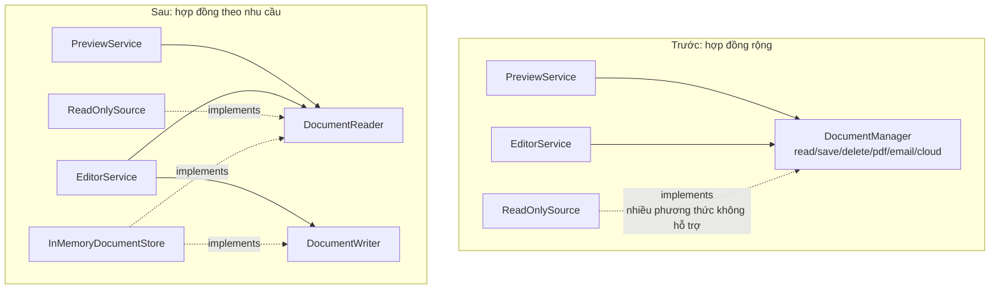
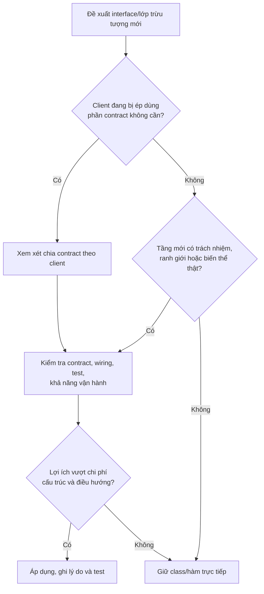

# Giao diện quá lớn hoặc quá nhiều lớp trừu tượng: nhận diện và sửa lỗi thiết kế OOP

> **Chủ đề:** Lỗi thiết kế trong OOP – khi một interface bắt client phụ thuộc vào quá nhiều thao tác, hoặc khi việc thêm interface, factory, facade, provider và adapter chỉ làm tăng số lớp phải đọc mà không tạo lợi ích thật. Mục tiêu của bài là biết phát hiện vấn đề, phân tích trách nhiệm của từng client, áp dụng **Interface Segregation Principle (ISP)** hợp lý và tránh **over-abstraction**.

## 1. Hai vấn đề khác nhau nhưng dễ xuất hiện cùng nhau

Có hai kiểu phức tạp hóa thường bị nhầm thành một:

**Giao diện quá lớn (*fat interface*, *bloated interface*)** là một hợp đồng công khai quá nhiều khả năng không liên quan đến nhau. Một client chỉ cần một phần rất nhỏ nhưng phải nhìn thấy hoặc phụ thuộc toàn bộ hợp đồng; một implementation cũng có thể bị buộc khai báo những thao tác mà nó không hỗ trợ.

**Quá nhiều lớp trừu tượng (*over-abstraction*, *needless indirection*)** là việc thêm các lớp/interface/tầng trung gian mà không có ranh giới trách nhiệm, khả năng thay thế hoặc quy tắc riêng đáng giá. Một request phải đi qua nhiều object chỉ để chuyển tiếp dữ liệu y hệt.

Hai lỗi này có thể xuất hiện riêng rẽ:

- Một `DocumentManager` có 20 phương thức: **interface quá lớn**, dù chỉ có một interface.
- Một thao tác `readDocument(id)` đi qua `ReaderFactory → ReaderProvider → ReaderFacade → ReaderAdapter → Store`: **quá nhiều abstraction**, dù mỗi interface chỉ có một phương thức.
- Hệ thống có cả `IDocumentManager` khổng lồ và năm tầng decorator/provider: mắc **cả hai**.

**Điểm cốt lõi:** số lượng phương thức ít hay số lượng lớp ít không tự quyết định chất lượng. Chất lượng phụ thuộc vào **trách nhiệm có mạch lạc không**, **client cần biết gì**, **hợp đồng có được mọi implementation tuân thủ không** và **điểm trừu tượng có bảo vệ được thay đổi thật nào không**.

### Một ví dụ quen thuộc

Ứng dụng quản lý tài liệu có người chỉ **xem tài liệu** và người **chỉnh sửa tài liệu**. Một nhóm định nghĩa interface:

```java
interface DocumentManager {
    Document findById(String id);
    void save(Document document);
    void delete(String id);
    byte[] exportPdf(String id);
    void emailTo(String id, String recipient);
    void syncToCloud(String id);
}
```

Người xem chỉ cần `findById` nhưng bị buộc phụ thuộc hợp đồng còn gồm ghi/xóa/xuất PDF/gửi email/đồng bộ đám mây. Một nguồn dữ liệu chỉ đọc muốn implement `DocumentManager` lại phải viết hàng loạt phương thức ném `UnsupportedOperationException`. Đó là tín hiệu thiết kế hợp đồng sai theo **nhu cầu client**, không đơn giản là interface “nhiều dòng”.

## 2. Tại sao interface quá lớn có hại?

### 2.1. Client phụ thuộc nhiều hơn mức cần thiết

Giả sử `DocumentPreviewService` chỉ làm nhiệm vụ hiển thị nội dung. Nếu constructor nhận `DocumentManager`, việc đổi API gửi email hoặc xóa tài liệu vẫn có thể tác động đến kiểu hợp đồng chung, các stub/mock dùng trong test, hoặc các module phụ thuộc interface đó.

Trong một codebase lớn, một interface “thượng đế” có thể khiến những nhóm chức năng không liên quan phải cùng cập nhật. Tốc độ thay đổi của hệ thống chậm dần vì bất cứ ai sửa interface chung đều lo ảnh hưởng nhiều consumer.

### 2.2. Implementation bị ép nói dối

```java
// Phản ví dụ, không phải thiết kế nên làm:
class ReadOnlyDocumentSource implements DocumentManager {
    public Document findById(String id) { /* ... */ return null; }

    public void save(Document document) {
        throw new UnsupportedOperationException("Chỉ đọc");
    }

    public void delete(String id) {
        throw new UnsupportedOperationException("Chỉ đọc");
    }

    public byte[] exportPdf(String id) {
        throw new UnsupportedOperationException("Không hỗ trợ");
    }

    public void emailTo(String id, String recipient) {
        throw new UnsupportedOperationException("Không hỗ trợ");
    }

    public void syncToCloud(String id) {
        throw new UnsupportedOperationException("Không hỗ trợ");
    }
}
```

Ở ví dụ phác họa này, `findById` chưa có logic và đang trả `null` để biểu diễn cấu trúc; **không phải bản cài đặt dùng trong sản phẩm**. Vấn đề là các thao tác mà hợp đồng **hứa hỗ trợ** lại luôn thất bại với một implementation hợp lệ theo khai báo. Điều đó có thể vi phạm khả năng thay thế theo **Liskov Substitution Principle (LSP)** nếu client được phép kỳ vọng những phương thức này hoạt động.

`UnsupportedOperationException` không phải lúc nào cũng sai trong Java: có các collection không hỗ trợ thao tác tùy chọn theo hợp đồng của Java Collections Framework. Nhưng nếu use case yêu cầu `save` và interface không nói rõ đó là hành vi tùy chọn, việc để một nguồn chỉ đọc implement giao diện vừa đọc vừa ghi là **thiết kế dễ gây bất ngờ**.

### 2.3. Quyền truy cập và trách nhiệm bị lẫn

Nếu code hiển thị tài liệu được truyền một object có khả năng `delete` hoặc `syncToCloud`, code này có thể vô tình sử dụng thao tác ngoài nhiệm vụ. Tách hợp đồng **giảm bề mặt API mà client thấy**, nhưng **không thay thế bảo mật**: phân quyền vẫn phải được kiểm tra ở các ranh giới đáng tin cậy, không dựa vào tên interface để ngăn một người dùng gọi API khác.

### 2.4. Test dựng mock khó hơn

Nếu constructor cần một interface 20 phương thức, mock framework có thể vẫn dễ tạo mock, nhưng contract và fixtures dễ phình to. Test đọc tài liệu có thể phải hiểu những phương thức không liên quan hoặc bị vỡ vì thay đổi mock interface chung. Dấu hiệu cần để ý là test phụ thuộc **cấu trúc không phục vụ hành vi đang kiểm thử**.

## 3. Interface Segregation Principle (ISP) giải quyết phần nào?

**ISP** trong SOLID thường được phát biểu:

> Client không nên bị buộc phụ thuộc vào những phương thức mà chúng không sử dụng.

Thay vì tạo một hợp đồng chung chứa mọi thao tác có thể có, hãy xác định **nhóm khả năng mạch lạc mà từng loại client thực sự cần**.

Từ interface `DocumentManager` ở trên, một thiết kế có thể bắt đầu bằng:

```java
interface DocumentReader {
    Optional<Document> findById(String id);
}

interface DocumentWriter {
    void save(Document document);
}
```

Dịch vụ xem tài liệu chỉ cần `DocumentReader`. Dịch vụ chỉnh sửa có thể cần **cả** `DocumentReader` và `DocumentWriter`. Nếu ứng dụng thực sự có quy trình xuất PDF và gửi email, hãy xác định những ranh giới tương ứng sau khi hiểu use case; không nhất thiết mỗi phương thức mới phải có một interface riêng.

### Mũi tên phụ thuộc thay đổi ra sao?



**Mấu chốt:** hai interface ở ví dụ **không bắt buộc tạo hai object lưu trữ**. Một `InMemoryDocumentStore` hoặc adapter cơ sở dữ liệu có thể triển khai **cả hai**, nhưng client chỉ nhìn thấy phần hợp đồng được phép dùng.

## 4. Java 17 hoàn chỉnh: hợp đồng nhỏ, implementation đúng khả năng

Ví dụ minh họa hai nhu cầu:

1. `PreviewService` chỉ đọc và tạo một đoạn xem trước.
2. `EditorialService` đọc tài liệu hiện tại rồi thay nội dung.

Một kho dữ liệu trong bộ nhớ thực hiện cả đọc và ghi; một nguồn tài liệu hướng dẫn chỉ thực hiện đọc. Không implementation nào phải khai báo thao tác không hỗ trợ.

Tạo file `InterfaceDesignDemo.java`:

```java
import java.util.HashMap;
import java.util.Map;
import java.util.Objects;
import java.util.Optional;

public class InterfaceDesignDemo {

    // Value object bất biến, không lộ mutable state.
    record Document(String id, String content) {
        Document {
            Objects.requireNonNull(id, "id");
            Objects.requireNonNull(content, "content");
            if (id.isBlank()) {
                throw new IllegalArgumentException("id không được rỗng");
            }
        }
    }

    // Hợp đồng nguồn dữ liệu chỉ đọc.
    @FunctionalInterface
    interface DocumentReader {
        Optional<Document> findById(String id);
    }

    // Hợp đồng nơi nhận tài liệu cần lưu.
    @FunctionalInterface
    interface DocumentWriter {
        void save(Document document);
    }

    // Implementation có cả hai khả năng.
    static final class InMemoryDocumentStore
            implements DocumentReader, DocumentWriter {

        private final Map<String, Document> documents = new HashMap<>();

        @Override
        public Optional<Document> findById(String id) {
            Objects.requireNonNull(id, "id");
            return Optional.ofNullable(documents.get(id));
        }

        @Override
        public void save(Document document) {
            Objects.requireNonNull(document, "document");
            documents.put(document.id(), document);
        }
    }

    // Implementation chỉ đọc, không có save() giả.
    static final class StaticDocumentReader implements DocumentReader {
        private final Map<String, Document> documents;

        StaticDocumentReader(Map<String, Document> documents) {
            this.documents = Map.copyOf(
                    Objects.requireNonNull(documents, "documents"));
        }

        @Override
        public Optional<Document> findById(String id) {
            Objects.requireNonNull(id, "id");
            return Optional.ofNullable(documents.get(id));
        }
    }

    static final class PreviewService {
        private final DocumentReader reader;

        PreviewService(DocumentReader reader) {
            this.reader = Objects.requireNonNull(reader, "reader");
        }

        String preview(String id, int maxChars) {
            if (id == null || id.isBlank() || maxChars < 0) {
                throw new IllegalArgumentException("Input không hợp lệ");
            }

            Document document = reader.findById(id)
                    .orElseThrow(() -> new IllegalArgumentException(
                            "Không tìm thấy tài liệu: " + id));

            String content = document.content();
            // Demo cắt theo số đơn vị UTF-16 của String.
            return content.substring(0, Math.min(maxChars, content.length()));
        }
    }

    static final class EditorialService {
        private final DocumentReader reader;
        private final DocumentWriter writer;

        EditorialService(DocumentReader reader, DocumentWriter writer) {
            this.reader = Objects.requireNonNull(reader, "reader");
            this.writer = Objects.requireNonNull(writer, "writer");
        }

        void replaceContent(String id, String newContent) {
            if (id == null || id.isBlank()) {
                throw new IllegalArgumentException("id không hợp lệ");
            }
            Objects.requireNonNull(newContent, "newContent");

            // Trong demo, chỉ cho sửa tài liệu đã tồn tại.
            reader.findById(id).orElseThrow(
                    () -> new IllegalArgumentException(
                            "Không tìm thấy tài liệu: " + id));
            writer.save(new Document(id, newContent));
        }
    }

    public static void main(String[] args) {
        InMemoryDocumentStore store = new InMemoryDocumentStore();
        store.save(new Document("DOC-1", "Xin chào Java"));

        PreviewService preview = new PreviewService(store);
        System.out.println(preview.preview("DOC-1", 8)); // Xin chào

        EditorialService editor = new EditorialService(store, store);
        editor.replaceContent("DOC-1", "Nội dung mới");
        System.out.println(preview.preview("DOC-1", 20)); // Nội dung mới

        DocumentReader helpSource = new StaticDocumentReader(Map.of(
                "HELP", new Document("HELP", "Hướng dẫn người dùng")
        ));
        PreviewService helpPreview = new PreviewService(helpSource);
        System.out.println(helpPreview.preview("HELP", 9)); // Hướng dẫn
    }
}
```

Chạy bằng JDK 17 trở lên:

```bash
javac InterfaceDesignDemo.java
java InterfaceDesignDemo
```

### Vì sao ví dụ này giải quyết đúng lỗi?

- `PreviewService` **không có** API `save` trong kiểu dependency của mình; nó chỉ biết tìm tài liệu.
- `StaticDocumentReader` triển khai đúng khả năng đọc; không có phương thức ném `UnsupportedOperationException` để lấp chỗ trống.
- `EditorialService` công khai nhu cầu thực: vừa tìm tài liệu, vừa lưu; constructor cho thấy chính xác hai hợp đồng nó sử dụng.
- `InMemoryDocumentStore` có thể thực hiện cả hai capability mà không bắt các client nhận cùng một “siêu giao diện”.
- `Document` là record bất biến nông với component `String` bất biến; dữ liệu trả về không cho caller sửa trực tiếp kho.
- Khi việc xem trước đổi cách trình bày, `PreviewService` thay đổi. Khi kho lưu trữ đổi sang DB, thay adapter được inject; không cần đưa SQL vào dịch vụ xem trước.

**Giới hạn demo:** `HashMap` không thread-safe; chuỗi “kiểm tra tồn tại → ghi tài liệu” của `EditorialService` không có transaction và có thể race khi nhiều người cùng chỉnh sửa. Trong sản phẩm thật, có thể cần repository operation nguyên tử như `replaceIfVersionMatches` cùng optimistic locking. Việc tách interface **không tự giải quyết consistency hoặc authorization**.

Phần `substring` minh họa API đơn giản và giới hạn theo **UTF-16 code units**; nếu cần cắt an toàn theo Unicode code point, grapheme cluster hoặc quy tắc hiển thị, phải thiết kế formatter đúng yêu cầu. Không nên suy diễn rằng một độ dài ký tự bất kỳ sẽ luôn không tách emoji hoặc ký tự ghép.

## 5. Tách theo client, không theo “mỗi phương thức một interface”

ISP rất dễ bị đẩy sang cực đoan khác:

```java
interface FindDocumentByIdUseCase {
    Optional<Document> findById(String id);
}

interface FindDocumentTitleUseCase {
    String findTitle(String id);
}

interface FindDocumentContentUseCase {
    String findContent(String id);
}

interface FindDocumentAuthorUseCase {
    String findAuthor(String id);
}
```

Nếu mọi client thực tế **luôn cần cả tiêu đề, nội dung và tác giả trong cùng thao tác đọc**, tách bốn interface nhỏ như trên có thể chỉ làm tăng số dependency, lượt gọi và cấu hình. Đặc biệt, nếu mỗi interface có một adapter độc lập phải truy vấn DB riêng, có thể làm tăng chi phí I/O và gây trạng thái đọc không nhất quán.

**Tách interface theo những vai trò khách hàng cần**, không theo số phương thức:

- Client **chỉ đọc** cần contract mô tả truy vấn.
- Client **chỉ ghi** cần contract mô tả lệnh ghi.
- Client **đọc + ghi** có thể nhận hai interface hoặc một contract ghép có nghĩa nếu luôn phải đi cùng.
- Một chức năng xuất PDF phức tạp có thể là application service riêng; chưa chắc nên đặt trong repository.
- Một adapter cơ sở dữ liệu vẫn có thể triển khai nhiều interface tương ứng.

### Khi nào hợp đồng ghép vẫn tốt?

Nếu một client thường xuyên cần cả đọc và ghi trong **một giao dịch nhất quán**, có thể có API như:

```java
interface DocumentRepository
        extends DocumentReader, DocumentWriter {
}
```

Hoặc tốt hơn, nếu nhu cầu thật là một thao tác có tính nguyên tử, diễn đạt trực tiếp:

```java
interface VersionedDocumentStore {
    boolean replaceIfVersionMatches(
            String id, long expectedVersion, String newContent);
}
```

Không nên ghép chỉ vì “ít tham số constructor hơn”, và cũng không nên tách chỉ vì “interface càng nhỏ càng SOLID”. Chọn theo **contract và loại thay đổi** cần bảo vệ.

## 6. Quá nhiều lớp trừu tượng có hại như thế nào?

Nhìn vào một luồng đọc tài liệu:

```text
Controller
  → PreviewFacade
    → PreviewProvider
      → PreviewFactory
        → DocumentReaderProxy
          → DocumentReaderAdapter
            → DatabaseDocumentReader
```

Nếu mỗi lớp chỉ làm:

```java
String preview(String id) {
    return delegate.preview(id);
}
```

mà không thêm ranh giới bảo mật, giao dịch, cache, tracing, chuyển đổi kiểu, chính sách lỗi hay lựa chọn implementation thực sự cần thiết thì đó là **indirection không tạo giá trị**.

Một luồng hợp lý hơn có thể là:

```text
Controller
  → PreviewService
    → DocumentReader (port)
      → JdbcDocumentReader (adapter)
```

Ở đây mỗi thành phần có thể có trách nhiệm rõ:
- Controller giải quyết HTTP input/output.
- PreviewService thực hiện use case trình bày.
- DocumentReader diễn đạt nhu cầu truy vấn của ứng dụng.
- JdbcDocumentReader hiện thực truy vấn và mapping dữ liệu.

**Đừng đánh giá chỉ bằng độ sâu call stack.** Proxy có thể bảo đảm quyền truy cập, decorator có thể thêm metrics, factory có thể quản lý vòng đời và adapter có thể che API vendor. Nếu từng tầng có **hợp đồng, lý do thay đổi và kiểm thử riêng**, nhiều tầng có thể là thiết kế đúng. Nhưng nếu phần lớn chỉ ủy quyền vô nghĩa, hãy xem lại.

### Sơ đồ điểm quyết định



## 7. Số interface có phải thước đo SOLID không?

**Không.** SOLID không yêu cầu cứ có một class là phải tạo `IClass`, hay cứ có một method là phải có một interface.

Phân biệt:

| Tình huống | Đánh giá hợp lý |
|---|---|
| `PaymentGateway` có một implementation thật nhưng che SDK ngân hàng khỏi ứng dụng | Interface có giá trị vì là ranh giới hạ tầng và hỗ trợ fake/test |
| `PriceCalculator` chỉ tính hai số cố định, không có nguồn phụ thuộc biến động | Class/hàm trực tiếp có thể đơn giản hơn một interface |
| `DocumentManager` có 30 method, client xem tài liệu chỉ cần một method | Nên kiểm tra ISP, tách theo năng lực cần dùng |
| Ba interface khác nhau nhưng đều được **mọi** client dùng cùng nhau, một implementation, không có khác biệt lifecycle | Có thể đang tách quá mức |
| Một class Java có nhiều method cùng phục vụ một abstraction mạch lạc | Không tự nhiên vi phạm ISP chỉ do nhiều phương thức |
| Một interface có một method nhưng mọi caller phải đi qua factory/provider/service locator không cần thiết | Có thể đang over-abstraction |
| Module application cần cấu hình implementation theo môi trường | Composition root/DI có thể là ranh giới chính đáng |

Một chỉ số hữu ích hơn “số interface” là **mức độ thay đổi lan rộng**: khi bổ sung một tính năng, có phải sửa hàng loạt client không liên quan, tạo thêm nhiều adapter rỗng hay đi qua nhiều tầng chỉ chuyển tiếp không?

## 8. Liên hệ ISP với SRP, LSP và DIP

### ISP — từng client chỉ phụ thuộc phần nó sử dụng

`PreviewService` phụ thuộc `DocumentReader` thay vì `DocumentManager` tổng hợp. Đây là trọng tâm bài toán giao diện quá lớn.

### SRP — các phần có lý do thay đổi riêng không bị ép chung

Đọc tài liệu, gửi email và xuất PDF có thể thay đổi bởi các tác nhân khác nhau. Nhét chúng vào một interface chung **có thể** làm coupling về nguồn thay đổi tăng lên. Tuy nhiên, SRP áp dụng cho trách nhiệm của module/class, không phải quy tắc rằng mọi method phải nằm interface khác nhau.

### LSP — implementation không được phá lời hứa

Một nguồn chỉ đọc implement interface buộc hỗ trợ `save` rồi luôn ném `UnsupportedOperationException` khiến client khó thay thế implementation an toàn. Tách `DocumentReader` giúp nguồn chỉ đọc thực hiện đúng toàn bộ contract của nó.

### DIP — policy cấp cao không phụ thuộc chi tiết hạ tầng

Ứng dụng đọc tài liệu có thể phụ thuộc `DocumentReader`; `JdbcDocumentReader` implement interface đó. Nhưng **DIP không buộc phải thêm nhiều tầng**. Một interface có mục đích rõ đã có thể là ranh giới cần thiết.

**Sự kết hợp lành mạnh:** dùng số abstraction **đủ** để bảo vệ những trách nhiệm độc lập và những thay đổi có thật; không tăng số lượng chỉ để “đạt SOLID”.

## 9. Một vấn đề nguy hiểm: hợp đồng mơ hồ và phương thức “không hỗ trợ”

Ngoài kích thước, độ chất lượng của interface phụ thuộc **ngữ nghĩa**:

```java
interface Storage {
    Object execute(String operation, Object payload);
}
```

Dù interface này chỉ có **một phương thức**, nó có thể tệ hơn một hợp đồng có vài method rõ ràng:

- Client phải nhớ “operation” nào hợp lệ.
- Sai type chỉ được phát hiện runtime.
- Không có hướng dẫn về lỗi, null, tính nguyên tử hoặc side effect.
- Dễ tạo `if/switch` và cast trải rộng.

Thay vì gom mọi thứ vào một method đa năng, chọn hợp đồng có kiểu và ý nghĩa rõ:

```java
interface DocumentReader {
    Optional<Document> findById(String id);
}
```

**ISP không đồng nghĩa tối thiểu hóa số method bằng mọi giá.** Một API một phương thức nhưng mang vô hạn ý nghĩa vẫn có thể là **giao diện khổng lồ bị giấu trong tham số**.

### Dấu hiệu API mang quá nhiều cờ

```java
// Khó hiểu, nhiều nhánh theo cờ:
Document process(
        Document d,
        boolean readOnly,
        boolean exportPdf,
        boolean notifyOwner,
        boolean forceSync);
```

Cùng một method đang nắm nhiều use case với tác dụng phụ khác nhau. Thay bằng các operation theo nghiệp vụ, giữ phần trùng lặp thật sự ở các collaborator phù hợp và không tạo một method chung với rất nhiều cờ.

## 10. Đừng dùng inheritance để ép mọi object chung một năng lực

Một lỗi liên quan là đặt quá nhiều thao tác vào **abstract base class** để mọi subclass “tiện dùng”:

```java
abstract class ContentHandler {
    abstract String read(String id);
    abstract void write(String id, String value);
    abstract void delete(String id);
    abstract void exportPdf(String id);
}
```

Nếu handler chỉ đọc phải override ba method rồi ném lỗi thì inheritance hierarchy đang mô tả **quan hệ sai**. Có thể dùng interface năng lực như `DocumentReader`, `DocumentWriter` để các loại chỉ thực hiện những gì chúng làm được.

Tuy nhiên, cũng không nên tạo các interface kiểu `CanRead`, `CanOpen`, `CanClose`, `CanWrite`, `CanDelete` cho mọi object mà không có client thực sự khác biệt. Nhóm năng lực dựa trên **cohesion** và **use case**.

### Interface kế thừa interface

Java cho phép ghép một hợp đồng rộng hơn từ những contract nhỏ:

```java
interface ReadWriteDocuments
        extends DocumentReader, DocumentWriter {
}
```

Nếu thật sự có client yêu cầu toàn bộ đọc/ghi, contract tổng hợp này có thể tiện lợi. Nhưng chỉ nên công khai nó ở nơi hợp lý, tránh để tất cả client quay trở lại phụ thuộc contract lớn.

## 11. Java default methods có giải quyết fat interface không?

Không nhất thiết.

Ví dụ:

```java
interface DocumentManager {
    Document read(String id);

    default void delete(String id) {
        throw new UnsupportedOperationException("Không hỗ trợ");
    }
}
```

`default` method có thể giúp tiến hóa API mà không buộc mọi class hiện có phải bổ sung code, nhưng **không tự sửa thiết kế sai về trách nhiệm**. Client vẫn nhìn thấy `delete` và có thể gọi mà không biết implementation hỗ trợ hay không.

**Default method là công cụ ngôn ngữ, không phải cách tránh thiết kế contract.**

Nếu chức năng là tùy chọn thực sự, hãy cân nhắc:
- Tách thành capability interface.
- Đưa operation vào một service riêng.
- Dùng mô hình capability negotiation rõ ràng nếu domain thật sự yêu cầu kiểm tra hỗ trợ động.
- Quy định và kiểm thử lỗi không hỗ trợ trong hợp đồng nếu API có chủ đích cho phép optional operations.

Không nên tạo hàng loạt default no-op trả về “thành công” giả để mọi implementation qua compiler.

## 12. Kiểm thử API nhỏ: lợi ích là kiểm tra hành vi, không chỉ mock dễ hơn

Đây là ví dụ JUnit 5 cho `InterfaceDesignDemo` ở mục 4. Đặt file `InterfaceDesignDemoTest.java` cùng package:

```java
import static org.junit.jupiter.api.Assertions.*;
import java.util.Map;
import java.util.Optional;
import org.junit.jupiter.api.Test;

class InterfaceDesignDemoTest {

    @Test
    void previewNeedsOnlyReader() {
        InterfaceDesignDemo.DocumentReader fake = id ->
                Optional.of(new InterfaceDesignDemo.Document(
                        id, "Hello, world"));

        var preview = new InterfaceDesignDemo.PreviewService(fake);

        assertEquals("Hello", preview.preview("DOC-1", 5));
    }

    @Test
    void readOnlySourceDoesNotNeedUnsupportedMethods() {
        var reader = new InterfaceDesignDemo.StaticDocumentReader(
                Map.of("DOC-1", new InterfaceDesignDemo.Document(
                        "DOC-1", "Chỉ đọc")));
        var preview = new InterfaceDesignDemo.PreviewService(reader);

        assertEquals("Chỉ đọc", preview.preview("DOC-1", 20));
    }

    @Test
    void editorCanReplaceExistingDocument() {
        var store = new InterfaceDesignDemo.InMemoryDocumentStore();
        store.save(new InterfaceDesignDemo.Document("A", "Cũ"));
        var editor = new InterfaceDesignDemo.EditorialService(store, store);

        editor.replaceContent("A", "Mới");

        assertEquals("Mới", store.findById("A").orElseThrow().content());
    }

    @Test
    void editorRejectsUnknownDocument() {
        var store = new InterfaceDesignDemo.InMemoryDocumentStore();
        var editor = new InterfaceDesignDemo.EditorialService(store, store);

        assertThrows(IllegalArgumentException.class,
                () -> editor.replaceContent("UNKNOWN", "Nội dung"));
        assertTrue(store.findById("UNKNOWN").isEmpty());
    }

    @Test
    void previewRejectsNegativeLimit() {
        var store = new InterfaceDesignDemo.InMemoryDocumentStore();
        var preview = new InterfaceDesignDemo.PreviewService(store);

        assertThrows(IllegalArgumentException.class,
                () -> preview.preview("A", -1));
    }
}
```

Điểm đáng học: test của `PreviewService` có thể tạo một **lambda** `DocumentReader`, không cần giả lập save/delete/export/email. `StaticDocumentReader` không cần viết các phương thức trống. Đây là dấu hiệu contract sát nhu cầu.

Tuy nhiên, có một ranh giới cần thiết phải kiểm thử thực tế: nếu production dùng JDBC, REST hoặc cloud storage, test với fake không bảo đảm SQL, transaction, timeout hoặc permissions là đúng. Vẫn cần integration/contract tests cho adapter. Không thể suy ra rằng “có interface” thì mọi lỗi runtime đã được giải quyết.

## 13. Khi nào nên giữ một class cụ thể thay vì tạo interface?

Một lớp chứa thuật toán ngắn gọn, chỉ có một cách thực hiện, không rò rỉ hạ tầng và không đóng vai trò API công khai có thể được sử dụng trực tiếp:

```java
final class TitleFormatter {
    String format(String title) {
        if (title == null) {
            throw new IllegalArgumentException("title không được null");
        }
        return title.trim();
    }
}
```

Tạo đủ bộ `ITitleFormatter`, `DefaultTitleFormatter`, `TitleFormatterFactory` và `TitleFormatterProvider` cho hàm này thường không mang lợi ích thực tế.

Khi nào interface lại đáng dùng?

- Cần **tách business logic khỏi SDK/DB/network**.
- Có nhiều implementation với contract thật sự giống nhau.
- Một module cung cấp extension point có chủ đích cho các nhóm khác.
- Một client cần giới hạn quyền nhìn thấy một tập capability.
- Test cần cô lập phụ thuộc chậm/không ổn định; interface phản ánh khả năng độc lập có ý nghĩa.
- Phương án thay thế đã có kế hoạch rõ hoặc thay đổi một công nghệ ở quy mô lớn rất tốn kém.

Không cần đủ tất cả dấu hiệu; chỉ cần **một lý do mạnh** cũng có thể biện minh interface. Ngược lại, “để sau này dễ mở rộng” mà không chỉ ra **mở rộng cái gì và ai sẽ làm** là lý do yếu.

## 14. So sánh hai loại chi phí thiết kế

| Tiêu chí | Giao diện quá lớn | Quá nhiều abstraction |
|---|---|---|
| Vấn đề chính | Client phụ thuộc các capability không dùng | Một nhiệm vụ đi qua quá nhiều lớp gián tiếp |
| Dấu hiệu | `UnsupportedOperationException` ở nhiều implementation; interface sửa liên tục | Lớp chỉ delegate; factory chỉ gọi `new`; wiring phức tạp |
| Hậu quả | Coupling lan rộng, khó thay thế, có thể vi phạm LSP | Chi phí đọc/debug/cấu hình, vòng phụ thuộc và hidden control flow |
| Sửa thường dùng | Tách contract theo client/capability | Bỏ lớp chuyển tiếp thừa, dùng class hoặc port trực tiếp |
| Nguy cơ khi sửa quá đà | Hàng chục interface một method thiếu cohesion | Gom mọi thứ vào một God Class |
| Tiêu chí thành công | Client chỉ thấy điều cần, implementation thực hiện trọn contract | Mỗi lớp còn lại có trách nhiệm/ranh giới rõ, luồng dễ theo dõi |

**Nhìn từ client** là cách chẩn đoán có hiệu quả: vẽ xem service sử dụng phương thức nào, kết quả nào, loại lỗi nào, và cần biết tới những class nào để chạy được một use case.

## 15. Làm sao đo được “quá lớn” và “quá nhiều”?

Không có con số cố định như “interface không quá 5 methods” hoặc “luồng không quá 3 tầng”. Những con số đó không phản ánh trách nhiệm.

Thử dùng các chỉ dấu có thể quan sát:

1. **Client usage matrix:** với từng client, liệt kê những method của interface thực sự được gọi. Nếu phần lớn client chỉ dùng một nhóm con khác nhau, có thể cần tách theo nhóm.
2. **Implementation support matrix:** implementation nào phải viết stub, no-op hoặc ném lỗi không hỗ trợ?
3. **Change ripple:** sửa một khả năng có khiến code hoặc test không liên quan phải sửa?
4. **Indirection audit:** có bao nhiêu tầng chỉ `return delegate.call(args)` mà không có ý nghĩa riêng?
5. **Wiring complexity:** khó xác định bean/adapter nào đang chạy không?
6. **Behavior testability:** có viết test ở boundary công khai mà không dựng hàng loạt service không liên quan?
7. **Vận hành:** lỗi ở tầng nào, timeout được áp ở đâu, tracing có phân biệt các bước không?
8. **Ownership:** một interface đại diện cho một nhóm capability có cùng chủ sở hữu/lý do thay đổi hay nhiều nhóm chức năng tách biệt?

Đây là **dữ liệu hỗ trợ quyết định**, không phải thước đo “đạt/chưa đạt” máy móc. Ví dụ interface có 12 method cùng mô tả một bộ thao tác nhất quán của parser có thể hoàn toàn phù hợp; một interface với hai method không liên quan vẫn có thể sai.

### Ma trận sử dụng đơn giản

| Client | Read | Save | Delete | Export PDF | Email |
|---|---:|---:|---:|---:|---:|
| Preview page | Có | — | — | — | — |
| Content editor | Có | Có | — | — | — |
| Admin cleanup | Có | — | Có | — | — |
| Report exporter | Có | — | — | Có | — |

Nếu tất cả cùng phụ thuộc `DocumentManager`, giao diện chung bị ép vào những client chỉ dùng mảnh nhỏ. Tách **Read**, **Write** và các thao tác use case khác có thể giảm coupling. Nhưng đừng tự động tạo năm microinterfaces: nhóm theo trách nhiệm, bảo đảm data/transaction semantics và mức chi phí hợp lý.

## 16. Refactor interface lớn mà không phá người sử dụng

Một kế hoạch refactor thực tế:

1. **Kiểm kê client và implementation.** Xác định ai dùng method nào, phần nào public API hoặc được bên ngoài biên dịch dựa vào.
2. **Lập ma trận use case–capability.** Gộp những method thật sự thuộc cùng hợp đồng. Kiểm tra các implementation chỉ hỗ trợ một phần.
3. **Viết test hành vi trước.** Dùng unit test và contract test cho tình huống đang chạy; kiểm tra cả lỗi.
4. **Giới thiệu contract nhỏ hơn.** Tạo `DocumentReader` và `DocumentWriter` phù hợp với nhu cầu; tránh tái tạo “God Interface” nhỏ hơn một chút.
5. **Cho implementation cũ thực hiện contract mới.** Cập nhật adapter một cách có kiểm soát; không đổi semantics lỗi hoặc dữ liệu.
6. **Chuyển client từng bước.** Preview chỉ inject reader, editor nhận các capability thật sự cần. Xóa setter/stub không còn hợp đồng.
7. **Giữ tương thích nếu cần.** Với thư viện công khai, có thể phải tạm giữ adapter/interface cũ được đánh dấu deprecation, lên kế hoạch phiên bản và migration.
8. **Đánh giá transaction.** Nếu hai operation phải nguyên tử, tách interface không được biến một transaction thành hai call có race; thiết kế method atomic khi phù hợp.
9. **Kiểm lại kiến trúc.** Xóa các provider/factory/delegate không còn mục đích; giữ composition root đủ rõ.
10. **Đo lại kết quả.** Số client bị ảnh hưởng khi đổi một feature, khả năng thay implementation và chi phí đọc/debug đã được cải thiện chưa?

**Chú ý quan trọng:** thay đổi hoặc tách một public interface có thể là **breaking change ở source/binary compatibility** cho implementer và caller bên ngoài. Nếu ứng dụng phát hành thư viện, cần chiến lược versioning/migration. Không nên xóa ngay một interface chỉ vì nó hiện chưa hợp lý nếu nhiều hệ thống đã tích hợp.

## 17. Thận trọng với một số “giải pháp” tưởng hợp lý

### 17.1. Tạo interface mỗi khi muốn unit test

Nếu một class thuần tính toán ổn định và không có side effect, test trực tiếp class đó thường đơn giản. Interface có ích khi đại diện một collaborator cần thay thế/cô lập, không phải vật trang trí cho mọi class.

### 17.2. Chẻ một interface thành hàng chục method-level interfaces

Có thể làm consumer constructor nhận 12 dependency thay vì 1, cấu hình phức tạp hơn mà không thay đổi khả năng phát triển thực tế. Đôi khi một hợp đồng `DocumentReader` với vài truy vấn liên quan lại vừa đủ.

### 17.3. Cho tất cả interface kế thừa một base interface

```java
interface BaseService {
    void initialize();
    void validate();
    void close();
}
```

Nếu service thuần xử lý chuỗi không cần `close`, còn adapter network phải `close`, việc ép cả hai kế thừa `BaseService` lại tạo **fat interface** ở tầng nền. Dùng `AutoCloseable` hoặc ranh giới vòng đời khi thật sự cần; không tạo base universal chỉ để mọi class “đồng nhất”.

### 17.4. Dùng generic repository cho mọi use case

`GenericRepository<T>` với nhiều phép query tùy biến có thể khiến application phụ thuộc một API quá rộng. Một port theo nhu cầu (ví dụ `FindActiveOrders`) có thể rõ ràng hơn khi nghiệp vụ cần truy vấn rất đặc thù. Nhưng trong CRUD thật sự đơn giản, một repository tiêu chuẩn cũng có thể là lựa chọn tiết kiệm; không nên bắt buộc tạo một interface riêng cho mỗi query.

### 17.5. Giấu thao tác không hỗ trợ sau runtime flag

```java
if (documentManager.supportsDelete()) {
    documentManager.delete(id);
}
```

Nếu các loại client/implementation có khả năng riêng rõ ràng, thiết kế capability interface có thể được type-check tốt hơn. Tuy nhiên, có hệ thống plugin mà capability thay đổi động; lúc đó flag/negotiation có thể là yêu cầu thật. Cần **nói rõ hợp đồng**, không áp một quy tắc duy nhất cho mọi kiến trúc.

### 17.6. Tưởng chia interface sẽ tự tạo bảo mật

Một biến có kiểu `DocumentReader` giúp code không gọi `save` trực tiếp qua biến đó, nhưng kẻ gọi không đáng tin cậy vẫn có thể truy cập endpoint khác. Phân quyền cần thực thi ở boundary với xác thực, ủy quyền và kiểm soát quyền dữ liệu.

## 18. Ghi quyết định thiết kế ngắn gọn

Khi tranh luận “tách thêm interface hay giữ nguyên?”, hãy viết vài dòng như một **Architecture Decision Record (ADR)**:

```markdown
# ADR: Tách hợp đồng đọc/ghi tài liệu

Bối cảnh:
- UI preview chỉ cần đọc.
- Adapter tài liệu hướng dẫn chỉ hỗ trợ đọc.
- Contract cũ có save/delete/export/email và ép nhiều stub.

Phương án:
1. Giữ DocumentManager chung.
2. Tách DocumentReader/DocumentWriter theo client.
3. Tách từng method thành một interface độc lập.

Quyết định:
- Chọn phương án 2. Export/email thuộc use case khác.

Lợi ích:
- Preview không phụ thuộc capability ghi/xóa.
- Adapter chỉ đọc không phải ném UnsupportedOperationException.
- Test preview dùng fake chỉ đọc.

Đánh đổi:
- Cần cập nhật constructor và wiring.
- Những workflow đọc-rồi-ghi có thể cần operation atomic riêng.

Xem xét lại khi:
- Nhiều client cùng cần một bộ capability ổn định,
  hoặc persistence/transaction boundary thay đổi.
```

Quyết định tốt có **lý do và điều kiện xem xét lại**, không phải một khẩu hiệu “ISP nói mỗi interface phải nhỏ”.

## 19. Bài tập phân tích

**Bài 1 – Tìm fat interface.** Cho `EmployeeSystem` có `findEmployee`, `updateSalary`, `sendBirthdayEmail`, `exportPayrollCsv` và `deleteEmployee`. Liệt kê client HR, payroll, employee self-service và email scheduler, xác định từng client thực sự cần thao tác nào. Đề xuất bộ hợp đồng không tạo ra 5 interface chỉ để “mỗi method một interface”.

**Bài 2 – Refactor một nguồn chỉ đọc.** Có `ReportRepository` với `load`, `save`, `delete`; adapter `RemoteReportArchive` chỉ được quyền tải báo cáo và ném lỗi khi ghi. Tách một contract phù hợp, sửa dependency của báo cáo dashboard và viết test chứng minh không cần mock hai method ghi/xóa.

**Bài 3 – Audit lớp trung gian.** Một request đi qua `PriceFacade → PriceProvider → PriceFactory → PriceCalculator`. Viết rõ mục đích từng tầng. Xóa tầng không có nhiệm vụ riêng, giữ nguyên behavior và test; chỉ ra trường hợp factory là cần thiết (nhiều implementation theo runtime config).

**Bài 4 – Điều kiện nguyên tử.** Một editor dùng `DocumentReader` và `DocumentWriter`: đọc phiên bản 2 rồi ghi đè phiên bản 3, đồng thời người khác cũng sửa. Đề xuất `replaceIfVersionMatches` hoặc transaction/locking. Giải thích vì sao tách interface không tự tạo concurrency safety.

**Bài 5 – Cân bằng giữa ISP và độ phức tạp.** Một ứng dụng có ba interface `ReadTitle`, `ReadContent`, `ReadAuthor`; mọi caller luôn dùng cả ba và implementation giống nhau. Đề xuất hợp đồng mạch lạc hơn, đánh giá số lớp giảm và tác động test.

## 20. Checklist review trước khi thêm hoặc tách abstraction

- [ ] Tôi nêu được client nào **không cần** một phần interface hiện tại.
- [ ] Không implementation nào bị buộc tạo method giả hoặc làm trái hợp đồng.
- [ ] Mỗi interface diễn đạt một nhóm capability **có ý nghĩa với client**.
- [ ] Tôi không tách “một method một interface” theo công thức cố định.
- [ ] Tôi nhận diện được tầng chỉ forwarding và có lý do rõ để giữ hoặc bỏ.
- [ ] Tôi biết thay đổi công nghệ/use case nào sẽ được abstraction bảo vệ.
- [ ] Tôi không kéo SQL/HTTP/SDK vào phần nghiệp vụ chỉ để giảm số class.
- [ ] Tôi xem xét giao dịch, lỗi, authorization, lifecycle và vận hành riêng biệt.
- [ ] Tôi có test hành vi, integration test khi cần và migration plan cho public API.
- [ ] Tôi không dùng số lượng interface/lớp làm thước đo chất lượng OOP.

**Ghi nhớ:** một interface tốt không nhất thiết ngắn nhất, mà là interface **đúng khả năng và đúng người sử dụng**. Một abstraction tốt không nhất thiết xuất hiện ở mọi nơi, mà phải tạo một ranh giới có ích. Hãy **tách thứ client không cần**, **giữ cùng những thao tác thật sự thuộc một hợp đồng**, và **loại bỏ tầng trung gian không mang lại trách nhiệm hay khả năng thay đổi rõ ràng**.