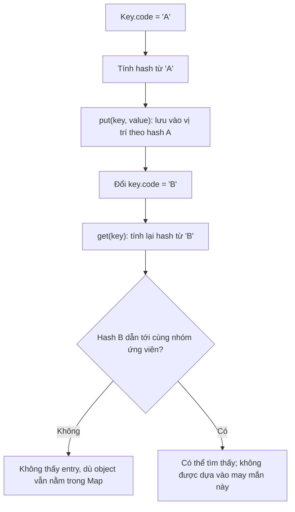
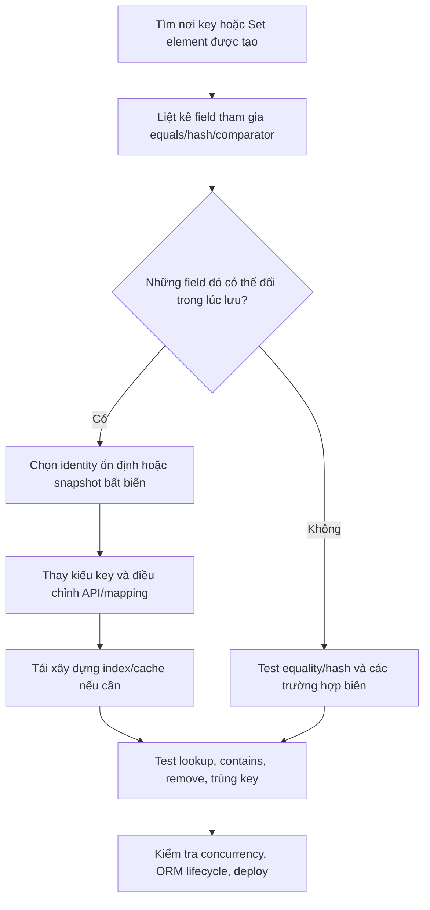

# Đối tượng có thể thay đổi làm sai phép so sánh hoặc mã băm

> **Chủ đề:** Lỗi thiết kế OOP khi một đối tượng thay đổi trạng thái ảnh hưởng đến `equals()`, `hashCode()` hoặc thứ tự so sánh. Bài học tập trung vào Java 17, các collection dựa trên hash/sắp xếp, cách chọn định danh ổn định và các biện pháp ngăn lỗi không dễ phát hiện này.

## 1. Vấn đề thực tế: tại sao khóa “vẫn ở đó” nhưng không tìm thấy?

Bạn đưa một đối tượng `CustomerKey` vào `HashMap` rồi thay đổi trường `code` của chính đối tượng đó. Sau đó `map.get(key)` có thể trả `null`, dù bạn đang giữ **chính tham chiếu đã dùng lúc thêm**.

Thoạt nghe điều này vô lý: “Tôi đâu tạo object mới; sao Map không tìm thấy?”

Vấn đề là cách một cấu trúc dữ liệu dựa trên hash sử dụng **mã băm để định vị**, rồi mới sử dụng **so sánh bằng nhau để nhận diện khóa**. Nếu mã băm của khóa thay đổi trong lúc khóa đang được lưu, phép tìm kiếm về sau có thể tìm ở vị trí khác vị trí chèn ban đầu.



**Kết luận trọng tâm:** Đừng thay đổi những thông tin quyết định `equals()` hoặc `hashCode()` của một object **trong thời gian object đó được dùng làm phần tử `HashSet` hoặc key `HashMap`**.

Đây không nhất thiết là trường hợp phương thức `hashCode()` “được viết sai công thức”. Công thức có thể đúng trên mỗi trạng thái, nhưng **cách sử dụng một key không ổn định đã phá giả định của collection**.

## 2. Nhắc lại hợp đồng `equals()` và `hashCode()`

### `equals(Object)` xác định thế nào là bằng nhau

Với các object khác `null`, hợp đồng equality gồm:

| Tính chất | Yêu cầu | Rủi ro khi thiết kế |
|---|---|---|
| Phản xạ (*reflexive*) | `x.equals(x)` luôn `true` | Phép so sánh phụ thuộc điều kiện không phù hợp |
| Đối xứng (*symmetric*) | `x.equals(y)` và `y.equals(x)` cho cùng kết quả | Kế thừa và so sánh hai chiều sai |
| Bắc cầu (*transitive*) | `x = y`, `y = z` thì `x = z` | Chọn tiêu chí equality không nhất quán |
| Nhất quán (*consistent*) | Kết quả ổn định **nếu thông tin dùng để so sánh không đổi** | Dùng clock, random, biến không ổn định |
| Khác `null` | `x.equals(null)` là `false` | Không kiểm tra đầu vào null |

Điều kiện in đậm rất quan trọng: **hợp đồng `equals` không yêu cầu kết quả giữ nguyên sau khi bạn cố ý sửa trạng thái có liên quan đến phép so sánh**. Sự thay đổi có thể hợp lệ đối với một object mutable nói chung, nhưng có thể **không hợp lệ trong vai trò khóa collection**.

### `hashCode()` cần tương thích với `equals()`

- Nếu `a.equals(b)` là `true`, thì `a.hashCode() == b.hashCode()` **bắt buộc**.
- Trong khoảng thời gian các thông tin dùng cho `equals()` không đổi, các lần gọi `hashCode()` phải nhất quán trong cùng một lần chạy ứng dụng.
- Nếu hai object **không bằng nhau**, chúng **vẫn có thể có cùng mã băm**. Hash collision là bình thường.
- Không có đảm bảo rằng cùng một object có mã băm giống nhau qua nhiều lần chạy JVM.
- `hashCode` không phải ID duy nhất, không phải checksum bảo mật và không dùng thay khóa database.

```text
a.equals(b) == true  =>  a.hashCode() == b.hashCode()   [BẮT BUỘC]
a.hashCode() != b.hashCode()  =>  a.equals(b) == false  [SUY RA]
a.hashCode() == b.hashCode()  =>  CHƯA THỂ KẾT LUẬN a.equals(b)
```

Một sai lầm liên quan nhưng **khác lỗi mutable key** là override `equals` theo nội dung mà quên override `hashCode`, khiến các object bằng nhau không có mã băm tương đương. Hai lỗi cần được kiểm tra riêng.

## 3. Phản ví dụ Java: một field mutable được dùng trong cả equality và hash

Hãy xem `MutableCustomerKey` với field `code` được cho phép chỉnh sửa:

```java
import java.util.HashMap;
import java.util.Map;
import java.util.Objects;

final class MutableCustomerKey {
    private String code;

    MutableCustomerKey(String code) {
        this.code = Objects.requireNonNull(code);
    }

    void rename(String newCode) {
        this.code = Objects.requireNonNull(newCode);
    }

    @Override
    public boolean equals(Object other) {
        return other instanceof MutableCustomerKey that
                && code.equals(that.code);
    }

    @Override
    public int hashCode() {
        return code.hashCode();
    }

    @Override
    public String toString() {
        return code;
    }
}

class BadKeyExample {
    public static void main(String[] args) {
        MutableCustomerKey key = new MutableCustomerKey("A");
        Map<MutableCustomerKey, String> map = new HashMap<>();
        map.put(key, "Hồ sơ khách hàng");

        int before = key.hashCode();
        key.rename("B");
        int after = key.hashCode();

        System.out.println(before); // 65
        System.out.println(after);  // 66
        System.out.println(map.get(key));
        // Có thể trả null: hash dùng để tìm không còn khớp
        // với hash được dùng lúc đưa entry vào Map.
    }
}
```

`"A".hashCode()` là `65`, còn `"B".hashCode()` là `66`. Trong cách triển khai `HashMap` thông dụng của JDK 17, hai giá trị này đưa entry vào các nhóm ứng viên khác nhau khi kích thước bảng phù hợp; sau khi đổi, `get(key)` thường trả `null`.

**Điều được API bảo đảm không phải** “mọi lần sửa key thì `get` nhất định trả `null`”. Tùy mã băm cũ/mới, collision và cách triển khai, một số lần tra cứu có thể tình cờ vẫn thành công. Không được dựa vào chuyện đó để xem thiết kế an toàn.

### Vì sao chính tham chiếu cũng có thể thất bại?

Một số người cho rằng `map.get(key)` sẽ nhận ra object bằng so sánh `==`. Nhưng `HashMap` **không quét toàn bộ Map để tìm tham chiếu** trong mọi lần gọi; trước hết nó xác định tập entry ứng viên từ hash của key được cung cấp. Nếu bucket đang tìm không chứa entry cũ, việc hai biến giữ cùng tham chiếu cũng không giúp ích.

### Đổi tên lại có sửa được không?

Trong một tình huống cụ thể, đặt `code` về giá trị cũ khiến `hashCode` trở lại giá trị cũ, nên tra cứu có thể hoạt động lại. Nhưng đó không phải một cơ chế phục hồi được thiết kế; nếu đã xảy ra nhiều thao tác `put`/`remove`/`rehash` trong thời gian key bị thay đổi, cấu trúc và ngữ nghĩa dữ liệu có thể đã khác.

**Không dùng việc đổi về giá trị cũ làm chiến lược sửa lỗi.**

## 4. Các hậu quả cụ thể trong từng collection

| Collection/cơ chế | Trường được thay đổi | Hậu quả có thể thấy |
|---|---|---|
| `HashMap<K,V>` | Field của **key** tham gia hash | `get`/`containsKey`/`remove` có thể không tìm được key |
| `HashSet<E>` | Field của **element** tham gia hash | `contains`/`remove` sai kỳ vọng; có thể thêm một phần tử bằng nhau lần nữa |
| `LinkedHashMap`, `LinkedHashSet` | Field tham gia hash/equality | Có thể lỗi tra cứu tương tự; thứ tự chèn không sửa được vấn đề |
| `ConcurrentHashMap` | Field key tham gia hash | Đồng bộ cơ chế map **không** bảo vệ việc thay đổi key ở bên ngoài |
| `WeakHashMap` | Key mutable | Weak reference liên quan GC, **không** xóa yêu cầu về hash/equality phù hợp |
| `TreeMap`/`TreeSet` | Field tham gia `compareTo`/`Comparator` | Thứ tự sắp xếp đã xây dựng không còn khớp thứ tự mới, tìm kiếm/sắp xếp có thể sai |
| `ArrayList` | Field tham gia `equals` | `contains`/`indexOf` thường quét theo trạng thái mới; không có bucket cũ, nhưng ngữ nghĩa tập dữ liệu vẫn có thể đổi |
| `HashMap<K,V>` | Field của **value** không tham gia key | Không trực tiếp làm sai tìm kiếm key; vẫn cần xem logic ứng dụng và thread safety |

**Phân biệt:** Một object có thể mutable nhưng vẫn làm key được nếu những dữ liệu quyết định equality/hash **không đổi** trong thời gian lưu. Rủi ro không đến từ từ khóa `mutable` nói chung, mà từ **những field liên quan tới danh tính hoặc phép so sánh** bị thay đổi.

### `HashSet` có thể chứa “hai lần cùng một object”?

Về mặt quan sát, có thể xảy ra hiện tượng khó hiểu:

1. Thêm `key` vào Set khi nó có hash A.
2. Thay field thành hash B.
3. Gọi `set.add(key)` lần nữa.
4. Nếu Set không tìm thấy entry cũ trong nhóm ứng viên B, nó có thể thêm một entry nữa mang **cùng tham chiếu object**.

Sau đó `set.size()` có thể lớn hơn số phần tử thực sự phân biệt theo equality hiện tại. Set không trở thành “cho phép duplicate” theo hợp đồng của nó; **người dùng đã thay đổi khóa làm hỏng tiền đề sử dụng cấu trúc hash**.

Vì hành vi phụ thuộc trạng thái nội bộ và mã băm, không dùng ví dụ này làm “tính năng” để lưu cùng object nhiều lần.

## 5. Ví dụ chạy được: khóa bất biến và hồ sơ có thể thay đổi

Giải pháp phổ biến trong OOP là **tách định danh ổn định khỏi các thuộc tính có thể đổi**.

- `CustomerId`: value object bất biến, dùng làm key.
- `CustomerProfile`: object có dữ liệu được phép sửa như `displayName`, nhưng `id` được giữ cố định.
- Equality của profile nếu được định nghĩa nên dựa vào định danh đã được chọn, **không** trộn các field thay đổi thường xuyên một cách tùy tiện.
- `Map<CustomerId, CustomerProfile>`: lookup dựa trên `CustomerId`, việc sửa tên hiển thị không ảnh hưởng bucket.

Lưu đoạn sau thành `StableKeyDemo.java`, chạy với JDK 17:

```bash
javac StableKeyDemo.java
java StableKeyDemo
```

```java
import java.util.HashMap;
import java.util.Map;
import java.util.Objects;

public final class StableKeyDemo {

    // Record với thành phần String bất biến.
    record CustomerId(String value) {
        CustomerId {
            Objects.requireNonNull(value, "value");
            if (value.isBlank()) {
                throw new IllegalArgumentException(
                        "CustomerId không được rỗng");
            }
        }
    }

    // Profile có thuộc tính mutable, ID luôn ổn định.
    static final class CustomerProfile {
        private final CustomerId id;
        private String displayName;

        CustomerProfile(CustomerId id, String displayName) {
            this.id = Objects.requireNonNull(id, "id");
            changeDisplayName(displayName);
        }

        CustomerId id() {
            return id;
        }

        String displayName() {
            return displayName;
        }

        void changeDisplayName(String newName) {
            Objects.requireNonNull(newName, "newName");
            if (newName.isBlank()) {
                throw new IllegalArgumentException(
                        "Tên hiển thị không được rỗng");
            }
            displayName = newName;
        }

        // Trong ví dụ, profile so sánh theo định danh ổn định.
        @Override
        public boolean equals(Object other) {
            return this == other
                    || other instanceof CustomerProfile p
                    && id.equals(p.id);
        }

        @Override
        public int hashCode() {
            return id.hashCode();
        }
    }

    public static void main(String[] args) {
        CustomerId id = new CustomerId("KH-001");
        CustomerProfile profile =
                new CustomerProfile(id, "Nguyễn An");

        Map<CustomerId, CustomerProfile> customers = new HashMap<>();
        customers.put(id, profile);

        // Dữ liệu hồ sơ thay đổi, ID không đổi.
        profile.changeDisplayName("Nguyễn An Bình");

        // Tạo một ID mới nhưng có cùng giá trị:
        CustomerId equivalent = new CustomerId("KH-001");

        System.out.println(
                customers.get(equivalent).displayName());
        // Nguyễn An Bình

        System.out.println(
                customers.containsKey(equivalent)); // true

        CustomerProfile another =
                new CustomerProfile(equivalent, "Tên khác");
        System.out.println(profile.equals(another)); // true
        System.out.println(
                profile.hashCode() == another.hashCode()); // true
    }
}
```

### Vì sao thiết kế này giữ được hợp đồng?

**`CustomerId` là một record chứa `String` bất biến.** Java tạo `equals`/`hashCode` từ component `value`, và dữ liệu đó không bị thay đổi sau khởi tạo. Hai instance `CustomerId("KH-001")` có cùng value sẽ được Map coi là cùng key.

**`CustomerProfile` tách field định danh khỏi field hiển thị.** `changeDisplayName` là thao tác hợp lệ, nhưng không đụng `id`; vì vậy trong ví dụ, equality và hash của profile ổn định qua những lần sửa tên.

**Không dùng danh tính con người theo tên hiển thị.** Hai người có thể trùng tên, hoặc một người thay tên. Chọn `displayName` làm key dễ gây xung đột nghiệp vụ và lỗi mutable hash.

**Giới hạn:** Equality của `CustomerProfile` dựa trên ID là **một quyết định domain**; không phải mọi entity cần override equality theo ID. Nếu ID mới được sinh khi lưu DB, cần xem xét trạng thái trước/sau persist và ORM proxy. Trong ví dụ, ID được xác định ngay khi tạo đối tượng.

### Entity có thể sửa trạng thái, nhưng key không nhất thiết phải sửa

Một quy tắc thực dụng:

> **Cho phép đối tượng có hành vi thay đổi hợp lệ, nhưng khóa nhận diện object phải ổn định theo vòng đời mà collection đang quản lý.**

Bạn không cần biến toàn bộ ứng dụng thành immutable. Cần bảo vệ những phần tham gia identity/equality.

## 6. Bẫy tinh vi: record không đồng nghĩa “bất biến sâu”

Record trong Java làm các **component field không gán lại được**, nhưng không tự biến object bên trong thành immutable.

Ví dụ:

```java
import java.util.ArrayList;
import java.util.List;

record FilterKey(List<String> tags) {}

List<String> tags = new ArrayList<>(List.of("java"));
FilterKey key = new FilterKey(tags);

int before = key.hashCode();
tags.add("oop");
int after = key.hashCode();

System.out.println(before == after);
// Giá trị có thể thay đổi vì List.hashCode phụ thuộc phần tử.
```

`FilterKey` là record nhưng component `tags` vẫn tham chiếu tới **cùng một ArrayList mutable**. Record-generated `equals`/`hashCode` dùng equality/hash của `List`, mà hai phương thức đó phụ thuộc nội dung phần tử. Vậy “record nên làm key” chỉ đúng nếu **các component tham gia equality/hash cũng có trạng thái ổn định**.

### Phòng vệ bằng `List.copyOf`

```java
import java.util.List;
import java.util.Objects;

record SafeFilterKey(List<String> tags) {
    SafeFilterKey {
        Objects.requireNonNull(tags, "tags");
        tags = List.copyOf(tags);
    }
}
```

Compact constructor gán lại tham số `tags` trước khi hệ thống gán component, bảo đảm record giữ snapshot list không thể sửa qua API collection thông thường. Vì `String` bất biến, những phần tử trong ví dụ cũng ổn định.

```java
List<String> callerTags = new java.util.ArrayList<>(List.of("java"));
SafeFilterKey key = new SafeFilterKey(callerTags);

callerTags.add("oop");       // Không thay đổi key.tags()
System.out.println(key.tags()); // [java]

// key.tags().add("spring"); // UnsupportedOperationException
```

**Lưu ý:** `List.copyOf` là snapshot **nông**. Nếu list chứa một class mutable như `Address` với setter, việc sửa chính phần tử vẫn có thể làm thay đổi equality/hash. Khi đó cần làm phần tử bất biến, tạo bản sao sâu phù hợp hoặc chọn khóa khác.

**Lưu ý thứ hai:** `List.copyOf` từ chối phần tử `null`. Nếu domain cho phép null, phải định nghĩa cách chuẩn hóa hoặc lựa chọn cấu trúc khác, không tự động sao chép rồi chấp nhận lỗi bất ngờ.

## 7. Bẫy array trong value object

Một ví dụ tương tự nhưng nguy hiểm hơn: `byte[]` là mutable, và `record` có component kiểu array **không tự sinh equality theo nội dung phần tử**:

```java
record RawToken(byte[] bytes) {}

RawToken a = new RawToken(new byte[]{1, 2});
RawToken b = new RawToken(new byte[]{1, 2});

System.out.println(a.equals(b)); // false, khác array reference
```

Nếu nghiệp vụ cần “hai token có cùng dãy byte là bằng nhau”, cần **tự định nghĩa equality/hash theo nội dung** và **sao chép phòng vệ** để key không bị đổi.

Ví dụ class `BinaryKey`:

```java
import java.util.Arrays;
import java.util.Objects;

final class BinaryKey {
    private final byte[] bytes;

    BinaryKey(byte[] bytes) {
        Objects.requireNonNull(bytes, "bytes");
        this.bytes = Arrays.copyOf(bytes, bytes.length);
    }

    byte[] bytes() {
        return Arrays.copyOf(bytes, bytes.length);
    }

    @Override
    public boolean equals(Object other) {
        return this == other
                || other instanceof BinaryKey key
                && Arrays.equals(bytes, key.bytes);
    }

    @Override
    public int hashCode() {
        return Arrays.hashCode(bytes);
    }
}
```

Chọn `class final` ở đây giúp tránh bất ngờ với default record equality trên array; cả constructor lẫn getter đều sao chép. `Arrays.equals`/`Arrays.hashCode` cùng dựa trên nội dung byte, nên hợp đồng nhất quán.

Một lưu ý an toàn: nếu byte array chứa secret, việc so sánh bằng `Arrays.equals` có thể không phù hợp yêu cầu chống *timing side channel*. Thiết kế key/hash không thay thế các giao thức bảo mật chuyên dụng.

## 8. Không phải mọi mutation đều nguy hiểm như nhau

Ví dụ dưới đây **không thay đổi** mã băm vì `equals`/`hashCode` chỉ dùng `id`:

```java
final class UserKey {
    private final String id;
    private String displayName;

    UserKey(String id, String displayName) {
        this.id = java.util.Objects.requireNonNull(id);
        this.displayName = displayName;
    }

    void renameDisplay(String name) {
        displayName = name;
    }

    @Override
    public boolean equals(Object other) {
        return other instanceof UserKey that
                && id.equals(that.id);
    }

    @Override
    public int hashCode() {
        return id.hashCode();
    }
}
```

Việc đổi `displayName` không ảnh hưởng điều kiện equality của kiểu này, nên **về mặt ổn định hash key**, nó an toàn hơn việc thay `id`. Tuy nhiên vẫn phải xét:
- Dữ liệu mutable có được chia sẻ giữa threads không?
- Đổi tên có cần validation/audit/authorization không?
- Client dùng tên để sort/filter thì trạng thái tập kết quả có cần cập nhật không?
- `id` có thực sự duy nhất trong phạm vi nghiệp vụ (tenant, tổ chức, phân vùng dữ liệu) không?

**Bài học:** Bất biến (*immutability*) là công cụ mạnh để bảo vệ key, nhưng điều kiện bắt buộc chính xác là **tính ổn định của các thuộc tính dùng trong equality, hash và comparator khi object đang nằm trong cấu trúc tương ứng**.

## 9. Đổi `equals` nhưng để `hashCode` khác trường cũng là lỗi

Đây là một lỗi độc lập cần tránh khi sửa mã:

```java
final class BrokenProduct {
    String sku;
    String description;

    @Override
    public boolean equals(Object other) {
        return other instanceof BrokenProduct p
                && java.util.Objects.equals(sku, p.sku);
    }

    @Override
    public int hashCode() {
        return java.util.Objects.hash(sku, description);
    }
}
```

Hai sản phẩm có cùng `sku` nhưng `description` khác nhau sẽ `equals() == true`, trong khi `hashCode` có thể khác. Điều đó **vi phạm hợp đồng ngay cả khi object không bị thay đổi**.

Nếu chỉ `sku` là định danh, `hashCode` phải chỉ phụ thuộc những dữ liệu bảo đảm hai object bằng nhau sẽ cùng giá trị hash, ví dụ `Objects.hashCode(sku)`. Tính hash từ **một tập con** các field trong equality có thể vẫn hợp lệ nhưng dễ tạo collision; tính hash từ field **không thuộc equality** có nguy cơ phá hợp đồng.

Phân biệt rõ:

| Trường hợp | Vấn đề |
|---|---|
| `equals` theo `sku` nhưng `hashCode` theo `sku + description` | Lỗi hợp đồng thiết kế ngay từ đầu |
| `equals` và `hashCode` cùng theo `sku`, nhưng `sku` được sửa sau khi vào Map | Hợp đồng theo trạng thái có thể đúng; **key không ổn định** khi dùng trong Map |
| `equals`/`hashCode` cùng theo `id final`, còn `displayName` được sửa | Về hash/equality, có thể an toàn |
| `hashCode` trả hằng số, `equals` đúng | Hợp đồng có thể đúng nhưng nhiều collision, hiệu năng có thể xấu |
| `equals` đúng nhưng `hashCode` kế thừa từ `Object` | Có thể vi phạm yêu cầu object bằng nhau phải có hash bằng nhau |

Không nên kết luận mọi mã băm thay đổi là “bản thân Java sai”, cũng không nên coi hash bằng nhau là đủ để xác nhận equality.

## 10. Collection sắp xếp còn có một dạng lỗi tương tự

`TreeSet` và `TreeMap` dựa trên **`compareTo` hoặc `Comparator`**, không dùng bucket hash để xác định thứ tự tìm kiếm.

Ví dụ:

```java
import java.util.Comparator;
import java.util.TreeSet;

final class RankedItem {
    int priority;
    final String id;

    RankedItem(String id, int priority) {
        this.id = id;
        this.priority = priority;
    }
}

class TreeSetProblem {
    public static void main(String[] args) {
        TreeSet<RankedItem> set = new TreeSet<>(
                Comparator.comparingInt(item -> item.priority));

        RankedItem a = new RankedItem("A", 10);
        RankedItem b = new RankedItem("B", 20);
        set.add(a);
        set.add(b);

        a.priority = 30; // Đổi trường quyết định thứ tự.
        System.out.println(set);
        // Cấu trúc đã được xây theo thứ tự cũ, không tự sắp xếp lại.
    }
}
```

Có hai vấn đề:

1. **Thứ tự không còn khớp comparator** sau khi thay trường `priority` của object đang nằm trong tree.
2. Comparator trong demo **chỉ so priority**. Hai item khác `id` nhưng cùng priority sẽ được TreeSet coi như tương đương (`compare == 0`), dù chúng không nhất thiết là cùng entity.

Nếu thực sự cần sắp xếp cả `priority` và `id`, có thể dùng:

```java
Comparator<RankedItem> ordering =
        Comparator.comparingInt((RankedItem item) -> item.priority)
                  .thenComparing(item -> item.id);
```

Nhưng **thêm tie-breaker chưa chữa được lỗi mutable comparator key**. Khi `priority` cần đổi, một hướng an toàn là remove object **trước** khi sửa rồi add lại, trong điều kiện transaction/đồng bộ thích hợp. Hoặc lưu các **snapshot bất biến** để sắp xếp; khi thay đổi, xây một tập/snapshot mới.

### Hash-based và sorted collections bảo vệ những gì?

| Cấu trúc | Thuộc tính phải ổn định khi lưu key |
|---|---|
| `HashMap`/`HashSet` | Những dữ liệu dùng để tính hash và xác định equality |
| `TreeMap`/`TreeSet` | Những dữ liệu dùng để tính comparator/order và xác định equivalence theo comparator |
| `PriorityQueue` | Thay priority của element đã enqueue không tự cấu trúc lại heap; cần remove/reinsert hoặc phương án cập nhật phù hợp |

Không nên dùng `PriorityQueue` như một queue “tự cập nhật thứ tự” khi nội dung object bị sửa ngoài cấu trúc.

## 11. Sửa chữa dữ liệu đã bị lưu bằng key mutable

Nếu object đã nằm trong Map/Set rồi mới bị thay đổi, **đừng** chỉ gọi `map.remove(mutatedKey)` và hy vọng tìm được: chính cơ chế định vị đã có thể bị phá.

Các phương án phụ thuộc phạm vi dữ liệu:

- **Biết trước giá trị cũ:** remove bằng key khi **chưa thay đổi**, sau đó tạo key mới và put lại; phải chú ý atomicity/concurrency.
- **Chỉ giữ key đã bị sửa:** nếu có thể lấy entry qua iterator, bạn có thể **thu thập lại dữ liệu rồi xây một collection mới** dùng các key bất biến. Cần xác định chính sách khi các key hiện tại trở thành bằng nhau.
- **Lớp dữ liệu có nguồn thật khác:** tải lại từ DB hoặc nguồn sự thật, tạo key mới đúng ngữ nghĩa, sau đó xây lại index/cache.
- **Cache trong nhiều node:** sửa key cục bộ chưa chắc sửa các bản sao cache khác; cần chiến lược invalidation/snapshot/version thích hợp.

**Ví dụ tư duy:** Nếu `map` chứa entry lúc mã `"A"` rồi key đã đổi thành `"B"`, quét `entrySet()` có thể vẫn cho thấy entry. Nhưng đây không phải lý do giữ thiết kế: Map hiện có thể ở trạng thái vi phạm kỳ vọng tra cứu; hãy xây lại từ trạng thái nhất quán thay vì tiếp tục sửa lẻ từng lookup.

Quan trọng: nếu hai key trước đây khác nhau nay **đều thành `"B"`** và bạn xây lại map, cần quyết định nghiệp vụ xem entry nào thắng hoặc liệu đó là lỗi xung đột cần từ chối. Không thể chữa bằng một phép hash.

## 12. Java ORM/JPA: khóa được sinh sau khi persist

Một bối cảnh rất hay gặp là entity JPA có trường ID được database cấp khi lưu:

```java
// Phác họa về lifecycle, không phải entity JPA hoàn chỉnh.
class OrderEntity {
    Long id;       // null trước persist, có giá trị sau persist
    String status;
}
```

Nếu `hashCode()` phụ thuộc trực tiếp `id` thì mã băm có thể thay đổi từ lúc transient (id = null) sang persisted (id được gán), gây lỗi nếu entity đang nằm trong `HashSet`.

Nhưng cũng không thể kết luận “mọi entity phải dùng `getClass()` và hash hằng số”:

- **Transient objects:** hai entity mới cùng `id == null` không nhất thiết bằng nhau.
- **Proxy:** ORM có thể trả proxy subclass; so sánh loại bằng `getClass()` máy móc có thể loại nhầm hai đối tượng đại diện cùng hàng DB.
- **Business key:** nếu có mã nghiệp vụ bất biến và duy nhất, có thể dùng làm equality trong một mô hình phù hợp.
- **Lifecycle:** entity managed, detached, merged cần test equality qua các trạng thái này.
- **Collection:** nếu entity nằm trong hash collection qua lần persist, hash phải ổn định hoặc collection cần được quản lý lại.

Một số chiến lược dùng identity theo reference cho object chưa persist và ID cho object đã persist; một số tránh dùng entity làm map key và chỉ dùng `EntityId` immutable; một số dùng phương án hash ổn định đặc thù ORM. **Không có công thức duy nhất đúng cho mọi JPA model**.

Cách giảm rủi ro rõ ràng: lưu `Map<OrderId, OrderData>` với `OrderId` bất biến thay vì dùng chính managed entity làm key, khi ngữ nghĩa ứng dụng cho phép.

## 13. Lombok, generated methods và dữ liệu liên kết

Annotation tạo mã như `@Data` hoặc `@EqualsAndHashCode` có thể tự động đưa field mutable/quan hệ hai chiều vào equality/hash tùy cấu hình.

Trước khi dựa vào code sinh:
1. Xác nhận **field nào** được chọn.
2. Kiểm tra field đó có đổi sau khi object được cho vào collection không.
3. Xem có association nào lazy-loaded hoặc cyclic không.
4. Kiểm tra subclass/ORM proxy ảnh hưởng symmetry và equality ra sao.
5. Viết test cho object trước/sau mutation và trước/sau persist.

**Code generator chỉ sinh phép so sánh từ cấu hình. Nó không thể tự quyết ý nghĩa “cùng một entity” theo domain.**

Trường hợp record có `List` mutable và Lombok sinh `hashCode` từ field mutable cùng chung gốc lỗi: **giá trị tham gia phép so sánh không ổn định**.

## 14. Cache mã băm: nên hay không?

Với value object lớn và bất biến, có thể cân nhắc lưu kết quả `hashCode` để tránh tính lại, nhưng có các điều kiện:

- Các field dùng để tính hash phải **bất biến về ngữ nghĩa**.
- Cache phải được khởi tạo/đọc an toàn dưới mô hình concurrency nếu có nhiều threads.
- Không tự gán “0 nghĩa là chưa tính” mà không tính tới khả năng hash thật bằng 0 hoặc cách tính lại chấp nhận được.
- Phải đo lợi ích bằng benchmark thực tế; tính hash của một string ngắn hay record nhỏ thường không phải bottleneck.

**Tuyệt đối không xem “cache lại hashCode” là cách làm một mutable key an toàn.** Khi field dùng trong `equals` đổi nhưng hash vẫn cố định, hai object có thể trở nên bằng nhau mà hash không bằng nhau, vi phạm hợp đồng. Hoặc hai object trước đây bằng nhau rồi không còn bằng nhau trong khi collection đã lưu trạng thái cũ.

Cách xử lý đúng là **chọn định danh ổn định hoặc bất biến hóa dữ liệu dùng cho equality**, không che sự thay đổi bằng caching.

## 15. Concurrency: `ConcurrentHashMap` không tự cứu key mutable

`ConcurrentHashMap` hỗ trợ nhiều thao tác map đồng thời theo hợp đồng riêng, nhưng nếu một thread đang đổi field nội bộ của key trong khi thread khác gọi `get`:
- Hash của key có thể đổi giữa các thao tác.
- Có thể có vấn đề visibility và race nếu field không được đồng bộ.
- `equals` có thể thấy trạng thái không nhất quán khi đọc nhiều field mutable.
- Kết quả lookup/insert có thể khác dự kiến, kể cả khi bản thân data structure không bị hỏng vì đồng thời.

**An toàn đồng thời của collection khác với an toàn ngữ nghĩa của key.**

Nếu cần đổi dữ liệu của entity, hãy giữ key immutable và đặt thông tin mutable ở **value** hoặc trong object do lifecycle/service phù hợp quản lý. Với state cần cập nhật nguyên tử, dùng transaction, lock hoặc compare-and-set theo bài toán; đừng trông chờ vào việc đổi container.

## 16. Kiểm thử lỗi và thiết kế khắc phục

Nên có cả test về **hợp đồng equality/hash** và test về **việc sử dụng key trong collection**.

### JUnit 5 với mô hình an toàn

Đặt test cùng package với `StableKeyDemo.java`:

```java
import static org.junit.jupiter.api.Assertions.*;
import java.util.HashMap;
import java.util.Map;
import org.junit.jupiter.api.Test;

class StableKeyDemoTest {

    @Test
    void equivalentImmutableIdsRetrieveSameEntry() {
        var id1 = new StableKeyDemo.CustomerId("KH-01");
        var id2 = new StableKeyDemo.CustomerId("KH-01");

        assertEquals(id1, id2);
        assertEquals(id1.hashCode(), id2.hashCode());

        Map<StableKeyDemo.CustomerId, String> map = new HashMap<>();
        map.put(id1, "An");
        assertEquals("An", map.get(id2));
    }

    @Test
    void profileNameChangeDoesNotChangeIdentityOrHash() {
        var id = new StableKeyDemo.CustomerId("KH-02");
        var profile = new StableKeyDemo.CustomerProfile(id, "Tên cũ");
        var sameId = new StableKeyDemo.CustomerProfile(
                new StableKeyDemo.CustomerId("KH-02"), "Tên khác");

        int originalHash = profile.hashCode();
        profile.changeDisplayName("Tên mới");

        assertEquals(originalHash, profile.hashCode());
        assertEquals(profile, sameId);
        assertEquals(sameId, profile);
    }

    @Test
    void changingValueDoesNotBreakLookupByStableId() {
        var id = new StableKeyDemo.CustomerId("KH-03");
        var profile = new StableKeyDemo.CustomerProfile(id, "A");
        Map<StableKeyDemo.CustomerId,
                StableKeyDemo.CustomerProfile> map = new HashMap<>();
        map.put(id, profile);

        profile.changeDisplayName("B");

        var equivalentId = new StableKeyDemo.CustomerId("KH-03");
        assertSame(profile, map.get(equivalentId));
        assertEquals("B", map.get(equivalentId).displayName());
    }
}
```

### Kiểm thử phản ví dụ thế nào cho đúng?

Đừng viết một bài test “chuẩn Java” bắt buộc `map.get(mutatedKey) == null` trong **mọi** JDK và mọi trạng thái hash: đó không phải hợp đồng API. Thay vào đó:

- Dùng chương trình `BadKeyExample` để **minh họa** nguy cơ trên một JDK cụ thể.
- Xác nhận field thay đổi khiến `hashCode` thay đổi trong ví dụ (mã `"A"` → `"B"`).
- Thiết kế lớp thật sao cho **key không có setter đối với field định danh**.
- Test dương: object có thể sửa những dữ liệu không thuộc key, nhưng lookup với `CustomerId` bất biến vẫn chính xác.
- Nếu cần test ràng buộc kiến trúc, có thể dùng kiểm tra access modifier, code review hoặc static analysis để ngăn khai báo setter không mong muốn.

Tương tự với một `HashSet` đang giữ phần tử mutable: một test may mắn “contains vẫn true sau mutation” **không chứng minh** thiết kế an toàn.

## 17. Quy trình refactor thiết kế đang sử dụng key mutable



Thực hiện có kiểm soát:

1. **Xác định mọi nơi dùng `equals`/`hashCode`/`Comparator`**: Map, Set, cache, dedup, ORM, serializer.
2. **Liệt kê field tham gia so sánh.** Bao gồm trường trong object con, collection, array và trường được Lombok/code generator tự chọn.
3. **Xem các đường mutation.** Setter, chỉnh sửa trực tiếp qua getter, reflection/framework, ORM gán ID, sự kiện async, concurrency.
4. **Định nghĩa identity domain.** Một mã theo `tenantId + customerId`, hay một số ID duy nhất? Không chọn tên hiển thị hoặc field thường xuyên cập nhật.
5. **Thiết kế value object bất biến.** Dùng record với component bất biến; hoặc final class có defensive copy khi chứa mutable data.
6. **Di chuyển map/set sang khóa mới.** Với dữ liệu đã bị lưu sai, xác định lại từ nguồn đúng, không chỉ thay class rồi coi xong.
7. **Kiểm thử hồi quy.** Equality/hash properties, get/contains/remove, duplicate prevention, biên null/empty và concurrency nếu cần.
8. **Rà soát external API và persistence.** Thay kiểu key có thể ảnh hưởng JSON, cache key, database indexing, message schema và tính tương thích.
9. **Quan sát sau triển khai.** Log số key trùng, cache misses bất thường, mapping conflicts; tránh log trực tiếp dữ liệu nhạy cảm.

### Một quyết định có thể ghi thành ADR ngắn

```markdown
# ADR: Không dùng CustomerProfile mutable làm HashMap key

Bối cảnh:
- Profile có displayName và preferences được cập nhật thường xuyên.
- Lookup chỉ dựa trên customerId duy nhất trong tenant.
- Hiện có nguy cơ field trong equals/hash thay đổi sau put.

Quyết định:
- Dùng CustomerKey(tenantId, customerId) bất biến.
- Map giữ CustomerKey → CustomerProfile.
- Không dùng displayName/preferences trong key.

Hệ quả:
+ Lookup ổn định khi hồ sơ thay đổi.
+ Quy tắc cùng khách hàng được thể hiện rõ.
- Phải cập nhật các API đang nhận profile làm key.
- Cần di trú/xây lại cache nếu key cũ không tương thích.

Xem xét lại khi:
- Quy tắc định danh khách hàng hoặc phạm vi tenant thay đổi.
```

## 18. Các lỗi hiểu sai thường gặp

| Nhận định sai | Cách hiểu đúng |
|---|---|
| “`equals` phải giữ nguyên mãi mãi với mọi mutable object.” | Hợp đồng yêu cầu nhất quán **khi dữ liệu liên quan không đổi**; nhưng dùng mutable equality làm key có thể không an toàn. |
| “`HashMap` so sánh bằng `==` nên cùng object chắc chắn tìm được.” | Nó dựa vào hash để tìm ứng viên trước khi xét equality/identity phù hợp. |
| “Hash bằng nhau nghĩa là cùng object.” | Collision có thể xảy ra, cần `equals` xác nhận. |
| “Muốn sửa key thì chỉ cần gọi `remove` sau khi sửa.” | `remove` có thể không tìm thấy key đã đổi hash; nên remove trước hoặc xây lại. |
| “Record luôn bất biến sâu.” | Record có thể chứa collection/mảng/object mutable. |
| “`List.copyOf` làm mọi phần tử cũng immutable.” | Chỉ snapshot/shallow copy; cần bảo vệ phần tử mutable. |
| “Đổi field value trong Map làm hỏng hash key.” | Chỉ thay value không trực tiếp đổi hash của key, nhưng vẫn xét concurrency/nghiệp vụ. |
| “`ConcurrentHashMap` sẽ sửa vấn đề mutable key.” | Cấu trúc thread-safe không bảo đảm key ngoài nó ổn định. |
| “Cache hashCode là giải pháp.” | Cache hash trên object còn đổi equality có thể phá hợp đồng. |
| “TreeSet không dùng hash nên đổi field tùy ý.” | Comparator/order có thể mất tính đúng khi field sort key thay đổi. |
| “JPA entity có id sinh tự động thì cứ dùng `Objects.hash(id)`.” | ID từ null sang có giá trị có thể làm hash đổi; phải xét lifecycle/proxy. |
| “HashCode càng phức tạp càng ít lỗi.” | Điều thiết yếu là **hợp đồng đúng và dữ liệu ổn định**; phân phối hash là mối quan tâm riêng. |

## 19. Bài tập thực hành

**Bài 1 – Tìm lỗi trong `HashSet`.** Tạo `Student` có `studentCode` và `name`, cả hai mutable, `equals`/`hashCode` dùng cả hai. Thêm vào `HashSet`, đổi `name` rồi quan sát `contains`. Giải thích vì sao kết quả có thể sai và refactor equality chỉ theo mã ổn định hoặc dùng `StudentId`.

**Bài 2 – Snapshot an toàn.** Tạo `SearchFilterKey(List<String> tags)`, lưu vào Map. Dùng `List.copyOf` trong constructor và test sau khi caller sửa list nguồn. Nếu phần tử là `MutableTag`, giải thích vì sao snapshot list chưa đủ.

**Bài 3 – Binary key.** Tạo `BinaryKey(byte[])` bất biến; dùng `Arrays.equals` và `Arrays.hashCode`, copy trong constructor và getter. Viết test: sửa array input hoặc array do getter trả về **không làm đổi** hash của key.

**Bài 4 – TreeSet thứ tự.** Một `Task` được xếp theo `priority`; người dùng có thể đổi ưu tiên trong lúc nằm trong `TreeSet`. Thiết kế thao tác đổi ưu tiên an toàn bằng remove/reinsert hoặc cập nhật snapshot; test thứ tự sau sửa và tác động khi hai task có cùng ưu tiên.

**Bài 5 – JPA generated ID.** Phác họa entity từ transient → persisted → detached. So sánh cách dùng ID sinh sau persist và business key bất biến. Với mỗi cách, nêu test: hai entity mới, ID null, cùng ID sau tải, proxy, `HashSet.contains` trước/sau persist.

**Bài 6 – Concurrency.** Một Map có khóa theo `tenantId + customerId`. Cách nào bảo đảm key ổn định? Cách nào bảo đảm profile update không bị race? Trình bày vì sao đây là hai vấn đề khác nhau và đề xuất locking/version phù hợp.

## 20. Checklist review nhanh

- [ ] Tôi xác định rõ **ngữ nghĩa equality** của kiểu domain, không dựa vào tên field mơ hồ.
- [ ] Mọi field tham gia hash và equality **ổn định khi object đóng vai trò key/Set element**.
- [ ] Hai object bằng nhau luôn có cùng hash; không kỳ vọng chiều ngược lại.
- [ ] Khóa bất biến không chứa tham chiếu mutable chưa được phòng vệ.
- [ ] Record chứa list/array được kiểm tra về shallow immutability và equality mặc định.
- [ ] Getter không trả mutable state phá key; array và collection có defensive copy phù hợp.
- [ ] Mutation của value không bị nhầm với mutation của key.
- [ ] Nếu dùng `TreeSet`/`TreeMap`, các thuộc tính comparator cũng không đổi ngoài sự kiểm soát của collection.
- [ ] Nếu có JPA/ORM, kiểm tra ID trước/sau persist, proxy và lifecycle.
- [ ] Nếu có đa luồng, thiết kế riêng thread safety cho dữ liệu mutable.
- [ ] Có unit test trên các thuộc tính hợp đồng và test lookup bằng khóa tương đương.
- [ ] Với dữ liệu đã bị lưu sai, có kế hoạch xây lại Map/Set/cache từ nguồn đúng.

**Ghi nhớ:** một object **được phép thay đổi** không có nghĩa nó **được phép thay đổi mọi thuộc tính trong mọi vai trò**. Trong `HashMap`/`HashSet`, các dữ liệu quyết định `equals` và `hashCode` phải ổn định suốt thời gian object là key hoặc phần tử. Hãy chọn **định danh bất biến**, bảo vệ dữ liệu tham chiếu và kiểm thử việc tra cứu sau các cập nhật nghiệp vụ để tránh lỗi xuất hiện âm thầm.