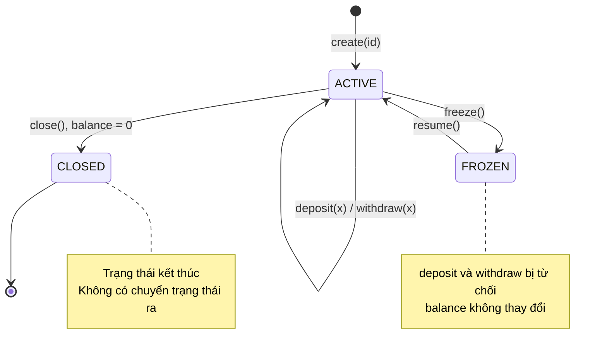
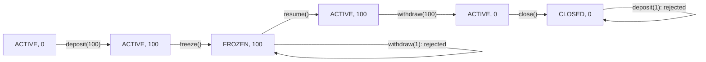
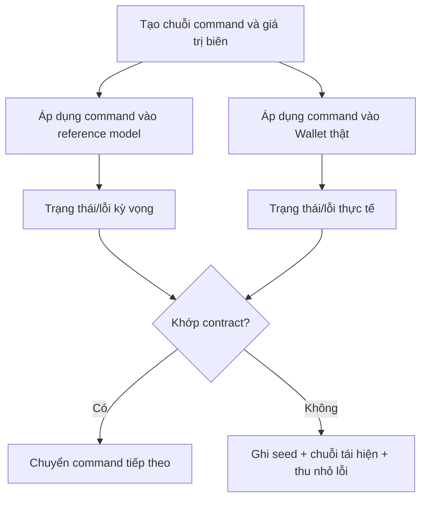

# Kiểm thử điều kiện bất biến và chuyển trạng thái trong OOP

> **Mục tiêu học tập:** Thiết kế kiểm thử cho những đối tượng **có trạng thái thay đổi theo thời gian**; phân biệt *invariant*, *precondition*, *postcondition* và *state transition*; kiểm tra cả hành vi thành công lẫn hành vi bị từ chối; chứng minh sau lỗi đối tượng vẫn hợp lệ. Ví dụ dùng Java 17 và JUnit 5, không cần Spring.

## 1. Vì sao chỉ kiểm tra kết quả của một phương thức là chưa đủ?

Một bài kiểm thử đơn giản có thể xác nhận:

```java
wallet.deposit(100_000);
assertEquals(100_000, wallet.balanceVnd());
```

Nhưng một đối tượng quản lý tiền còn nhiều điều phải bảo đảm:

- Số dư có được âm không?
- Có thể rút tiền nhiều hơn số dư không?
- Khi ví đã **đóng**, có thể nạp tiền lại không?
- Khi một thao tác bị từ chối, trạng thái có giữ nguyên không?
- Nếu cộng tiền bị tràn kiểu `long`, số dư có bị hỏng không?
- Hai lần gọi liên tiếp có tạo ra một chuỗi trạng thái hợp lệ không?

Một test chỉ xác nhận giá trị trả về của một lời gọi có thể bỏ sót cả **quy tắc của đối tượng qua nhiều lần tương tác**.

Trong OOP, một object không chỉ là dữ liệu + hàm. Nhiều object còn chịu trách nhiệm bảo vệ **những điều kiện luôn đúng** và điều khiển **cách trạng thái được phép thay đổi**. Kiểm thử phải nhìn vào các trách nhiệm đó.

**Tư duy quan trọng:** Không chỉ hỏi “phương thức có chạy đúng không?”, mà hỏi “trước, trong và sau từng hành động, object có luôn nằm trong các trạng thái được phép không?”.

## 2. Bốn khái niệm cần phân biệt

| Khái niệm | Ý nghĩa | Ví dụ với ví điện tử |
|---|---|---|
| **Invariant – điều kiện bất biến** | Điều phải đúng trong mọi trạng thái hợp lệ **có thể quan sát** của object | `balanceVnd >= 0` |
| **Precondition – điều kiện trước** | Điều kiện để một hành động được phép thực hiện | Rút tiền chỉ khi ví `ACTIVE` và số rút không vượt số dư |
| **Postcondition – điều kiện sau** | Điều phải đúng sau khi thao tác thành công | Nạp `x` làm số dư tăng đúng `x`, trạng thái vẫn `ACTIVE` |
| **Transition rule – quy tắc chuyển trạng thái** | Cạnh được phép giữa các trạng thái và điều kiện để đi qua cạnh | `ACTIVE → FROZEN`, `FROZEN → ACTIVE` |

**Invariant** không đơn thuần là “một field có `final`”. Một object có thể mutable nhưng luôn duy trì `balance >= 0`. Ngược lại, một field `final` chỉ ngăn gán lại tham chiếu hoặc primitive; nó không bảo đảm các object nằm phía sau tham chiếu là bất biến.

### State invariant khác quy tắc theo thời gian

- **State invariant:** nhìn vào *một snapshot* là đủ để kiểm tra, ví dụ `CLOSED ⇒ balance == 0`.
- **Temporal/transition property:** cần nhìn *hai trạng thái hoặc một chuỗi sự kiện*, ví dụ “khi ví `FROZEN`, thao tác rút tiền không làm thay đổi số dư”.

Một snapshot `FROZEN, balance=100000` **tự nó không vi phạm**. Lỗi chỉ xuất hiện nếu phương thức `withdraw` trong trạng thái `FROZEN` vẫn trừ tiền.

Vì vậy kiểm thử cần kết hợp **assert các điều kiện trên snapshot** và **assert hành vi của từng transition**.

## 3. Ví dụ nghiệp vụ xuyên suốt: Ví điện tử có trạng thái

Để tập trung vào OOP, ta xây một mô hình đơn giản, không kết nối ngân hàng hay database.

### Các trạng thái

- `ACTIVE`: ví hoạt động, cho phép `deposit` và `withdraw`.
- `FROZEN`: ví tạm khóa, không cho phép nạp/rút tiền.
- `CLOSED`: ví kết thúc vĩnh viễn, không cho phép nạp/rút, đóng băng hoặc mở khóa.

Ví mới được tạo ở trạng thái `ACTIVE` với số dư bằng 0. Chỉ cho **đóng ví đang ACTIVE khi số dư bằng 0**.

### Hành vi được phép

| Hành động | Trạng thái trước | Điều kiện khác | Trạng thái sau | Số dư sau |
|---|---|---|---|---|
| `deposit(x)` | ACTIVE | `x > 0`, không tràn `long` | ACTIVE | `balance + x` |
| `withdraw(x)` | ACTIVE | `x > 0` và `x <= balance` | ACTIVE | `balance - x` |
| `freeze()` | ACTIVE | Không | FROZEN | Không đổi |
| `resume()` | FROZEN | Không | ACTIVE | Không đổi |
| `close()` | ACTIVE | `balance == 0` | CLOSED | 0 |

Mọi trường hợp không khớp hàng tương ứng **bị từ chối**. Trong bài này, việc gọi `close()` hai lần là **lỗi trạng thái**, không phải no-op; đây là một lựa chọn hợp đồng rõ ràng. Một hệ thống khác có thể quy định đóng lại là thao tác idempotent, nhưng phải viết lại bảng và test theo quyết định đó.

### Các điều kiện bất biến

1. `id` phải tồn tại, không rỗng và không bị đổi sau khi tạo.
2. `status` luôn thuộc tập `ACTIVE`, `FROZEN`, `CLOSED` và không null.
3. `balanceVnd >= 0`.
4. `status == CLOSED ⇒ balanceVnd == 0`.
5. Các thao tác bị từ chối **không làm thay đổi snapshot**.

Điều kiện số 5 chính xác hơn là một **postcondition khi thất bại** hoặc một quy tắc về chuyển trạng thái, không phải state invariant đơn thuần. Chúng ta cố ý tách nó ra khi thiết kế test.

Các quy tắc trên là **giả định dạy học**. Ví thật còn có ledger, giao dịch, hạn mức, quyền truy cập, chống gian lận, đồng thời và quy định tài chính.

## 4. Vẽ máy trạng thái trước khi viết test



Từ sơ đồ này, lập test theo ba nhóm:

- **Cạnh hợp lệ:** chứng minh từng transition hợp lệ có thể xảy ra khi thỏa điều kiện.
- **Cạnh bị cấm:** chứng minh những transition không xuất hiện trên sơ đồ bị từ chối.
- **Điều kiện biên:** ví dụ `close()` được phép khi số dư 0, bị cấm khi số dư 1; `withdraw(balance)` được phép, `withdraw(balance + 1)` bị cấm.

Một state machine nhỏ giúp lộ những câu hỏi dễ bị quên, chẳng hạn “Có thể `resume()` từ `ACTIVE` không?” hoặc “`CLOSED` có mở lại được không?”.

## 5. Java 17 hoàn chỉnh: object tự bảo vệ trạng thái

Tạo file `WalletDemo.java`:

```java
import java.util.Objects;

public final class WalletDemo {

    enum Status { ACTIVE, FROZEN, CLOSED }

    // Snapshot bất biến để quan sát trước/sau thao tác.
    record Snapshot(Status status, long balanceVnd) {}

    static final class Wallet {
        private final String id;
        private Status status = Status.ACTIVE;
        private long balanceVnd = 0L;

        Wallet(String id) {
            Objects.requireNonNull(id, "id");
            if (id.isBlank()) {
                throw new IllegalArgumentException("id không được rỗng");
            }
            this.id = id;
        }

        String id() {
            return id;
        }

        Snapshot snapshot() {
            return new Snapshot(status, balanceVnd);
        }

        void deposit(long amountVnd) {
            requireActive();
            requirePositive(amountVnd);

            // Math.addExact ném lỗi trước khi phép gán thực hiện.
            balanceVnd = Math.addExact(balanceVnd, amountVnd);
        }

        void withdraw(long amountVnd) {
            requireActive();
            requirePositive(amountVnd);
            if (amountVnd > balanceVnd) {
                throw new IllegalStateException("Không đủ số dư");
            }
            balanceVnd -= amountVnd;
        }

        void freeze() {
            requireStatus(Status.ACTIVE, "freeze");
            status = Status.FROZEN;
        }

        void resume() {
            requireStatus(Status.FROZEN, "resume");
            status = Status.ACTIVE;
        }

        void close() {
            requireStatus(Status.ACTIVE, "close");
            if (balanceVnd != 0L) {
                throw new IllegalStateException(
                        "Chỉ đóng ví khi số dư bằng 0");
            }
            status = Status.CLOSED;
        }

        private void requireActive() {
            requireStatus(Status.ACTIVE, "money operation");
        }

        private void requireStatus(Status required, String operation) {
            if (status != required) {
                throw new IllegalStateException(
                        operation + " yêu cầu " + required
                        + ", trạng thái hiện tại " + status);
            }
        }

        private static void requirePositive(long amountVnd) {
            if (amountVnd <= 0L) {
                throw new IllegalArgumentException(
                        "Số tiền phải dương");
            }
        }
    }

    public static void main(String[] args) {
        Wallet wallet = new Wallet("W-100");
        wallet.deposit(150_000L);
        wallet.withdraw(40_000L);

        System.out.println(wallet.snapshot());
        // Snapshot[status=ACTIVE, balanceVnd=110000]

        wallet.freeze();
        System.out.println(wallet.snapshot());
        // Snapshot[status=FROZEN, balanceVnd=110000]

        try {
            wallet.withdraw(10_000L);
        } catch (IllegalStateException expected) {
            System.out.println("Ví FROZEN: không cho rút tiền");
        }

        wallet.resume();
        wallet.withdraw(110_000L);
        wallet.close();

        System.out.println(wallet.snapshot());
        // Snapshot[status=CLOSED, balanceVnd=0]
    }
}
```

Chạy với JDK 17:

```bash
javac WalletDemo.java
java WalletDemo
```

### Các quyết định thiết kế đáng chú ý

**Không có `setBalance` và `setStatus`.** Client không được tự đặt `balance=-1` hoặc `status=CLOSED` khi còn tiền. Các hành vi công khai đều diễn đạt một ý nghĩa nghiệp vụ.

**Validation trước mutation.** `withdraw` kiểm tra trạng thái, số tiền và số dư **trước khi** trừ. `close` kiểm tra số dư trước khi đặt `CLOSED`.

**Tràn số được kiểm soát.** Với `deposit`, `Math.addExact` ném `ArithmeticException` nếu tổng vượt giới hạn `long`. Vì vế phải được tính xong trước khi gán, lỗi tràn không làm thay đổi `balanceVnd`.

**Snapshot tách quan sát khỏi thay đổi.** `Snapshot` là record chứa enum và primitive, nên giá trị trả về không cho client sửa trạng thái nội bộ thông qua một reference mutable. Đây là một quan sát không có side effect.

**Trạng thái kết thúc được kiểm tra tại điểm đổi.** `CLOSED ⇒ balance == 0` không cần được kiểm tra lại trong từng getter nếu mọi đường thay đổi hợp lệ đều bảo đảm nó, nhưng test vẫn phải xác nhận invariant để chống lỗi khi refactor.

**Hợp đồng lỗi là cụ thể.** `IllegalArgumentException` cho số tiền không dương/ID không hợp lệ; `IllegalStateException` cho trạng thái không cho phép hoặc số dư không đủ; `ArithmeticException` khi tràn số. Production có thể dùng mã lỗi nghiệp vụ riêng, nhưng test phải rõ điều gì được hứa.

**Giới hạn ví dụ:** đây là object trong bộ nhớ, được sử dụng tuần tự. `Wallet` không thread-safe và không đại diện cho hệ thống tiền thật có ledger, transaction hay kiểm soát gian lận.

## 6. Chiến lược kiểm thử: nhìn trạng thái trước và sau

Với mỗi hành động, mô tả:

```text
Given: trạng thái và dữ liệu trước thao tác
When:  một hành động (hoặc chuỗi hành động)
Then:  trạng thái sau và bất biến cần bảo đảm
```

Ví dụ:

```text
Given: Wallet ACTIVE, balance = 100_000
When:  withdraw(30_000)
Then:  ACTIVE, balance = 70_000

Given: Wallet ACTIVE, balance = 100_000
When:  withdraw(120_000)
Then:  throw IllegalStateException
       trạng thái ACTIVE và balance 100_000 KHÔNG ĐỔI

Given: Wallet FROZEN, balance = 100_000
When:  deposit(10_000)
Then:  bị từ chối, snapshot giữ nguyên
```

**Điểm cần nhấn mạnh:** Test thất bại không chỉ dùng `assertThrows`. Nếu object đã bị sửa một phần rồi mới ném exception, `assertThrows` vẫn PASS. Vì vậy hãy assert **snapshot trước = snapshot sau** khi hợp đồng yêu cầu không có tác dụng phụ khi thất bại.

### Bảng test gợi ý

| Tình huống | Trạng thái đầu | Hành động | Mong đợi |
|---|---|---|---|
| Nạp hợp lệ | ACTIVE, 0 | `deposit(100)` | ACTIVE, 100 |
| Rút một phần | ACTIVE, 100 | `withdraw(30)` | ACTIVE, 70 |
| Rút đúng số dư | ACTIVE, 100 | `withdraw(100)` | ACTIVE, 0 |
| Rút quá số dư | ACTIVE, 100 | `withdraw(101)` | Exception; ACTIVE, 100 |
| Rút số 0/âm | ACTIVE, 100 | `withdraw(0)`/`withdraw(-1)` | Exception; không đổi |
| Nạp tràn | ACTIVE, MAX | `deposit(1)` | Exception; MAX không đổi |
| Khóa ví | ACTIVE, 100 | `freeze()` | FROZEN, 100 |
| Nạp/rút khi khóa | FROZEN, 100 | `deposit/withdraw` | Exception; không đổi |
| Mở lại ví | FROZEN, 100 | `resume()` | ACTIVE, 100 |
| Resume khi đang active | ACTIVE, 100 | `resume()` | Exception; không đổi |
| Đóng khi còn tiền | ACTIVE, 100 | `close()` | Exception; không đổi |
| Đóng khi hết tiền | ACTIVE, 0 | `close()` | CLOSED, 0 |
| Bất kỳ lệnh tiền sau đóng | CLOSED, 0 | `deposit/withdraw` | Exception; CLOSED, 0 |
| Mở lại sau đóng | CLOSED, 0 | `resume()` | Exception; CLOSED, 0 |

Không nhất thiết phải viết **một hàm test cho từng dòng**, nhưng các quan hệ khác nhau phải được kiểm tra một cách dễ nhận diện.

## 7. Bộ kiểm thử JUnit 5 có thể chạy

Tạo `WalletDemoTest.java` cùng package với `WalletDemo.java` và dùng dependency JUnit Jupiter của dự án. Các method/package-private class lồng của `WalletDemo` có thể được truy cập từ test cùng package.

```java
import static org.junit.jupiter.api.Assertions.*;
import org.junit.jupiter.api.Test;

class WalletDemoTest {

    @Test
    void newWalletStartsActiveAndEmpty() {
        var wallet = new WalletDemo.Wallet("W-1");

        assertEquals("W-1", wallet.id());
        assertEquals(new WalletDemo.Snapshot(
                WalletDemo.Status.ACTIVE, 0L), wallet.snapshot());
    }

    @Test
    void depositAndWithdrawPreserveNonNegativeBalance() {
        var wallet = new WalletDemo.Wallet("W-2");

        wallet.deposit(100L);
        wallet.withdraw(30L);

        assertEquals(new WalletDemo.Snapshot(
                WalletDemo.Status.ACTIVE, 70L), wallet.snapshot());
    }

    @Test
    void exactBalanceCanBeWithdrawn() {
        var wallet = new WalletDemo.Wallet("W-3");
        wallet.deposit(100L);

        wallet.withdraw(100L);

        assertEquals(new WalletDemo.Snapshot(
                WalletDemo.Status.ACTIVE, 0L), wallet.snapshot());
    }

    @Test
    void insufficientFundsRejectsWithoutMutation() {
        var wallet = new WalletDemo.Wallet("W-4");
        wallet.deposit(100L);
        var before = wallet.snapshot();

        assertThrows(IllegalStateException.class,
                () -> wallet.withdraw(101L));

        assertEquals(before, wallet.snapshot());
    }

    @Test
    void invalidAmountDoesNotChangeState() {
        var wallet = new WalletDemo.Wallet("W-5");
        var before = wallet.snapshot();

        assertThrows(IllegalArgumentException.class,
                () -> wallet.deposit(0L));
        assertThrows(IllegalArgumentException.class,
                () -> wallet.withdraw(-1L));

        assertEquals(before, wallet.snapshot());
    }

    @Test
    void frozenWalletRejectsMoneyOperations() {
        var wallet = new WalletDemo.Wallet("W-6");
        wallet.deposit(200L);
        wallet.freeze();
        var before = wallet.snapshot();

        assertThrows(IllegalStateException.class,
                () -> wallet.deposit(10L));
        assertThrows(IllegalStateException.class,
                () -> wallet.withdraw(10L));

        assertEquals(new WalletDemo.Snapshot(
                WalletDemo.Status.FROZEN, 200L), before);
        assertEquals(before, wallet.snapshot());
    }

    @Test
    void freezeAndResumeFormValidTransitions() {
        var wallet = new WalletDemo.Wallet("W-7");

        wallet.freeze();
        assertEquals(WalletDemo.Status.FROZEN,
                wallet.snapshot().status());

        wallet.resume();
        assertEquals(WalletDemo.Status.ACTIVE,
                wallet.snapshot().status());

        // Lặp lại resume không được phép theo contract ví dụ.
        var before = wallet.snapshot();
        assertThrows(IllegalStateException.class, wallet::resume);
        assertEquals(before, wallet.snapshot());
    }

    @Test
    void cannotCloseWalletWithFunds() {
        var wallet = new WalletDemo.Wallet("W-8");
        wallet.deposit(1L);
        var before = wallet.snapshot();

        assertThrows(IllegalStateException.class, wallet::close);

        assertEquals(before, wallet.snapshot());
    }

    @Test
    void closedWalletIsTerminalAndEmpty() {
        var wallet = new WalletDemo.Wallet("W-9");
        wallet.close();
        var closed = wallet.snapshot();

        assertEquals(new WalletDemo.Snapshot(
                WalletDemo.Status.CLOSED, 0L), closed);

        assertThrows(IllegalStateException.class,
                () -> wallet.deposit(1L));
        assertThrows(IllegalStateException.class, wallet::freeze);
        assertThrows(IllegalStateException.class, wallet::resume);
        assertThrows(IllegalStateException.class, wallet::close);

        assertEquals(closed, wallet.snapshot());
    }

    @Test
    void overflowRejectsWithoutMutation() {
        var wallet = new WalletDemo.Wallet("W-10");
        wallet.deposit(Long.MAX_VALUE);
        var before = wallet.snapshot();

        assertThrows(ArithmeticException.class,
                () -> wallet.deposit(1L));

        assertEquals(before, wallet.snapshot());
    }
}
```

Bộ test trên cố ý kết hợp **test trạng thái đơn lẻ** và **test một chuỗi hành động**. Nó kiểm tra những nhánh quan trọng, nhưng chưa phải bằng chứng hình thức cho mọi chuỗi vô hạn hay mọi trường hợp đồng thời.

## 8. Tại sao phải kiểm cả “sau khi thất bại”?

Xem một implementation nguy hiểm:

```java
// Phản ví dụ: mutate trước khi kiểm tra.
void withdrawWrong(long amountVnd) {
    balanceVnd -= amountVnd;
    if (balanceVnd < 0L) {
        throw new IllegalStateException("Không đủ tiền");
    }
}
```

Với `balance=100` và `withdrawWrong(120)`, method ném exception nhưng để lại `balance=-20`. Nếu test chỉ có:

```java
assertThrows(IllegalStateException.class,
        () -> wallet.withdraw(120));
```

thì test **không phát hiện object đã bị phá invariant**.

Thay vào đó:

```java
var before = wallet.snapshot();
assertThrows(IllegalStateException.class,
        () -> wallet.withdraw(120));
assertEquals(before, wallet.snapshot());
```

**Thông điệp quan trọng:** Kiểm thử lỗi không chỉ kiểm exception type; còn kiểm **postcondition của thất bại**.

Tuy nhiên, điều kiện “lỗi thì hoàn toàn không thay đổi” phải xuất phát từ **hợp đồng nghiệp vụ**. Một workflow có thể cố ý lưu trạng thái `FAILED` hoặc thêm bản ghi audit khi thao tác không thành công. Khi đó test phải xác nhận *những thay đổi được phép khi lỗi*, không áp quy tắc no-mutation lên mọi chức năng một cách máy móc.

## 9. Kiểm thử ranh giới: những giá trị nằm ngay sát điều kiện

Khi các quy tắc dùng dấu `>`, `>=`, `<`, `<=`, kiểm thử tại giá trị gần ranh giới dễ phát hiện off-by-one.

Với `withdraw(amount)` ở số dư 100:

| Giá trị rút | Mong đợi |
|---:|---|
| -1 | Từ chối vì âm |
| 0 | Từ chối vì không dương |
| 1 | Thành công, còn 99 |
| 99 | Thành công, còn 1 |
| 100 | Thành công, còn 0 |
| 101 | Từ chối vì vượt số dư |

Với `close()`:
- Balance = 0 → hợp lệ.
- Balance = 1 → bị từ chối.
- Balance âm → **không bao giờ phải xuất hiện** nếu invariant được bảo vệ bởi các operation công khai.

Với `deposit`:
- `Long.MAX_VALUE - 1` cộng 1 → hợp lệ.
- `Long.MAX_VALUE` cộng 1 → tràn số và phải bị từ chối mà không thay đổi số dư.

**Không tạo trạng thái bất hợp lệ chỉ để test method khác bằng cách dùng reflection sửa field private**, trừ khi bạn đang cố tình kiểm tra cơ chế phục hồi dữ liệu cũ. Thông thường nên tạo đối tượng qua API công khai và duy trì invariant trong toàn bộ quá trình sắp đặt test.

## 10. Bao phủ trạng thái khác với bao phủ chuyển trạng thái

Giả sử test đã tạo được cả ba trạng thái `ACTIVE`, `FROZEN`, `CLOSED`. Điều đó **không có nghĩa** đã kiểm được mọi hành vi chuyển giữa chúng.

### State coverage

Từng trạng thái xuất hiện ít nhất một lần trong các test. Ví dụ test `new Wallet` cho ACTIVE, test `freeze` cho FROZEN, test `close` cho CLOSED.

### Transition coverage

Từng **cạnh hợp lệ** trong sơ đồ được thực hiện ít nhất một lần:
- ACTIVE → FROZEN;
- FROZEN → ACTIVE;
- ACTIVE → CLOSED;
- ACTIVE → ACTIVE với nạp/rút hợp lệ.

### Invalid-transition coverage

Chọn các hành động bị cấm đáng quan tâm:
- `resume` từ ACTIVE;
- `freeze` từ FROZEN;
- `deposit`/`withdraw` từ FROZEN;
- mọi thao tác đổi trạng thái từ CLOSED;
- `close` từ ACTIVE khi số dư khác 0.

### Transition-pair / sequence coverage

Một số lỗi chỉ xuất hiện theo chuỗi: ACTIVE → FROZEN → ACTIVE rồi rút tiền; hoặc nạp → rút hết → đóng → thử nạp lại. Test hai thao tác riêng lẻ có thể không phát hiện lỗi lưu/khôi phục trạng thái liên quan đến chuỗi.



Ký hiệu mũi tên vòng lại với nhãn *rejected* biểu thị **không đổi trạng thái sau khi thao tác bị từ chối**, không phải một transition nghiệp vụ thành công.

### Không chạy mọi tổ hợp một cách vô hạn

Nếu có `n` trạng thái, `m` lệnh và vô số tham số, số chuỗi kiểm thử có thể tăng rất nhanh. Hãy ưu tiên:

- Những trạng thái/cạnh có rủi ro cao.
- Các giá trị biên.
- Các lệnh lặp, lệnh trái thứ tự, hành động sau trạng thái cuối.
- Những chuỗi có mutation và rollback.
- Những quy tắc dễ đổi trong sản phẩm thật.

Đo được state/branch coverage rất hữu ích, nhưng **tỷ lệ coverage cao không tự chứng minh invariant đúng** nếu assertions kém.

## 11. Model-based testing: dùng mô hình đơn giản để đối chiếu

Với nhiều trạng thái hoặc nhiều chuỗi lệnh, viết test thủ công cho từng đường đi rất tốn công. Một hướng là tạo **mô hình tham chiếu (reference model)** đơn giản, có luật tường minh, rồi phát sinh chuỗi lệnh và so sánh kết quả.

Ý tưởng:

1. **Reference model** lưu `status` và `balance`, xác định lệnh nào được phép và trạng thái dự kiến.
2. **System Under Test (SUT)** là `Wallet` thật.
3. Bộ sinh lệnh tạo các chuỗi như `deposit(100)`, `freeze()`, `withdraw(10)`, `resume()`, `close()`.
4. Sau mỗi lệnh, so sánh snapshot SUT với model; cả khi lệnh bị từ chối cũng phải kiểm tra không đổi nếu hợp đồng yêu cầu.
5. Nếu tìm thấy chuỗi làm sai, lưu seed/chuỗi và thu nhỏ (*shrinking*) để tạo test hồi quy ngắn.



**Quan trọng:** Reference model cần đủ **độc lập về cách cài đặt** để không chép nguyên lỗi của SUT. Nếu model copy y nguyên từng dòng code từ `Wallet`, cả hai có thể cùng mắc một lỗi và bài test vẫn PASS.

### Một mô hình test rất nhỏ bằng bảng

Với trạng thái ACTIVE:
- `freeze` luôn đến FROZEN.
- `resume` luôn bị từ chối.
- `close` thành công iff balance = 0.
- `withdraw(x)` thành công iff `x > 0 && x <= balance`.

Với FROZEN:
- Chỉ `resume` được phép trong các lệnh đã định nghĩa.

Với CLOSED:
- Không lệnh nào thay đổi được trạng thái.

Mô hình này có thể được mã hóa thành một bảng transition độc lập, sau đó cho test chạy qua nhiều chuỗi khác nhau.

## 12. Property-based testing: kiểm các tính chất thay vì chỉ ví dụ đơn

JUnit test truyền thống chỉ gọi vài input đã chọn. Với property-based testing, một thư viện như jqwik hoặc QuickTheories có thể tạo nhiều chuỗi giá trị hợp lệ và thử các tính chất tổng quát.

Các property phù hợp với `Wallet`:

**P1 – Số dư không âm:** sau mọi chuỗi lệnh hợp lệ, `balance >= 0`.

**P2 – Trạng thái kết thúc:** nếu `status == CLOSED` thì `balance == 0`, và không có thao tác nào làm trạng thái thoát khỏi CLOSED.

**P3 – Bảo toàn khi bị từ chối:** nếu thao tác bị từ chối theo hợp đồng demo, snapshot trước và sau phải bằng nhau.

**P4 – Nạp rồi rút cùng lượng:** từ ví ACTIVE có số dư `b`, với `x > 0` và `b+x` không tràn, nếu nạp `x` rồi rút `x` liên tiếp, số dư quay về `b` và status không đổi.

**P5 – Freeze/resume không đổi số dư:** từ ACTIVE, chuỗi `freeze(); resume();` trả về ACTIVE với balance không đổi.

**P6 – Rút luôn có giới hạn:** với `x > balance`, `withdraw(x)` bị từ chối và balance giữ nguyên.

Các property này cần **điều kiện đầu vào rõ**. Chẳng hạn P4 sai nếu ví đang FROZEN hoặc phép cộng tràn số; test property phải chỉ phát sinh trường hợp thỏa tiền đề hoặc xác nhận rằng khi tiền đề không thỏa thì thao tác bị từ chối đúng.

Không bắt buộc cài thêm thư viện cho ví dụ chính; bạn có thể bắt đầu bằng JUnit 5 và bảng trường hợp. Khi state space lớn, property-based testing giúp tìm các chuỗi khó đoán, nhưng vẫn cần test mẫu cụ thể để tài liệu hóa nghiệp vụ.

## 13. Precondition, invariant và postcondition trong một phương thức

Hãy phân tích `withdraw`:

```java
void withdraw(long amountVnd) {
    requireActive();                 // Precondition về status
    requirePositive(amountVnd);     // Precondition về input

    if (amountVnd > balanceVnd) {    // Precondition về state
        throw new IllegalStateException("Không đủ số dư");
    }

    balanceVnd -= amountVnd;         // Mutation được phép
}
```

Các test nên đặt theo ba lớp:

| Lớp | Test hỏi điều gì? | Assert |
|---|---|---|
| Precondition | `amount<=0` hoặc trạng thái không ACTIVE? | Bị từ chối và không đổi |
| Postcondition | Rút 30 từ số dư 100? | Số dư 70, trạng thái ACTIVE |
| Invariant | Sau bất kỳ rút hợp lệ nào? | Số dư không âm |

Nếu chỉ assert “rút 30 còn 70” thì chưa kiểm boundary và failed operation. Nếu chỉ assert số dư không âm thì có thể bỏ sót lỗi rút ít tiền hơn yêu cầu. Nếu chỉ assert exception thì có thể bỏ sót object bị sửa một phần.

**Phối hợp cả ba** mới tạo bộ kiểm thử có ý nghĩa.

## 14. Test double và ranh giới nghiệp vụ

Ví dụ `Wallet` không có dependency ngoài; test có thể tạo một Wallet thật trực tiếp. Đừng mock chính đối tượng đang cần kiểm tra invariant. Nếu dùng mock cho `Wallet` rồi kiểm `deposit` được gọi một lần, bạn chưa kiểm chứng `balance` thay đổi đúng.

Khi object nghiệp vụ cần cộng tác với dependency ngoài:

- Fake `Clock` để kiểm quy tắc hết hạn theo thời gian.
- Fake `ExchangeRateProvider` để kiểm cách chọn tỷ giá.
- Mock `NotificationGateway` để xác nhận ứng dụng gửi yêu cầu sau một chuyển trạng thái thành công.
- Repository in-memory hoặc transaction test để xác nhận state được lưu và đọc lại đúng.

**Phân biệt:** Unit test object kiểm tra quy tắc cục bộ. Integration test kiểm tra nhiều thành phần phối hợp (DB, transaction, message queue...). Không nên để thông báo/email quyết định trực tiếp trạng thái nội bộ của Wallet nếu không phải một phần invariant.

## 15. Test bất biến với object có collection nội bộ

Không phải invariant nào cũng chỉ liên quan một con số. Ví dụ giỏ hàng:

- Mỗi dòng hàng có quantity dương.
- Không được có dòng trùng SKU nếu nghiệp vụ quy định như vậy.
- Tổng tiền bằng tổng `unitPrice * quantity` của các dòng.
- Khi đơn đã xác nhận, không được thêm/xóa dòng.

Nếu API trả trực tiếp một `ArrayList` mutable:

```java
List<Line> lines = order.getLines();
lines.clear(); // Có thể qua mặt phương thức domain.
```

thì các test gọi `order.addLine` có thể PASS nhưng invariant vẫn bị phá qua đường getter. Vì vậy nên test thêm:

1. Client không thể sửa collection nội bộ qua giá trị trả về.
2. Constructor/setter không giữ tham chiếu tới mutable collection từ caller mà không phòng vệ.
3. Nếu trả record chứa list, danh sách và phần tử cần được bảo vệ đúng mức.
4. Những thay đổi hợp lệ phải đi qua phương thức có kiểm tra quy tắc.

`List.copyOf` bảo vệ **một snapshot nông**; nếu phần tử bên trong mutable, việc sao chép danh sách vẫn chưa bảo đảm invariant. Test các đường “escape reference” là một phần của kiểm thử bảo toàn trạng thái.

## 16. Điều kiện bất biến của hai đối tượng có liên hệ

Một object tự bảo đảm `balance >= 0` chưa đủ cho một nghiệp vụ **chuyển tiền giữa hai ví**:

```text
Nguồn: 100   Đích: 20
Chuyển 30
Sau thành công: Nguồn 70   Đích 50
Tổng hệ thống trước/sau: 120
```

Bất biến liên quan nhiều đối tượng có thể là **tổng tiền được bảo toàn** trong một phép chuyển nội bộ (không tính phí, không tạo/hủy tiền).

Nếu implementation gọi `source.withdraw(30)` thành công nhưng `target.deposit(30)` thất bại, ta có **mất cập nhật liên đối tượng** dù từng object riêng lẻ vẫn có số dư không âm.

Kiểm thử ở cấp use case phải kiểm:
- Cả hai ví cập nhật, hoặc không ví nào thay đổi theo hợp đồng atomicity.
- Chuyển tiền hai lần với cùng request ID được xử lý theo chính sách idempotency.
- Retry sau timeout không tạo chuyển tiền trùng.
- DB transaction/locking hoặc phương án phân tán tương ứng được sử dụng đúng.

**Tính nguyên tử của một thay đổi object không đồng nghĩa tính nguyên tử của cả workflow.** Nếu các ví nằm ở hai hệ thống khác nhau, cần thiết kế transaction/saga/ledger/compensation tùy yêu cầu thay vì mong một unit test object giải quyết được.

## 17. Concurrency: chuỗi test tuần tự không chứng minh thread-safe

Trong ví dụ, `balanceVnd` là một field `long` và thao tác nạp thực hiện:
`balanceVnd = Math.addExact(balanceVnd, amountVnd)`.

Nếu hai thread cùng chạy, mỗi thread có thể đọc cùng số dư cũ và ghi lại kết quả khác nhau, gây **lost update**. Các precondition nhìn đúng trong từng thread nhưng trạng thái cuối vẫn sai.

Tương tự:
- Hai request cùng rút 80 từ số dư 100 có thể đều đọc 100 trước khi ghi.
- Hai request cùng cố chuyển trạng thái từ ACTIVE sang FROZEN có thể cùng thấy tiền đề đúng.
- Một luồng đóng ví khi luồng khác đang nạp/rút có thể tạo trạng thái không nhất quán.

Test concurrency cần thêm cơ chế điều phối thử nghiệm:
- `CountDownLatch`/`CyclicBarrier` để tạo tình huống cạnh tranh có kiểm soát.
- Chạy nhiều lần với dữ liệu và kỳ vọng rõ ràng; không dựa vào `Thread.sleep` để “đợi đủ lâu”.
- Với DB, kiểm thử transaction isolation, row locks, optimistic locking/version và retry logic.
- Có thể dùng công cụ concurrency testing chuyên biệt cho các cấu trúc low-level khi phù hợp.

**Quan trọng:** Một concurrency test PASS một lần không chứng minh không tồn tại race. Test giúp tìm lỗi, còn thiết kế cần cung cấp cơ chế đồng bộ hoặc transaction thực sự.

Với ví tiền thật, đơn vị thao tác cập nhật phải nằm trong một ranh giới đồng thời rõ ràng; ví dụ dạy học **không nên được dùng nguyên xi trong hệ thống tài chính**.

## 18. Không ép test vào chi tiết triển khai

Một bộ test dễ vỡ có thể kiểm:
- Method đã gọi helper `validateBalance` bao nhiêu lần.
- Field `status` được gán đúng ở dòng nào.
- Internal collection là `ArrayList` hay `LinkedList`.
- Exception có đúng từng ký tự message không, dù message không phải public contract.

Những điều này thường không phải kết quả người dùng cần. Test nên kiểm hành vi qua API quan sát được:

```java
WalletDemo.Snapshot before = wallet.snapshot();
assertThrows(IllegalStateException.class, wallet::close);
assertEquals(before, wallet.snapshot());
```

Nếu sau này đổi cách lưu trạng thái, tối ưu việc tính số dư hoặc tách private helper, test vẫn bảo vệ quy tắc nghiệp vụ. Tuy nhiên nếu text lỗi/cấu trúc lỗi là **contract public** của một API, test chính xác mã lỗi và schema có thể cần thiết.

### Lựa chọn assertion đúng

| Nhu cầu | Assertion JUnit phù hợp |
|---|---|
| Giá trị số dư đúng | `assertEquals(expected, actual)` |
| Trạng thái enum đúng | `assertEquals(Status.ACTIVE, snapshot.status())` |
| Operation ném đúng loại lỗi | `assertThrows(ExpectedException.class, executable)` |
| Sau lỗi object không thay đổi | Lưu snapshot, rồi `assertEquals(before, after)` |
| Nhiều kết quả phải đồng thời đúng | `assertAll(...)` khi giúp chẩn đoán |
| Không ném lỗi với lệnh hợp lệ | `assertDoesNotThrow(...)` nếu có ích |
| So đúng instance | `assertSame(...)` – chỉ khi identity là contract |
| Danh sách/collection | Assert nội dung theo semantics của List/Set/Map |

**Đừng kiểm `==` trên những value objects khác instance** nếu domain muốn so sánh bằng giá trị; hãy dùng equality phù hợp.

## 19. Một chiến lược phủ từ mức nhỏ tới lớn

Có thể tổ chức các lớp kiểm thử theo chi phí và mục tiêu:

| Cấp kiểm thử | Chủ thể | Điều cần chứng minh | Rủi ro còn lại |
|---|---|---|---|
| Unit | `Wallet` thực trong bộ nhớ | Invariant, transition, lỗi và trạng thái sau lỗi | Không chứng minh DB/concurrency |
| Unit property/model-based | Nhiều chuỗi command | Tìm chuỗi mutation khó đoán | Model có thể sai hoặc chưa đủ |
| Integration | Repository + transaction | Tải/lưu trạng thái, version, rollback | Hệ thống ngoài vẫn có thể lỗi |
| Contract | API/port giữa module | Semantics lỗi, tính hợp lệ khi thay implementation | Chưa kiểm tất cả path end-to-end |
| End-to-end | Một luồng nghiệp vụ chính | Khách hàng thực hiện được tác vụ qua toàn hệ thống | Chậm, khó cô lập nguyên nhân |

Không nên bỏ unit test trạng thái chỉ vì đã có end-to-end tests. E2E thường tốn kém và khó phủ hết những chuyển trạng thái bị cấm. Ngược lại, chỉ có unit test Wallet không chứng minh rằng hai người dùng sửa cùng một record trong DB được xử lý đúng.

## 20. Những sai lầm kiểm thử thường gặp

| Sai lầm | Vì sao nguy hiểm | Cách cải thiện |
|---|---|---|
| Chỉ test “happy path” | Bỏ sót trạng thái và input bị cấm | Bảng transition hợp lệ/bất hợp lệ |
| Chỉ dùng `assertThrows` | Object có thể đã mutate một phần | Assert snapshot trước = sau khi lỗi |
| Kiểm trạng thái mà không kiểm invariant | Có thể tạo trạng thái mới nhưng số dư âm | Assert toàn bộ invariant liên quan |
| Chỉ test từng method độc lập | Bỏ sót lỗi do chuỗi thao tác | Test transition pairs và scenario |
| Dùng reflection để tự đặt field thành giá trị sai trong mọi test | Bỏ qua cơ chế bảo vệ domain, test không giống sử dụng thực | Tạo state qua API hợp lệ; dành reflection cho test phục hồi dữ liệu đặc biệt |
| Mock chính object domain | Không kiểm logic thật | Dùng domain object thật, fake dependency ngoài |
| Assert quá nhiều private call | Refactor hợp lệ làm test vỡ | Assert behavior và public contract |
| Bỏ qua overflow/biên số | Trạng thái có thể sai ở số rất lớn | Kiểm `0`, âm, balance, balance+1, MAX |
| Test giả định mọi exception phải rollback toàn bộ workflow | Bỏ qua hành vi audit/FAILED state hợp lệ | Xác định contract lỗi rõ theo tầng |
| Hiểu “invariant” là field `final` | Không phát hiện object mutable nhưng hợp lệ/sai quy tắc | Viết invariant thành điều kiện logic |
| Test không dùng version/lock nhưng kết luận thread-safe | Có thể lost update khi chạy thật | Bổ sung concurrency integration tests |
| Chỉ đo coverage % | Coverage cao vẫn có thể không assert điều quan trọng | Mapping invariant/transition → test |
| Copy cùng thuật toán vào model test | Test và production có thể cùng lỗi | Reference model độc lập, dựa trên spec |
| Quá nhiều chuỗi ngẫu nhiên không lưu seed | Lỗi khó tái hiện | Lưu seed, command sequence và shrink |

## 21. Quy trình thực hành khi nhận một lớp có trạng thái

1. **Liệt kê state variables**: `status`, `balance`, các dòng hàng, version, thời gian hết hạn…
2. **Viết invariant** thành công thức kiểm được, ví dụ `balance >= 0` và `CLOSED ⇒ balance == 0`.
3. **Liệt kê commands và queries**: command làm thay đổi trạng thái; query chỉ quan sát.
4. **Vẽ state diagram**, ghi các guard trên cạnh.
5. **Lập bảng transition** gồm trạng thái trước, input biên, thành công/thất bại và trạng thái sau.
6. **Chọn ca test ưu tiên**: từng cạnh hợp lệ, mỗi loại lỗi, các giá trị biên, ít nhất một chuỗi nhiều bước.
7. **Test no-mutation khi lỗi** nếu đó là hợp đồng, không chỉ assert exception.
8. **Bổ sung property/model-based tests** khi số chuỗi tăng và có nhiều biến đổi trạng thái.
9. **Xem xét reference escape**: getter có trả mutable collection/array khiến client vượt validation không?
10. **Kiểm tra riêng concurrency, persistence và transaction**: unit test tuần tự chưa đủ.
11. **Gắn từng invariant/transition với ít nhất một test** để nhìn ra vùng chưa được bảo vệ.
12. **Cập nhật bảng và test khi nghiệp vụ đổi**; đừng chỉ sửa code mà quên sửa contract.

## 22. Bài tập tự luyện

### Bài 1 – Đơn hàng

Thiết kế `Order` với `DRAFT`, `CONFIRMED`, `SHIPPED`, `CANCELLED`. Cho phép thêm dòng hàng khi DRAFT, xác nhận khi có sản phẩm, gửi khi CONFIRMED và cấm hủy khi SHIPPED. Vẽ sơ đồ trạng thái, viết ba invariant và ít nhất sáu test cho các chuyển trạng thái hợp lệ/bất hợp lệ.

### Bài 2 – Tài khoản có hạn mức

Bổ sung hạn mức số dư tối đa cho Wallet: `balance <= limit`, với `limit > 0` không đổi. Viết test cho nạp tới đúng limit và nạp vượt một đơn vị; khi từ chối, snapshot không đổi. Nếu limit có thể được giảm, cần quy định hành vi khi balance hiện tại đang cao hơn limit mới.

### Bài 3 – Làm lộ mutable state

Tạo `Order` với getter trả `List<OrderLine>` mutable và một invariant “đơn CONFIRMED không được sửa dòng hàng”. Viết test làm lộ bug qua getter, sau đó refactor dùng snapshot/unmodifiable API cùng domain method an toàn.

### Bài 4 – Sinh chuỗi lệnh

Viết mô hình trạng thái đơn giản cho Wallet và tạo ngẫu nhiên chuỗi dài tối đa 20 lệnh `deposit`/`withdraw`/`freeze`/`resume`/`close`. Sau mỗi lệnh đối chiếu status, số dư, loại lỗi với model. Lưu chuỗi lệnh khi phát hiện khác biệt. Không sao chép nguyên implementation của Wallet vào model.

### Bài 5 – Lỗi sau khi rút tiền

Phân tích một quy trình chuyển 100 VND từ ví A sang ví B. Nếu A đã rút nhưng B không nạp được, thiết kế test ở cấp application/transaction để bảo đảm nguyên tắc tổng tiền được bảo toàn hoặc workflow ghi rõ trạng thái chờ khắc phục. Giải thích vì sao hai ví riêng lẻ có thể đều thỏa invariant nhưng toàn bộ nghiệp vụ vẫn sai.

### Bài 6 – Hai request đồng thời

Hai thread cùng gọi `withdraw(80)` với balance ban đầu 100. Viết kỳ vọng nghiệp vụ (“chỉ một lần rút thành công, còn 20”) và phác thảo cách dùng transaction/optimistic locking để đạt kết quả; không coi test tuần tự hay một `Thread.sleep` là bằng chứng an toàn đồng thời.

## 23. Checklist trước khi kết luận test đã đủ

- [ ] Tôi phân biệt invariant, precondition, postcondition và transition rule.
- [ ] Tôi đã xác định các trạng thái hợp lệ và những cạnh chuyển trạng thái được phép.
- [ ] Có test cho **đúng trạng thái sau khi thao tác thành công**.
- [ ] Có test cho **thao tác bị cấm**, không chỉ đường đi bình thường.
- [ ] Sau lỗi, test kiểm tra **đối tượng không thay đổi** hoặc chỉ thay đổi theo contract.
- [ ] Các giá trị 0, âm, đúng ngưỡng, vượt ngưỡng và overflow được kiểm tra khi liên quan.
- [ ] Có test cho ít nhất một chuỗi nhiều bước dẫn tới trạng thái kết thúc.
- [ ] Không có đường mutation qua getter/reference khiến client phá invariant.
- [ ] Các assertion kiểm tra hành vi public thay vì chỉ chi tiết triển khai.
- [ ] Tôi biết phần nào còn cần integration/concurrency testing.
- [ ] Những hành vi có side effect xuyên nhiều object được kiểm thử ở đúng boundary.
- [ ] Test được cập nhật khi bảng chuyển trạng thái hoặc quy tắc nghiệp vụ thay đổi.

**Ghi nhớ:** Kiểm thử OOP có trạng thái không kết thúc ở việc “một phương thức trả đúng số”. Giá trị của test nằm ở việc chứng minh **đối tượng không đi vào trạng thái bất hợp lệ**, **mọi thay đổi phải tuân các cạnh chuyển trạng thái**, và **khi thao tác thất bại, hợp đồng về trạng thái sau lỗi vẫn được giữ**.