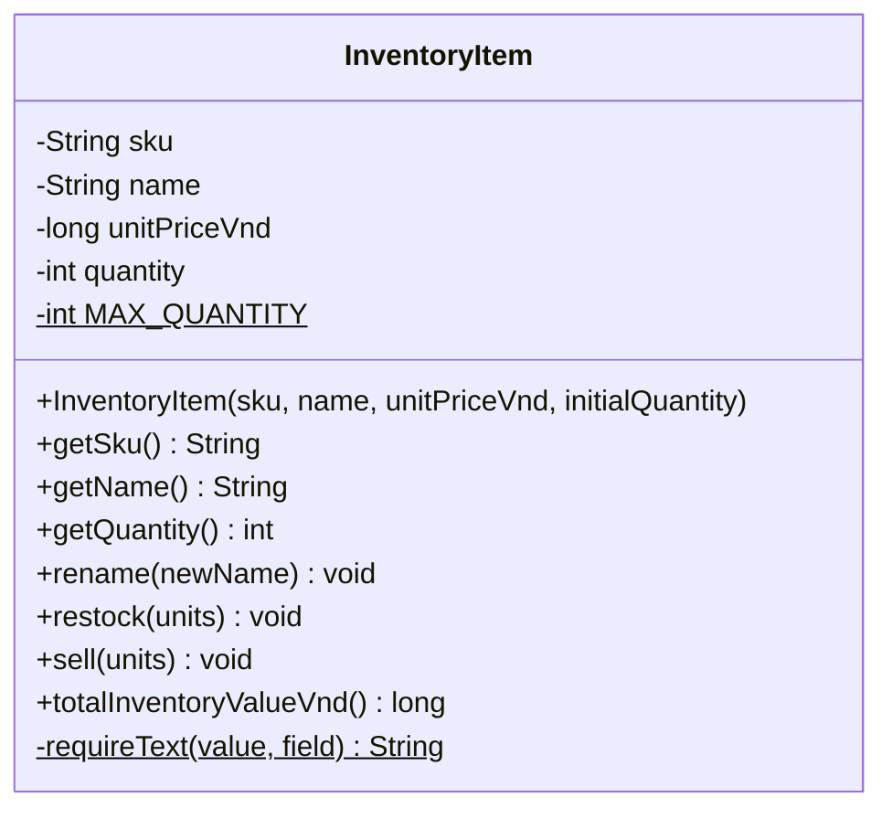
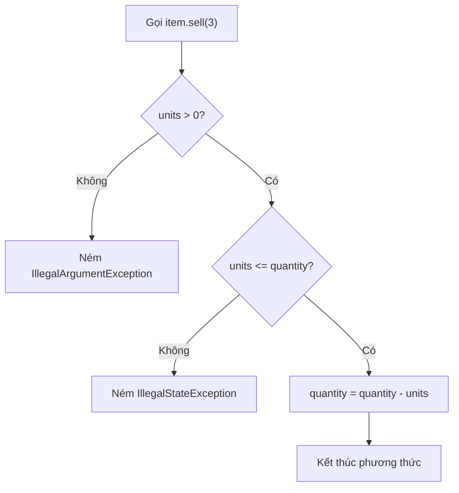

# Cấu trúc lớp trong Java: thuộc tính và phương thức

Một **lớp (class)** là bản mô tả cho các đối tượng cùng loại. Trong lớp, **thuộc tính (field)** lưu trạng thái và **phương thức (method)** định nghĩa những việc đối tượng có thể thực hiện. Hai phần này phối hợp với nhau: phương thức đọc hoặc thay đổi thuộc tính theo những quy tắc mà lớp chịu trách nhiệm bảo vệ.

Ví dụ, một mặt hàng trong kho có mã hàng, tên, đơn giá và số lượng tồn. Khi nhập hoặc bán hàng, số lượng thay đổi; mã hàng vẫn giữ nguyên. Thay vì cho mã bên ngoài sửa số lượng tùy ý, lớp `InventoryItem` cung cấp các phương thức `restock()` và `sell()` để kiểm tra trước khi thay đổi.

## 1. Nhìn tổng thể cấu trúc một lớp

```java
public class Product {
    // Thuộc tính: trạng thái của từng đối tượng
    private final String code;
    private String name;
    private long priceVnd;

    // Constructor: tạo đối tượng với trạng thái ban đầu hợp lệ
    public Product(String code, String name, long priceVnd) {
        this.code = code;
        this.name = name;
        this.priceVnd = priceVnd;
    }

    // Phương thức: đọc trạng thái
    public String getName() {
        return name;
    }

    // Phương thức: thay đổi trạng thái
    public void rename(String newName) {
        this.name = newName;
    }
}
```

Đây là một bản phác thảo cú pháp; ví dụ hoàn chỉnh ở phần sau bổ sung kiểm tra dữ liệu đầu vào.

| Thành phần | Ví dụ | Vai trò |
| --- | --- | --- |
| Khai báo lớp | `public class Product` | Định nghĩa kiểu đối tượng; tên lớp thường dùng PascalCase |
| Thuộc tính | `private String name;` | Giữ dữ liệu thuộc về đối tượng |
| Constructor | `public Product(...)` | Thiết lập trạng thái khi gọi `new Product(...)` |
| Phương thức | `public void rename(...)` | Cung cấp thao tác mà đối tượng cho phép |
| Tham số | `String newName` | Dữ liệu nhận vào khi gọi phương thức |
| Kiểu trả về | `String`, `long`, `void` | Quy định kết quả trả về, hoặc `void` nếu không trả kết quả |
| Bộ điều khiển truy cập | `private`, `public` | Quyết định nơi nào có thể sử dụng thành phần |
| `this` | `this.name = newName` | Tham chiếu đến chính đối tượng đang thực thi phương thức |

Sơ đồ lớp mô tả các thành phần mà chưa cần đi vào cách chúng được triển khai:



Trong ký hiệu UML, `+` là `public`, `-` là `private`; dấu `$` ở đây biểu thị thành phần `static`.

## 2. Thuộc tính lưu trạng thái như thế nào?

Một field được khai báo **trực tiếp trong thân lớp, bên ngoài các phương thức**:

```java
private final String sku;
private String name;
private final long unitPriceVnd;
private int quantity;
```

- `sku` nhận giá trị khi khởi tạo và không được gán lại sau đó vì có `final`.
- `name` có thể đổi thông qua phương thức được lớp kiểm soát.
- `unitPriceVnd` dùng `long` để lưu số tiền nguyên theo đơn vị đồng; không dùng `double` cho một ví dụ cần số tiền nguyên chính xác.
- `quantity` là trạng thái thay đổi khi nhập, bán hàng.

Mỗi lần `new InventoryItem(...)` tạo một đối tượng, đối tượng đó có **bộ giá trị riêng cho các instance field**. Bán hàng ở đối tượng A không tự làm giảm tồn kho của đối tượng B.

### Instance field, static field và biến cục bộ

| Loại | Nơi khai báo | Sở hữu / vòng đời |
| --- | --- | --- |
| Instance field | Trong lớp, không có `static` | Mỗi đối tượng giữ một giá trị riêng |
| Static field | Trong lớp, có `static` | Thuộc về lớp, được chia sẻ giữa các đối tượng |
| Local variable | Trong thân phương thức/khối lệnh | Chỉ tồn tại trong phạm vi thực thi của khối đó |
| Parameter | Trong danh sách tham số phương thức | Là biến cục bộ nhận giá trị lúc gọi |

Ví dụ `private static final int MAX_QUANTITY = 1_000_000;` là một hằng giới hạn chung của lớp, không cần mỗi đối tượng giữ một bản sao về mặt ngữ nghĩa. `int units` trong `sell(int units)` là tham số, còn `int remaining = quantity - units;` (nếu khai báo trong phương thức) là biến cục bộ.

`final` ngăn gán lại **biến/field đó** sau khi được khởi tạo, nhưng không có nghĩa mọi đối tượng được tham chiếu bởi field đều bất biến. `private` giới hạn quyền truy cập từ bên ngoài lớp; nó không tự động khiến dữ liệu hợp lệ, nên phương thức và constructor vẫn phải kiểm tra.

## 3. Phương thức xác định hành vi và giao diện sử dụng

Một khai báo phương thức có dạng:

```java
public void restock(int units) {
    // thân phương thức
}
```

Phân tích: `public` là mức truy cập; `void` là kiểu trả về; `restock` là tên; `int units` là tham số; phần trong `{ ... }` là logic thực thi. Một phương thức trả dữ liệu sẽ khai báo kiểu phù hợp và dùng `return`:

```java
public int getQuantity() {
    return quantity;
}
```

Có thể phân nhóm theo **trách nhiệm**:

- Phương thức truy vấn (`getQuantity()`, `totalInventoryValueVnd()`) cung cấp thông tin mà không chủ động sửa trạng thái.
- Phương thức tác động (`restock()`, `sell()`, `rename()`) thực hiện hành vi và có thể làm thay đổi trạng thái.
- Phương thức trợ giúp `private` tái sử dụng logic nội bộ, không trở thành API công khai của đối tượng.

Tên phương thức nên là động từ hoặc cụm mô tả kết quả rõ ràng. Một phương thức có thể nhận nhiều tham số; Java cũng hỗ trợ **overloading** (cùng tên, khác danh sách kiểu/số lượng tham số). Chỉ khác kiểu trả về thì chưa đủ để overload.

## 4. Ví dụ hoàn chỉnh: lớp quản lý tồn kho

Tạo file `InventoryItem.java`. Ví dụ dùng Java 11 trở lên vì có `String.isBlank()` và `String.strip()`.

```java
public final class InventoryItem {
    private static final int MAX_QUANTITY = 1_000_000;

    private final String sku;
    private String name;
    private final long unitPriceVnd;
    private int quantity;

    public InventoryItem(String sku, String name,
                         long unitPriceVnd, int initialQuantity) {
        this.sku = requireText(sku, "sku");
        this.name = requireText(name, "name");

        if (unitPriceVnd < 0) {
            throw new IllegalArgumentException("Giá không được âm");
        }
        if (initialQuantity < 0 || initialQuantity > MAX_QUANTITY) {
            throw new IllegalArgumentException("Số lượng ban đầu không hợp lệ");
        }

        this.unitPriceVnd = unitPriceVnd;
        this.quantity = initialQuantity;
    }

    public String getSku() {
        return sku;
    }

    public String getName() {
        return name;
    }

    public int getQuantity() {
        return quantity;
    }

    public void rename(String newName) {
        this.name = requireText(newName, "name");
    }

    public void restock(int units) {
        if (units <= 0) {
            throw new IllegalArgumentException("Số nhập phải dương");
        }
        if (units > MAX_QUANTITY - quantity) {
            throw new IllegalArgumentException("Vượt giới hạn tồn kho");
        }
        quantity += units;
    }

    public void sell(int units) {
        if (units <= 0) {
            throw new IllegalArgumentException("Số bán phải dương");
        }
        if (units > quantity) {
            throw new IllegalStateException("Không đủ hàng trong kho");
        }
        quantity -= units;
    }

    public long totalInventoryValueVnd() {
        return Math.multiplyExact(unitPriceVnd, (long) quantity);
    }

    private static String requireText(String value, String field) {
        if (value == null || value.isBlank()) {
            throw new IllegalArgumentException(field + " không được trống");
        }
        return value.strip();
    }
}
```

Điểm cần quan sát trong cấu trúc trên:

1. **Field `private`, phương thức `public`:** mã bên ngoài hỏi số lượng qua `getQuantity()` và thay đổi nó qua hành vi hợp lệ; không được thực hiện `item.quantity = -10`.
2. **Constructor không có kiểu trả về:** tên trùng tên lớp. Nó đảm bảo các đối tượng vừa tạo đã có mã, tên, giá và số lượng hợp lệ.
3. **`this.sku` và `sku`:** vế trái là field của đối tượng, vế phải là tham số constructor. `this` làm rõ hai biến trùng tên.
4. **Trạng thái nhất quán:** `restock()` kiểm tra số dương và giới hạn trước khi cộng; `sell()` kiểm tra số dương và còn đủ hàng trước khi trừ. Khi kiểm tra thất bại, `quantity` chưa bị thay đổi.
5. **Dữ liệu suy ra qua phương thức:** tổng giá trị kho bằng đơn giá nhân số lượng hiện tại nên được tính từ hai field. Không lưu thêm field `totalValue` dễ bị quên cập nhật. `Math.multiplyExact` báo lỗi nếu phép nhân `long` tràn số.
6. **`static`:** `MAX_QUANTITY` và `requireText()` gắn với lớp vì không cần trạng thái của một mặt hàng cụ thể. Ngược lại, `sell()` dùng `quantity` của từng đối tượng, nên là instance method.

### Chạy thử đối tượng

Tạo file `Main.java` cùng thư mục:

```java
public class Main {
    public static void main(String[] args) {
        InventoryItem item =
                new InventoryItem("KB-01", "Bàn phím", 129_000, 10);

        item.restock(5);               // 10 -> 15
        item.sell(3);                  // 15 -> 12
        item.rename("Bàn phím cơ");

        System.out.println(item.getSku());                    // KB-01
        System.out.println(item.getName());                   // Bàn phím cơ
        System.out.println(item.getQuantity());               // 12
        System.out.println(item.totalInventoryValueVnd());    // 1548000

        try {
            item.sell(20);
        } catch (IllegalStateException ex) {
            System.out.println(ex.getMessage()); // Không đủ hàng trong kho
        }

        System.out.println(item.getQuantity()); // Vẫn là 12
    }
}
```

Biên dịch và chạy bằng:

```bash
javac InventoryItem.java Main.java
java Main
```

Luồng xử lý của `item.sell(3)`:



Ngay trước lời gọi, `quantity = 15`. Điều kiện được thỏa mãn nên field thành `12`. Với `sell(20)`, điều kiện đủ hàng sai, ngoại lệ được ném ra và số lượng **vẫn là 12**. Đây là giá trị thực tế của việc đặt logic ở phương thức thay vì cho bên ngoài sửa field trực tiếp.

### Hai đối tượng từ cùng một lớp

```java
InventoryItem a = new InventoryItem("A", "Chuột", 200_000, 2);
InventoryItem b = new InventoryItem("B", "Bàn phím", 500_000, 4);

a.restock(3);

System.out.println(a.getQuantity()); // 5
System.out.println(b.getQuantity()); // 4
```

`InventoryItem` là lớp; `a` và `b` tham chiếu tới **hai đối tượng khác nhau**. Cả hai có cùng tập tên field/phương thức nhưng trạng thái độc lập.

## 5. Phân biệt field, property và phương thức

Trong cách nói phổ thông về OOP, “thuộc tính” thường chỉ dữ liệu đặc trưng của đối tượng. Trong Java cơ bản, trường dữ liệu khai báo bằng `private int quantity;` được gọi chính xác là **field**. Một “property” trong ngôn ngữ thiết kế có thể là giá trị được công bố qua `getQuantity()` hoặc được tính qua `totalInventoryValueVnd()`; Java không có cú pháp property tự động giống một số ngôn ngữ khác.

Không phải field nào cũng cần getter/setter. Nếu viết `setQuantity(int x)` công khai và chấp nhận mọi số nguyên, người dùng lớp có thể bỏ qua quy tắc nhập/bán hàng. Trong trường hợp này, hai hành vi `restock()` và `sell()` diễn tả nghiệp vụ và kiểm soát điều kiện tốt hơn. Tương tự, không cần setter cho `sku` vì danh tính mặt hàng đã được xác định lúc khởi tạo.

### Phạm vi truy cập thường gặp

| Modifier | Truy cập điển hình | Khi nào phù hợp |
| --- | --- | --- |
| `private` | Chỉ trong chính lớp khai báo | Field và chi tiết triển khai nội bộ |
| Không ghi modifier (package-private) | Trong cùng package | Cộng tác nội bộ giữa các lớp cùng package |
| `protected` | Cùng package và trong lớp con theo quy tắc Java | Thành phần dành cho mở rộng bằng kế thừa |
| `public` | Mọi nơi có quyền truy cập tới lớp | API mà nơi sử dụng lớp cần gọi |

Một lớp có nhiều field `private` nhưng vẫn thể hiện đầy đủ hành vi qua các phương thức `public`. Đây là nền tảng của **đóng gói (encapsulation)**: đối tượng giữ quyền kiểm soát trạng thái của chính nó.

## 6. Những lỗi thiết kế và lỗi Java dễ gặp

| Tình huống | Vì sao có vấn đề | Cách cải thiện |
| --- | --- | --- |
| `public int quantity;` | Mã bên ngoài có thể đặt số lượng âm | Giữ `private`, cung cấp hành vi có kiểm tra |
| Constructor gán trực tiếp tên rỗng | Đối tượng sinh ra ở trạng thái không hợp lệ | Kiểm tra tham số ngay khi tạo |
| `setQuantity(...)` cho mọi nghiệp vụ | Caller phải tự ghi nhớ quy tắc nhập/bán | Đặt tên `restock`, `sell` theo hành vi |
| Tạo field `totalValue` rồi quên đồng bộ | Dữ liệu dư thừa có thể sai | Tính bằng phương thức truy vấn |
| Trùng tên tham số và field nhưng quên `this` | Gán nhầm vào tham số hoặc không cập nhật field | Dùng `this.field = parameter` |
| Lầm `static` là dữ liệu của từng đối tượng | Mọi đối tượng cùng sử dụng một biến chung | Để dữ liệu riêng ở instance field |
| Gọi phương thức instance mà chưa có đối tượng | Không có trạng thái cụ thể để xử lý | Tạo đối tượng bằng `new` trước |
| Chỉ kiểm tra sau khi cập nhật field | Ngoại lệ có thể để lại trạng thái sai | Xác thực toàn bộ điều kiện trước khi thay đổi |

Cũng cần nhớ: method không nhất thiết phải sửa field; getter và các phép tính là hành vi hợp lệ. Ngược lại, một lớp có field và method chưa chắc đã được thiết kế tốt nếu trách nhiệm lộn xộn hoặc cho phép phá vỡ quy tắc dữ liệu.

## 7. Tự kiểm tra hiểu biết

Hãy thử thay đổi ví dụ theo ba yêu cầu sau:

1. Thêm `getUnitPriceVnd()` trả về đơn giá, không cho bên ngoài chỉnh giá.
2. Thêm `boolean canSell(int units)` để kiểm tra `units > 0 && units <= quantity` **mà không thay đổi** số lượng.
3. Thử gọi `restock(0)`, `sell(-1)`, `sell(999)` và xác định kiểu ngoại lệ; kiểm tra tồn kho trước/sau mỗi lần gọi.

Khi đọc một lớp Java bất kỳ, hãy tự hỏi: **Field nào biểu diễn trạng thái? Field nào thuộc lớp qua `static`? Constructor đảm bảo điều gì? Phương thức nào đọc hoặc thay đổi trạng thái? Quy tắc nào ngăn đối tượng trở nên không hợp lệ?** Trả lời được những câu hỏi này là đã nắm được cấu trúc cơ bản của lớp gồm thuộc tính và phương thức.