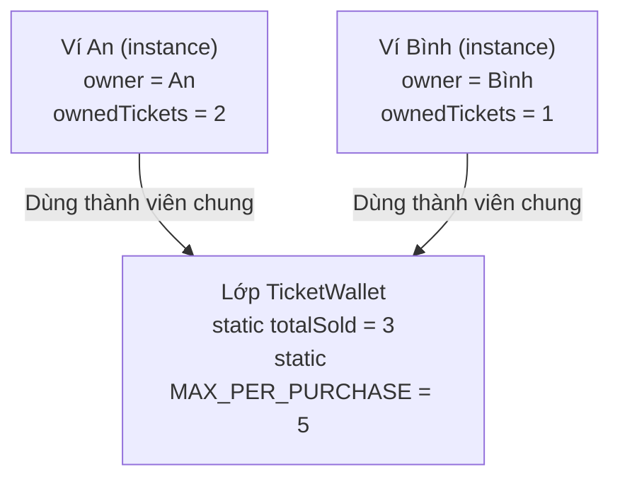

# Thành viên của thể hiện và thành viên dùng chung trong Java

Trong lập trình hướng đối tượng, **lớp (class)** mô tả kiểu đối tượng; còn **thể hiện (instance)** là một đối tượng cụ thể được tạo từ lớp đó. Khi khai báo trường dữ liệu (field) và phương thức (method), Java cho phép chọn thành viên thuộc **từng đối tượng** hoặc thuộc **lớp và được dùng chung** bằng từ khóa `static`.

Sự phân biệt này trả lời hai câu hỏi rất thực tế:

- Dữ liệu này có thuộc riêng một đối tượng cụ thể không? Ví dụ: tên chủ tài khoản, số dư, trạng thái đơn hàng.
- Dữ liệu/hành vi này có ý nghĩa chung cho cả kiểu đối tượng không? Ví dụ: bộ đếm số tài khoản đã tạo, giới hạn cố định, hàm tiện ích không cần trạng thái của một tài khoản.

## 1. Hai loại thành viên

| Tiêu chí | Thành viên của thể hiện (*instance member*) | Thành viên dùng chung (*static member*) |
|---|---|---|
| Cách khai báo | Không có `static` | Có `static` |
| Gắn với | Từng đối tượng | Lớp (trong phạm vi class loader tương ứng) |
| Field được lưu | Mỗi đối tượng có một vị trí lưu riêng | Có một field dùng chung cho các đối tượng của lớp đó |
| Cách truy cập nên dùng | `doiTuong.tenThanhVien` | `TenLop.tenThanhVien` |
| Phương thức có thể truy cập trực tiếp | Field/phương thức instance và static | Thành viên static; muốn dùng instance phải có tham chiếu đối tượng |
| Sử dụng `this` | Được trong ngữ cảnh instance | Không được trong ngữ cảnh static |
| Trường hợp điển hình | `account.balance`, `account.deposit()` | `Account.getTotalCreated()`, `Math.max(a, b)` |

**Chú ý:** `static` không đồng nghĩa với `public` hay `final`. Đây là ba ý nghĩa khác nhau: `static` xác định nơi thành viên thuộc về; `public/private` quy định quyền truy cập; `final` hạn chế việc gán lại hoặc ghi đè tùy loại thành viên.

## 2. Ví dụ thực hành: ví lưu vé xem sự kiện

Đặt yêu cầu: mỗi khách hàng có một ví lưu vé và giữ số vé riêng của mình. Đồng thời, hệ thống cần đếm tổng số vé đã bán trên tất cả các ví trong chương trình đang chạy.

Tạo một tệp **Demo.java** và chạy với Java 17 trở lên:

```java
public class Demo {
    public static void main(String[] args) {
        TicketWallet an = new TicketWallet("An");
        TicketWallet binh = new TicketWallet("Bình");

        an.buyTickets(2);
        binh.buyTickets(1);

        System.out.println(an.getOwner() + ": " + an.getOwnedTickets());
        System.out.println(binh.getOwner() + ": " + binh.getOwnedTickets());
        System.out.println("Tổng vé đã bán: " + TicketWallet.getTotalSold());
    }
}

class TicketWallet {
    // Dùng chung cho mọi TicketWallet trong phạm vi lớp đã nạp.
    private static int totalSold = 0;

    // Hằng số dùng chung: không cần một bản sao ở mỗi ví.
    public static final int MAX_PER_PURCHASE = 5;

    // Mỗi đối tượng TicketWallet có trạng thái của riêng mình.
    private final String owner;
    private int ownedTickets;

    public TicketWallet(String owner) {
        if (owner == null || owner.isBlank()) {
            throw new IllegalArgumentException("Tên chủ ví không hợp lệ");
        }
        this.owner = owner;
        this.ownedTickets = 0;
    }

    // Phương thức instance: tác động lên chính ví được gọi.
    public void buyTickets(int quantity) {
        if (quantity <= 0 || quantity > MAX_PER_PURCHASE) {
            throw new IllegalArgumentException("Số vé mỗi lần mua phải từ 1 đến 5");
        }

        this.ownedTickets += quantity; // Chỉ thay đổi ví hiện tại.
        totalSold += quantity;         // Thay đổi bộ đếm chung.
    }

    public String getOwner() {
        return owner;
    }

    public int getOwnedTickets() {
        return ownedTickets;
    }

    // Phương thức static: không cần một ví cụ thể để trả lời.
    public static int getTotalSold() {
        return totalSold;
    }
}
```

Kết quả:

```text
An: 2
Bình: 1
Tổng vé đã bán: 3
```

Quan sát từng bước:

1. `new TicketWallet("An")` tạo ví An với `ownedTickets = 0`.
2. `new TicketWallet("Bình")` tạo ví Bình với `ownedTickets = 0`. Hai ví là hai đối tượng khác nhau.
3. `an.buyTickets(2)` làm `an.ownedTickets = 2` và `TicketWallet.totalSold = 2`.
4. `binh.buyTickets(1)` làm `binh.ownedTickets = 1` và `TicketWallet.totalSold = 3`. Số vé của An vẫn là 2.

Hình dung mối quan hệ:



Sơ đồ thể hiện **quyền sở hữu logic**, không phải bản đồ bố trí byte trong bộ nhớ JVM. Mỗi instance có các field riêng; cả hai nhìn thấy cùng một `TicketWallet.totalSold` trong phạm vi lớp được nạp đó.

## 3. Field instance: trạng thái của từng đối tượng

Một field khai báo không có `static` là field instance:

```java
class Lamp {
    private boolean on; // Mặc định là false cho mỗi đèn.

    public void turnOn() {
        this.on = true;
    }

    public boolean isOn() {
        return on;
    }
}
```

Sử dụng:

```java
Lamp bedroom = new Lamp();
Lamp kitchen = new Lamp();

bedroom.turnOn();

System.out.println(bedroom.isOn()); // true
System.out.println(kitchen.isOn()); // false
```

Cả hai cùng là `Lamp` nhưng bật đèn phòng ngủ không thể tự làm thay đổi trạng thái của đèn nhà bếp. Đây là khả năng **đóng gói trạng thái riêng** rất quan trọng của OOP.

Field instance có giá trị mặc định khi đối tượng được khởi tạo (ví dụ `int = 0`, `boolean = false`, tham chiếu `= null`), trừ khi code gán giá trị khác. Mỗi lần tạo một đối tượng mới, các field instance được khởi tạo cho đối tượng mới ấy. Nếu hai field tham chiếu cùng trỏ đến một đối tượng khác, đối tượng được trỏ tới vẫn có thể được chia sẻ; “field riêng” không có nghĩa toàn bộ đồ thị dữ liệu đều độc lập.

## 4. Field static: dữ liệu gắn với lớp

Khai báo `static` khi thông tin **thực sự áp dụng cho toàn lớp**:

```java
class Player {
    private static int createdCount;
    private final String nickname;

    public Player(String nickname) {
        this.nickname = nickname;
        createdCount++;
    }

    public static int getCreatedCount() {
        return createdCount;
    }

    public String getNickname() {
        return nickname;
    }
}
```

```java
Player p1 = new Player("Fox");
Player p2 = new Player("Bear");

System.out.println(p1.getNickname());     // Fox
System.out.println(p2.getNickname());     // Bear
System.out.println(Player.getCreatedCount()); // 2
```

`nickname` là thuộc tính của từng người chơi. `createdCount` là số lượng *lượt tạo instance* được constructor ghi nhận trong lần chạy hiện tại; không phải số người chơi còn sống, số bản ghi trong database hay số lượng trên tất cả máy chủ.

**Phân biệt `static` với hằng số:**

```java
class Pricing {
    public static final int MAX_DISCOUNT_PERCENT = 30;
    private static int successfulOrders = 0;
}
```

- `MAX_DISCOUNT_PERCENT` là hằng số kiểu nguyên, gắn với lớp, không thể gán lại.
- `successfulOrders` cũng gắn với lớp nhưng có thể đổi theo thời gian; nó là **trạng thái dùng chung có thể thay đổi**.
- `final` trên một biến tham chiếu chỉ ngăn biến trỏ sang đối tượng khác; không tự động làm đối tượng bên trong bất biến.

Ví dụ dễ nhầm:

```java
private static final java.util.List<String> NAMES =
        new java.util.ArrayList<>();

// NAMES = new java.util.ArrayList<>(); // Lỗi: không thể gán lại.
// NAMES.add("An");                       // Vẫn hợp lệ: nội dung list có thể đổi.
```

Nếu cần danh sách bất biến, có thể dùng `List.of("An", "Bình")` cùng quy tắc kiểm soát dữ liệu phù hợp.

## 5. Phương thức instance và phương thức static

Phương thức instance thực thi trong ngữ cảnh **một đối tượng nhận lời gọi**, nên có thể dùng `this`, đọc/sửa field instance, và gọi các phương thức instance khác.

```java
class Rectangle {
    private final double width;
    private final double height;

    Rectangle(double width, double height) {
        this.width = width;
        this.height = height;
    }

    public double area() {        // Instance method
        return width * height;
    }

    public static boolean isValidSize(double width, double height) {
        return width > 0 && height > 0; // Static method
    }
}
```

```java
Rectangle r = new Rectangle(3, 4);
System.out.println(r.area());                     // 12.0
System.out.println(Rectangle.isValidSize(3, 4));  // true
```

`area()` cần kích thước của **một hình chữ nhật cụ thể**. `isValidSize(width, height)` nhận đủ dữ liệu qua tham số, không cần biết một hình chữ nhật nào đang tồn tại; vì vậy có thể để `static`.

Một phương thức `static` **không được trực tiếp** đọc field instance hoặc sử dụng `this`:

```java
class Student {
    private String name;

    public static void printNameWrong() {
        // System.out.println(name); // Lỗi biên dịch:
        // non-static variable name cannot be referenced from a static context
        // System.out.println(this.name); // Cũng lỗi: không có this.
    }

    public static void printName(Student student) {
        System.out.println(student.name); // Hợp lệ nhờ đối tượng student.
    }

    public void printMyName() {
        System.out.println(this.name);    // Hợp lệ trong instance method.
    }
}
```

Điều quan trọng: phương thức static **vẫn có thể sử dụng dữ liệu của đối tượng** nếu được cung cấp tham chiếu tới đối tượng (ví dụ qua tham số). Nó chỉ không có một `this` ngầm định.

Về cú pháp, Java cho phép gọi một phương thức static qua biểu thức tham chiếu đối tượng, nhưng nên gọi qua **tên lớp**: `TicketWallet.getTotalSold()`. Điều đó truyền đạt đúng ý nghĩa và tránh hiểu nhầm rằng mỗi ví có bộ đếm riêng.

## 6. Khởi tạo và vòng đời: chuyện gì xảy ra khi tạo đối tượng?

Trong một tình huống đơn giản (không xét quan hệ kế thừa), trình tự khái quát như sau:

1. Khi lớp được sử dụng theo cách yêu cầu khởi tạo, JVM thực hiện khởi tạo lớp: chạy các phép gán field static và khối `static { ... }` theo thứ tự trong mã nguồn. Việc này xảy ra một lần cho **mỗi lần khởi tạo lớp trong một class loader**, chứ không lặp lại mỗi lần `new`.
2. Với mỗi lần `new`, Java cấp phát một instance, khởi tạo field instance và khối khởi tạo instance, rồi thực thi phần thân constructor.
3. Khi thay đổi field static, các instance cùng thuộc lớp được nạp ấy quan sát trạng thái chung. Khi thay đổi field instance, trạng thái gắn với instance nhận tác động.

Ví dụ:

```java
class Sample {
    static int shared = 10;
    int local = 1;

    Sample() {
        local++;
        shared++;
    }
}

Sample a = new Sample(); // a.local = 2; shared = 11
Sample b = new Sample(); // b.local = 2; shared = 12
a.local += 5;

System.out.println(a.local);      // 7
System.out.println(b.local);      // 2
System.out.println(Sample.shared); // 12
```

Không nên hình dung `static` là “một biến duy nhất toàn bộ thế giới”. Những JVM/process khác nhau có trạng thái riêng; ứng dụng nhiều máy chủ không tự đồng bộ các field static. Mỗi class loader cũng có thể nạp cùng một tên lớp như những lớp riêng. Ngoài ra, field static **không phải nơi lưu dữ liệu bền vững**: khởi động lại ứng dụng không đảm bảo giữ giá trị trước đó.

## 7. Kế thừa: override instance method khác với static method hiding

Các phương thức instance có thể tham gia **đa hình động**: phiên bản được gọi phụ thuộc kiểu đối tượng thực tế. Phương thức static không được override theo nghĩa đó; khi một lớp con khai báo phương thức static cùng chữ ký, đây là **method hiding**.

```java
class Animal {
    public static String group() {
        return "Animal";
    }

    public String sound() {
        return "...";
    }
}

class Dog extends Animal {
    public static String group() {
        return "Dog";
    }

    @Override
    public String sound() {
        return "Gâu";
    }
}

Animal pet = new Dog();
System.out.println(pet.sound());   // Gâu: đa hình instance.
System.out.println(pet.group());   // Animal: chọn static theo kiểu tham chiếu.
System.out.println(Dog.group());   // Dog: gọi rõ tên lớp.
```

Dòng `pet.group()` chỉ nhằm minh họa quy tắc ngôn ngữ; trong code thực tế nên viết `Animal.group()` hoặc `Dog.group()`. Không đặt `@Override` lên phương thức static và đừng dựa vào static dispatch để triển khai hành vi cần đa hình.

## 8. Rủi ro của trạng thái dùng chung: nhiều luồng và kiểm thử

Trường `static` có thể thay đổi giúp đếm hoặc chia sẻ cấu hình trong một JVM, nhưng cũng tạo ra điểm chung mà nhiều phần code có thể cùng tác động. Ví dụ `totalSold += quantity` là thao tác đọc–cộng–ghi, **không nguyên tử**. Nếu nhiều luồng mua vé cùng lúc, tổng có thể bị thiếu do cập nhật chồng lấn.

Khi thật sự cần một bộ đếm trong bộ nhớ JVM được nhiều luồng cập nhật, có thể dùng `AtomicInteger`:

```java
import java.util.concurrent.atomic.AtomicInteger;

class SalesMetrics {
    private static final AtomicInteger TOTAL_SOLD = new AtomicInteger();

    public static void recordSale(int quantity) {
        if (quantity <= 0) {
            throw new IllegalArgumentException("quantity phải > 0");
        }
        TOTAL_SOLD.addAndGet(quantity);
    }

    public static int getTotalSold() {
        return TOTAL_SOLD.get();
    }
}
```

`AtomicInteger` bảo đảm các thao tác nguyên tử **trên chính bộ đếm này**, nhưng không tự bảo đảm tính nhất quán của cả quy trình mua vé, lưu đơn hàng, hoàn tiền hay các máy chủ khác nhau. Trong hệ thống thực tế, tổng doanh số có thể cần được xác định từ database hoặc dịch vụ quản lý giao dịch, tùy yêu cầu chính xác.

Field static thay đổi được cũng có thể làm các bài kiểm thử ảnh hưởng lẫn nhau do trạng thái lưu lại giữa các test. Không nên biến mọi dữ liệu thành static chỉ để dễ truy cập.

## 9. Cách chọn trong thiết kế thực tế

| Nhu cầu | Nên chọn | Lý do |
|---|---|---|
| Tên, trạng thái, số dư của một tài khoản | Instance field | Mỗi tài khoản có dữ liệu riêng |
| `deposit(amount)`, `withdraw(amount)` | Instance method | Hành vi tác động lên một tài khoản xác định |
| Giới hạn cố định chung, ví dụ `MAX_RETRY` | `static final` | Một quy tắc chung, không cần sao chép theo đối tượng |
| Hàm thuần túy `Math.abs(x)` | Static method | Đầu ra chỉ phụ thuộc đầu vào, không cần `this` |
| Bộ đếm đối tượng tạo trong một JVM | Có thể là static field | Được chia sẻ trong phạm vi lớp được nạp; chú ý đồng thời |
| Số người dùng đăng ký trên toàn hệ thống | Kho dữ liệu/dịch vụ phù hợp | Phải đúng qua nhiều tiến trình, lần khởi động và máy chủ |
| Dữ liệu thay đổi theo từng request hoặc người dùng | Thường là instance / request scope | Tránh rò rỉ trạng thái giữa những người dùng |

**Quy tắc quyết định:** Nếu xóa một instance thì ý nghĩa dữ liệu của instance đó cũng biến mất, dữ liệu thường là instance field. Nếu hành vi không cần đối tượng nhận lời gọi, cân nhắc static method. Nếu dữ liệu phải dùng chung và thay đổi, hãy xét phạm vi chia sẻ, khả năng đồng thời, vòng đời và nhu cầu lưu trữ trước khi chọn static field.

## 10. Tự kiểm tra hiểu bài

**Câu 1.** Hai đối tượng `Counter` đều có field `int value` không static. Tăng `a.value` có làm `b.value` tăng?  
**Đáp án:** Không, trừ khi có logic khác chủ động cập nhật `b`.

**Câu 2.** `static int count` có được tạo lại mỗi lần `new Counter()`?  
**Đáp án:** Không. Nó thuộc lớp trong phạm vi class loader; constructor có thể cập nhật giá trị ấy nhưng không tạo một field static mới cho mỗi instance.

**Câu 3.** Một phương thức static có thể truy cập `user.name` không?  
**Đáp án:** Có, nếu nó có tham chiếu `user` hợp lệ và quyền truy cập cho phép. Điều bị cấm là truy cập `name` như thể đã có sẵn một `this`.

**Câu 4.** `static final List<String>` có luôn bất biến không?  
**Đáp án:** Không. `final` chỉ ngăn gán lại biến tham chiếu; danh sách vẫn có thể thay đổi nếu đối tượng cho phép.

**Câu 5.** Có nên dùng field static để lưu tổng tiền thanh toán của mọi khách hàng trên nhiều máy chủ?  
**Đáp án:** Không phù hợp làm nguồn dữ liệu chuẩn. Static field không đồng bộ xuyên JVM và không tự tồn tại bền vững sau khi khởi động lại.

**Ghi nhớ khi đọc code Java:** Hỏi thành viên được khai báo có `static` hay không, nó lưu trạng thái thuộc **ai**, có cần `this` hay không, và trạng thái ấy phải được chia sẻ trong **phạm vi nào**. Trả lời bốn câu hỏi này thường đủ để chọn giữa thành viên của thể hiện và thành viên dùng chung một cách đúng đắn.