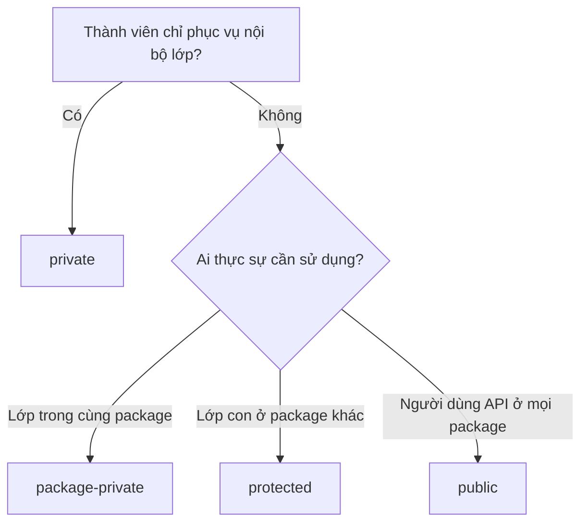

# Phạm vi truy cập của thành viên trong Java

Khi thiết kế một lớp theo OOP, **phạm vi truy cập** (*access level*) xác định mã ở đâu được phép sử dụng thành viên của lớp đó: thuộc tính (*field*), phương thức (*method*), hàm tạo (*constructor*) và kiểu lồng nhau (*nested type*). Java kiểm soát quyền truy cập ngay lúc biên dịch, nhờ đó lớp có thể công khai các thao tác cần thiết nhưng giữ kín dữ liệu và chi tiết triển khai.

Ví dụ, đối tượng sinh viên có mã sinh viên cần được đọc từ bên ngoài, nhưng số tín chỉ không nên bị sửa tùy ý. Ta có thể công khai phương thức đọc, đồng thời hạn chế phương thức tăng tín chỉ để giữ các quy tắc nghiệp vụ.

## 1. Bốn mức truy cập thành viên

| Khai báo | Ý nghĩa | Trường hợp sử dụng |
|---|---|---|
| `private` | Chỉ truy cập trực tiếp bên trong lớp khai báo (kể cả các kiểu lồng nhau theo quy tắc Java) | Dữ liệu nội bộ, hàm hỗ trợ, kiểm tra đầu vào |
| *package-private* (không ghi từ khóa) | Các lớp thuộc **cùng package** truy cập được | Hàm hỗ trợ nội bộ của một package |
| `protected` | Các lớp cùng package truy cập được; lớp con ở package khác được truy cập với điều kiện riêng | Điểm mở rộng dành cho lớp kế thừa |
| `public` | Mã ở mọi package có thể truy cập nếu bản thân kiểu chứa thành viên cũng truy cập được | API mà lớp muốn cung cấp ra ngoài |

Trong Java, *package-private* là tên gọi của quyền truy cập mặc định khi **không viết access modifier**. Không có cú pháp `default int score;` cho field: `default` là từ khóa dùng trong những ngữ cảnh khác, chẳng hạn phương thức `default` của interface.

### Bảng quyền truy cập

Giả sử thành viên được khai báo trong một lớp `public`, và mã muốn sử dụng cũng nhìn thấy lớp đó:

| Vị trí mã truy cập | `private` | Không ghi modifier | `protected` | `public` |
|---|:---:|:---:|:---:|:---:|
| Bên trong chính lớp khai báo | ✅ | ✅ | ✅ | ✅ |
| Lớp khác, cùng package | ❌ | ✅ | ✅ | ✅ |
| Lớp con, khác package | ❌ | ❌ | ✅* | ✅ |
| Lớp không kế thừa, khác package | ❌ | ❌ | ❌ | ✅ |

**(*) Ngoại lệ quan trọng của `protected`:** Ở package khác, lớp con chỉ dùng thành viên kế thừa qua `this`, `super` hoặc biểu thức có kiểu phù hợp là lớp con đó (hay một lớp con của nó). Không thể lấy một tham chiếu có kiểu lớp cha bất kỳ rồi truy cập thành viên `protected` thông qua tham chiếu ấy.

## 2. Ví dụ thực tế: quản lý sinh viên

Xét cấu trúc package:

```text
vn.edu.school
├── domain
│   ├── Student.java
│   └── StudentAudit.java
├── exchange
│   └── ExchangeStudent.java
└── presentation
    └── StudentViewer.java
```

### 2.1. Khai báo các mức truy cập trong một lớp

**`domain/Student.java`**

```java
package vn.edu.school.domain;

public class Student {
    private final String studentId; // Chỉ Student trực tiếp sử dụng
    private int credits;            // Không cho bên ngoài sửa tùy ý
    String internalNote;            // Package-private: cùng package

    public Student(String studentId) {
        this.studentId = requireValidId(studentId);
    }

    public String getStudentId() {
        return studentId;
    }

    public int getCredits() {
        return credits;
    }

    protected void addCredits(int amount) {
        if (amount <= 0) {
            throw new IllegalArgumentException("Số tín chỉ phải dương");
        }
        credits += amount;
    }

    private static String requireValidId(String id) {
        if (id == null || id.isBlank()) {
            throw new IllegalArgumentException("Mã sinh viên không hợp lệ");
        }
        return id;
    }
}
```

Trong ví dụ này:

- `studentId` và `credits` là `private`, nên các lớp bên ngoài không thể trực tiếp sửa chúng.
- `getStudentId()`, `getCredits()` và constructor là `public`: mã khác có thể tạo và đọc thông tin đối tượng.
- `internalNote` không có modifier, chỉ các lớp thuộc `vn.edu.school.domain` được truy cập trực tiếp.
- `addCredits()` là `protected` để lớp con có thể mở rộng hành vi có kiểm tra.
- `requireValidId()` là `private`: người sử dụng `Student` không cần biết cách kiểm tra mã.

### 2.2. Lớp khác cùng package

**`domain/StudentAudit.java`**

```java
package vn.edu.school.domain;

class StudentAudit {
    void markReviewed(Student student) {
        student.internalNote = "Đã kiểm tra"; // Hợp lệ: cùng package
        student.addCredits(3);                // Hợp lệ: protected cũng mở cho package
        System.out.println(student.getCredits()); // public

        // student.credits = 99; // LỖI BIÊN DỊCH: credits là private
    }
}
```

Hai lớp được xem là cùng package khi khai báo **chính xác cùng tên package**; `vn.edu.school.domain` và `vn.edu.school.domain.audit` là hai package khác nhau. Tên package có quan hệ tiền tố không tạo quan hệ truy cập đặc biệt.

### 2.3. Lớp con thuộc package khác: điểm khó của protected

**`exchange/ExchangeStudent.java`**

```java
package vn.edu.school.exchange;

import vn.edu.school.domain.Student;

public class ExchangeStudent extends Student {
    public ExchangeStudent(String studentId) {
        super(studentId); // Gọi public constructor của Student
    }

    public void recognizeTransferredCredits(int amount) {
        addCredits(amount);       // Hợp lệ: gọi thành viên kế thừa trên this
        this.addCredits(1);       // Hợp lệ: this là ExchangeStudent

        Student other = new Student("S-02");

        // other.addCredits(1);   // LỖI: receiver có kiểu Student
        // other.internalNote = ""; // LỖI: package-private
        // other.credits = 100;   // LỖI: private
    }
}
```

Trong package `vn.edu.school.exchange`, lớp `ExchangeStudent` được dùng `addCredits()` vì kế thừa `Student`. Nhưng biến `other` có kiểu `Student`, nên câu lệnh `other.addCredits(1)` không hợp lệ dù đang viết bên trong lớp con. Đây là lý do không nên hiểu `protected` đơn giản là “lớp con có thể truy cập mọi đối tượng lớp cha”.

Lưu ý: ví dụ cộng thêm 1 tín chỉ ở dòng `this.addCredits(1)` chỉ nhằm minh họa cú pháp truy cập. Trong chương trình thật, mỗi lần cộng tín chỉ phải tuân theo quy trình nghiệp vụ rõ ràng.

### 2.4. Lớp thông thường ở package khác

**`presentation/StudentViewer.java`**

```java
package vn.edu.school.presentation;

import vn.edu.school.domain.Student;

public class StudentViewer {
    public String format(Student student) {
        // student.credits = 100;      // private: không được
        // student.internalNote = "";  // package-private: không được
        // student.addCredits(3);      // protected: không được

        return student.getStudentId() + " - " + student.getCredits();
    }
}
```

`StudentViewer` chỉ sử dụng được API `public` của `Student`. Những giới hạn này giúp giao diện không thể bỏ qua kiểm tra nghiệp vụ bằng cách thay đổi trực tiếp dữ liệu.

## 3. Phạm vi truy cập và tính đóng gói

**Đóng gói (*encapsulation*)** không chỉ là đổi tất cả field thành `private` rồi tạo getter/setter. Mục tiêu là bảo vệ trạng thái hợp lệ của đối tượng, đồng thời chỉ cung cấp thao tác thực sự cần thiết.

Một thiết kế dễ mắc lỗi:

```java
public class ExamResult {
    public int score; // Bất kỳ ai cũng có thể gán -5 hoặc 200
}
```

Thiết kế có kiểm soát:

```java
public class ExamResult {
    private int score;

    public ExamResult(int initialScore) {
        updateScore(initialScore);
    }

    public int getScore() {
        return score;
    }

    public void updateScore(int newScore) {
        if (newScore < 0 || newScore > 100) {
            throw new IllegalArgumentException("Điểm phải từ 0 đến 100");
        }
        this.score = newScore;
    }
}
```

`score` vẫn được đọc từ bên ngoài, nhưng việc sửa điểm bắt buộc đi qua `updateScore()`, nơi quy tắc từ 0 đến 100 luôn được áp dụng. Không nhất thiết tạo setter cho mọi field: với trạng thái không được sửa sau khởi tạo, có thể chỉ cần constructor và getter, kết hợp `private final`.

## 4. Một số quy tắc thường gặp

**Phạm vi của lớp và phạm vi của thành viên là hai chuyện khác nhau.** Một lớp cấp cao nhất (*top-level class*) chỉ có thể khai báo `public` hoặc không ghi modifier (*package-private*), không khai báo `private` hay `protected`. Lớp lồng nhau (*nested class*) có thể dùng cả bốn mức. Dù phương thức là `public`, mã ngoài package cũng không sử dụng được nó thông qua một top-level class mà mã đó không thể truy cập.

**Quy tắc áp dụng cho constructor.** Một constructor `private` thường dùng để kiểm soát cách tạo đối tượng (ví dụ static factory hoặc lớp tiện ích). Constructor `protected` có ích khi muốn hỗ trợ kế thừa. Nếu lớp không khai báo constructor nào, Java sinh constructor mặc định với mức truy cập tương ứng mức truy cập của lớp; đừng nhầm với việc tạo một constructor `public` thủ công.

**Ghi đè phương thức không được giảm quyền truy cập.** Nếu lớp cha khai báo phương thức `protected`, lớp con có thể ghi đè bằng `protected` hoặc `public`, nhưng không được đổi thành `private`.

```java
class Parent {
    protected void validate() {}
}

class Child extends Parent {
    @Override
    public void validate() {} // Hợp lệ: mở rộng quyền truy cập

    // private void validate() {} // Không hợp lệ nếu dùng để override
}
```

**`private` không trở thành quyền truy cập của lớp con.** Lớp con không được trực tiếp sử dụng field hay method `private` của lớp cha; nếu cần hành vi đó, lớp cha nên cung cấp phương thức `protected` hoặc `public` phù hợp.

**Trong interface:** Các field khai báo trong interface mặc nhiên là `public static final`; các abstract method thông thường mặc nhiên là `public`. Interface cũng hỗ trợ `private` method để tái sử dụng logic nội bộ (từ Java 9), nhưng không dùng `protected` hay package-private để khai báo method của interface.

## 5. Chọn mức truy cập thế nào?



Hãy chọn **mức truy cập hẹp nhất đáp ứng đúng nhu cầu**. Ưu tiên `private` cho dữ liệu; chỉ mở `package-private`, `protected` hoặc `public` khi có lý do thiết kế rõ ràng. Tránh công khai field có thể sửa trực tiếp khi lớp phải duy trì ràng buộc nghiệp vụ.

## 6. Tự kiểm tra

1. Lớp `A` có field `int count;`. Lớp `B` ở cùng package có đọc `count` được không? **Có**, vì field mặc định là package-private.
2. Lớp `C extends A` nằm ở package khác có đọc `count` không? **Không**, vì package-private không mở cho lớp con ở package khác.
3. Đổi `count` thành `protected`. Trong `C`, lệnh `this.count` có hợp lệ không? **Có**. Nhưng lệnh `new A().count` trong `C` vẫn **không hợp lệ** khi khác package.
4. Field `private` có bị thay đổi qua phương thức `public` không? **Có thể**, nếu chính lớp cung cấp phương thức công khai thực hiện thay đổi đó. Quyền truy cập kiểm soát *nơi được truy cập trực tiếp*, không có nghĩa trạng thái vĩnh viễn bất biến.

**Ghi nhớ:** `private` bảo vệ chi tiết trong lớp; *package-private* chia sẻ trong package; `protected` hỗ trợ package và kế thừa có điều kiện; `public` tạo giao diện truy cập từ bên ngoài. Hãy thiết kế API theo trách nhiệm của lớp và các bất biến cần bảo vệ.