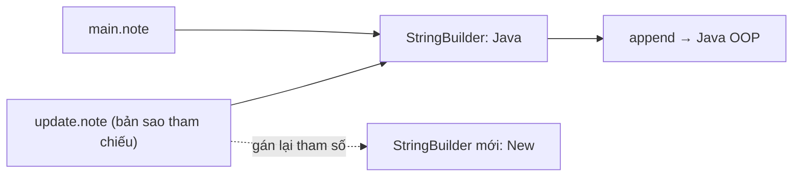

# Tham số, giá trị trả về và tác động của phương thức trong Java

> **Ngữ cảnh:** OOP → Lớp (class). Phương thức mô tả hành vi của đối tượng. Khi gọi một phương thức, ta có thể truyền dữ liệu vào qua **tham số**, nhận **giá trị trả về** và quan sát các **tác động** lên trạng thái hoặc môi trường.

## 1. Đọc cấu trúc một phương thức

```java
public class Rectangle {
    public static double area(double width, double height) {
        if (width <= 0 || height <= 0) {
            throw new IllegalArgumentException("Kích thước phải dương");
        }
        return width * height;
    }

    public static void main(String[] args) {
        double result = area(3.5, 2.0);
        System.out.println(result); // 7.0
    }
}
```

Trong ví dụ:

- `area` là **tên phương thức**, cho biết thao tác được yêu cầu.
- `double width, double height` là **tham số hình thức** (parameters): tên và kiểu dữ liệu đầu vào được khai báo.
- `3.5, 2.0` là **đối số** (arguments): giá trị thực tế được truyền khi gọi.
- `double` trước `area` là **kiểu trả về**, còn `7.0` là **giá trị trả về** của lời gọi cụ thể.
- `return width * height;` đưa kết quả về vị trí gọi và kết thúc lần chạy hiện tại của phương thức.
- Phương thức `area` không sửa dữ liệu bên ngoài; việc `println` trong `main` mới có tác động in ra console.

| Khái niệm | Câu hỏi cần trả lời | Ví dụ |
|---|---|---|
| Tham số | Phương thức cần dữ liệu gì? | `width`, `height` |
| Đối số | Lúc gọi đã đưa giá trị nào vào? | `3.5`, `2.0` |
| Giá trị trả về | Người gọi nhận lại kết quả nào? | `7.0` |
| Tác động | Lời gọi đã làm thay đổi điều gì? | `area` không sửa trạng thái |

**Giá trị trả về khác với tác động:** một phương thức có thể trả kết quả mà không sửa trạng thái, thay đổi trạng thái mà không trả kết quả, hoặc làm cả hai.

## 2. Tham số: hợp đồng dữ liệu đầu vào

Một khai báo có hình thức:

```java
[accessModifier] ReturnType methodName(Type1 param1, Type2 param2) {
    // Thân phương thức
}
```

Các tham số nằm trong phạm vi phương thức; lời gọi phải cung cấp đối số tương thích về kiểu, số lượng và thứ tự (trừ một số trường hợp như varargs). Ví dụ:

```java
public static String formatUser(String name, int age, boolean active) {
    if (name == null || name.isBlank()) {
        throw new IllegalArgumentException("Tên không được để trống");
    }
    if (age < 0) {
        throw new IllegalArgumentException("Tuổi không hợp lệ");
    }
    return name + " (" + age + "), active=" + active;
}

String label = formatUser("An", 20, true);
```

Các lệnh kiểm tra đầu vào có ích vì thông tin hợp lệ là một phần của hợp đồng phương thức. Nếu một phương thức cần số tiền dương, kiểm tra điều kiện này trước khi sử dụng số tiền.

### Nạp chồng phương thức

Java cho phép nhiều phương thức cùng tên nếu **danh sách tham số** khác nhau:

```java
static int multiply(int a, int b) {
    return a * b;
}

static double multiply(double a, double b) {
    return a * b;
}
```

Trình biên dịch xác định phiên bản được gọi dựa vào đối số và quy tắc chọn phương thức. Chỉ thay đổi **kiểu trả về** không tạo thành một overload hợp lệ.

### Tham số mặc định và varargs

Java không có cú pháp tham số mặc định `method(int x = 10)`. Có thể dùng nạp chồng:

```java
static String greeting(String name) {
    return greeting(name, "Xin chào");
}

static String greeting(String name, String prefix) {
    return prefix + ", " + name;
}
```

Nếu số lượng đối số thay đổi, dùng varargs:

```java
static int sum(int... numbers) {
    int total = 0;
    for (int number : numbers) {
        total += number;
    }
    return total;
}

int x = sum();         // 0
int y = sum(2, 4, 6);  // 12
```

`int... numbers` được xử lý như một mảng bên trong phương thức. Tham số varargs phải đứng cuối danh sách tham số.

## 3. Java luôn truyền tham số theo giá trị

Trong Java, **mọi đối số đều được truyền theo giá trị (pass-by-value)**, kể cả khi đối số là một đối tượng. Điều được sao chép phụ thuộc kiểu dữ liệu:

| Tham số | Giá trị được sao chép | Hệ quả |
|---|---|---|
| `int`, `long`, `double`, `boolean`... | Dữ liệu nguyên thủy | Gán lại tham số không thay đổi biến gốc |
| `StringBuilder`, `List`, đối tượng lớp... | Giá trị tham chiếu tới đối tượng | Có thể sửa cùng một đối tượng mutable mà người gọi giữ |
| Tham chiếu được gán sang đối tượng mới | Chỉ bản sao tham chiếu trong phương thức | Biến tham chiếu của người gọi không bị đổi sang đối tượng mới |

Ví dụ Java chạy độc lập:

```java
public class ParameterDemo {
    static void update(int score, StringBuilder note) {
        score = 100;                       // Chỉ sửa bản sao của số
        note.append(" OOP");               // Sửa đối tượng đang được chia sẻ
        note = new StringBuilder("New");   // Chỉ gán lại tham số cục bộ
    }

    public static void main(String[] args) {
        int score = 10;
        StringBuilder note = new StringBuilder("Java");

        update(score, note);

        System.out.println(score); // 10
        System.out.println(note);  // Java OOP
    }
}
```



Ban đầu biến `note` ở `main` và tham số `note` cùng tham chiếu tới một đối tượng. Lệnh `append` thay đổi đối tượng đó nên người gọi nhìn thấy thay đổi. Còn phép gán `note = new StringBuilder(...)` chỉ thay đổi tham số nội bộ.

Với `String`, chuỗi là đối tượng **bất biến**:

```java
static void rename(String name) {
    name = name.toUpperCase();
}

String name = "Lan";
rename(name);
System.out.println(name); // Lan
```

Nếu cần nhận chuỗi mới, phải trả về rồi gán:

```java
static String normalize(String input) {
    return input.trim().toUpperCase();
}

name = normalize(name); // LAN
```

Điều cốt lõi: Java **không truyền biến tham chiếu theo tham chiếu**. Nó truyền **bản sao của giá trị tham chiếu**.

## 4. Giá trị trả về và câu lệnh return

Kiểu trả về nằm trước tên phương thức. Với phương thức có kiểu trả về khác `void`, mỗi đường đi kết thúc bình thường phải trả giá trị phù hợp.

```java
static String grade(int score) {
    if (score < 0 || score > 100) {
        throw new IllegalArgumentException("Điểm không hợp lệ");
    }
    if (score >= 85) return "Giỏi";
    if (score >= 70) return "Khá";
    if (score >= 50) return "Đạt";
    return "Chưa đạt";
}
```

Ở đây, `return` lập tức kết thúc phương thức. Nhánh `throw` kết thúc bất thường, chuyển điều khiển sang nơi xử lý ngoại lệ.

| Kiểu trả về | Ý nghĩa | Ví dụ |
|---|---|---|
| `int`, `long`, `double` | Giá trị số | `return total;` |
| `boolean` | Kết quả đúng/sai hoặc thành công/thất bại | `return balance >= amount;` |
| `String` hoặc đối tượng | Dữ liệu kết quả | `return user;` |
| `Optional<T>` | Có hoặc không có kết quả, với API lựa chọn cách biểu đạt này | `Optional<User>` |
| `void` | Không trả giá trị | `return;` (thoát sớm) |

`void` không đồng nghĩa với “không có tác động”. Phương thức `void` có thể cập nhật trạng thái, in thông tin hoặc lưu dữ liệu.

### Trả về đối tượng có thể làm lộ trạng thái nội bộ

```java
List<String> getNames() {
    return names; // Người gọi có thể sửa trực tiếp nếu names là danh sách mutable
}
```

Giả sử `names` là `ArrayList`, lời gọi `getNames().clear()` sẽ xóa nội dung danh sách mà lớp sở hữu. Một lựa chọn an toàn hơn cho danh sách chuỗi là:

```java
List<String> getNames() {
    return List.copyOf(names);
}
```

`List.copyOf` (Java 10+) tạo danh sách không thể sửa. Đây là bản sao **nông**: nếu các phần tử là đối tượng mutable, chúng vẫn có thể bị thay đổi thông qua tham chiếu khác. Vì vậy cần xét cả kiểu phần tử.

## 5. Tác động của phương thức là gì?

**Tác dụng phụ (side effect)** là thay đổi có thể quan sát được ngoài giá trị trả về: thay đổi trường của đối tượng, sửa collection đầu vào, ghi tệp, in ra console, cập nhật cơ sở dữ liệu, gửi yêu cầu mạng...

| Thao tác | Có thể thay đổi gì? | Ghi chú |
|---|---|---|
| `square(4)` trả `16` | Không có trạng thái ngoài | Ví dụ hàm thuần |
| `account.getBalance()` | Không sửa tài khoản | Kết quả phụ thuộc trạng thái hiện thời |
| `account.deposit(50)` | Trường `balance` | Tác động lên chính đối tượng |
| `items.add("Java")` | Nội dung danh sách | Người giữ cùng danh sách nhìn thấy thay đổi |
| `System.out.println(...)` | Console | I/O là tác dụng phụ |
| `repository.save(entity)` | Dữ liệu lưu trữ | Có thể liên quan giao dịch hoặc lỗi I/O |

**Hàm thuần (pure function)** cho cùng kết quả khi có cùng đầu vào và không có side effect quan sát được. Một hàm đọc `balance` có thể không sửa gì nhưng vẫn phụ thuộc trạng thái đối tượng, vì thế chưa hẳn là hàm thuần theo nghĩa chặt.

Ném ngoại lệ cũng làm thay đổi luồng điều khiển và là hành vi quan sát được. Khi thiết kế hợp đồng phương thức, cần nói rõ khả năng ném ngoại lệ bên cạnh giá trị trả về và các thay đổi trạng thái.

## 6. Ví dụ OOP thực tế: hợp đồng phương thức của bộ đếm tác vụ

Xét một bộ đếm số tác vụ đang chờ xử lý. Ví dụ này tách rõ **đầu vào**, **giá trị trả về** và **tác động lên trạng thái** ngay trong chữ ký và thân từng phương thức. Bộ đếm chỉ mô phỏng số lượng tác vụ, không thực thi công việc thật.

~~~java
public class MethodDemo {
    static final class JobCounter {
        private int pendingJobs;

        JobCounter(int initialJobs) {
            if (initialJobs < 0) {
                throw new IllegalArgumentException("Số tác vụ ban đầu không hợp lệ");
            }
            this.pendingJobs = initialJobs;
        }

        public int getPendingJobs() {
            return pendingJobs; // Chỉ đọc, trả về số tác vụ
        }

        public void addJobs(int count) {
            if (count <= 0) {
                throw new IllegalArgumentException("Số tác vụ thêm phải dương");
            }
            pendingJobs = Math.addExact(pendingJobs, count);
        }

        public boolean completeOne() {
            if (pendingJobs == 0) {
                return false; // Không có việc để hoàn tất, không thay đổi trạng thái
            }
            pendingJobs--;
            return true; // Đã giảm số tác vụ chờ đi một
        }
    }

    public static void main(String[] args) {
        JobCounter jobs = new JobCounter(1);
        jobs.addJobs(2);
        System.out.println(jobs.getPendingJobs()); // 3
        System.out.println(jobs.completeOne());     // true
        System.out.println(jobs.getPendingJobs()); // 2

        try {
            jobs.addJobs(-1);
        } catch (IllegalArgumentException ex) {
            System.out.println("Bị từ chối");
        }
        System.out.println(jobs.getPendingJobs()); // 2

        jobs.completeOne();
        jobs.completeOne();
        System.out.println(jobs.completeOne());     // false
        System.out.println(jobs.getPendingJobs()); // 0
    }
}
~~~

Biên dịch và chạy sau khi lưu thành `MethodDemo.java`:

~~~bash
javac MethodDemo.java
java MethodDemo
~~~

Kết quả:

~~~text
3
true
2
Bị từ chối
2
false
0
~~~

| Phương thức | Tham số | Giá trị trả về | Tác động hoặc lỗi |
| --- | --- | --- | --- |
| `getPendingJobs()` | Không có | `int`: số việc chờ | Không sửa bộ đếm |
| `addJobs(int count)` | Số tác vụ muốn thêm | `void` | Tăng số việc nếu `count > 0`; đối số sai gây `IllegalArgumentException`, tràn số gây `ArithmeticException` trước khi gán |
| `completeOne()` | Không có | `boolean` | Trả `true` và giảm một tác vụ khi còn việc; trả `false` và giữ nguyên khi hết việc |

~~~mermaid
flowchart TD
    A["completeOne()"] --> B{"pendingJobs > 0?"}
    B -->|Không| C["return false; không đổi"]
    B -->|Có| D["pendingJobs--"]
    D --> E["return true"]
~~~

Giả sử ban đầu có một tác vụ: `addJobs(2)` làm bộ đếm từ 1 thành 3. `completeOne()` lần đầu trả `true` **và** giảm bộ đếm còn 2. Khi hết việc, phương thức trả `false` và không giảm dưới 0. `addJobs(-1)` thất bại **trước khi thay đổi** bộ đếm.

`Math.addExact` giúp phát hiện tràn `int`, nhưng không biến phép kiểm tra–cập nhật thành thao tác an toàn giữa nhiều luồng. Ví dụ này giả định một luồng; chương trình thực tế cần thiết kế đồng bộ phù hợp nếu nhiều nơi cập nhật cùng một bộ đếm.

Ở đây, trả về `true` hay `false` chỉ báo **kết quả của thao tác**, còn giảm `pendingJobs` là **tác động lên đối tượng**. Đọc chữ ký thôi chưa đủ để biết cả hai; cần xác định hợp đồng và điều kiện lỗi của phương thức.

## 7. Trả đối tượng mới hay sửa đối tượng đầu vào?

Hai phiên bản sau có ý nghĩa API khác nhau. Các ví dụ cần `import java.util.*;`.

**Phiên bản A — trả danh sách mới:**

```java
static List<String> withAddedTag(List<String> original, String tag) {
    List<String> result = new ArrayList<>(original);
    result.add(tag);
    return result;
}

List<String> oldTags = new ArrayList<>(List.of("OOP"));
List<String> newTags = withAddedTag(oldTags, "Java");
// oldTags = [OOP]
// newTags = [OOP, Java]
```

**Phiên bản B — sửa ngay danh sách nhận được:**

```java
static void addTag(List<String> tags, String tag) {
    tags.add(tag);
}

List<String> tags = new ArrayList<>(List.of("OOP"));
addTag(tags, "Java");
// tags = [OOP, Java]
```

Cách A dễ dự đoán khi người gọi cần giữ nguyên đầu vào. Cách B thuận tiện khi thao tác chủ ý cập nhật danh sách. Không gọi `addTag` với `List.of(...)`, vì danh sách này không thể sửa; `add` sẽ ném `UnsupportedOperationException`.

Lưu ý: ở cách B, Java vẫn truyền một **bản sao tham chiếu** vào `addTag`. Hiệu ứng đến từ việc hai bên cùng nhìn thấy một đối tượng `ArrayList`, chứ không phải từ truyền biến theo tham chiếu.

## 8. Thiết kế phương thức có hợp đồng rõ ràng

Trước khi viết một phương thức, nên xác định bốn điều:

1. **Đầu vào:** cần những tham số nào, điều kiện hợp lệ là gì?
2. **Đầu ra:** trả kiểu nào, có thể vắng mặt hoặc thất bại không?
3. **Tác động:** sẽ sửa những trường nào, đối số nào, tài nguyên bên ngoài nào?
4. **Lỗi:** ném ngoại lệ khi nào và trạng thái có được giữ nhất quán không?

| Mục đích | Chữ ký gợi ý | Hợp đồng |
|---|---|---|
| Tính toán | `double calculateTotal(int quantity, double price)` | Trả kết quả |
| Hỏi trạng thái | `boolean isEmpty()` | Chỉ truy vấn |
| Thay đổi trạng thái | `void clear()` | Làm rỗng nội dung của đối tượng |
| Thay đổi có kết quả | `boolean remove(String key)` | Báo phần tử có được xóa không |
| Tìm kiếm có thể không thấy | `Optional<User> findUser(String id)` | Diễn đạt khả năng vắng mặt |

Một số quy tắc thực hành:

- **Tên phản ánh hành vi:** `calculate...`, `find...`, `get...` thường dùng cho truy vấn; `add...`, `update...`, `delete...` thường báo hiệu thay đổi. Đây là quy ước chứ không thay thế hợp đồng thực tế.
- **Kiểm tra bất biến trước khi cập nhật:** chẳng hạn số dư phải không âm. Cố gắng tránh cập nhật dở dang rồi mới phát hiện đầu vào không hợp lệ.
- **Không sửa ngầm dữ liệu của người gọi:** khi API cần sửa collection, hãy thể hiện trong tên, tài liệu và kiểm thử. Khi muốn độc lập, cân nhắc trả bản sao.
- **Không phơi bày trường mutable nội bộ:** giữ các trường `private`, chỉ cung cấp cách truy cập phù hợp.
- **Không lạm dụng `void` khi có kết quả cần báo:** phương thức rút tiền nên thể hiện rõ thành công, thất bại hoặc lỗi.
- **Giảm số tham số không liên quan:** có thể đưa nhóm thông tin thành lớp hoặc record có ý nghĩa. Thay `process(x, true)` bằng API giúp người đọc hiểu `true` tượng trưng cho gì.

Với hệ thống lớn, đôi khi nên tách **command** (thực hiện thay đổi) và **query** (chỉ trả dữ liệu). Đây là hướng thiết kế hữu ích, không phải luật cứng cho mọi lớp Java.

## 9. Những lỗi dễ gặp

```java
// Sai kỳ vọng 1: tưởng n thay đổi ở bên ngoài.
static void increment(int n) { n++; }

// Sai kỳ vọng 2: tưởng gán lại tham số là thay biến của người gọi.
static void replace(StringBuilder b) {
    b = new StringBuilder("X");
}

// Sai kỳ vọng 3: bỏ qua dữ liệu trả về của đối tượng bất biến.
String original = " java ";
original.trim(); // original vẫn là " java "

// Đúng: nhận và lưu kết quả trả về.
String cleaned = original.trim(); // "java"
```

Ngoài ra:

- `System.out.println(total)` chỉ in dữ liệu, còn `return total;` chuyển dữ liệu về vị trí lời gọi; hai thao tác có thể cùng tồn tại nhưng không thay thế nhau.
- Nếu `return` xảy ra trước một lệnh, lệnh đó không được thực thi trên nhánh tương ứng.
- Dùng `==` với hai tham chiếu đối tượng thường kiểm tra chúng có cùng trỏ tới một đối tượng không; nếu muốn so sánh nội dung `String`, thường dùng `equals`.
- Đừng giả định một phương thức `get...` luôn là hàm thuần: nó có thể phụ thuộc trạng thái đang thay đổi, hoặc có tác động phụ nếu thiết kế kém.

## 10. Bài tập tự kiểm tra

1. Viết `TemperatureConverter.toFahrenheit(double celsius)`: cho biết tham số, kiểu trả về, kết quả với `0`, và liệu phương thức có làm thay đổi trạng thái không.
2. Viết lớp `Counter` có trường `private int count`, hai phương thức `increment()` và `getCount()`. Giải thích đâu là hành vi cập nhật, đâu là truy vấn.
3. Dự đoán kết quả khi truyền `int`, `StringBuilder`, `ArrayList<String>` vào một phương thức, rồi phân biệt lệnh **gán lại tham số** với lệnh **sửa đối tượng**.
4. Cho lớp quản lý danh sách `tasks`, giải thích vì sao `return tasks;` có thể phá vỡ đóng gói và đề xuất phiên bản `getTasks()` an toàn hơn.

**Ghi nhớ:** **Tham số** mô tả dữ liệu đi vào; **return** đưa kết quả ra và kết thúc lời gọi; **tác động** mô tả những thay đổi có thể quan sát sau khi gọi. Muốn hiểu đúng một phương thức Java, luôn xét **cả giá trị nhận được lẫn trạng thái có thể bị thay đổi**.