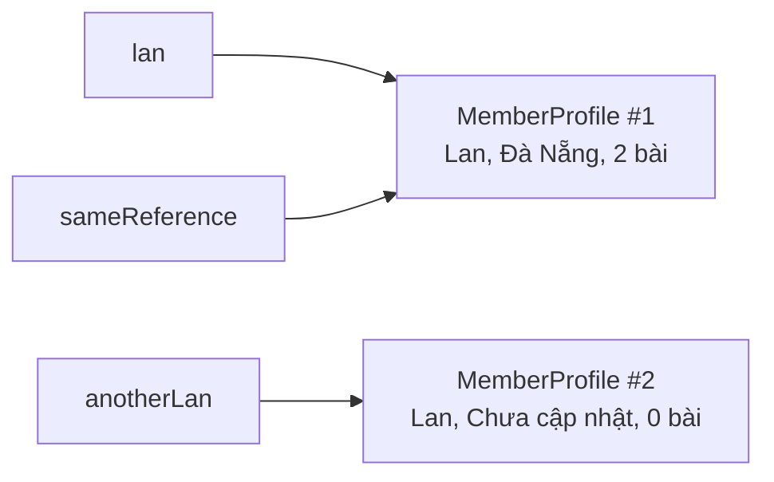

# Tham chiếu đến đối tượng hiện tại trong Java: `this`

Trong Java, mỗi đối tượng có các trường lưu trạng thái và các phương thức thao tác trên trạng thái đó. Khi một **phương thức thể hiện** (*instance method*) hoặc **constructor** đang chạy, từ khóa `this` cho phép mã nguồn tham chiếu đến **chính đối tượng hiện tại**.

Ví dụ: nếu gọi `lan.completeLesson()` thì `this` trong phương thức `completeLesson()` chính là đối tượng mà biến `lan` đang tham chiếu. Nếu gọi cùng phương thức trên `minh`, `this` lại là đối tượng do `minh` tham chiếu.

```java
MemberProfile lan = new MemberProfile("Lan");
MemberProfile minh = new MemberProfile("Minh");

lan.completeLesson();  // this trong lời gọi này là đối tượng Lan
minh.completeLesson(); // this trong lời gọi này là đối tượng Minh
```

**Điểm cốt lõi:** `this` không tạo ra đối tượng mới. Nó là cách mã bên trong một thể hiện nói đến chính thể hiện đó.

## 1. Dùng `this.field` để truy cập trường của đối tượng hiện tại

Xét lớp `MemberProfile`:

```java
class MemberProfile {
    private String username;

    MemberProfile(String username) {
        this.username = username;
    }
}
```

Trong constructor, tên tham số `username` trùng với tên trường:

- `this.username` là **trường thuộc đối tượng hiện tại**.
- `username` ở vế phải là **tham số của constructor**.
- `this.username = username;` lưu dữ liệu được truyền vào trong trạng thái của đối tượng.

Nếu viết `username = username;`, cả hai vế đều trỏ đến biến tham số. Trường `username` không được gán và sẽ giữ giá trị mặc định `null`. Đây là lỗi rất dễ bỏ sót vì câu lệnh vẫn có thể biên dịch.

Quy tắc tương tự áp dụng khi biến cục bộ che khuất (*shadow*) một trường:

```java
class Counter {
    private int count = 10;

    void example() {
        int count = 3;
        System.out.println(count);      // 3: biến cục bộ
        System.out.println(this.count); // 10: trường của đối tượng
    }
}
```

Khi không có tên cục bộ hoặc tham số trùng với trường, có thể viết `count` thay cho `this.count` trong một phương thức thể hiện. Tuy nhiên, dùng `this.` có chủ đích giúp người đọc nhận ra đang thao tác trên trạng thái của đối tượng.

## 2. Ví dụ thực tế: một đối tượng hồ sơ học viên tự cập nhật trạng thái

Đặt toàn bộ đoạn sau trong file **`Main.java`** và chạy với Java 11 trở lên (vì sử dụng `String.isBlank()`):

```java
class MemberProfile {
    private final String username;
    private String city;
    private int completedLessons;

    // Constructor một tham số ủy quyền sang constructor hai tham số.
    MemberProfile(String username) {
        this(username, "Chưa cập nhật");
    }

    MemberProfile(String username, String city) {
        if (username == null || username.isBlank()) {
            throw new IllegalArgumentException("Tên không được trống");
        }
        if (city == null || city.isBlank()) {
            throw new IllegalArgumentException("Thành phố không được trống");
        }

        this.username = username;
        this.city = city;
        this.completedLessons = 0;
    }

    MemberProfile moveTo(String city) {
        if (city == null || city.isBlank()) {
            throw new IllegalArgumentException("Thành phố không được trống");
        }
        this.city = city;
        return this;
    }

    MemberProfile completeLesson() {
        this.completedLessons++;
        return this;
    }

    boolean isSameInstance(MemberProfile other) {
        return this == other;
    }

    void sendReport(Reporter reporter) {
        reporter.print(this);
    }

    String getUsername() {
        return username;
    }

    String getCity() {
        return city;
    }

    int getCompletedLessons() {
        return completedLessons;
    }
}

class Reporter {
    void print(MemberProfile member) {
        System.out.println(
            "Báo cáo: " + member.getUsername()
            + " - " + member.getCity()
            + " - " + member.getCompletedLessons()
        );
    }
}

public class Main {
    public static void main(String[] args) {
        MemberProfile lan = new MemberProfile("Lan");
        MemberProfile sameReference = lan;
        MemberProfile anotherLan = new MemberProfile("Lan");

        lan.moveTo("Đà Nẵng")
           .completeLesson()
           .completeLesson();

        System.out.println(lan.getCity());
        System.out.println(lan.getCompletedLessons());
        System.out.println(sameReference.getCompletedLessons());
        System.out.println(lan.isSameInstance(sameReference));
        System.out.println(lan.isSameInstance(anotherLan));

        lan.sendReport(new Reporter());
        System.out.println(anotherLan.getCity());
    }
}
```

Lệnh biên dịch và chạy:

```bash
javac Main.java
java Main
```

Kết quả:

```text
Đà Nẵng
2
2
true
false
Báo cáo: Lan - Đà Nẵng - 2
Chưa cập nhật
```

**Phân tích các vai trò của `this` trong cùng một ví dụ:**

| Mã nguồn | `this` đại diện hoặc thực hiện điều gì? |
| --- | --- |
| `this.username = username` | Phân biệt trường `username` với tham số cùng tên |
| `this(username, "Chưa cập nhật")` | Gọi một constructor khác của **cùng lớp** |
| `this.city = city` | Thay đổi trường `city` của đối tượng nhận lời gọi |
| `this.completedLessons++` | Tăng số bài học của chính đối tượng này |
| `return this` | Trả về tham chiếu tới chính đối tượng hiện tại để gọi tiếp phương thức |
| `this == other` | Kiểm tra hai tham chiếu có cùng trỏ đến một đối tượng hay không |
| `reporter.print(this)` | Truyền chính đối tượng hiện tại làm đối số cho một phương thức khác |

`sameReference = lan` **không** tạo hồ sơ mới, nên cả hai biến cùng thấy `completedLessons = 2`. Còn `new MemberProfile("Lan")` tạo một đối tượng khác dù tên học viên giống nhau. Vì vậy `lan.isSameInstance(anotherLan)` trả về `false`.

## 3. `this` phụ thuộc vào đối tượng đang nhận lời gọi

Sơ đồ sau biểu diễn mối quan hệ của các tham chiếu:



Trong lời gọi `lan.completeLesson()`, đối tượng #1 là đối tượng hiện tại. Nếu gọi `anotherLan.completeLesson()`, đối tượng #2 là đối tượng hiện tại. Cùng một phần mã phương thức có thể chạy với các giá trị `this` khác nhau.

Trong phương thức thể hiện, hai cách gọi sau thường tương đương:

```java
completeLesson();
this.completeLesson();
```

Cả hai đều gọi phương thức `completeLesson()` trên đối tượng hiện tại. `this.` giúp nhấn mạnh đối tượng nhận lời gọi, nhưng không bắt buộc trong mọi trường hợp.

Cần phân biệt:

- `this`: đối tượng hiện tại.
- `other` hoặc `member`: tham chiếu khác được truyền vào, có thể trỏ cùng đối tượng hoặc đối tượng khác.
- `new MemberProfile(...)`: tạo một đối tượng mới.
- `super`: dùng để truy cập thành phần của lớp cha hoặc gọi constructor lớp cha, không đồng nghĩa với `this`.

## 4. `this(...)` dùng để gọi constructor khác trong cùng lớp

Ngoài biểu thức `this.field` và `return this`, Java có cú pháp đặc biệt `this(...)`: **gọi một constructor khác trong cùng lớp** (*constructor chaining*).

```java
class ReportConfig {
    private final String language;
    private final int pageSize;

    ReportConfig() {
        this("vi", 20);
    }

    ReportConfig(String language) {
        this(language, 20);
    }

    ReportConfig(String language, int pageSize) {
        if (language == null || language.isBlank() || pageSize <= 0) {
            throw new IllegalArgumentException("Cấu hình không hợp lệ");
        }
        this.language = language;
        this.pageSize = pageSize;
    }
}
```

Với Java 17/21, lời gọi `this(...)` phải là **câu lệnh đầu tiên** của constructor gọi nó. Không được viết lệnh khác trước `this(...)` trong constructor này:

```java
// Ví dụ SAI trên Java 17/21:
ReportConfig() {
    System.out.println("Đang khởi tạo");
    this("vi", 20); // Lỗi biên dịch
}
```

Các constructor không được gọi vòng lặp lẫn nhau. Một constructor cũng không thể đồng thời chứa cả lời gọi constructor `this(...)` và `super(...)` tường minh. Nếu không có lời gọi constructor tường minh, Java sẽ gọi `super()` ngầm định khi phù hợp.

| Cú pháp | Ý nghĩa |
| --- | --- |
| `this.field` | Truy cập trường của đối tượng hiện tại |
| `this.method()` | Gọi phương thức trên đối tượng hiện tại |
| `this(...)` | Trong constructor: gọi constructor khác cùng lớp |
| `super(...)` | Trong constructor: gọi constructor của lớp cha |
| `super.method()` | Gọi cách cài đặt phương thức ở lớp cha khi phù hợp |

**Lưu ý:** Điều kiện “đầu tiên” ở trên được nêu theo Java 17/21, là các phiên bản thông dụng để học Spring/Java. Những phiên bản Java mới hơn có thay đổi về cấu trúc constructor; khi dùng chúng cần đối chiếu chính xác phiên bản biên dịch.

## 5. Trả về `this` để viết lời gọi nối tiếp

Một phương thức có thể trả lại đối tượng đang nhận lời gọi:

```java
MemberProfile moveTo(String city) {
    this.city = city;
    return this;
}
```

Nhờ vậy:

```java
lan.moveTo("Đà Nẵng").completeLesson().completeLesson();
```

Tương đương với:

```java
lan.moveTo("Đà Nẵng");
lan.completeLesson();
lan.completeLesson();
```

Đây là kỹ thuật *fluent API* / *method chaining*. **`return this` chỉ trả lại tham chiếu đến đối tượng hiện tại**, không sao chép đối tượng và không tạo bản bất biến mới. Trong ví dụ này, các lời gọi làm thay đổi trạng thái `lan`.

Không phải phương thức nào cũng nên trả về `this`. Phương thức truy vấn như `getCity()` nên trả dữ liệu cần đọc; phương thức cần báo lỗi hoặc kết quả giao dịch có thể trả một kiểu phù hợp hơn. Nếu thiết kế lớp bất biến (*immutable*), một thao tác thay đổi thường tạo và trả về **đối tượng mới** thay vì sửa đối tượng hiện tại.

## 6. Truyền `this` sang một đối tượng khác

Trong ví dụ chính:

```java
void sendReport(Reporter reporter) {
    reporter.print(this);
}
```

Lời gọi `reporter.print(this)` truyền tham chiếu đến chính `MemberProfile` đang thực hiện `sendReport()`. Nhờ đó `Reporter` có thể đọc thông tin từ đối tượng nhận được.

Một số tình huống tương tự:

- Đăng ký một đối tượng làm listener: `eventBus.register(this)`.
- Truyền một đối tượng cho bộ xử lý: `processor.process(this)`.
- Gọi helper cần biết đối tượng hiện tại: `validator.validate(this)`.

**Cẩn thận khi truyền `this` ra ngoài ngay trong constructor.** Nếu một listener, luồng chạy khác hoặc thành phần bên ngoài sử dụng đối tượng trước khi constructor hoàn tất, nó có thể quan sát trạng thái chưa khởi tạo đầy đủ. Nên hoàn tất khởi tạo trước rồi mới đăng ký hoặc công bố đối tượng.

## 7. Khi nào không được dùng `this`?

`this` gắn với một **thể hiện cụ thể**. Phương thức `static` thuộc cấp lớp và không có đối tượng nhận lời gọi ngầm định, nên không thể dùng `this` trong ngữ cảnh static:

```java
class MathHelper {
    static int doubleValue(int value) {
        // return this.value; // SAI: không có this trong static method
        return value * 2;
    }
}
```

Tương tự, không thể dùng `this` trực tiếp trong khối khởi tạo `static` hoặc trình khởi tạo trường `static`. Phương thức static vẫn có thể thao tác với một đối tượng nếu đối tượng được **truyền tường minh** qua tham số:

```java
class ProfilePrinter {
    static void print(MemberProfile member) {
        System.out.println(member.getUsername());
    }
}
```

Bảng ghi nhớ:

| Ngữ cảnh | Dùng `this` được không? | Vì sao? |
| --- | --- | --- |
| Phương thức instance | Có | Có đối tượng nhận lời gọi |
| Constructor | Có, theo quy tắc khởi tạo | Đang xây dựng đối tượng hiện tại |
| Khối khởi tạo instance | Có | Thuộc quá trình khởi tạo từng thể hiện |
| Phương thức static | Không | Không có đối tượng hiện tại |
| Khối hoặc trường khởi tạo static | Không | Thuộc lớp, không gắn với một thể hiện |

## 8. Trường hợp nâng cao: `OuterClass.this` trong inner class

Một **inner class không static** có đối tượng bao ngoài. Trong inner class, `this` tham chiếu đến **đối tượng inner class**, còn `OuterClass.this` tham chiếu đến đối tượng của lớp bao ngoài.

```java
class Classroom {
    private final String name;

    Classroom(String name) {
        this.name = name;
    }

    class Student {
        private final String name;

        Student(String name) {
            this.name = name;
        }

        String describe() {
            return this.name + " thuộc lớp " + Classroom.this.name;
        }
    }
}

public class InnerClassDemo {
    public static void main(String[] args) {
        Classroom room = new Classroom("Java OOP");
        Classroom.Student student = room.new Student("Mai");
        System.out.println(student.describe());
    }
}
```

Lưu đoạn ví dụ **riêng** vào `InnerClassDemo.java`, rồi chạy `javac InnerClassDemo.java` và `java InnerClassDemo`. Kết quả: `Mai thuộc lớp Java OOP`.

Ở đây `this.name` là tên học viên, còn `Classroom.this.name` là tên lớp học. Đây là trường hợp cần ghi rõ đối tượng bên trong hay đối tượng bao ngoài mà mình muốn tham chiếu.

## 9. Lỗi hiểu sai thường gặp

| Nhầm lẫn | Cách hiểu đúng |
| --- | --- |
| `this` là một đối tượng mới | `this` tham chiếu đến đối tượng đã nhận lời gọi / đang được khởi tạo |
| `this.username = username` và `username = username` luôn tương đương | Không khi tham số che khuất trường; câu sau chỉ tự gán tham số |
| `this(...)` là gọi phương thức có tên `this` | Không; đó là lời gọi constructor khác trong cùng lớp |
| `return this` tạo bản sao | Không; nó trả về cùng tham chiếu |
| Gán `b = a` thì `b` có đối tượng riêng | Không; với kiểu tham chiếu, phép gán sao chép tham chiếu |
| Có thể dùng `this` trong mọi hàm Java | Không; phương thức static không có `this` |
| `this == other` so sánh nội dung hai đối tượng | Không; nó kiểm tra hai tham chiếu có trỏ cùng một đối tượng |
| `OuterClass.this` và `this` luôn cùng đối tượng | Không; trong inner class, chúng có thể trỏ đến đối tượng khác nhau |

## 10. Tự kiểm tra

**Câu 1.** Cho:

```java
class Box {
    int value;

    Box(int value) {
        value = value;
    }
}
Box box = new Box(5);
System.out.println(box.value);
```

Kết quả là **`0`**, vì câu `value = value;` chỉ tác động lên tham số, trường `int value` vẫn nhận giá trị mặc định. Sửa thành `this.value = value;` thì kết quả là `5`.

**Câu 2.** Giả sử `MemberProfile a = new MemberProfile("A");` và `MemberProfile b = a;`. Nếu gọi `b.completeLesson()`, `a.getCompletedLessons()` là bao nhiêu? **`1`**, bởi `a` và `b` tham chiếu cùng đối tượng.

**Câu 3.** `this("vi", 20);` trong constructor khác `this.language = "vi";` ra sao? Câu đầu **ủy quyền cho constructor khác**, câu sau **gán trường** của đối tượng.

**Câu 4.** Có thể viết `static void hello() { System.out.println(this); }` không? **Không**, vì static method không có thể hiện hiện tại.

**Câu 5.** Sau `MemberProfile result = a.moveTo("Huế");`, `result == a` là gì? **`true`**, vì `moveTo()` trả về `this` và không tạo đối tượng mới.

Khi đọc hoặc viết mã Java, hãy tự hỏi: “Phương thức này đang chạy trên **đối tượng nào**?” Đối tượng đó chính là ý nghĩa của `this` tại vị trí tương ứng. Tư duy này giúp hiểu cách đối tượng giữ trạng thái riêng, cách constructor khởi tạo trạng thái và cách các lời gọi tác động lên cùng một thể hiện.