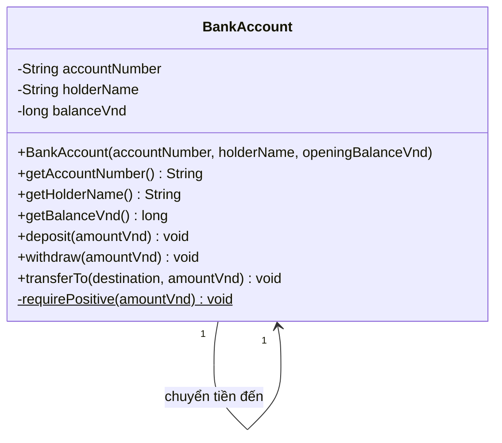
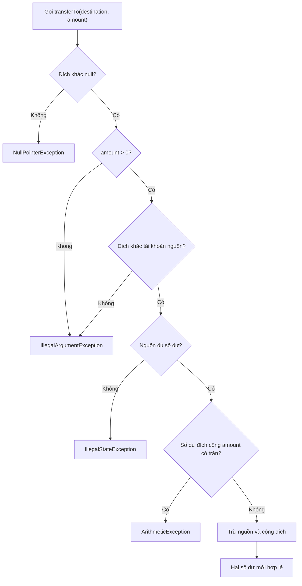

# Thiết kế lớp qua ví dụ tài khoản ngân hàng (Java OOP)

## Bài toán: một tài khoản ngân hàng cần biết gì và làm được gì?

Giả sử chúng ta xây dựng phần lõi cho một ứng dụng mô phỏng ngân hàng bằng Java. Mỗi tài khoản có **số tài khoản**, **tên chủ tài khoản** và **số dư**. Người sử dụng có thể nạp tiền, rút tiền, chuyển tiền sang tài khoản khác và tra cứu số dư.

Điểm quan trọng của thiết kế hướng đối tượng là: **dữ liệu và các thao tác liên quan được đặt trong cùng một lớp**, và lớp chịu trách nhiệm giữ dữ liệu hợp lệ. Nếu bất kỳ mã nào cũng sửa trực tiếp `balance`, chương trình rất dễ xuất hiện số dư âm hoặc chuyển tiền sai.

Bài này xây dựng một mô hình học tập có thể chạy bằng Java 11+, dùng tiền Việt Nam đồng (`VND`) dưới dạng số nguyên `long` để các ví dụ rõ ràng. Đây là mô hình trong bộ nhớ nhằm học **thiết kế lớp**, chưa phải hệ thống ngân hàng triển khai thực tế.

### Các yêu cầu nghiệp vụ

| Tình huống | Quy tắc cần giữ |
| --- | --- |
| Mở tài khoản | Có số tài khoản hợp lệ, tên chủ không rỗng và số dư ban đầu không âm |
| Nạp tiền | Số tiền nạp lớn hơn 0; không để phép cộng tràn `long` |
| Rút tiền | Số tiền rút lớn hơn 0 và không vượt quá số dư |
| Chuyển tiền | Tài khoản đích phải tồn tại, khác nguồn; nguồn đủ tiền, đích nhận được tiền mà không tràn số |
| Tra cứu | Đọc được thông tin cần thiết nhưng mã bên ngoài không được tự ý gán số dư |
| Thao tác thất bại | Các số dư phải giữ nguyên nếu điều kiện kiểm tra không đạt |

Một điều kiện luôn đúng của đối tượng sau khi khởi tạo và sau mỗi thao tác hợp lệ được gọi là **bất biến (invariant)**. Với lớp này, bất biến quan trọng nhất là `balanceVnd >= 0`. Các thông tin định danh đã thiết lập cũng không thay đổi trong vòng đời đối tượng.

## 1. Xác định lớp, thuộc tính và phương thức

Trước khi viết mã, chuyển câu mô tả nghiệp vụ thành các thành phần của lớp:

| Khái niệm nghiệp vụ | Thành phần Java đề xuất | Lý do |
| --- | --- | --- |
| Số tài khoản | `private final String accountNumber` | Định danh tài khoản; không cho gán lại sau khi tạo |
| Chủ tài khoản | `private final String holderName` | Tên được xác nhận lúc mở tài khoản trong mô hình này |
| Số dư (VND) | `private long balanceVnd` | Trạng thái riêng của mỗi đối tượng, thay đổi qua nghiệp vụ |
| Mở tài khoản | Constructor `BankAccount(...)` | Thiết lập trạng thái ban đầu, kiểm tra dữ liệu |
| Xem số dư | `getBalanceVnd()` | Cung cấp quyền đọc có kiểm soát |
| Nạp tiền | `deposit(long amountVnd)` | Kiểm tra và tăng số dư |
| Rút tiền | `withdraw(long amountVnd)` | Kiểm tra và giảm số dư |
| Chuyển khoản | `transferTo(BankAccount destination, long amountVnd)` | Điều phối thay đổi trên hai đối tượng |
| Kiểm tra số tiền | `requirePositive(long amountVnd)` | Logic kiểm tra dùng chung, chỉ dùng nội bộ |

**Tại sao chọn `private` cho các field?** Nếu khai báo `public long balanceVnd`, bên ngoài có thể làm điều này:

```java
// Ví dụ thiết kế SAI: giả sử balanceVnd được khai báo public
account.balanceVnd = -500_000;
```

Số dư lúc đó vi phạm quy tắc. Một setter tổng quát như `setBalanceVnd(-500_000)` cũng có thể gây cùng vấn đề nếu không có quy tắc nghiệp vụ. API `deposit`, `withdraw`, `transferTo` thể hiện **ý nghĩa hành động**, giúp tập trung kiểm tra vào một nơi.

Sơ đồ UML thể hiện phần cấu trúc chính:



Ký hiệu `-` là `private`, `+` là `public` và `$` biểu thị thành phần `static`. Đường liên hệ cho biết phương thức chuyển tiền làm việc với **một đối tượng BankAccount khác**, không có nghĩa tài khoản nào cũng cố định một tài khoản đích.

## 2. Hiện thực lớp BankAccount

Tạo tệp **`BankAccount.java`** như sau. Để ví dụ chạy độc lập, lớp không phụ thuộc framework, cơ sở dữ liệu hay thư viện ngoài JDK.

```java
import java.util.Objects;

public final class BankAccount {
    private final String accountNumber;
    private final String holderName;
    private long balanceVnd;

    // Constructor: tạo đối tượng ở trạng thái ban đầu hợp lệ
    public BankAccount(String accountNumber,
                       String holderName,
                       long openingBalanceVnd) {
        Objects.requireNonNull(accountNumber, "accountNumber");
        Objects.requireNonNull(holderName, "holderName");

        if (!accountNumber.matches("[A-Z0-9]{6,20}")) {
            throw new IllegalArgumentException(
                    "Số tài khoản phải gồm 6-20 chữ in hoa hoặc chữ số");
        }

        String normalizedName = holderName.strip();
        if (normalizedName.isBlank()) {
            throw new IllegalArgumentException(
                    "Tên chủ tài khoản không được rỗng");
        }

        if (openingBalanceVnd < 0) {
            throw new IllegalArgumentException(
                    "Số dư ban đầu không được âm");
        }

        this.accountNumber = accountNumber;
        this.holderName = normalizedName;
        this.balanceVnd = openingBalanceVnd;
    }

    // Các phương thức truy vấn: không thay đổi trạng thái
    public String getAccountNumber() {
        return accountNumber;
    }

    public String getHolderName() {
        return holderName;
    }

    public long getBalanceVnd() {
        return balanceVnd;
    }

    // Nạp tiền: validate trước, cập nhật sau
    public void deposit(long amountVnd) {
        requirePositive(amountVnd);
        balanceVnd = Math.addExact(balanceVnd, amountVnd);
    }

    // Rút tiền: không cho phép thấu chi trong ví dụ
    public void withdraw(long amountVnd) {
        requirePositive(amountVnd);

        if (amountVnd > balanceVnd) {
            throw new IllegalStateException("Số dư không đủ để rút");
        }

        balanceVnd -= amountVnd;
    }

    // Chuyển tiền giữa hai tài khoản trong chương trình đơn luồng
    public void transferTo(BankAccount destination, long amountVnd) {
        Objects.requireNonNull(destination, "destination");
        requirePositive(amountVnd);

        if (destination == this) {
            throw new IllegalArgumentException(
                    "Không chuyển tiền cho chính tài khoản nguồn");
        }

        if (amountVnd > balanceVnd) {
            throw new IllegalStateException("Số dư không đủ để chuyển");
        }

        // Tính trước số dư đích để bắt tràn số trước khi trừ tiền nguồn.
        long nextDestinationBalance =
                Math.addExact(destination.balanceVnd, amountVnd);

        // Cập nhật chỉ sau khi mọi kiểm tra đều thành công.
        this.balanceVnd -= amountVnd;
        destination.balanceVnd = nextDestinationBalance;
    }

    private static void requirePositive(long amountVnd) {
        if (amountVnd <= 0) {
            throw new IllegalArgumentException(
                    "Số tiền giao dịch phải lớn hơn 0");
        }
    }
}
```

### Phân tích lựa chọn thiết kế

**`public final class BankAccount`:** đây là một lớp cụ thể; `final` ngăn lớp khác kế thừa nó. Trong bài học này, ta chủ động không mở rộng qua kế thừa để tập trung vào hợp đồng của tài khoản. `final` trên lớp **không** làm đối tượng bất biến: `balanceVnd` vẫn có thể thay đổi qua phương thức.

**`private final String accountNumber`:** `private` ngăn mã bên ngoài truy cập trực tiếp, còn `final` cho biết field được gán một lần trong constructor. Ví dụ dùng số tài khoản chỉ gồm chữ in hoa/chữ số và dài 6–20 ký tự; đây là **quy tắc minh họa**, không phải chuẩn số tài khoản của mọi ngân hàng.

**`private long balanceVnd`:** không dùng `final` vì số dư phải thay đổi theo nạp/rút/chuyển tiền. Field là trạng thái riêng của từng đối tượng. Giá trị được biểu diễn theo **đơn vị đồng**, vì thế `125_000` nghĩa là 125.000 VND.

**Constructor `BankAccount(...)`:** không có kiểu trả về, có tên trùng với tên lớp và được gọi khi `new BankAccount(...)`. Constructor kiểm tra tất cả tham số trước khi gán field, ngăn tạo đối tượng có số dư âm hoặc tên không hợp lệ. `this.accountNumber` chỉ field của đối tượng; `accountNumber` bên phải là tham số.

**Getter:** `getBalanceVnd()` trả về `long`, là kiểu nguyên thủy, nên người gọi nhận được giá trị chứ không nhận quyền sửa field. Vì bài toán không cho tự ý chỉnh số dư, lớp **không có** `setBalanceVnd()`.

**`deposit()`:** dùng `Math.addExact` để phát hiện tràn số. Nếu phép cộng không thể biểu diễn trong `long`, Java ném `ArithmeticException` và phép gán không thực hiện, số dư giữ nguyên.

**`withdraw()`:** kiểm tra số tiền trước khi trừ; `IllegalArgumentException` cho đối số bằng 0/âm và `IllegalStateException` khi trạng thái tài khoản không đủ tiền. Trong thiết kế sản phẩm thật, có thể tạo kiểu ngoại lệ nghiệp vụ riêng như `InsufficientFundsException`.

**`transferTo()`:** nhận một tham chiếu tới đối tượng `BankAccount` khác. Java cho phép một phương thức của lớp truy cập field `private` của *đối tượng khác cùng lớp*, vì `private` áp dụng theo **lớp khai báo**, không phải theo từng instance. Phép cộng ở tài khoản đích được tính trước để tránh trừ tiền nguồn rồi mới phát hiện tràn số.

**`requirePositive()`:** là `private static` vì kiểm tra này chỉ phụ thuộc tham số, không cần `this` hay field của tài khoản. Phương thức trợ giúp vẫn là một phần của lớp, nhưng không được công khai ra ngoài.

## 3. Khởi tạo và sử dụng hai đối tượng

Tạo thêm tệp **`Main.java`** cùng thư mục:

```java
public class Main {
    public static void main(String[] args) {
        BankAccount an = new BankAccount(
                "ACC001", "Nguyễn An", 1_000_000);
        BankAccount binh = new BankAccount(
                "ACC002", "Trần Bình", 200_000);

        an.deposit(300_000);       // An: 1.000.000 -> 1.300.000
        an.withdraw(100_000);      // An: 1.300.000 -> 1.200.000
        an.transferTo(binh, 400_000);

        System.out.println("An: " + an.getBalanceVnd());
        System.out.println("Bình: " + binh.getBalanceVnd());

        try {
            an.withdraw(900_000);  // An còn 800.000: không đủ tiền
        } catch (IllegalStateException ex) {
            System.out.println("Bị từ chối: " + ex.getMessage());
        }

        System.out.println("An sau lỗi: " + an.getBalanceVnd());
    }
}
```

Chạy bằng terminal khi đã cài JDK 11 trở lên:

```bash
javac BankAccount.java Main.java
java Main
```

Kết quả dự kiến:

```text
An: 800000
Bình: 600000
Bị từ chối: Số dư không đủ để rút
An sau lỗi: 800000
```

Đối chiếu số dư từng bước:

| Thao tác | Tài khoản An | Tài khoản Bình |
| --- | ---: | ---: |
| Ngay sau khởi tạo | 1.000.000 | 200.000 |
| An nạp 300.000 | 1.300.000 | 200.000 |
| An rút 100.000 | 1.200.000 | 200.000 |
| An chuyển cho Bình 400.000 | **800.000** | **600.000** |
| An cố rút 900.000 (bị từ chối) | **800.000** | **600.000** |

Phép chuyển tiền bảo toàn tổng số dư của hai tài khoản trong tình huống này: trước chuyển là 1.400.000 VND, sau chuyển vẫn là 1.400.000 VND. Nạp/rút là các giao dịch thay đổi tổng tiền trong tập hai tài khoản đang xét, còn chuyển chỉ dịch chuyển tiền từ đối tượng này sang đối tượng khác.

## 4. Một lời gọi phương thức diễn ra ra sao?

Giả sử `an` và `binh` là tham chiếu đến hai đối tượng khác nhau. Khi gọi `an.transferTo(binh, 400_000)`:

```mermaid
sequenceDiagram
    participant Main
    participant An as an: BankAccount
    participant Binh as binh: BankAccount
    Main->>An: transferTo(binh, 400000)
    An->>An: Kiểm tra đích và số tiền dương
    An->>An: Kiểm tra đủ số dư
    An->>Binh: Đọc balanceVnd để tính số dư mới
    Note over An,Binh: Tính trước kết quả; kiểm tra tràn số
    An->>An: balanceVnd -= 400000
    An->>Binh: balanceVnd = số dư mới
    An-->>Main: Hoàn tất
```

Khi sai điều kiện, luồng xử lý dừng trước khi cập nhật:



Cơ chế này giữ nguyên số dư khi những phép kiểm tra thông thường thất bại **trong ví dụ đơn luồng**. Nó không bảo đảm giao dịch bền vững nếu máy bị tắt giữa lúc cập nhật hai biến, và cũng không an toàn khi nhiều luồng cùng sửa tài khoản.

## 5. Làm rõ các khái niệm OOP qua ví dụ

### Lớp và đối tượng

`BankAccount` là **lớp** (bản thiết kế). `an` và `binh` là các **biến tham chiếu** tới hai **đối tượng** được tạo bởi `new`. Mỗi đối tượng có riêng `accountNumber`, `holderName` và `balanceVnd`.

```java
BankAccount first = new BankAccount("ACC003", "Lan", 500_000);
BankAccount alias = first; // Hai biến cùng tham chiếu một đối tượng

alias.deposit(50_000);
System.out.println(first.getBalanceVnd()); // 550000
```

Phép gán `alias = first` **không tạo đối tượng mới**. Hai tên cùng nhìn thấy một số dư vì cùng tham chiếu một instance. Ngược lại, dùng `new BankAccount(...)` lần nữa sẽ tạo instance độc lập.

### Đóng gói (encapsulation)

Đóng gói kết hợp hai ý: giữ trạng thái bên trong lớp và cung cấp API có kiểm soát. `private` chỉ là công cụ giới hạn truy cập; thiết kế đúng còn cần các quy tắc ở constructor/phương thức.

```java
// Không biên dịch được vì balanceVnd là private:
an.balanceVnd = -1;

// Cũng không có phương thức setBalanceVnd:
an.setBalanceVnd(-1);

// Phải sử dụng hành vi đã được lớp định nghĩa:
an.withdraw(100_000);
```

Trong ví dụ này, không có nghĩa mọi field trong mọi lớp đều phải `private` một cách máy móc. Điều cần đạt là các bất biến được bảo vệ, trách nhiệm của lớp rõ ràng và API hợp lý.

### Trạng thái và hành vi

- **Trạng thái:** `balanceVnd` là số dư *hiện tại*.
- **Hành vi thay đổi trạng thái:** `deposit`, `withdraw` và `transferTo`.
- **Hành vi truy vấn:** `getAccountNumber`, `getHolderName`, `getBalanceVnd`.
- **Thông tin không đổi sau khởi tạo:** `accountNumber` và `holderName` trong phiên bản này, được đánh dấu `final`.

Như vậy, phương thức không nhất thiết phải làm thay đổi field. Một getter là hành vi truy vấn, còn một phương thức nghiệp vụ có thể tương tác với đối tượng khác.

### Tính trừu tượng ở cấp độ API

Nơi sử dụng chỉ cần biết `an.withdraw(100_000)` nghĩa là yêu cầu rút 100.000 đồng. Người gọi không phải tự tính số dư mới hoặc tự kiểm tra khoản tiền có hợp lệ. Nếu sau này có quy tắc giới hạn số tiền rút trong ngày, lớp hoặc dịch vụ nghiệp vụ thích hợp có thể đảm nhận quy tắc đó mà không bắt mọi nơi gọi tự lặp lại logic.

### Chia đúng trách nhiệm

Một lớp tài khoản **nên** biết trạng thái và quy tắc thay đổi trạng thái trong phạm vi mô hình. Nó **không nên** tự ôm mọi việc như đọc mật khẩu, gửi email, ghi dữ liệu SQL, tạo báo cáo PDF và vẽ giao diện. Trong hệ thống lớn, các trách nhiệm đó được phối hợp bởi các thành phần phù hợp.

| Thành phần trong ứng dụng lớn | Trách nhiệm ví dụ |
| --- | --- |
| `BankAccount` (domain model) | Trạng thái tài khoản và những quy tắc nghiệp vụ cục bộ |
| `TransferService` | Điều phối chuyển tiền, chính sách, phân quyền và giao dịch cơ sở dữ liệu |
| `BankAccountRepository` | Đọc/ghi tài khoản từ nơi lưu trữ |
| `TransactionRepository` | Lưu lịch sử giao dịch để truy vết |
| API/controller | Nhận yêu cầu, kiểm tra dữ liệu đầu vào ở biên hệ thống và trả phản hồi |

Đây là hướng mở rộng kiến trúc, chưa phải các lớp cần có để chạy ví dụ nhỏ.

## 6. Thử các tình huống biên

Một lớp tốt không chỉ chạy được ở tình huống thuận lợi; nó phải xác định rõ kết quả khi đầu vào không hợp lệ.

| Lời gọi | Kết quả mong đợi | Trạng thái |
| --- | --- | --- |
| `new BankAccount("ACC004", "Mai", -1)` | `IllegalArgumentException` | Không tạo đối tượng hợp lệ |
| `new BankAccount("A", "Mai", 0)` | `IllegalArgumentException` | Không tạo đối tượng hợp lệ |
| `new BankAccount("ACC004", "   ", 0)` | `IllegalArgumentException` | Không tạo đối tượng hợp lệ |
| `deposit(0)` / `deposit(-10)` | `IllegalArgumentException` | Số dư không đổi |
| `withdraw(0)` / `withdraw(-10)` | `IllegalArgumentException` | Số dư không đổi |
| `withdraw(x)` với `x > balanceVnd` | `IllegalStateException` | Số dư không đổi |
| `transferTo(null, 100)` | `NullPointerException` | Số dư không đổi |
| `transferTo(this, 100)` | `IllegalArgumentException` | Số dư không đổi |
| `deposit(Long.MAX_VALUE)` với số dư dương | `ArithmeticException` | Số dư không đổi |
| Chuyển vào tài khoản gần `Long.MAX_VALUE` gây tràn | `ArithmeticException` | Cả hai số dư không đổi |

Có thể kiểm tra các trường hợp lỗi mà không cần thêm thư viện:

```java
public class BoundaryCheck {
    public static void main(String[] args) {
        BankAccount account =
                new BankAccount("ACC005", "Hà", 100_000);

        try {
            account.withdraw(200_000);
            throw new AssertionError("Lẽ ra phải từ chối rút");
        } catch (IllegalStateException expected) {
            // Đúng: số dư không đủ
        }

        if (account.getBalanceVnd() != 100_000) {
            throw new AssertionError("Số dư đã bị thay đổi khi rút thất bại");
        }

        try {
            account.deposit(0);
            throw new AssertionError("Lẽ ra phải từ chối nạp 0 đồng");
        } catch (IllegalArgumentException expected) {
            // Đúng: số tiền phải dương
        }

        System.out.println("Kiểm tra biên thành công");
    }
}
```

Biên dịch và chạy:

```bash
javac BankAccount.java BoundaryCheck.java
java BoundaryCheck
```

Ví dụ kiểm tra trên minh họa hành vi. Khi phát triển ứng dụng thực tế, có thể chuyển các tình huống thành unit test với JUnit để chạy tự động.

## 7. Tại sao không dùng double để lưu số tiền?

`double` sử dụng biểu diễn dấu phẩy động nhị phân; nhiều số thập phân không thể biểu diễn chính xác tuyệt đối.

```java
System.out.println(0.1 + 0.2); // 0.30000000000000004
```

Với bài toán chỉ có **số tiền nguyên VND**, `long` là lựa chọn đơn giản: `500_000L` tương ứng 500.000 đồng. Khi phát triển hệ thống hỗ trợ số lẻ hoặc nhiều đơn vị tiền tệ, thường cần `BigDecimal` cùng một quy tắc về đơn vị, làm tròn và scale.

Ví dụ riêng về phép cộng thập phân chính xác:

```java
import java.math.BigDecimal;

BigDecimal amount = new BigDecimal("0.10")
        .add(new BigDecimal("0.20"));

System.out.println(amount); // 0.30
```

Lưu ý: `new BigDecimal("0.10")` nhận chuỗi thập phân; `new BigDecimal(0.1)` lấy một giá trị `double` đã có sai số biểu diễn. `BigDecimal` cũng không tự giải quyết mọi quy tắc tiền tệ: vẫn cần chọn đơn vị, số chữ số thập phân và cách làm tròn rõ ràng.

Trong hệ thống tài chính thực tế, có thể biểu diễn tiền bằng một kiểu giá trị `Money` gồm số tiền, loại tiền và các phép tính hợp lệ. Điều đó giúp tránh vô tình cộng VND với USD.

## 8. Giới hạn cố ý của mô hình và hướng phát triển

Mã `BankAccount` ở trên chạy tốt để học **lớp, đối tượng, thuộc tính, phương thức, constructor, truy cập, đóng gói và bất biến**. Tuy nhiên, ngân hàng thực tế đòi hỏi nhiều lớp bảo vệ và đảm bảo hơn:

**Đồng thời (concurrency).** Hai luồng rút tiền trên cùng tài khoản có thể cùng đọc số dư cũ rồi cùng trừ, làm sai kết quả. Bản mẫu chưa có khóa hay kiểm soát tranh chấp. Không thể dùng `Math.addExact` để thay cho đồng bộ hóa.

**Tính nguyên tử và bền vững khi chuyển tiền.** Trong ứng dụng thật, trừ bên nguồn và cộng bên đích phải nằm trong **một giao dịch dữ liệu nguyên tử**. Ghi vào hai field trong RAM không đủ: nếu tiến trình chết ở giữa, bộ nhớ mất hoặc cơ sở dữ liệu ghi dở, giao dịch không được bảo đảm. Có thể thiết kế `TransferService` kết hợp transaction của database và cơ chế chống xử lý trùng yêu cầu.

**Bảo mật.** Việc sở hữu một tham chiếu `BankAccount` và gọi `withdraw()` chỉ là cách diễn đạt hành vi trong bài học. Nó không xác nhận danh tính, không kiểm tra quyền truy cập và không thể hiện xác thực giao dịch. Trong hệ thống thực, người dùng không được tự gọi thao tác ghi số dư mà không có kiểm tra quyền phía máy chủ.

**Lưu vết và đối soát.** Số dư đơn lẻ không trả lời được “tiền đến từ đâu?”. Hệ thống vận hành cần bản ghi giao dịch, thời điểm, mã yêu cầu, khả năng kiểm toán và quy trình xử lý lỗi/hoàn tiền. Có thể dùng mô hình bút toán kép (double-entry ledger) khi phạm vi nghiệp vụ yêu cầu.

**Quy tắc thay đổi theo nghiệp vụ.** Chủ tài khoản có thể đổi tên hợp pháp, tài khoản có thể bị khóa, áp dụng hạn mức, phí hoặc nhiều loại tiền. Những nhu cầu đó đòi hỏi mở rộng mô hình; đừng thay đổi field một cách tùy tiện khi chưa có chính sách rõ ràng.

### Câu hỏi luyện tập

1. Vì sao `balanceVnd` không được khai báo `public`, trong khi `getBalanceVnd()` là `public`?
2. `final` trên `accountNumber` khác gì với `final` trên chính lớp `BankAccount`?
3. Nếu `deposit(-50_000)` bị từ chối, số dư trước và sau lời gọi phải thế nào?
4. Nếu tài khoản A có 300.000 đồng và tài khoản B có 200.000 đồng, kết quả `A.transferTo(B, 120_000)` là bao nhiêu? Điều gì xảy ra nếu yêu cầu chuyển 400.000?
5. Vì sao `transferTo()` được phép đọc `destination.balanceVnd` dù field này khai báo `private`?
6. Tại sao kiểm tra tràn ở tài khoản đích phải xảy ra **trước** khi trừ tài khoản nguồn?
7. Nếu cần lưu mọi giao dịch vào database, nên bổ sung trách nhiệm đó trực tiếp vào `BankAccount` hay phối hợp với service/repository? Giải thích theo nguyên tắc một lớp có trách nhiệm rõ ràng.

**Bài thực hành mở rộng:** Bổ sung trường `status` với hai trạng thái `ACTIVE` và `FROZEN`. Viết phương thức `freeze()`; chỉ tài khoản `ACTIVE` mới được rút hoặc chuyển tiền ra. Định nghĩa rõ tài khoản bị đóng băng có được nhận tiền hay không, rồi bổ sung kiểm tra ở đúng phương thức. Đây là cách thấy rõ lợi ích của thiết kế lớp: **quy tắc thay đổi tập trung tại nơi sở hữu trạng thái**.