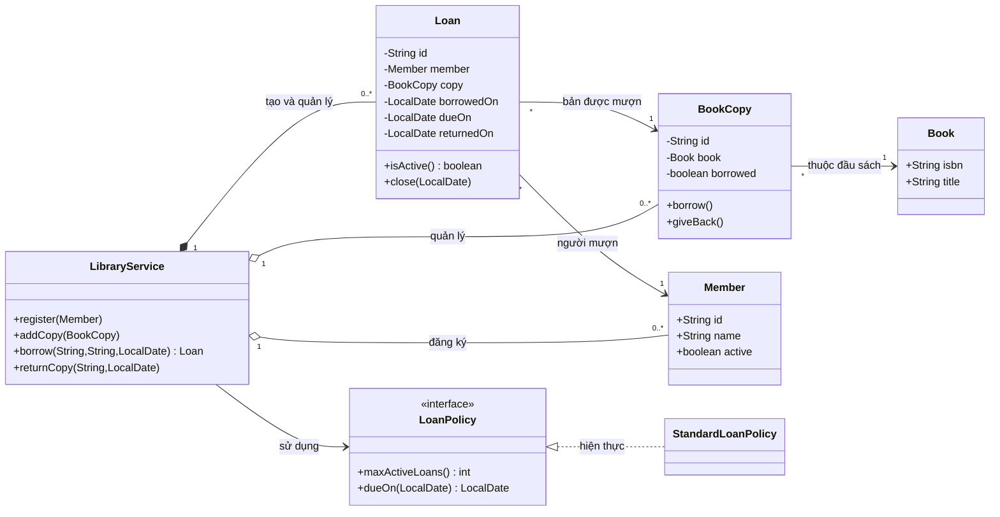
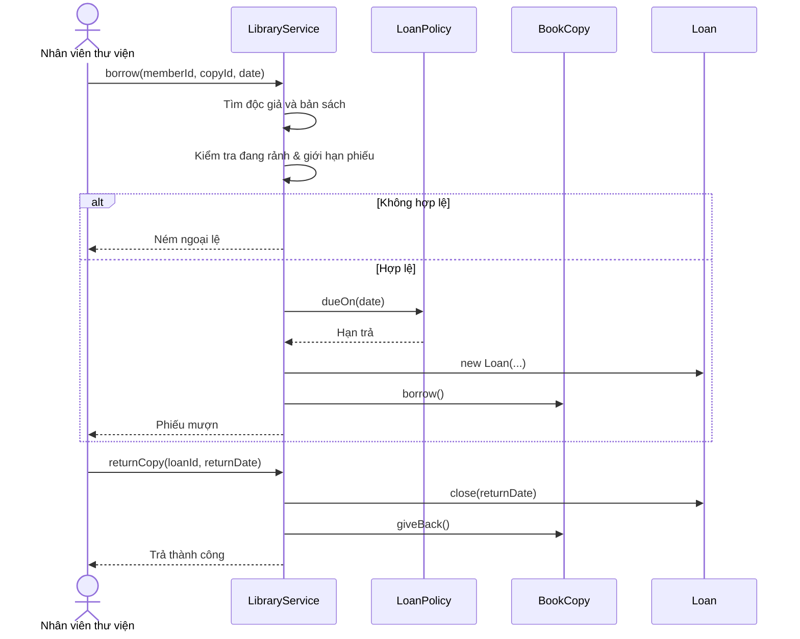

# Dự án tổng hợp OOP: Thiết kế lớp và quan hệ trong hệ thống mượn trả sách

> **Mục tiêu:** Từ một yêu cầu nghiệp vụ bằng ngôn ngữ tự nhiên, xác định đúng đối tượng, trách nhiệm, thuộc tính, hành vi và quan hệ giữa các lớp; hiện thực một phiên bản chạy được bằng Java 17; tự kiểm tra các bất biến và giải thích vì sao chọn quan hệ đó. Dự án tập trung vào **thiết kế lớp và quan hệ**, không tập trung vào giao diện hay cơ sở dữ liệu.

## 1. Bối cảnh và yêu cầu

Một thư viện nhỏ quản lý **đầu sách**, **bản sách vật lý**, **độc giả** và **phiếu mượn**.

- Mỗi đầu sách có ISBN và tên sách. Một đầu sách có thể có nhiều bản sách riêng biệt. Chẳng hạn, ba cuốn cùng tựa đề có chung ISBN nhưng có ba mã bản sách khác nhau.
- Mỗi độc giả được nhận diện bằng mã duy nhất.
- Chỉ được mượn bản sách AVAILABLE bởi độc giả đã đăng ký và đang hoạt động; thành viên có lượt quá hạn chưa trả không được mượn mới.
- Khi mượn, hệ thống tạo phiếu mượn ghi độc giả, bản sách, ngày mượn và hạn trả. Một bản sách không được thuộc hai phiếu mượn **đang hoạt động** cùng lúc.
- Mỗi độc giả được có tối đa ba phiếu đang hoạt động; phải từ chối phiếu thứ tư. Thời hạn mượn mặc định 14 ngày và một lượt quá hạn chỉ được tính khi còn mở và ngày hiện tại sau hạn trả. Con số này thuộc về chính sách, có thể thay đổi.
- Trả sách bằng mã phiếu: phải là phiếu đang hoạt động; ngày trả không thể trước ngày mượn; sau khi trả, bản sách lại sẵn sàng.
- Hệ thống từ chối mã trùng, mã không tồn tại và thao tác không hợp lệ bằng ngoại lệ rõ nghĩa.

**Ngoài phạm vi phiên bản đầu:** đăng nhập, đặt trước, tiền phạt, lưu dữ liệu lâu dài, giao diện đồ họa và nhiều người dùng ghi dữ liệu đồng thời. Việc chủ động giới hạn phạm vi giúp các quan hệ OOP dễ kiểm chứng.

### Tách danh từ và động từ

| Cụm trong yêu cầu | Mô hình đề xuất | Lý do |
|---|---|---|
| Đầu sách | `Book` | Thông tin mô tả sách; nhiều bản có thể dùng chung |
| Bản sách | `BookCopy` | Có mã riêng và trạng thái sẵn sàng/đang mượn |
| Độc giả | `Member` | Có định danh và tên |
| Phiếu mượn | `Loan` | Ghi nhận một lần mượn cụ thể |
| Quy định hạn trả và số lượng | `LoanPolicy` | Quy tắc có thể thay đổi độc lập với nghiệp vụ |
| Đăng ký, mượn, trả, tra cứu | `LibraryService` | Điều phối nhiều đối tượng để hoàn thành ca sử dụng |

Không nên máy móc biến mọi danh từ thành lớp. Ví dụ, “ngày trả” là dữ liệu kiểu `LocalDate`; “đang mượn” là trạng thái; “cho mượn” là hành vi liên quan đến nhiều đối tượng.

## 2. Thiết kế trách nhiệm trước khi viết mã

| Lớp/giao diện | Chịu trách nhiệm | Không nên chịu trách nhiệm |
|---|---|---|
| `Book` | Giữ ISBN và tiêu đề hợp lệ | Ghi nhận ai đang mượn từng cuốn |
| `BookCopy` | Giữ mã bản sách và trạng thái được mượn | Tự tìm độc giả hoặc quyết định giới hạn mượn |
| `Member` | Giữ thông tin định danh và cờ hoạt động của độc giả | Quản lý toàn bộ kho sách |
| `Loan` | Giữ lịch sử của **một** lượt mượn, bảo vệ quy tắc trả một lần | Tự quản lý danh sách tất cả độc giả |
| `LoanPolicy` | Xác định thời hạn và giới hạn số phiếu hoạt động | Đọc/ghi kho dữ liệu |
| `StandardLoanPolicy` | Hiện thực một chính sách cụ thể | Điều phối quy trình mượn trả |
| `LibraryService` | Tra cứu đối tượng, kiểm tra quy tắc liên đối tượng, tạo/đóng phiếu | Chứa chi tiết định dạng màn hình, SQL hay HTTP |

Câu hỏi kiểm tra **Single Responsibility**: “Nếu quy định hạn mượn thay đổi từ 14 lên 21 ngày, lớp nào phải sửa?” Câu trả lời tốt là thay cấu hình hoặc hiện thực `LoanPolicy`, không phải sửa `Book`, `Member` hay `Loan`.

### Sơ đồ quan hệ (UML)



Đọc đúng ý nghĩa ký hiệu:

- **Association (`-->`):** `Loan` tham chiếu `Member` và `BookCopy`. Hai đối tượng được tham chiếu vẫn có ý nghĩa riêng, không được tạo lại chỉ để lập phiếu.
- **Aggregation (`o--`):** `LibraryService` giữ danh sách độc giả và bản sách được đăng ký từ bên ngoài; các đối tượng này có thể được tạo độc lập với service.
- **Composition (`*--`):** trong thiết kế minh họa, service tạo và quản lý vòng đời phiếu `Loan` thuộc kho lịch sử của nó. Đây là **quan hệ sở hữu về mặt mô hình**; Java không tự hủy đối tượng theo UML và chương trình thực tế có thể cần kho lưu phiếu độc lập.
- **Realization (`<|..`):** `StandardLoanPolicy` *implements* `LoanPolicy`. Service phụ thuộc vào hợp đồng giao diện, nên có thể đổi chính sách mà không đổi quy trình.
- **Multiplicity:** `"*"` nghĩa là nhiều, `"1"` là một. Một đầu sách có nhiều bản; một phiếu gắn đúng một độc giả và đúng một bản sách.

**Không dùng `extends` chỉ vì hai lớp cùng có thuộc tính.** Chỉ dùng kế thừa khi quan hệ “là một loại của” thực sự đúng và việc thay thế đối tượng vẫn bảo toàn hợp đồng (Liskov Substitution). Với `Book` và `BookCopy`, một bản sách *thuộc* một đầu sách, chứ không phải một kiểu con của đầu sách; dùng tham chiếu phù hợp hơn kế thừa.

## 3. Luồng tương tác



**Bất biến cần bảo vệ:**

1. Mã bản sách và mã độc giả trong cùng service là duy nhất; thành viên bị khóa không được mượn.
2. Mọi phiếu tham chiếu tới một độc giả và một bản sách đã đăng ký.
3. `Loan.borrowedOn < Loan.dueOn`; ngày trả không sớm hơn ngày mượn.
4. Mỗi bản sách tối đa một phiếu đang hoạt động tại một thời điểm.
5. Số phiếu hoạt động của mỗi độc giả không vượt `LoanPolicy.maxActiveLoans()`; thành viên có một phiếu mở quá hạn bị chặn mượn tiếp.
6. Phiếu đã trả không thể trả thêm lần nữa.

Các bất biến 1, 2, 4, 5 đòi hỏi nhìn qua **nhiều đối tượng**, vì vậy service chịu trách nhiệm kiểm tra. Các bất biến nội tại của một phiếu nằm trong `Loan`. Trạng thái có thể mượn/trả nằm trong `BookCopy` và bị bảo vệ bằng phương thức, không để trường `borrowed` công khai.

## 4. Cài đặt Java 17 chạy được

Tạo **một file `LibraryDemo.java`**. Các kiểu khác ngoài lớp `public` là package-private để ví dụ chạy trong một file duy nhất; ở dự án thật hãy tách từng kiểu sang file riêng và tổ chức theo package.

```java
import java.time.LocalDate;
import java.util.HashMap;
import java.util.Map;
import java.util.Objects;
import java.util.UUID;

public class LibraryDemo {
    public static void main(String[] args) {
        LoanPolicy policy = new StandardLoanPolicy(14, 3);
        LibraryService library = new LibraryService(policy);

        Book book = new Book("978-0134685991", "Effective Java");
        BookCopy copy = new BookCopy("COPY-001", book);
        Member member = new Member("M-001", "Lan", true);

        library.addCopy(copy);
        library.register(member);

        Loan loan = library.borrow(
                "M-001", "COPY-001", LocalDate.of(2026, 10, 15));
        System.out.println("Hạn trả: " + loan.dueOn());
        System.out.println("Đang mượn: " + copy.isBorrowed());

        try {
            library.borrow(
                    "M-001", "COPY-001", LocalDate.of(2026, 10, 16));
        } catch (IllegalStateException expected) {
            System.out.println("Chặn mượn trùng bản sách");
        }

        library.returnCopy(loan.id(), LocalDate.of(2026, 10, 20));
        System.out.println("Đã trả: " + !copy.isBorrowed());
        System.out.println("Phiếu còn hoạt động: " + loan.isActive());
    }
}

final class Checks {
    private Checks() {}

    static String nonBlank(String value, String label) {
        if (value == null || value.isBlank()) {
            throw new IllegalArgumentException(label + " không được rỗng");
        }
        return value.trim();
    }
}

// Value objects: không có trạng thái biến đổi sau khi tạo.
record Book(String isbn, String title) {
    Book {
        isbn = Checks.nonBlank(isbn, "ISBN");
        title = Checks.nonBlank(title, "Tên sách");
    }
}

record Member(String id, String name, boolean active) {
    Member {
        id = Checks.nonBlank(id, "Mã độc giả");
        name = Checks.nonBlank(name, "Tên độc giả");
    }
}

final class BookCopy {
    private final String id;
    private final Book book;
    private boolean borrowed;

    BookCopy(String id, Book book) {
        this.id = Checks.nonBlank(id, "Mã bản sách");
        this.book = Objects.requireNonNull(book, "book");
    }

    String id() { return id; }
    Book book() { return book; }
    boolean isBorrowed() { return borrowed; }

    void borrow() {
        if (borrowed) {
            throw new IllegalStateException("Bản sách đã được mượn: " + id);
        }
        borrowed = true;
    }

    void giveBack() {
        if (!borrowed) {
            throw new IllegalStateException("Bản sách chưa được mượn: " + id);
        }
        borrowed = false;
    }
}

final class Loan {
    private final String id;
    private final Member member;
    private final BookCopy copy;
    private final LocalDate borrowedOn;
    private final LocalDate dueOn;
    private LocalDate returnedOn; // null nghĩa là đang mượn

    Loan(String id, Member member, BookCopy copy,
         LocalDate borrowedOn, LocalDate dueOn) {
        this.id = Checks.nonBlank(id, "Mã phiếu");
        this.member = Objects.requireNonNull(member, "member");
        this.copy = Objects.requireNonNull(copy, "copy");
        this.borrowedOn = Objects.requireNonNull(borrowedOn, "borrowedOn");
        this.dueOn = Objects.requireNonNull(dueOn, "dueOn");
        if (!dueOn.isAfter(borrowedOn)) {
            throw new IllegalArgumentException("Hạn trả phải sau ngày mượn");
        }
    }

    String id() { return id; }
    Member member() { return member; }
    BookCopy copy() { return copy; }
    LocalDate borrowedOn() { return borrowedOn; }
    LocalDate dueOn() { return dueOn; }
    LocalDate returnedOn() { return returnedOn; }
    boolean isActive() { return returnedOn == null; }

    boolean isOverdue(LocalDate day) {
        return isActive() && Objects.requireNonNull(day, "day").isAfter(dueOn);
    }

    void close(LocalDate date) {
        Objects.requireNonNull(date, "Ngày trả");
        if (!isActive()) {
            throw new IllegalStateException("Phiếu đã được trả: " + id);
        }
        if (date.isBefore(borrowedOn)) {
            throw new IllegalArgumentException("Ngày trả trước ngày mượn");
        }
        returnedOn = date;
    }
}

interface LoanPolicy {
    int maxActiveLoans();
    LocalDate dueOn(LocalDate borrowedOn);
}

final class StandardLoanPolicy implements LoanPolicy {
    private final int loanDays;
    private final int maxLoans;

    StandardLoanPolicy(int loanDays, int maxLoans) {
        if (loanDays <= 0 || maxLoans <= 0) {
            throw new IllegalArgumentException("Chính sách phải dương");
        }
        this.loanDays = loanDays;
        this.maxLoans = maxLoans;
    }

    @Override
    public int maxActiveLoans() {
        return maxLoans;
    }

    @Override
    public LocalDate dueOn(LocalDate borrowedOn) {
        return Objects.requireNonNull(borrowedOn).plusDays(loanDays);
    }
}

final class LibraryService {
    private final Map<String, Member> members = new HashMap<>();
    private final Map<String, BookCopy> copies = new HashMap<>();
    private final Map<String, Loan> loans = new HashMap<>();
    private final LoanPolicy policy;

    LibraryService(LoanPolicy policy) {
        this.policy = Objects.requireNonNull(policy, "policy");
    }

    void register(Member member) {
        Objects.requireNonNull(member, "member");
        if (members.putIfAbsent(member.id(), member) != null) {
            throw new IllegalArgumentException("Trùng mã độc giả: " + member.id());
        }
    }

    void addCopy(BookCopy copy) {
        Objects.requireNonNull(copy, "copy");
        if (copies.putIfAbsent(copy.id(), copy) != null) {
            throw new IllegalArgumentException("Trùng mã bản sách: " + copy.id());
        }
    }

    Loan borrow(String memberId, String copyId, LocalDate date) {
        Objects.requireNonNull(date, "Ngày mượn");
        Member member = members.get(memberId);
        BookCopy copy = copies.get(copyId);

        if (member == null) {
            throw new IllegalArgumentException("Không tìm thấy độc giả: " + memberId);
        }
        if (copy == null) {
            throw new IllegalArgumentException("Không tìm thấy bản sách: " + copyId);
        }
        if (!member.active()) {
            throw new IllegalStateException("Độc giả đã bị khóa: " + memberId);
        }
        if (copy.isBorrowed()) {
            throw new IllegalStateException("Bản sách đang được mượn: " + copyId);
        }

        long activeCount = loans.values().stream()
                .filter(l -> l.isActive() && l.member().id().equals(memberId))
                .count();
        if (activeCount >= policy.maxActiveLoans()) {
            throw new IllegalStateException("Độc giả đã đạt giới hạn mượn");
        }
        boolean hasOverdue = loans.values().stream()
                .anyMatch(l -> l.member().id().equals(memberId)
                        && l.isOverdue(date));
        if (hasOverdue) {
            throw new IllegalStateException("Độc giả có phiếu quá hạn");
        }

        LocalDate due = Objects.requireNonNull(policy.dueOn(date), "dueOn");
        Loan loan = new Loan(UUID.randomUUID().toString(),
                member, copy, date, due);
        copy.borrow();
        loans.put(loan.id(), loan);
        return loan;
    }

    void returnCopy(String loanId, LocalDate date) {
        Loan loan = loans.get(loanId);
        if (loan == null) {
            throw new IllegalArgumentException("Không tìm thấy phiếu: " + loanId);
        }
        loan.close(date);       // kiểm tra hợp lệ trước
        loan.copy().giveBack(); // mở bản sách cho lượt mượn sau
    }
}
```

Trong mã này:

- `Book` chính là *đầu sách* (`BookTitle` trong bài phân tích yêu cầu); `BookCopy` vẫn là từng bản vật lý riêng, không dùng ISBN làm mã bản.
- `Book` và `Member` là `record` bất biến, phù hợp cho thông tin định danh/mô tả. Java sinh accessors, `equals`, `hashCode` và `toString` theo giá trị.
- `BookCopy` và `Loan` là đối tượng có **trạng thái theo thời gian**. Hai bản sách cùng ISBN vẫn là hai thực thể riêng, nhờ mã `copy.id()`.
- Các trường dữ liệu đặt `private`, các phụ thuộc thiết yếu dùng `final`, quy tắc được kiểm tra ngay khi tạo hoặc thay đổi trạng thái: đó là **encapsulation**, không chỉ là viết getter/setter.
- `LibraryService` nhận `LoanPolicy` qua constructor (**dependency injection**); gọi qua giao diện (**polymorphism**). Không cần cây kế thừa phức tạp.
- `HashMap` dùng để tìm theo mã, `UUID` tạo mã phiếu minh họa; trong hệ thống thực cần quy tắc định danh, lưu trữ và giao dịch rõ ràng.

### Biên dịch và chạy

Yêu cầu **JDK 17 trở lên** vì có `record` và `String.isBlank()`.

```bash
javac -encoding UTF-8 LibraryDemo.java
java LibraryDemo
```

Đầu ra mong đợi:

```text
Hạn trả: 2026-10-29
Đang mượn: true
Chặn mượn trùng bản sách
Đã trả: true
Phiếu còn hoạt động: false
```

Ví dụ dùng ngày cố định để việc kiểm tra có thể lặp lại. `2026-10-15.plusDays(14)` là `2026-10-29`. Hạn trả không tự động đóng phiếu; người đọc vẫn được trả muộn vì phiên bản này chưa triển khai xử phạt.

## 5. Kiểm thử hành vi và quan hệ

Hãy chạy từng ca sau bằng một đối tượng `LibraryService` mới hoặc làm sạch trạng thái giữa các ca. Việc lặp lại trong cùng một kho đang có phiếu sẽ làm thay đổi tiền điều kiện.

| Ca kiểm thử | Thao tác | Kết quả đúng |
|---|---|---|
| Luồng chuẩn | Đăng ký độc giả, thêm bản sách, mượn và trả | Ngày hạn trả chính xác; trạng thái từ `false → true → false` |
| Mã độc giả trùng | `register` hai `Member` cùng mã | `IllegalArgumentException` |
| Mã bản sách trùng | `addCopy` hai bản cùng mã | `IllegalArgumentException` |
| Mã không tồn tại | `borrow("unknown", "COPY-001", date)` | `IllegalArgumentException` |
| Bản sách đang được mượn | Mượn cùng `copyId` lần hai khi chưa trả | `IllegalStateException` |
| Đạt giới hạn | Độc giả đã mượn ba bản, thử mượn bản thứ tư | `IllegalStateException` |
| Trả hai lần | Gọi `returnCopy` lần hai với cùng `loanId` | `IllegalStateException` |
| Thành viên bị khóa | `Member(..., false)` mượn bản sẵn có | `IllegalStateException`; không tạo phiếu |
| Có phiếu quá hạn | Phiếu mở hạn hôm qua, mượn bản khác hôm nay | `IllegalStateException`; không đổi dữ liệu |
| Đúng ngày đến hạn | Phiếu mở hạn hôm nay, mượn tiếp khi chưa đủ 3 | Không bị chặn do quá hạn |
| Ngày trả sai | Trả trước ngày mượn | `IllegalArgumentException`; phiếu vẫn đang hoạt động |
| Hạn trả tùy biến | Khởi tạo `StandardLoanPolicy(21, 5)` | Hạn trả cộng 21 ngày; giới hạn 5 phiếu |

Một kiểm thử quan trọng là **trạng thái sau ngoại lệ**: khi mượn trùng, không được sinh phiếu mới và bản sách vẫn đang được mượn bởi phiếu ban đầu; khi ngày trả sai, `Loan` phải còn hoạt động và `BookCopy` phải còn ở trạng thái đang mượn. Đừng chỉ kiểm tra loại ngoại lệ mà bỏ qua các hậu điều kiện này.

### Ví dụ kiểm tra nhanh không cần thư viện test

Thêm phương thức sau vào lớp `LibraryDemo`, rồi gọi `selfCheck()` cuối `main` nếu muốn thực hành. Mỗi lần tự tạo dữ liệu mới để tránh phụ thuộc lần chạy trước.

```java
private static void selfCheck() {
    LibraryService service = new LibraryService(new StandardLoanPolicy(14, 3));
    service.register(new Member("M2", "Minh", true));
    Book b = new Book("ISBN-2", "OOP");
    BookCopy c = new BookCopy("C2", b);
    service.addCopy(c);

    LocalDate start = LocalDate.of(2026, 10, 15);
    Loan loan = service.borrow("M2", "C2", start);
    if (!loan.dueOn().equals(LocalDate.of(2026, 10, 29))) {
        throw new AssertionError("Sai hạn trả");
    }

    try {
        service.returnCopy(loan.id(), start.minusDays(1));
        throw new AssertionError("Đã chấp nhận ngày trả sai");
    } catch (IllegalArgumentException expected) {
        if (!loan.isActive() || !c.isBorrowed()) {
            throw new AssertionError("Trạng thái bị thay đổi khi lỗi");
        }
    }

    service.returnCopy(loan.id(), start.plusDays(5));
    if (loan.isActive() || c.isBorrowed()) {
        throw new AssertionError("Trả sách chưa cập nhật trạng thái");
    }
}
```

Lưu ý phương thức trên **phải được đặt bên trong** cặp ngoặc của lớp `public class LibraryDemo` nếu thêm vào file mẫu. Các ví dụ mệnh đề `if` kiểm tra trạng thái trực tiếp; khi dự án lớn hơn, chuyển sang JUnit để có `assertThrows`, `assertEquals` và các bộ kiểm thử độc lập.

## 6. Nhìn lại quyết định thiết kế

**Vì sao phân biệt `Book` và `BookCopy`?** Nếu chỉ có một lớp `Book` với thuộc tính `borrowed`, thư viện có hai cuốn cùng ISBN sẽ không biết cuốn nào đang được mượn. Tách thông tin đầu sách khỏi bản sách giúp mô hình giữ đúng thực tế và tránh dữ liệu lặp.

**Vì sao `Loan` là một lớp thay vì lưu `memberId` trên `BookCopy`?** Mỗi bản sách có thể được mượn nhiều lần theo thời gian. Phiếu mượn ghi nhận sự kiện cùng ngày mượn, hạn trả và ngày trả, nên không làm mất lịch sử khi độc giả trả sách.

**Vì sao không để `Member.borrow(BookCopy)` tự sửa mọi dữ liệu?** Mượn phải đồng thời tra cứu đăng ký, kiểm tra giới hạn, kiểm tra trạng thái bản sách và tạo phiếu. Nếu rải việc này vào `Member` hoặc `BookCopy`, chúng sẽ phụ thuộc vào kho dữ liệu và chính sách toàn hệ thống. `LibraryService` giữ vai trò điều phối; các thực thể vẫn tự bảo vệ trạng thái riêng.

**Khi nào thêm lớp mới?** Khi có trách nhiệm độc lập và lý do thay đổi rõ ràng. Chẳng hạn, lưu dữ liệu thật → tách `MemberRepository`, `CopyRepository`, `LoanRepository`; gửi nhắc hạn → `ReminderService`; nhiều nhóm độc giả → các hiện thực `LoanPolicy`. Không tạo interface/repository trống từ đầu chỉ để tăng số lớp.

### Những giới hạn cần giải quyết khi triển khai thực tế

- **Đồng thời và tính nguyên tử:** nếu hai yêu cầu `borrow` chạy song song, kiểm tra “đang rảnh” rồi cập nhật có thể xảy ra đua dữ liệu. Bản minh họa giả định một luồng. Ứng dụng thật cần giao dịch, khóa phù hợp hoặc ràng buộc tại cơ sở dữ liệu; thao tác đóng phiếu và mở bản sách cũng phải nguyên tử.
- **Nguồn sự thật của trạng thái:** `BookCopy.borrowed` và `Loan.returnedOn` cùng biểu diễn một phần tình trạng mượn. Cần bảo đảm cập nhật nhất quán hoặc tính trạng thái bản sách từ phiếu hoạt động ở thiết kế lưu trữ khác.
- **Lưu trữ:** `HashMap` mất dữ liệu khi chương trình dừng. Đổi sang repository nhưng giữ các bất biến ở tầng nghiệp vụ.
- **Ranh giới quyền truy cập:** các phương thức thay đổi trạng thái ở đây là package-private để gói bài học trong một file. Trong ứng dụng thật, bố trí package/aggregate và API sao cho mã ngoài không tùy ý gọi `copy.borrow()` hay `loan.close()`, vượt qua service.
- **Dữ liệu:** kiểm tra ISBN thực tế, chuẩn hóa mã, xử lý timezone nếu ghi thời điểm, log/audit, tiền phạt và chính sách trả muộn sẽ cần mô hình bổ sung.

## 7. Bài tập mở rộng có tiêu chí rõ ràng

1. **Thêm gia hạn:** `extendLoan(loanId, days)`; không được gia hạn phiếu đã trả, không được nhập ngày âm; quyết định lớp giữ quyền thay đổi hạn trả. Cập nhật UML và kiểm thử.
2. **Đặt trước bản sách:** thêm `Reservation` chỉ khi bạn xác định được vòng đời, ai tạo/hủy và trường hợp mượn trùng. Giải thích vì sao reservation khác loan.
3. **Đổi chính sách mà không đổi service:** viết `ShortTermPolicy` trả hạn sau 7 ngày và tối đa 1 phiếu; dùng cùng `LibraryService` để chứng minh đa hình.
4. **Tách lớp ra nhiều file/package:** thực hành `public`/package-private và tránh để client thay đổi trạng thái mượn trả ngoài quy trình.
5. **Vẽ lại sơ đồ sau mở rộng:** với mỗi đường quan hệ, ghi rõ “giữ tham chiếu”, “sở hữu vòng đời”, “thực hiện hợp đồng” hoặc “kế thừa thật sự”; sửa sơ đồ nếu mã thực tế không chứng minh được đường đó.

**Tiêu chí hoàn thành:** giải thích được vì sao tồn tại từng lớp, mô tả đúng quan hệ và số lượng trong UML, chỉ ra nơi bảo vệ từng bất biến, biên dịch chạy ví dụ Java 17, và kiểm tra được cả trường hợp thành công lẫn thất bại mà trạng thái vẫn nhất quán.