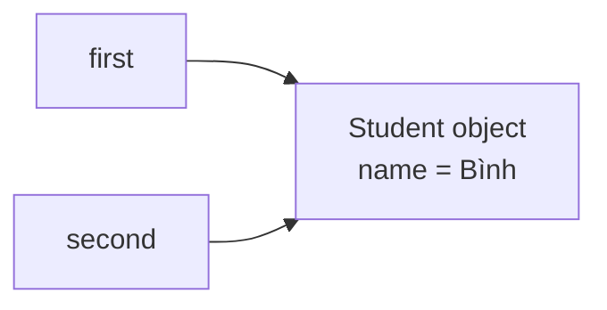
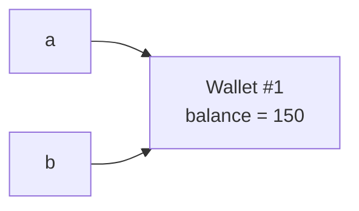
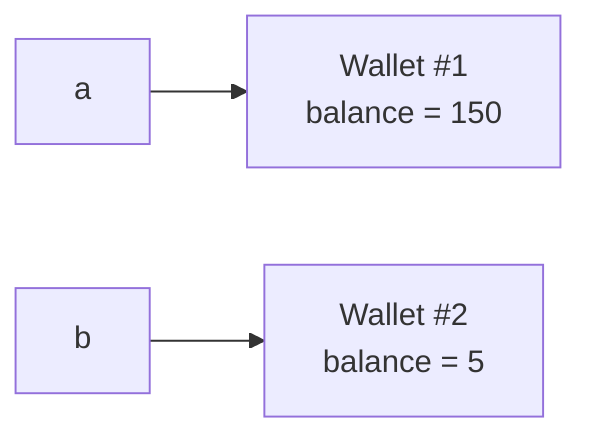

# Tham chiếu, giá trị và cách truyền đối tượng trong Java

Trong Java, khi làm việc với **đối tượng (object)**, chúng ta thường gặp các câu hỏi:

- Vì sao `b = a` nhưng sửa `b` lại khiến dữ liệu đọc qua `a` thay đổi?
- Vì sao truyền một đối tượng vào phương thức rồi gán `obj = new ...` lại không thay thế được đối tượng ở nơi gọi?
- Java truyền tham số **theo giá trị (pass-by-value)** hay **theo tham chiếu (pass-by-reference)**?

Câu trả lời nằm ở sự phân biệt giữa **giá trị của biến**, **tham chiếu đến đối tượng** và **bản thân đối tượng**. Hiểu đúng ba khái niệm này giúp tránh lỗi khi thiết kế API, cập nhật trạng thái, xử lý collection và truyền dữ liệu giữa các lớp.

## 1. Giá trị của biến primitive và biến kiểu tham chiếu

Java có hai nhóm kiểu dữ liệu chính:

| Nhóm | Ví dụ | Giá trị lưu trong biến | Khi gán sang biến cùng kiểu |
|---|---|---|---|
| Kiểu nguyên thủy (*primitive*) | `int`, `long`, `boolean`, `double`, `char` | Giá trị nguyên thủy, ví dụ `42` | Sao chép giá trị đó |
| Kiểu tham chiếu (*reference type*) | `Student`, `String`, `int[]`, `List<String>` | Một giá trị tham chiếu chỉ đến đối tượng, hoặc `null` | Sao chép **giá trị tham chiếu**, không sao chép đối tượng |

Ví dụ với kiểu nguyên thủy:

```java
int a = 10;
int b = a;     // b nhận bản sao của giá trị 10
b = 20;

System.out.println(a); // 10
System.out.println(b); // 20
```

Mỗi biến có giá trị riêng, nên sửa `b` không làm `a` thay đổi.

Với đối tượng:

```java
class Student {
    String name;

    Student(String name) {
        this.name = name;
    }
}

Student first = new Student("An");
Student second = first; // Sao chép tham chiếu, không tạo Student mới

second.name = "Bình";

System.out.println(first.name);  // Bình
System.out.println(second.name); // Bình
```

`first` và `second` là **hai biến**, nhưng đang cùng tham chiếu đến **một đối tượng `Student`**. Việc thay đổi trường `name` của đối tượng ấy có thể quan sát từ cả hai biến.

### Hình dung quan hệ tham chiếu



Sơ đồ diễn tả quan hệ logic giữa biến và đối tượng; nó **không** phải cam kết chính xác về địa chỉ vật lý, bố trí stack/heap hoặc cách JVM tối ưu bộ nhớ.

> **Điểm cần nhớ:** `Student second = first;` tạo một biến tham chiếu mới cùng trỏ đến đối tượng hiện có. Chỉ lệnh `new Student(...)` trong ví dụ mới tạo đối tượng `Student` mới.

## 2. Phân biệt thay đổi đối tượng và gán lại tham chiếu

Đây là hai thao tác rất khác nhau.

```java
class Wallet {
    private int balance;

    Wallet(int balance) {
        this.balance = balance;
    }

    void deposit(int amount) {
        if (amount <= 0) {
            throw new IllegalArgumentException("Số tiền phải dương");
        }
        balance += amount;
    }

    int getBalance() {
        return balance;
    }
}

Wallet a = new Wallet(100);
Wallet b = a;

b.deposit(50);             // Sửa đối tượng được a và b cùng tham chiếu
System.out.println(a.getBalance()); // 150

b = new Wallet(5);         // Chỉ cho biến b tham chiếu đối tượng mới
System.out.println(a.getBalance()); // 150
System.out.println(b.getBalance()); // 5
```

**Trước khi `b = new Wallet(5)`:**



**Sau khi `b = new Wallet(5)`:**



`b.deposit(50)` gọi phương thức trên đối tượng `Wallet #1`, vì vậy `a` cũng quan sát được số dư mới. Còn phép gán `b = new Wallet(5)` chỉ thay đổi **đối tượng mà biến `b` tham chiếu**; nó không thay đổi `a`.

Tình huống nhiều biến cùng tham chiếu đến một đối tượng được gọi là **aliasing** (các bí danh/tham chiếu dùng chung). Aliasing không nhất thiết sai, nhưng cần kiểm soát nếu đối tượng có trạng thái thay đổi được.

## 3. Java luôn truyền tham số theo giá trị (*pass-by-value*)

**Trong Java, mọi đối số được truyền vào phương thức theo giá trị.** Điều đó có nghĩa: tham số của phương thức nhận một **bản sao giá trị** từ biểu thức đối số ở nơi gọi.

- Với `int`, bản sao là số nguyên.
- Với `Student`, bản sao là **giá trị tham chiếu đến đối tượng `Student`**.
- Java **không** hỗ trợ kiểu truyền tham số bằng cách tạo một biến tham số là bí danh trực tiếp của biến tham chiếu ở phía caller.

### 3.1. Truyền kiểu primitive: sửa tham số không tác động tới caller

```java
public class PrimitiveParameterDemo {
    static void increase(int number) {
        number += 10;
        System.out.println("Trong method: " + number);
    }

    public static void main(String[] args) {
        int value = 5;
        increase(value);

        System.out.println("Sau lời gọi: " + value);
    }
}
```

Kết quả:

```text
Trong method: 15
Sau lời gọi: 5
```

Tham số `number` bắt đầu bằng giá trị `5` do `value` cung cấp, sau đó được thay đổi thành `15`. Biến `value` bên ngoài vẫn là `5`.

### 3.2. Truyền đối tượng: có thể sửa trạng thái đối tượng dùng chung

Ví dụ hoàn chỉnh có thể chạy độc lập:

```java
public class ReferenceParameterDemo {

    static class Account {
        private int balance;

        Account(int balance) {
            this.balance = balance;
        }

        void deposit(int amount) {
            if (amount <= 0) {
                throw new IllegalArgumentException("amount must be positive");
            }
            balance += amount;
        }

        int getBalance() {
            return balance;
        }
    }

    static void depositTo(Account account) {
        account.deposit(20); // Sửa đối tượng qua bản sao tham chiếu
    }

    static void replaceLocally(Account account) {
        account = new Account(999); // Chỉ gán lại tham số cục bộ
    }

    public static void main(String[] args) {
        Account account = new Account(100);

        depositTo(account);
        System.out.println(account.getBalance()); // 120

        replaceLocally(account);
        System.out.println(account.getBalance()); // 120
    }
}
```

Ở `depositTo(account)`, tham số `account` bên trong phương thức và biến `account` ở `main` nhận các giá trị tham chiếu cùng chỉ đến một `Account`. Gọi `deposit(20)` làm thay đổi đối tượng dùng chung, nên `main` nhìn thấy số dư `120`.

Ở `replaceLocally(account)`, lệnh `account = new Account(999)` chỉ gán lại **biến tham số cục bộ**. Biến `account` trong `main` vẫn tham chiếu đến đối tượng có số dư `120`.

| Thao tác trong phương thức | Thay đổi biến tham chiếu ở caller? | Có thể làm caller nhìn thấy thay đổi trạng thái? |
|---|---|---|
| `account = new Account(...)` | Không | Không, nếu chỉ thực hiện phép gán này |
| `account = null` | Không | Không, nếu chỉ thực hiện phép gán này |
| `account.deposit(20)` | Không | Có, vì sửa đối tượng mà cả hai cùng tham chiếu |
| `account.balance = ...` (nếu field truy cập được) | Không | Có, vì sửa trạng thái đối tượng |
| `account = someOtherReference` | Không | Không, nếu chỉ gán lại tham số |

**Không nên kết luận “Java truyền đối tượng theo tham chiếu”** chỉ vì có thể sửa đối tượng qua tham số. Điều được sao chép chính là giá trị tham chiếu; phương thức không thể gán lại biến tham chiếu của caller.

## 4. Thử hoán đổi hai đối tượng qua phương thức

Một cách kiểm chứng quy tắc truyền theo giá trị là thử viết hàm `swap`:

```java
static void swap(Account left, Account right) {
    Account temp = left;
    left = right;
    right = temp;
}

// Giả sử Account có getBalance()
Account a = new Account(10);
Account b = new Account(20);

swap(a, b);

System.out.println(a.getBalance()); // 10
System.out.println(b.getBalance()); // 20
```

Phương thức `swap` chỉ hoán đổi **hai biến tham số cục bộ** `left` và `right`. Hai biến `a`, `b` ở caller không bị gán lại, nên thứ tự tham chiếu của chúng giữ nguyên.

Nếu mục đích là cập nhật đối tượng mà caller sẽ sử dụng, API nên **trả đối tượng mới**:

```java
static Account accountWithBonus(Account original, int bonus) {
    return new Account(original.getBalance() + bonus);
}

Account a = new Account(100);
a = accountWithBonus(a, 25);

System.out.println(a.getBalance()); // 125
```

Ở đây việc thay đổi biến `a` được thực hiện **tại nơi gọi**, nơi có quyền quyết định nhận kết quả trả về.

## 5. Biến tham chiếu không nhất thiết đang trỏ tới object

Giá trị `null` nghĩa là biến tham chiếu hiện không trỏ đến instance nào. Nó không phải một đối tượng rỗng; gọi phương thức instance qua `null` có thể gây `NullPointerException`.

~~~java
Student student = null;
if (student != null) {
    System.out.println(student.name);
}
~~~

Phải phân biệt `Student student;` là biến **cục bộ chưa được gán** (không được đọc trước khi gán) với `Student student = null;` là biến đã được gán giá trị `null`. Field kiểu tham chiếu nếu không khởi tạo tường minh có giá trị mặc định `null`. Bài *Giá trị rỗng và đối tượng chưa tồn tại* phân tích các trường hợp vắng mặt và cách xử lý API sâu hơn.

## 6. Giá trị tham chiếu được sao chép cho cả chuỗi, mảng và collection

`String`, mảng và `List` đều là kiểu tham chiếu; truyền chúng vào phương thức cũng là **truyền bản sao giá trị tham chiếu**, giống như với `Student`. Khả năng thấy thay đổi phụ thuộc **đối tượng đó có mutable hay không**:

~~~java
String text = "Java";
String aliasText = text;
aliasText = aliasText.concat(" OOP");
System.out.println(text);                 // Java

int[] scores = {7, 8};
int[] sharedScores = scores;
sharedScores[0] = 10;
System.out.println(scores[0]);            // 10
~~~

`String` bất biến nên phép nối không sửa chuỗi ban đầu; mảng mutable nên sửa phần tử qua alias được quan sát từ cả hai biến. Với `List<Student>`, các thao tác `add/get` truyền và trả tham chiếu đến `Student`, không tự động tạo bản sao sâu.

Điều này giải thích vì sao khi truyền dữ liệu cho thư viện, ta phải đọc hợp đồng xem phương thức chỉ đọc dữ liệu, sửa tại chỗ hay trả đối tượng mới. Bài *Mutable/Immutable* và *Sao chép nông/sâu* sẽ trình bày chi tiết hai thiết kế.

## 7. `final` chỉ kiểm soát phép gán lại tham chiếu

~~~java
final StringBuilder message = new StringBuilder("Xin chào");
message.append(" Java"); // Hợp lệ: sửa object.
 // message = new StringBuilder("Khác"); // Không hợp lệ: gán lại final.
~~~

`final` không biến object thành immutable. Đặt `final` cho tham số chỉ ngăn code trong phương thức gán lại **chính biến tham số**; bên trong vẫn có thể gọi hành vi làm đổi trạng thái đối tượng mutable mà nó tham chiếu.

## 8. Thiết kế API khi không muốn sửa đối tượng của caller

Một phương thức nhận object mutable có thể sửa object ấy dù caller không đổi biến tham chiếu. Vì vậy hợp đồng API cần nói rõ **có mutation hay không**. Nếu phải nhận và giữ mảng từ caller, có thể tạo bản sao phòng vệ:

~~~java
final class ScoreReport {
    private final int[] scores;

    ScoreReport(int[] input) {
        this.scores = java.util.Objects.requireNonNull(input).clone();
    }

    int[] getScores() {
        return scores.clone();
    }
}
~~~

`int[].clone()` tạo mảng mới, sao chép các phần tử nguyên thủy; caller sửa mảng cũ hay kết quả getter cũng không sửa được mảng nội bộ. Nếu phần tử là đối tượng mutable, việc clone mảng chỉ sao chép **tham chiếu phần tử**, cần chính sách sao chép phù hợp. Đây là hệ quả của quy tắc pass-by-value và ownership, không phải ngoại lệ đối với nó.

## 9. Đừng dùng phép so sánh tham chiếu để hỏi về nội dung

Với hai giá trị tham chiếu, `==` kiểm tra cùng instance (hoặc cùng `null`), còn `equals()` kiểm tra bình đẳng theo hợp đồng lớp:

~~~java
String a = new String("OOP");
String b = new String("OOP");
System.out.println(a == b);      // false
System.out.println(a.equals(b)); // true
~~~

Hợp đồng `equals/hashCode` được triển khai và kiểm chứng trong bài *Phân biệt cùng đối tượng với bằng nhau về giá trị*. Khi viết phương thức truyền đối tượng, hãy chỉ dùng loại so sánh đúng với yêu cầu nghiệp vụ.

## 10. Các lỗi tư duy hay gặp

| Nhận định | Đúng hay sai? | Giải thích |
|---|---|---|
| `obj2 = obj1` tạo bản sao đối tượng | Sai | Chỉ sao chép giá trị tham chiếu |
| Java truyền tham số đối tượng bằng pass-by-reference | Sai | Java truyền **bản sao giá trị tham chiếu** |
| Phương thức sửa field trên đối tượng truyền vào thì caller có thể thấy thay đổi | Đúng | Vì cùng đối tượng được tham chiếu |
| Phương thức gán lại tham số bằng `new` sẽ thay đổi biến tham chiếu của caller | Sai | Tham số là biến cục bộ độc lập |
| `final MyType x` đảm bảo đối tượng bất biến | Sai | Chỉ ngăn gán lại biến `x` |
| `new ArrayList<>(old)` sao chép sâu phần tử | Sai | Đây là bản sao nông |
| Mọi `equals()` đều so sánh nội dung | Sai | Phụ thuộc hợp đồng/triển khai của lớp |
| Một biến tham chiếu bằng `null` đang trỏ tới một đối tượng rỗng | Sai | `null` nghĩa là không có tham chiếu tới đối tượng nào |

## 11. Bài tập tự kiểm tra

### Bài 1 — Dự đoán kết quả

```java
class Box {
    int value;
    Box(int value) { this.value = value; }
}

static void modify(Box box) {
    box.value += 5;
    box = new Box(100);
    box.value++;
}

// Tại nơi gọi:
Box original = new Box(10);
modify(original);
System.out.println(original.value);
```

**Đáp án: `15`.** Lệnh `box.value += 5` sửa `Box(10)` ban đầu thành `15`. Sau đó `box = new Box(100)` chỉ làm tham số `box` tham chiếu đối tượng mới; lệnh `box.value++` chỉ sửa đối tượng mới thành `101`. Biến `original` vẫn trỏ đến đối tượng ban đầu.

### Bài 2 — Hai mảng có độc lập không?

```java
int[][] matrix = {{1, 2}, {3, 4}};
int[][] copy = matrix.clone();

copy[0][0] = 99;
System.out.println(matrix[0][0]);
```

**Đáp án: `99`.** `clone()` chỉ sao chép mảng ngoài; các phần tử `int[]` bên trong vẫn được dùng chung. Muốn sao chép từng hàng, cần tạo các mảng con mới, ví dụ lặp `copy[i] = matrix[i].clone()`.

### Bài 3 — Thiết kế API an toàn

Một lớp `Classroom` nhận `List<Student>` từ constructor và cung cấp `getStudents()`. Hãy xác định những đường nào khiến code bên ngoài có thể thay đổi trạng thái nội bộ. Gợi ý: kiểm tra tham chiếu `List` đầu vào, tham chiếu danh sách trả về và tham chiếu các phần tử `Student`. Đề xuất cách thiết kế: dùng bản sao danh sách, API truy vấn chỉ đọc, và cân nhắc kiểu phần tử bất biến hoặc sao chép dữ liệu cần thiết.

---

**Ghi nhớ:** Giá trị của biến kiểu đối tượng là một **tham chiếu**. Phép gán và lời gọi phương thức sao chép giá trị tham chiếu đó; chúng không tự động sao chép đối tượng. **Java luôn pass-by-value.** Một phương thức có thể sửa đối tượng dùng chung thông qua tham chiếu nhận được, nhưng việc gán lại tham số không thể gán lại biến của caller. Nắm vững điều này giúp xử lý đúng aliasing, immutable objects, mảng, collection và thiết kế API có kiểm soát.