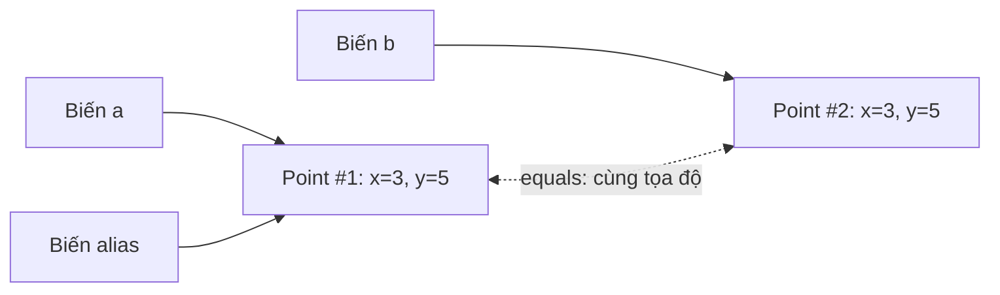

# Phân biệt cùng đối tượng và bằng nhau về giá trị trong Java

> **Chủ đề:** OOP → Đối tượng. Hai biến tham chiếu có thể **trỏ đến cùng một đối tượng** hoặc trỏ đến **hai đối tượng khác nhau nhưng có dữ liệu tương đương**. Đây là hai câu hỏi độc lập. Phân biệt đúng giúp tránh lỗi khi so sánh `String`, thiết kế lớp, xử lý danh sách và dùng `HashSet`/`HashMap`.

## 1. Hai câu hỏi khác nhau: identity và equality

Giả sử tạo hai đối tượng đều chứa tọa độ `(3, 5)`:

```java
Point a = new Point(3, 5);
Point b = new Point(3, 5);
Point alias = a;
```

- **Cùng đối tượng (object identity):** `a` và `alias` cùng tham chiếu đến **một instance**. Khi đó `a == alias` là `true`.
- **Bằng nhau về giá trị (value equality):** `a` và `b` có thể là **hai instance** nhưng có cùng `x`, `y`. Nếu lớp `Point` cài đặt `equals()` để so sánh tọa độ, `a.equals(b)` là `true`.
- **Không cùng đối tượng** không đồng nghĩa **khác giá trị**. `a == b` thường là `false`, mặc dù nội dung hai đối tượng như nhau.



`a == alias` kiểm tra hai tham chiếu có cùng đích hay không. `a.equals(b)` hỏi lớp `Point` có coi hai instance là tương đương về mặt giá trị hay không.

| Phép so sánh | Câu hỏi được trả lời | Trường hợp |
|---|---|---|
| `a == b` khi `a`, `b` là tham chiếu | Có cùng instance không? | Object identity |
| `a != b` khi là tham chiếu | Có trỏ đến hai đối tượng khác nhau không? | Khác identity |
| `a.equals(b)` | Có bằng nhau theo quy tắc `equals` của lớp không? | Value/logical equality |
| `Objects.equals(a, b)` | Có bằng nhau mà xử lý an toàn cả `null` không? | Equality có thể null |
| `x == y` khi `x`, `y` là kiểu nguyên thủy | Hai **giá trị nguyên thủy** có bằng nhau không? | So sánh giá trị, không có identity đối tượng |

Cần nhớ: kiểu nguyên thủy như `int`, `boolean` không phải đối tượng; `==` với kiểu nguyên thủy là phép so sánh **giá trị**. Điểm khác biệt identity/value equality xuất hiện rõ khi so sánh **tham chiếu đối tượng**.

## 2. Vì sao hai đối tượng có cùng trường dữ liệu vẫn có thể `equals() == false`?

Mỗi lớp Java đều kế thừa `equals(Object)` từ `java.lang.Object`. Nếu lớp **không ghi đè**, cách cài đặt mặc định của `Object.equals` chỉ công nhận **cùng một instance**.

```java
class Book {
    String isbn;
    Book(String isbn) {
        this.isbn = isbn;
    }
}

Book first = new Book("978-000");
Book second = new Book("978-000");

System.out.println(first == second);      // false
System.out.println(first.equals(second)); // false
```

Hai đối tượng có giá trị trường `isbn` giống nhau, nhưng `Book` không định nghĩa equality theo `isbn`, nên `equals` thừa hưởng hành vi so sánh identity.

Ngược lại:

```java
Book sameBook = first;
System.out.println(first == sameBook);      // true
System.out.println(first.equals(sameBook)); // true
```

**Điều kiện quan trọng:** `equals()` không tự động so sánh tất cả trường dữ liệu của mọi lớp. Quy tắc equality là một phần của thiết kế lớp.

## 3. Ví dụ hoàn chỉnh: cài đặt `equals()` và `hashCode()` cho lớp giá trị

Ta xây dựng `Point` như một **value object**: hai điểm bằng nhau khi hai tọa độ bằng nhau. Lớp được khai báo `final` để không phải giải quyết thêm tình huống lớp con thay đổi quy tắc equality; trường `final` để giá trị không đổi sau khi khởi tạo.

Lưu đoạn mã dưới đây thành `EqualityDemo.java` (Java 17+):

```java
import java.util.HashMap;
import java.util.HashSet;
import java.util.Map;
import java.util.Objects;
import java.util.Set;

public class EqualityDemo {
    static final class Point {
        private final int x;
        private final int y;

        Point(int x, int y) {
            this.x = x;
            this.y = y;
        }

        @Override
        public boolean equals(Object obj) {
            if (this == obj) {
                return true;  // Cùng một instance luôn bằng nhau
            }
            if (!(obj instanceof Point other)) {
                return false; // Bao gồm cả null và loại khác
            }
            return x == other.x && y == other.y;
        }

        @Override
        public int hashCode() {
            return Objects.hash(x, y);
        }

        @Override
        public String toString() {
            return "Point(" + x + ", " + y + ")";
        }
    }

    public static void main(String[] args) {
        Point a = new Point(3, 5);
        Point b = new Point(3, 5);
        Point alias = a;
        Point c = new Point(4, 5);

        System.out.println(a == b);       // false
        System.out.println(a == alias);   // true
        System.out.println(a.equals(b));  // true
        System.out.println(a.equals(c));  // false
        System.out.println(a.hashCode() == b.hashCode()); // true

        Set<Point> points = new HashSet<>();
        points.add(a);
        points.add(b);
        points.add(c);
        System.out.println(points.size()); // 2

        Map<Point, String> labels = new HashMap<>();
        labels.put(a, "Điểm A");
        System.out.println(labels.get(b)); // Điểm A
    }
}
```

Kết quả mong đợi, đúng theo thứ tự các dòng `println`:

```text
false
true
true
false
true
2
Điểm A
```

Ở đây `a` và `b` được tạo bằng hai lần `new` nên là hai instance khác nhau. Nhưng chúng có cùng `x`, `y` nên `equals` trả `true` và `hashCode` trả cùng mã băm. `HashSet` chỉ giữ một phần tử tương đương trong `a` và `b`; `HashMap` có thể tìm giá trị đã lưu bằng một khóa tương đương.

### Đọc từng dòng trong `equals()`

```java
@Override
public boolean equals(Object obj) {
    if (this == obj) return true;
    if (!(obj instanceof Point other)) return false;
    return x == other.x && y == other.y;
}
```

1. `this == obj`: tối ưu trường hợp hai tham chiếu là cùng một đối tượng; chính nó phải bằng chính nó.
2. `instanceof Point other`: chỉ chấp nhận đối tượng thuộc loại được so sánh và gán tham chiếu đã kiểm tra vào `other` (pattern matching có từ Java 16); `null instanceof Point` là `false`.
3. So sánh **các trường tạo nên giá trị** của `Point`. Vì `x` và `y` là `int`, sử dụng `==` là đúng.

Đừng viết `public boolean equals(Point other)` khi mục đích là ghi đè `Object.equals(Object)`: đó chỉ là một phương thức **overload**, không thay thế `equals(Object)` mà các collection Java sử dụng. Hãy dùng `@Override` để trình biên dịch phát hiện sai chữ ký.

Lựa chọn `instanceof` hay `getClass()` cần xét inheritance. Với lớp `Point` ở trên đã `final`, không thể có lớp con nên không phát sinh vấn đề subclass. Với lớp có thể kế thừa, cần thiết kế equality sao cho **đối xứng** và **bắc cầu**, tránh để lớp cha và lớp con định nghĩa hai bộ tiêu chí khác nhau.

## 4. Hợp đồng `equals()`: không chỉ cần “so sánh đúng trường”

Java quy định một số tính chất của `equals()` cho các tham chiếu không null:

| Tính chất | Yêu cầu | Ví dụ |
|---|---|---|
| Phản xạ (reflexive) | `x.equals(x)` là `true` | Điểm bằng chính nó |
| Đối xứng (symmetric) | `x.equals(y)` và `y.equals(x)` cho cùng kết quả | Không được phụ thuộc chiều gọi |
| Bắc cầu (transitive) | Nếu `x.equals(y)` và `y.equals(z)` thì `x.equals(z)` | Bình đẳng phải nhất quán qua ba đối tượng |
| Nhất quán (consistent) | Không đổi kết quả khi dữ liệu dùng cho equality không thay đổi | Gọi lại không bất ngờ đổi kết quả |
| Với `null` | `x.equals(null)` phải là `false` | Null không là một Point |

Nếu quy tắc equality phụ thuộc vào trạng thái **mutable**, kết quả so sánh có thể đổi sau khi cập nhật trường. Điều đó không tự động vi phạm tính nhất quán (vì trạng thái đã đổi), nhưng là nguồn lỗi lớn khi đối tượng nằm trong collection dạng hash.

**Ví dụ vi phạm đối xứng:** lớp cha cho phép so sánh với mọi đối tượng con, trong khi lớp con đòi thêm trường phụ và chỉ bằng đối tượng cùng lớp con. Khi đó `parent.equals(child)` có thể là `true` còn `child.equals(parent)` là `false`. Không nên cài đặt quy tắc như vậy.

## 5. Vì sao phải ghi đè `hashCode()` cùng `equals()`?

`hashCode()` trả về một `int` dùng trong cấu trúc dữ liệu dạng hash. Hợp đồng cốt lõi:

> **Nếu `a.equals(b)` là `true`, thì `a.hashCode() == b.hashCode()` bắt buộc phải đúng.**

Chiều ngược lại **không** được đảm bảo: hai đối tượng **không bằng nhau** vẫn có thể trùng mã băm (hash collision). Một mã băm chỉ giúp tra cứu nhanh, không thay thế `equals()`.

| Tình huống | Hợp lệ? | Giải thích |
|---|---|---|
| `equals` true, hash code giống | Bắt buộc | Hợp đồng của `Object` |
| `equals` false, hash code giống | Có thể | Hash collision |
| `equals` false, hash code khác | Có thể | Trường hợp phổ biến |
| `equals` true, hash code khác | **Sai** | Phá hoạt động của `HashSet`/`HashMap` |

Khi ghi đè `equals`, gần như luôn cần ghi đè `hashCode` dựa trên **cùng bộ dữ liệu**. Ví dụ `Objects.hash(x, y)` phù hợp để học và cho các lớp nhỏ. Ở đường chạy rất nhạy hiệu năng, có thể tính hash thủ công để tránh chi phí không cần thiết.

```java
@Override
public int hashCode() {
    int result = Integer.hashCode(x);
    result = 31 * result + Integer.hashCode(y);
    return result;
}
```

Kết quả tính bằng công thức trên có thể khác với `Objects.hash(x, y)`, nhưng cả hai đều đúng nếu các đối tượng cùng `x`, `y` luôn có cùng hash code. Không bắt buộc các thuật toán băm khác nhau phải cho cùng số.

### Lỗi rất khó phát hiện: dùng đối tượng mutable làm key

```java
final class MutableKey {
    int code;

    MutableKey(int code) {
        this.code = code;
    }

    @Override
    public boolean equals(Object obj) {
        return obj instanceof MutableKey other && code == other.code;
    }

    @Override
    public int hashCode() {
        return Integer.hashCode(code);
    }
}

// Ví dụ sử dụng:
MutableKey key = new MutableKey(1);
Map<MutableKey, String> map = new HashMap<>();
map.put(key, "One");

key.code = 2; // Thay đổi trường quyết định equality/hashCode
String result = map.get(key); // Có thể không tìm được giá trị đã lưu
```

Bảng băm xác định vị trí dựa vào mã băm khi thêm phần tử. Đổi trường `code` có thể làm `hashCode()` đổi, khiến tra cứu dựa trên trạng thái mới không tìm đúng vị trí cũ. **Giải pháp:** dùng key bất biến hoặc bảo đảm không sửa trường tham gia equality/hashCode trong suốt thời gian làm key.

## 6. `String`: lỗi phổ biến nhất của toán tử `==`

`String` đã ghi đè `equals()` để so sánh **nội dung ký tự**. Cách viết đúng khi so sánh giá trị chuỗi là `equals`, hoặc `equalsIgnoreCase` nếu yêu cầu không phân biệt chữ hoa/chữ thường.

```java
String s1 = new String("Java");
String s2 = new String("Java");
String s3 = s1;

System.out.println(s1 == s2);       // false: hai đối tượng riêng
System.out.println(s1 == s3);       // true: cùng tham chiếu
System.out.println(s1.equals(s2));  // true: cùng nội dung
```

Với chuỗi literal:

```java
String left = "Java";
String right = "Java";
System.out.println(left == right); // true do cơ chế intern của literal
```

Java có **string pool/interning** giúp các literal tương đương tham chiếu cùng chuỗi đã intern. Vì vậy `==` trên chuỗi *đôi khi* trả `true`, khiến lỗi bị che giấu. **Không dùng `==` để kiểm tra nội dung chuỗi**, vì giá trị cũng có thể đến từ file, API, bàn phím, `new String(...)` hoặc một phép biến đổi.

```java
String status = null;

System.out.println(Objects.equals(status, "READY")); // false
System.out.println("READY".equals(status));           // false

// status.equals("READY") sẽ ném NullPointerException nếu status null.
```

`Objects.equals(a, b)` là null-safe: `true` khi cả hai cùng null, `false` khi chỉ một bên null, còn khi cả hai có giá trị sẽ gọi `a.equals(b)`.

## 7. Những loại đối tượng có quy tắc equality khác nhau

| Loại dữ liệu | `==` | `equals()` hoặc cách thích hợp |
|---|---|---|
| `int`, `boolean`... | So sánh giá trị nguyên thủy | Không gọi `equals` trên primitive |
| `String` | Cùng instance chuỗi | `String.equals` so sánh nội dung |
| `StringBuilder` | Cùng instance | Kế thừa `Object.equals`: không so sánh nội dung; dùng `toString().equals(...)` hoặc `contentEquals` khi phù hợp |
| `List<String>` | Cùng instance danh sách | `List.equals` so sánh phần tử theo thứ tự |
| `Set<String>` | Cùng instance tập hợp | `Set.equals` so sánh phần tử, không phụ thuộc thứ tự |
| `int[]`, `String[]` | Cùng instance mảng | `Arrays.equals` so sánh phần tử |
| Mảng lồng nhau | Cùng instance mảng ngoài | `Arrays.deepEquals` khi cần so sánh lồng nhau |
| `record` Java | Cùng instance record | `equals` được tạo từ các thành phần (components) |
| `enum` | So sánh hằng enum | `==` phù hợp vì mỗi enum constant là một instance duy nhất |

**Một số ví dụ cụ thể:**

```java
import java.util.Arrays;
import java.util.List;

int[] a = {1, 2, 3};
int[] b = {1, 2, 3};

System.out.println(a == b);             // false
System.out.println(a.equals(b));        // false
System.out.println(Arrays.equals(a, b));// true

int[][] x = {{1, 2}, {3, 4}};
int[][] y = {{1, 2}, {3, 4}};

System.out.println(Arrays.equals(x, y));     // false
System.out.println(Arrays.deepEquals(x, y)); // true

List<String> list1 = List.of("A", "B");
List<String> list2 = List.of("A", "B");
System.out.println(list1.equals(list2));      // true
```

`Arrays.equals(x, y)` ở ví dụ hai chiều so sánh các phần tử là **mảng con**, mà mảng con dùng identity khi gọi `equals`. `Arrays.deepEquals` đi sâu vào các mảng lồng nhau. Với mảng có phần tử là object, `Arrays.equals` áp dụng quy tắc equality của phần tử; với mảng nguyên thủy, nó so sánh từng giá trị.

### `BigDecimal`: cùng giá trị số học chưa chắc `equals` true

```java
import java.math.BigDecimal;

BigDecimal one = new BigDecimal("1.0");
BigDecimal another = new BigDecimal("1.00");

System.out.println(one.equals(another));       // false
System.out.println(one.compareTo(another) == 0);// true
```

`BigDecimal.equals` xét cả **giá trị không chia tỷ lệ (unscaled value)** và **scale**, nên `1.0` khác `1.00` về `equals`, dù so sánh độ lớn toán học bằng nhau qua `compareTo`. Đây là ví dụ cho thấy **“bằng nhau” tùy thuộc hợp đồng của kiểu dữ liệu**.

Khi dùng `BigDecimal` làm key trong hash collection, cần nhất quán cách chuẩn hóa scale hoặc hiểu rõ luật `equals`/`hashCode`. `TreeSet` mặc định dựa vào thứ tự `compareTo`, còn `HashSet` dựa vào `equals` và `hashCode`, nên hành vi loại trùng có thể khác nhau với những giá trị scale khác nhau.

## 8. `record`: cách diễn đạt value object ngắn gọn

Từ Java 16, `record` có thể dùng để mô tả một nhóm dữ liệu với các thành phần được xác định ngay trong khai báo. Java tự sinh constructor, accessor, `equals`, `hashCode` và `toString` tương ứng:

```java
record Coordinate(int x, int y) {}

Coordinate first = new Coordinate(3, 5);
Coordinate second = new Coordinate(3, 5);

System.out.println(first == second);      // false
System.out.println(first.equals(second)); // true
System.out.println(first.hashCode() == second.hashCode()); // true
```

Với record này, equality phù hợp với ý tưởng cùng tọa độ nghĩa là cùng giá trị. Nhưng lưu ý: record chỉ ngăn gán lại **tham chiếu trường**; nó không tự làm bất biến sâu các đối tượng mutable được chứa trong trường. Nếu một record có thành phần là mảng, equality mặc định của thành phần mảng vẫn là so sánh tham chiếu, không tự động so sánh nội dung mảng.

Ví dụ:

```java
record Bytes(byte[] data) {}

Bytes one = new Bytes(new byte[] {1, 2});
Bytes two = new Bytes(new byte[] {1, 2});

System.out.println(one.equals(two)); // false: mảng con khác identity
```

Do đó, trước khi chọn record, hãy xác định đúng **khái niệm giá trị** của từng thành phần; cân nhắc defensive copy và thiết kế equality riêng khi có collection hoặc mảng mutable.

## 9. Phân biệt entity với value object trong thiết kế OOP

Không phải mọi đối tượng cùng dữ liệu hiển thị đều nên coi là bằng nhau.

**Value object** có ý nghĩa chủ yếu bởi các thuộc tính cấu thành: `Coordinate(3,5)`, khoảng ngày tháng, một cặp tọa độ, hoặc một cấu trúc cấu hình. Hai instance với cùng giá trị có thể được coi là tương đương.

**Entity** có danh tính nghiệp vụ độc lập với thuộc tính thay đổi: hai tài khoản có thể cùng tên chủ tài khoản và cùng số dư nhưng **không phải cùng tài khoản**. Với entity, cần xác định identity nghiệp vụ, chẳng hạn mã tài khoản, thay vì so sánh tùy tiện mọi trường dữ liệu.

| Tình huống | Cùng object identity? | Equality mong muốn |
|---|---|---|
| Hai biến cùng trỏ tới một `BankAccount` | Có | Có |
| Hai `Coordinate(3,5)` tạo riêng | Không | Có, nếu theo tọa độ |
| Hai tài khoản cùng số dư 100.000 nhưng ID khác | Không | Thường không |
| Hai object biểu diễn cùng account ID qua hai lần tải | Không nhất thiết | Phụ thuộc hợp đồng entity trong ứng dụng |
| Hai DTO có trường giống nhau | Không nhất thiết | Phụ thuộc việc DTO có định nghĩa value equality hay không |

Đối với entity được lưu vào cơ sở dữ liệu, quy tắc `equals`/`hashCode` cần xử lý cả tình trạng ID chưa được gán, proxy của ORM và vòng đời thực thể; không nên áp dụng máy móc `Objects.equals(id, other.id)` vì hai entity mới đều có `id == null` có thể bị coi là bằng nhau. Chỉ cần nắm trong phạm vi OOP căn bản: **quy tắc equality là quyết định thiết kế dựa trên ý nghĩa của đối tượng**.

## 10. Kiểm tra null, wrapper và những bẫy thường gặp

**Không gọi `equals` trên tham chiếu null:**

```java
String input = null;

// input.equals("OK") -> NullPointerException
boolean ok = Objects.equals(input, "OK"); // false
boolean alsoOk = "OK".equals(input);      // false
```

**Tránh dùng `==` cho giá trị boxed như `Integer`:**

```java
Integer p = Integer.valueOf(1000);
Integer q = Integer.valueOf(1000);

System.out.println(p.equals(q)); // true
// p == q không phải hợp đồng so sánh giá trị; kết quả tùy identity.
```

Một số giá trị boxed nhỏ có thể được cache và làm `==` trả `true`; điều đó không chứng minh hai biến đều phải là cùng instance ở mọi trường hợp. Nếu cần so sánh nội dung, dùng `equals`; nếu một bên có thể null, dùng `Objects.equals`. Nếu ép kiểu tự động unbox `Integer` null sang `int`, có thể gặp `NullPointerException`.

**Không dựa vào mã băm để suy ra identity hoặc equality:**

```java
boolean equal = a.equals(b);                // Câu hỏi về equality
boolean same = a == b;                      // Câu hỏi về identity
boolean sameHash = a.hashCode() == b.hashCode(); // Chỉ câu hỏi về mã băm
```

`sameHash == true` **không** chứng minh `equal == true`. Còn `System.identityHashCode(obj)` cũng không phải địa chỉ bộ nhớ hay định danh duy nhất tuyệt đối: các đối tượng khác nhau vẫn có thể trùng số này.

## 11. Tự kiểm tra và bài tập

**Câu 1 — đoán kết quả:**

```java
String a = new String("oop");
String b = new String("oop");
String c = a;
System.out.println(a == b);
System.out.println(a.equals(b));
System.out.println(a == c);
```

Đáp án lần lượt: `false`, `true`, `true`. Hai `new String` tạo hai instance riêng, nhưng cùng nội dung; `c` tham chiếu lại đúng `a`.

**Câu 2 — sửa lỗi:** Một lớp `ProductCode` chỉ có trường `String code` nhưng `new ProductCode("P01").equals(new ProductCode("P01"))` đang là `false`. Hãy viết lại lớp sao cho equality dựa trên `code`, bổ sung `hashCode`, kiểm thử bằng `HashSet`.

**Câu 3 — giải thích:** Vì sao `Arrays.equals(new int[]{1,2}, new int[]{1,2})` là `true`, còn `new int[]{1,2}.equals(new int[]{1,2})` là `false`? Liên hệ với phương thức `equals` mặc định của `Object`.

**Câu 4 — thiết kế:** Hai `Customer` có cùng tên và ngày sinh nhưng ID khác nhau. Bạn có nên cho `equals` trả `true`? Hãy xác định đó là entity hay value object trước khi chọn các trường tham gia equality.

**Câu 5 — hash collections:** Dùng một đối tượng có trường mutable làm key `HashMap` rồi thay đổi trường tham gia `hashCode`. Hãy giải thích vì sao có thể không tra được giá trị và đề xuất cách sửa.

---

**Ghi nhớ:**

- Với **tham chiếu**, `==` hỏi **“có phải cùng instance?”**; với **kiểu nguyên thủy**, `==` so sánh **giá trị**.
- `equals` hỏi **“có bằng nhau theo hợp đồng của lớp?”**; nhiều lớp phải tự định nghĩa hợp đồng này.
- Ghi đè `equals` phải đồng bộ `hashCode`, nhất là khi sử dụng `HashSet` hoặc `HashMap`.
- Hai đối tượng bằng nhau về giá trị **không nhất thiết** là cùng một đối tượng. Quy tắc equality cần phù hợp với bản chất entity/value object của dữ liệu.