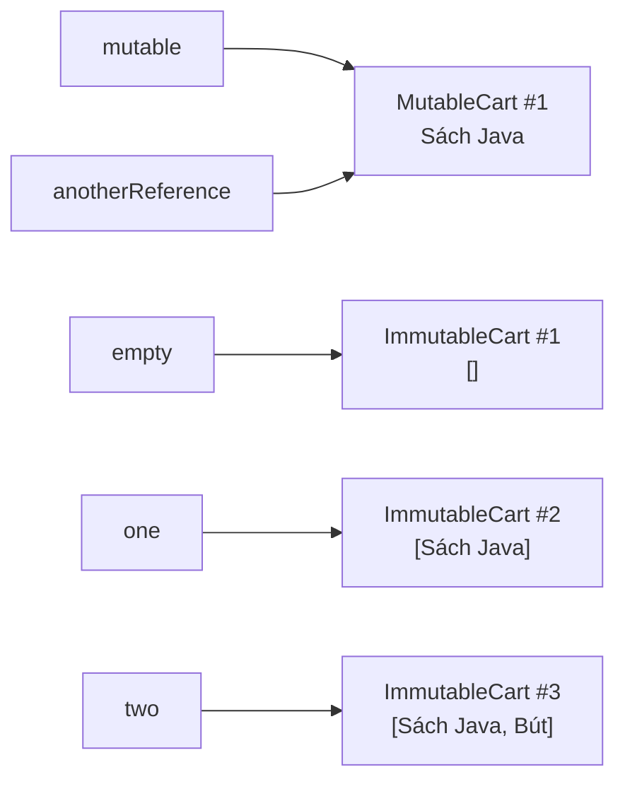

# Đối tượng có thể thay đổi (Mutable) và đối tượng bất biến (Immutable) trong Java

Trong lập trình hướng đối tượng, **trạng thái của đối tượng** (*object state*) là những giá trị mà đối tượng đang giữ, chẳng hạn tên người dùng, danh sách sản phẩm hoặc số dư. Dựa vào khả năng thay đổi trạng thái **sau khi đã khởi tạo**, ta thường phân biệt:

- **Mutable object (đối tượng có thể thay đổi):** đối tượng cho phép thay đổi trạng thái quan sát được mà không cần tạo đối tượng thay thế.
- **Immutable object (đối tượng bất biến):** sau khi đối tượng được tạo hợp lệ, trạng thái quan sát được của chính đối tượng đó không thay đổi. Muốn có giá trị mới, chương trình thường tạo một đối tượng mới.

Điểm cần phân biệt: **thay đổi biến tham chiếu** khác với **thay đổi đối tượng mà biến đang tham chiếu**. Biến có thể được gán sang đối tượng khác, trong khi đối tượng cũ vẫn bất biến.

## 1. Nhìn nhanh qua `String` và `StringBuilder`

Java có hai kiểu quen thuộc minh họa rất rõ sự khác biệt:

```java
String title = "Java";
String updatedTitle = title.concat(" OOP");

System.out.println(title);        // Java
System.out.println(updatedTitle); // Java OOP

StringBuilder builder = new StringBuilder("Java");
builder.append(" OOP");

System.out.println(builder);      // Java OOP
```

- `String` là **immutable**: `concat()` tạo hoặc trả về một chuỗi khác; nội dung chuỗi `"Java"` ban đầu không đổi.
- `StringBuilder` là **mutable**: `append()` cập nhật trạng thái bên trong chính đối tượng `builder`.

Một trường hợp dễ nhầm:

```java
String message = "A";
message = message + "B";
System.out.println(message); // AB
```

Dòng gán không hề sửa chuỗi `"A"`. Biến `message` nhận tham chiếu đến chuỗi kết quả `"AB"`. **Có thể gán lại biến** không đồng nghĩa với **đối tượng có thể thay đổi**.

| Tiêu chí | Mutable object | Immutable object |
| --- | --- | --- |
| Trạng thái sau khởi tạo | Có thể thay đổi | Không thay đổi qua API và các tham chiếu được chia sẻ |
| Cách cập nhật | Thường sửa đối tượng hiện tại | Thường tạo đối tượng chứa giá trị mới |
| Tham chiếu cùng trỏ đến một đối tượng | Cùng quan sát các thay đổi | Cùng nhìn thấy một trạng thái cố định |
| Ví dụ Java | `StringBuilder`, `ArrayList`, `Date` | `String`, `Integer`, `LocalDate`, `BigDecimal` |
| Lợi thế thường gặp | Cập nhật liên tục, ít tạo bản sao | Dễ suy luận, chia sẻ và kiểm thử |
| Điều cần lưu ý | Trạng thái bị thay đổi ngoài dự kiến | Chi phí tạo giá trị mới và sao chép có thể tăng |

Các ví dụ bất biến trong bảng là các lớp thư viện được thiết kế bất biến. Một lớp tự viết chỉ bất biến nếu **toàn bộ trạng thái quan sát được** thật sự được bảo vệ, không đơn giản là có `final`.

## 2. Ví dụ Java hoàn chỉnh: giỏ hàng mutable và immutable

Ví dụ sau đặt cả hai thiết kế cạnh nhau. Lớp `MutableCart` bổ sung sản phẩm ngay trên đối tượng đang có. Lớp `ImmutableCart` trả về **một giỏ hàng mới** sau mỗi lần thêm sản phẩm.

Đặt toàn bộ mã vào **`Main.java`**; có thể biên dịch bằng Java 17 hoặc Java 21.

```java
import java.util.ArrayList;
import java.util.List;
import java.util.Objects;

final class MutableCart {
    private final List<String> products = new ArrayList<>();

    void addProduct(String product) {
        validateProduct(product);
        products.add(product);  // Thay đổi trạng thái bên trong đối tượng
    }

    int size() {
        return products.size();
    }

    List<String> products() {
        return List.copyOf(products); // Trả về snapshot để tránh lộ list nội bộ
    }

    private static void validateProduct(String product) {
        Objects.requireNonNull(product, "product");
        if (product.isBlank()) {
            throw new IllegalArgumentException("Tên sản phẩm không được trống");
        }
    }
}

final class ImmutableCart {
    private final List<String> products;

    ImmutableCart(List<String> products) {
        Objects.requireNonNull(products, "products");
        List<String> copy = List.copyOf(products); // Sao chép cấu trúc danh sách
        for (String product : copy) {
            if (product.isBlank()) {
                throw new IllegalArgumentException("Tên sản phẩm không được trống");
            }
        }
        this.products = copy;
    }

    ImmutableCart withAddedProduct(String product) {
        Objects.requireNonNull(product, "product");
        if (product.isBlank()) {
            throw new IllegalArgumentException("Tên sản phẩm không được trống");
        }

        List<String> updated = new ArrayList<>(products);
        updated.add(product);
        return new ImmutableCart(updated); // Không sửa this.products
    }

    int size() {
        return products.size();
    }

    List<String> products() {
        return products; // Danh sách đã không thể sửa cấu trúc
    }
}

public class Main {
    public static void main(String[] args) {
        MutableCart mutable = new MutableCart();
        MutableCart anotherReference = mutable;
        mutable.addProduct("Sách Java");
        System.out.println(anotherReference.size()); // 1

        ImmutableCart empty = new ImmutableCart(List.of());
        ImmutableCart one = empty.withAddedProduct("Sách Java");
        ImmutableCart two = one.withAddedProduct("Bút");
        System.out.println(empty.size());  // 0
        System.out.println(one.size());    // 1
        System.out.println(two.size());    // 2
        System.out.println(one == two);    // false

        List<String> source = new ArrayList<>(List.of("Vở"));
        ImmutableCart snapshot = new ImmutableCart(source);
        source.add("Thước");
        System.out.println(snapshot.products()); // [Vở]

        try {
            snapshot.products().add("Tẩy");
        } catch (UnsupportedOperationException ex) {
            System.out.println("Không thể sửa danh sách kết quả");
        }
    }
}
```

Chạy:

```bash
javac Main.java
java Main
```

Kết quả:

```text
1
0
1
2
false
[Vở]
Không thể sửa danh sách kết quả
```

**Điều cần quan sát:**

1. `mutable` và `anotherReference` cùng trỏ đến một `MutableCart`; `addProduct()` làm cả hai tham chiếu thấy số sản phẩm là 1.
2. `empty`, `one`, `two` lần lượt giữ **ba thể hiện `ImmutableCart`** với 0, 1, 2 sản phẩm. Mỗi lần `withAddedProduct()` tạo đối tượng mới, không sửa các giỏ cũ.
3. `one == two` bằng `false` vì chúng là hai đối tượng khác nhau.
4. Constructor `ImmutableCart` lấy bản sao danh sách đầu vào: sửa `source` sau đó không làm thay đổi `snapshot`.
5. `snapshot.products()` không cho phép `add()`, tránh sửa cấu trúc danh sách từ bên ngoài.

Sơ đồ minh họa sự khác nhau về tham chiếu:



**Không thể kết luận một lớp là immutable chỉ vì không có setter.** Nếu lớp trả trực tiếp một danh sách nội bộ có thể sửa, gọi `getItems().add(...)` cũng làm trạng thái thay đổi dù không có phương thức `setItems()`.

## 3. Vì sao `final` chưa đủ để tạo immutable object?

`final` được áp dụng ở nhiều vị trí, mỗi vị trí có ý nghĩa khác nhau:

| Khai báo | Điều `final` bảo đảm | Điều `final` không bảo đảm |
| --- | --- | --- |
| `final int count` | Trường không thể được gán lại sau khi khởi tạo đúng quy tắc | Không nói gì về các trường khác của đối tượng |
| `final List<String> items` | Trường `items` không được trỏ sang danh sách khác | Có thể vẫn gọi `items.add(...)` |
| `final class Cart` | Lớp không thể bị kế thừa | Trường và nội dung của đối tượng vẫn có thể thay đổi |
| `final Cart cart` | Biến `cart` không thể được gán lại | Bản thân đối tượng `cart` vẫn có thể mutable |

Ví dụ:

```java
final List<String> names = new ArrayList<>();
names.add("An");       // Hợp lệ: sửa nội dung của list
// names = new ArrayList<>(); // Lỗi biên dịch: không được gán lại biến final
```

Với một đối tượng **thực sự bất biến**, cần bảo vệ *đường truy cập đến mọi trạng thái có thể thay đổi*, gồm cả các đối tượng lồng bên trong.

## 4. Defensive copy: bảo vệ dữ liệu đầu vào và đầu ra

Giả sử ta viết như sau:

```java
final class UnsafeSchedule {
    private final List<String> lessons;

    UnsafeSchedule(List<String> lessons) {
        this.lessons = lessons;
    }

    List<String> lessons() {
        return lessons;
    }
}
```

Lớp có `final` và không có setter nhưng **không bất biến**:

```java
List<String> input = new ArrayList<>(List.of("OOP"));
UnsafeSchedule schedule = new UnsafeSchedule(input);

input.add("Concurrency");             // Sửa qua tham chiếu bên ngoài
schedule.lessons().add("Spring Boot"); // Sửa qua getter
System.out.println(schedule.lessons()); // [OOP, Concurrency, Spring Boot]
```

Cách sửa phù hợp với danh sách chứa các phần tử immutable, chẳng hạn `String`:

```java
final class Schedule {
    private final List<String> lessons;

    Schedule(List<String> lessons) {
        this.lessons = List.copyOf(lessons);
    }

    List<String> lessons() {
        return lessons;
    }
}
```

`List.copyOf(lessons)` cung cấp một danh sách **không thể sửa cấu trúc** và không bị ảnh hưởng bởi việc thêm, xóa phần tử vào danh sách đầu vào sau đó. Phương thức này không chấp nhận phần tử `null`. Vì `String` cũng immutable, mẫu `Schedule` có thể giữ trạng thái danh sách ổn định.

Tuy nhiên, `List.copyOf()` **không tự sao chép sâu các đối tượng phần tử**. Nếu phần tử là đối tượng mutable, một tham chiếu khác vẫn có thể chỉnh sửa phần tử đó.

```java
final class MutableTask {
    String status = "TODO";
}

MutableTask task = new MutableTask();
List<MutableTask> snapshot = List.copyOf(List.of(task));
task.status = "DONE";

System.out.println(snapshot.get(0).status); // DONE
// snapshot.add(new MutableTask());          // UnsupportedOperationException
```

Danh sách không thể thêm/xóa phần tử, nhưng trạng thái `MutableTask` vẫn đổi được. Khi cần bất biến xuyên suốt, hãy dùng phần tử immutable, thực hiện sao chép sâu phù hợp, hoặc thiết kế lại mô hình dữ liệu.

### `List.copyOf`, `List.of`, `Collections.unmodifiableList` khác nhau ra sao?

```java
List<String> original = new ArrayList<>(List.of("A"));
List<String> view = java.util.Collections.unmodifiableList(original);
List<String> snapshot = List.copyOf(original);
List<String> literal = List.of("A");

original.add("B");
System.out.println(view);     // [A, B]
System.out.println(snapshot); // [A]
System.out.println(literal);  // [A]
```

| API | Ý nghĩa chính | Có nhìn thấy sửa đổi danh sách gốc? |
| --- | --- | --- |
| `Collections.unmodifiableList(list)` | Tạo **view chỉ đọc** của list; chặn sửa qua view | **Có**, khi list gốc thay đổi |
| `List.copyOf(list)` | Tạo danh sách bất biến về cấu trúc, là snapshot của nội dung | **Không**, đối với thay đổi cấu trúc của list gốc |
| `List.of(...)` | Tạo trực tiếp danh sách không sửa được | Không có list gốc mutable cần theo dõi |

Cả ba không bảo đảm phần tử bên trong bất biến. Ngoài ra, `List.copyOf()` có thể tái sử dụng một danh sách vốn đã không thể sửa được; không nên dựa vào việc nó **luôn** tạo đối tượng list mới. “Snapshot” ở đây nói đến **nội dung quan sát được**, không cam kết danh tính đối tượng khác nhau.

## 5. `record` có tự động immutable không?

Java `record` thuận tiện để định nghĩa đối tượng dữ liệu: trình biên dịch sinh các trường `private final`, constructor chuẩn, accessor và các phương thức như `equals()`, `hashCode()`, `toString()`. Tuy nhiên, **record chỉ bảo đảm trường tham chiếu không bị gán lại, không tự bảo đảm bất biến sâu**.

Ví dụ chưa an toàn:

```java
record UnsafeInvoice(List<String> products) {}

List<String> data = new ArrayList<>(List.of("Sách"));
UnsafeInvoice invoice = new UnsafeInvoice(data);
data.add("Bút");

System.out.println(invoice.products()); // [Sách, Bút]
```

Một cách thiết kế tốt hơn khi từng sản phẩm được biểu diễn bởi dữ liệu bất biến:

```java
import java.util.List;
import java.util.Objects;

record LineItem(String sku, int quantity) {
    LineItem {
        Objects.requireNonNull(sku, "sku");
        if (sku.isBlank() || quantity <= 0) {
            throw new IllegalArgumentException("Dòng hàng không hợp lệ");
        }
    }
}

record Invoice(List<LineItem> lines) {
    Invoice {
        lines = List.copyOf(lines);
    }
}
```

Ở đây `LineItem` có `String` bất biến và số nguyên nguyên thủy; `Invoice` sao chép danh sách trong compact constructor. Vì các phần tử `LineItem` cũng bất biến, không có đường thông thường để sửa dữ liệu đã khởi tạo. Accessor `lines()` trả danh sách không cho phép thêm hoặc xóa.

**Lưu ý:** `record` không tự bảo vệ nếu thành phần của nó chứa `StringBuilder`, mảng, `Date`, `List<MutableTask>` hoặc đối tượng mutable khác. Cần xử lý các thành phần này riêng.

## 6. Immutable object không đồng nghĩa với không bao giờ có giá trị mới

Với đối tượng bất biến, một thao tác “cập nhật” thường có dạng:

```java
java.time.LocalDate original = java.time.LocalDate.of(2026, 10, 15);
java.time.LocalDate nextWeek = original.plusDays(7);

System.out.println(original); // 2026-10-15
System.out.println(nextWeek); // 2026-10-22
```

`original` không đổi; `plusDays(7)` trả về một giá trị mới. Tương tự, `BigDecimal.add()`, `String.replace()`, `ImmutableCart.withAddedProduct()` không làm thay đổi đối tượng nhận lời gọi.

Vì thế cần **giữ lại kết quả trả về**:

```java
String name = "java";
name.toUpperCase(); // Kết quả bị bỏ qua
System.out.println(name); // java

name = name.toUpperCase();
System.out.println(name); // JAVA
```

Đây là khác biệt đáng nhớ so với những API mutable trả về `void` hoặc trả `this` để thay đổi ngay trên đối tượng.

## 7. Ảnh hưởng đến chia sẻ tham chiếu và xử lý nhiều luồng

Khi nhiều thành phần cùng dùng một đối tượng mutable, thành phần này có thể quan sát trạng thái do thành phần khác vừa sửa:

```java
StringBuilder shared = new StringBuilder("A");
StringBuilder alias = shared;
alias.append("B");
System.out.println(shared); // AB
```

Đó là hệ quả của việc chia sẻ tham chiếu. Trong môi trường nhiều luồng, **cùng chỉnh sửa mutable state mà không đồng bộ đúng cách** có thể gây race condition và kết quả khó đoán. Bất biến giúp giảm đáng kể vấn đề này vì trạng thái sau khởi tạo không bị sửa.

Nhưng cần hiểu chính xác:

- **Immutable object** hữu ích khi chia sẻ dữ liệu đọc giữa nhiều luồng; không có thao tác cập nhật nội bộ để tranh chấp.
- Để quan sát được trạng thái khởi tạo đúng trong môi trường đa luồng, vẫn cần quan tâm đến quy tắc khởi tạo và **safe publication** của Java Memory Model. Việc phát tán `this` trước khi constructor hoàn thành là đặc biệt nguy hiểm.
- **Tham chiếu đến immutable object vẫn có thể thay đổi**: nếu nhiều luồng gán vào cùng một biến chia sẻ, cần cơ chế đồng bộ/visibility thích hợp như `volatile`, lock hoặc atomic reference tùy bài toán.
- **Immutable wrapper** không tự làm cho một phần tử mutable, dịch vụ ngoài hay toàn bộ quy trình nghiệp vụ trở nên thread-safe.

Ví dụ chia sẻ cấu hình immutable:

```java
record AppConfig(String endpoint, int timeoutSeconds) {
    AppConfig {
        if (endpoint == null || endpoint.isBlank() || timeoutSeconds <= 0) {
            throw new IllegalArgumentException("Cấu hình không hợp lệ");
        }
    }
}
```

Sau khi được khởi tạo và công bố an toàn, một `AppConfig` có thể được nhiều luồng đọc mà không cần khóa chỉ để ngăn việc sửa hai trường của nó. Nếu ứng dụng muốn đổi cấu hình, có thể tạo `AppConfig` mới rồi thay thế tham chiếu chia sẻ bằng cơ chế phù hợp.

## 8. Tại sao mutable object đôi khi nguy hiểm khi làm khóa của `HashMap`?

`HashMap` và `HashSet` dựa vào `hashCode()` và `equals()` để tìm khóa hoặc phần tử. Nếu một đối tượng mutable được dùng làm khóa, và các trường tham gia `hashCode()`/ `equals()` thay đổi sau khi đưa vào map/set, việc tìm lại có thể thất bại.

Ví dụ về thiết kế rủi ro:

```java
import java.util.Objects;

class MutableKey {
    String code;

    MutableKey(String code) {
        this.code = code;
    }

    @Override
    public boolean equals(Object obj) {
        return obj instanceof MutableKey other
                && Objects.equals(code, other.code);
    }

    @Override
    public int hashCode() {
        return Objects.hashCode(code);
    }
}
```

Nếu thêm một `MutableKey("A")` vào `HashSet` rồi gán `key.code = "B"`, hash dùng để tra cứu có thể khác hash khi chèn vào, nên `contains(key)` có thể trả về `false`. Giải pháp tốt là khóa có các giá trị tham gia so sánh **ổn định trong thời gian nằm trong map/set**; dùng immutable value object là lựa chọn phổ biến.

Trường hợp cần thay đổi khóa, nên xóa mục bằng giá trị khóa cũ khi còn tra cứu được và chèn lại với khóa mới, thay vì tự sửa trạng thái đã được dùng để phân vùng hash.

## 9. Chọn mutable hay immutable theo nhu cầu

Không có quy tắc “mọi đối tượng đều phải bất biến”. Tùy vào cách sử dụng:

| Tình huống | Thiết kế thường phù hợp | Lý do |
| --- | --- | --- |
| DTO chứa cấu hình, giá trị tiền, ngày giờ | Immutable | Giá trị có ngữ nghĩa ổn định, dễ chia sẻ |
| Value object như tọa độ, mã định danh, khoảng thời gian | Immutable | Tránh thay đổi bất ngờ, hỗ trợ so sánh theo giá trị |
| Bộ đệm để ghép chuỗi nhiều lần | Mutable, ví dụ `StringBuilder` | Cập nhật nhiều lần trong một vòng xử lý |
| Đối tượng quản lý trạng thái đang diễn ra, như giỏ hàng trong một phiên | Mutable có kiểm soát hoặc immutable có thao tác trả bản mới | Phụ thuộc tần suất cập nhật và yêu cầu chia sẻ |
| Snapshot sự kiện hoặc dữ liệu truyền giữa các thành phần | Immutable | Bảo vệ ảnh chụp dữ liệu tại thời điểm tạo |
| Cấu trúc lớn được cập nhật rất thường xuyên | Cân nhắc mutable hoặc persistent data structure | Tránh chi phí sao chép toàn bộ sau mỗi cập nhật |

**Chi phí:** Ví dụ `ImmutableCart` sao chép cả list mỗi lần thêm sản phẩm, có thể tốn thời gian và bộ nhớ khi list lớn. Những hệ thống cần cập nhật dữ liệu thường xuyên có thể dùng cấu trúc mutable được đóng gói kỹ, hoặc cấu trúc dữ liệu bất biến có **structural sharing** (tái sử dụng các phần không thay đổi) thay vì sao chép toàn bộ. Không nên mặc định rằng “immutable” luôn nhanh hơn hoặc luôn chậm hơn; phải nhìn vào thao tác và tải thực tế.

**Đóng gói vẫn cần thiết với mutable object.** Lớp mutable tốt nên giữ các trường `private`, kiểm soát thay đổi bằng phương thức có kiểm tra tính hợp lệ, và tránh trả các tham chiếu nội bộ có thể bị sửa tùy ý. Ví dụ `MutableCart.products()` trả snapshot, dù bản thân giỏ hàng vẫn mutable.

## 10. Những lỗi thường gặp và cách sửa

| Lỗi | Tác động | Cách khắc phục |
| --- | --- | --- |
| Nghĩ `final List` làm danh sách bất biến | Mã vẫn gọi `add/remove` được | Dùng `List.copyOf` khi cần snapshot; kiểm soát cách truy cập |
| Lưu trực tiếp mutable list do caller truyền vào | Caller sửa list làm đối tượng đổi trạng thái | Defensive copy trong constructor |
| Trả trực tiếp mutable list nội bộ | Caller sửa gián tiếp qua getter | Trả snapshot hoặc thiết kế API chỉ đọc phù hợp |
| Dùng `List.copyOf` rồi cho rằng phần tử cũng immutable | Phần tử mutable vẫn thay đổi | Dùng phần tử immutable hoặc sao chép sâu |
| Gọi phương thức của immutable object rồi bỏ kết quả | Giá trị ban đầu không thay đổi | Lưu giá trị được trả về |
| Cho rằng `record` luôn bất biến sâu | Thành phần record có thể vẫn mutable | Defensive copy, thiết kế thành phần bất biến |
| Dùng đối tượng mutable có hash thay đổi làm map key | Có thể không tìm thấy khóa đã thêm | Dùng khóa có `equals/hashCode` ổn định |
| Cho rằng immutable tự giải quyết mọi concurrency issue | Biến tham chiếu chung hoặc dependency khác vẫn có race | Kết hợp safe publication và đồng bộ nơi cần thiết |

## 11. Tự kiểm tra kiến thức

**Câu 1.** Kết quả là gì?

```java
String a = "Hi";
String b = a;
a = a.concat("!");
System.out.println(b);
```

**Đáp án:** `Hi`. `a` được gán sang chuỗi kết quả mới, còn `b` vẫn tham chiếu đến chuỗi ban đầu.

**Câu 2.** Nếu `List<String> input` được đưa vào constructor của lớp có trường `private final List<String> data;`, gán `this.data = input;` đã đủ bất biến chưa?

**Đáp án:** Chưa. Caller vẫn có thể sửa `input`, ảnh hưởng trực tiếp đến `data`. Có thể dùng `List.copyOf(input)` khi phần tử cũng immutable và yêu cầu là lưu snapshot.

**Câu 3.** Vì sao `return this` trong một phương thức thay đổi trường khác với `return new ImmutableCart(updated)`?

**Đáp án:** `return this` trả lại chính đối tượng nhận lời gọi (có thể đã thay đổi trạng thái), còn `return new ...` đưa ra một thể hiện khác, cho phép giữ đối tượng cũ nguyên trạng.

**Câu 4.** Một `record Event(List<MutableTask> tasks)` có bất biến sâu chỉ nhờ dùng `List.copyOf(tasks)` không?

**Đáp án:** Không. Danh sách không thêm/xóa được nhưng từng `MutableTask` vẫn có thể bị sửa thông qua tham chiếu khác.

**Câu 5.** Khi thiết kế một cấu hình được hàng chục luồng cùng đọc, nên chú ý điều gì?

**Đáp án:** Ưu tiên mô hình bất biến nếu phù hợp; khởi tạo đầy đủ; công bố đối tượng an toàn; đồng bộ khi thay thế tham chiếu chia sẻ nếu có cập nhật cấu hình. Bất biến của giá trị không thay thế mọi cơ chế đồng bộ trong toàn hệ thống.

**Ghi nhớ:** Mutable và immutable mô tả **khả năng thay đổi trạng thái của đối tượng**, không phải khả năng gán lại tên biến. Để tự thiết kế đối tượng bất biến trong Java, cần kiểm soát mọi đường thay đổi trạng thái: constructor, trường, phần tử lồng nhau, đối số nhận vào và dữ liệu trả ra. Còn khi chọn mutable, hãy đặt việc thay đổi trạng thái dưới các phương thức có quy tắc rõ ràng.