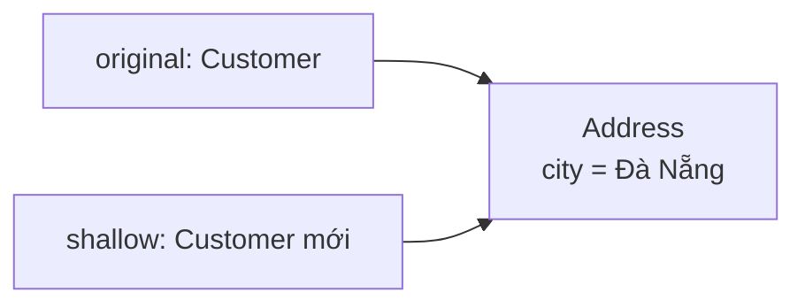
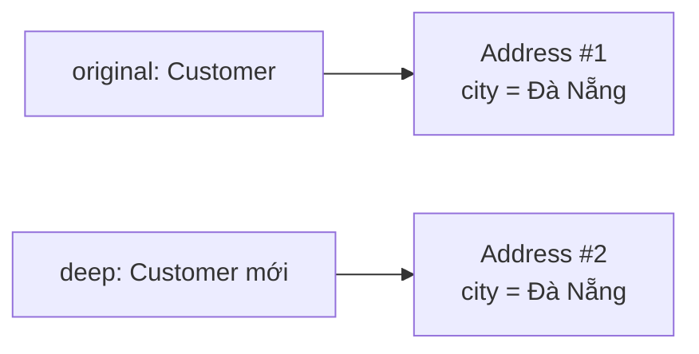

# Sao chép nông và sao chép sâu trong Java

Khi tạo một đối tượng mới từ một đối tượng có sẵn, câu hỏi quan trọng là: **đối tượng mới có chia sẻ những đối tượng con có thể thay đổi với đối tượng ban đầu hay không?** Đây là điểm phân biệt giữa **sao chép nông (shallow copy)** và **sao chép sâu (deep copy)**.

Một chương trình quản lý đơn hàng có thể cần tạo bản sao để tính phí vận chuyển thử nghiệm. Nếu bản sao vẫn chia sẻ địa chỉ giao hàng hoặc danh sách sản phẩm có thể thay đổi với đơn gốc, một thao tác tưởng chỉ sửa bản sao có thể vô tình sửa luôn đơn gốc.

## 1. Ba thao tác dễ nhầm lẫn

Xét lớp đơn giản:

```java
class Address {
    String city;

    Address(String city) {
        this.city = city;
    }
}

class Customer {
    String name;
    Address address;

    Customer(String name, Address address) {
        this.name = name;
        this.address = address;
    }
}
```

Giả sử đã có:

```java
Customer original = new Customer("Mai", new Address("Đà Nẵng"));
```

Có ba khả năng:

| Cách làm | Tạo `Customer` mới? | Tạo `Address` mới? | Có thể chia sẻ trạng thái có thể thay đổi? |
|---|:---:|:---:|:---:|
| `Customer alias = original;` | Không | Không | Có, chính cùng một đối tượng |
| `new Customer(original.name, original.address)` | Có | Không | Có, chung `Address` |
| `new Customer(original.name, new Address(original.address.city))` | Có | Có | Không, đối với đồ thị đối tượng cụ thể trong ví dụ |

**Gán tham chiếu không phải là sao chép đối tượng.** Phép gán `alias = original` chỉ sao chép giá trị tham chiếu và khiến hai biến trỏ đến cùng một đối tượng.

**Sao chép nông** tạo đối tượng ngoài (*outer object*) mới, nhưng các trường kiểu tham chiếu thường giữ cùng đối tượng bên trong. Những trường kiểu nguyên thủy, nếu có, nhận bản sao giá trị.

**Sao chép sâu** tạo đối tượng ngoài mới và sao chép tiếp những đối tượng con cần độc lập, để thao tác trên dữ liệu có thể thay đổi ở bản sao không ảnh hưởng đến đối tượng nguồn. Mức “sâu” cần được xác định theo ranh giới sở hữu dữ liệu, không nhất thiết sao chép mọi thứ mà đối tượng tham chiếu tới trong toàn hệ thống.

## 2. Nhìn bằng sơ đồ tham chiếu

**Sao chép nông:**



Hai đối tượng `Customer` khác nhau nhưng chung một đối tượng `Address`.

**Sao chép sâu đối với cấu trúc này:**



Các sơ đồ mô tả **quan hệ tham chiếu theo logic**; chúng không biểu diễn vị trí bộ nhớ vật lý mà JVM bắt buộc phải sử dụng.

## 3. Ví dụ Java chạy độc lập: hai kiểu sao chép

File `CopyDemo.java`:

```java
public class CopyDemo {
    static class Address {
        private String city;

        Address(String city) {
            this.city = city;
        }

        Address(Address source) {
            this.city = source.city;
        }

        String getCity() {
            return city;
        }

        void setCity(String city) {
            this.city = city;
        }
    }

    static class Customer {
        private String name;
        private Address address;

        Customer(String name, Address address) {
            this.name = name;
            this.address = address;
        }

        static Customer shallowCopy(Customer source) {
            return new Customer(source.name, source.address);
        }

        static Customer deepCopy(Customer source) {
            return new Customer(
                source.name,
                new Address(source.address)
            );
        }

        String getCity() {
            return address.getCity();
        }

        void moveTo(String city) {
            address.setCity(city);
        }

        Address getAddressForDemo() {
            return address;
        }
    }

    public static void main(String[] args) {
        Customer original = new Customer(
            "Mai", new Address("Đà Nẵng")
        );

        Customer shallow = Customer.shallowCopy(original);
        Customer deep = Customer.deepCopy(original);

        System.out.println(original == shallow); // false
        System.out.println(original == deep);    // false

        System.out.println(
            original.getAddressForDemo()
                == shallow.getAddressForDemo()
        ); // true

        System.out.println(
            original.getAddressForDemo()
                == deep.getAddressForDemo()
        ); // false

        original.moveTo("Hà Nội");

        System.out.println(original.getCity()); // Hà Nội
        System.out.println(shallow.getCity());  // Hà Nội
        System.out.println(deep.getCity());     // Đà Nẵng
    }
}
```

Giải thích:

1. `shallowCopy` khởi tạo `Customer` mới, nhưng đưa **chính tham chiếu** `source.address` vào constructor.
2. `deepCopy` khởi tạo `Customer` mới **và** một `Address` mới qua copy constructor.
3. Khi gọi `original.moveTo("Hà Nội")`, `shallow` nhìn thấy thay đổi vì chung `Address`; `deep` không bị ảnh hưởng.

Trong ví dụ trên, việc sao chép tham chiếu tới `String name` vẫn an toàn đối với nội dung tên vì `String` là immutable (không thay đổi nội dung sau khi được tạo). Nếu trường `name` được thay bằng một đối tượng tùy chỉnh có thể thay đổi, ta phải cân nhắc sao chép cả đối tượng đó.

**Lưu ý thực tế:** Phương thức `getAddressForDemo()` cố ý để lộ tham chiếu để quan sát sự khác biệt. Một API sản xuất nên cân nhắc không trả trực tiếp tham chiếu nội bộ nếu muốn giữ tính độc lập của trạng thái.

## 4. Bản sao nông bằng constructor và Object.clone()

Java không có cú pháp chung kiểu `deepcopy(object)` áp dụng đúng cho mọi đồ thị đối tượng.

Một cách minh bạch là viết **copy constructor** hoặc phương thức factory:

```java
class Point {
    int x;
    int y;

    Point(int x, int y) {
        this.x = x;
        this.y = y;
    }

    Point(Point other) {
        this.x = other.x;
        this.y = other.y;
    }
}
```

Vì `Point` chỉ chứa hai trường nguyên thủy, copy constructor này cho ra hai đối tượng độc lập về trạng thái. Không có tham chiếu đến đối tượng con mutable cần sao chép thêm.

### Object.clone() có phải sao chép sâu?

**Không.** Hành vi của `Object.clone()` mặc định tạo một đối tượng mới bằng cách sao chép các trường; với trường tham chiếu, nó sao chép **giá trị tham chiếu**. Vì vậy kết quả thường là **shallow copy**.

Ví dụ minh họa:

```java
class Inventory implements Cloneable {
    int[] quantities;

    Inventory(int[] quantities) {
        this.quantities = quantities;
    }

    @Override
    public Inventory clone() {
        try {
            return (Inventory) super.clone();
        } catch (CloneNotSupportedException ex) {
            throw new AssertionError(ex);
        }
    }
}

Inventory a = new Inventory(new int[] {3, 5});
Inventory b = a.clone();

System.out.println(a == b);                // false
System.out.println(a.quantities == b.quantities); // true

b.quantities[0] = 99;
System.out.println(a.quantities[0]);       // 99
```

`Cloneable` là giao diện đánh dấu cho cơ chế `Object.clone()`; bản thân nó **không định nghĩa** một phương thức `clone()` công khai. Nếu muốn sao chép sâu trường mảng, có thể thay đổi bản sao sau khi gọi `super.clone()`:

```java
@Override
public Inventory clone() {
    try {
        Inventory copy = (Inventory) super.clone();
        copy.quantities = this.quantities.clone();
        return copy;
    } catch (CloneNotSupportedException ex) {
        throw new AssertionError(ex);
    }
}
```

Với `int[]`, `clone()` của mảng tạo mảng mới và sao chép các giá trị nguyên thủy nên đủ độc lập. Với `Product[]` có các `Product` mutable, mảng mới vẫn giữ cùng tham chiếu đến từng `Product`: muốn bản sao sâu hơn, phải sao chép các phần tử tương ứng.

Do những yêu cầu đặc biệt và khả năng khó kiểm soát của `Object.clone()` trong hệ phân cấp kế thừa, copy constructor hoặc factory chuyên biệt thường dễ đọc, dễ kiểm tra hơn. Tuy nhiên, chọn cách nào còn tùy hợp đồng của lớp và API đang sử dụng.

## 5. List, Set, Map: sao chép collection chưa chắc sao chép phần tử

Đây là nguồn lỗi rất phổ biến trong Java.

```java
import java.util.ArrayList;
import java.util.List;

public class ListCopyDemo {
    static class Item {
        String name;

        Item(String name) {
            this.name = name;
        }

        Item(Item source) {
            this.name = source.name;
        }
    }

    public static void main(String[] args) {
        List<Item> original = new ArrayList<>();
        original.add(new Item("Bàn phím"));

        // Danh sách mới, phần tử Item vẫn là đối tượng cũ.
        List<Item> shallow = new ArrayList<>(original);

        // Danh sách mới với từng Item được tạo mới.
        List<Item> deep = new ArrayList<>();
        for (Item item : original) {
            deep.add(new Item(item));
        }

        original.get(0).name = "Chuột";

        System.out.println(shallow.get(0).name); // Chuột
        System.out.println(deep.get(0).name);    // Bàn phím

        shallow.add(new Item("Tai nghe"));
        System.out.println(original.size());    // 1
        System.out.println(shallow.size());     // 2
    }
}
```

Có **hai cấp độc lập** cần phân biệt:

- **Cấu trúc collection:** `new ArrayList<>(original)` tạo danh sách khác, nên `add` hoặc `remove` trên danh sách mới không tự thay đổi cấu trúc danh sách cũ.
- **Đối tượng phần tử:** các phần tử ban đầu có thể vẫn được chia sẻ. Sửa trạng thái của `Item` sẽ xuất hiện ở cả hai danh sách shallow.

Các thao tác `new HashSet<>(source)`, `new HashMap<>(source)` cũng cần được hiểu tương tự: chúng tạo container mới, nhưng thường vẫn giữ tham chiếu tới key, value hoặc element gốc.

### List.copyOf có phải deep copy?

`List.copyOf(source)` tạo ra danh sách có giao diện **không cho sửa cấu trúc** (và từ chối phần tử `null`). Điều đó **không** biến các phần tử mutable thành immutable và không tạo bản sao sâu cho chúng:

```java
List<StringBuilder> source = new ArrayList<>();
source.add(new StringBuilder("A"));

List<StringBuilder> snapshot = List.copyOf(source);
// snapshot.add(new StringBuilder("B")); // UnsupportedOperationException

source.get(0).append("!");
System.out.println(snapshot.get(0)); // A!
```

Tương tự, `Collections.unmodifiableList(source)` trả một **view không cho sửa qua view**, nhưng nó còn có thể phản ánh thay đổi cấu trúc của danh sách `source` bên dưới. Để chụp cấu trúc tại thời điểm hiện tại, có thể kết hợp sao chép container và bao không cho sửa; để cách ly trạng thái phần tử, vẫn cần giải pháp riêng.

## 6. Sao chép mảng một chiều và mảng nhiều chiều

### Mảng chứa kiểu nguyên thủy

```java
int[] scores = {8, 9, 10};
int[] copied = scores.clone();

copied[0] = 0;

System.out.println(scores[0]); // 8
System.out.println(copied[0]); // 0
```

Mảng đích là đối tượng mới. Vì các phần tử là `int`, việc sao chép trực tiếp từng giá trị đã bảo đảm độc lập về dữ liệu trong mảng.

### Mảng hai chiều

Java biểu diễn `int[][]` dưới dạng một **mảng chứa các tham chiếu đến mảng con**:

```java
int[][] grid = {{1, 2}, {3, 4}};

int[][] shallow = grid.clone();
shallow[0][0] = 99;

System.out.println(grid[0][0]); // 99
```

`grid.clone()` chỉ tạo mảng ngoài mới; cả hai mảng ngoài còn dùng chung các hàng `int[]`.

Sao chép từng hàng để tách biệt:

```java
int[][] deep = new int[grid.length][];
for (int i = 0; i < grid.length; i++) {
    deep[i] = grid[i] == null ? null : grid[i].clone();
}

deep[0][0] = 7;
System.out.println(grid[0][0]); // 99
System.out.println(deep[0][0]); // 7
```

Với mảng lồng sâu hơn hoặc các phần tử là đối tượng mutable, cần tiếp tục sao chép theo cấu trúc thực tế. Dấu ngoặc `[][]` không khiến Java tự động sao chép sâu.

## 7. Deep copy là sao chép đồ thị đối tượng

Một đối tượng có thể tham chiếu đến nhiều đối tượng con; các đối tượng con lại tham chiếu tới nhau. Khi đó, đơn giản gọi copy constructor đệ quy có thể chưa đủ.

Ví dụ:

```text
Department
  ├── leader ---> Employee #1
  └── staff[0] -> Employee #1
```

Nếu deep copy cả `leader` lẫn `staff[0]` bằng cách tạo hai `Employee` mới riêng rẽ, bản sao mất đi quan hệ **cả hai trường cùng trỏ đến một nhân viên** vốn tồn tại trong đối tượng nguồn.

Thực tế có hai đặc điểm cần cân nhắc:

1. **Shared references:** nhiều đường tham chiếu tới cùng một đối tượng nên tiếp tục trỏ tới cùng **một bản sao tương ứng**, nếu hợp đồng yêu cầu bảo toàn cấu trúc đồ thị.
2. **Cycles:** các đối tượng tham chiếu vòng (A → B → A). Đệ quy tạo mới ngây thơ có thể lặp vô hạn và gây `StackOverflowError`.

Cách sao chép đồ thị thường cần **bảng ánh xạ đối tượng nguồn → đối tượng đã sao chép**, dựa vào danh tính đối tượng, đồng thời ghi bản sao vào bảng **trước khi** đi sâu vào các tham chiếu con.

### Ví dụ xử lý vòng tham chiếu với IdentityHashMap

File `GraphCopyDemo.java`:

```java
import java.util.IdentityHashMap;
import java.util.Map;

public class GraphCopyDemo {
    static class Node {
        final String label;
        Node next;

        Node(String label) {
            this.label = label;
        }
    }

    static Node deepCopy(Node source, Map<Node, Node> seen) {
        if (source == null) {
            return null;
        }

        Node existing = seen.get(source);
        if (existing != null) {
            return existing;
        }

        Node copy = new Node(source.label);
        seen.put(source, copy); // Phải lưu trước khi đệ quy
        copy.next = deepCopy(source.next, seen);
        return copy;
    }

    static Node deepCopy(Node source) {
        return deepCopy(source, new IdentityHashMap<>());
    }

    public static void main(String[] args) {
        Node a = new Node("A");
        Node b = new Node("B");
        a.next = b;
        b.next = a; // Tạo vòng A -> B -> A

        Node copiedA = deepCopy(a);

        System.out.println(a == copiedA);          // false
        System.out.println(a.next == copiedA.next); // false
        System.out.println(copiedA.next.next == copiedA); // true
        System.out.println(copiedA.next.next == a); // false
    }
}
```

`IdentityHashMap` so sánh key theo **danh tính đối tượng (`==`)** thay vì hợp đồng `equals()`. Điều đó phù hợp cho bài toán bảo toàn cấu trúc đồ thị: hai đối tượng gốc khác nhau nhưng có nội dung bằng nhau vẫn cần hai bản sao khác nhau. Thuật toán trên phù hợp với `Node` chỉ có `label` là `String` immutable và tham chiếu `next`; lớp thực tế có thể cần sao chép thêm các field mutable khác.

Với đồ thị rất sâu, phiên bản đệ quy vẫn có nguy cơ tràn stack; có thể dùng thuật toán duyệt lặp với queue/stack nếu cần xử lý đồ thị lớn.

## 8. Defensive copy để bảo vệ trạng thái của lớp

Một trường hợp thường cần sao chép là **ranh giới API**: lớp nhận dữ liệu có thể sửa từ bên ngoài nhưng muốn giữ trạng thái của mình ổn định.

Giả sử báo cáo điểm chỉ lưu `int[]`:

```java
import java.util.Objects;

public final class ScoreReport {
    private final int[] scores;

    public ScoreReport(int[] source) {
        Objects.requireNonNull(source, "source");
        this.scores = source.clone(); // Sao chép khi nhận
    }

    public int[] getScores() {
        return scores.clone(); // Sao chép khi trả ra
    }

    public int total() {
        int result = 0;
        for (int score : scores) {
            result += score;
        }
        return result;
    }
}
```

Cách sử dụng:

```java
int[] input = {7, 8};
ScoreReport report = new ScoreReport(input);

input[0] = 0;                  // Không làm đổi report
int[] result = report.getScores();
result[1] = 0;                 // Không làm đổi report

System.out.println(report.total()); // 15
```

**Sao chép khi nhận** tránh đối tượng gọi sửa dữ liệu sau khi giao cho `ScoreReport`. **Sao chép khi trả** tránh bên ngoài sửa dữ liệu bên trong thông qua getter.

Vì `scores` là `int[]`, `clone()` là đủ. Nếu là `List<MutableStudent>`, chỉ sao chép list có thể vẫn lộ tham chiếu đến từng sinh viên mutable; cần tiếp tục sao chép phần tử, công khai DTO bất biến hoặc chỉ trả thông tin đã tính toán.

Từ khóa `final` trên field `scores` chỉ ngăn gán lại tham chiếu của field; nó **không** tự ngăn sửa phần tử mảng. Chính defensive copy và việc không cho truy cập trực tiếp mới giúp kiểm soát trạng thái ở ví dụ này.

## 9. Khi nào không cần deep copy?

Sao chép sâu không phải lựa chọn mặc định trong mọi trường hợp. Hãy xét **mục đích**, **quyền sở hữu dữ liệu** và **tính mutable**:

| Tình huống | Lựa chọn thường hợp lý | Lý do |
|---|---|---|
| Chỉ cần một tên khác cho cùng đối tượng | Gán tham chiếu | Cố ý chia sẻ dữ liệu; không tốn bản sao |
| Tạo collection mới nhưng chia sẻ phần tử bất biến | Shallow copy container | Rẻ và thường đủ an toàn |
| Tạo DTO độc lập khỏi đối tượng nghiệp vụ mutable | Deep copy các field cần độc lập | Sửa DTO không tác động dữ liệu nguồn |
| Lưu `int[]` vào lớp muốn bảo vệ bất biến | Sao chép mảng khi nhận và trả | Chặn sửa ngoài ý muốn |
| Đồ thị đối tượng có shared references hoặc cycles | Copy theo identity map có kiểm soát | Bảo toàn quan hệ và tránh lặp vô hạn |
| Đối tượng là immutable (ví dụ `String`, `Integer`) | Có thể chia sẻ tham chiếu | Không thể sửa trạng thái đối tượng đó |
| Đối tượng đại diện tài nguyên bên ngoài (socket, kết nối DB, lock) | Thiết kế lại hợp đồng, thường không deep copy | Không thể hoặc không nên nhân bản máy móc danh tính và tài nguyên |
| Thực thể ORM/JPA đang được quản lý | Thiết kế DTO/snapshot tách biệt tùy mục đích | Sao chép entity tùy tiện có thể gây nhầm lẫn identity, quan hệ, trạng thái persistence |

### Chi phí và giới hạn

Deep copy có thể tốn **thời gian và bộ nhớ**, đặc biệt khi đồ thị lớn. Nó còn đặt ra câu hỏi nghiệp vụ: trường nào thuộc dữ liệu sở hữu của đối tượng? Trường nào chỉ là tham chiếu tới một entity có danh tính riêng, tài nguyên dùng chung hoặc một service?

Một bản sao “sâu hơn” không nhất thiết “đúng hơn” nếu nó làm mất quan hệ dùng chung có chủ đích, nhân bản thực thể nghiệp vụ hoặc tạo dữ liệu độc lập ngoài mong muốn. Ngược lại, shallow copy dễ gây hiệu ứng phụ nếu code tưởng bản sao hoàn toàn độc lập.

Hãy định nghĩa rõ trong API: **những cấp dữ liệu nào được sao chép, những cấp nào vẫn được chia sẻ và phía nào được phép thay đổi chúng**.

## 10. Sai lầm thường gặp

| Nhận định | Kết luận | Giải thích |
|---|---|---|
| `b = a` là shallow copy | Sai | Đây chỉ là sao chép giá trị tham chiếu; không tạo đối tượng mới |
| `new ArrayList<>(oldList)` luôn là deep copy | Sai | Container mới thường vẫn chia sẻ phần tử |
| `Object.clone()` mặc định sao chép sâu | Sai | Bản sao các field tham chiếu vẫn trỏ tới đối tượng con gốc |
| `int[].clone()` đủ tách biệt giá trị phần tử | Đúng | Các phần tử là primitive |
| `Person[].clone()` làm bản sao `Person` mới | Sai | Các phần tử tham chiếu vẫn dùng chung |
| `List.copyOf()` làm các phần tử mutable trở nên bất biến | Sai | Nó hạn chế sửa collection qua danh sách kết quả, không đóng băng phần tử |
| Field `final` khiến đối tượng con bất biến | Sai | `final` chỉ giới hạn gán lại field đó |
| Deep copy nhất thiết sao chép mọi thứ vô điều kiện | Sai | Cần quy định ranh giới và tôn trọng danh tính, tài nguyên dùng chung |
| Có vòng tham chiếu thì copy đệ quy ngây thơ có thể lỗi | Đúng | Cần phát hiện đối tượng đã sao chép hoặc dùng thuật toán khác |

## 11. Bài tập thực hành

### Bài 1: Dự đoán kết quả

```java
class Category {
    String title;
    Category(String title) { this.title = title; }
}

class Product {
    Category category;
    Product(Category category) { this.category = category; }
}

Category category = new Category("Thiết bị");
Product p1 = new Product(category);
Product p2 = new Product(p1.category);

p2.category.title = "Phụ kiện";
System.out.println(p1.category.title);
System.out.println(p1 == p2);
System.out.println(p1.category == p2.category);
```

**Đáp án:** `Phụ kiện`, `false`, `true`. Hai `Product` khác nhau nhưng cùng tham chiếu một `Category`. Thao tác tạo `Product` mới ở đây mang tính chất sao chép nông đối với field `category`.

### Bài 2: Sao chép mảng hai chiều

```java
int[][] a = {{1}, {2}};
int[][] b = a.clone();
b[0] = new int[] {9};
b[1][0] = 7;

System.out.println(a[0][0]);
System.out.println(a[1][0]);
```

**Đáp án:** `1` và `7`. Việc gán `b[0]` chỉ thay tham chiếu hàng đầu trong mảng ngoài `b`; nhưng `b[1]` và `a[1]` vẫn cùng tham chiếu đến hàng thứ hai nên sửa phần tử là tác động dùng chung.

### Bài 3: Thiết kế hàm copy an toàn

Một đối tượng `Order` gồm `id: String`, `shippingAddress: Address`, `items: List<OrderItem>`, trong đó `Address` và `OrderItem` đều mutable. Yêu cầu tạo bản sao để người dùng chỉnh địa chỉ và số lượng sản phẩm thử nghiệm mà đơn gốc không thay đổi.

Gợi ý triển khai:

1. Tạo `Order` mới và giữ nguyên giá trị `id` nếu đặc tả cho phép giữ id; nếu đây là entity có danh tính nghiệp vụ, cân nhắc dùng id riêng hoặc DTO.
2. Tạo `Address` mới từ dữ liệu địa chỉ gốc.
3. Tạo `List` mới và từng `OrderItem` mới; tiếp tục sao chép các thành phần mutable được sở hữu bên trong mỗi item.
4. Kiểm tra bằng phép so sánh tham chiếu `==` và bằng cách sửa bản sao rồi xác nhận đơn gốc không đổi.

Tự hỏi thêm: nếu hai item ban đầu cùng tham chiếu đến một đối tượng `DiscountRule` mutable, có cần giữ việc dùng chung trong bản sao không? Câu trả lời phụ thuộc hợp đồng nghiệp vụ và là lý do phải xem dữ liệu như **một đồ thị**, không chỉ như cây đơn giản.

---

## Ghi nhớ

- **Gán tham chiếu:** không tạo đối tượng mới.
- **Shallow copy:** tạo đối tượng ngoài mới nhưng thường giữ tham chiếu tới các đối tượng con.
- **Deep copy:** tạo thêm các đối tượng con cần độc lập theo phạm vi đã xác định.
- `clone()`, copy constructor, tạo container mới hoặc `List.copyOf()` đều cần xét chính xác mức sao chép mà chúng thực sự thực hiện.
- Quyết định sao chép cần dựa vào khả năng thay đổi dữ liệu, ý định chia sẻ, danh tính đối tượng và ranh giới API; kiểm tra bằng việc sửa bản sao và quan sát đối tượng nguồn.