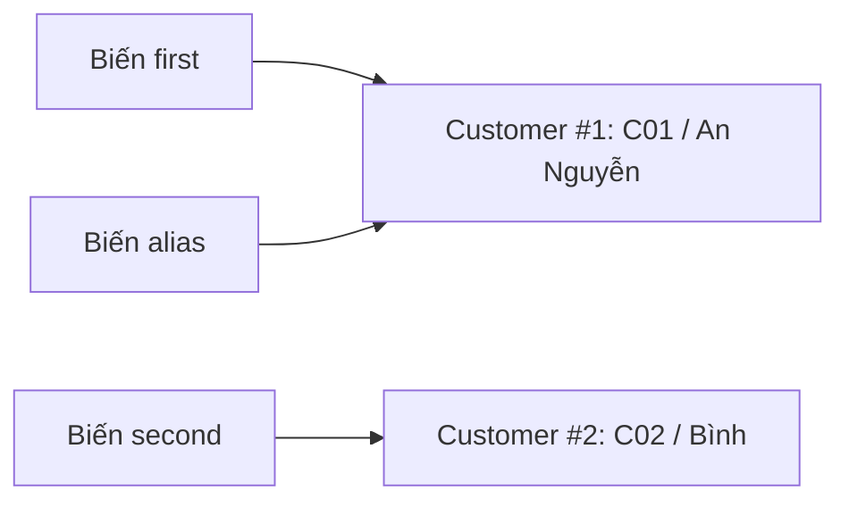
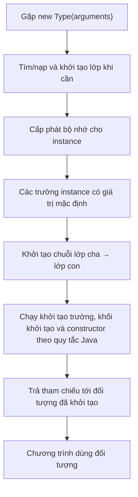

# Tạo đối tượng và cấp phát tài nguyên trong Java

> **Chủ đề:** OOP → Vòng đời. Khi viết `new Customer(...)`, chương trình tạo một **đối tượng Java** và khởi tạo trạng thái của nó. Khi đối tượng làm việc với file, socket hay kết nối cơ sở dữ liệu, chương trình có thể còn phải **cấp phát tài nguyên bên ngoài bộ nhớ Java**. Hai loại tài nguyên có vòng đời và cách giải phóng khác nhau.

## 1. Từ lớp đến đối tượng

**Lớp (class)** mô tả dữ liệu và hành vi; **đối tượng (object/instance)** là một thực thể được tạo từ lớp đó.

```java
public class CustomerDemo {
    static final class Customer {
        private final String id;
        private String name;

        Customer(String id, String name) {
            if (id == null || id.isBlank()) {
                throw new IllegalArgumentException("ID không hợp lệ");
            }
            if (name == null || name.isBlank()) {
                throw new IllegalArgumentException("Tên không hợp lệ");
            }
            this.id = id;
            this.name = name;
        }

        void rename(String newName) {
            if (newName == null || newName.isBlank()) {
                throw new IllegalArgumentException("Tên không hợp lệ");
            }
            this.name = newName;
        }

        String describe() {
            return id + ": " + name;
        }
    }

    public static void main(String[] args) {
        Customer first = new Customer("C01", "An");
        Customer second = new Customer("C02", "Bình");
        Customer alias = first;

        alias.rename("An Nguyễn");

        System.out.println(first.describe());  // C01: An Nguyễn
        System.out.println(second.describe()); // C02: Bình
        System.out.println(first == alias);     // true
        System.out.println(first == second);    // false
    }
}
```

Ở dòng `Customer first = new Customer("C01", "An");`:

- `Customer` là **kiểu của biến tham chiếu**.
- `first` là biến giữ **tham chiếu** tới đối tượng; nó không phải chính đối tượng.
- `new Customer(...)` tạo một instance rồi thực hiện quá trình khởi tạo.
- `"C01"` và `"An"` là các đối số được truyền vào constructor.
- `alias = first` sao chép tham chiếu, **không tạo thêm đối tượng**.
- `new Customer("C02", "Bình")` tạo một instance khác với trạng thái riêng.



**Điểm mấu chốt:** khai báo một biến tham chiếu không tự tạo đối tượng:

```java
Customer a;              // Chỉ khai báo biến cục bộ; chưa được gán
Customer b = null;       // Có biến tham chiếu nhưng chưa trỏ tới Customer nào
Customer c = new Customer("C03", "Chi"); // Mới tạo instance
```

Không thể đọc `a` trước khi gán giá trị vì trình biên dịch Java yêu cầu biến cục bộ được khởi tạo trước khi sử dụng. Gọi `b.describe()` khi `b == null` sẽ ném `NullPointerException`.

## 2. Điều gì diễn ra khi gọi `new`?

Có thể hình dung quy trình ở mức khái niệm như sau:



Sơ đồ tóm tắt ở cấp độ học OOP. Trên JVM, chi tiết nạp lớp, khởi tạo lớp, tối ưu hóa cấp phát và trình tự gọi constructor tuân theo những quy tắc cụ thể; **không được hiểu đây là các thao tác máy chạy tách biệt bắt buộc trong mọi lần gọi**.

Các điểm cần hiểu:

1. **Lớp và đối tượng khác nhau:** JVM quản lý thông tin lớp; mỗi lần `new` thông thường tạo một instance có các trường instance riêng.
2. **Trạng thái mặc định:** trước khi các initializer và constructor thiết lập dữ liệu, trường instance nhận giá trị mặc định: số là `0`, `boolean` là `false`, tham chiếu là `null`. Điều này **không áp dụng cho biến cục bộ chưa gán**.
3. **Constructor chạy khi tạo:** constructor dùng để bảo đảm đối tượng ở trạng thái hợp lệ, không có kiểu trả về, kể cả `void`.
4. **Chạy khởi tạo theo quy tắc kế thừa:** constructor lớp con gọi constructor phù hợp của lớp cha; các bộ khởi tạo instance của mỗi lớp được thực thi theo thứ tự khai báo trước phần thân constructor của lớp đó, sau bước gọi superclass theo quy tắc ngôn ngữ.
5. **Tham chiếu được trả về cho biểu thức `new`:** người gọi dùng tham chiếu này để gọi phương thức hoặc lưu vào cấu trúc dữ liệu.

### Giá trị mặc định, field initializer và constructor

```java
class Device {
    int attempts;                // Mặc định 0
    boolean active;              // Mặc định false
    String label;                // Mặc định null
    int priority = 5;            // Field initializer

    Device(String label) {
        this.label = label;      // Constructor gán trạng thái
        this.active = true;
    }
}
```

Sau `Device d = new Device("Printer");`, các giá trị quan sát được là `attempts == 0`, `active == true`, `label.equals("Printer")`, `priority == 5`. Tuy nhiên, **không nên dựa vào `null` mặc định để bỏ qua kiểm tra dữ liệu bắt buộc**; constructor nên thiết lập rõ các điều kiện hợp lệ.

## 3. Khởi tạo xong mới có một đối tượng dùng được

Sau khi cấp phát và gán giá trị mặc định, Java thực hiện các bước khởi tạo theo quy tắc của lớp và kế thừa. **Constructor** không có kiểu trả về; nó thiết lập dữ liệu bắt buộc và có thể từ chối đầu vào sai bằng exception:

~~~java
class Order {
    private final String code;

    Order(String code) {
        if (code == null || code.isBlank()) {
            throw new IllegalArgumentException("Mã đơn không hợp lệ");
        }
        this.code = code;
    }
}
~~~

`new Order("A01")` hoàn thành và trả tham chiếu; `new Order("")` ném exception, nên biểu thức không trả về đối tượng được khởi tạo thành công. Nếu constructor đã mở file hoặc cấp phát resource trước khi phát hiện lỗi, ứng dụng vẫn phải xử lý đóng tài nguyên đã sở hữu: lỗi constructor **không tự rollback side effect**.

Mỗi lối khởi tạo cần duy trì cùng một hợp đồng trạng thái. Cách kiểm tra invariant thuộc trọng tâm của bài *Hàm khởi tạo và thiết lập trạng thái hợp lệ*; overload và `this(...)` sẽ được học trong bài *Khởi tạo mặc định, tham số và nhiều cách khởi tạo*.

## 4. Bộ nhớ được cấp phát ở đâu? Heap, stack và tối ưu của JVM

Tại mức mô hình Java:

| Thành phần | Hiểu như thế nào? | Ví dụ |
|---|---|---|
| Đối tượng/array | Có vùng lưu trữ trạng thái; JVM thường quản lý trong heap | `new Customer(...)`, `new int[10]` |
| Biến tham chiếu cục bộ | Giữ một giá trị tham chiếu, không chứa toàn bộ object | `Customer c` trong `main` |
| Trường instance | Thuộc từng instance | `this.name` |
| Trường `static` | Thuộc lớp, được chia sẻ ở mức lớp | `static int createdCount` |
| Call stack | Liên quan ngữ cảnh thực thi lời gọi, biến cục bộ, địa chỉ quay lại... | `main()` gọi `rename()` |
| Tài nguyên ngoài JVM heap | File descriptor, socket, connection, native handle... | File đang mở, kết nối DB |

Thường nói “**object nằm trên heap, biến local nằm trên stack**” để dễ hình dung, nhưng đó **không phải cam kết bố trí vật lý tuyệt đối** của ngôn ngữ. JVM JIT có thể tối ưu escape analysis, scalar replacement và việc cấp phát; Java specification mô tả hành vi quan sát được thay vì bắt buộc một cách bố trí bộ nhớ cụ thể.

```java
Customer c = new Customer("C04", "Dũng");
Customer alsoC = c; // Hai biến cùng tham chiếu instance
c = null;           // Chỉ bỏ tham chiếu qua biến c
// alsoC vẫn tham chiếu được Customer("C04", "Dũng")
```

Gán `null` **không trực tiếp xóa đối tượng**. Chừng nào còn có đường tham chiếu đủ để JVM xác định đối tượng đang có thể được sử dụng, nó chưa đủ điều kiện thu hồi. Khi không còn đường tham chiếu tới nó từ các GC roots, đối tượng **có thể** được garbage collector thu hồi vào thời điểm do JVM lựa chọn.

## 5. Hai nghĩa khác nhau của “cấp phát tài nguyên”

`new Customer(...)` tạo một Java object, còn `Files.newBufferedReader(path)` có thể vừa cung cấp object Java vừa mở **file descriptor** do hệ điều hành quản lý.

| Loại | Ai hoàn trả? | Khi nào? |
|---|---|---|
| Bộ nhớ Java object không còn reachable | Garbage collector | JVM tự quyết định; không có mốc thu hồi tức thì |
| File, socket, DB connection, native handle | Bên sở hữu theo hợp đồng API | Chủ động `close()` hoặc cơ chế quản lý riêng khi xong việc |

Gán `reader = null` không bảo đảm đã đóng file. `System.gc()` cũng không tạo ra hợp đồng đóng tài nguyên. Khi mở resource, bước thiết kế quan trọng là xác định **ai sở hữu nó và khi nào phải kết thúc sử dụng**. Bài *Đóng tài nguyên và giới hạn của hàm hủy* phân tích sâu thứ tự đóng, exception và ownership.

## 6. Cách an toàn nhất với tài nguyên đóng được: try-with-resources

Từ Java 7, cú pháp `try-with-resources` tự động gọi `close()` khi rời khỏi phạm vi `try`, kể cả khi xảy ra exception. Đối tượng trong ngoặc phải thực thi `AutoCloseable` (hoặc `Closeable`).

### Ví dụ chạy thực tế: đọc file

```java
import java.io.BufferedReader;
import java.io.IOException;
import java.nio.charset.StandardCharsets;
import java.nio.file.Files;
import java.nio.file.Path;

public class ReadFileDemo {
    static void printFirstLine(Path path) throws IOException {
        try (BufferedReader reader =
                     Files.newBufferedReader(path, StandardCharsets.UTF_8)) {
            String line = reader.readLine();
            System.out.println(line == null ? "(file rỗng)" : line);
        } // Tự động gọi reader.close()
    }

    public static void main(String[] args) throws IOException {
        Path path = Files.createTempFile("oop-demo-", ".txt");
        try {
            Files.writeString(path, "Xin chào Java\nDòng thứ hai", StandardCharsets.UTF_8);
            printFirstLine(path); // Xin chào Java
        } finally {
            Files.deleteIfExists(path); // Dọn file tạm kể cả khi đọc lỗi
        }
    }
}
```

Để chạy, lưu thành `ReadFileDemo.java`:

```bash
javac ReadFileDemo.java
java ReadFileDemo
```

Ở ví dụ này:

1. `Files.createTempFile(...)` **tạo một file thực trên hệ thống**.
2. `Files.newBufferedReader(...)` mở tài nguyên đọc file.
3. `try (reader)` trao cho khối `try` trách nhiệm đóng `reader`.
4. Khi khối `try` kết thúc (thành công hoặc lỗi), `close()` được gọi.
5. Khối `finally` xóa file tạm do chương trình chủ động tạo; **đóng stream và xóa file là hai thao tác khác nhau**.

Không nhầm `newBufferedReader` chỉ là “tạo object” đơn giản: nó còn có thể mở file và tiêu thụ tài nguyên hệ điều hành. Khi mở file thất bại, API có thể ném `IOException`, và chương trình phải xử lý hoặc khai báo ngoại lệ đó.

### Điều gì xảy ra nếu lỗi phát sinh?

```java
try (BufferedReader reader = Files.newBufferedReader(path)) {
    throw new IOException("Lỗi xử lý");
}
```

Dù có lỗi trong thân `try`, JVM vẫn gọi `reader.close()` theo cú pháp try-with-resources. Nếu cả thân `try` lẫn `close()` cùng ném ngoại lệ, ngoại lệ từ thân `try` được giữ làm **primary exception**, còn lỗi khi đóng thường được ghi thành **suppressed exception** (xem `Throwable.getSuppressed()`). Nếu có nhiều tài nguyên khai báo trong cùng `try`, chúng được đóng theo **thứ tự ngược** với thứ tự khai báo.

## 7. Khi tạo object đồng nghĩa bắt đầu một vòng đời cần đóng

Một lớp tự viết có thể dùng `AutoCloseable` để mô tả trách nhiệm đóng tài nguyên. Ví dụ minh họa không mở socket thật:

~~~java
final class DemoSession implements AutoCloseable {
    private boolean closed;

    void send() {
        if (closed) throw new IllegalStateException("Đã đóng");
    }

    @Override
    public void close() {
        closed = true;
    }
}

try (DemoSession session = new DemoSession()) {
    session.send();
}
// Resource được yêu cầu đóng khi thoát try; object Java có thể còn tồn tại.
~~~

Trạng thái `closed` là **hợp đồng sử dụng resource**, không phải bằng chứng GC đã xóa object. `AutoCloseable` không bắt buộc mọi implementation phải an toàn khi đóng nhiều lần; lớp ví dụ chỉ đặt trạng thái đóng. Với tài nguyên thật cần xử lý lỗi `close()`, ngoại lệ bị suppressed, thứ tự đóng và chuyển giao ownership, xem bài *Đóng tài nguyên và giới hạn của hàm hủy*.

## 8. Không phải lúc nào vị trí sử dụng cũng gọi `new`

Một **static factory**, một factory service hay framework có thể cung cấp object mà caller không thấy constructor trực tiếp:

| Cách lấy object | Ví dụ | Điều cần nhớ |
|---|---|---|
| Constructor | `new Customer("C01", "An")` | Thông thường tạo một instance mới |
| Factory | `List.of("A")`, `Integer.valueOf(42)` | Có thể trả object đã tồn tại; không bảo đảm instance mới mỗi lần |
| API mở tài nguyên | `Files.newBufferedReader(path)` | Có thể mở file, cần xử lý IOException và đóng đúng lúc |
| Dependency injection | Constructor nhận `Repository` | Dependency được tạo/cung cấp ở nơi khác |
| Deserialization/reflection | API hoặc framework tạo instance | Tuân thủ hợp đồng riêng, không suy luận y hệt mọi lời gọi `new` |

Bài *Hàm tạo tĩnh, Factory và Builder* sẽ giúp lựa chọn cách tạo object có ý nghĩa, kiểm soát implementation và xử lý nhiều tham số. Bất kể cách tạo nào, **vòng đời bộ nhớ Java và vòng đời tài nguyên bên ngoài vẫn phải được xét riêng**.

## 9. Sau khi tạo, ai còn giữ object?

Một object có thể đã hết giá trị nghiệp vụ nhưng vẫn reachable nếu registry, cache hay listener giữ tham chiếu:

~~~java
static final List<Runnable> listeners = new ArrayList<>();

static void register(Runnable listener) {
    listeners.add(listener);
}

static void unregister(Runnable listener) {
    listeners.remove(listener);
}
~~~

Ví dụ đặt trong lớp đã import `java.util.List` và `java.util.ArrayList`. Khi `listener` vẫn nằm trong danh sách sống lâu, nó và những object nó tham chiếu có thể còn được giữ lại. Đăng ký cần có chính sách hủy; cache cần giới hạn/TTL theo nhu cầu. Những con đường từ GC roots và bài toán retention được phân tích đầy đủ tại *Thời gian tồn tại, khả năng truy cập và giải phóng bộ nhớ*.

## 10. Phân biệt các thời điểm trong vòng đời

| Sự kiện | Đối tượng Java | Tài nguyên ngoài JVM |
|---|---|---|
| `new`/factory trả thành công | Đối tượng có thể được sử dụng | Có thể đã mở, tùy API |
| Sử dụng phương thức | Trạng thái có thể thay đổi | Có thể đọc/ghi dữ liệu |
| `close()` | Đối tượng vẫn có thể tồn tại | Tài nguyên được yêu cầu hoàn trả |
| Mất mọi đường tham chiếu reachable | Có thể được GC thu hồi | Không được dựa vào GC để đóng kịp thời |
| GC chạy | Thu hồi bộ nhớ của các object đủ điều kiện | Không phải cơ chế quản lý tài nguyên có thời điểm xác định |

Ví dụ hay gây nhầm:

```java
BufferedReader reader = Files.newBufferedReader(path);
reader = null; // Không bảo đảm file đã được đóng!
```

Cách đúng khi chính đoạn mã mở và sở hữu reader:

```java
try (BufferedReader reader = Files.newBufferedReader(path)) {
    // Sử dụng reader
}
```

Nếu chương trình tạo liên tục object mà không còn tham chiếu, GC có thể thu hồi bộ nhớ của chúng. Nếu chương trình liên tục mở file mà không đóng, nó vẫn có thể hết file descriptors hoặc giới hạn tài nguyên hệ thống ngay cả khi heap chưa đầy.

## 11. Các lỗi thường gặp và cách sửa

| Lỗi | Vì sao nguy hiểm? | Cách xử lý |
|---|---|---|
| Gọi phương thức qua tham chiếu `null` | `NullPointerException` | Khởi tạo đúng, kiểm tra null ở ranh giới API |
| Cho rằng khai báo biến là đã tạo object | Biến local có thể chưa được gán | Dùng constructor/factory khi cần |
| Cho rằng `alias = original` tạo bản sao | Cùng tham chiếu một instance | Tạo bản sao rõ ràng khi cần trạng thái độc lập |
| Constructor mở resource rồi ném lỗi, không đóng | Rò rỉ tài nguyên | Dùng xử lý lỗi và `close` đúng ownership |
| Dùng GC hoặc `System.gc()` để “đóng” file | Không có thời điểm đóng bảo đảm | Try-with-resources |
| Quên `close()` với JDBC/file/socket | Tài nguyên hữu hạn bị giữ | Cấu trúc sở hữu và đóng rõ ràng |
| Đóng tài nguyên do caller quản lý | Làm hỏng luồng làm việc bên gọi | Thống nhất ownership qua hợp đồng |
| Lưu mọi object vào collection `static` | Object còn reachable không được GC | Giới hạn cache, unregister, xóa phần tử không dùng |
| Dùng object đã đóng | Lỗi trạng thái/IO | Kiểm soát trạng thái `closed` và phạm vi sử dụng |

## 12. Tự thực hành

1. Viết lớp `Student` có `id`, `name`; dùng constructor từ chối `id` rỗng, tạo hai đối tượng, thêm biến alias rồi dự đoán kết quả `==`.
2. Viết `Counter` với trường instance `count` và trường `static` đếm tổng số instance được tạo thành công. Hãy cân nhắc constructor có thể ném exception trước khi tăng biến đếm.
3. Tạo tệp tạm bằng `Files.createTempFile`, ghi và đọc một dòng, sau đó bảo đảm stream được đóng và tệp được xóa ngay cả khi có lỗi.
4. Viết lớp `FakeConnection implements AutoCloseable`: ghi log khi mở, thực thi một thao tác, và khi đóng; thử ném `RuntimeException` ở trong khối `try` để kiểm tra `close()` vẫn chạy.
5. Một service lưu mọi đối tượng `Request` vào `static List<Request>` mà không xóa. Giải thích vì sao GC không thể tự thu hồi các object vẫn được list tham chiếu.

**Điểm cần nhớ:** Tạo một đối tượng Java nghĩa là xây dựng instance và khởi tạo trạng thái hợp lệ. Việc giải phóng **bộ nhớ đối tượng** do GC đảm trách theo khả năng truy cập, còn việc giải phóng **tài nguyên có vòng đời đóng/mở** phải theo hợp đồng sở hữu của API — thường thông qua `AutoCloseable` và `try-with-resources`.